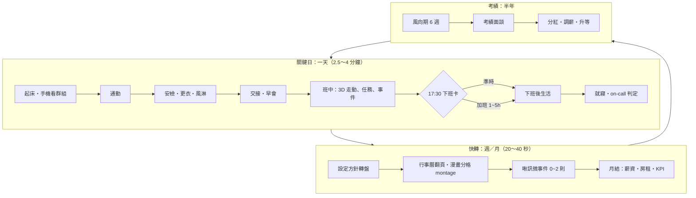
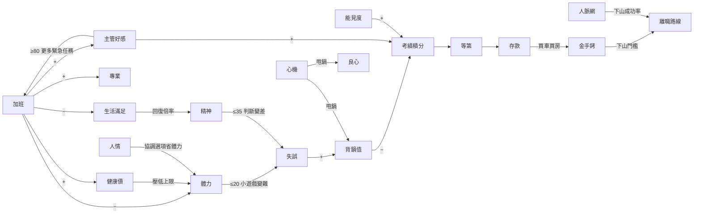

# 《上山！穹晶 FAB 7》遊戲企劃書（Game Design Document）

| 項目 | 內容 |
|---|---|
| 文件版本 | v1.0（企劃初版，供工程規格書展開） |
| 撰寫日期 | 2026-10-23 |
| 類型 | 3D 職場養成 × 選擇敘事 × 工作小遊戲（three.js 網頁遊戲） |
| 美術 | 風格 C「卡通渲染劇場」（`design/style-c-toon.html`） |
| 一輪長度 | 2～3 小時（目標 2.5 小時）；遊戲內 3 年（2027/03/01～2030/02/28） |
| 素材來源 | `docs/research/workplace-stories.md`（下稱 **〔WS〕**）、`docs/research/fab-domain.md`（下稱 **〔FD〕**） |

> **引用格式**：〔WS §2-1〕＝ workplace-stories.md 第 2-1 節；〔WS 點子 #7〕＝ 第 8 節「可以直接做成遊戲事件的點子」第 7 條；〔FD §5.3〕＝ fab-domain.md 第 5.3 節。
>
> **虛構聲明**：本作所有公司、廠區、客戶、人物、論壇、App 都是虛構的。研究素材只當「真實感來源」，一律改編，不直接重現任何真實公司、真實人名或可辨識的真實事件。
>
> **數字說明**：文件裡所有數值都是**初版調校值**，目的是讓工程能直接實作第一版，之後再用 playtest 調整。
>
> **與工程規格書的關係**：規格書（`docs/specs/01`～`04`）與本文件衝突時以規格書為準，差異清單見 `docs/specs/00-index.md`。

---

## 目錄

1. [概念、賣點、目標玩家、體驗支柱](#1-概念賣點目標玩家體驗支柱)
2. [核心循環](#2-核心循環)
3. [時間結構與養成階段](#3-時間結構與養成階段)
4. [數值系統](#4-數值系統)
5. [選擇設計原則與完整事件範例](#5-選擇設計原則與完整事件範例)
6. [事件系統與事件總表](#6-事件系統與事件總表)
7. [故事線與角色名冊](#7-故事線與角色名冊)
8. [工作玩法（小遊戲）](#8-工作玩法小遊戲)
9. [職涯與經濟系統](#9-職涯與經濟系統)
10. [結局清單](#10-結局清單)
11. [3D 場景與地點清單](#11-3d-場景與地點清單)
12. [呈現與演出](#12-呈現與演出)
13. [敏感題材處理原則](#13-敏感題材處理原則)
14. [重玩性、成就與圖鑑](#14-重玩性成就與圖鑑)
15. [範圍分級：MVP／完整版／未來擴充](#15-範圍分級mvp完整版未來擴充)
16. [「我的決定」清單](#16-我的決定清單)
17. [開放問題](#17-開放問題)

---

## 1. 概念、賣點、目標玩家、體驗支柱

### 1.1 一句話概念

> **穿上兔寶寶裝，在穹晶半導體 FAB 7 撐過三年。每一次「加不加班」，都在決定你會升職、下山，還是某天早上「工號被消失」。**

### 1.2 世界設定（虛構）

- **穹晶半導體（QiongJing Semiconductor）**：台灣晶圓代工大廠，主力廠區是位在虛構「鷺山科學園區」的 **FAB 7**。網友給它取了暱稱「**QQ**」，因為「上班都在哭哭」。延伸梗有「QQ 真的 QQ」「上山（進穹晶）／下山（離職）」。這是把〔WS §6〕裡真實大廠的暱稱梗與「上山／下山」俚語改編成虛構版本。
- **玩家**：剛拿到碩士學位（或從技術員轉職）的新進**製程工程師（PE）**，分發到**蝕刻課（Etch）**，負責 ET-03～ET-06 四台乾式蝕刻機台的 recipe、SPC 與異常處理〔FD §1.1、§4〕。
- **園區生活圈**：新人落腳的「金沙街」（改編自〔WS §6〕的「新手村」）、交通車、園區早餐店、24 小時「全日超商」、匿名論壇「**灰區論壇**」（取材自研究素材中的科技業論壇討論）、匿名吐苦水粉專「**靠杯晶圓人**」（取材自研究素材中的匿名吐苦水粉專）、通訊 App「**啾訊**」（虛構的通訊 App）。

### 1.3 賣點

1. **真實到會痛**：每個事件都能追到研究素材的出處（網友故事、媒體報導），經過改編與虛構化。台詞直接用科技業中英夾雜的語感：lot、hold、down、PM、recipe、over Q。
2. **沒有完美選項**：加班換主管好感、準時下班換精神、找同事要花人情。三張選項卡都有代價（沿用風格 C 範例的「壹／貳／參」卡片和數值 chip）。
3. **在 3D fab 裡真的「上班」**：走過風淋室、在黃光區看不清顏色、蹲在 down 掉的機台前面。SPC 管制圖、hold lot 處置、recipe 調參、8D 報告，全部做成可以玩的小遊戲。
4. **漫畫劇場式黑色幽默**：主管 PUA 時鏡頭仰拍、背景放射線、立繪假笑反光。用誇張的演出包裝真實的辛酸。
5. **2.5 小時一輪，21 個結局**：升職、技術大神、下山、外派、躺平 FIRE、被開除、休養，還有「泡麵泡不爛」這種隱藏結局。鼓勵重玩。

### 1.4 目標玩家

| 層級 | 玩家 | 他們想得到什麼 |
|---|---|---|
| 主要 | 22～35 歲的台灣上班族，特別是科技業從業者 | 「這根本是我」的共鳴、宣洩、把遊戲截圖丟到同事群組 |
| 主要 | 科技業工程師的家人、伴侶、朋友（例如本作企劃發起人） | 終於知道「他到底在忙什麼、為什麼半夜一直接電話」 |
| 次要 | 喜歡 Reigns、Papers, Please、《中國式家長》這類選擇養成遊戲的玩家 | 數值取捨、多結局、重玩收集 |
| 次要 | 正在考慮要不要進科技業的學生 | 在遊戲裡先體驗一次「上山」 |

平台：PC 網頁瀏覽器優先，同時支援手機直式網頁（風格 C 範例已經有 760px 以下的版面）。

### 1.5 體驗支柱（之後所有設計都會回扣）

| 代號 | 支柱 | 定義 | 設計檢查問題 |
|---|---|---|---|
| **P1** | **「這是真的」** | 事件、台詞、數字都要找得到真實依據。術語保留原文，不刻意簡化。 | 這個事件能標出〔WS〕或〔FD〕的出處嗎？業界朋友看了會不會點頭？ |
| **P2** | **「每個選擇都有代價」** | 任何選項都至少有一項扣分（看得到的或看不到的）。延遲後果會讓玩家「幾週後被咬」。 | 這組選項裡有沒有哪個是無腦最佳解？有的話就要改。 |
| **P3** | **「我變強了，但……」** | 成長要看得見（專業、職等、薪資單、解鎖的新選項），代價也要看得見（健檢報告、伴侶訊息越來越短）。 | 玩家這一章結束時，能說出自己「得到了什麼、失去了什麼」嗎？ |
| **P4** | **「笑著笑著就沉默了」** | 用漫畫式誇張演出包裝真實的痛。笑點打在體制和荒謬上，不打在受害者身上。 | 這個笑點是在嘲笑受害者，還是嘲笑讓人受害的體制？ |

---

## 2. 核心循環

### 2.1 三層循環總覽

### 2.2 關鍵日：一天的流程

關鍵日（Key Day）是玩家實際下場的日子。每一輪大約 42 天，每天平均 3 分鐘。

| 時段 | 場景 | 玩法 | 遊戲時間 | 典型數值變化 |
|---|---|---|---|---|
| 06:30 起床 | 租屋處（2.5D 小房間） | 手機畫面：看啾訊群組的夜間訊息，這些是早會的情報來源。選早餐：早餐店（體力 +5、NT$ −60）／不吃（省 10 分鐘） | 自動 | 前一晚睡眠結算體力 |
| 07:00 通勤 | 交通車／機車 | 交通車：免費、07:05 準點發車，可以補眠（體力 +5）或滑灰區論壇（人脈網 +1）。機車：時間自由，但下雨天會觸發事件 | 15 分 | — |
| 07:25 進廠 | 門禁大廳、更衣室、風淋室 | 手機要寄放在置物櫃，進廠後只能用公司「工作機」〔FD §5.2〕。著裝：第一次是完整教學關卡，之後是 10 秒 QTE，也可以在設定裡改成自動 | 15 分 | 著裝出錯：微粒數 +，被技術員白眼 |
| 07:40 交接 | 蝕刻 bay 白板／系統畫面 | 「交接重點挑 3 件」小遊戲 | 20 分 | 挑錯：早會被追問 |
| 08:00 早會 | 會議室 | 「早會生存」小遊戲：部經理或課長追問異常進度 | 20 分 | 答好：能見度 +；答差：背鍋值 +2 |
| 08:30～17:30 班中 | 3D fab：蝕刻 bay、黃光區、灰區、辦公室 | 自由走動。任務清單 3～5 項，每項是一個小遊戲或對話；另外有 1～2 個事件（劇本或隨機）。午餐要選跟誰吃，影響好感和情報 | 3D 走動時，現實 1 秒＝遊戲 1 分鐘。對話和小遊戲進行中時鐘暫停，結束後再扣固定時間 | 每項任務：體力 −3～−8 |
| 16:30 | 任意 | 「下午四點半的緊急任務」判定（機率依主管好感與章節而定，見 §6） | — | — |
| 17:30 下班卡 | 打卡機（2D 演出） | 選擇：**準時下班**／**加班 N 小時**（滑桿 1～5 小時）／**帶回家做** | — | 見下方「加班換算」 |
| 夜間 | 租屋處、城市地點（2.5D） | 從生活清單選 1 項（睡死、運動、約會、打給家人、讀 paper、逛論壇、聯絡學長或獵頭……） | — | 見 §4 |
| 23:00 就寢 | 房間 | 輪到 on-call 的夜晚：判定工作機會不會響（見 §8.12） | — | 被吵醒：體力回復減半 |

**加班換算**（每加班 1 小時）：
- 自動完成 1 項剩餘任務（沒有剩餘任務時改成專業 +1）
- 主管好感 +1（當天上限 +4）
- 體力 −6、健康債 +0.5、生活滿足 −1
- 只有在月底「工時申報」時有申報，才能拿到加班費（見 §9.4）

**帶回家做**：任務會在夜間生活時段自動完成，但會吃掉當晚的生活行動；精神 −4、生活滿足 −3，伴侶好感 −3（如果是同居或約會日）。

### 2.3 快轉：週快轉與月快轉

- **第一章、第二章**（前 3 個月）用**週快轉**，**第三～五章**用**月快轉**。關鍵日以外的日子全部快轉。
- 每次快轉前，玩家要設定**方針轉盤**，包含兩個轉盤：

**工作方針**（每月效果；週快轉時取 1/4）

| 方針 | 意思 | 每月效果 |
|---|---|---|
| **拚** | 每天加班約 2 小時，主動接案 | 專業 +4、主管好感 +6、能見度 +5、體力上限暫時 −10、精神 −10、健康債 +6、生活滿足 −8，月加班約 44 小時 |
| **穩** | 偶爾加班，跟大家一樣 | 專業 +2、主管好感 +1、精神 −3、健康債 +2，月加班約 18 小時 |
| **省** | 盡量準時下班 | 精神 +5、生活滿足 +6、主管好感 −5、能見度 −4，有 25% 機率觸發「下班被叫住」微事件 |
| **學** | 下班讀 paper、上課、學新工具 | 專業 +3、人脈網 +3、體力 −5、精神 −2、生活滿足 −2、存款 −NT$3,000（學費、書費） |

**生活方針**（每月效果）

| 方針 | 每月效果 |
|---|---|
| **休養** | 健康債 −4、精神 +6 |
| **伴侶** | 伴侶好感 +8、生活滿足 +6、存款 −NT$6,000 |
| **家人** | 家人好感 +8、生活滿足 +3、存款 −NT$3,000（回家車票） |
| **社交** | 隨機挑 1 位同事，好感 +6，人情 +1（50% 機率）、存款 −NT$2,500 |
| **運動** | 健康債 −6、體力上限 +2（累積上限 +10）、精神 +2 |
| **存錢** | 存款 +NT$5,000、生活滿足 −4 |

- **快轉演出**：行事曆翻頁，接著 3 格漫畫分格 montage（例如「早會被電」→「蹲在 ET-04 前面」→「交通車上睡著」），然後跳出 0～2 則啾訊**微事件**。微事件是一鍵選擇，5 秒內沒選就套用預設選項。每次月快轉 20～40 秒。
- **中斷規則**：危機事件（地震、你值班時機台 down、家人急事）可以打斷快轉，變成「**插播關鍵日**」（1～2 分鐘的短版關鍵日）。每個快轉月最多中斷 1 次。
- **安全提示**：快轉開始時如果精神 ≤15 或體力 ≤20，系統會先跳出一段「關心」對話，建議改成「休養」方針（只是建議，不強制，見 §13）。

### 2.4 週循環與月循環的固定節點

| 週期 | 節點 | 遊戲意義 |
|---|---|---|
| 每週一 | 部經理週會（大早會） | 比平常早會更兇，答錯會讓背鍋值 ×2 |
| 每週三 | 跨部門會議（PE／EE／PIE／製造） | 扯皮對話戰最常出現的地方 |
| 每週五 | 週報截止 | 「拚」方針會自動完成；「省」方針有 30% 機率被催 |
| 每月 1 號 | 房租、房貸扣款 | 存款 − |
| 每月 5 號 | 薪資入帳（薪資單畫面） | 存款 + |
| 每月 10 號 | 孝親費（可以調整，見 §9.6） | 家人好感 ± |
| 每月 | 假日值班 1～2 次〔FD §2.1〕〔WS §2-5〕 | 可能變成插播關鍵日 |
| 每月 | 平日 on-call 輪值（約 1 週） | 夜間 call 機判定 |
| 每月底 | 工時申報、KPI 結算（良率指數、機台 uptime） | 加班費、考績 KPI 分數 |
| 每季末（3、6、9、12 月） | 季分紅入帳 | 存款大幅增加；觸發「分紅開獎日」微事件〔WS 點子 #18〕 |

### 2.5 考績週期循環

- **試用期考核**：第 90 天（2027/05/28）。結果只有過或不過。
- **期中考績**：每年 7 月，決定當年 Q3、Q4 的季分紅倍率。
- **年度考績**：每年 1 月，決定調薪、年終獎金、升等資格，以及隔年 Q1、Q2 的季分紅倍率。
- 一輪總共有 **1 次試用期 + 2 次期中 + 3 次年度考績**。第一年 7 月的期中只面談、不打等第，因為新人還沒滿半年。
- **風向期**：考績前 6 週。這段期間主管好感的增減 ×1.5，政治類事件（團體活動、聚餐、黑函）的出現率 ×2〔WS §4-4〕。HUD 的日期旁邊會多一個「風向」小旗。
- 考績等第採**強制分配**，用晶圓等級命名（詳見 §9.2）。

### 2.6 關鍵日與快轉日的切換規則

依優先序判斷：
1. **劇本關鍵日**：寫死在行事曆上的主線日子，一定會出現（見 §3 各章清單）。
2. **條件關鍵日**：數值或旗標達到門檻時插入。例如健康債 ≥30 →「健檢紅字日」；背鍋值 ≥85 →「PIP 約談日」。
3. **角色線關鍵日**：某角色好感到達階段，而且日期落在指定窗口內。
4. **插播關鍵日**：快轉中的危機中斷。

**上限**：一輪關鍵日控制在 40～46 天。如果同一個月有超過 2 個非劇本關鍵日被觸發，優先序較低的那個會降級成快轉微事件，或延到下個月。

---

## 3. 時間結構與養成階段

### 3.1 總覽

| 章 | 名稱 | 遊戲內期間 | 主題 | 起始職等 | 關鍵日 | 預估時間 |
|---|---|---|---|---|---|---|
| 序章 | 上山 | 2027/03/01～03/05（第 1 週） | 報到、第一次穿兔寶寶裝 | Q1 助理工程師 | 4 | 12 分 |
| 第一章 | 穹晶學院 | 2027/03/08～04/16（6 週） | 地獄新訓 | Q1 | 5 | 15 分 |
| 第二章 | 跟著學長 | 2027/04/19～05/31 | OJT、被放生、第一次背鍋、試用期考核 | Q1 | 6 | 18 分 |
| 第三章 | 獨立上線 | 2027/06～2028/02 | 值班、on-call、地震、第一次考績 | Q2 工程師 | 10 | 32 分 |
| 第四章 | 中堅之年 | 2028/03～2029/02 | 帶學弟、新機台、黑函、外派、升等審查 | Q2→Q3 | 9 | 32 分 |
| 第五章 | 分歧之年 | 2029/03～2030/02 | 路線鎖定、ET-03 的真相、最終考績 | Q3 | 8 | 30 分 |
| 終章 | 結局 | 2030/02 | 結局演出、尾聲、統計 | — | — | 5 分 |
| — | 建角、選單、說明 | — | — | — | — | 約 6 分 |
| **合計** | | **3 年** | | | **42** | **約 150 分（2.5 小時）** |

- 動作快的玩家（跳過著裝、跳過對白）大約 2 小時；讀完所有對白、到處探索的玩家大約 3 小時。
- **提前結局**會縮短遊玩時間：試用期未過（約 45 分）、新人速逃（約 55 分）、PIP 勸退（約 70～110 分）、身心休養（任何時間點）。這是刻意設計的，讓重玩更有動機。
- **通關一次後**解鎖「章節選擇」，可以從第三章、第四章或第五章開頭重玩，數值使用該章的平均基準值（見 §14）。

### 3.2 序章「上山」（第 1 週，4 個關鍵日，12 分）

**目標**：建立角色、教玩家操作，埋下主線懸念。

| 日 | 關鍵日 | 內容 |
|---|---|---|
| D1（一） | 報到日 | **建角**：選履歷（3 選 1，見下表）、姓名、代名詞（他／她／不指定）。接著是安檢，拿工號和工作機。HR 何佩珊做新人簡報：「我們非常重視 work-life balance 喔～」。最後是**懸念場景**：分到的座位上，前任工程師的東西被清空到一半，工號牌已經撕掉了（取材〔WS §3-1〕「工號被消失」）。抽屜裡留著一本「**前任的筆記本**」，選擇：收下／交給 HR／丟掉。另外有一個不起眼的選項：「把報到時收到的所有 mail 寄一份給自己？」（證據 +1，替 §5.5 範例四埋伏筆，取材〔WS §3-3〕「找相關 mail 寄一份給自己，先保命」） |
| D2（二） | 第一次進無塵室 | 著裝和風淋**教學關卡**（§8.1）。阿哲學長帶隊參觀 fab，這是 3D 走動教學。在這裡認識技術員美玲姐，第一次看到 ET-03 的紅燈。阿哲：「那台喔……你之後就知道了。」 |
| D3（三） | 找房子 | 選住處：公司宿舍（前 2 個月免費，第 3 個月 NT$3,000，第 4 個月一定要搬走〔FD §5.7〕）／金沙街雅房（NT$8,500）／跟同期豪哥合租（NT$6,000，會開啟室友事件線） |
| D4（五） | 新人座談與迎新宵夜 | 沈部經理精神講話：「我們這個產業，不是靠高薪留人，是靠你真的熱愛。不願意 on-call 的，可以現在就想清楚。」（改編自〔WS §1-1〕大老闆的公開發言，已改寫，不使用原句）。宵夜認識同期小晴（PIE）和豪哥（EE）。 |

**履歷（開局 3 選 1）**

| 履歷 | 專業 | 主管好感 | 人情 | 存款 | 隱藏 | 專屬事件 |
|---|---|---|---|---|---|---|
| 國立北灣大學 材料所碩士 | 25 | 50 | 2 | NT$60,000 | 人脈網 15 | 「你北灣的欸」被酸學歷（強化版） |
| 私立鷺江大學 電子所碩士 | 18 | 55 | 3 | NT$45,000 | 心機 15 | 「學歷濾網」：考績面談時被暗示學校 |
| 技術員轉工程師（在職進修畢業） | 22 | 50 | 4 | NT$260,000 | 美玲姐好感 +30，SPC 小遊戲容錯 +1 | 「你以前不是 OP 嗎？」被部分工程師看不起；技術員們挺你 |

### 3.3 第一章「穹晶學院」（6 週，5 個關鍵日，15 分）

**目標**：體驗「地獄新訓」〔WS §3-1〕，學會基本術語和小遊戲。
**解鎖**：SPC 小遊戲（教學版）、著裝 QTE、術語辭典、PUA 話術圖鑑。
**架構**：新訓中心分成設備、製程、系統、值班技能 4 個學程〔FD §3〕〔WS §3-4〕，每週快轉時可以選這週的「重點學程」（專業加成會落在不同的小遊戲容錯上）。

| 週 | 關鍵日 | 內容 | 關卡 |
|---|---|---|---|
| W2 | 開訓日 | 講師「老K」（資深主任工程師，兼任講師）開場：「你們之中，一年後會有兩成不在這裡。」（取材〔WS §3-2〕新人離職率 17.6%） | — |
| W3 | SOP 抽考 | 背 Hold Lot 處理 SOP。題目是排序題，把步驟拖到正確順序 | 錯 3 題以上：精神 −8 |
| W4 | **默畫機台** | 見 §8.11。只畫出「三個圈圈」會觸發隔天的「早會公開處刑」〔WS §3-1〕〔WS 點子 #2〕 | **關卡 1**：60 分及格。不及格可以重考 1 次；重考也沒過會掛上試用期旗標「基礎不穩」（試用期考核時專業門檻 +5） |
| W5 | 值班技能模擬 | 模擬機台半夜 alarm，用假電話做 on-call 演練（§8.12 教學版） | — |
| W6 | 結訓分發 | 分發到蝕刻課，見到林課長。林課長的第一句話：「蝕刻課很操喔，但年輕人多學一點，對你以後有好處。」 | — |

### 3.4 第二章「跟著學長」（2027/04/19～05/31，6 個關鍵日，18 分）

**目標**：體驗學長不教、被放生、第一次背鍋〔WS §3-2〕〔WS §3-3〕。撐過試用期。
**解鎖**：Hold Lot 處置小遊戲、啾訊工作群組、灰區論壇、人情系統的完整功能。

| 日期 | 關鍵日 | 內容 |
|---|---|---|
| 04/19 | OJT 第一天 | 阿哲：「你先看文件跟影片，看完再說。」然後他整天不見人影。 |
| 04/30 | 「你北灣的欸」 | 見 §5.5 範例二 |
| 05/07 | 看影片的第 20 天 | 改編自〔WS 點子 #3〕。原素材是「看了兩個月」，配合時間軸縮短成 20 天。選擇：去找別組學長偷學／星期六自主到廠學習／跟主管反映 |
| 05/12 | 第一次 hold lot | 阿哲終於在旁邊盯著你做第一次處置（§8.3 教學版）。結果會在 2 週後揭曉。 |
| 05/20 | 新人背鍋 | 見 §5.5 範例四〔WS §3-3〕 |
| 05/28 | **上機認證＋試用期考核** | **關卡 2**：通過條件是「上機認證」SPC 實作 ≥60 分、專業 ≥30（有「基礎不穩」旗標時 ≥35），而且主管好感 ≥25。沒過的話，人情 ≥2 可以「拜託阿哲幫你惡補」補考 1 次；補考也沒過就進入**結局 E09〈工號被消失〉** |

### 3.5 第三章「獨立上線」（2027/06～2028/02，10 個關鍵日，32 分）

**目標**：真正的上班日常。值班、on-call、危機、第一次考績。
**職等**：通過試用期後升為 **Q2 工程師**（薪資單畫面會演出這件事）。
**解鎖**：on-call、假日值班、工時申報、excursion 偵探（9 月起）、recipe 調參（10 月起）、8D 輕量版、黃光區（跨模組支援）。

| 月 | 關鍵日 | 內容 | 關卡／意義 |
|---|---|---|---|
| 06 | 第一次獨立值班夜 | 見 §5.5 範例一「ET-03 又 down 了」。這就是風格 C 範例畫面的場景；範例上的日期只是示意，實際日期以本表為準 | — |
| 07 | 期中面談（新人版） | 不打等第，林課長給「口頭風向」。第一次看到「黑歷史本」的存在（林課長翻小本子） | 教學：延遲後果 |
| 08 | 電影院的 call 機 | 見 §5.5 範例六 | — |
| 09 | **地震夜召回** | 見 §5.5 範例三。凌晨 04:12 地震，接著是解 hold 小遊戲連發 | 危機大事件 |
| 10 | 健檢日（條件：健康債 ≥30，否則改成快轉微事件） | 健檢報告上的紅字：肝指數、尿酸〔WS 點子 #27〕 | — |
| 11 | 第一次客訴 excursion | 客戶「晨曦科技」抱怨 particle。第一次玩 excursion 偵探和 8D 輕量版 | 專業成長檢驗 |
| 12 | 下午四點半的緊急任務 | 林課長 16:30 丟下任務，要求「明早討論」〔WS §1-3〕〔WS 點子 #8〕 | — |
| 01 | 尾牙 | 抽獎、敬酒、部經理致詞。選擇：上台表演／幫課長擋酒／提早溜走 | 風向期政治 |
| 01 | **第一次年度考績** | 見 §5.5 範例五 | **關卡 3**：第一次拿到等第 |
| 02 | 除夕的機台參數 | 除夕夜在老家，機台出現異常〔WS 點子 #17〕〔WS §5-3〕 | 家人線 |

### 3.6 第四章「中堅之年」（2028/03～2029/02，9 個關鍵日，32 分）

**目標**：從被 PUA 的人，變成可能 PUA 別人的人。帶學弟（角色鏡像），參與新機台專案，捲入辦公室政治。
**解鎖**：PM 排程、扯皮對話戰完整版、帶學弟系統、新機台 buy-off 專案、外派、獵頭、離職預約。

| 月 | 關鍵日 | 內容 | 關卡／意義 |
|---|---|---|---|
| 03 | 學弟小廖報到 | 林課長：「他就交給你帶了。」選擇：認真教／丟文件給他看（就是當年阿哲對你做的事）／教一半藏一半 | 鏡像事件 |
| 04 | 新機台 ET-07 buy-off 啟動 | 跟 EE 大D 第一次正式扯皮對話戰（§8.9） | 主線專案 |
| 06 | 森田課長來了 | 林課長去受訓兩個月，由日籍代理課長森田接手：「我在日本是加班狂，希望各位跟上我的步伐。」一個月後（快轉演出）：「你們這樣加班……是不人道的。」然後他閃辭〔WS §1-1〕〔WS 點子 #23〕 | 黑色幽默插曲 |
| 07 | 期中考績 | 第一次期中等第 | — |
| 08 | 阿哲的爆發 | 結構調薪：學弟的起薪跟阿哲差不多〔WS §3-2〕。阿哲在頂樓抽菸區對你說心裡話 | 阿哲線分歧 |
| 10 | 外派抽籤 | 櫻花新廠（日本九州）／沙漠新廠（美國西南部）／拒絕〔WS 點子 #25〕 | 外派線入口 |
| 11 | 獵頭來信（條件：人脈網 ≥30） | 境外挖角公司開出翻倍薪水〔WS 點子 #21〕 | 違法風險分支 |
| 12 | **黑函事件** | 考績前出現匿名黑函〔WS §4-2〕〔WS 點子 #12〕，接調查小遊戲（偵探的變體） | 政治危機 |
| 01 | **年度考績＋升等審查** | **關卡 4**：升等 Q3 資深工程師的條件見 §9.1 | 職涯分歧 |

### 3.7 第五章「分歧之年」（2029/03～2030/02，8 個關鍵日，30 分）

**目標**：選擇人生方向，面對主線真相，迎來結局。

| 月 | 關鍵日 | 內容 | 關卡／意義 |
|---|---|---|---|
| 04 | **人生岔路口** | 「三年快到了，你想要什麼？」設定**主要志向**（見 §7.1）。志向會改變之後的事件池，但不保證結局 | 路線鎖定 |
| 05 | 阿哲的決定 | 阿哲要不要下山，結果取決於他的線（§7.3） | 角色線收束 |
| 07 | 期中考績 | — | — |
| 09 | **ET-03 的真相（上）** | 大客訴 excursion：晨曦科技的 CP 良率崩盤。止血＋偵探長版 | 主線高潮 |
| 10 | **ET-03 的真相（下）** | 8D 客戶審查會：最終扯皮對話戰，8D 的 D4 真因要寫什麼（§7.2） | 主線抉擇 |
| 12 | 路線收束日 | 依志向：升等答辯／離職約談排隊／外派送別會／內轉面談／躺平宣言 | 結局前置 |
| 01 | **最終年度考績** | 結算 3 年 | **關卡 5** |
| 02 | 終章 | 結局判定與演出（§10） | — |

### 3.8 階段解鎖總表

| 系統／內容 | 序章 | 一 | 二 | 三 | 四 | 五 |
|---|---|---|---|---|---|---|
| 3D 走動（fab 主走道） | ● | ● | ● | ● | ● | ● |
| 著裝＋風淋 | 教學 | QTE | QTE | QTE | QTE | QTE |
| SPC 獵人 | | 教學 | ● | ● | 難 | 難 |
| Hold Lot 判官 | | | 教學 | ● | ● | 難 |
| 交接＋早會生存 | | | ● | ● | ● | ● |
| On-call 半夜電話 | | 模擬 | | ● | ● | ● |
| Excursion 偵探 | | | | ● | ● | 長版 |
| Recipe 調參台 | | | | ● | ● | 難 |
| 8D 拼圖 | | | | 輕量 | ● | 完整 |
| 黃光區之眼 | | | | ● | ● | ● |
| 扯皮對話戰 | | | | 輕量 | ● | 魔王 |
| PM 排程 | | | | | ● | ● |
| 帶學弟 | | | | | ● | ● |
| 離職預約、獵頭、外派、內轉 | | | | | ● | ● |
| 志向設定 | | | | | | ● |

---

## 4. 數值系統

本作的數值分成三層：
- **可見數值**：HUD 上的 6 項，跟風格 C 範例的「新人狀態表」一致。
- **半可見數值**：用圖示、表情、燈號暗示，不直接顯示數字。
- **隱藏數值**：玩家看不到，只能從事件和台詞推敲。結局畫面才會攤開。

### 4.1 可見數值（HUD「狀態表」）

| 數值 | 範圍 | 初始 | 意義 | 主要增加來源 | 主要減少來源 | 低值後果 | 歸零／爆表後果 | 與結局的關係 |
|---|---|---|---|---|---|---|---|---|
| **體力** | 0～最大體力（見 §4.4） | 80 | 今天還撐得住多少 | 睡滿 7 小時 +45；週末 +30；早餐 +5；交通車補眠 +5；能量飲料 +10（健康債 +1） | 正常上班一天 −25；每加班 1 小時 −6；在黃光區每小時額外 −3；每項任務 −3～−8；on-call 被吵醒時睡眠回復減半 | ≤35 時 HUD 亮「危」（沿用範例的 LOW_LINE）；≤20 時走路速度 −30%、小遊戲計時 −20% | **0**：「眼前一黑」強制事件，送醫務室、請病假 1 天、主管好感 −5、健康債 +8 | 間接：透過健康債 |
| **精神** | 0～100 | 70 | 心理狀態、抗壓餘裕 | 準時下班 +6；生活行動 +8～+20；被真心肯定 +8；生活滿足 ≥60 時回復 ×1.3 | PUA 事件 −5～−20；被當眾罵 −10；on-call 電話響一次 −8；無效會議 −3；每加班 1 小時 −1.5 | ≤35「危」：出現「爆氣／崩潰」選項，SPC 圖雜訊增加；≤15「身心警訊」：畫面降低飽和度，觸發角色關懷事件，手機會出現求助資訊卡（§13） | **0**：「停下來」序列（§13.3）。選「請假就醫」可以繼續遊戲；選「離開」進入**結局 E12**；第二次歸零直接進入 E12 | E12 休養結局；E08、E14 需要精神 ≥50 |
| **專業** | 0～100 | 18～25（依履歷） | 工程能力、機台熟練度 | 新訓每週 +2～+4；小遊戲成功 +1～+4；讀 paper +2；學長教 +3；自主加班學習 +3 | **不會下降**（市場價值的衰退由隱藏數值「人脈網」表現） | ≤30 時試用期有風險；選項門檻見 §5.4 | 100：解鎖「機台的聲音」隱藏台詞 | E01 ≥80；E03 ≥90；E16 ≥85 |
| **主管好感** | 0～100 | 50～55 | 直屬主管林課長對你的評價 | 每加班 1 小時 +1；接爛攤子 +5～+10；早會表現好 +3；討好 +4；認下背鍋 +8 | 被留下時準時下班 −12；拒絕 −8～−15；頂嘴 −10；申訴 −20；越級 −15 | ≤20「被電」模式：早會被點名的機率 ×2，派爛任務 | ≥80「**信任的代價**」：16:30 緊急任務機率 +20%（被信任＝被利用，P2） | 佔考績積分 30%；E01 ≥70；E02 ≥60 |
| **同事人情** | 0～5 枚硬幣 | 2～4 | 你在同事之間的信用額度，可以花掉 | +1：幫人代班、支援解 hold、請宵夜、教別人 | −1：使用「協調」選項（請人幫忙）、叫學弟頂上 | 0 枚：所有「協調」選項上鎖（「沒人欠你」） | 已滿 5 枚又獲得時，溢出轉成人脈網 +3 | E03、E14 需要 ≥3 |
| **存款** | NT$（可以是負數） | 依履歷 | 生活的底氣 | 薪資、加班費、季分紅、年終 | 房租、伙食、孝親費、生活行動、買車買房 | <0：信用卡循環利息每月 1.5%，觸發「卡債」事件 | < −NT$50,000：必須跟家人借錢（家人好感 −15），或被強制套用 1 個月「拚」方針 | E04 ≥80 萬；E08 ≥150 萬 |

### 4.2 半可見數值

| 數值 | 呈現方式 | 範圍與規則 |
|---|---|---|
| **職等／月薪** | HUD 的 rank 牌（例如「助理工程師 · 蝕刻課」）、薪資單 | 見 §9.1 |
| **角色好感** | 手機「通訊錄」裡每個人的頭像外框分 5 段：敵視／冷淡／普通／信任／生死之交 | 內部是 −100～100；段落切點是 −40／0／40／80。主管好感就是林課長的好感（換算成 0～100 顯示） |
| **考績風向** | HUD 上林課長的小頭像表情：笑／平／皺眉 | 由目前的考績積分在課內的排名決定（前 30%／中段／後 20%） |
| **產線狀態** | 3D 場景裡機台頂端的燈塔顏色（綠＝正常、黃＝注意、紅＝故障〔FD §5.5〕）、辦公室大螢幕上的良率指數 | 每台機台有「機台健康 0～100」；<40 時黃燈、<20 時紅燈，down 機機率上升 |

### 4.3 隱藏數值

| 數值 | 範圍 | 初始 | 意義 | 增加來源 | 減少來源 | 門檻效果 | 與結局的關係 |
|---|---|---|---|---|---|---|---|
| **健康債** | 0～100 | 0 | 身體的長期帳單〔WS §5-1〕 | 每加班 2 小時 +1；憋尿 +3；on-call 被吵醒 +2；體力歸零 +8；精神 ≤15 時每個關鍵日 +1（快轉每月 +4）；熬夜帶回家做 +1 | 運動 −3／次（運動方針每月 −6）；健檢後就醫 −5；連休 ≥3 天 −10；轉長日班或調職 −15 | 30：健檢紅字事件；60：隨機一項身體事件（痛風／腎發炎／心悸）；85：醫生最後警告，強制選擇「請假 2 週」或「繼續撐」；同時壓低最大體力 | 100 → **E13 過勞住院** |
| **背鍋值** | 0～100 | 0 | 你在組織裡「適合當替死鬼」的程度 | 認下別人的鍋 +10～+15；自己失誤（scrap）+5～+20；早會答錯 +2；黑函 +10；沒接 on-call 結果出事 +10 | 拿證據自保 −10；澄清成功 −8；每月自然衰減 −2；每次考績結算後 ×0.6（翻篇） | ≥60「替死鬼體質」：背鍋類事件機率 ×1.5（〔WS §3-3〕「你背第一次鍋就會有第二次」）；考績時 ≥85 → PIP | 佔考績積分 20%（反向計算）；E10、E11 |
| **心機** | 0～100 | 10（私校履歷 15） | 政治手腕 | 甩鍋 +8；討好 +4；留證據 +3；打聽情報 +2；參加政治活動 +2；查出黑函作者 +5 | 誠實認錯 −2（很難降） | 40：解鎖「話中有話」類選項；70：解鎖「借刀殺人」類選項；甩鍋被看穿的機率＝60% − 心機×0.6%（最低 10%） | E02 ≥75 |
| **良心** | 0～100 | 70 | 你還認不認得自己 | 扛下 +3；幫人 +3；誠實報告 +8；勇於檢舉 +5 | 甩鍋 −10；謊報 −15；叫學弟頂 −5；放生學弟 −5；霸凌學弟 −10 | ≤30：夢境事件「鏡子裡是林課長」；≥80：解鎖「替他扛」選項（代價很大） | E02 ≤30；E03 ≥50；E11 ≥60 |
| **生活滿足** | 0～100 | 50 | 工作以外的人生 | 準時下班 +2；約會 +8；興趣、運動 +5；回家 +5；旅行 +15 | 取消約會 −8；過年還在工作 −10；帶回家做 −3；每加班 1 小時 −1 | ≥60：精神回復 ×1.3；≤25：精神回復 ×0.7；≤10「什麼都不想要」：生活行動效果減半 | E08 ≥70；E14 ≥80 |
| **人脈網** | 0～100 | 10～15 | 外部市場價值，以及業界人脈 | 參加研討會 +5；逛灰區論壇 +1；跟下山的學長吃飯 +4；學新技能 +3；回獵頭的信 +5；人情溢出 +3 | **腳麻**：連續 6 個月沒選「學」方針，也沒有任何進修行動 → −5〔WS §5-4〕 | 30：獵頭開始來信；50：解鎖「其實我有 offer」選項 | E04 ≥60；E05 <30；E19 |
| **能見度** | 0～100 | 20 | 你做的事有沒有被看見（功勞 vs 苦勞，〔WS §4-1〕） | 早會表現好 +3；簡報 +5；專案成果 +10；越級 +8 | 每月自然衰減 −5；「省」方針 −4；功勞被搶 −10 | — | 佔考績積分 15%；E01 |
| **金手銬** | 0～5 | 0 | 想走卻走不了的程度〔WS §5-4〕 | 買車 +1；買房 +2；簽留任獎金 +1；簽外派合約 +1 | 賣房 −2（虧損存款） | 想下山時必須存款 ≥ 房貸 6 個月，否則「下山」選項上鎖或導向 E05 | E04 ≤2；成就「上山不易下山更難」 |
| **證據包** | 0～10 件（道具） | 0 | 能保護自己的紀錄 | mail 備份、錄音、截圖、交接紀錄、「前任的筆記本」（特殊道具） | 被要求刪除（事件） | 3：申訴成功率加成；6：解鎖提告 | E11 ≥6 |

### 4.4 衍生公式

- **最大體力** ＝ 100 − ⌊健康債 ÷ 2⌋ ＋ 運動加成（最多 +10）
- **精神回復倍率** ＝ 1.0；生活滿足 ≥60 時 ×1.3；≤25 時 ×0.7
- **KPI 分數（0～100）** ＝ 當期小遊戲平均成績 × 0.6 ＋ 產線 KPI（你負責的機台 uptime、良率指數）× 0.4
- **考績積分 PS（0～100）** ＝ 0.35 × KPI ＋ 0.30 × 主管好感 ＋ 0.15 × 能見度 ＋ 0.20 ×（100 − 背鍋值）＋ 事件修正（例如同事評價 −4、專案成功 +6）
- **強制分配**：你和課內 9 位 NPC 同事一起依 PS 排名（NPC 的 PS 依個性模擬，範圍在 45～80 之間浮動），按 §9.2 的比例分等第。如果出現「今年沒人犯錯」的情況（全員 PS ≥55），最後一名仍然拿 **D 擋片**。這就是「**輪流當擋片**」〔WS §4-1〕。

### 4.5 數值互動關係

**四個核心迴圈**（企劃意圖）：
1. **加班螺旋（正回饋陷阱）**：加班 → 主管好感↑ → 好感 ≥80 之後被派更多緊急任務 → 更多加班 → 健康債↑、最大體力↓ → 小遊戲失誤 → 背鍋值↑ → 考績反而下降。這個迴圈呈現「越努力越被吃定」，回扣 P2、P3。
2. **準時下班循環（負回饋保護）**：準時 → 生活滿足↑ → 精神回復↑ → 小遊戲表現穩 → 但主管好感、能見度↓ → 考績落在 M 到 M−。這是「健康但平庸」的路線，可以通往 E08、E14。
3. **甩鍋飛輪**：心機↑ → 背鍋↓、考績↑ → 良心↓ → 被看穿時人情大跌。高風險、高報酬，通往 E02。
4. **金手銬迴圈**：分紅 → 買車買房 → 金手銬↑ → 下山門檻↑ → 只能撐下去 → 健康債↑。呼應〔WS §5-4〕「你以為 40 年房貸是幹嘛用的」。

**人情經濟**：幫別人（花時間和體力）→ 拿到人情硬幣 → 在關鍵時刻用「協調」選項省下大量體力。人情是唯一「可以存起來、自己決定什麼時候花」的資源，讓玩家感覺到「人際也是一種投資」。

### 4.6 數值平衡守則（給後續調校用）

- 單一選項的可見數值變化，每項 ≤ ±20；單一關鍵日的可見數值淨變化，每項 ≤ ±35。
- 主線關鍵日的三個基本選項，用「加權總分」（體力 1、精神 1.2、主管好感 1、專業 1.5、人情 1 枚＝8 分、存款 NT$1,000＝1 分）計算時，彼此差距不超過 15%。這是「沒有完美選項」的量化檢查（P2）。
- 健康債預設 3 年累積大約 60～80，代表「穩」型玩家一定會碰到身體事件，但不會自動走到 E13。
- 「拚」方針連續 4 個月，又沒有任何休養行動，健康債大約會到 85（觸發最後警告）。

---

## 5. 選擇設計原則與完整事件範例

### 5.1 六條選擇設計原則

1. **沒有完美選項（P2）**：每個選項至少有 1 項扣分。上線前用 §4.6 的加權總分做「支配檢查」：如果某個選項在所有數值上都不比另一個差，就必須修改。
2. **代價只看得到一半**：選項卡片上的 chip 只顯示**可見數值**的變化（沿用風格 C 範例的 `.chip.pos`／`.chip.neg`）。隱藏數值不顯示。選完之後，結果框可能出現一行「**風聲**」小字，例如「好像有人記住了這件事」，暗示埋下了伏筆。
3. **延遲後果**：重要選項會埋下「伏筆」，幾週到幾個月後才回來咬你（見 §5.3）。考績面談時，林課長會翻開「**黑歷史本**」，唸出你幾個月前做過的事。
4. **選項就是人格**：每個選項都屬於一種「選項類型」（§5.2）。結局會統計你最常用哪一種，並在結局卡上顯示，例如「你是一個 62% 硬扛型的工程師」。
5. **數值門檻會開新路，但新路也不完美**：門檻解鎖的第 4 張卡通常比較聰明，但還是有代價（例如花人情、得罪人、要冒險擲骰）。
6. **沉默也是一種選擇**：危機事件有 8～10 秒的倒數條。時間到會自動選「**沉默**」，而沉默有它自己的後果（例如被當成默認、被當成沒擔當）。

**介面規則**：一般是 3 張選項卡（壹、貳、參）。門檻解鎖時多出第 4 張「肆」，左上角蓋上「門檻解鎖」章。沒達到門檻的卡會顯示成灰色鎖頭卡，並寫出條件（例如「需要專業 45」），讓玩家知道還有這條路（重玩動機）。

### 5.2 選項類型

| 類型 | 說明 | 典型數值特徵 | 研究依據 |
|---|---|---|---|
| **硬扛** | 自己吞下來做完 | 體力−、精神−、主管好感+、專業+、健康債+ | 〔WS §2-1〕「十萬青年十萬肝」 |
| **拒絕** | 說「不」或準時走 | 精神+、生活滿足+、主管好感−、能見度− | 〔WS §2-3〕年輕人拒絕 on-call |
| **協調** | 找同事分擔、談條件 | 人情−1、體力小−、好感中性 | 範例「找學長阿哲幫忙分擔」 |
| **甩鍋** | 把責任推給別人或天災 | 背鍋−、心機+、良心−，有被看穿的風險 | 〔WS §2-1〕「地震我來扛」 |
| **討好** | 拍馬屁、參加活動、擋酒 | 主管好感+、心機+、精神−、生活滿足− | 〔WS §1-2〕升官公式「拍馬屁」 |
| **摸魚** | 拖著、裝忙、放著給下一班 | 體力+、精神+，延遲擲骰風險 | 〔WS §3-3〕「拖著讓他不了了之」 |
| **蒐證** | 留 mail、錄音、截圖 | 證據+、心機+；被發現時主管好感− | 〔WS §3-3〕〔WS §7〕「直接講就可以錄音」 |
| **越級** | 跳過主管直接找上級或 HR | 能見度++、主管好感−−、心機+ | 〔WS §1-1〕「你拿經理壓廠長？」 |
| **裝傻** | 已讀不回、回貼圖 | 精神+、短期不扣分，伏筆擲骰 | 〔WS 點子 #7〕回貼圖裝傻 |
| **爆氣**（精神 ≤35 限定） | 當場翻臉、哭出來 | 精神 +10（宣洩）、好感大−，可能讓別人開始關心你 | 〔WS §5-2〕「每天上班都想哭」 |

### 5.3 延遲後果機制

**伏筆（Seed）**：每個伏筆有 5 個欄位，給工程實作參考：
- `id`：伏筆編號
- `觸發窗口`：例如「第 7～40 天」
- `條件`：例如「主管好感 <50」
- `機率`：例如 40%
- `結果事件`：觸發後要跑的事件

同一時間最多有 8 個伏筆在等待觸發，超過的話，最舊的低權重伏筆會失效。

**黑歷史本**：林課長的小本子，最多記 12 筆，每筆有權重（1～5）。考績面談時，依「權重 × 新近度」挑出前 3 筆，寫進考績單的「主管評語」裡。玩家拿到 D 或 X 時，一定會看到這 3 筆。這是讓「幾個月前的選擇回來咬你」最直接的舞台。

**回聲台詞**：NPC 會記住你說過的特定話，之後換個場合講回來。例如你曾經對學弟說「工作不是念碩班」，第五章學弟升官時會對你說同一句話。

**累積計數**：例如「吞忍」次數 ≥4 →「每天上班都想哭」夢境事件；「取消約會」次數 ≥3 → 伴侶的「我們是不是該談談」事件。

### 5.4 數值門檻解鎖選項

| 門檻 | 解鎖選項（例子） | 代價 |
|---|---|---|
| 專業 ≥45 | 「先調 log 看是不是 gauge 飄掉」：用專業縮短加班 | 要玩一場偵探小遊戲；失敗的話照樣要加班 |
| 專業 ≥70 | 「直接在會議上指出真因」 | 得罪原本負責的人（該角色好感 −10） |
| 專業 ≥90 | 「我聽得出來，是 RF 的聲音不對」（機台的聲音） | 別人會覺得你怪怪的（人情 0 變化，但會觸發成就） |
| 心機 ≥40 | 「話中有話」：表面附和，暗中留後路 | 良心 −3 |
| 心機 ≥70 | 「借刀殺人」：讓別人去碰釘子 | 良心 −10，被看穿時人情 −2 |
| 證據 ≥1／≥3 | 「拿出 mail」／「正式申訴」 | 主管好感 −15～−20 |
| 人情 ≥1 | 所有「協調」選項 | 人情 −1 |
| 良心 ≥80 | 「替他扛」（替同事或學弟扛鍋） | 背鍋 +15，但該角色會變成生死之交 |
| 人脈網 ≥50 | 「其實我有其他 offer」 | 擲骰：主管可能讓步，也可能叫你走 |
| 精神 ≤35 | 「爆氣」或「當場哭出來」 | 主管好感 −10 起跳 |
| 二周目：話術圖鑑已收錄該句 | 「看穿話術」：直接點破對方在 PUA | 精神 +5，但對方好感 −5；可以避開那句話術的精神扣分 |

### 5.5 完整事件範例

> 每個範例都標示：觸發條件、場景、台詞、選項（可見 chip／隱藏效果）、結果台詞、延遲後果、出處。

---

#### 範例一：ET-03 又 down 了（主線，第三章 6 月，就是風格 C 範例的場景）

- **觸發**：2027/06/13（日）假日值班，22:47。劇本關鍵日，一定會發生。
- **場景**：蝕刻 bay，ET-03 紅燈閃爍，畫面整體偏紅（沿用範例的 `fx-alert` 和紅色點光源）。SFX 字卡：「嗶——嗶——!! ET-03 停機」。
- **前情**：美玲姐打工作機給你：「工程師，ET-03 又 alarm 了，chamber pressure 一直跳，三個 lot 卡在 load port。」你趕到現場時，林課長剛好從辦公室走過來；他週日晚上也在趕報告。

> **林課長**（假笑）：「這批 lot 客戶明天早上要，ET-03 又 down 了。你今晚留下來盯一下吧？年輕人多學一點，對你以後有好處。」

| 選項 | 可見 chip | 隱藏效果 | 結果台詞（旁白） | 延遲後果 |
|---|---|---|---|---|
| **壹　留下來加班** | 體力 −18、精神 −10、主管好感 +8、專業 +3 | 健康債 +3、生活滿足 −5、旗標「好用的新人」+1；ET-03 機台健康 +10；如果這晚原本跟阿安有約，阿安好感 −10 | 「你吞下一句『好』，轉身走向 ET-03。課長拍拍你的肩：『很好，有擔當。』凌晨四點機台才恢復，你的腰已經不是自己的了。」 | 7 天後，林課長：「上次 ET-03 你處理得不錯，這個也交給你。」（多一項任務）。「好用的新人」累積 ≥3 → 16:30 緊急任務和假日支援事件機率 +25% |
| **貳　準時下班，明早再處理** | 精神 +6、主管好感 −12 | 生活滿足 +6、能見度 −3；黑歷史本記下「6/13 值班夜先走」（權重 2）；ET-03 機台健康 −10 | 「你把交接單放在桌上，準時打卡離開。身後傳來一聲冷笑：『現在的年輕人啊……』明早的晨會，你大概會被點名。」 | 40% 機率 ET-03 半夜惡化 → 隔天早會：「昨天誰值班？」（背鍋 +8、精神 −6）。年度考績時如果主管好感 <50，這筆會被引用 |
| **參　找學長阿哲幫忙分擔** | 人情 −1、體力 −8、主管好感 +2 | 阿哲好感 +5；產生「欠一頓宵夜」債務 | 「阿哲嘆了口氣，還是接過一半的 PM 清單：『欠我一頓宵夜喔。』你們並肩蹲在 ET-03 前面，這一夜好像沒那麼長了。」 | 7 天內的夜間生活可以選「請阿哲吃宵夜」（NT$ −380、阿哲好感 +5、人情 +1 回來）。逾期沒請 → 阿哲好感 −8，而且他會拒絕你下一次的協調 |
| **肆（專業 ≥45）先調 log 看是不是 pressure gauge 飄** | 體力 −6、專業 +2、主管好感 +4 | 進入 5 分鐘（遊戲時間）的偵探小遊戲；成功 → 1 小時內 release | 成功：「你指著 log 上一條鋸齒狀的線：『是 gauge 飄，不是 chamber 的問題。』林課長愣了一下：『……喔，不錯嘛。』」失敗：直接套用「壹」的效果，體力再 −6 | 成功時，林課長的黑歷史本記下一筆**正面**紀錄（權重 2） |

- **出處**：風格 C 範例對白；〔WS §1-3〕主管傍晚派緊急任務；〔WS §2-2〕「被 call 的處理不來，負責該機台的工程師一樣要被 call」；〔FD §2.2〕先止血、處理異常。

---

#### 範例二：「你北灣的欸」（角色線，第二章 04/30）

- **觸發**：OJT 期間，辦公室。蔣怡君（Vivian）學姐要你用 vlookup 合併 3 張 WAT 資料表，你遲疑了 3 秒。
- **演出**：鏡頭從 Vivian 的肩膀後方仰拍，背景變成紅白放射，SFX 字卡「蛤？」。

> **Vivian**：「蛤？你北灣材料所的欸，連 vlookup 都不會喔？」
> （履歷是私校時，改成：「鷺江的喔……嗯，難怪。」；技術員轉職時，改成：「OP 升上來的果然……算了，我自己弄。」）

| 選項 | 可見 chip | 隱藏效果 | 延遲後果 |
|---|---|---|---|
| **壹　默默吞下：「我馬上學。」** | 精神 −8 | Vivian 好感 +3、「吞忍」計數 +1 | 「吞忍」≥4 → 夢境事件「每天上班都想哭」〔WS §5-2〕（精神 −10，但解鎖跟小晴的「互相吐苦水」對話） |
| **貳　回嘴：「學校沒教 Excel，不過學姐妳教得會。」** | 精神 +4、主管好感 −3 | Vivian 好感 −15、心機 +2、能見度 +2 | 年度考績的「同事評價」：Vivian 給低分 → 考績積分 −4（〔WS §4-2〕「主管說是同事評價不好」） |
| **參　今晚熬夜學 VBA，明天做出自動化報表** | 體力 −12、專業 +4 | 隔天判定 | 專業 ≥32：報表成功，能見度 +8、主管好感 +5、Vivian 好感 −5（「要你好又怕你太好」〔WS §1-2〕：Vivian 線轉為「對手」）。專業 <32：失敗，精神 −6。Vivian：「做不出來就不要逞強。」 |
| **肆（人情 ≥2）晚點私下請阿哲教** | 人情 −1、專業 +2、精神 +2 | 阿哲好感 +2 | 無（安全，但要花人情） |

- **話術圖鑑收錄**：「你○○的欸，連○○都不會喔？」→ **翻譯**：「我不想教你，但我想讓你知道我比你強。」→ **應對**：問題本身可以學；但「不教還羞辱」不是你的錯。
- **出處**：〔WS §1-1〕〔WS 點子 #4〕。學校名稱已經虛構化。

---

#### 範例三：地震夜召回＋「地震我來扛」（危機事件，第三章 09 月）

- **觸發**：2027/09/18（六）04:12。劇本關鍵日。玩家**這晚不是值班人員**，所以這是一道「回不回去」的道德題。
- **前情鋪陳**：8 月的快轉中有一則固定微事件「ET-05 機械手臂吃掉 2 片」，責任歸屬模糊，背鍋值 +5，旗標「破片 2 片」。
- **演出**：漆黑房間，床頭的手機狂震。畫面切成手機 UI，啾訊「蝕刻課 on-call 群」一直往上刷：

> **美玲姐**：「地震 ET 全部 alarm」
> **阿哲**：「黃光那邊機況倒一片」
> **林課長**：「@所有人 能回來的先回來」
> 灰區論壇推文截圖：「四點半路上全是車往鷺山開」「十萬青年十萬肝」

| 選項 | 可見 chip | 隱藏效果 | 延遲後果 |
|---|---|---|---|
| **壹　立刻飛車回廠** | 體力 −20、主管好感 +10 | 健康債 +4、生活滿足 −3、能見度 +5 | 接插播：解 hold 連發（3 個快要 over Q-time 的 lot，每成功 1 個專業 +1） |
| **貳　裝睡，等學長處理** | 精神 +3、主管好感 −15 | 良心 −5、阿哲好感 −10；黑歷史本記下「地震夜沒回來」（權重 3） | 70% 機率在週一大早會被部經理點名：「地震那晚，誰沒回來？」（精神 −10、背鍋 +5） |
| **參（專業 ≥40）先遠端連線看機況再決定** | 體力 −8、專業 +2、主管好感 +3 | — | 60% 機況嚴重 → 還是得回去（體力再 −12），但因為提前掌握狀況，lot 損失比較小（KPI +5）；40% 機況可控 → 留在家（精神 +2） |

**06:10 子事件「地震我來扛」**（選擇回廠的玩家才會遇到；選「貳」的玩家，Vivian 會在週一傳訊息問你）：

> **Vivian**（壓低聲音）：「欸，上禮拜 ET-05 你那兩片破片……要不要一起報成地震損失？大家都這樣啊。」

| 選項 | 效果 | 延遲後果 |
|---|---|---|
| **a　跟著報** | 背鍋 −10（破片紀錄消失）、良心 −15、心機 +5；成就「地震我來扛」 | 伏筆「內部稽核」：第 60～120 天擲骰，被抓機率 30%（心機 ≥50 時降為 15%）。被抓 → 背鍋 +30、主管好感 −20、書面警告；第二次重大違規 → 解僱（E10 的變體） |
| **b　不跟，照實報** | 良心 +5、人情 −1（被說「不合群」）、Vivian 好感 −5 | 破片的背鍋值保留 |
| **c（心機 ≥40）不跟，但提醒 Vivian 稽核的風險** | 心機 +2 | 50% Vivian 聽進去（Vivian 好感 +5）；50% 她覺得你在裝清高（Vivian 好感 −5） |

- **出處**：〔WS §2-1〕地震夜（「機台破片清不完」「地震：我來扛 defect 都算我的」「趁機把之前吃掉的破片拿出來報」「黃光就怕震動」「lot 都要 over Q 了」）；〔WS 點子 #1、#24〕。

---

#### 範例四：新人背鍋（主線，第二章 05/20）

- **觸發**：OJT 第 5 週，月會。前任工程師方博文（就是序章裡「工號被消失」的那位）留下了「ET 腔體 uptime 提升」專案。方向是 Vivian 定的，林課長批准，結果不如預期。沈部經理問：「這案子誰負責？」林課長說：「這個現在是新人在 follow。」
- **會後**，在林課長的座位旁：

> **林課長**（壓低聲音，假笑）：「部經理那邊，你就說是你接手後 data 沒追好。你還新，他不會怎樣的。這種事，學長姐都經歷過。」

| 選項 | 可見 chip | 隱藏效果 | 結果台詞／延遲後果 |
|---|---|---|---|
| **壹　認了** | 精神 −10、主管好感 +8 | 背鍋 +15；旗標「林欠你一次」；背鍋類事件機率 +10% | 「部經理推了推眼鏡：『新人嘛，下次注意。』會後林課長拍拍你：『很好，有擔當。』你突然覺得這句話好耳熟。」**伏筆**：下一次背鍋事件時，林課長有 50% 機率出面罩你一次 |
| **貳（證據 ≥1）拿出 mail 自保** | 主管好感 −15 | 背鍋 −5、心機 +5、能見度 +4；旗標「林的敵意」（3 個月內主管好感的回復速度 −30%） | 你把報到時寄給自己的交接 mail 轉給部經理，上面寫著專案方向的決策日期，那時你還沒報到。部經理：「嗯，我知道了。」林課長整個下午沒跟你說話。**沒有證據時**，這張卡是鎖住的：「你手上沒有任何紀錄。」（回扣序章 D1 的伏筆） |
| **參　照前輩建議：「拖著讓它不了了之」** | 精神 −3 | 隱藏擲骰 | 50%：真的不了了之；30%：年度考績被翻出來（考績積分 −5、背鍋 +8）；20%：鍋轉到豪哥或小晴身上（如果他們發現了，該角色好感 −10） |
| **肆（心機 ≥40）在部經理面前「主動」報告改善計畫** | 主管好感 −5 | 能見度 +10、背鍋 +5、心機 +3 | 越級搶了林課長的戲。部經理記住了你的名字，林課長也記住了。 |

- **出處**：〔WS §3-3〕（「進公司不到兩週就被丟專案」「拖著讓他不了了之就好」「應該要留 mail」「找相關 mail 寄一份給自己，先保命」「你背第一次鍋就會有第二次」）；〔WS 點子 #5〕。

---

#### 範例五：第一次年度考績面談（季節事件，第三章 2028/01）

- **觸發**：年度考績週。先依照 §4.4 計算等第，然後進面談室。
- **演出**：面談室是冷白光，林課長背光坐著，眼鏡反光（立繪差分「假笑・反光」）。桌上放著考績單，等第欄被一張便利貼蓋住。

> **林課長**：「你做得很好，水準之上。我欣賞你的態度和主動，請繼續努力。」
> （掀開便利貼：**M−**）
> **林課長**：「But……因為你剛來一年，還沒有對部門有顯著貢獻，所以調薪上沒辦法那麼顯著。」

**依等第替換的台詞**：
- **P**：「這是部門給你的肯定，不要讓我失望。」（預告：下一季會被派更多工作）
- **D**：「今年部門沒人犯錯……但總要有人嘛，你懂的。明年就輪到別人了。」（〔WS §4-1〕輪流吃 I）

| 選項（M−／D 時出現） | 可見 chip | 隱藏效果 | 延遲後果 |
|---|---|---|---|
| **壹　微笑接受** | 精神 −10、主管好感 +3 | 旗標「沉默的大多數」 | 當晚的生活時段多一個選項：「去灰區論壇發文」（精神 +5、人脈網 +1；有 30% 機率被推文酸「凡爾賽」〔WS §6〕） |
| **貳　正式申訴** | 主管好感 −20 | 成功率＝20% ＋ 10% × 證據件數（加成最多 +50%）＋（專業 ≥60 時再 +10%） | 成功 → 等第升一級、能見度 +5。失敗 → 背鍋 +10、旗標「被針對」（6 個月內爛任務 ×1.5）。申訴期限是下個月底，期間林課長的態度會變冷（〔WS §4-2〕「申訴後會被針對」） |
| **參　當場問具體理由** | 主管好感 −6 | 心機 +3 | 林課長翻開**黑歷史本**，唸出前 3 筆紀錄，UI 逐條秀出日期和事件，例如「6/13 值班夜先走」「9/18 地震夜沒回來」「11/02 早會答不出來」。這是玩家第一次看見延遲後果的全貌（教學意義） |
| **肆（人脈網 ≥40）「其實我有其他 offer。」** | 主管好感 −10 | — | 50%：林課長臉色一變，答應「期中幫你爭取」（旗標：期中時如果積分跟上一等只差 5 分以內，就升一等）。50%：「那你要不要考慮看看？」（精神 −10，林課長好感再 −10） |

- **出處**：〔WS §1-1〕考績幹話（「你做的很好，水準之上」「But…因為你剛來一年」）；〔WS §4-1〕〔WS §4-2〕；〔WS 點子 #10〕。

---

#### 範例六：電影院的 call 機（日常＋伴侶線，第三章 08 月）

- **觸發**：2027/08/21（六），你剛好輪到 on-call。這天的夜間行動選了「約會阿安」，觸發機率 100%（劇本）。之後同類事件依 on-call 機率隨機出現。
- **演出**：漆黑的影廳，大銀幕的藍光照在你臉上。工作機在口袋裡震動，畫面角落跳出「美玲姐」來電。旁邊的阿安轉過頭來看你。倒數 8 秒。

> **美玲姐**（訊息預覽）：「工程師，ET-04 particle 超標，要不要 hold？」
> **阿安**（小聲）：「……又是公司？」

| 選項 | 可見 chip | 隱藏效果 | 延遲後果 |
|---|---|---|---|
| **壹　走出影廳接電話** | 主管好感 +3 | 阿安好感 −10、生活滿足 −8；接著在走廊玩「半夜電話」小遊戲（§8.12） | 阿安傳訊息：「我先看完喔。」「中斷約會」計數 +1 |
| **貳　切飛航模式** | 精神 +3 | 生活滿足 +5、阿安好感 +3 | 35%：ET-04 異常擴大，隔天 4 個 lot scrap → 背鍋 +12、主管好感 −15；黑歷史本「8/21 on-call 失聯」（權重 4）。65%：美玲姐自己處理好了 → 只有美玲姐好感 −5（「工程師都不接」） |
| **參（人情 ≥1）傳訊息請美玲姐先 hold 整台，散場再處理** | 人情 −1、精神 −2 | 阿安好感 −3；ET-04 hold 2 小時 → WIP 壓力上升 | 下週早會，林課長：「hold 機台的決定是誰下的？」（主管好感 <40 時背鍋 +5） |
| **沉默（倒數結束）** | 精神 −4 | 等同「貳」的擲骰，但沒有任何加分 | — |

- **累積後果**：「中斷約會」或「取消約會」累積 3 次 → 阿安線事件「我們是不是該談談」。
- **出處**：〔WS 點子 #6〕；〔WS §2-2〕（「值班吧…你每次拿那隻 call 機都要拜祈禱」「不知道電話何時會響」）；〔WS §2-3〕（「下班 oncall 的時候如果在陪小孩，會覺得很不舒服」「睡覺都直接飛航模式」）。

---

## 6. 事件系統與事件總表

### 6.1 事件分類

| 類型 | 代號 | 說明 | 一輪大約數量 |
|---|---|---|---|
| **主線劇情** | M | 寫死在行事曆上，推動三年的戲劇弧線 | 22 |
| **角色線** | C | 某角色好感到達階段，而且日期在窗口內時觸發 | 每位 2～4 個，一輪會遇到 10～14 個 |
| **日常隨機** | R | 關鍵日班中的隨機事件池；每個關鍵日 0～1 個 | 15～20 |
| **危機事件** | X | 地震、機台 down、客訴 excursion、颱風。會打斷快轉 | 5～7 |
| **季節事件** | S | 考績、分紅、尾牙、春節、健檢、運動會 | 12～15 |
| **條件事件** | T | 數值或旗標觸發，例如健檢紅字、PIP、卡債、身心警訊 | 0～6（依玩法） |
| **微事件** | m | 快轉時的啾訊一鍵選擇 | 40～60 |

### 6.2 觸發條件類型

| 觸發類型 | 例子 |
|---|---|
| 日期 | 2027/09/18 04:12 地震 |
| 數值門檻 | 健康債 ≥30 → 健檢紅字 |
| 旗標 | 有「破片 2 片」旗標 →「地震我來扛」子事件 |
| 好感段落 | 小晴好感 ≥40（信任）→「小晴的 on-call 地獄」 |
| 地點進入 | 第一次走進黃光區 →「看不清顏色」教學 |
| 時刻 | 16:30 →「緊急任務」擲骰 |
| 機率（受數值修正） | 緊急任務基本 15%，主管好感 ≥80 時 +20% |
| 伏筆連鎖 | 「跟著報地震損失」→ 60～120 天後的稽核擲骰 |
| 計數累積 | 中斷約會 ≥3 → 伴侶談判事件 |

### 6.3 排程規則

- **優先序**：危機 > 主線 > 條件 > 角色 > 季節 > 日常隨機。
- **每個關鍵日上限**：對話事件 2 個 ＋ 危機 1 個。超過的事件順延到下一個關鍵日，或降級成快轉微事件。
- **冷卻**：同一類日常隨機事件，要隔至少 3 個關鍵日才會再出現。標記為「可重複」的事件（例如 on-call 電話）除外。
- **章節事件池**：日常隨機事件依章節分池，第三章以後才會出現「學弟相關」以外的跨部門事件。
- **志向修正**（第五章）：設定志向後，跟志向相關的事件權重 ×2，無關的 ×0.5。

### 6.4 事件總表（62 個）

> 類型代號見 §6.1。「影響」欄只列主要方向；完整數值由工程規格書展開。

| # | 事件名 | 類型 | 觸發時機／條件 | 核心選擇 | 主要影響 | 出處 |
|---|---|---|---|---|---|---|
| 1 | 工號被消失 | M | 序章 D1 | 收下／交給 HR／丟掉前任的筆記本；要不要把 mail 寄給自己 | 證據 +1；筆記本是主線的關鍵道具 | 〔WS §3-1〕〔WS §3-3〕 |
| 2 | 面試的回憶 | M | 序章 D1 開場回想 | HR 面試專挑弱點：坦白弱點／包裝成優點／反問 | 初始精神、心機微調 | 〔WS §3-4〕 |
| 3 | 第一次兔寶寶裝 | M | 序章 D2 | 著裝順序（教學） | 教學；微粒數 | 〔FD §5.2〕 |
| 4 | 新手村找房 | M | 序章 D3 | 宿舍／雅房／跟豪哥合租 | 存款、豪哥線 | 〔FD §5.7〕〔WS §6〕新手村 |
| 5 | 部經理的熱愛講話 | M | 序章 D4 | 鼓掌／偷滑手機／舉手問「on-call 有加班費嗎？」 | 主管好感、能見度、沈部經理第一印象 | 〔WS §1-1〕 |
| 6 | 一年後兩成不在這裡 | M | 第一章開訓 | 老K 開場：認真記筆記／跟同期小聲吐槽／舉手問離職率 | 老K 好感、同期好感 | 〔WS §3-2〕 |
| 7 | 默畫機台 | M | 第一章 W4（關卡 1） | 熬夜背圖／偷看學長的舊筆記（作弊風險）／照實畫 | 專業、精神、試用期旗標 | 〔WS 點子 #2〕〔WS §3-1〕 |
| 8 | 早會公開處刑 | T | 默畫機台不及格的隔天 | 道歉／辯解／沉默 | 精神 −15、成就「三個圈圈」 | 〔WS §3-1〕 |
| 9 | 夢到課長 | T | 精神 ≤40，第一、二章 | 夢境：逃跑／回嘴／交出報告 | 精神 ±；解鎖 PUA 圖鑑頁 | 〔WS §3-1〕〔WS §5-2〕 |
| 10 | 看影片的第 20 天 | M | 第二章 05/07 | 偷學別組學長／週六自主到廠／跟主管反映 | 人脈網、健康債，或被貼上「抗壓性低」標籤 | 〔WS 點子 #3〕〔WS §3-2〕 |
| 11 | 「你北灣的欸」 | C | 第二章 04/30 | 見範例二 | Vivian 線分歧 | 〔WS §1-1〕 |
| 12 | 新人背鍋 | M | 第二章 05/20 | 見範例四 | 背鍋、林課長關係 | 〔WS §3-3〕 |
| 13 | 第一次 hold lot | M | 第二章 05/12 | 放行／重工／報廢／送實驗室 | 2 週後揭曉結果 | 〔FD §2.2〕〔FD §7 #2〕 |
| 14 | 上機認證＋試用期考核 | M | 第二章 05/28（關卡 2） | 補考時要不要拜託阿哲 | 過關或進入 E09 | 〔WS §3-1〕三個月考核期 |
| 15 | 豪哥想登出 | C | 第二章末～第三章 6 月 | 勸他留下／祝福他／一起罵公司 | 豪哥線：離職或留下成為 EE 盟友 | 〔WS §7〕新人速逃 |
| 16 | ET-03 又 down 了 | M | 第三章 06/13 | 見範例一 | — | 風格 C 範例 |
| 17 | 早上 6 點「測了沒」 | m | on-call 週，06:00 | 秒回／已讀不回到 8 點／回貼圖 | 主管好感、精神 | 〔WS §2-2〕〔WS 點子 #7〕 |
| 18 | 下午四點半的緊急任務 | R | 16:30，機率 15%（主管好感 ≥80 時 +20%） | 加班到 22:00／明早硬擠／找同事分擔 | 體力、人情、主管好感 | 〔WS §1-3〕〔WS 點子 #8〕 |
| 19 | 解 hold 解到崩潰 | X | 值班夜，WIP 壓力 ≥70 | 硬解／打給學長求救／寫進交接留給下一班 | 精神、學長好感、下一班怨念 | 〔WS §2-1〕〔WS 點子 #9〕 |
| 20 | 電影院的 call 機 | C | 第三章 08/21 | 見範例六 | 伴侶線 | 〔WS 點子 #6〕 |
| 21 | 地震夜召回 | X | 第三章 09/18 04:12 | 見範例三 | — | 〔WS §2-1〕 |
| 22 | 地震我來扛 | X | 地震夜子事件 | 見範例三 | 稽核伏筆 | 〔WS §2-1〕〔WS 點子 #24〕 |
| 23 | 憋尿 15 個半小時 | R | 單日在無塵室連續超過 6 小時（遊戲時間） | 憋著／出去重新換衣（任務進度 −，要重新著裝） | 健康債 +3；累積 3 次 → 腎發炎事件 | 〔WS §5-1〕〔WS 點子 #16〕 |
| 24 | 門禁卡比主管更愛你 | T | 單日在無塵室超過 16 小時 | 無選擇：門禁卡被鎖，強制離場 | 黑色幽默：系統比人更在乎你 | 〔WS §2-5〕客戶規定 16 小時上限 |
| 25 | 看不清顏色 | R | 在黃光區待超過 2 小時 | 硬撐／出去休息 10 分鐘 | 黃光區之眼小遊戲難度 | 〔FD §5.3〕 |
| 26 | 健檢紅字 | T | 健康債 ≥30 | 開始運動／無視／申請轉長日班 | 健康債、薪水 | 〔WS 點子 #27〕 |
| 27 | 美玲姐的腎 | C | 美玲姐好感 ≥40，第三章 | 幫她調班讓她去看醫生／裝沒看到 | 美玲姐成為主線證人的機率 | 〔WS §5-1〕 |
| 28 | 第一次客訴 excursion | X | 第三章 11 月 | 止血順序；8D 輕量版 | KPI、背鍋 | 〔FD §2.2〕〔FD §2.3〕 |
| 29 | 小晴的 on-call 地獄 | C | 小晴好感 ≥40，第三～四章 | 陪她去公司諮商（EAP）／幫她代班／叫她撐下去 | 小晴線；精神與人情 | 〔WS §2-3〕〔WS §5-2〕 |
| 30 | 媽媽：「你們那裡年薪兩百萬啊？」 | C | 第三章回老家 | 多給孝親費／誠實說很累／轉移話題 | 家人好感、存款 | 〔FD §1.3〕年薪報導；〔WS §5-3〕 |
| 31 | 尾牙 | S | 每年 1 月 | 上台表演／幫課長擋酒／提早溜走 | 主管好感、健康債、生活滿足 | 〔WS §4-4〕 |
| 32 | 年度考績面談 | S | 每年 1 月 | 見範例五 | 等第、調薪 | 〔WS §1-1〕〔WS §4-1〕 |
| 33 | 輪流當擋片 | S | 考績時全課 PS ≥55，而且輪到你 | 自願吃 D／暗中把鍋推給別人／躺平享受「D 就準時下班」 | 考績、良心、生活滿足 | 〔WS §4-1〕〔WS 點子 #11〕 |
| 34 | 分紅開獎日 | m | 每季末 | 買車／付房子頭期款／存成「下山基金」 | 金手銬、存款 | 〔WS §4-5〕〔WS 點子 #18〕 |
| 35 | 除夕的機台參數 | S | 每年春節（第一年是關鍵日，之後是微事件） | 躲進廁所遠端處理／拒接／把筆電帶上餐桌 | 家人好感、主管好感 | 〔WS 點子 #17〕〔WS §5-3〕 |
| 36 | 「去不去都沒關係」 | S | 風向期 | 參加假日志工活動／不參加 | 假日、政治、生活滿足 | 〔WS §4-4〕〔WS 點子 #13〕 |
| 37 | 生理假的考績威脅 | C | 第三～四章；發生在小晴身上（如果主角是「她」，也可能發生在主角身上） | 錄音蒐證／找 HR／忍下來 | 證據、良心、主管好感；附上正確的勞權資訊 | 〔WS §1-1〕〔WS 點子 #14〕 |
| 38 | 運動會 | S | 每年 11 月 | 報名大隊接力／當啦啦隊／不去 | 健康債 −、人情 +、生活滿足 | 〔FD §5.7〕 |
| 39 | 學弟報到 | M | 第四章 03 月 | 認真教／丟文件給他看／教一半藏一半 | 學弟線、良心、時間 | 〔WS §3-2〕（鏡像） |
| 40 | 學弟學太快了 | C | 學弟專業逼近你 | 低調讓他飛／開始藏私／把功勞搶過來 | 良心、能見度、學弟好感 | 〔WS 點子 #15〕〔WS §1-2〕 |
| 41 | ET-07 buy-off 扯皮 | M | 第四章 04 月 | 拿證據說服 EE／讓步／找主管施壓 | 大D 好感、專案成敗 | 〔FD §2.2〕〔FD §7 #6〕 |
| 42 | 森田課長的加班步伐 | M | 第四章 06 月 | 跟上他／婉拒／觀察 | 黑色幽默插曲；一個月後他閃辭 | 〔WS §1-1〕〔WS 點子 #23〕 |
| 43 | 期中考績 | S | 每年 7 月（第一年只面談） | 同範例五的變體 | 季分紅倍率 | 〔WS §4-1〕 |
| 44 | 阿哲的爆發 | C | 第四章 08 月 | 挺阿哲／勸他忍／把他的話傳給課長 | 阿哲線分歧 | 〔WS §3-2〕結構調薪 |
| 45 | 颱風天照常上班 | X | 第四章 09 月 | 冒雨騎車／搭交通車／請颱風假 | 體力、主管好感 | 台灣日常（非研究素材） |
| 46 | 外派抽籤 | M | 第四章 10 月 | 櫻花新廠／沙漠新廠／拒絕 | 外派線；金手銬 +1 | 〔WS 點子 #25〕〔WS §7〕 |
| 47 | 獵頭來信 | T | 人脈網 ≥30，每季最多 1 次 | 回信／舉報／刪除 | 違法分支（E20） | 〔WS §4-5〕〔WS 點子 #21〕 |
| 48 | 40 歲學長的人生課 | C | 老K 好感 ≥40，第四章 | 認真聽／不屑／回家檢查自己的工時 | 生活滿足、伴侶線 | 〔WS §5-3〕〔WS 點子 #26〕 |
| 49 | 黑函事件 | M | 第四章 12 月 | 查出是誰（調查小遊戲）／找主管澄清／「祝福各位，我先下車了」 | 背鍋 +10；黑函作者依旗標而定（§7.2） | 〔WS §4-2〕〔WS 點子 #12〕 |
| 50 | 年度考績＋升等審查 | S | 第四章 2029/01（關卡 4） | 升等答辯的表現 | 升 Q3 與否 | 〔FD §1.3〕 |
| 51 | 羅生門：排班協調員 | C | 第四～五章，葛協調員好感 ≤−40 | 提告／申請換組／以牙還牙 | 證據、精神；可通往 E11 | 〔WS §4-3〕〔WS 點子 #29〕 |
| 52 | 房貸與離職申請 | T | 金手銬 ≥2 而且精神 ≤35 | 撐下去／內轉到新廠／賣房下山 | 金手銬、路線 | 〔WS 點子 #19〕〔WS §5-4〕 |
| 53 | 離職約談要排隊 | T | 送出離職預約 | 等（可能被慰留）／直接走／談加薪留任 | 路線收束 | 〔WS 點子 #20〕〔WS §4-5〕 |
| 54 | 人生岔路口 | M | 第五章 04 月 | 志向 6 選 1 | 事件池權重 | — |
| 55 | 阿哲的決定 | C | 第五章 05 月 | 挽留／祝福／跟他一起走 | 阿哲線結局、人脈網 | 〔WS §4-5〕〔WS §7〕 |
| 56 | 35 歲輪不動 | C | 第五章，老K 線 | 老K 裝心臟支架：去醫院探望／送花／沒空 | 老K 給的結局提示 | 〔WS §5-1〕〔WS 點子 #28〕 |
| 57 | ET-03 的真相（上） | X/M | 第五章 09 月 | 止血策略（全面 hold／只 hold ET-03／先觀察） | 損失規模、線索 | 〔FD §4〕seasoning；〔WS §2-2〕「好幾年前離職的人埋下的炸彈」 |
| 58 | ET-03 的真相（下）：8D 審查會 | M | 第五章 10 月 | D4 真因要寫什麼（§7.2） | 主線結局分歧 | 〔FD §2.3〕 |
| 59 | 我們是不是該談談 | C | 中斷或取消約會 ≥3 | 認真談／敷衍／求婚 | 伴侶線分歧 | 〔WS §5-3〕 |
| 60 | 灰區論壇爆文 | R | 在論壇發文 ≥5 篇 | 繼續匿名／轉成實名經營／刪文 | 人脈網、被公司約談的風險；E19 | 〔WS §7〕轉自媒體 |
| 61 | PIP 績效改善計畫 | T | 考績時背鍋值 ≥85 | 4 週任務；接受／拿證據反擊／提早離職 | E10 或 E11 | 〔WS §1-1〕「只會逼你辭職」 |
| 62 | 飲水機的溫度 | R（隱藏） | 茶水間飲水機互動累積 5 次 | 「這水……泡麵泡不爛。」 | 解鎖 E15 的離職理由選項 | 〔WS §6〕泡麵泡不爛 |

---

## 7. 故事線與角色名冊

### 7.1 主線劇情大綱：「ET-03 的幽靈」

**隱藏真相（玩家一開始不知道）**：
五年前，林振國還是 ET bay 的 PE。為了達成當時沈經理（現在的部經理）要求的 uptime KPI，他發明了一個「快速 release」的做法：ET-03 做完濕式清潔 PM 之後，seasoning 只跑 5 片擋片，而不是官方 SOP 規定的 25 片，就直接放行〔FD §4〕seasoning；〔FD §6〕擋片。這個做法從沒寫進正式 SOP，只靠學長「口耳相傳」：「學長說這樣就好。」〔FD §3〕〔FD §7 #13〕大多數時候沒事，但 ET-03 的腔體塗層最老，在塗層老化加上特定 recipe 的條件下，會在 PM 後第 3～7 天掉出 particle，造成間歇性 excursion。

前任工程師方博文從 log 裡找到了這個關聯，寫在筆記本上，也向上反映了。後來他被「uptime 專案失敗」的鍋壓垮，被勸退，工號被消失。

**三幕結構**

| 幕 | 期間 | 戲劇問題 | 主要節拍 | 玩家能拿到的線索（共 5 條） |
|---|---|---|---|---|
| **第一幕：上山** | 第一年（序章～第三章） | 「我撐得過去嗎？」 | 工號被消失 → 新訓地獄 → 被放生、被背鍋 → 試用期 → ET-03 一再 down → 地震夜 → 第一次考績看清強制分配 | ① 前任的筆記本（序章，前提是收下）：「ET-03 PM 後 3～7 天」「seasoning 5 片？」「不要跟林說」；② 美玲姐的證詞（美玲姐好感 ≥40）：「每次 PM 完那幾天就怪怪的」 |
| **第二幕：中堅** | 第二年（第四章） | 「我會變成那種人嗎？」 | 帶學弟（你會怎麼對待新人？）→ ET-07 buy-off（新機台照官方 SOP 跑 25 片 seasoning，形成對照）→ 森田插曲 → 阿哲爆發 → 黑函 → 升等 | ③ ET-07 跟 ET-03 的 seasoning 紀錄對照（buy-off 專案成功時取得）；④ 阿哲的坦白（阿哲好感 ≥60）：「那是林課長當年教的，我們都這樣做。」 |
| **第三幕：分歧** | 第三年（第五章） | 「我要什麼？」 | 志向設定 → 阿哲的決定 → **晨曦科技 CP 良率崩盤** → 止血與偵探 → 8D 審查會的真因抉擇 → 路線收束 → 最終考績 | ⑤ PM 時間與 particle 的 correlation 圖（第五章偵探小遊戲中，專業 ≥70 才能取得） |

**黑函的作者會依旗標改變**（第四章 12 月）：
- 「調查 ET-03」進度 ≥2（玩家問太多了）→ 作者是**林課長**本人（玩家會非常震撼）。
- 否則，如果 Vivian 線是「對手」→ 作者是 **Vivian**。
- 其他情況 → 作者是**葛協調員**（羅生門線的起點）。

### 7.2 主線高潮：8D 的 D4 真因要寫什麼

第五章 10 月，晨曦科技的 8D 審查會。玩家在 8D 拼圖（§8.8）的 D4 欄位，要放入一張「真因卡」：

| 選項 | 條件 | 結果 |
|---|---|---|
| **A　寫真因**：PM 後 seasoning 不足（非正式作業習慣），同時寫出流出原因 | 線索 ≥3 | 林課長被調離課長職位。如果能見度 ≥50、證據 ≥3 → 沈部經理公開肯定你（通往 E01／E03）。否則 → 你被說成「破壞團隊和氣」（主管好感歸零、背鍋 +20），但良心 +15 |
| **B　寫表面原因**：「腔體零件老化，已更換」 | 無 | 林課長欠你一次大人情（主管好感 +20），心機 +10、良心 −15。伏筆：12 月有 50% 機率再發，規模更大 → 你是 8D 簽名人（背鍋 +25）。通往 E02 |
| **C　寫「人員操作疏失」**：讓美玲姐或夜班技術員背 | 無 | 背鍋 −20、良心 −25，美玲姐變成敵視，技術員們對你冷淡（班中任務時間 +20%）。強烈通往 E02 |
| **D　寫真因，加上新的 seasoning 監控方法（APC 規則）** | 專業 ≥90，而且 5 條線索全部到手 | 要先跟林課長本人打一場「私下扯皮對話戰」。贏了 → 林課長保住面子（主管好感 +10），你負責全廠推行（一個月「拚」方針）。通往 E03 |

### 7.3 主要志向（第五章 04 月設定）

| 志向 | 第五章增加的事件 | 對應結局 |
|---|---|---|
| 升遷 | 部經理飯局、升等答辯準備、帶專案 | E01、E02 |
| 技術 | ET-03 深挖、研討會、大D 的師徒線 | E03、E16 |
| 下山 | 面試、獵頭、離職預約 | E04、E05、E06、E15、E19、E20 |
| 外派 | 語言課、行前說明、伴侶談判 | E07 |
| 躺平 | 主動吃 D、準時下班挑戰、FIRE 試算 | E08、E18 |
| 家庭 | 內轉回南部、伴侶與家人事件 | E14 |

志向只會改變事件權重，**不保證結局**。結局還是依 §10 的條件判定（P2：想要不等於得到）。

### 7.4 角色名冊

> 所有人名都是虛構的。立繪表情差分的完整清單見 §12.2。

#### ① 林振國｜林課長（42 歲，蝕刻課課長，直屬主管）
- **個性**：永遠在假笑，眼鏡反光。房貸、兩個小孩，半夜電話秒接〔WS §2-2〕「副理層級以上……幾乎都是秒接」。他不是單純的反派，他也被沈部經理壓著。
- **PUA 類型**：「為你好型」（「年輕人多學一點」）、「甩鍋型」〔WS §1-2〕、「反覆失憶型」（「這個我們之前沒討論過吧？」）、「兩難陷阱型」〔WS §1-3〕。
- **口頭禪**：「很好，有擔當。」「對你以後有好處。」「我們再 sync 一下。」
- **專屬故事線**：
  - **「課長的夜晚」**（主管好感 ≥60，第四章）：凌晨 3 點，你在停車場看到林課長在車裡睡著，手機還亮著。可以選擇敲車窗、留一罐咖啡，或假裝沒看到。這會影響 8D 抉擇時林課長的態度。
  - **8D 收束**（§7.2）：林課長的結局有「倒台」「被你保住」「被你取代」三種。
- **對結局的影響**：E01、E02 的關鍵人物；E02 的最後一幕是你變成他。

#### ② 陳哲宇｜阿哲學長（31 歲，資深工程師，OJT mentor）
- **個性**：嘴硬心軟，說「欠我一頓宵夜」的人。被一批又一批離職的新人磨到心灰意冷〔WS §3-2〕「教的心灰意冷」。
- **類型**：表面放生（「你先看文件跟影片」），其實是「延遲支持型」。好感到 40 以上才會真的教你。
- **專屬故事線**：「阿哲的爆發」（結構調薪，學弟起薪跟他差不多）→「阿哲的決定」。
- **分支**：
  - 你挺他，而且他好感 ≥40 → 他下山去外商設備商，之後成為你的業界人脈（人脈網 +15），也是 E04 的引路人。
  - 你冷淡以對 → 他留下來變成「死海」老鳥〔WS §4-4〕，被動、冷漠。
  - 生死之交，而且你的良心 ≥80 → 他留下來，在 8D 審查會上幫你作證（線索 ④）。

#### ③ 許若晴｜小晴（26 歲，同期，PIE）
- **個性**：天才型、拚命三娘，lot owner，一直被客戶追著跑〔FD §1.1〕。
- **類型**：同期戰友；她是「比你更早撐不住的人」，讓玩家從旁人的角度看見過勞。
- **專屬故事線**：「小晴的 on-call 地獄」→「生理假的考績威脅」→ 收束。
- **分支**（處理原則見 §13）：
  - 你陪她去公司諮商 → 她休息一段時間後下山，去了 IC 設計公司，過得很好。尾聲她會傳照片給你。
  - 你幫她代班 → 她撐下來，升得比你快（亦敵亦友），但你自己的健康債 +6。
  - 你叫她撐下去 → 她的精神崩潰事件以「請長假」呈現，沒有任何悲劇化描寫；你的良心 −10。

#### ④ 吳家豪｜豪哥（27 歲，同期，EE；如果合租就是室友）
- **個性**：嘴砲、樂天，是「不幹最大」世代的代言人：「給 5x8 的薪水要人做 7x24 的事，會做的才稀奇。」〔WS §2-3〕
- **專屬故事線**：「豪哥想登出」（入職第 4 個月，準備獨立值班前）〔WS §7〕。
- **分支**：
  - 他離職 → 之後寄明信片給你：「歡迎回到正常人的生活。」
  - 他留下 → 成為 EE 盟友（扯皮對話戰中，EE 對手的耐久 −30%）。

#### ⑤ 黃美玲｜美玲姐（45 歲，資深技術員、夜班領班）
- **個性**：20 年資歷，「真正的 SOP 在我腦袋裡」。看人很準：尊重技術員的工程師，她就挺你。
- **類型**：支持型，但有條件。如果你對技術員頤指氣使，她會讓你的班中任務時間 +20%。
- **專屬故事線**：「美玲姐的腎」（長期憋尿〔WS §5-1〕）→ 主線證人（線索 ②）。
- **風險**：8D 選 C 時，她會被犧牲。

#### ⑥ 鄭德威｜大D（38 歲，EE 課副理）
- **個性**：「機台就是你的孩子。你用心對它，它會感應得到。」（改寫自〔WS §1-1〕產線主管的訓練哲學）
- **類型**：扯皮對話戰的對手，打著打著會變成尊敬的對手，最後是技術線的師父。
- **專屬故事線**：ET-07 buy-off → 技術線師徒（志向「技術」）。
- **對結局的影響**：E03 的必要條件之一是大D 好感 ≥60。

#### ⑦ 蔣怡君｜Vivian 學姐（30 歲，資深工程師，林課長的愛將）
- **個性**：心機高、能力也強，很怕被超越〔WS §1-2〕「要你好又怕你太好」。
- **類型**：對手。
- **專屬故事線**：「你北灣的欸」→「地震我來扛」→ 黑函（可能的作者）→ 第五章她被林課長推出去扛 8D 的鍋，你要選擇救她或不救她。
- **分支**：和解（她說出自己也被利用：「你以為我不想準時下班？」）或決裂。

#### ⑧ 沈立衡｜沈部經理（50 歲，製程部部經理）
- **個性**：早會大魔王，熱愛講「熱愛」。
- **類型**：體制的化身。
- **專屬故事線**：「部經理的賞識」（能見度 ≥60 → 部經理約你吃飯，開啟升遷線）。如果你曾經拿課長的名義去壓別人，會觸發他那句：「你拿課長壓我？」（改編自〔WS §1-1〕「你拿經理壓廠長？」）。

#### ⑨ 何佩珊｜HR（34 歲，HRBP）
- **個性**：永遠微笑。「去不去都沒關係喔～」（〔WS §4-4〕「會特別說沒關係的就是有關係」）
- **類型**：制度的臉。負責離職約談排隊、PIP、申訴流程。
- **隱藏面**：如果你的證據 ≥6 而且良心 ≥60，她會在走廊上低聲說：「如果是我，我會先去問勞工諮詢專線。」她也是一個普通人。

#### ⑩ 陳以安｜阿安（28 歲，伴侶，國小老師）
- **個性**：生活的錨。穩定、溫柔，但不會無限包容。
- **專屬故事線**：電影院的 call 機 →「我們是不是該談談」→ 求婚、分手，或一起外派。
- **對結局的影響**：E14 的必要條件；E07 的變體（一起去櫻花新廠）。

#### ⑪ 主角的媽媽（58 歲，住台南老家）
- **個性**：以你為榮，也帶著鄰居的期待：「鄰居說你們那裡年薪兩百萬欸。」
- **專屬故事線**：孝親費 → 除夕的機台參數 → 第五章「媽媽住院」（家庭線，非悲劇：只是需要人陪）。
- **對結局的影響**：E14；存款跌破 −NT$50,000 時，借錢的對象就是她。

#### ⑫ 廖品翰｜小廖學弟（24 歲，第四章報到）
- **個性**：就是一年前的你。
- **類型**：鏡像角色。你怎麼對待他，他就怎麼長大。
- **專屬故事線**：學弟報到 → 學弟學太快了 → 第五章收束：他會對你說出你曾經對他說過的話（回聲台詞）。
- **分支**：你認真教 → 他在 8D 審查會幫你拿到線索 ⑤（專業門檻降為 60）；你放生他 → 他在第四章 9 月離職（「歡迎回到正常人的生活」），你被林課長罵「帶不起人」。

#### ⑬ 柯國興｜老K（44 歲，主任工程師，新訓講師）
- **個性**：看透了，很溫和。「娶對人、有自己的時間、身體健康，比年薪獎金拿多少重要多了。」（〔WS §5-3〕學長年過四十的體悟，改寫）
- **專屬故事線**：40 歲學長的人生課 → 35 歲輪不動（心臟支架）〔WS §5-1〕。
- **對結局的影響**：E08、E14 的提示者。結局前他會給你一句因人而異的建議。

#### ⑭ 葛文彬｜葛協調員（40 歲，排班協調員，羅生門線）
- **個性**：在排班上刁難你，但他有自己的說法：「你上次讓機台出包，害技術員受傷送醫。」〔WS §4-3〕
- **類型**：羅生門。你和他的說法，遊戲都會給出部分證據，不會給出唯一真相。

#### 客串角色
- **森田課長**：日籍代理課長，第四章出場一個月〔WS §1-1〕。
- **Kevin**：境外挖角公司的獵頭〔WS §4-5〕。

### 7.5 好感與關係如何運作

- **數值**：每位角色的好感範圍是 −100～100，分成 5 段：敵視（≤−40）、冷淡（−39～−1）、普通（0～39）、信任（40～79）、生死之交（≥80）。主管好感（0～100）就是林課長的好感換算後的數值。
- **增減來源**：事件選項、午餐跟誰吃（+2）、送宵夜（+5）、幫忙代班（+6）、在早會替對方說話（+8）、搶功或甩鍋給對方（−20）。
- **段落效果**：
  - **信任**：解鎖該角色的專屬故事線。協調選項找這個人時，人情的消耗可以免除一次（每章一次）。
  - **生死之交**：結局尾聲裡會出現他的後日談；他可以在一次危機中主動幫你，抵銷一次背鍋。
  - **敵視**：他會在考績的同事評價裡給你低分（考績積分 −4）；在對話戰裡站在對方那邊。
- **衰減**：好感超過 40 的角色，連續 3 個月沒有互動會 −5（「人情冷淡」）。
- **手機通訊錄**：每位角色有一張「檔案卡」，記錄已經解鎖的故事片段，對應 §14 的人物圖鑑。

---

## 8. 工作玩法（小遊戲）

> 共通規則：
> - 每個小遊戲結束時給一個 0～100 的成績，計入當期的 KPI 分數（§4.4）。
> - 體力 ≤20 或精神 ≤35 時，所有小遊戲都會變難，這是「疲勞會影響判斷」的實感（〔FD §7 #11〕）。
> - 所有小遊戲都支援滑鼠、鍵盤和觸控三種輸入方式。
> - 小遊戲進行時，遊戲時鐘暫停；結束後一次扣除該小遊戲的「遊戲時間成本」。

### 8.1 著裝儀式＋風淋室

- **玩法**：在更衣室依正確順序穿戴 6 件裝備：口罩 → 髮罩 → 頭罩 → 無塵鞋 → 無塵衣 → 手套〔FD §5.2〕中研院守則。接著進風淋室：按住「舉手」鍵，同時用滑鼠或手指畫圓「原地轉圈」，持續 12 秒，等指示燈變綠。
- **輸入**：拖放或依序點擊；長按加畫圓。
- **成敗**：全對 → 微粒數 0，偶爾美玲姐好感 +1。每錯一件 → 微粒數 +，當天 KPI −1。錯 3 件 → 被技術員退回重穿（遊戲時間 −10 分）。
- **難度成長**：第一章以後隨機出現變體，例如「無塵衣有破洞，要找出來」「手套尺寸拿錯」。跟憋尿事件連動：中途離開無塵室再回來，要重新著裝（遊戲時間 −15 分）。
- **頻率**：每個關鍵日 1 次。第一次是完整教學，之後是 10 秒 QTE（3 個按鍵提示）。連續 10 次全對後，可以在設定裡改成自動跳過（成就「人形無塵衣」）。
- **遊戲時間成本**：15 分。

### 8.2 SPC 獵人

- **玩法**：管制圖從右往左捲動，每 0.8 秒出現一個新點。圖上有中心線、±2σ 虛線、±3σ 管制界限（UCL／LCL），以及規格界限（USL／LSL）。玩家要在違規圖形出現時點選相關的點，標記違規類型，然後依 OCAP 做處置。
  - **違規類型**〔FD §6〕WECO rules：一點超出 3σ／連續 7 點落在中心線同一側／連續 6 點遞增或遞減／3 點中有 2 點超出 2σ。
  - **嚴重度**：OOC（失控，但還沒超出規格）或 OOS（已經超出規格）。
  - **OCAP 處置**：hold lot／hold 機台／繼續觀察並通知。
- **輸入**：點擊或觸控；下拉選單選類型和處置。
- **成敗**：
  - 違規出現後 3 個點內抓到 → 專業 +1～+2、KPI +。
  - 抓太晚，等到變成 OOS → 損失 lot，背鍋 +5～+10。
  - 誤判（白白 hold）→ WIP 壓力 +10，林課長：「你 hold 這個幹嘛？」
- **難度成長**：

| 章 | 圖數 | 規則數 | 其他 |
|---|---|---|---|
| 一 | 1 張 | 只有「超出 3σ」 | 教學 |
| 二 | 1 張 | 2 條 | — |
| 三 | 1 張 | 4 條 | 量測雜訊 |
| 四 | 2 張同時 | 4 條 | — |
| 五 | 3 張同時 | 4 條 | 疲勞抖動 |

  精神 ≤35 時，畫面會閃出「假點」干擾；體力 ≤20 時捲動速度 +25%。
- **頻率**：最常見的小遊戲，每個關鍵日 1～2 次。
- **遊戲時間成本**：30 分。
- **出處**：〔FD §2.2 #3〕〔FD §7 #1〕。

### 8.3 Hold Lot 判官

- **玩法**：卡片式決策。每張 lot 卡上有：lot ID（例如 `QJ27A0193`）、站點、異常描述、量測數據、剩餘 Q-time、客戶優先等級。可以選擇：**放行**／**重工（rework）**／**報廢（scrap）**／**分批（split）**／**送實驗室分析（FA）**。每個選項都有時間、成本和風險。
- **延遲回饋**：結果在 2～4 週後由 WAT 或 CP 揭曉，以啾訊通知呈現，例如「LOT QJ27A0193 WAT：PASS」。這是〔FD §7 #2〕「結果在 WAT/CP 時才揭曉」的實作。
- **Q-time 壓力**：每張卡都有倒數計時；超過 Q-time 會被強制重工。
- **成敗**：
  - 判斷正確 → KPI +，專業 +1。
  - 錯誤放行 → 之後出現客訴（背鍋 +15）。
  - 過度保守報廢 → 成本 KPI −，林課長：「你知道一片多少錢嗎？」
- **難度成長**：資訊越來越模糊、彼此矛盾。可以花人情 1 枚打給阿哲問意見。
- **頻率**：每個關鍵日 0～2 張；值班夜的「解 hold 連發」是 3～5 張。
- **遊戲時間成本**：每張 15 分。

### 8.4 Recipe 調參台

- **玩法**：蝕刻 recipe 有 4 個滑桿：RF 功率、腔體壓力、氣體比例（CF₄／O₂）、蝕刻時間。輸出有 4 項：etch rate、均勻度、CD bias、選擇比。參數之間會互相影響，例如功率提高會讓 etch rate 上升、均勻度下降。目標是讓 4 項輸出都落進綠色窗口。
- **資源限制**：每次試跑消耗 1 片控片和 30 分鐘遊戲時間。控片數量：第三章 6 片，第五章 4 片〔FD §6〕控片。
- **DOE 輔助**（專業 ≥60）：試跑 4 次之後，顯示兩個參數的響應地圖。
- **成敗**：在控片預算內達標 → 專業 +3、KPI +。超支 → 林課長：「控片很貴耶。」沒達標 → 該 recipe 被 hold。
- **難度成長**：量測雜訊增加；PM 後會出現漂移（要先判斷是 recipe 問題還是機台問題）；第五章加入「客戶指定 CD」的硬限制。
- **頻率**：第三章 10 月起，大約每 2 個關鍵日 1 次。
- **出處**：〔FD §4〕蝕刻；〔FD §7 #4〕。

### 8.5 Excursion 偵探（4M 調查）

- **玩法**：分 5 步驟〔FD §2.2 #4〕。
  1. **止血**：倒數計時內選擇 hold 的範圍（同機台／同批／同時段）。範圍太小會漏網，太大會讓 WIP 爆掉。
  2. **蒐證**：在 3D fab 裡走動，蒐集線索卡：機台旁的 log、技術員的口供、量測區的數據、物料的批號。每蒐集 1 張花 10～20 分鐘遊戲時間。
  3. **排除**：把線索卡拖到「人／機／料／法」4 欄調查板上，排除假設。
  4. **真因**：選出真因卡。
  5. **防再發**：選擇對策（改 PM 頻率、改 SOP、加強訓練）。
- **輸入**：3D 走動加上卡片拖放。
- **成敗**：止血越快，損失的 lot 越少。找到真因 → 專業 +4、能見度 +5。找錯真因 → 幾週後同樣的問題再發生（伏筆）。
- **難度成長**：誤導線索變多；第五章是長版（3 階段，約 6 分鐘）。
- **變體**：第四章的「黑函調查」用同一套介面，只是線索換成人際證據（打卡時間、啾訊訊息、誰在場）。
- **頻率**：第三章 2 次、第四章 3 次（含黑函）、第五章 2 次（含主線）。
- **出處**：〔FD §7 #3〕。

### 8.6 交接＋早會生存

- **交接**：白板或系統畫面上有 6～9 則夜班留言（「ET-04 PM 延後」「LOT xxx hold 待 disposition」「天車 B 區卡車」……），玩家要挑出最重要的 3 則〔FD §2.2 #1〕。
- **早會**：部經理或課長會追問 2～3 題，每題有 5 秒倒數，回答選項例如：
  - 具體回答：要你有挑對交接重點才答得出來，能見度 +3。
  - 「我會再確認。」：安全，但能見度 −1。
  - 「這個是設備那邊在看。」：甩鍋類，心機 +1，大D 好感 −3。
- **成敗**：答錯或時間到 → 背鍋 +2（週一大早會是 +4）。
- **頻率**：第二章起每個工作日的關鍵日 1 次。
- **遊戲時間成本**：交接 20 分 ＋ 早會 20 分。
- **出處**：〔FD §2.2 #1、#2〕〔FD §7 #7〕。

### 8.7 PM 排程

- **玩法**：一條 2 週的時間軸，上面有 ET-03～ET-06 四台機台。每台機台都有不斷下降的「機台健康」條。玩家要把 PM 區塊（8 小時）排進去；每次 PM 後都要做 seasoning：
  - **官方 SOP**：25 片擋片，4 小時。
  - **「快速 release」**：5 片擋片，1 小時。這個選項旁邊的提示寫著：「學長都這樣做。」
- **壓力來源**：WIP 佇列條會顯示塞車程度；林課長要求 uptime ≥92%。
- **成敗**：KPI 由 uptime 和機台健康決定。
- **主線連動（重要）**：玩家可能在不知情的情況下，重複了林課長當年的「原罪」。使用「快速 release」≥2 次會掛上旗標「你也用了快速 release」。之後 8D 選 A（寫真因）時，你自己也會被牽連（背鍋 +10）。這是 P2 和 P3 的集中體現：系統是怎麼讓好人變成共犯的。
- **頻率**：第四章起，每個月第一個關鍵日 1 次。
- **出處**：〔FD §7 #5〕〔FD §4〕seasoning。

### 8.8 8D 拼圖

- **玩法**：報告板上有 D1～D8 欄位。把 excursion 偵探蒐集到的證據卡放進對應欄位：
  - D2：問題描述（5W2H）
  - D3：圍堵措施
  - D4：真因，分成「發生原因」和「流出原因」兩格〔FD §2.3〕
  - D5～D7：矯正、驗證、預防再發
- **客戶審查**：晨曦科技的品保經理會審。D4 只寫表面原因時會被退件；退件 3 次 → 背鍋 +10。
- **難度成長**：第三章是輕量版（只有 D2～D4），第四章是 D2～D7，第五章是完整版，再加上審查會的扯皮對話戰。
- **頻率**：第三章 1 次、第四章 1～2 次、第五章 1 次（主線）。
- **出處**：〔FD §2.3〕〔FD §7 #8〕。

### 8.9 扯皮對話戰

- **玩法**：類似法庭辯論遊戲。對手（EE 大D、製造部、客戶、升等審查委員、林課長本人）會依序提出 5～8 個論點。玩家手上有一副證據卡（SPC 圖、機台 log、PM 紀錄、交接單、mail），要在對手論點出現矛盾時「出示證據」。
  - 出示正確 → 對手的「耐久」條下降。
  - 出示錯誤 → 你的「火氣」條上升（精神 −3）。
  - 「讓步」按鈕：可以隨時結束，保住雙方關係，但任務會拖延。
- **收尾**：贏了之後可以選擇「給台階」（對手好感 +5），或「乘勝追擊」（能見度 +5，對手好感 −10）。
- **經典開場台詞**（大D）：「我們機台 PM 都照 SOP 做，你要不要先查一下你的 recipe？」（〔FD §2.2 #6〕「製程叫設備查，設備叫製程查」）
- **頻率**：第三章輕量版 1 次、第四章 3 次、第五章 2 次（含 8D 審查會的魔王戰）。
- **出處**：〔FD §7 #6〕。

### 8.10 黃光區之眼

- **玩法**：一走進黃光區，3D 場景和 HUD 都轉成琥珀色調（模擬約 2223K 色溫、292 lux〔FD §5.3〕）。黃光區任務例如：找出某個顏色的 FOUP 標籤、辨認 wafer map 上用顏色標示的缺陷區。
- **視覺疲勞**：在黃光區待越久，顏色提示越模糊。2 小時（遊戲時間）後，「顏色」提示完全消失，只剩「符號」提示（三角、圓、方形）。
- **企劃意圖**：研究指出黃光區難辨顏色，建議改用符號標示〔FD §5.3〕。遊戲讓玩家親身體驗「為什麼要用符號」，同時也滿足色盲無障礙需求。
- **成敗**：辨認錯誤 → 送錯 lot（KPI −）；在黃光區每小時體力額外 −3。
- **頻率**：第三章起，有跨模組支援任務時出現，大約每 3 個關鍵日 1 次。

### 8.11 默畫機台

- **玩法**：先看蝕刻機台的剖面圖 20 秒（腔體、靜電吸盤 ESC、RF 產生器、氣體管路、真空泵、load lock、機械手臂），然後在空白畫布上，90 秒內把零件拖到正確位置並連接管路。
- **成績**：0～100 分。低於 20 分時，你畫出來的圖會被演出成「三個圈圈」（漫畫式特寫），隔天觸發「早會公開處刑」〔WS §3-1〕。
- **關卡**：第一章關卡 1，60 分及格。
- **鏡像回歸**：第四章，林課長要你出題考學弟。你可以出合理的題目，或出刁鑽的題目（良心 −3，學弟好感 −10）。
- **出處**：〔WS 點子 #2〕〔WS §3-1〕。

### 8.12 半夜電話（On-call 遠端處置）

- **玩法**：在半夢半醒的狀態接電話。畫面模糊，技術員描述的 alarm 文字有一部分看不清（模糊程度跟體力成反比）。玩家要從指令清單選出 3 個步驟的處置順序，或者直接選「我進去看」。限時 60 秒。
- **成敗**：
  - 指令正確 → 繼續睡（體力回復只扣一半）。
  - 指令錯誤 → lot scrap，背鍋 +8。
  - 「我進去看」→ 體力 −15，但保證安全。
- **電話響的機率**（每個 on-call 夜晚）＝ 25% ＋（100 − 你負責機台的平均健康）× 0.3% ＋ 10%（如果當晚值班的是菜鳥技術員）。
- **頻率**：第三章起，每次 on-call 夜晚判定 1 次。
- **出處**：〔WS §2-2〕（「On call 就是輪班不會，被挖起來問說怎麼作」「不知道電話何時會響」）。

---

## 9. 職涯與經濟系統

### 9.1 職等階梯（穹晶 Q 職等，虛構）

| 職等 | 職稱 | 月薪 | 加班費 | 升等條件 | 一輪內能不能到 |
|---|---|---|---|---|---|
| Q1 | 助理工程師 | NT$58,000 | 有 | 報到起始；試用期 3 個月 | 起點 |
| Q2 | 工程師 | NT$66,000 | 有 | 通過試用期＋上機認證 | 第三章（幾乎都會到） |
| Q3 | 資深工程師 | NT$78,000 | **改成責任制**：沒有加班費，改發專業津貼 NT$6,000／月（〔WS §2-5〕「升等後改責任制，就沒有加班費了」） | 年資 ≥18 個月＋最近兩次考績至少 M+ 和 M（或其中一次是 P）＋專業 ≥60＋升等答辯（扯皮對話戰的變體） | 第四章末（大約 50% 的玩家） |
| Q4 | 主任工程師 | NT$92,000 | 責任制，津貼 NT$9,000 | 破格升等：最終年度考績 P 或 M+＋主線 8D 選 A 或 D 並且成功＋專業 ≥80＋能見度 ≥60 | 只有 E01 |
| Q5 | 副理／技術副理（雙軌：管理線和技術線）；課長通常是這個職等 | — | — | 遊戲內一般到不了 | 只有 E02 能拿到「代理課長」 |
| Q6 | 經理 | — | — | NPC 專用 | — |
| Q7 | 部經理（沈立衡） | — | — | NPC 專用 | — |

- 職等的結構參考了研究中「31 工程師 → 36 部經理」以及技術、管理雙軌制〔FD §1.3〕，但職等代號、薪資數字和升等年資都是**遊戲設定**。
- **年度調薪**：依年度考績等第，見 §9.2。

### 9.2 考績制度：晶圓等第

| 等第 | 名稱 | 課內 10 人的名額 | 意義 | 季分紅倍率 | 年度調薪 |
|---|---|---|---|---|---|
| **P** | 正片（Prime） | 1 | 部門的明星 | ×1.5 | +10% |
| **M+** | 控片・上 | 2 | 表現很好 | ×1.2 | +7% |
| **M** | 控片 | 4 | 符合期待 | ×1.0 | +4% |
| **M−** | 控片・下 | 2 | 「你做得很好，水準之上……」 | ×0.85 | +2% |
| **D** | 擋片（Dummy） | 1（跟 X 共用名額） | 「陪跑的」。今年總要有人當 | ×0.6 | 0% |
| **X** | 報廢（Scrap） | 只有 PS <40 或有重大失誤時才會給 | 警告 | ×0 | 0%，加上書面警告 |

- 比例改編自〔WS §4-1〕（O 約一成、S 約八成、I 與 U 各約 5%，S 再分 S+／S／S−）。用晶圓等級命名是為了黑色幽默（P4）：「人就是晶圓，有正片、有控片、也有擋片。」
- **兩次 X → 勸退**；**連續兩次 D** → 林課長：「你要不要想想自己適不適合這裡？」（精神 −15）。
- 拿到 D 的那個月，解鎖成就「擋片人生」，同時解鎖一個特殊選項：「反正都 D 了，準時下班吧」（〔WS §4-1〕「I 就躺著準時上班下班，CP 值極高」）。

### 9.3 收入結構

| 項目 | 規則 |
|---|---|
| 月薪 | 依職等（§9.1），每月 5 號入帳。勞健保和所得稅預扣 8% |
| 季分紅 | ＝ 月薪 × 3.5 × 等第倍率，在 3、6、9、12 月底入帳，預扣 10%。試用期內不發；6 月起用 ×1.0 發放，直到第一次拿到等第 |
| 年終獎金 | ＝ 月薪 × 2（等第 D 或 X 時只發一半），每年 1 月尾牙前入帳 |
| 加班費 | Q1、Q2：每小時 NT$400，只算有申報的時數 |
| On-call 津貼 | 每輪值一週 NT$500，每被叫一次 NT$300（〔WS §2-3〕「幾百塊值班」） |
| 外派加給 | 月薪 +40%，外加「每 3 個月一張回台機票」（改編自〔WS §7〕） |

**第一年收入試算**（Q2、等第 M、「穩」方針）：月薪約 76.8 萬 ＋ 季分紅約 69 萬 ＋ 年終 13.2 萬 ＋ 加班費約 6.5 萬 ≈ **165 萬**。這個數字刻意落在「百萬年薪」的感受區間（〔WS §2-1〕「百萬年薪不 on call 對得起誰」），但低於研究中碩士新人平均 220 萬的報導〔FD §1.3〕，讓「三年後年薪變多少」成為成長感的來源（P3）。

### 9.4 工時申報

- 每月底有一個「工時申報」畫面。系統自動記錄實際加班時數，玩家用滑桿決定要申報多少。
- **申報 >46 小時／月**：林課長：「你加班這麼多，是效率有問題嗎？」主管好感 −5。
- **任一週 >60 小時**：觸發 HR 工時警戒〔FD §2.1〕「週工時 60 小時警戒線」→ 強制休假 1 天（體力 +30，但當週任務延後）。
- **少報**：每少報 10 小時，生活滿足 −2。累積少報 100 小時 → 成就「無償的愛」。
- **企劃意圖**：「報不報加班費」本身就是一個取捨（〔WS §2-3〕「主管態度，報加班費就嘰嘰歪歪」；「年輕人排斥的是無償加班」）。

### 9.5 生活開銷

| 項目 | 每月金額 | 備註 |
|---|---|---|
| 房租 | 宿舍 0／NT$3,000；雅房 NT$8,500；合租 NT$6,000 | 宿舍第 4 個月必須搬走 |
| 伙食 | NT$9,000 | 早餐店、公司餐廳（有補助）〔FD §5.7〕 |
| 交通 | 交通車 0；機車 NT$1,500 | — |
| 手機與雜支 | NT$3,500 | — |
| 保險 | NT$2,500 | — |
| 孝親費 | 0／5,000／10,000／20,000（預設 NT$10,000） | 對家人好感的每月影響：−6／−2／+2／+6 |
| 生活行動 | 依選擇 | 約會 NT$1,500、旅行 NT$15,000…… |
| **基本合計** | **約 NT$33,000～38,000** | — |

**大型消費**（第四章起解鎖）：

| 消費 | 價格 | 金手銬 | 效果 |
|---|---|---|---|
| 買車 | NT$90 萬（頭期 30 萬＋每月 NT$15,000 × 48 期） | +1 | 改搭自己的車通勤，生活滿足 +5，約會效果 +20% |
| 買預售屋 | 總價 NT$1,500 萬（簽約與工程款 NT$150 萬；交屋後頭期尾款 NT$150 萬，房貸每月 NT$45,500，30 年） | +2 | 生活滿足 +10，家人好感 +15；交屋時間在第五章 |
| 簽留任獎金 | 一次 +NT$50 萬 | +1 | 2 年內離職要全額賠償 |

- **存款不夠時**：交屋需要 NT$150 萬但存款不足 → 觸發「爸媽支援」事件（媽媽拿出 NT$100 萬，家人好感 +10，但旗標「欠家裡」會讓第五章家庭線的權重提高）。

### 9.6 被開除與被迫離職的條件

| 條件 | 流程 | 結局 |
|---|---|---|
| 試用期考核沒過（補考也沒過） | 直接結束 | E09 |
| 年度或期中考績時背鍋值 ≥85 | 進入 4 週 PIP（績效改善計畫）：每週一個指定任務。失敗 2 次以上 → 勸退 | E10；有證據 ≥6 時可以改走 E11 |
| 累積兩次 X | HR 約談，勸退 | E10 |
| 重大違規：謊報 scrap 被稽核抓到兩次、帶未授權電腦離場〔WS §4-3〕 | 解僱 | E10（違規版） |
| on-call 不接 ≥3 次，而且背鍋值 ≥50 | 書面警告；第 4 次 → 解僱 | E10 |
| 把公司機密帶給境外挖角公司並被查獲 | 移送法辦 | E20 |

### 9.7 離職、跳槽與轉調

**離職預約流程**（第四章起，從手機的「人生」App 送出）：
1. 送出 → HR 何佩珊：「好的～部經理的約談要排隊喔，大概 2～4 週。」（〔WS §4-5〕「離職預約部經約談時，秘書還說要排隊」）
2. **排隊期間的慰留**（擲骰）：
   - 加薪 8%：50% 是真的。
   - 調部門。
   - 升等承諾：只有 30% 會兌現。
   （〔WS §2-4〕「你拿到其他 offer，上面馬上就會改掉 oncall 規則要你留下」）
3. **約談**：留下（取消離職）／走人（依 offer 進入結局）／談條件。

**外部 offer**（依人脈網和專業出現）：

| 去處 | 條件 | 薪資變化 | 生活變化 | 對應結局 |
|---|---|---|---|---|
| 外商設備商 FAE | 人脈網 ≥40 | −10% | 準時下班、下午茶 | E04 |
| IC 設計公司 | 專業 ≥60、人脈網 ≥50 | ±0% | 工時中等 | E04 |
| 準公營事業 | 「國考」事件成功 | −35% | 非常穩定 | E14 的變體 |
| 系統廠／新創 | 人脈網 ≥30 | −15%～+10%（擲骰） | 擲骰 | E04 或 E05 |
| 境外挖角公司 | 人脈網 ≥30 時獵頭來信 | ×2 | 有法律風險 | E20 |
| 沒有 offer 就離職 | — | 失業 | 存款燃燒 | E05 → 可能接 E06 |

**內部轉調（內轉）**：
- 轉到新廠：「機台少，蠻爽的。」〔WS §7〕精神 +10，薪水不變，專業成長 −30%。
- 轉回南部廠：開啟家庭線，對應 E14。
- 轉長日班或轉內勤：健康債 −15，月薪 −5%。

**外派**（第四章 10 月抽籤）：

| 外派地 | 加給與福利 | 代價 | 第五章事件 |
|---|---|---|---|
| 櫻花新廠（日本九州） | 月薪 +40%，每 3 個月一張回台機票 | 金手銬 +1（2 年合約）；伴侶線轉成「要不要一起去」 | 伴侶談判、語言課 |
| 沙漠新廠（美國西南部） | 月薪 +40% | 高工時（每天約 14～16 小時〔WS §2-5〕）、文化衝突、手機限制 | 高壓事件包 |

---

## 10. 結局清單

### 10.1 判定時機與順序

1. **中途結局**（即時判定，遊戲直接結束）：E09、E10、E11、E12、E13、E20、E21，以及透過離職預約完成的 E04／E05／E06／E15／E16／E19。
2. **三年期滿結局**（2030/02/28 判定），依下列順序取第一個符合的：
   E02 → E01 → E03 → E07 → E14 → E08 → E18 → E17（保底）。
3. **隱藏結局的覆蓋規則**：
   - E16 會在符合條件時取代 E04。
   - E19 會在符合條件時取代 E04 或 E05。
   - E15 只要在離職約談時選了那個理由，就會取代原本的下山結局。

### 10.2 結局總表（21 個）

| # | 結局名稱 | 類型 | 達成條件 | 結局演出概要 | 研究出處 |
|---|---|---|---|---|---|
| **E01** | **破格升遷：最年輕的主任工程師** | 好（帶苦味） | 最終年度考績 P 或 M+；8D 選 A 或 D 並且成功；專業 ≥80；能見度 ≥60；背鍋 ≤30；主管好感 ≥70 或沈部經理好感 ≥60 | 升等公告寄到全課信箱。你搬到靠窗的座位，工作機換成「主管專線」。尾聲：凌晨 2:13，電話響了，你第一聲就接起來（呼應〔WS §2-2〕「副理以上 24 小時秒接」）。結局卡：「你升上去了。電話也是。」 | 〔WS §7〕熬成主管；〔WS §2-2〕 |
| **E02** | **你成了林課長** | 壞（黑色） | 心機 ≥75；良心 ≤30；甩鍋型選項 ≥5 次；主管好感 ≥60；8D 選 B 或 C | 林課長被調走，你成為代理課長。最後一幕的構圖跟風格 C 範例**完全相同**：ET-03 紅燈閃爍，新人站在你面前，而你戴上了眼鏡，聽見自己說：「年輕人多學一點，對你以後有好處。」立繪換成你自己的假笑差分 | 〔WS §1-2〕〔WS §4-4〕死海效應 |
| **E03** | **機台會跟你說話：技術大神** | 好 | 專業 ≥90；5 條線索全部取得；8D 選 D（或選 A 並成功）；良心 ≥50；大D 好感 ≥60；人情 ≥3 | 你被任命為全廠蝕刻技術顧問。你把手放在 ET-03 上，聽見 RF 的聲音變乾淨了。大D：「我就說吧，你用心對它，它會感應得到。」 | 〔WS §1-1〕大D 的機台哲學（改編） |
| **E04** | **下山治百病** | 好 | 透過離職預約走人；人脈網 ≥60；存款 ≥NT$80 萬；金手銬 ≤2；拿到外商或 IC 設計的 offer | 新公司的下午 5:30，你走出大樓，看見夕陽。啾訊上，阿哲傳來：「歡迎下山。」結局卡：「原來下班的夕陽是無價的。」 | 〔WS §7〕（「能看到下班的夕陽無價」「原來世界很美好」） |
| **E05** | **下山後悔** | 壞 | 離職時人脈網 <30，或存款 <NT$30 萬，或沒有 offer 就走 | 半年後，你還在投履歷，存款一路往下掉。灰區論壇有人推文：「當初心一橫就按下去了，只是現在很後悔而已。」之後可以選擇回鍋（接 E06）或繼續找 | 〔WS §7〕下山後悔、失業 |
| **E06** | **回鍋輪迴** | 荒謬 | 走到 E05 之後選擇回鍋，或 E04 之後一年內再收到穹晶的 offer 並接受 | 你重新報到，HR 何佩珊微笑著說：「歡迎回來～」座位上，前任的東西又被清空到一半，畫面跟序章 D1 一模一樣。結局卡：「離職、花光錢、回來。循環。」 | 〔WS §7〕回鍋（「離職 花光錢買車買房 回來 循環」） |
| **E07** | **外派人生**（櫻花版／沙漠版） | 中性 | 第四章接受外派；三年期滿時人在外派地；精神 ≥30 | **櫻花版**：櫻花樹下的外派宿舍，超市裡到處聽得到台灣口音（伴侶好感 ≥40 時阿安也在身邊）。**沙漠版**：凌晨的沙漠廠區，你一個人跟台灣開視訊會議；隔著 15 小時的時差，你永遠在 on-call | 〔WS §7〕外派日本、美國 |
| **E08** | **躺平 FIRE：倒數第二肥的米蟲** | 好（另類） | 志向「躺平」；選「省」方針的月數 ≥14；拿過 D 至少 1 次；存款 ≥NT$150 萬；生活滿足 ≥70；健康債 ≤40 | 你內轉到新廠，準時下班，在 Excel 裡算著 Barista FIRE 的年份。最後一句旁白：「溫水煮青蛙？那也要水是溫的才行。」 | 〔WS §4-2〕「當倒數第二肥的米蟲就好」；〔WS §7〕躺平 FIRE |
| **E09** | **工號被消失** | 壞（早期） | 試用期考核沒過，補考也沒過 | 你收拾桌面，把東西放進紙箱。最後一個鏡頭：下一位新人坐在你的位子上，打開抽屜，看到你留下的筆記本。（跟序章 D1 首尾呼應） | 〔WS §3-1〕工號被消失 |
| **E10** | **背鍋到底：被勸退** | 壞 | PIP 失敗；或兩次 X；或重大違規 | 面談室的冷白光下，HR 遞來一份「合意離職同意書」。你想起一句話（改寫）：「我們不裁員，我們只是讓你自己想走。」違規版是警衛陪你走到門口 | 〔WS §1-1〕「只會逼你辭職」；〔WS §3-3〕 |
| **E11** | **羅生門勝訴** | 苦樂參半 | 在 PIP 期間或羅生門線中選擇提告；證據 ≥6；良心 ≥60 | 你贏了。法院判賠 15 萬。走出法院，你算了算這幾年看醫生的掛號費。結局卡：「正義是有的，只是很便宜。」**片尾附上勞工諮詢資訊**（§13） | 〔WS §4-3〕〔WS §7〕反擊提告 |
| **E12** | **先停下來**（身心休養結局） | 敏感（尊重） | 精神歸零後選擇「離開」；或精神第二次歸零 | 見 §13.3 的專屬演出規範：沒有懲罰語氣，不出現「GAME OVER」字樣。最後一幕是幾個月後的早晨，你在老家的陽台上曬太陽。片尾會顯示求助資訊 | 〔WS §5-2〕（重度憂鬱的描述，只作為背景，不重現情節） |
| **E13** | **過勞住院 → 長日班的早晨** | 壞（帶希望） | 健康債到 100 | 急診室。醫生看著報告：「你才幾歲？」出院後，你申請轉長日班或轉內勤。結局卡：「錢都買藥了。」**不會出現死亡** | 〔WS §5-1〕（「拿命換錢，錢都買藥」）；〔WS §2-5〕過勞案例**只作為背景，不改編** |
| **E14** | **回到生活** | 好 | 生活滿足 ≥80；阿安好感 ≥80 或家人好感 ≥80；精神 ≥50；內轉南部廠，或拿到準公營 offer | 你在新的地方，牽著阿安的手去市場（或陪媽媽散步）。老K 傳訊息：「我就說吧。」結局卡：「娶對人、有自己的時間、身體健康。」 | 〔WS §5-3〕〔WS §7〕35 歲輪不動的出路 |
| **E15** | **泡麵泡不爛**（隱藏） | 荒謬 | 茶水間飲水機互動 ≥5 次，然後在離職約談時選擇理由「泡麵泡不爛」 | 沈部經理和 HR 當場愣住。你說：「我每天想泡泡麵，麵都泡不爛。我覺得這家公司沒有未來。」SFX 字卡：「……蛤？」 | 〔WS §6〕泡麵泡不爛 |
| **E16** | **時薪三千的外包神**（隱藏） | 荒謬好 | 達成 E04 的條件，而且專業 ≥85、線索 ≥4 | 下山一年後，穹晶的機台停擺，林課長打電話向你求救。三個報價選項：「時薪 2000」「時薪 3000」「十萬現金，不連號，先給再辦事」 | 〔WS §6〕被裁老鳥喊價；〔WS 點子 #22〕 |
| **E17** | **第四年的早上**（保底） | 普通 | 撐滿三年，而且沒有符合其他結局 | 2030/03/01，入職第 1,097 天，07:05 的交通車。你在車上補眠，手機亮了：「早安，今天 ET-03 PM。」結局卡：「明天也要上山。」 | — |
| **E18** | **完美螺絲釘**（隱藏，黑色幽默） | 荒謬 | 三年期滿時，所有可見數值都在 40～60 之間；6 次考績全部是 M；沒有觸發任何角色線的收束 | HR 頒給你「年度最佳螺絲釘獎」。你的照片被印在新人手冊封面上，旁邊寫著「穹晶 DNA」。結局卡：「員工的職涯規劃，是員工自己的事。」 | 〔WS §6〕螺絲釘文化、DNA |
| **E19** | **下山說書人**（隱藏） | 好（另類） | 灰區論壇發文 ≥8 篇並且有爆文；人脈網 ≥40；離職時選擇「做自己的頻道」 | 你開了一個職場頻道，第一支影片的標題是「我在 QQ 的三年」。觀看數破百萬。留言第一名：「這根本是我。」 | 〔WS §7〕轉自媒體 |
| **E20** | **營業秘密** | 壞 | 接受境外挖角公司的 offer，並選擇「帶走 recipe」 | 機場出境大廳，你被攔下。旁白：「年薪翻倍的那封信，原來有附件。」 | 〔WS §4-5〕挖角；〔WS 點子 #21〕 |
| **E21** | **歡迎回到正常人的生活** | 中性（早期） | 入職 6 個月內主動離職 | 你在準備獨立值班的前一週按下離職。豪哥（或灰區論壇的推文）：「歡迎回到正常人的生活。」 | 〔WS §7〕新人速逃 |

### 10.3 結局統計畫面

每個結局之後都會顯示：
- **三年數字**：總加班時數、被叫醒次數、準時下班次數、收入總額、健康債最終值。這些都是隱藏數值第一次完整公開。
- **選項人格**：最常用的選項類型（例如「62% 硬扛型」）。
- **林課長的黑歷史本**：全文公開。
- **「如果……」提示**：一句話提示另一個結局的方向，例如「如果那天地震夜你沒有回去……」。

---

## 11. 3D 場景與地點清單

> - **3D 可走動**：第三人稱自由走動，WASD 或點擊移動，E 鍵或點擊互動。
> - **2.5D 小場景**：固定鏡頭的小房間或街景，用來控制開發範圍。
> - **共通美術**：MeshToon 3 階漸層、背面黑描邊、半球光染色，沿用風格 C 範例的做法。

| 地點 | 形式 | 玩法用途 | 可互動物件 | 氛圍與光色（風格 C） |
|---|---|---|---|---|
| 租屋處（宿舍／雅房／合租） | 2.5D | 起床、睡前、夜間生活 | 床、手機、書桌（讀 paper）、牆上的月曆 | 暖橘色檯燈；凌晨 on-call 時只剩手機的冷白光照在臉上 |
| 金沙街與早餐店 | 2.5D | 早餐選擇、夜市 | 早餐店老闆娘（隱藏 NPC，每天會說一句話）、夜市攤販 | 晨光偏黃、霓虹偏粉 |
| 交通車 | 2.5D | 通勤、補眠、滑論壇 | 車窗、隔壁同事、手機 | 清晨的藍灰色，窗外是園區的大塞車 |
| 門禁大廳＋安檢 | 3D（小） | 手機寄放、刷卡 | 置物櫃、金屬探測門〔FD §5.2〕、警衛 | 冷白色，玻璃反光 |
| 更衣室 | 3D（小） | 著裝小遊戲 | 無塵衣架、自動洗手機、鏡子 | 純白加上藍色手套的點綴色；鏡子裡的你只露出眼睛 |
| 風淋室 | 3D（小） | 風淋 QTE | 指示燈、噴嘴 | 漫畫風線條 VFX，燈號從紅轉綠 |
| 無塵室主走道（蝕刻 bay） | 3D（主要） | 任務中心、機台、事件 | ET-03～ET-07 機台（燈塔、觸控螢幕）、load port 上的 FOUP（hold 標籤）、天車、分機電話 | 白色牆板、有孔高架地板、頭頂 FFU 格子、天車在頭上滑過〔FD §5.5〕。機台 down 時整個空間染紅並脈動（範例的 `redLight`） |
| 黃光區（Photo） | 3D | 跨模組支援、黃光區之眼 | 曝光機、塗佈顯影機、顏色標籤 | 飽和琥珀色（範例的 `yellowMat`），交界處有黑黃斜紋地帶；入口標示「PHOTO AREA」 |
| 薄膜、擴散、CMP 區 | 3D（完整版） | 偵探蒐證 | 爐管、研磨機台 | 各區有不同的點綴色：擴散是熱橘、CMP 是灰藍 |
| 量測區 | 3D | 拿量測數據 | CD-SEM、膜厚量測機 | 冷藍色的螢幕光 |
| 灰區（chase／維修走廊） | 3D | 機台背面檢查、跟 EE 碰面、偷偷喘口氣 | 管線、泵浦、機台背板 | 冷灰藍色、管線密集，比較暗；FFU 嗡嗡聲比較明顯〔FD §5.6〕 |
| Sub-fab（下層支援樓） | 3D（完整版） | 主線線索：泵浦 log | 真空泵、化學品管路 | 低矮、機械感、橘色警示燈 |
| 工程師辦公室 | 3D（小） | 寫報告、8D、Vivian 事件 | 座位（序章被清空的那一個）、白板、印表機、大螢幕上的良率指數 | 日光燈的綠白色；加班夜只剩你的螢幕光 |
| 會議室 | 3D（小） | 早會、扯皮對話戰、8D 審查 | 投影幕、長桌 | 冷色調，投影機藍光；PUA 時切換成紅白放射背景 |
| 部經理辦公室 | 2.5D | 升遷、約談 | 辦公桌、窗外的廠區 | 強烈逆光，沈部經理是一個剪影 |
| HR 面談室 | 2.5D | 考績、PIP、離職約談 | 面紙盒（細節）、文件 | 過度明亮的冷白光 |
| 公司餐廳美食街 | 3D（小） | 午餐要跟誰吃（社交） | 各個攤位、同事的餐桌 | 暖色、人聲嘈雜（fab 裡唯一熱鬧的地方） |
| 茶水間 | 3D（小） | 喘口氣、八卦、隱藏結局 E15 | **飲水機**（溫度太低）、咖啡機、冰箱 | 窄小、暖黃 |
| 頂樓休息平台 | 3D（小） | 跟阿哲或老K 談心、日出 | 空調機房、長椅、**高圍欄** | 黎明的粉橘色，畫面開闊。安全設計見 §13.4 |
| 健身房／運動館 | 2.5D | 運動行動、運動會 | 跑步機、球場 | 明亮、高飽和 |
| 醫務室 | 2.5D | 體力歸零、健檢 | 廠護、血壓計 | 柔和的白綠色 |
| 停車場 | 3D（小） | 「課長的夜晚」事件、下班 | 林課長的車 | 深夜的鈉燈橘色 |
| 老家（台南） | 2.5D | 春節、家庭線 | 餐桌、神明桌、媽媽 | 溫暖的紅金色；工作機在桌上震動的時候，色彩會被吸走 |
| 電影院、餐廳等約會地點 | 2.5D | 伴侶線 | 座位、手機 | 黑暗中的銀幕藍光 |
| 外派地（櫻花新廠、沙漠新廠） | 3D（完整版，fab 走道換材質） | 外派線 | 同結構、不同標示語言 | 櫻花版偏粉，沙漠版偏乾燥的橙 |

---

## 12. 呈現與演出

### 12.1 演出配方（配合風格 C）

| 情境 | 鏡頭 | 特效 | 立繪 | 音效與音樂 | 文字 |
|---|---|---|---|---|---|
| **主管 PUA（壓迫）** | 仰角約 15°；0.6 秒推近；畫面傾斜 6～11°（範例的 roll 約 0.11 rad） | 集中線（範例 `fx-speed`）透明度從 0.42 拉到 0.7；邊緣網點（`fx-dots`）；立繪背景換成紅白放射（範例 `.portrait::before`）；對話框抖動 1 格 | 加害者用誇張的差分，例如「假笑・眼鏡反光」。**誇張化的是加害者，不是受害者**（P4） | BGM 加低通濾波，再疊一層低頻 drone；SFX 字卡「嘖」「蛤？」「啪」 | 主角的內心獨白用小字手寫體（LXGW WenKai）顯示在對話框下方，灰色，例如「（……又來了。）」 |
| **兩難陷阱** | 鏡頭慢慢左右搖晃 | 所有選項卡改成紅框並微微抖動；8～10 秒倒數條 | 對方面無表情 | 心跳聲 | 倒數結束時自動選「沉默」 |
| **危機：機台 down** | 手持晃動感 | 紅色暈影脈動（範例 `fx-alert`，1.2 秒 steps 動畫）；機台燈塔紅燈閃爍；SFX 字卡「嗶——嗶——!!」，副標「ET-03 停機」（範例） | — | 警報聲，FFU 底噪被壓低 | — |
| **危機：地震** | 全畫面晃動 3 秒（漫畫網點震動） | 手機 UI 訊息狂刷 | — | 低頻轟隆聲、手機連續震動 | — |
| **被肯定、成長** | 鏡頭微微拉遠 | 黃色光暈；網點換成亮點；數值 delta 以黃字彈出（範例 `.delta.pos`） | 對方「真心笑」（稀有差分） | 吉他短樂句 | — |
| **升等** | 正面特寫 | 職等牌翻轉，蓋上紅色印章「升」 | — | 鼓聲加上銅管 | 薪資單滑入畫面 |
| **考績公布** | 俯拍桌面 | 掀開便利貼，等第印章以 steps 動畫蓋下 | 林課長的差分依等第變化 | 印章聲 | — |
| **精神低落（≤35）** | 鏡頭稍微遠離角色 | 畫面飽和度 −30%；UI 文字微微抖動；對話框邊框變細 | — | BGM 少一個聲部 | — |
| **身心警訊（≤15）** | — | 對方台詞有部分字被墨點遮住（「聽不進去」的感覺） | — | 偶爾出現一次「幻覺震動」（工作機假震動）；可以在設定裡關閉 | — |
| **精神歸零「停下來」** | 固定、安靜 | **所有特效關閉**，畫面慢慢轉成柔和的米白紙色（§13.3） | 主角的「疲憊」差分 | 只剩 FFU 底噪，然後一片安靜 | 字體換成較安靜的版本 |
| **結局** | 漫畫最後一頁：4 小格加 1 大格 | 每個結局有專屬的色調 | — | 結局主題曲（好結局和壞結局各一首變奏） | 結局卡 |

- **減少動態**：所有演出都要遵守 `prefers-reduced-motion`（範例已經實作）：關閉抖動和閃爍，改用靜態強調。

### 12.2 立繪表情差分需求

| 角色 | 差分 | 數量 |
|---|---|---|
| 林課長 | 假笑・反光（範例 `smileg`）、不悅（範例 `sourg`）、暴怒、失憶臉、私下疲憊、心虛、求助、真心笑（稀有） | 8 |
| 阿哲 | 嫌棄、嘆氣、專注、笑、喝醉、低落、驚訝 | 7 |
| 小晴 | 開朗、拚命（黑眼圈）、哭、放空、生氣、釋懷 | 6 |
| 豪哥 | 嘴砲笑、崩潰、認真、得意、離職後的陽光臉 | 5 |
| 美玲姐 | 嚴肅、慈祥、白眼、身體不舒服、驕傲 | 5 |
| 大D | 不屑、認真、熱血、讚許 | 4 |
| Vivian | 冷笑、得意、焦慮、憤怒、脆弱 | 5 |
| 沈部經理 | 威嚴、演講熱情、冷眼、滿意，外加逆光剪影版 | 4＋1 |
| 何佩珊（HR） | 標準微笑、職業微笑（眼睛沒笑）、為難、私下低語 | 4 |
| 阿安 | 溫柔、期待、失望、生氣、哭、笑 | 6 |
| 媽媽 | 驕傲、擔心、嘮叨、疲倦 | 4 |
| 小廖 | 緊張、崇拜、委屈、自信、冷淡（回聲台詞用） | 5 |
| 老K | 溫和、感慨、病中的微笑 | 3 |
| 葛協調員 | 刁難、委屈、強硬 | 3 |
| 森田 | 熱血、崩潰 | 2 |
| 主角（對話小頭像，依代名詞做 2 版） | 普通、疲憊、震驚、生氣、哭、笑、假笑（E02 專用） | 7 × 2 |
| **合計** | | **約 86 張** |

- **3D 模型**：主角有無塵衣版（範例已有）和便服版。fab 裡的 NPC 都穿無塵衣、只露出眼睛，所以靠**頭罩上的彩色名牌**和頭頂浮動的名字辨識，同時降低模型成本。fab 外的 NPC 用簡化的便服 low-poly 模型。

### 12.3 UI 主要畫面清單

| # | 畫面 | 用途 | 風格 C 元素 |
|---|---|---|---|
| 1 | 標題畫面 | 開始、繼續、圖鑑、設定 | 漫畫封面，「QQ」塗鴉 |
| 2 | 建角 | 3 張履歷卡、姓名、代名詞 | 選項卡樣式 |
| 3 | HUD | 日期、時鐘、入職第 N 天、職等牌、6 項數值 | 範例的 `.hud`、`.rank`、`.stats` |
| 4 | 數值面板（展開） | 可見數值、考績風向、伏筆提示數量 | 範例的 `.panel`，紅色標題貼紙 |
| 5 | 對話框 | 台詞、說話者、立繪、名牌 | 範例的 `.talk`、`.speaker`、`.portrait`、`.nameplate` |
| 6 | 選項卡 | 壹／貳／參／肆，數值 chip，鎖卡 | 範例的 `.choice`、`.idx`、`.chips`；鎖卡是灰色斜紋加上鎖頭 |
| 7 | 結果框 | 結果旁白、chip、「風聲」小字 | 範例的 `.talk.result`（雙線框） |
| 8 | 手機 | 啾訊群組與私訊、工作機來電、灰區論壇、銀行、「人生」App（離職預約、外派申請）、通訊錄 | 手機外框也用黑描邊；群組訊息用漫畫對白框 |
| 9 | 行事曆與班表 | 月曆、on-call 標記、假日值班、考績週、方針轉盤 | 手寫字體的月曆紙 |
| 10 | 任務清單 | 3D 場景中右側的便利貼 | 黃色便利貼，完成時畫上紅線 |
| 11 | 小遊戲共用框 | 各小遊戲的外框、計時、成績 | `.panel` 加上大字成績印章 |
| 12 | 考績單 | 等第印章、主管評語（引用黑歷史本）、調薪 | 公文樣式，加上紅色印章 |
| 13 | 薪資單 | 本薪、加班費、on-call 津貼、扣繳、季分紅 | 撕線式單據 |
| 14 | 工時申報 | 實際加班 vs 申報滑桿 | — |
| 15 | 健檢報告 | 紅字項目 | 紅字特別放大 |
| 16 | 黑歷史本 | 考績時和結局時翻開 | 林課長的筆跡 |
| 17 | 圖鑑 | PUA 話術、機台、術語、人物、結局、成就 | 卡牌收集冊 |
| 18 | 結局卡與統計 | §10.3 | 漫畫最後一頁 |
| 19 | 設定 | 自動著裝、文字速度、敏感內容提示、減少動態、色盲輔助、關閉幻覺震動 | — |
| 20 | 存檔 | 每個關鍵日開始時自動存檔，另有 3 個手動存檔欄位 | — |
| 21 | 求助資訊卡 | 常駐在設定和手機裡（§13） | 安靜、清楚、不加任何漫畫效果 |

### 12.4 聲音

- **底噪**：FFU 的持續低頻嗡嗡聲〔FD §5.6〕，是無塵室所有場景的基底層，以低音量播放。
- **環境音**：天車小車從頭上滑過的聲音、機台運轉聲、遠處的警報聲。
- **介面音**：啾訊通知「啾」一聲；工作機震動（on-call 焦慮的核心音效）。
- **黃光區**：BGM 加上帶通濾波，聽起來悶悶的，配合視覺上的悶感。
- **音樂**：漫畫劇場風的爵士放克當日常 BGM；危機時改成打擊樂；結局用鋼琴。

---

## 13. 敏感題材處理原則

### 13.1 絕對底線

1. **不呈現自殺或自傷**的方法、過程、場景或倒數。不出現遺書、站在頂樓邊緣或墜落的意象。
2. 研究中**未證實的竹科工程師墜樓事件**〔WS §4-3〕：**完全不改編**。不做成事件、不寫進台詞，也不做任何暗示。同一則爆料裡「被主管逼著在同事面前下跪道歉」的情節也不使用。
3. **過勞猝死案**〔WS §2-5〕：不改編成任何角色的死亡。**遊戲中沒有任何角色死亡。**最嚴重的身體結局是 E13 住院，而且結局帶著希望。
4. **流產與生育困難**〔WS §5-3〕：本作不使用。不做成事件，也不做成數值懲罰。
5. **「綠帽」梗**〔WS §5-3〕：不做成任何伴侶事件或笑點，避免貶低伴侶角色。
6. **真實人物的公開發言**〔WS §1-1〕：不引用原句，也不暗示說話者的身分。只能改寫之後交給虛構角色說。
7. **極端辱罵**（例如「去死一死」〔WS §1-1〕）：不使用原句。PUA 話術圖鑑只收經過改寫、可以呈現權力關係但不直接複製暴力語言的版本。

### 13.2 呈現原則

- **笑點打體制，不打受害者（P4）**：PUA 演出把加害者畫得荒謬，主角的痛苦則用安靜的方式呈現（內心獨白、畫面降飽和）。
- **求助是正確的選擇**：遊戲機制**永遠不重罰「求助」**。請假就醫、找諮商、跟家人說「我很累」，都可以讓遊戲繼續，代價只有時間（被快轉）和輕微的主管好感變化，並且可以拿到正向成就「好好照顧自己」。
- **不美化過勞**：加班螺旋的代價，一定會在健檢報告和結局統計中被看見。沒有任何結局把「犧牲健康」包裝成英雄行為（E01 刻意寫成帶著苦味的結局）。
- **精神狀態不拿來搞笑**：「精神低落」是嚴肅狀態，不會有搞笑音效或滑稽演出。
- **內容提示**：開始遊戲前顯示一次內容提示（職場霸凌、過勞、心理健康議題），同時顯示「本作為虛構作品」的聲明。設定裡可以隨時查看。

### 13.3 精神歸零：「停下來」序列

- **觸發**：精神 = 0。
- **演出**：所有漫畫特效停止，沒有集中線、紅光、抖動。音樂淡出，只剩 FFU 底噪，然後是安靜。畫面慢慢轉成柔和的米白紙色。**不出現「GAME OVER」字樣。**
- **旁白**：「今天早上，你在交通車上，發現自己怎麼樣都站不起來。」
- **電話**：好感最高的那個人（阿安、小晴或媽媽）打來：「你還好嗎？你聽起來很累。」
- **選項**（沒有倒數）：

| 選項 | 結果 |
|---|---|
| 「請假，去看醫生。」 | 遊戲繼續。快轉 1 個月的休養期；精神恢復到 50、健康債 −10；該期考績最多只到 M；主管好感 −5。解鎖成就「好好照顧自己」 |
| 「我想離開這份工作，先休息。」 | 進入 **E12〈先停下來〉** |
| 「我想先跟人聊聊。」 | 顯示求助資訊卡，接著是一段抽象的「打出電話、對方接起來」演出（**不模擬諮商內容**），然後回到選項 |

- **求助資訊卡**（以純文字顯示號碼，不做成可點擊的撥號連結）：

> 如果你在現實中也有類似的感受，你不需要一個人撐。
> **安心專線 1925**（24 小時）
> **生命線 1995**
> **張老師 1980**

- **E12 演出**：4 格安靜的漫畫：遞出假單 → 診間門口（沒有任何醫療細節）→ 老家陽台的陽光 → 幾個月後出門散步。結局卡：「先停下來，不是輸。」片尾再次顯示求助資訊卡。
- **身心警訊（精神 ≤15）時**：每月最多 1 次，由好感最高的角色主動關心你（小晴：「要不要一起去公司的諮商室？我上次去過，其實還好。」）。手機設定頁裡一直都有求助資訊。

### 13.4 頂樓場景的設計規範

- 頂樓休息平台一定要有**清楚可見、高度 ≥2.2 公尺的圍欄**。
- 鏡頭**永遠不朝下拍向建築邊緣**；也沒有角色靠近邊緣的動畫。
- 頂樓只跟「日出」「抽菸聊天」「說心裡話」連結。
- 精神 ≤35 時走上頂樓，一定已經有同伴在那裡（阿哲或老K）：「你也上來喘口氣喔？」對話會導向休息和關心。
- 研究中「工作到一半我會想往公司頂樓走」〔WS §5-2〕這句**不使用**。

### 13.5 勞權資訊

- **生理假事件**：附上一行小知識卡：「生理假是法定權利，依性別平等工作法，雇主不得因此給予不利對待。」
- **霸凌與 PIP 事件**：附上一行小知識卡：「勞動部勞工諮詢申訴專線：1955。」
- 這些小知識卡只在相關事件出現，一行就好，不說教。

### 13.6 審稿流程

- 上線前，用本節做一次「敏感內容審稿清單」，逐條檢查。
- 建議請題材來源的業界朋友審一次真實感；如果資源允許，再請一位心理健康專業人士審 §13.3 和 E12。

---

## 14. 重玩性、成就與圖鑑

### 14.1 多周目

| 解鎖時機 | 內容 |
|---|---|
| 通關 1 次 | **章節選擇**（從第三、四、五章開頭重玩，數值使用該章的平均基準值）；**單身開局**選項；結局「如果……」提示 |
| 通關 1 次 | 第 4 種履歷「**回鍋工程師**」：專業 40、金手銬 1，林課長認得你（「你又回來啦？」），延續 E06 的世界觀 |
| 二周目起 | 話術圖鑑裡已收錄的句子，再遇到時可以用「**看穿話術**」選項（§5.4）。設計主旨：**認清話術，就是解藥** |
| 收集 5 個結局 | 「**快轉模式**」：對白自動播放，速度 ×2 |
| 收集 10 個結局 | 林課長視角的短篇「**課長的夜晚**」（約 10 分鐘，完整版內容）：揭露他五年前為什麼發明「快速 release」 |

### 14.2 成就（26 個）

| # | 成就 | 條件 |
|---|---|---|
| 1 | 三個圈圈 | 默畫機台低於 20 分 |
| 2 | 人形無塵衣 | 連續 10 次著裝全對 |
| 3 | 十萬青年十萬肝 | 一輪累積加班 500 小時 |
| 4 | 飛航模式大師 | on-call 時開飛航模式 5 次，而且都沒出事 |
| 5 | 地震我來扛 | 把破片報成地震損失 |
| 6 | 很好，有擔當 | 被林課長說「很好，有擔當」10 次 |
| 7 | 水準之上 | 拿到 M− 的同時聽到「水準之上」 |
| 8 | 擋片人生 | 拿到 D |
| 9 | 正片 | 拿到 P |
| 10 | 無償的愛 | 累積少報加班 100 小時 |
| 11 | 欠我一頓宵夜 | 請阿哲吃宵夜 10 次 |
| 12 | 門禁卡比主管更愛你 | 單日在無塵室超過 16 小時被鎖卡 |
| 13 | 排隊的離職 | 離職約談排隊等滿 4 週 |
| 14 | 人比鬼可怕 | 收集全部 PUA 話術（〔WS §6〕「聊齋的人比鬼可怕」） |
| 15 | 窮到只剩錢 | 存款 ≥NT$500 萬，而且生活滿足 ≤20 |
| 16 | 下班的夕陽無價 | 一輪準時下班 100 次 |
| 17 | 上山不易，下山更難 | 金手銬 5 |
| 18 | 你拿課長壓我？ | 觸發沈部經理這句台詞 |
| 19 | QQ 真的 QQ | 累積收集 3 個壞結局 |
| 20 | 凡爾賽 | 拿 M− 去論壇抱怨，結果被推文說凡爾賽 |
| 21 | 機台的聲音 | 專業 100 |
| 22 | 好好照顧自己 | 精神低落時選擇請假就醫（正向成就） |
| 23 | 鏡子裡的人 | 達成 E02 |
| 24 | 泡麵研究員 | 跟茶水間飲水機互動 5 次 |
| 25 | 早餐店的常客 | 吃早餐店 50 次（老闆娘：「今天也要加油喔。」） |
| 26 | 歷史總是重演 | 在 PM 排程中用了「快速 release」，之後在 8D 選了 A（自己也被牽連） |

### 14.3 圖鑑

| 圖鑑 | 收錄數 | 每一筆的內容 |
|---|---|---|
| **PUA 話術圖鑑** | 40 句 | 原句（改寫版）／翻譯／可行的應對／素材出處 |
| **機台圖鑑** | 12 項 | ET-03～ET-07、曝光機、塗佈顯影機、爐管、CMP、CD-SEM、FOUP、天車。用〔FD §4〕〔FD §5.5〕的白話說明 |
| **術語辭典** | 40 個 | lot、hold、OOC、OOS、Q-time、seasoning……〔FD §6〕 |
| **人物檔案** | 16 人 | 解鎖的故事片段、最後的後日談 |
| **結局圖鑑** | 21 個 | 沒解鎖的結局顯示剪影，加上一句謎樣提示 |
| **黑歷史本典藏** | 每輪 1 本 | 保存每一輪林課長的完整紀錄 |
| **灰區論壇精選** | 30 則 | 遊戲中看到的推文（虛構化的 ID） |

**PUA 話術圖鑑範例**

| 話術 | 翻譯 | 應對 | 出處 |
|---|---|---|---|
| 「年輕人多學一點，對你以後有好處。」 | 「這是加班，但我不想說它是加班。」 | 問清楚範圍和期限；記錄工時 | 風格 C 範例；〔WS §1-3〕 |
| 「你做得很好，水準之上。But……」 | 「你的等第已經決定了，跟你做得好不好無關。」 | 要求具體的改進項目，留下紀錄 | 〔WS §1-1〕 |
| 「工作不是念碩班，這裡不是付薪水讓你學習的。」 | 「我不打算教你。」 | 找其他學習管道；把「沒人教」告訴主管並留紀錄 | 〔WS §1-1〕 |
| 「去不去都沒關係喔～」 | 「有關係。」 | 自己決定；知道代價就好 | 〔WS §4-4〕 |
| 「你就說是你接手後 data 沒追好。」 | 「這個鍋你背。」 | 回頭看 mail 和決策時間點 | 〔WS §3-3〕 |

---

## 15. 範圍分級：MVP／完整版／未來擴充

### 15.1 MVP：「第一年」版（約 50～60 分鐘可玩）

| 項目 | 內容 |
|---|---|
| 章節 | 序章、第一章、第二章，加上第三章縮短版（6 個關鍵日：ET-03 又 down 了、電影院的 call 機、地震夜、下午四點半、尾牙（只做快轉演出）、第一次年度考績）→ 第一年結算 |
| 關鍵日 | 21 天 |
| 3D 場景 | 無塵室主走道（蝕刻 bay，4 台機台）、黃光區入口（範例已有）、更衣室與風淋室、工程師辦公室。其他地點用 2.5D 靜態背景 |
| 數值 | 6 項可見數值，加上 4 項隱藏數值（健康債、背鍋值、生活滿足、心機） |
| 系統 | 選項卡與鎖卡、伏筆、黑歷史本（簡版）、方針轉盤快轉、手機（啾訊群組與來電）、考績強制分配、薪資單 |
| 小遊戲 | 4 個：著裝＋風淋、SPC 獵人、Hold Lot 判官、半夜電話 |
| 角色 | 8 位有立繪：林課長、阿哲、小晴、豪哥、美玲姐、Vivian、沈部經理、阿安。HR 只有文字 |
| 事件 | 約 20 個：總表 #1、3、4、5、7、8、10、11、12、13、14、16、17、18、19、20、21、22、23、32 |
| 結局 | 5 個：E09、E10（簡版 PIP）、E12、E21，以及 MVP 專用的「撐過第一年」（E17 的簡版） |
| 敏感處理 | **§13 全部都要做，MVP 也不能省** |
| 驗證目標 | 「真實上班感」和「沒有完美選項」能不能成立；一天的節奏是不是 2.5～4 分鐘 |

### 15.2 完整版（2.5 小時，一輪）

- 全部 5 章、42 個關鍵日
- 12 個小遊戲
- 16 位角色（含客串）
- 62 個事件
- 21 個結局
- 全部 8 項隱藏數值
- 志向系統、職涯與經濟系統全套（買車、買房、離職預約、外派、內轉）
- 成就與圖鑑
- 外派：做成第五章的事件和結局演出（3D 外派地只是 fab 走道換材質）

### 15.3 未來擴充

| 擴充 | 說明 |
|---|---|
| 其他模組路線 | 黃光課、CMP 課；開局可以選擇分發，小遊戲有模組專屬的版本 |
| 林課長視角 DLC | 「課長的夜晚」擴充成完整章節 |
| 外派篇 | 櫻花新廠和沙漠新廠各一個完整章節（含 3D 外派廠） |
| 其他職種主角 | EE、技術員、PIE |
| 分享結局卡 | 產生可以分享到社群的結局卡圖片 |
| 語音 | 主要角色的關鍵台詞配音 |
| 網友投稿事件 | 經過審核與虛構化的投稿事件，定期更新 |
| 事件編輯器 | 讓社群可以製作 mod 事件 |

---

## 16. 「我的決定」清單

> 以下都是企劃自行拍板、使用者沒有明確要求的重大決定。每一條都可以推翻。

**A. 世界觀與包裝**
1. 遊戲名稱暫定《上山！穹晶 FAB 7》，取自業界俚語「上山／下山」。
2. 穹晶的網路暱稱是「QQ」（上班都在哭哭），用來取代研究素材中真實大廠的暱稱梗。
3. 園區與街道虛構化：「鷺山科學園區」「金沙街」。主角老家保留真實城市「台南」，維持台灣的生活感。
4. 虛構的通訊 App「啾訊」、論壇「灰區論壇」、粉專「靠杯晶圓人」、客戶「晨曦科技」。
5. 主角固定是**蝕刻課 PE**（配合範例的「蝕刻課」與 ET 機台）。其他模組放到未來擴充。
6. 開局日期 2027/03/01（星期一）；三年期滿日是 2030/02/28。風格 C 範例畫面上的日期「2027/03/14・入職第 38 天」只是示意；那個場景在正式版中發生在 2027/06/13。
7. 新人起始職稱沿用範例的「助理工程師」，定為試用期職等 Q1。

**B. 系統**
8. 數值分三層。HUD 的 6 項可見數值與範例完全一致（同事人情維持 0～5 枚硬幣）。
9. 新增 8 項隱藏數值：健康債、背鍋值、心機、良心、生活滿足、人脈網、能見度、金手銬，外加道具「證據包」。
10. 選項卡只顯示可見數值的變化；隱藏數值不顯示，只用「風聲」小字暗示。
11. 門檻選項用第 4 張卡「肆」呈現；沒有達到門檻的鎖卡也會顯示出來（重玩動機）。
12. 考績用晶圓等級命名（P／M+／M／M−／D／X），在 10 人的課裡強制分配。「今年沒人犯錯也要有人當擋片」。
13. 「黑歷史本」是延遲後果的主要呈現舞台：考績時引用 3 筆，結局時全文公開。
14. 加班費要自己申報，申報太多會被主管「關心」；升到 Q3 以後改成責任制，沒有加班費。
15. 快轉採用「工作方針 × 生活方針」雙轉盤。
16. 3D 走動時，現實 1 秒＝遊戲 1 分鐘；對話和小遊戲進行中時鐘暫停。
17. 第五章加入「志向」系統，只改變事件權重，不保證結局。
18. 精神歸零不是 Game Over：玩家可以選擇請假就醫，繼續遊戲。

**C. 故事**
19. 主線是「ET-03 的幽靈」：林課長五年前發明的 seasoning 捷徑。他是人性化的反派，自己也被體制壓著。
20. PM 排程小遊戲裡提供「快速 release」選項，讓玩家可能在不知情的情況下變成共犯。
21. 黑函的作者會依玩家的旗標而改變（林課長／Vivian／葛協調員）。
22. 伴侶固定是交往中的「阿安」，職業是國小老師；家人以「媽媽」為代表。單身開局放到二周目。
23. 第四章加入學弟小廖當作主角的鏡像角色。
24. 結局一共 21 個，其中 4 個是隱藏結局（E15、E16、E18、E19）；另有從 E05 延伸出來的 E06〈回鍋輪迴〉。

**D. 敏感處理**
25. 遊戲中沒有任何角色死亡。墜樓事件、猝死案、下跪道歉都不改編。
26. 不使用研究中的流產、生育困難和「綠帽」素材。
27. 頂樓場景有明確的安全設計規範（高圍欄、不朝下拍、低精神時一定有同伴）。
28. 除了規定的三支專線，另外在霸凌和 PIP 事件附上勞動部勞工諮詢申訴專線 1955。
29. 主角可以選代名詞；生理假事件依代名詞分流：發生在小晴身上，或發生在主角身上。

**E. 範圍**
30. MVP 定為「第一年」版本，大約 50～60 分鐘。
31. fab 以外的地點大多用 2.5D 小場景，以控制 3D 的工作量。
32. 外派在完整版裡只做成第五章的事件和結局，完整的外派章節放到未來擴充。
33. fab 裡的 NPC 都穿無塵衣，靠彩色名牌辨識，以降低角色模型的成本。

---

## 17. 開放問題

> 只列出會改變遊戲本質、需要使用者決定的問題。
>
> **暫定決議（2026-10-23）**：使用者授權全自動推進，以下 5 題先採用本文件現行設定，規格書依此展開。使用者可隨時推翻：
> 1. 尺度維持「7 分真實、3 分荒謬」。
> 2. 保留可選代名詞，只有少數事件分流。
> 3. 阿安維持配角定位，不做戀愛攻略。
> 4. 維持 3D 自由走動，約佔 40%；工程上保留「點選地點切換鏡頭」作為效能降級模式。
> 5. MVP 與完整版固定蝕刻課，其他模組放未來擴充。

1. **黑色幽默的尺度**：目前的設定是「真實優先，演出誇張」（大約 7 分真實、3 分荒謬）。你希望更荒謬搞笑（例如更多像「泡麵泡不爛」這樣的結局、更誇張的演出），還是更寫實、沉重？這會決定台詞的整體調性，以及結局好壞結局的比例。
2. **主角的性別與性別議題**：目前讓玩家選代名詞，只有少數事件會依此分流（生理假、求職時被問生育計畫）。你希望保留這種做法，還是把主角固定成一種性別（敘事比較集中），或是完全不碰性別議題？
3. **感情線的比重**：目前伴侶「阿安」固定存在，是「生活的錨」，不是可攻略的戀愛對象。你希望加重戀愛要素（例如單身開局、可以發展不同的對象），還是維持現在的配角定位？
4. **3D 自由走動的比重**：目前關鍵日大約 40% 的時間在 3D fab 裡走動。如果工程評估 3D 成本太高，你能不能接受改成「點選地點後切換鏡頭」的半 3D 方式？這會影響「真實上班感」支柱的強度。
5. **單一模組 vs 開局選模組**：目前固定是蝕刻課（範圍比較好控制）。如果你朋友的故事主要來自黃光或其他模組，是否要改成黃光課，或是在完整版就提供多個模組讓玩家選？
