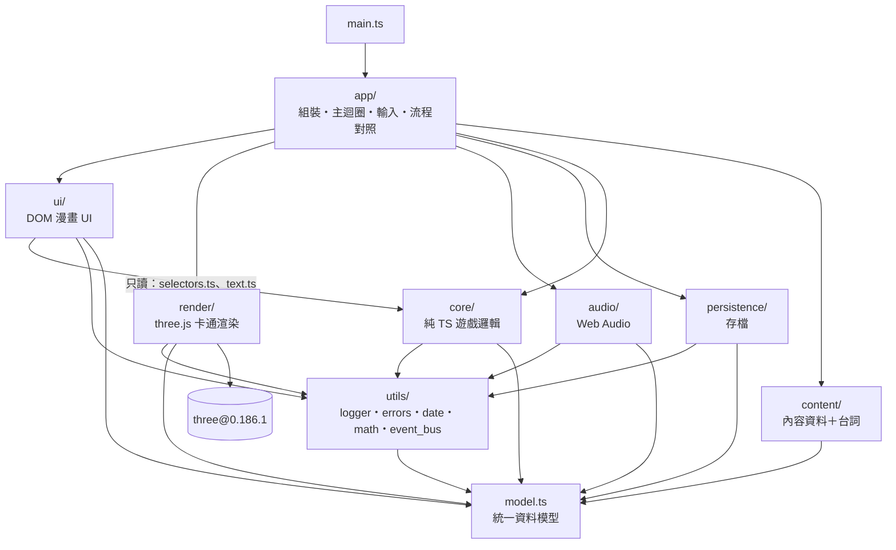
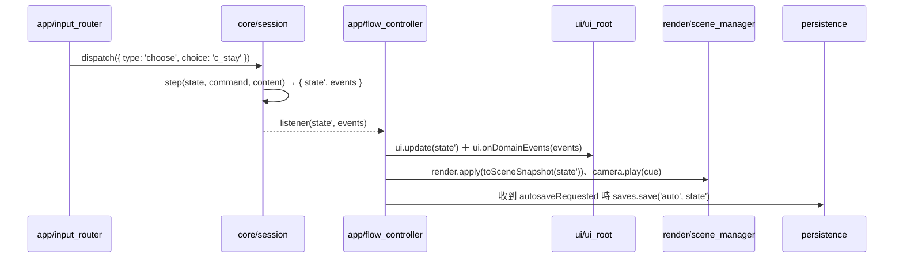
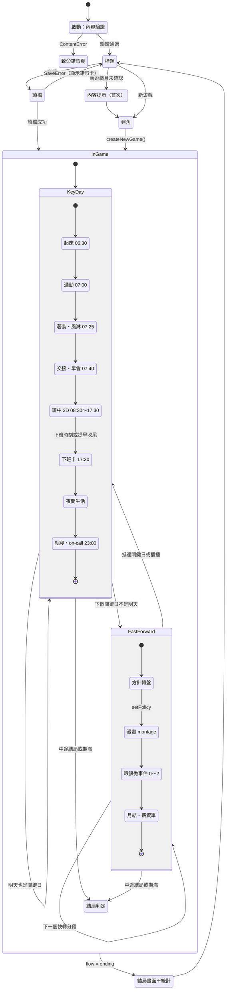
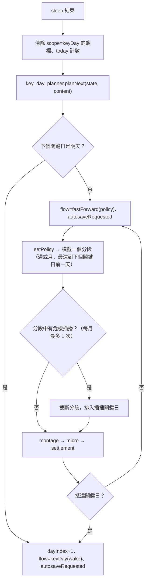

# 工程規格書 01：技術架構

| 項目 | 內容 |
|---|---|
| 文件版本 | v1.3 |
| 撰寫日期 | 2026-10-23（v1.0）；2026-10-24（v1.1、v1.2、v1.3） |
| 依據 | `docs/planning/game-design-doc.md` v1.0（下稱 **GDD**）、`design/style-c-toon.html`（下稱 **風格 C 範例**）、`CLAUDE.md` |
| 範圍 | 第一個實作目標是 GDD §15.1「第一年」MVP；型別與模組邊界同時預留完整版（GDD §15.2） |
| 下游文件 | 02 遊戲系統、03 小遊戲、04 美術 3D UI。三份都**必須**引用本文件的型別名稱、ID 規則、模組邊界，不得另立平行定義。文件地圖、優先序與 CR 裁決總表見 `docs/specs/00-index.md` |

**版本紀錄**

| 版本 | 日期 | 變更摘要 |
|---|---|---|
| v1.0 | 2026-10-23 | 初版 |
| v1.1 | 2026-10-24 | 整合 02 §15（CR-01～19）、03 §9（CR-1～12）、04 §14（CR-01～19）的變更請求，裁決見 00-index §4。主要變更：§5.2 `model.ts`（`MachineStatus` 的 `idle` 改 `warn`；`Effect` 加 `economy`；`PendingSeed.sourceEvent` 可為 null；小遊戲 Params 補欄位、`MinigameContext` 加 `stamina`／`skill`／`favor`、`chapterDefaults`、各遊戲 State／Input 與 `MinigameStateMap`／`MinigameInputMap`；`Interaction` 加時段小遊戲；`BalanceRules` 加 `valuation`、`minigameRewards`、`workday`…等 13 個子結構；`ReviewRules`、`EconomyRules` 補常數；`SceneSnapshot` 加 `timeOfDay`、`yieldIndex`、`focusActor`、`playerSpeedScale`、`phoneGlow`；`SfxId` ＋11、`ScreenFx` ＋2、`CharacterClip` ＋`armsUp`；結果節點可帶表情；`ChoiceCardView.favorWaived`；`PlayerProfile.look`；`SettingsData` 加文字大小與分軌音量）；§3 新增 `core/workday`、`thresholds`、`minigame_rewards`、`minigames/difficulty`、`minigames/procgen`、`app/minigame_host`、`render/look`、`ui/components/coach_mark`、`scene_fallback` 與資產、測試；§6.5 時鐘 150 ms／遊戲分；§7.4 安全事件例外；§7.5 小遊戲伏筆不重複；§7.6 黑歷史本依等第排序；§7.10 快轉依 02 §5 改寫；§8.5 範例一改用 02 §3.6 建議值並刪除 waiver；§8.6 驗證規則；§9 快照算法、`GRADIENT_STEPS`、圖集、2.5D 光色；§10.8 `AudioService`；§13.4～13.5 平衡檢查改成期望價值；§15 階段重新分配；§16 D38～D48；§17 R1、R2 標為已解決、新增 R18；§18 索引 |
| v1.2 | 2026-10-24 | 套用獨立審查「審查回合 1」的 lead 裁決（00-index §9）：R1-A 美術與內容由實作者產出、佔位 SVG（§15、§17 R17）；R1-B 人工驗收的「暫定通過」與小遊戲領域資料改為內容（§5.2 `MinigameRulesMap`、`MinigameLogic.create` 第三個參數、§15）；R1-C 第一章新訓日（§6.4、§9.11 `scn.academy_classroom`）；R1-D 班中跨場景與 `EventDef.scene` 必填（§5.2、§6.5-10、§8.6）；R1-E `economy` 估值、內容數值調校權、`docs/issues.md` 流水號（§2.3、§13.5、§14.8）；矛盾 2 微事件倒數（§8.2、§8.6）；矛盾 5 `chr.lao_k`（§8.3）。決定見 §16 F 組 |
| v1.3 | 2026-10-24 | 同步 00 §9.3 的 N1～N6（§5.2 註解、§6.4、§6.5-10、§7.3、§8.5、§16 G 組）；記錄 Stage 1 實作計畫的決定（§16 H 組）與新增名稱（§18） |

> **用語**：「必須」＝違反就不能合併；「應」＝預設要做，例外要在 PR 說明；「可」＝選用。
>
> **引用格式**：〔GDD §4.6〕＝企劃書第 4.6 節；〔範例 L383〕＝風格 C 範例第 383 行。
>
> **本文件只是文件**：撰寫時沒有執行任何安裝或建立專案的指令。§14.1 列出初始化步驟，由 Stage 1 的實作者執行。

---

## 目錄

0. [架構總覽（一頁版）](#0-架構總覽一頁版)
1. [技術選型](#1-技術選型)
2. [CLAUDE.md 規範逐條對映](#2-claudemd-規範逐條對映)
3. [專案目錄結構](#3-專案目錄結構)
4. [模組架構與邊界](#4-模組架構與邊界)
5. [統一資料模型（`src/model.ts`）](#5-統一資料模型srcmodelts)
6. [遊戲主迴圈與狀態機](#6-遊戲主迴圈與狀態機)
7. [事件引擎](#7-事件引擎)
8. [內容資料規範](#8-內容資料規範)
9. [渲染層架構](#9-渲染層架構)
10. [UI 層架構](#10-ui-層架構)
11. [存檔系統](#11-存檔系統)
12. [錯誤處理與日誌](#12-錯誤處理與日誌)
13. [測試策略](#13-測試策略)
14. [建置、開發指令與品質門檻](#14-建置開發指令與品質門檻)
15. [MVP 實作階段劃分](#15-mvp-實作階段劃分)
16. [「我的決定」清單](#16-我的決定清單)
17. [風險清單](#17-風險清單)
18. [附錄：型別與模組名稱索引](#18-附錄型別與模組名稱索引)

---

## 0. 架構總覽（一頁版）

- **一個純 TS 的遊戲核心**（`src/core/`）：沒有 DOM、沒有 three.js、沒有 `Math.random`、沒有系統時間。所有規則都寫成 `step(state, command, content) → { state, events }` 這種純函式，所以 `bun test` 不開瀏覽器就能跑完整的一年。
- **一份統一資料模型**（`src/model.ts`）：所有跨層共用的型別都定義在這裡，對應 CLAUDE.md 的 `model.py`。
- **內容是資料**（`src/content/`）：事件、選項、數值變化、伏筆、結局判定、小遊戲參數都寫成可 JSON 序列化的 TS 物件；台詞另放在 `src/content/text/`，對應 CLAUDE.md 的 `prompts.py`。
- **兩個呈現層只讀不寫**：`src/render/`（three.js 卡通渲染）與 `src/ui/`（DOM 漫畫 UI 疊在 canvas 上，沿用風格 C 範例）只能讀狀態、送指令（`GameCommand`），不能直接改狀態。
- **組裝層**（`src/app/`）負責依賴注入、主迴圈、把核心狀態對到場景與畫面。
- **依賴很少**：本機的 bun 負責套件、腳本、測試；開發依賴只有 5 個（TypeScript、Vite、Biome、`@types/bun`、`@types/three`）；執行期依賴只有 `three`。

---

## 1. 技術選型

### 1.1 選型總表

> 版本是 2026-10-23 從 npm registry 查到、而且**發佈滿兩週以上**的版本。全部用確切版本（不加 `^`、`~`），`bunfig.toml` 設定 `exact = true`，`bun.lock` 必須提交。

| 項目 | 選擇 | 確切版本 | 理由 |
|---|---|---|---|
| 套件管理、腳本執行、測試執行 | **bun** | 1.2.21（本機已安裝；`package.json` 的 `packageManager` 鎖定） | 使用者指定。安裝快、內建 TS 執行與測試，不需要 ts-node、Jest、Vitest |
| 語言 | **TypeScript**（strict ＋額外嚴格旗標，見 §14.3） | `typescript@7.0.2`（2026-07-08） | 只用來做型別檢查（`tsc --noEmit`）。7.x 是原生編譯器，型別檢查比 5.x 快很多。若 Stage 1 發現與 `@types/three` 或編輯器有阻斷性不相容，降回 `typescript@6.0.3`，並記錄在 `IMPLEMENTATION_PLAN.md` |
| 開發伺服器與打包 | **Vite**（在 Node 24 上執行） | `vite@8.3.4`（2026-10-08） | 見 §1.3 的評估。`bun run dev` 會用 Node 執行 Vite 的 bin（Vite 官方支援 Node `>=22.12`），避開 Bun 執行 Vite 的相容性風險 |
| 單元與整合測試 | **bun test** | 隨 bun 1.2.21 | 使用者指定。內建 `describe`／`test.each`／`expect`；核心邏輯沒有 DOM，所以不需要 jsdom 或 happy-dom |
| 型別定義 | `@types/bun`、`@types/three` | `@types/bun@1.2.21`（跟本機 bun 對齊）、`@types/three@0.186.0` | — |
| Lint ＋ Format | **Biome** | `@biomejs/biome@2.5.15`（2026-09-30） | 見 §1.2.2 |
| 3D 渲染 | **three.js**（npm 套件，ES module） | `three@0.186.1`（2026-09-24） | 使用者指定。範例用的是 CDN 上的 r128，必須遷移（遷移注意事項見 §9.9） |
| UI 層 | **純 DOM ＋ TypeScript**，自製約 60 行的 `h()` 建構函式與元件契約 | 無依賴 | 見 §1.2.1 |
| 狀態管理 | **自製 `GameSession`**：純函式 `step()` ＋訂閱，加上型別化的 `EventBus` | 無依賴 | 核心本來就是純函式 reducer。Redux、Zustand 只會多一層抽象，換不到東西 |
| 內容資料格式 | **TS 物件（`satisfies` 型別檢查）＋載入時語意驗證** | 無依賴 | 見 §1.2.3 |
| 執行期資料驗證 | **手寫驗證**：內容用 `core/content_validator.ts`；存檔用 `persistence/save_guard.ts` | 無依賴 | 內容的「形狀」已由 tsc 保證，剩下的是跨 ID 參照、數值範圍這類語意檢查，schema 函式庫本來就做不到。存檔只有一個根型別要驗。不引入 zod／valibot |
| 隨機數 | **自製 mulberry32**（`core/rng.ts`），狀態是 1 個 uint32，存在 `GameState.rngState` | 無依賴 | 必須可注入種子、可序列化、可重現。演算法很短，有公開的參考輸出可以測（§13.4 範例二） |
| 存檔 | **localStorage**（失敗時退回記憶體儲存，並顯示提示） | 瀏覽器內建 | 一份存檔小於 100 KB，同步 API 最單純。IndexedDB 的非同步交易換不到好處（§11.1） |
| 音效 | **Web Audio API 直接使用**；MVP 音效全部程式合成（FFU 底噪、警報嗶聲、啾訊、震動） | 瀏覽器內建 | MVP 不需要音檔，也就不需要 Howler／Tone.js。之後加入音檔時，仍然走 `AudioService` 介面 |
| 字型 | Google Fonts：`LXGW WenKai TC`、`Noto Sans TC`（沿用範例），搭配完整的系統字 fallback | — | 中文字型很大，Google Fonts 有 unicode-range 子集。風險見 §17 R6 |
| 動畫補間 | CSS `steps()` 動畫（沿用範例）＋ `utils/math.ts` 的 ease 函式 | 無依賴 | 範例的漫畫感就來自 steps 動畫；不需要 GSAP |
| SPC 管制圖 | Canvas 2D 直接畫 | 瀏覽器內建 | 不需要圖表函式庫 |
| Git hooks | `.githooks/` ＋ `git config core.hooksPath` | 無依賴 | 不引入 husky／lefthook |
| E2E／截圖測試 | **MVP 不做** | — | 3D 與 DOM 的驗收在 MVP 用人工清單（§13.6）。如果之後要引入 Playwright，要先在規格裡說明理由 |
| CI | MVP 不做；本機 pre-commit 跑 `bun run verify` | — | 等 git 遠端確定後再加 |

### 1.2 三個關鍵決策的比較與拍板

#### 1.2.1 UI 層：純 DOM ＋ TS vs. 輕量框架

| 方案 | 優點 | 缺點 |
|---|---|---|
| **A. 純 DOM ＋ TS**（自製 `h()` 與 `Component` 契約） | 零依賴、零建置設定；風格 C 範例本來就是純 DOM，CSS 和結構可以直接搬；`steps()` 動畫、`aria-live`、focus 管理都是直接操作 DOM，沒有框架的生命週期要配合；打包最小 | 要自己寫「狀態 → DOM」的更新，元件一多容易出現 DOM 和狀態不同步；列表（選項卡、訊息串）要手動 diff；需要紀律（統一元件契約） |
| B. Preact 10（＋ signals） | JSX 宣告式、3～4 KB；生態系大；列表更新方便 | 加一個執行期依賴和 JSX 設定；跟 three.js 的每幀迴圈是兩套更新模型；範例的 CSS 動畫重新掛載時會重播，要額外處理 |
| C. Lit 3 | Web Components 標準；樣板語法輕 | Shadow DOM 會把範例的全域漫畫 CSS（`.panel`、`.chip` 共用網點）切斷，要嘛全部改成 `adoptedStyleSheets`，要嘛關掉 shadow DOM，兩者都不划算 |
| D. Solid 1.9 | 細粒度響應式，效能最好 | 需要 JSX 編譯插件；生態系最小；團隊熟悉度通常最低 |

**拍板：A，純 DOM ＋ TS。**
理由：(1) MVP 有約 21 個畫面，但大多是「顯示一份核心算好的資料」（§10.3 的 `EventView` 已經把台詞、chip、鎖卡算好），DOM 端很薄；(2) 不引入沒有強力理由的依賴（CLAUDE.md）；(3) 範例可以直接移植。
**防止它變難維護的三條規則**：所有元件都實作 §10.2 的 `Component<P>` 契約；元件只吃 props，不讀全域；列表一律走 `dom.ts` 的 `replaceChildrenKeyed()`。
**推翻條件**：元件數超過 40，或 Stage 4 結束時有 3 個以上 bug 的根因是「DOM 沒跟著狀態更新」。這時改用 Preact。因為元件契約一致，可以逐個元件遷移。

#### 1.2.2 Lint／Format：ESLint ＋ Prettier vs. Biome

| 方案 | 優點 | 缺點 |
|---|---|---|
| ESLint 9（flat config）＋ typescript-eslint ＋ Prettier | 規則最多，包含需要型別資訊的規則（例如 `no-floating-promises`）；有成熟的模組邊界插件 | 至少 4～6 個套件、兩份設定檔，lint 和 format 職責重疊要調整；跑得慢 |
| **Biome 2** | 單一套件、單一設定檔，lint、format、import 排序一起做；速度快；pre-commit 幾乎無感 | 規則比較少；需要型別資訊的規則比較少；沒有專門的「依賴邊界」插件 |

**拍板：Biome。**
理由：一個工具抵兩個，符合「不引入不必要的工具」。Biome 欠缺的兩項能力這樣補：
1. **模組邊界**：用 `test/architecture.test.ts` 掃描 import 來強制（§4.3），比任何 lint 插件都明確，也不依賴工具版本。Biome 的 `noRestrictedImports` 只用來在編輯器裡提早提示。
2. **Promise 沒有處理**：`tsc` 開 strict，`app/` 層的非同步呼叫一律 `await` 或接 `.catch(reportFatal)`，在 code review 時檢查。

#### 1.2.3 內容資料格式：TS 物件 vs. JSON／YAML ＋ schema

| 方案 | 優點 | 缺點 |
|---|---|---|
| **A. TS 物件 ＋ `satisfies EventDef` ＋ 載入時語意驗證** | 寫錯欄位名稱或型別，編輯器當場就畫紅線；有自動完成；可以用常數重複使用效果（例如範例一的「失敗套用壹的效果」）；不需要解析器和 schema 函式庫；ID 用模板字面型別（`` `ev.${string}` ``）防止混用 | 內容作者要會一點 TS 語法；有人可能偷寫函式進資料（用驗證器擋下）；給未來的 mod 編輯器用時要先轉成 JSON |
| B. JSON ＋ JSON Schema（ajv） | 語言中立；未來的事件編輯器、mod 可以直接讀寫 | JSON 不能寫註解；長篇中文台詞要處理跳脫；要另外維護 schema；ajv 是新依賴；編輯器提示要靠 schema 對應設定 |
| C. YAML ＋ zod | 寫長台詞最舒服、可以寫註解 | 需要 yaml 解析器＋zod 兩個依賴；縮排錯誤很難找；型別要再從 zod 推導一次；執行期解析成本 |

**拍板：A，TS 物件。**
理由：62 個事件、數百個效果的正確性，主要靠「寫的時候就被型別系統擋下」，TS 物件是唯一能在作者打字當下就報錯的方案；跨參照（事件 ID、旗標、台詞 ID）再由驗證器在載入時擋下。
**保留可逆性**：所有內容型別都必須可 JSON 序列化（不能放函式、`Date`、`Map`、`undefined` 以外的特殊值）。`test/content_integrity.test.ts` 用「JSON 往返後仍相等」強制這條。所以未來要做 GDD §15.3 的事件編輯器時，只要加一支匯出 JSON 的腳本即可。

### 1.3 Vite 的評估（lead 的建議，確認採用）

| 方案 | 評估 |
|---|---|
| **Vite 8** | 成熟的 HMR；`import.meta.env.DEV` 讓除錯工具在正式版被 tree-shake 掉；`?raw` 匯入 SVG 立繪；處理未來的 glTF、音檔資產（`?url`、`public/`）；Rolldown 打包的 code splitting。three.js 生態的範例幾乎都用 Vite |
| Bun 內建 bundler ＋ HTML dev server | 少一個依賴。但 HTML 匯入與開發伺服器在 bun 1.2 還算新，資產管線（glTF、`?raw`、`public/`）和 HMR 的成熟度都比較差 |
| 不打包（原生 ES module ＋ import map） | 最少工具，但 TS 要另外轉譯，沒有 HMR，three.js 的 addons 路徑要手動對應 |

**結論：確認採用 Vite 8.3.4**。分工是：bun 管套件、跑腳本、跑測試；Vite 只負責開發伺服器與正式打包；型別檢查由 `tsc` 負責（Vite 不做型別檢查）。

---

## 2. CLAUDE.md 規範逐條對映

> CLAUDE.md 偏向 Python 後端。下表逐條說明它在這個 TypeScript 前端遊戲裡怎麼落實；「強制方式」欄說明是靠工具自動擋，還是靠 review。

### 2.1 架構與組織

| CLAUDE.md 條目 | 本專案的對映 | 強制方式 |
|---|---|---|
| `api/main.py`：只放端點定義與應用程式初始化 | `src/main.ts` 只有一行：呼叫 `app/bootstrap.ts` 的 `bootstrap()`。`bootstrap.ts` 是**組裝根**（composition root），只負責建立依賴並接線，不放任何遊戲規則 | review；`architecture.test.ts` 檢查 `main.ts` 只 import `app/bootstrap` |
| `api/routers/`：用 Router 分組端點 | **不適用**：沒有後端、沒有 HTTP 端點。最接近的對應是 `app/flow_controller.ts` 裡的「流程 → 場景／畫面」對照表，依 `GameFlow.kind` 分組註冊 | — |
| 允許端點只有 `/`、`/health`，禁止測試、除錯端點 | 正式版只有一個頁面 `/`（`index.html`）。`/health` **不適用**：靜態網站沒有伺服器程序可以回報健康狀態，由託管平台負責。**禁止除錯端點的精神**對映為：作弊、除錯面板（`app/dev_panel.ts`）只能透過 `if (import.meta.env.DEV) await import('./dev_panel')` 載入，正式版會被 tree-shake 掉；正式版不接受改數值的 URL 參數 | `architecture.test.ts` 檢查沒有其他檔案靜態 import `dev_panel`；§14.5 的 build 檢查確認 `dist/` 裡沒有 `__FAB7_DEV_PANEL__` 標記字串 |
| `src/`：核心商業邏輯 | `src/core/`：所有遊戲規則（數值、事件、時鐘、考績、經濟、結局、小遊戲邏輯） | `architecture.test.ts` 的分層規則（§4.3） |
| `utils/`：共用工具函式 | `src/utils/`：只放**被 2 個以上的層使用**、而且是純函式的工具（logger、event bus、錯誤型別、日期換算、數學）。只有單一層使用的工具放在那一層裡（例如 `rng.ts` 只有 core 用，放在 `core/`） | review（CLAUDE.md「Shared Code ≥2」） |
| `model.py`：統一資料模型 | **`src/model.ts`**：所有跨層的**資料結構**（狀態、內容定義、指令、領域事件、呈現快照）與核心契約（`GameSession`、`MinigameLogic`）。其他檔案**不得**重複定義相同的資料結構。例外只有兩種：(1) 各層對 app 公開的**服務介面**（`RenderHost`、`UiRoot`、`SaveRepository`、`AudioService`），定義在該層的入口檔，因為它們是該層的 API 而不是資料；(2) 綁定 three.js 或 DOM 型別、只在單一層內使用的介面（`SceneModule`、`Component<P>`） | `architecture.test.ts`：(1) `model.ts` 不得有任何 import；(2) 其他檔案匯出的型別名稱不得跟 `model.ts` 重名 |
| `prompts.py`：長提示詞集中管理 | 本專案沒有 LLM 提示詞。對映為**所有給玩家看的文字**集中在 `src/content/text/*.ts`（台詞、選項標題、結果旁白、UI 字串、結局卡）。邏輯資料只用 `TextId` 參照 | 驗證器：每個 `TextId` 都必須存在、不得有孤兒文字（§8.6） |
| `requirements.txt` | `package.json`（確切版本）＋ `bun.lock`（提交） | `bunfig.toml` `exact = true` |
| 前端 `components/`、`pages/`、`utils/`、`assets/` | `src/ui/components/`（可重用 UI 元件）、`src/ui/pages/`（全畫面頁面：標題、建角、考績單、結局……）、`src/utils/`（全專案共用，因為整個專案都是前端，不另設前端 utils）、`src/assets/`（立繪 SVG；未來的模型和音檔） | — |
| 「避免過度切分：一個目錄不能只有一個檔案」 | §3 的目錄樹已逐一確認每個目錄至少有 2 個項目。例：不設 `content/text/zh-TW/`（MVP 只有一種語言，多一層就會變成只有一個子目錄） | `architecture.test.ts` 掃描 `src/`、`test/`：每個目錄的直接項目數必須 ≥2 |

### 2.2 程式碼品質與錯誤處理

| CLAUDE.md 條目 | 本專案的對映 | 強制方式 |
|---|---|---|
| logger、raise 訊息寫成單行 | 「單行」指**訊息內容**：一個模板字串、不含換行、不跨行串接。格式統一為 `[模組] 事件描述: key=value key=value`（§12.2）。Biome `lineWidth: 120` 降低自動折行；即使 formatter 把參數折到下一行，訊息仍然是一個字串，符合規範 | `logger` 在開發模式下收到含 `\n` 的訊息會丟 `InvariantError`；正式版把換行轉成 `⏎` 後照樣記錄 |
| Fail fast、提供除錯脈絡、在適當層級處理、不吞例外 | 內容錯誤在啟動時就失敗，指出 ID 和欄位路徑；存檔錯誤以 `SaveError` 帶 `kind` 回報，UI 一定顯示；核心不可能發生的狀態丟 `InvariantError`；全域錯誤邊界（`app/error_boundary.ts`）接住未處理例外並顯示錯誤頁。**不准** `catch {}` 空區塊 | Biome `noEmptyBlockStatements`；review |
| Composition over inheritance、依賴注入 | 不使用類別繼承（錯誤型別繼承 `Error` 一層是唯一例外）。場景由 props 組合而成，UI 頁面由元件組合而成；所有依賴（content、logger、storage、renderer）都在 `bootstrap.ts` 建立後當參數傳入 | review；`architecture.test.ts` 禁止 `class X extends Y`（`Error` 子類除外） |
| Interfaces over singletons | 不准有模組層級的可變狀態（`let` 或可變物件放在模組頂層）。需要「全域唯一」的東西（logger、session、renderer）都由 `bootstrap.ts` 建立一次，以介面傳遞 | `architecture.test.ts`：`src/core`、`src/utils`、`src/content` 不得有頂層 `let` |
| Explicit over implicit | 資料流單向：輸入 → `GameCommand` → `step()` → 新 `GameState` ＋ `DomainEvent[]` → UI／render。呈現層不能直接改狀態（§4.4） | 型別：session 回傳 `DeepReadonly<GameState>` |
| 函式品質清單、「不要為了抽而抽」 | 照用。PR 自我檢查時跑 CLAUDE.md 的 QCHECKF | review |
| 不寫多餘註解 | 只寫「為什麼」與企劃出處（例：`// GDD §4.4：強制分配時，平手的玩家排在 NPC 後面`）。不寫重述程式碼的註解 | review |
| 命名 | **檔名一律 snake_case**（CLAUDE.md 後端規則；本專案的 UI 沒有使用框架，也就沒有框架慣例可以遵循，所以統一用 snake_case）。工具規定的檔名例外：`vite.config.ts`、`biome.json`、`package.json`、`bunfig.toml`。型別 PascalCase；函式、變數 camelCase；ID 字串見 §8.3 | `architecture.test.ts` 檢查 `src/`、`test/`、`scripts/` 下的檔名符合 `^[a-z0-9_]+(\.spec|\.test)?\.(ts|css|svg)$` |
| Import 順序：標準庫 → 第三方 → 本地 | 對映為：`bun:`／`node:` 內建 → npm 套件（`three`）→ 本地相對路徑。由 Biome 的 organizeImports 自動排序 | `biome check` |

### 2.3 流程、測試與 Git

| CLAUDE.md 條目 | 本專案的對映 | 強制方式 |
|---|---|---|
| 先問釐清問題；≥2 種做法時列優缺點 | 本文件 §1.2 已對三個關鍵決策列表。實作中遇到新的重大分歧，應在 PR 描述列出 | review |
| `IMPLEMENTATION_PLAN.md`，3～5 個 stage | §15 定義 MVP 的 5 個 stage。Stage 1 開工時把 §15 複製成根目錄的 `IMPLEMENTATION_PLAN.md`，隨進度更新 Status，全部完成後刪除 | review |
| TDD：stub → 失敗測試 → 實作 | 核心（`src/core`、`src/utils`、`src/persistence`）**必須** TDD。render、ui 的純函式部分（鏡頭插值、碰撞、view model）也必須 TDD；DOM 與 WebGL 的畫面本身不寫自動測試（§13.1） | review；PR 內要看得到測試先於實作的提交順序 |
| unit test 與 DB integration test 分開 | 本專案沒有資料庫。對映為：**單元測試** `*.spec.ts` 跟原始碼放在同一個目錄，只測單一模組、用最小的測試用內容；**整合測試** `test/*.test.ts`，使用真正的 `src/content` 內容、跨模組（session ＋ 內容 ＋ 存檔編解碼），以及架構檢查。對應 CLAUDE.md「碰 DB 的測試」的是碰 `StorageLike` 與完整內容的測試 | `bun test ./src` 與 `bun test ./test` 分開跑；`architecture.test.ts` 檢查 `*.test.ts` 只出現在 `test/`、`*.spec.ts` 只出現在 `src/` |
| 測試品質清單 1～10 | §13.3 逐條對映（參數化、強斷言、`describe(函式名)`、獨立算出的預期值、不變量） | review；`architecture.test.ts` 禁止提交 `.only(`、`.skip(`、`.todo(` |
| 不准停用測試 | 同上。內容平衡的例外要用資料欄位 `balance.waiver`（必須附 issue 編號），而不是跳過測試（§13.5） | `content_balance.test.ts` |
| 每個 commit 都要能編譯、通過測試、通過 lint | `.githooks/pre-commit` 跑 `bun run verify`（型別檢查、Biome、內容驗證、全部測試） | git hook（**不准** `--no-verify`） |
| Conventional Commits；commit 訊息不得提到 AI 工具 | `.githooks/commit-msg` 呼叫 `scripts/check_commit_message.ts`：檢查格式 `type(scope)?: 描述`、type 在允許清單內、訊息裡不得出現 Claude／Anthropic／ChatGPT／OpenAI／Copilot／Gemini 等字樣（`CLAUDE.md` 這個檔名例外），也不得出現 AI 共同作者的 trailer | git hook |
| 沒有 issue 編號的 TODO | 不准出現 `TODO` 而沒有 `#數字`。（v1.2 R1-E）建立遠端 issue 追蹤之前，`#N` 是專案內 `docs/issues.md` 的流水號（每號一列：編號、標題、狀態、關聯檔案）；建立遠端後在該檔加一欄對照遠端編號，不重新編號。`balance.waiver.issue` 用同一套編號 | `architecture.test.ts`（另檢查每個 `#N` 都存在於 `docs/issues.md`） |
| 安全：只開放必要端點、最小權限 | 不請求任何瀏覽器權限（相機、麥克風、定位、通知）；不載入第三方分析或廣告腳本；正式版的 `index.html` 由 Vite 插件注入 CSP（內容見 §14.5；開發模式不注入，以免擋住 HMR 的 WebSocket） | `scripts/check_dist.ts` 檢查 `dist/index.html` 含 CSP |
| 不引入新工具，除非有強力理由 | 執行期依賴只有 `three`；開發依賴共 5 個（§14.2）。新增任何依賴都要在 PR 寫出比較表 | review |
| 版本管理（v1.2、生效日） | **不適用**於程式碼。本規格書自己的版本記在表頭 | — |

---

## 3. 專案目錄結構

> 下面是 MVP 完成時的完整樹狀圖，列到檔案層級。標 `（DEV）` 的檔案只在開發模式載入。`*.spec.ts` 是與原始碼同目錄的單元測試。

```text
d:\game2\
├── CLAUDE.md                         專案規範（既有）
├── IMPLEMENTATION_PLAN.md            實作期間的階段計畫，全部完成後刪除（§15）
├── package.json                      確切版本、scripts（§14.2）
├── bun.lock                          bun install 產生，必須提交
├── bunfig.toml                       [install] exact = true
├── tsconfig.json                     §14.3
├── biome.json                        §14.4
├── vite.config.ts                    §14.5
├── index.html                        唯一頁面：canvas＋各層容器＋CSP（§10.1）
├── .gitignore                        node_modules、dist、*.local、coverage
├── .githooks/
│   ├── pre-commit                    bun run verify
│   └── commit-msg                    bun run scripts/check_commit_message.ts "$1"
├── docs/                             （既有）planning/、research/、specs/01～04
├── design/                           （既有）風格 A／B／C 範例，不參與建置
├── scripts/
│   ├── validate_content.ts           內容驗證 CLI（§8.7）
│   ├── check_commit_message.ts       Conventional Commits＋禁用字檢查
│   └── check_dist.ts                 打包後檢查：CSP 存在、沒有 DEV 標記、體積預算
├── test/                             整合測試（真實內容、跨模組）
│   ├── fixtures.ts                   測試用最小內容 testContent、buildTestState()、minigameContextFor()
│   ├── architecture.test.ts          分層 import、禁用全域、目錄規則、檔名、TODO、.only/.skip
│   ├── content_integrity.test.ts     真實內容通過驗證器、JSON 往返、ID 規則
│   ├── content_balance.test.ts       GDD §4.6 平衡檢查（§13.5、02 §3.5）
│   ├── scene_hotspots.test.ts        內容宣告的 hotspot 都存在於對應場景
│   ├── palette_sync.test.ts          tokens.css 與 render/look.ts 的色票一致（04 §2.8）
│   ├── portrait_assets.test.ts       立繪 SVG：viewBox、禁止項、表情群組齊全（04 §8.1）
│   ├── playthrough.test.ts           以固定種子無頭跑完 MVP 一年
│   └── save_roundtrip.test.ts        存檔 → 讀檔後的後續行為完全一致
└── src/
    ├── main.ts                       唯一入口：bootstrap(document)
    ├── model.ts                      ★ 統一資料模型（§5）
    ├── app/                          組裝層：唯一可以 import 所有層的地方
    │   ├── bootstrap.ts              組裝根：建立 logger、驗證內容、storage、session、renderer、ui
    │   ├── flow_controller.ts        GameFlow／Interaction → 場景、UI 頁面、音效；自動存檔時機
    │   ├── game_loop.ts              requestAnimationFrame 迴圈；現實時間 → 遊戲分鐘
    │   ├── input_router.ts           鍵盤、滑鼠、觸控 → 移動意圖或 GameCommand
    │   ├── minigame_host.ts          小遊戲生命週期：持有本局 state、送 tick／input、countdownScale、自動著裝（03 §2.2）
    │   ├── error_boundary.ts         window error／unhandledrejection → logger＋錯誤頁
    │   └── dev_panel.ts              （DEV）改數值、跳日期、顯示種子
    ├── core/                         純 TS 遊戲邏輯：無 DOM、無 three、無系統時間與 Math.random
    │   ├── session.ts                createGameSession()：持有狀態、dispatch、subscribe
    │   ├── session.spec.ts
    │   ├── step.ts                   step(state, command, content)：唯一的狀態轉移入口
    │   ├── step.spec.ts
    │   ├── new_game.ts               createNewGame()：依履歷建立初始 GameState
    │   ├── new_game.spec.ts
    │   ├── flow.ts                   GameFlow 狀態機轉移表
    │   ├── flow.spec.ts
    │   ├── clock.ts                  遊戲時鐘、時段、跨日、行事曆掛鉤
    │   ├── clock.spec.ts
    │   ├── stats.ts                  數值夾限、溢出、修正器、衍生公式
    │   ├── stats.spec.ts
    │   ├── conditions.ts             evaluateCondition()、evaluateNumber()
    │   ├── conditions.spec.ts
    │   ├── effects.ts                applyEffects()
    │   ├── effects.spec.ts
    │   ├── text.ts                   resolveText()：TextRef → 字串（變體、佔位符）
    │   ├── text.spec.ts
    │   ├── selectors.ts              UI／render 唯讀用的衍生值（最大體力、好感段落、考績風向、機台燈號、時段、良率指數……）
    │   ├── selectors.spec.ts
    │   ├── rng.ts                    mulberry32：createRng()、restoreRng()
    │   ├── rng.spec.ts
    │   ├── event_scheduler.ts        檢查點 → 候選事件、優先序、上限、冷卻
    │   ├── event_scheduler.spec.ts
    │   ├── event_runner.ts           事件節點圖的推進、EventView 產生
    │   ├── event_runner.spec.ts
    │   ├── seeds.ts                  伏筆佇列（延遲後果）
    │   ├── seeds.spec.ts
    │   ├── black_book.ts             黑歷史本：記錄、淘汰、考績引用
    │   ├── black_book.spec.ts
    │   ├── key_day_planner.ts        關鍵日排程：劇本、條件、插播、每月上限
    │   ├── key_day_planner.spec.ts
    │   ├── fast_forward.ts           方針轉盤、快轉分段、微事件、中斷
    │   ├── fast_forward.spec.ts
    │   ├── workday.ts                下班卡、加班、帶回家做、夜間行動、睡眠回復、on-call 判定、提早收尾（02 §2.4、§4）
    │   ├── workday.spec.ts
    │   ├── thresholds.ts             門檻監看 runThresholdMonitor：歸零、健康債、停下來序列、借錢（02 §1.6、§11）
    │   ├── thresholds.spec.ts
    │   ├── minigame_rewards.ts       deriveMinigameEffects：小遊戲 facts → 效果、KPI 樣本（02 §1.9）
    │   ├── minigame_rewards.spec.ts
    │   ├── economy.ts                日曆掛鉤、月結、薪資、房租、加班費、薪資單
    │   ├── economy.spec.ts
    │   ├── review.ts                 KPI、考績積分、強制分配、試用期判定
    │   ├── review.spec.ts
    │   ├── endings.ts                中途結局監看、期滿結局判定、覆蓋規則
    │   ├── endings.spec.ts
    │   ├── content_validator.ts      validateContent()：語意驗證（§8.7）
    │   ├── content_validator.spec.ts
    │   ├── balance_check.ts          GDD §4.6 期望價值、差距、門檻卡、支配檢查（02 §3.4）
    │   ├── balance_check.spec.ts
    │   └── minigames/                小遊戲的純邏輯（畫面在 ui/minigames/）
    │       ├── registry.ts           MinigameId → MinigameLogic
    │       ├── difficulty.ts         resolveDifficulty()：疲勞、壓力、修正器、容錯（03 §1.3）
    │       ├── difficulty.spec.ts
    │       ├── procgen.ts            normal12、uniform、shuffle、pickDistinct、roundTo（03 §2.6）
    │       ├── procgen.spec.ts
    │       ├── gowning.ts            著裝＋風淋
    │       ├── gowning.spec.ts
    │       ├── spc.ts                SPC 獵人
    │       ├── spc.spec.ts
    │       ├── hold_lot.ts           Hold Lot 判官
    │       ├── hold_lot.spec.ts
    │       ├── oncall.ts             半夜電話
    │       └── oncall.spec.ts
    ├── content/                      內容資料（只 import model.ts 的型別）
    │   ├── index.ts                  組裝 ContentBundle、合併台詞、偵測重複 ID
    │   ├── campaign.ts               CampaignDef、ChapterDef、KeyDayDef（21 個關鍵日）
    │   ├── characters.ts             CharacterDef（8 位有立繪＋HR、媽媽、老K 三位文字角色）
    │   ├── resumes.ts                3 種履歷（GDD §3.2）
    │   ├── policies.ts               工作／生活方針、夜間生活行動
    │   ├── economy.ts                職等、經濟規則、考績規則（GDD §9）
    │   ├── balance.ts                調校常數：時鐘倍率、加班換算、§4.6 權重與門檻
    │   ├── minigames.ts              小遊戲參數預設組（每章難度）與時間成本
    │   ├── world.ts                  地點、機台、hotspot、任務
    │   ├── flags.ts                  旗標與計數器的登錄表（防打錯字）
    │   ├── endings.ts                MVP 結局定義
    │   ├── events/
    │   │   ├── prologue.ts           #1、#3、#4、#5
    │   │   ├── ch1.ts                #7、#8
    │   │   ├── ch2.ts                #10～#14
    │   │   ├── ch3.ts                #16、#18～#23、#32 與其子事件
    │   │   ├── safety.ts             §13：停下來序列、關心對話、眼前一黑、健康警告
    │   │   ├── micro.ts              快轉微事件（#17 等）
    │   │   └── random.ts             班中日常隨機事件池
    │   └── text/                     所有玩家可見文字（對映 prompts.py）
    │       ├── common.ts             共用：風聲小字、旁白模板
    │       ├── ui.ts                 按鈕、數值名稱、HUD、設定頁、求助資訊卡
    │       ├── characters.ts         角色名、職稱
    │       ├── prologue.ts
    │       ├── ch1.ts
    │       ├── ch2.ts
    │       ├── ch3.ts
    │       ├── safety.ts
    │       ├── micro.ts
    │       ├── random.ts
    │       ├── endings.ts
    │       └── minigames.ts
    ├── persistence/                  存檔（透過 StorageLike 介面，不直接碰 window）
    │   ├── storage.ts                StorageLike、localStorage 包裝、記憶體備援
    │   ├── save_repository.ts        list／load／save／remove／匯出匯入
    │   ├── save_repository.spec.ts
    │   ├── save_codec.ts             封包、checksum（FNV-1a）、JSON
    │   ├── save_codec.spec.ts
    │   ├── save_guard.ts             壞檔偵測：形狀、數值、內容參照
    │   ├── save_guard.spec.ts
    │   ├── migrations.ts             schemaVersion 逐版遷移
    │   ├── migrations.spec.ts
    │   └── settings_store.ts         設定與跨輪 meta（已見結局、內容提示已確認）
    ├── render/                       three.js：只讀 app 傳入的資料，不 import core
    │   ├── render_host.ts            WebGLRenderer、尺寸、像素比、context lost、無 3D 備援
    │   ├── scene_manager.ts          SceneModule 註冊、切換、快取、釋放
    │   ├── resource_tracker.ts       追蹤並釋放 geometry／material／texture
    │   ├── resource_tracker.spec.ts
    │   ├── look.ts                   視覺常數：PALETTE、光組、r128 校準值、描邊粗細（04 §2.8）
    │   ├── look.spec.ts
    │   ├── toon_kit.ts               MeshToon＋gradientMap（GRADIENT_STEPS）＋外描邊工廠（共用快取）
    │   ├── toon_kit.spec.ts
    │   ├── static_batcher.ts         靜態網格依材質合併，降低 draw call
    │   ├── static_batcher.spec.ts
    │   ├── camera_director.ts        鏡頭演出（仰拍、傾斜、推近、晃動）與跟隨鏡頭
    │   ├── camera_director.spec.ts
    │   ├── navigation.ts             可走區域、障礙、點擊移動、hotspot 距離判定
    │   ├── navigation.spec.ts
    │   ├── quality.ts                畫質分級與自動降級（§9.7）
    │   ├── quality.spec.ts
    │   ├── asset_sources.ts          CharacterModelSource：程式化實作；glTF 預留（§9.6）
    │   ├── canvas_textures.ts        地板、牆板、斜紋、螢幕、標牌的 CanvasTexture
    │   ├── props/                    程式化道具元件
    │   │   ├── machine.ts            蝕刻機台（燈塔、螢幕、標牌）
    │   │   ├── foup.ts
    │   │   ├── oht.ts                天車＋軌道
    │   │   ├── fab_shell.ts          高架地板、牆板、天花板 FFU、黃光區
    │   │   └── props.spec.ts         三角形與 draw call 預算
    │   ├── characters/
    │   │   ├── character_rig.ts      CharacterRig 介面與程式化動作
    │   │   ├── chibi_builder.ts      程式拼的 Q 版人形（無塵衣／便服）
    │   │   └── chibi_builder.spec.ts
    │   └── scenes/
    │       ├── fab_bay.ts            無塵室主走道（ET-03～06）＋黃光區入口
    │       ├── gowning_room.ts       更衣室＋風淋室
    │       ├── office.ts             工程師辦公室＋會議角
    │       └── backdrop_2_5d.ts      2.5D 固定鏡頭小場景的參數化建構器
    ├── ui/                           DOM 漫畫 UI：只透過 GameSession 介面互動
    │   ├── ui_root.ts                各圖層容器、頁面切換、元件生命週期
    │   ├── dom.ts                    h()、replaceChildrenKeyed()、Component 契約
    │   ├── bindings.ts               bind(session, selector, render, equals)
    │   ├── bindings.spec.ts
    │   ├── view_models.ts            純函式：狀態 → 顯示資料（數值列、日期字串）
    │   ├── view_models.spec.ts
    │   ├── a11y.ts                   焦點陷阱、roving tabindex、朗讀
    │   ├── motion.ts                 prefers-reduced-motion＋設定覆寫
    │   ├── components/
    │   │   ├── hud.ts                日期、時鐘、入職第 N 天、職等牌、風向旗
    │   │   ├── stats_panel.ts        6 項可見數值（含「危」）
    │   │   ├── dialogue_box.ts       對話框、說話者、內心獨白
    │   │   ├── portrait.ts           SVG 立繪＋表情差分切換＋名牌
    │   │   ├── choice_cards.ts       壹貳參肆、chip、鎖卡、門檻章
    │   │   ├── countdown_bar.ts      危機倒數條
    │   │   ├── result_box.ts         結果框、chip、風聲小字
    │   │   ├── phone.ts              啾訊群組、工作機來電、「人生」App（離職）
    │   │   ├── task_notes.ts         班中任務便利貼
    │   │   ├── clock_out_card.ts     17:30 下班卡（準時／加班滑桿／帶回家）
    │   │   ├── evening_actions.ts    夜間生活清單
    │   │   ├── micro_event_toast.ts  快轉微事件一鍵選擇（5 秒預設）
    │   │   ├── fx_layer.ts           集中線、網點、紅色暈影、SFX 字卡
    │   │   ├── delta_pop.ts          數值變化浮字
    │   │   ├── toast.ts              一般提示（存檔失敗、畫質降級）
    │   │   ├── minigame_frame.ts     小遊戲共用外框、計時、成績印章
    │   │   ├── coach_mark.ts         小遊戲教學泡泡（03 §2.5）
    │   │   ├── scene_fallback.ts     L3／L4 的 CSS 場景背景＋hotspot 清單（04 §4.6）
    │   │   └── help_card.ts          求助資訊卡（GDD §13.3，無任何特效）
    │   ├── pages/
    │   │   ├── title_page.ts
    │   │   ├── content_notice_page.ts
    │   │   ├── character_creation_page.ts
    │   │   ├── policy_dial_page.ts   行事曆＋方針雙轉盤
    │   │   ├── montage_page.ts       快轉 3 格漫畫
    │   │   ├── review_sheet_page.ts  考績單（引用黑歷史本）
    │   │   ├── payslip_page.ts       薪資單
    │   │   ├── ending_page.ts        結局卡＋三年數字＋黑歷史本全文
    │   │   ├── settings_page.ts
    │   │   ├── save_slots_page.ts    存讀檔、匯出匯入字串
    │   │   ├── pause_page.ts
    │   │   └── error_page.ts         致命錯誤、壞檔、內容錯誤
    │   ├── minigames/
    │   │   ├── gowning_view.ts
    │   │   ├── spc_view.ts           Canvas 2D 管制圖
    │   │   ├── hold_lot_view.ts
    │   │   └── oncall_view.ts
    │   └── styles/
    │       ├── tokens.css            色票、字型（沿用範例 :root）
    │       ├── comic.css             .panel、.chip、.choice、.talk（沿用範例）
    │       ├── fx.css                集中線、網點、alert、shake（沿用範例）
    │       └── pages.css             各頁面與 760px 以下手機版面
    ├── audio/
    │   ├── audio_service.ts          AudioService 介面＋Web Audio 實作＋靜音實作
    │   └── synth.ts                  程式合成：FFU 底噪、警報、啾、震動、印章
    ├── assets/                       SVG（Vite ?raw 匯入；規格見 04 §8、§9）
    │   ├── portrait_lin.svg          林課長（含 8 種表情群組）
    │   ├── portrait_azhe.svg
    │   ├── portrait_xiaoqing.svg
    │   ├── portrait_haoge.svg
    │   ├── portrait_meiling.svg
    │   ├── portrait_vivian.svg
    │   ├── portrait_shen.svg
    │   ├── portrait_aan.svg
    │   ├── portrait_player_a.svg     主角頭像外型 A／B（PlayerProfile.look）
    │   ├── portrait_player_b.svg
    │   ├── montage_icons.svg         快轉 montage 的 pictogram 圖集
    │   ├── ending_e09.svg            結局大格插圖（MVP 6 個結局各 1 張）
    │   ├── ending_e10mvp.svg
    │   ├── ending_e12.svg
    │   ├── ending_e13mvp.svg
    │   ├── ending_e17mvp.svg
    │   ├── ending_e21.svg
    │   ├── gowning_doll.svg          著裝小遊戲的紙娃娃與置物架圖示（03 §3.9）
    │   ├── gowning_icons.svg
    │   └── ui_icons.svg              鎖頭、風向旗、風向小頭像、鍵帽圖示
    └── utils/                        被 ≥2 個層使用的純工具
        ├── logger.ts                 Logger 介面＋console 實作＋環狀緩衝
        ├── logger.spec.ts
        ├── errors.ts                 ContentError、SaveError、InvariantError、RenderError
        ├── event_bus.ts              型別化的發布／訂閱
        ├── event_bus.spec.ts
        ├── date.ts                   dayIndex ↔ ISO 日期、星期、月界、分鐘 ↔ HH:MM
        ├── date.spec.ts
        ├── math.ts                   clamp、lerp、ease、round1
        └── math.spec.ts
```

**各目錄職責摘要**

| 目錄 | 職責 | 不准做的事 |
|---|---|---|
| `src/app/` | 組裝、主迴圈、輸入路由、流程對照、錯誤邊界 | 寫遊戲規則（例如「加班 1 小時扣多少體力」） |
| `src/core/` | 全部遊戲規則與小遊戲邏輯 | 碰 DOM、three、`window`、`localStorage`、系統時間、`Math.random`；import `content/` |
| `src/content/` | 內容資料與台詞 | 寫函式；import `model.ts` 以外的任何模組 |
| `src/persistence/` | 存檔編解碼、遷移、壞檔偵測 | 直接碰 `window.localStorage`（透過注入的 `StorageLike`） |
| `src/render/` | three.js 場景、材質、鏡頭、導航 | import `core/`、`content/`；決定遊戲結果 |
| `src/ui/` | DOM 畫面 | 直接改狀態；import `three`、`render/`、`persistence/` |
| `src/audio/` | 音效 | 決定何時播（由 app 依領域事件決定） |
| `src/utils/` | 跨層純工具 | 碰 DOM 或 three |
| `test/` | 整合測試與架構檢查 | 放單元測試 |

> **未來擴充時新增的目錄**（MVP 不建立，避免空目錄或單檔目錄）：`public/models/`（glTF 角色，Stage 6）、`public/audio/`（音檔）、`scripts/blender/`（headless 匯出腳本，Stage 7）。

---

## 4. 模組架構與邊界

### 4.1 分層與依賴方向



### 4.2 依賴規則表（`architecture.test.ts` 逐條強制）

| 層 | 路徑 | 可以 import | 禁止 |
|---|---|---|---|
| model | `src/model.ts` | （無） | 任何 import |
| utils | `src/utils/**` | `model.ts`、utils 內部 | `three`；DOM 全域（`window`、`document`、`localStorage`、`navigator`、`requestAnimationFrame`、`performance`）；其他層 |
| core | `src/core/**` | `model.ts`、`utils/` | `three`；DOM 全域；`Math.random`、`Date.now`、無參數的 `new Date()`；`content/`、`persistence/`、`render/`、`ui/`、`audio/`、`app/` |
| content | `src/content/**` | `model.ts`（只能 `import type`） | 其他所有模組；匯出函式 |
| persistence | `src/persistence/**` | `model.ts`、`utils/` | `three`；`window`／`localStorage` 直接存取（`storage.ts` 是唯一例外，且只在 `createBrowserStorage(win)` 內透過參數取用）；`core/`、`render/`、`ui/` |
| render | `src/render/**` | `model.ts`、`utils/`、`three`、`three/addons/**` | `core/`、`content/`、`persistence/`、`ui/`、`audio/`、`app/` |
| audio | `src/audio/**` | `model.ts`、`utils/` | `three`、其他層 |
| ui | `src/ui/**` | `model.ts`、`utils/`、`core/selectors.ts`、`core/text.ts`、`src/assets/*.svg?raw` | `three`、`render/`、`persistence/`、`app/`、core 的其他檔案 |
| app | `src/app/**` | 全部 | — |
| main | `src/main.ts` | 只有 `app/bootstrap.ts` | — |

**為什麼 render 不能讀 core**：render 只需要「畫什麼」，不需要知道「為什麼」。app 把 `GameState` 轉成 `SceneSnapshot`（§9.2）傳給 render，這樣 render 換掉（例如降級成無 3D 模式）時，遊戲規則完全不受影響。

**為什麼 ui 可以讀 `core/selectors.ts`**：HUD 需要「最大體力」「好感段落」這些衍生值。把公式放在 core 的 selectors 裡，可以確保 UI 顯示的跟規則計算用的是同一份公式（GDD §4.4）。selectors 都是純函式、不改狀態。

### 4.3 邊界的自動檢查

`test/architecture.test.ts` 用 `Bun.Glob` 掃描原始碼文字，**不需要任何外部工具**：

1. 依 §4.2 檢查每個檔案的 `import ... from '...'` 與 `import('...')` 目標。單元測試（`*.spec.ts`）另外允許 import `test/fixtures.ts`，但不得 import `src/content`（§13.2）。
2. 在 core／utils／content 檔案中搜尋禁用的全域識別字（regex，排除註解與字串）。
3. 每個目錄的直接項目數 ≥2（`src/`、`test/`）。
4. 檔名規則、`*.spec.ts`／`*.test.ts` 的位置。
5. 沒有 `.only(`、`.skip(`、`.todo(`；沒有不帶 `#數字` 的 `TODO`。
6. `src/core`、`src/utils`、`src/content` 沒有頂層 `let`。
7. 除了 `Error` 子類，沒有 `extends`。
8. 其他檔案匯出的型別名稱不得跟 `model.ts` 重名。

### 4.4 執行期資料流



- **唯一可以改狀態的地方**是 `step()`。`step()` 先 `structuredClone(state)`，在副本上修改後回傳（一份狀態約 30～60 KB，每秒最多數十次指令，成本可以忽略；換來的是「沒有人能改到別人手上的狀態」）。
- `session.getState()` 回傳 `DeepReadonly<GameState>`，呈現層在型別層級就改不了狀態。
- 隨機數也是狀態的一部分：`step()` 用 `createRng(state.rngState)` 取得 RNG，結束時寫回 `rng.getState()`。所以「同一個存檔＋同一串指令」一定得到同一個結果（§13.4 `save_roundtrip.test.ts`）。

### 4.5 依賴注入方式

不使用 DI 容器。`bootstrap.ts` 依序建立依賴，用參數物件傳遞：

```ts
// src/app/bootstrap.ts（骨架）
import { content } from '../content';
import { createGameSession } from '../core/session';
import { validateContent } from '../core/content_validator';
import { createBrowserStorage } from '../persistence/storage';
import { createSaveRepository } from '../persistence/save_repository';
import { createSettingsStore } from '../persistence/settings_store';
import { createRenderHost } from '../render/render_host';
import { createUiRoot } from '../ui/ui_root';
import { createAudioService } from '../audio/audio_service';
import { createConsoleLogger } from '../utils/logger';
import { ContentError, InvariantError } from '../utils/errors';
import { installErrorBoundary } from './error_boundary';
import { createFlowController } from './flow_controller';
import { startGameLoop } from './game_loop';

export async function bootstrap(doc: Document): Promise<void> {
  const win = doc.defaultView;
  if (win === null) throw new InvariantError('Bootstrap failed: document has no window');
  const now = (): string => new Date().toISOString();
  const logger = createConsoleLogger({ level: import.meta.env.DEV ? 'debug' : 'warn', now, ringSize: 200 });
  const ui = createUiRoot(doc, { content, logger });
  installErrorBoundary(win, logger, ui.showFatal);

  const issues = validateContent(content);
  if (issues.length > 0) throw ContentError.fromIssues(issues);

  const storage = createBrowserStorage(win, logger);
  const saves = createSaveRepository({ storage, content, logger, now });
  const settings = createSettingsStore(storage, logger);
  const render = createRenderHost(doc, { logger, quality: settings.get().quality });
  const audio = createAudioService(win, logger);
  const flow = createFlowController({ content, saves, settings, render, audio, ui, logger, createSession: createGameSession });
  startGameLoop(win, { flow, render, msPerGameMinute: content.balance.clock.realMsPerGameMinute });
  if (import.meta.env.DEV) await import('./dev_panel').then((m) => m.mountDevPanel(doc, flow));
}
```

`main.ts`：

```ts
import { bootstrap } from './app/bootstrap';

bootstrap(document).catch((error: unknown) => {
  document.body.dataset.fatal = 'true';
  console.error(`[main] bootstrap failed: ${error instanceof Error ? error.message : String(error)}`);
  throw error;
});
```

> `main.ts` 是唯一允許直接用 `console` 的檔案之一（另一個是 `utils/logger.ts`），因為這時 logger 可能還沒建立。錯誤會再丟出去，不吞掉。

---

## 5. 統一資料模型（`src/model.ts`）

### 5.1 規則

1. `model.ts` **不 import 任何東西**。
2. 資料型別必須可以 JSON 序列化：只能有 `string`、`number`（有限值）、`boolean`、`null`、陣列、純物件。不能有函式、`Date`、`Map`、`Set`、class 實例。日期一律用 `dayIndex`（整數）或 `IsoDate` 字串。
3. 內容定義（`*Def`）用 `readonly` 陣列，作者寫的字面陣列可以直接放進去；執行期狀態（`GameState` 與它的子型別）用一般型別，只在 `step()` 內部的副本上修改，對外以 `DeepReadonly` 曝光。
4. 「行為契約」區（§5.2 最後一段）是唯一可以有方法簽名的地方，用來讓下游規格書（03 小遊戲、04 UI）共用介面。
5. 下游規格書如果需要新型別，**必須**提出修改 `model.ts` 的 PR，不得在自己的模組另外定義跨層型別。

### 5.2 完整型別定義

```ts
// src/model.ts — 統一資料模型（對映 CLAUDE.md 的 model.py）

/* ================================================================
 * 1. 識別碼（模板字面型別，防止不同種類的 ID 混用；命名規則見 §8.3）
 * ================================================================ */
export type EventId = `ev.${string}`;
export type CharacterId = `chr.${string}`;
export type FlagId = `flag.${string}`;
export type CounterId = `cnt.${string}`;
export type SeedId = `seed.${string}`;
export type EndingId = `end.${string}`;
export type TextId = `t.${string}`;
export type LocationId = `loc.${string}`;
export type SceneId = `scn.${string}`;
export type HotspotId = `hs.${string}`;
export type MachineId = `mc.${string}`;
export type TaskId = `task.${string}`;
export type KeyDayId = `kd.${string}`;
export type LifeActionId = `act.${string}`;
export type ResumeId = `res.${string}`;
export type ModifierId = `mod.${string}`;
export type PhoneThreadId = `thread.${string}`;
/** 事件內的局部 ID：節點 n_xxx、選項 c_xxx */
export type NodeId = string;
export type ChoiceId = string;
/** 'YYYY-MM-DD' */
export type IsoDate = string;
/** 'HH:MM'（24 小時制） */
export type ClockTime = string;

export type ChapterId = 'prologue' | 'ch1' | 'ch2' | 'ch3' | 'ch4' | 'ch5' | 'finale';
export type Pronoun = 'he' | 'she' | 'neutral';

/* ================================================================
 * 2. 數值（GDD §4：可見 6 項／半可見／隱藏 9 項）
 * ================================================================ */
export const VISIBLE_STAT_IDS = ['stamina', 'mind', 'skill', 'bossFavor', 'favor', 'money'] as const;
export const HIDDEN_STAT_IDS = [
  'healthDebt', 'blame', 'scheming', 'conscience', 'lifeSatisfaction',
  'network', 'visibility', 'goldenHandcuffs', 'evidence',
] as const;
/** 體力、精神、專業、主管好感、同事人情（0～5 枚）、存款（NT$，可為負） */
export type VisibleStatId = (typeof VISIBLE_STAT_IDS)[number];
/** 健康債、背鍋值、心機、良心、生活滿足、人脈網、能見度、金手銬、證據包 */
export type HiddenStatId = (typeof HIDDEN_STAT_IDS)[number];
export type StatId = VisibleStatId | HiddenStatId;
export type Stats = Record<StatId, number>;

export interface StatRule {
  min: number | null;
  /** 'maxStamina'＝依 GDD §4.4 衍生公式動態計算 */
  max: number | 'maxStamina' | null;
  initial: number;
  visibility: 'visible' | 'hidden';
  /** true：套用後四捨五入成整數（人情、存款、金手銬、證據） */
  integer: boolean;
  /** HUD「危」的門檻（GDD §4.1：35） */
  lowLine: number | null;
  /** 超過上限時的溢出轉換（GDD §4.1：人情溢出 → 人脈網 +3／枚） */
  overflowTo: { stat: StatId; perUnit: number } | null;
}

/** 半可見數值：不直接顯示數字，由 core/selectors.ts 衍生 */
export type AffinityTier = 'hostile' | 'cold' | 'neutral' | 'trusted' | 'bonded';
export type ReviewWind = 'smile' | 'flat' | 'frown';
/** 燈號：run 綠、warn 黃（注意，GDD §4.2）、down 紅；門檻在 balance.machines（02 §1.10） */
export type MachineStatus = 'run' | 'warn' | 'down';
export type PresentationMood = 'normal' | 'low' | 'warning' | 'calm';

/* ================================================================
 * 3. 時間（GDD §2.2、§2.6、§3）
 * ================================================================ */
/** 關鍵日的時段；KeyDayDef.phases 決定當天實際走哪些 */
export type DayPhase = 'wake' | 'commute' | 'gowning' | 'briefing' | 'shift' | 'clockOut' | 'evening' | 'sleep';
export type KeyDayKind = 'scripted' | 'conditional' | 'character' | 'interrupt';
export type FastForwardGranularity = 'week' | 'month';

export interface TimeState {
  /** 0 ＝ 2027-03-01（星期一）。「入職第 N 天」＝ dayIndex + 1 */
  dayIndex: number;
  /** 0～1439 */
  minuteOfDay: number;
  chapter: ChapterId;
  keyDaysPlayed: number;
  currentKeyDay: { id: KeyDayId; kind: KeyDayKind } | null;
}

/** 事件與伏筆的求值時機 */
export type Checkpoint =
  | 'dayStart' | 'wake' | 'commute' | 'briefing' | 'shiftStart' | 'clock' | 'location'
  | 'clockOut' | 'evening' | 'sleep' | 'fastForwardSegment' | 'monthEnd' | 'review' | 'afterEffects';

export interface DateWindow { from: IsoDate; to: IsoDate }

/* ================================================================
 * 4. 條件與數值運算式（可序列化；求值器見 §5.3）
 * ================================================================ */
export type Cmp = 'eq' | 'neq' | 'gt' | 'gte' | 'lt' | 'lte';
export type RankId = 'Q1' | 'Q2' | 'Q3' | 'Q4' | 'Q5';
export type Grade = 'P' | 'M+' | 'M' | 'M-' | 'D' | 'X';
export type ReviewKind = 'probation' | 'midYear' | 'annual';
export type ProbationStatus = 'pending' | 'passed' | 'retakePending' | 'failed';

export type Condition =
  | { all: readonly Condition[] }
  | { any: readonly Condition[] }
  | { not: Condition }
  | { stat: StatId; cmp: Cmp; value: number }
  | { affinity: CharacterId; cmp: Cmp; value: number }
  | { affinityTier: CharacterId; atLeast: AffinityTier }
  | { flag: FlagId; is?: boolean }
  | { counter: CounterId; cmp: Cmp; value: number }
  | { dateBetween: DateWindow }
  | { timeBetween: { from: ClockTime; to: ClockTime } }
  | { weekdayIn: readonly (0 | 1 | 2 | 3 | 4 | 5 | 6)[] }
  | { chapterIn: readonly ChapterId[] }
  | { resume: ResumeId }
  | { pronoun: Pronoun }
  | { rank: RankId; cmp: Cmp }
  | { lastReview: ReviewKind; gradeIn: readonly Grade[] }
  | { probation: ProbationStatus }
  | { eventSeen: EventId }
  | { choiceMade: { event: EventId; choice: ChoiceId } }
  | { machine: MachineId; cmp: Cmp; value: number }
  | { location: LocationId }
  | { windPeriod: boolean }
  | { onCallTonight: boolean }
  | { expr: NumExpr; cmp: Cmp; value: number };

export type NumExpr =
  | number
  | { stat: StatId }
  | { affinityOf: CharacterId }
  | { counterOf: CounterId }
  | { machineHealth: MachineId }
  | { ownedMachineHealthAvg: true }
  | { sum: readonly NumExpr[] }
  | { product: readonly NumExpr[] }
  | { min: readonly NumExpr[] }
  | { max: readonly NumExpr[] }
  | { clamp: NumExpr; lo: number; hi: number }
  | { if: Condition; then: NumExpr; else: NumExpr };

/* ================================================================
 * 5. 效果（可序列化；求值器見 §5.3）
 * ================================================================ */
export type Effect =
  | { op: 'stat'; stat: StatId; delta: NumExpr }
  | { op: 'setStat'; stat: StatId; value: NumExpr }
  | { op: 'affinity'; character: CharacterId; delta: number }
  | { op: 'flag'; flag: FlagId; value: boolean }
  | { op: 'counter'; counter: CounterId; delta: number }
  | { op: 'machine'; machine: MachineId; healthDelta: number }
  | { op: 'plantSeed'; seed: SeedId }
  | { op: 'cancelSeed'; seed: SeedId }
  | { op: 'blackBook'; entry: BlackBookEntryDef }
  | { op: 'modifier'; modifier: ModifierDef }
  /** 'today' 在今天沒有 shift、shift 已結束或快轉中時自動改成 'nextKeyDay'（02 §6.8） */
  | { op: 'addTask'; task: TaskId; when: 'today' | 'nextKeyDay' }
  | { op: 'advanceTime'; minutes: number }
  /** 改寫 EconomyState（02 §7.6）；改住處當天收新住處第 1 個月房租並更新 housingSinceDay */
  | { op: 'economy'; housing?: HousingId; commute?: EconomyState['commute']; filialAmount?: EconomyState['filialAmount'] }
  | { op: 'phone'; thread: PhoneThreadId; message: PhoneMessageDef }
  | { op: 'queueEvent'; event: EventId; when: 'afterCurrent' | 'nextCheckpoint' | 'nextKeyDay' }
  | { op: 'ending'; ending: EndingId }
  | { op: 'when'; if: Condition; then: readonly Effect[]; else?: readonly Effect[] }
  | { op: 'chance'; p: NumExpr; then: readonly Effect[]; else?: readonly Effect[] };

export type ModifierDef =
  | { id: ModifierId; kind: 'statGain'; stat: StatId; positiveMultiplier: number; negativeMultiplier: number; durationDays: number | null }
  | { id: ModifierId; kind: 'eventTagWeight'; tag: string; multiplier: number; durationDays: number | null }
  /** offset 正數＝更難；resolveDifficulty() 把加總夾限在 ±2（03 §1.3） */
  | { id: ModifierId; kind: 'minigameDifficulty'; minigame: MinigameId | 'all'; offset: number; durationDays: number | null };
export type ActiveModifier = ModifierDef & { appliedDay: number; expiresDay: number | null };

/** 一次效果套用後「實際」變化的量（夾限後），給 UI 浮字與統計 */
export interface StatDelta { stat: StatId; delta: number }

/* ================================================================
 * 6. 事件、選項、節點、伏筆、觸發（GDD §5、§6）
 * ================================================================ */
/** GDD §6.1 代號：X、M、T、C、S、R、m */
export type EventCategory = 'crisis' | 'main' | 'condition' | 'character' | 'seasonal' | 'random' | 'micro';
/** GDD §5.2 的 10 種＋「專業解」＋「沉默」（§16 D19） */
export type ChoiceType =
  | 'endure' | 'refuse' | 'coordinate' | 'shiftBlame' | 'please' | 'slack'
  | 'evidence' | 'escalate' | 'playDumb' | 'outburst' | 'expertise' | 'silence';

export type EventTrigger =
  /** 只能由 KeyDayDef.events 排入 */
  | { kind: 'scripted' }
  | { kind: 'condition'; checkpoint: Checkpoint; when: Condition; window?: DateWindow; promotesKeyDay?: boolean }
  | { kind: 'clock'; at: ClockTime; chance: NumExpr; when?: Condition }
  | { kind: 'location'; location: LocationId; firstVisitOnly: boolean; when?: Condition }
  | { kind: 'randomPool'; weight: NumExpr; when?: Condition }
  | { kind: 'micro'; weight: NumExpr; when?: Condition }
  /** 只能由伏筆觸發 */
  | { kind: 'seed' }
  /** 只能由其他事件的 queueEvent 觸發 */
  | { kind: 'sub' };

export interface EventDef {
  id: EventId;
  /** GDD §6.4 事件總表的編號；子事件或補充事件為 null */
  gddRef: number | null;
  category: EventCategory;
  chapters: readonly ChapterId[];
  /** 給修正器與志向權重用，例如 'blame'、'politics'、'overtime' */
  tags: readonly string[];
  trigger: EventTrigger;
  /** 同類別內的次序，數字大者優先，預設 0 */
  priority?: number;
  repeatable: boolean;
  /** 日常隨機事件的冷卻群組；預設等於事件 ID（GDD §6.3：隔 3 個關鍵日） */
  cooldownGroup?: string;
  /** 當天名額滿時的處置 */
  overflow: 'nextKeyDay' | 'micro' | 'drop';
  /** 可以打斷快轉，變成插播關鍵日（危機事件） */
  interruptsFastForward?: boolean;
  /** scene：完整對話演出；micro：手機一鍵選擇 */
  presentation: 'scene' | 'micro';
  /** 主要場景（v1.2 審查回合 1 R1-D：必填；v1.3 N2：班中觸發時若玩家不在此場景，事件以 phone 節點開場、在玩家所在場景演出，§6.4）；只有 presentation 'micro'（手機呈現）可以是 null */
  scene: SceneId | null;
  /** 事件結束後扣除的遊戲時間（對話中時鐘暫停，GDD §2.2） */
  gameMinutes: number;
  start: NodeId;
  nodes: Readonly<Record<NodeId, EventNode>>;
  seeds?: readonly SeedDef[];
  /** GDD §4.6 的平衡檢查設定（§13.5） */
  balance?: { mode: 'core'; choices: readonly ChoiceId[]; waiver?: { reason: string; issue: string } };
  /** P1「這是真的」：出處，例如 '〔WS §2-1〕' */
  sourceRefs: readonly string[];
}

export type Speaker = CharacterId | 'narrator' | 'player' | 'inner';
export interface TextVariant { when: Condition; text: TextId }
export type TextRef = TextId | { variants: readonly TextVariant[]; fallback: TextId };
export interface PortraitRef { character: CharacterId; expression: string }

/** 演出提示：由 render（鏡頭）、ui（特效）、audio 解讀；04 規格書擴充清單 */
export type CameraShotId = 'default' | 'puaLowAngle' | 'dilemmaSway' | 'handheld' | 'quake' | 'praisePullBack' | 'closeUp' | 'topDownDesk';
export type ScreenFx =
  | 'speedLines' | 'dots' | 'alert' | 'radialBackdrop' | 'desaturate' | 'shakeDialog' | 'inkBlots'
  /** 被肯定（GDD §12.1，04 §3.5） */
  | 'warmGlow' | 'sparkleDots';
/** 04 §10.3 的 20 個音效配方 */
export type SfxId =
  | 'beepAlarm' | 'chirp' | 'vibrate' | 'stamp' | 'tsk' | 'huh' | 'slap' | 'heartbeat' | 'rumble'
  | 'stingPraise' | 'uiTap' | 'cardLocked' | 'countdownTick' | 'pageTurn' | 'softRing'
  | 'airShower' | 'whoosh' | 'ding' | 'doorSlide' | 'coinPop';
export type BgmMode = 'normal' | 'lowpass' | 'crisis' | 'silent';
export interface StagingCue {
  camera?: CameraShotId;
  fx?: readonly ScreenFx[];
  sfx?: SfxId;
  /** SFX 字卡（例：「嗶——嗶——!!」） */
  sfxCard?: { main: TextId; sub?: TextId };
  bgm?: BgmMode;
}

export interface Choice {
  id: ChoiceId;
  label: TextId;
  type: ChoiceType;
  /** 不符合時顯示為鎖卡（GDD §5.1 介面規則） */
  requires?: Condition;
  /** 鎖卡上的條件說明；簡單數值門檻可省略（自動產生「需要專業 45」） */
  lockedHint?: TextId;
  /** 預設 false：鎖卡也要顯示（重玩動機） */
  hiddenWhenLocked?: boolean;
  effects: readonly Effect[];
  next: NodeId | null;
}

export interface PhoneMessageDef { from: Speaker; text: TextId; kind: 'chat' | 'call' | 'forumPost' | 'system' }

export type EventNode =
  | { kind: 'line'; speaker: Speaker; text: TextRef; portrait?: PortraitRef; stage?: StagingCue; next: NodeId | null }
  | { kind: 'phone'; thread: PhoneThreadId; messages: readonly PhoneMessageDef[]; next: NodeId | null }
  | { kind: 'choice'; prompt?: TextRef; choices: readonly Choice[]; countdown?: { seconds: number; onTimeout: Choice }; stage?: StagingCue }
  /** portrait：結果框旁的立繪換表情（04 §9.13，例：範例一「貳」林課長 displeased） */
  | { kind: 'result'; text: TextRef; rumor?: TextId; portrait?: PortraitRef; next: NodeId | null }
  | { kind: 'effects'; effects: readonly Effect[]; next: NodeId | null }
  | { kind: 'branch'; cases: readonly { when: Condition; next: NodeId }[]; otherwise: NodeId }
  | { kind: 'roll'; outcomes: readonly { weight: NumExpr; next: NodeId }[] }
  | { kind: 'minigame'; minigame: MinigameId; preset: string; next: { success: NodeId; partial?: NodeId; fail: NodeId } }
  | { kind: 'end' };

/** 伏筆（GDD §5.3：id、觸發窗口、條件、機率、結果事件） */
export interface SeedDef {
  id: SeedId;
  /** 相對於埋下當天的天數窗口（含兩端） */
  window: { minDays: number; maxDays: number };
  /** 在哪些檢查點求值；包含 'fastForwardSegment' 才能在快轉中觸發 */
  checkpoints: readonly Checkpoint[];
  when?: Condition;
  /** 只擲一次：窗口內第一次「條件成立」的檢查點擲骰，沒中就消失 */
  chance: NumExpr;
  outcome: { event: EventId } | { effects: readonly Effect[] };
  /** 窗口結束時條件都沒成立才套用 */
  onExpire?: readonly Effect[];
  /** 佇列滿 8 個時，最低權重中最舊的先失效 */
  weight: 1 | 2 | 3 | 4 | 5;
}
export interface PendingSeed {
  seed: SeedId;
  /** null＝由小遊戲的 outcome.effects 埋下（例：任務進入的 Hold Lot，03 §5.6）；同 ID 已在佇列時不重複加入（§7.5） */
  sourceEvent: EventId | null;
  plantedDay: number;
  eligibleFromDay: number;
  expiresDay: number;
  weight: number;
}

/** 黑歷史本（GDD §5.3：最多 12 筆，權重 1～5） */
export interface BlackBookEntryDef {
  text: TextId;
  weight: 1 | 2 | 3 | 4 | 5;
  polarity: 'negative' | 'positive';
  /** 考績時才判斷；例：範例一「主管好感 <50 才引用」 */
  citeWhen?: Condition;
}
export interface BlackBookEntry extends BlackBookEntryDef {
  id: string;
  dayIndex: number;
  sourceEvent: EventId;
}

/* ================================================================
 * 7. 角色與關係（GDD §7.4、§7.5）
 * ================================================================ */
/** 便服人物的髮型（04 §6.4） */
export type HairStyle = 'short' | 'slick' | 'spiky' | 'ponytail' | 'curly' | 'perm' | 'long' | 'swept' | 'bob';
export interface CharacterAppearance {
  outfit: 'cleanroom' | 'casual' | 'office';
  skinTone: string;
  hairColor: string;
  hairStyle: HairStyle;
  /** 便服上衣、下身顏色（無塵衣版忽略） */
  topColor: string;
  bottomColor: string;
  /** 無塵衣頭罩上的彩色名牌顏色（GDD §12.2） */
  badgeColor: string;
  heightScale: number;
  glasses: boolean;
  /** 未來換成 glTF 時的資產鍵（Stage 6）；MVP 一律 null */
  modelRef: string | null;
}

export interface CharacterDef {
  id: CharacterId;
  name: TextId;
  role: TextId;
  hasPortrait: boolean;
  /** 立繪表情差分的 ID，例如 'fakeSmileGlare'、'displeased' */
  expressions: readonly string[];
  defaultExpression: string;
  initialAffinity: number;
  /** true：此角色的好感就是 bossFavor（GDD §4.2），不得對他使用 affinity 效果 */
  isDirectBoss: boolean;
  appearance: Readonly<Record<'fab' | 'outside', CharacterAppearance>>;
}

export interface RelationshipState {
  /** −100～100；isDirectBoss 的角色不存這裡，改由 stats.bossFavor 換算 */
  affinity: number;
  lastInteractionDay: number | null;
  /** GDD §7.5：信任段落每章可免一次人情消耗 */
  coordinateWaiverUsedIn: ChapterId | null;
}

/* ================================================================
 * 8. 小遊戲（03 規格書填入各自的 Params；共通介面在本區與「行為契約」區）
 * ================================================================ */
export type WecoRule = 'beyond3Sigma' | 'run7' | 'trend6' | 'twoOfThree2Sigma';
/** 半夜電話的情境（03 §6.4）；#20 的事件台詞指定 particleHigh */
export type OnCallScenarioId = 'chamberPressure' | 'particleHigh' | 'rfReflected' | 'robotStuck' | 'epdMiss';
export interface MinigameParamsMap {
  'mg.gowning': { mode: 'tutorial' | 'qte' | 'auto'; variants: readonly ('tornSuit' | 'wrongGloveSize')[]; timeLimitSec: number };
  'mg.spc': {
    variant: 'chart' | 'logTrace'; charts: 1 | 2 | 3; rules: readonly WecoRule[]; pointIntervalMs: number; noise: number; durationSec: number;
    /** 教學暫停、不扣誤判（03 §4.10） */
    tutorial: boolean;
  };
  'mg.hold_lot': {
    cards: number; ambiguity: 0 | 1 | 2; qTimePressure: boolean;
    /** 固定教學案例、阿哲講解 */
    tutorial: boolean;
    /** 這一局能不能打給阿哲（另需 context.favor ≥1） */
    consult: boolean;
  };
  'mg.oncall': {
    stepsRequired: number; timeLimitSec: number; blurByStamina: boolean;
    /** 新訓模擬：不糊字、情境固定 */
    tutorial: boolean;
    scenario: OnCallScenarioId | 'random';
  };
}
export type MinigameId = keyof MinigameParamsMap;

export interface MinigamePreset<K extends MinigameId> {
  params: MinigameParamsMap[K];
  /** 結束後固定扣除的遊戲時間（GDD §8 各節；範例一的偵查變體是 5 分）；本局額外時間見 MinigameOutcome.gameMinutes */
  gameMinutes: number;
  /** 體力成本（02 §1.9 定案）；小遊戲任務的 TaskDef.staminaCost 必須是 0 */
  staminaCost: number;
}
/*
 * v1.2（審查回合 1 R1-B）：需要業界審核的領域資料（OCAP 小卡、Hold Lot 案例、半夜電話的情境／正確順序／危險指令）
 * 是內容資料，放在 content/minigames.ts 的 rules；core/minigames/ 不得寫死。審核後的修改只動內容（與引用真實內容的測試期望值）。
 */
export interface SpcOcapRules {
  /** OCAP 小卡：每條違規的正確處置（03 §4.6） */
  byRule: Readonly<Record<WecoRule, SpcOcapAction>>;
  /** 已經 OOS 時，不論哪種違規的正確處置 */
  afterOos: SpcOcapAction;
}
export interface HoldLotMeasurementDef {
  label: TextId;
  unit: string;
  /** uniform 抽樣範圍；null＝文字說明列（例：「異常片都在 chamber B」），value 記 0、UI 只顯示 label */
  range: readonly [number, number] | null;
  specLow: number | null;
  specHigh: number | null;
  status: 'ok' | 'ooc' | 'oos';
  /** true：只在 ambiguity 0 顯示 */
  ambiguity0Only: boolean;
}
export interface HoldLotCaseDef {
  stage: 'ADI' | 'AEI';
  /** ambiguity ≥ 此值時才進入案例池（03 §5.5） */
  minAmbiguity: 0 | 1 | 2;
  station: TextId;
  description: TextId;
  measurements: readonly HoldLotMeasurementDef[];
  waferPattern: 'allOk' | 'allBad' | 'everyFourth' | 'scattered';
  qTimeMinutes: readonly [number, number];
  /** ambiguity 2 的 Q-time 範圍；省略＝同 qTimeMinutes */
  qTimeMinutesAtAmbiguity2?: readonly [number, number];
  /** 每種處置的價值 0～100；恰好一個 100（最佳處置） */
  payoffs: Readonly<Record<HoldLotDisposition, number>>;
  /** 放行這個案例算「錯誤放行」 */
  releaseIsBad: boolean;
  /** 報廢這個案例算「過度報廢」 */
  scrapIsOver: boolean;
  notes: { helpful: HoldLotNote; neutral: HoldLotNote; misleading: HoldLotNote | null };
}
export interface OnCallScenarioDef {
  machine: MachineId;
  transcript: readonly { text: TextId; key: boolean }[];
  /** 正確順序；長度必須等於使用它的預設組的 stepsRequired */
  correct: readonly OnCallCommandId[];
  dangerous: readonly OnCallCommandId[];
}
export interface MinigameRulesMap {
  /** 著裝順序屬於遊戲規則，不在審核清單（03 §3.4 GOWN_ORDER） */
  'mg.gowning': null;
  'mg.spc': { ocap: SpcOcapRules };
  'mg.hold_lot': { cases: Readonly<Record<HoldLotCaseId, HoldLotCaseDef>>; tutorialCase: HoldLotCaseId };
  'mg.oncall': {
    scenarios: Readonly<Record<OnCallScenarioId, OnCallScenarioDef>>;
    /** params.scenario 是 'random' 時依此陣列抽 */
    randomPool: readonly OnCallScenarioId[];
    tutorialScenario: OnCallScenarioId;
    /** 填充用的中性指令 */
    neutralCommands: readonly OnCallCommandId[];
  };
}
export interface MinigameContent<K extends MinigameId> {
  presets: Readonly<Record<string, MinigamePreset<K>>>;
  /** 時段進入點（著裝、半夜電話）依章節選的預設組（03 §2.4） */
  chapterDefaults?: Partial<Record<ChapterId, string>>;
  /** v1.2 R1-B：領域資料；minigame_host 交給 MinigameLogic.create() */
  rules: MinigameRulesMap[K];
}
export type MinigameContentMap = { [K in MinigameId]: MinigameContent<K> };

export interface MinigameContext {
  chapter: ChapterId;
  /** 體力 ≤20（GDD §8 共通規則） */
  fatigued: boolean;
  /** 精神 ≤35 */
  stressed: boolean;
  /** 履歷等帶來的容錯加成（例：技術員轉職 SPC +1） */
  tolerance: number;
  /** 修正器加總（正數＝更難） */
  difficultyOffset: number;
  /** 由主 RNG 分出的種子；小遊戲內部的隨機不影響主序列 */
  seed: number;
  /** 開局當下的體力（半夜電話的糊字比例，GDD §8.12） */
  stamina: number;
  /** 開局當下的專業（完整版 Recipe 的 DOE 輔助門檻） */
  skill: number;
  /** 開局當下的同事人情枚數（Hold Lot「打給阿哲」需要 ≥1） */
  favor: number;
}

export type MinigameAction<I> = { type: 'tick'; dtMs: number } | { type: 'input'; input: I };

export interface MinigameOutcome {
  minigame: MinigameId;
  /** 0～100 整數，計入 KPI（GDD §4.4；權重與排除清單見 02 §1.9） */
  score: number;
  result: 'success' | 'partial' | 'fail';
  /** 本局**額外**消耗的遊戲分鐘；core 扣除 preset.gameMinutes ＋ outcome.gameMinutes（例：退回重穿 +10、我進去看 +90） */
  gameMinutes: number;
  /**
   * 小遊戲機制本身的效果（旗標、計數器、伏筆）；**不含** op: 'stat'。
   * 數值變化由 02 的 deriveMinigameEffects(outcome, context) 從 facts 換算（core/minigame_rewards.ts）
   */
  effects: readonly Effect[];
  /** 給換算、事件分支與統計用的事實，鍵表見 03 各節 X.6；教學局一律帶 tutorial: true（著裝用 mode） */
  facts: Readonly<Record<string, number | boolean | string>>;
}

/* ---- 8a. 各小遊戲的 State／Input（03 §3.4、§4.4、§5.4、§6.4；純資料，ui/minigames 依此畫面與送輸入） ---- */
export type GownItem = 'mask' | 'hairNet' | 'hood' | 'boots' | 'suit' | 'gloves';
export type GownDecoy = 'streetShoes' | 'jacket';
export type GloveAction = 'wearAnyway' | 'doubleGlove' | 'swapToM';
export type SuitRegion = 'leftSleeve' | 'rightSleeve' | 'chest' | 'back' | 'leftLeg' | 'rightLeg';
export type GowningPrompt =
  /** 已穿 step 件，問下一件 */
  | { kind: 'nextItem'; step: number; options: readonly (GownItem | GownDecoy)[]; correct: number; windowMs: number }
  /** 拿到的手套盒尺寸不對（主角固定 M） */
  | { kind: 'gloveSize'; boxSize: 'S' | 'L'; options: readonly GloveAction[]; correct: number; windowMs: number }
  /** 6 個區域中有一處破洞 */
  | { kind: 'tornSuit'; options: readonly SuitRegion[]; correct: number; windowMs: number }
  | { kind: 'airShower'; requiredMs: number; windowMs: number };
export interface GowningState {
  mode: 'tutorial' | 'qte' | 'auto';
  phase: 'dressing' | 'airShower' | 'prompt' | 'done';
  shelf: readonly GownItem[];
  worn: number;
  stepMistaken: boolean;
  prompts: readonly GowningPrompt[];
  promptIndex: number;
  promptElapsedMs: number;
  handsUp: boolean;
  spinCreditDeg: number;
  showerProgressMs: number;
  showerRequiredMs: number;
  mistakes: number;
  particleBumps: readonly number[];
  tornSuit: 'none' | 'found' | 'missed';
  gloveSize: 'none' | 'correct' | 'wrong';
  reGowned: boolean;
  elapsedMs: number;
  softLimitMs: number;
  staleInputs: number;
}
export type GowningInput =
  | { kind: 'pick'; item: GownItem }
  | { kind: 'answer'; option: number }
  | { kind: 'hands'; up: boolean }
  /** 角度絕對值（≥0、有限值） */
  | { kind: 'spin'; degrees: number };

export type SpcOcapAction = 'holdLot' | 'holdTool' | 'monitor';
export type SpcTiming = 'timely' | 'late' | 'afterOos' | 'missed';
export interface SpcAnomaly { id: number; rule: WecoRule; start: number; detectIndex: number; oosIndex: number; ocap: SpcOcapAction }
export interface SpcChart {
  label: TextId;
  unit: string;
  machine: MachineId;
  mean: number;
  sigma: number;
  /** 全部點（含歷史點），單位是 σ */
  z: readonly number[];
  anomalies: readonly SpcAnomaly[];
}
export interface SpcFlag {
  chart: number;
  index: number;
  atIndex: number;
  rule: WecoRule;
  ocap: SpcOcapAction;
  /** null＝誤判 */
  anomalyId: number | null;
  timing: SpcTiming | null;
  ruleCorrect: boolean;
  ocapCorrect: boolean;
}
export interface SpcGhost { id: number; chart: number; showAtMs: number; hideAtMs: number; z: number }
export interface SpcChartState {
  variant: 'chart';
  tutorial: boolean;
  rules: readonly WecoRule[];
  /** v1.2 R1-B：create() 從 MinigameRulesMap['mg.spc'] 複製；送出判定與 OCAP 小卡顯示都讀這裡 */
  ocap: SpcOcapRules;
  charts: readonly SpcChart[];
  historyCount: number;
  totalPoints: number;
  intervalMs: number;
  catchWindow: number;
  scrollMs: number;
  emitted: number;
  pending: { chart: number; index: number; atIndex: number; rule: WecoRule | null } | null;
  flags: readonly SpcFlag[];
  lostAnomalyIds: readonly number[];
  ghosts: readonly SpcGhost[];
  ghostFlags: number;
  falseFlags: number;
  tutorialHold: boolean;
  phase: 'running' | 'done';
  staleInputs: number;
}
export type LogTraceDiagnosis = 'gaugeDrift' | 'chamberLeak' | 'mfcUnstable';
export interface LogTraceChannel { label: TextId; unit: string; values: readonly number[] }
export interface SpcLogTraceState {
  variant: 'logTrace';
  tutorial: boolean;
  channels: readonly LogTraceChannel[];
  truth: LogTraceDiagnosis;
  truthWindow: { from: number; to: number };
  decoyWindow: { from: number; to: number } | null;
  step: 'mark' | 'crossCheck' | 'diagnose' | 'done';
  marked: { from: number; to: number } | null;
  crossChecks: readonly (boolean | null)[];
  diagnosis: LogTraceDiagnosis | null;
  elapsedMs: number;
  limitMs: number;
  staleInputs: number;
}
export type SpcState = SpcChartState | SpcLogTraceState;
export type SpcInput =
  | { kind: 'select'; chart: number; index: number }
  | { kind: 'selectGhost'; ghost: number }
  | { kind: 'classify'; rule: WecoRule }
  | { kind: 'ocap'; action: SpcOcapAction }
  | { kind: 'cancel' }
  | { kind: 'markWindow'; from: number; to: number }
  | { kind: 'crossCheck'; channel: 1 | 2; follows: boolean }
  | { kind: 'diagnose'; diagnosis: LogTraceDiagnosis };

export type HoldLotCaseId = 'flier' | 'adiCdHigh' | 'underEtch' | 'overEtch' | 'partialChamber' | 'unknownDefect';
export type HoldLotDisposition = 'release' | 'rework' | 'scrap' | 'split' | 'fa';
export type HoldLotPriority = 'hot' | 'normal' | 'engineering';
export type WaferMark = 'ok' | 'bad' | 'unknown';
export interface HoldLotMeasurement { label: TextId; value: number; unit: string; specLow: number | null; specHigh: number | null; status: 'ok' | 'ooc' | 'oos' }
export interface HoldLotNote { from: 'technician' | 'mfg' | 'customer'; text: TextId; misleading: boolean }
export interface HoldLotCard {
  /** 例 'QJ27A0193'（純顯示，不是 ID 型別） */
  lotId: string;
  caseId: HoldLotCaseId;
  machine: MachineId;
  stage: 'ADI' | 'AEI';
  station: TextId;
  description: TextId;
  measurements: readonly HoldLotMeasurement[];
  /** 25 片 */
  waferMap: readonly WaferMark[];
  qTimeMinutes: number;
  priority: HoldLotPriority;
  notes: readonly HoldLotNote[];
}
export interface HoldLotDecision {
  lotId: string;
  caseId: HoldLotCaseId;
  chosen: HoldLotDisposition | null;
  effective: HoldLotDisposition;
  value: number;
  badRelease: boolean;
  overScrap: boolean;
  qTimeExpired: boolean;
}
export interface HoldLotState {
  tutorial: boolean;
  consultAllowed: boolean;
  qTimePressure: boolean;
  cards: readonly HoldLotCard[];
  /** v1.2 R1-B：create() 從 MinigameRulesMap['mg.hold_lot'].cases 複製；判定與阿哲的建議讀這裡（UI 不得顯示） */
  caseRules: Readonly<Record<HoldLotCaseId, HoldLotCaseDef>>;
  current: number;
  qTimeLeftMs: number;
  msPerQMinute: number;
  decisions: readonly HoldLotDecision[];
  consultUsed: boolean;
  consultHint: { card: number; disposition: HoldLotDisposition } | null;
  phase: 'deciding' | 'done';
  elapsedMs: number;
  staleInputs: number;
}
export type HoldLotInput = { kind: 'decide'; disposition: HoldLotDisposition } | { kind: 'consult' };

export type OnCallCommandId =
  | 'checkAlarm' | 'abortWafer' | 'holdTool' | 'holdLots' | 'holdLot' | 'runMonitor' | 'stopLoad'
  | 'checkMatch' | 'callEE' | 'dontTouch' | 'measureDepth' | 'waitMorning' | 'rebootTool'
  | 'resetContinue' | 'releaseContinue' | 'seasoningRelease' | 'manualRemove' | 'switchTimeMode';
export interface OnCallLine { text: TextId; key: boolean; blurred: boolean }
export interface OnCallState {
  tutorial: boolean;
  scenario: OnCallScenarioId;
  /** v1.2 R1-B：create() 從 MinigameRulesMap['mg.oncall'].scenarios 複製；評估讀這裡（UI 不得顯示正解） */
  scenarioDef: OnCallScenarioDef;
  machine: MachineId;
  caller: CharacterId;
  transcript: readonly OnCallLine[];
  commands: readonly OnCallCommandId[];
  plan: readonly OnCallCommandId[];
  stepsRequired: number;
  blurredAtStart: number;
  repeats: number;
  elapsedMs: number;
  limitMs: number;
  ending: 'none' | 'submitted' | 'wentIn' | 'timedOut';
  phase: 'listening' | 'done';
  staleInputs: number;
}
export type OnCallInput =
  | { kind: 'toggle'; command: OnCallCommandId }
  | { kind: 'clearPlan' }
  | { kind: 'repeat' }
  | { kind: 'submit' }
  | { kind: 'goIn' };

export interface MinigameStateMap {
  'mg.gowning': GowningState;
  'mg.spc': SpcState;
  'mg.hold_lot': HoldLotState;
  'mg.oncall': OnCallState;
}
export interface MinigameInputMap {
  'mg.gowning': GowningInput;
  'mg.spc': SpcInput;
  'mg.hold_lot': HoldLotInput;
  'mg.oncall': OnCallInput;
}

/* ================================================================
 * 9. 職涯、考績、經濟（GDD §9）
 * ================================================================ */
export interface RankDef {
  id: RankId;
  title: TextId;
  monthlySalary: number;
  overtimeEligible: boolean;
  /** Q3 以上的專業津貼（責任制） */
  allowance: number;
}

export interface ReviewRecord {
  kind: ReviewKind;
  dayIndex: number;
  kpi: number;
  /** 考績單的 KPI 欄位（04 §9.16）：小遊戲平均、產線 KPI、扣分 */
  kpiBreakdown: { minigames: number; line: number; penalty: number };
  /** 這次等第決定的分紅倍率（考績單顯示用；生效值在 CareerState.bonusMultiplier） */
  bonusMultiplier: number;
  /** 考績積分 PS（GDD §4.4） */
  ps: number;
  grade: Grade | null;
  passed: boolean | null;
  /** 1＝課內第一 */
  teamRank: number | null;
  citedEntries: readonly string[];
  raisePct: number;
}

export interface CareerState {
  rank: RankId;
  monthlySalary: number;
  probation: ProbationStatus;
  certificationScore: number | null;
  /** 本考核期的小遊戲成績 */
  kpiSamples: number[];
  reviews: ReviewRecord[];
  /** 下一次季分紅倍率（等第決定） */
  bonusMultiplier: number;
  overtimeHoursThisMonth: number;
  overtimeHoursDeclaredThisMonth: number;
  /** GDD §2.2：加班換來的主管好感當天上限 +4 */
  bossFavorFromOvertimeToday: number;
  onCallThisWeek: boolean;
  onCallCallsThisMonth: number;
}

export interface ReviewRules {
  psWeights: { kpi: number; bossFavor: number; visibility: number; blameInverse: number };
  kpiWeights: { minigames: number; line: number };
  teamSize: number;
  peerPsRange: { min: number; max: number };
  quota: readonly { grade: Exclude<Grade, 'X'>; count: number }[];
  scrapBelowPs: number;
  allClearPs: number;
  raisePct: Readonly<Record<Grade, number>>;
  bonusMultiplier: Readonly<Record<Grade, number>>;
  windPeriodDays: number;
  windBossFavorMultiplier: number;
  blackBookCiteCount: number;
  blackBookRecencyDecayPerMonth: number;
  blameDecayFactorAfterReview: number;
  /** 課內 9 位 NPC 的 PS 基準與浮動（02 §7.4） */
  peers: readonly PeerDef[];
  /** 黑歷史本對 PS 的修正：Σ(±weight × 新近度) × factor，夾限（02 §9.3） */
  blackBookPsFactor: number;
  blackBookPsClamp: { min: number; max: number };
  /** 本考核期沒有小遊戲樣本時的平均值 */
  defaultMinigameKpi: number;
  /** 調薪與升等月薪取整的單位（100 元；薪資相關唯一的取整常數） */
  salaryRoundTo: number;
  probation: {
    certificationPass: number; skillMin: number; skillMinWeakFoundation: number; bossFavorMin: number;
    retakeFavorAtLeast: number; retakeFavorCost: number; retakeEffects: readonly Effect[];
  };
  /** 申訴（範例五「貳」）：p ＝ min(base ＋ perEvidence × evidence, cap) ＋ (skill ≥ skillBonusAtOrAbove ? skillBonus : 0) */
  appeal: { base: number; perEvidence: number; cap: number; skillBonusAtOrAbove: number; skillBonus: number; windowDays: { min: number; max: number } };
  pip: { weeks: number; failsToDismiss: number; weeklySuccess: NumExpr; successEffects: readonly Effect[]; failEffects: readonly Effect[]; liftEffects: readonly Effect[] };
  pipBlameAtOrAbove: number;
  xGradesToDismiss: number;
  majorViolationsToDismiss: number;
  unansweredOnCallWarning: { count: number; blameAtOrAbove: number };
}
export interface PeerDef { id: string; name: TextId; base: number; spread: number }

export type HousingId = 'dorm' | 'sharedRoom' | 'flatShare';
export type LedgerKind =
  | 'salary' | 'overtime' | 'onCall' | 'bonus' | 'yearEnd' | 'rent' | 'food' | 'transport'
  | 'phone' | 'insurance' | 'filial' | 'action' | 'interest' | 'withholding';
export interface LedgerLine { dayIndex: number; kind: LedgerKind; amount: number }
export interface Payslip {
  /** 'YYYY-MM' */
  month: string;
  rank: RankId;
  base: number;
  overtime: number;
  onCall: number;
  bonus: number;
  allowance: number;
  withholding: number;
  net: number;
}
export interface EconomyState {
  housing: HousingId;
  housingSinceDay: number;
  commute: 'shuttle' | 'scooter';
  filialAmount: 0 | 5000 | 10000 | 20000;
  monthLedger: LedgerLine[];
  payslips: Payslip[];
  totalIncome: number;
}
export interface EconomyRules {
  withholdingRate: number;
  bonusWithholdingRate: number;
  overtimeHourly: number;
  onCallWeekly: number;
  onCallPerCall: number;
  quarterlyBonusSalaryMonths: number;
  yearEndSalaryMonths: number;
  rent: Readonly<Record<HousingId, readonly { fromMonth: number; amount: number }[]>>;
  monthlyCosts: { food: number; phone: number; insurance: number; transport: Readonly<Record<EconomyState['commute'], number>> };
  calendarDays: { rent: number; salary: number; filial: number };
  filialAffinityPerMonth: Readonly<Record<EconomyState['filialAmount'], number>>;
  creditInterestMonthly: number;
  /** 年終只發一半的等第（D、X） */
  yearEndHalfGrades: readonly Grade[];
  /** 1 月 20 日（02 §7.5） */
  yearEndPayDate: { month: number; day: number };
  /** 宿舍第幾個月必須搬走 */
  dormMoveOutMonth: number;
  /** 申報 >46 小時 → bossFavor −5（02 §7.7） */
  declaredOvertimePenalty: { aboveHours: number; effects: readonly Effect[] };
  /** 升等月薪 ＝ max(新職等底薪, 取整到 review.salaryRoundTo(目前月薪 × promotionRaise)) */
  promotionRaise: number;
}

/* ================================================================
 * 10. 方針、生活行動、履歷、世界物件
 * ================================================================ */
export type WorkPolicyId = 'grind' | 'steady' | 'save' | 'learn';
export type LifePolicyId = 'rest' | 'partner' | 'family' | 'social' | 'exercise' | 'saveMoney';
export interface PolicyDef<P extends string> {
  id: P;
  label: TextId;
  description: TextId;
  /** 每月效果；週快轉時由 fast_forward 依 1/4 比例套用（GDD §2.3） */
  monthlyEffects: readonly Effect[];
  overtimeHoursPerMonth: number;
}
export interface LifeActionDef {
  id: LifeActionId;
  label: TextId;
  requires?: Condition;
  effects: readonly Effect[];
  chapters: readonly ChapterId[];
}
export interface ResumeDef {
  id: ResumeId;
  label: TextId;
  description: TextId;
  initialStats: Partial<Record<StatId, number>>;
  initialAffinity: Partial<Record<CharacterId, number>>;
  initialFlags: readonly FlagId[];
  minigameTolerance: Partial<Record<MinigameId, number>>;
}
export interface LocationDef {
  id: LocationId;
  name: TextId;
  scene: SceneId;
  mode: '3d' | '2.5d';
  cleanroom: boolean;
  /** GDD §4.1：黃光區每小時體力額外 −3 */
  staminaPerHour: number;
  hotspots: readonly HotspotId[];
}
export interface MachineDef { id: MachineId; label: string; location: LocationId; hotspot: HotspotId; ownedByPlayer: boolean; initialHealth: number }
export interface MachineState { health: number }
export interface TaskDef {
  id: TaskId;
  title: TextId;
  location: LocationId;
  hotspot: HotspotId;
  action: { kind: 'minigame'; minigame: MinigameId; preset: string } | { kind: 'event'; event: EventId };
  staminaCost: number;
  /** GDD §2.2：加班 1 小時可自動完成 1 項 */
  autoCompletable: boolean;
}
export interface TaskState { task: TaskId; status: 'todo' | 'done' | 'autoDone' | 'failed' }

/* ================================================================
 * 11. 劇本結構：章節、關鍵日、戰役
 * ================================================================ */
export interface KeyDayEventSlot { event: EventId; checkpoint: Checkpoint; at?: ClockTime }
export interface KeyDayDef {
  id: KeyDayId;
  /** null＝範本（條件、角色線、插播關鍵日套用） */
  date: IsoDate | null;
  kind: KeyDayKind;
  chapter: ChapterId | null;
  title: TextId;
  variant: 'full' | 'short' | 'offsite' | 'review';
  phases: readonly DayPhase[];
  /** 班中時段的起訖；預設 08:30～17:30 */
  shiftWindow?: { from: ClockTime; to: ClockTime };
  /** true：排定事件都結束後直接進入下一個時段（例：值班夜） */
  endShiftWhenEventsDone?: boolean;
  scenes?: Partial<Record<DayPhase, SceneId>>;
  events: readonly KeyDayEventSlot[];
  tasks: readonly TaskId[];
  onCall: boolean;
}
export interface ChapterDef {
  id: ChapterId;
  title: TextId;
  from: IsoDate;
  to: IsoDate;
  fastForward: FastForwardGranularity;
  keyDays: readonly KeyDayId[];
}
export interface CampaignDef {
  startDate: IsoDate;
  /** MVP：2028-02-29；完整版：2030-02-28 */
  termEndDate: IsoDate;
  chapters: readonly ChapterDef[];
  keyDayTarget: { min: number; max: number };
  /** 期滿結局依序判定，取第一個成立者；最後一個必須無條件（保底） */
  termEndings: readonly EndingId[];
  templates: { conditional: KeyDayId; interrupt: KeyDayId };
}

/* ================================================================
 * 12. 結局（GDD §10）
 * ================================================================ */
export interface EndingDef {
  id: EndingId;
  name: TextId;
  tone: 'good' | 'bitter' | 'bad' | 'neutral' | 'absurd' | 'sensitive';
  timing: 'midway' | 'term';
  /** midway：每次 afterEffects 檢查點監看；term：期滿依序判定 */
  condition: Condition;
  /** 隱藏結局覆蓋規則（GDD §10.1-3） */
  replaces?: readonly EndingId[];
  panels: readonly TextId[];
  card: TextId;
  palette: EndingPalette;
  showHelpCard: boolean;
}
/** 結局畫面調色（04 §9.23）；tone 'sensitive' 必須用 'rest'。完整版新增結局時擴充 */
export type EndingPalette = 'firstYear' | 'badgeErased' | 'pip' | 'normalLife' | 'hospital' | 'rest';
export interface RunStats { overtimeHours: number; wokenUpCount: number; onTimeLeaves: number }
export interface EndingResult {
  ending: EndingId;
  dayIndex: number;
  stats: Stats;
  runStats: RunStats;
  totalIncome: number;
  choiceTally: Record<ChoiceType, number>;
  blackBook: readonly BlackBookEntry[];
}

/* ================================================================
 * 13. 遊戲流程與互動（狀態機見 §6）
 * ================================================================ */
export type FastForwardStage = 'policy' | 'montage' | 'micro' | 'settlement';
export type GameFlow =
  | { kind: 'keyDay'; phase: DayPhase }
  | { kind: 'fastForward'; stage: FastForwardStage; granularity: FastForwardGranularity; segmentEndDay: number; targetDay: number }
  | { kind: 'ending'; ending: EndingId };

export interface StatChip { stat: VisibleStatId; delta: number; label: string }
export interface ChoiceCardView {
  id: ChoiceId;
  /** 0→壹、1→貳、2→參、3→肆 */
  index: number;
  title: string;
  type: ChoiceType;
  locked: boolean;
  lockedHint: string | null;
  thresholdStamp: boolean;
  /** 信任段落協調免人情（02 §8.4）：chips 已扣掉人情，卡片蓋「免人情」小章（04 §9.11） */
  favorWaived: boolean;
  chips: readonly StatChip[];
}
export interface PhoneMessageView { from: string; text: string; kind: PhoneMessageDef['kind'] }
/** core 已經把文字、chip、鎖卡算好；UI 只負責畫 */
export type EventView =
  | { kind: 'line'; speaker: Speaker; speakerName: string; text: string; portrait: PortraitRef | null; stage: StagingCue | null }
  | { kind: 'phone'; thread: PhoneThreadId; messages: readonly PhoneMessageView[] }
  | { kind: 'choice'; prompt: string | null; cards: readonly ChoiceCardView[]; countdownSec: number | null; stage: StagingCue | null }
  | { kind: 'result'; text: string; chips: readonly StatChip[]; rumor: string | null; portrait: PortraitRef | null }
  | { kind: 'minigame'; minigame: MinigameId; preset: string; context: MinigameContext };

/** 呈現契約：app 把 GameState 轉成這份快照交給 render（render 不讀 core，§4.2）；欄位的算法見 §9.2 */
export type CharacterClip = 'idle' | 'walk' | 'talk' | 'crouch' | 'tired' | 'point' | 'bow' | 'armsUp';
/** 05:30～07:00 dawn、07:00～17:30 day、17:30～19:00 dusk、其他 night（04 §3.1） */
export type TimeOfDay = 'dawn' | 'day' | 'dusk' | 'night';
export interface SceneActor { actor: CharacterId | 'player'; spot: string; outfit: CharacterAppearance['outfit']; clip: CharacterClip }
export interface SceneSnapshot {
  scene: SceneId;
  mood: PresentationMood;
  timeOfDay: TimeOfDay;
  machines: Record<MachineId, { label: string; status: MachineStatus }>;
  actors: SceneActor[];
  highlightHotspots: HotspotId[];
  /** 辦公室大螢幕的良率指數（0～100，一位小數）；不在辦公室時 null */
  yieldIndex: number | null;
  /** 目前台詞的說話者（puaLowAngle、closeUp 拍誰） */
  focusActor: CharacterId | 'player' | null;
  /** 體力 ≤20 → 0.7（GDD §4.1），否則 1 */
  playerSpeedScale: number;
  /** 凌晨工作機來電：房間只剩手機冷白光 */
  phoneGlow: boolean;
}
export type NavigationMode = 'free' | 'hotspot' | 'none';
export type QualityTier = 'high' | 'medium' | 'low';
/** ui/motion.ts 產生，app 傳給 render 與 ui 的動畫 */
export interface MotionPolicy { reduced: boolean }

export interface EventRun {
  event: EventId;
  node: NodeId;
  lastChoice: ChoiceId | null;
  lastDeltas: StatDelta[];
  view: EventView;
}
export type DocumentKind = 'reviewSheet' | 'payslip';
export type Interaction =
  | { kind: 'event'; run: EventRun }
  | { kind: 'task'; task: TaskId; context: MinigameContext }
  /** 時段進入的小遊戲（著裝、半夜電話，03 §2.4）；預設組依 chapterDefaults 選 */
  | { kind: 'minigame'; source: 'gowning' | 'onCall'; minigame: MinigameId; preset: string; context: MinigameContext }
  | { kind: 'clockOutCard' }
  /** chips 由 core 依 §7.8 的 chip 規則算好（只取最上層、可見數值、常數 delta） */
  | { kind: 'eveningActions'; options: readonly { action: LifeActionId; chips: readonly StatChip[] }[] }
  | { kind: 'document'; document: DocumentKind; index: number }
  | { kind: 'phone'; thread: PhoneThreadId | null };

export interface QueuedEvent {
  event: EventId;
  checkpoint: Checkpoint;
  at?: ClockTime;
  source: 'scripted' | 'trigger' | 'seed' | 'sub' | 'deferred';
}
export interface PendingKeyDay { dayIndex: number; kind: KeyDayKind; event: EventId; template: KeyDayId }
export interface EventHistory {
  seen: Record<EventId, { count: number; lastDay: number; lastChoice: ChoiceId | null }>;
  /** 冷卻群組 → 上次觸發時的 keyDaysPlayed */
  cooldowns: Record<string, number>;
  queue: QueuedEvent[];
  deferred: QueuedEvent[];
  pendingKeyDays: PendingKeyDay[];
  /** 'YYYY-MM' → 次數（GDD §2.6、§2.3） */
  nonScriptedKeyDaysByMonth: Record<string, number>;
  interruptsByMonth: Record<string, number>;
  today: { dialogue: number; crisis: number };
  locationsVisited: LocationId[];
}

export interface PhoneMessage extends PhoneMessageDef { thread: PhoneThreadId; dayIndex: number; minuteOfDay: number; read: boolean }
/** look：主角頭像外型 A（短髮）／B（鮑伯頭），建角時選（04 §8.3） */
export interface PlayerProfile { name: string; pronoun: Pronoun; resume: ResumeId; look: 'a' | 'b' }

/* ================================================================
 * 14. 遊戲狀態（存檔的主體）
 * ================================================================ */
export interface GameState {
  runId: string;
  seed: number;
  rngState: number;
  player: PlayerProfile;
  time: TimeState;
  flow: GameFlow;
  stats: Stats;
  modifiers: ActiveModifier[];
  relationships: Record<CharacterId, RelationshipState>;
  career: CareerState;
  economy: EconomyState;
  flags: Record<FlagId, boolean>;
  counters: Record<CounterId, number>;
  machines: Record<MachineId, MachineState>;
  tasks: TaskState[];
  events: EventHistory;
  seeds: PendingSeed[];
  blackBook: BlackBookEntry[];
  choiceTally: Record<ChoiceType, number>;
  policy: { work: WorkPolicyId; life: LifePolicyId } | null;
  phone: { messages: PhoneMessage[] };
  location: LocationId | null;
  runStats: RunStats;
  interaction: Interaction | null;
  endingResult: EndingResult | null;
}

export type DeepReadonly<T> = T extends (infer U)[]
  ? readonly DeepReadonly<U>[]
  : T extends object
    ? { readonly [K in keyof T]: DeepReadonly<T[K]> }
    : T;

/* ================================================================
 * 15. 指令與領域事件（UI／app → core；core → UI／render／audio）
 * ================================================================ */
export type GameCommand =
  /** 對話下一句、結果框繼續、文件頁關閉 */
  | { type: 'advance' }
  | { type: 'choose'; choice: ChoiceId }
  /** 倒數結束（GDD §5.1-6：自動選沉默）或微事件 5 秒未選 */
  | { type: 'timeout' }
  /** 由 app 依 balance.clock.realMsPerGameMinute 換算後送入 */
  | { type: 'advanceClock'; minutes: number }
  | { type: 'enterLocation'; location: LocationId }
  | { type: 'interact'; hotspot: HotspotId }
  /** 任務全部完成後的「提早收尾」：時鐘跳到 16:30 檢查點，再到下班 */
  | { type: 'wrapUpShift' }
  | { type: 'finishMinigame'; outcome: MinigameOutcome }
  | { type: 'clockOut'; mode: 'onTime' }
  | { type: 'clockOut'; mode: 'overtime'; hours: 1 | 2 | 3 | 4 | 5 }
  | { type: 'clockOut'; mode: 'takeHome' }
  | { type: 'pickLifeAction'; action: LifeActionId }
  | { type: 'setPolicy'; work: WorkPolicyId; life: LifePolicyId }
  | { type: 'openPhone'; thread: PhoneThreadId | null }
  | { type: 'closePhone' }
  /** MVP：手機「人生」App 的離職（E21 入口） */
  | { type: 'resign' };

export type DomainEvent =
  | { type: 'flowChanged'; from: GameFlow; to: GameFlow }
  | { type: 'interactionChanged'; interaction: Interaction | null }
  | { type: 'statsChanged'; deltas: readonly StatDelta[]; source: EventId | 'clock' | 'policy' | 'economy' | 'minigame' | 'review' }
  | { type: 'staging'; cue: StagingCue }
  | { type: 'clockTick'; dayIndex: number; minuteOfDay: number }
  | { type: 'phoneMessage'; message: PhoneMessage }
  | { type: 'sceneRequested'; scene: SceneId }
  | { type: 'autosaveRequested'; reason: 'keyDayStart' | 'fastForwardStart' | 'reviewDone' }
  | { type: 'endingReached'; result: EndingResult };

/* ================================================================
 * 16. 內容總包（core 透過參數取得；不直接 import content/）
 * ================================================================ */
export interface BalanceRules {
  clock: { realMsPerGameMinute: number; hotspotMoveMinutes: number };
  overtimePerHour: readonly Effect[];
  overtimeBossFavorDailyCap: number;
  takeHomeEffects: readonly Effect[];
  maxPendingSeeds: number;
  maxBlackBookEntries: number;
  perKeyDayCaps: { dialogue: number; crisis: number };
  maxNonScriptedKeyDaysPerMonth: number;
  maxInterruptsPerMonth: number;
  microEventsPerSegment: { min: number; max: number };
  randomEventDailyChance: number;
  randomCooldownKeyDays: number;
  safety: SafetyRules;
  /** GDD §4.6 的權重，含隱藏數值（02 §3.3） */
  choiceWeights: Readonly<Partial<Record<StatId, number>>> & { moneyPerThousand: number };
  /** 支配檢查用：1＝越高越好，−1＝越低越好（健康債、背鍋值、金手銬） */
  statPolarity: Readonly<Record<StatId, 1 | -1>>;
  spreadFloor: number;
  /** 0.20（02 §3.2；GDD 寫 0.15） */
  maxCoreChoiceSpread: number;
  maxVisibleDeltaPerChoice: number;
  maxVisibleNetPerKeyDay: number;
  /** 期望價值估算的常數（02 §3.3～§3.4） */
  valuation: ValuationRules;
  /** 小遊戲 facts → 效果的換算表（02 §1.9） */
  minigameRewards: readonly MinigameRewardRule[];
  minigameKpi: MinigameKpiRules;
  workday: WorkdayRules;
  sleep: SleepRules;
  onCall: OnCallRules;
  fastForward: FastForwardRules;
  stamina: StaminaRules;
  mindRecovery: MindRecoveryRules;
  thresholds: ThresholdRules;
  machines: MachineRules;
  wip: WipRules;
  relationships: RelationshipRules;
}

/* ---- 16a. BalanceRules 的子結構（數值見 02 §14.1） ---- */
export interface SafetyRules {
  careMindAtOrBelow: number;
  careStaminaAtOrBelow: number;
  warningMindAtOrBelow: number;
  lowMindAtOrBelow: number;
  /** 精神 ≤ 此值時快轉安全提示每次都出現（不受每月一次限制） */
  promptAlwaysAtOrBelowMind: number;
  leaveDays: number;
  shortLeaveDays: number;
  leaveEffects: readonly Effect[];
  shortLeaveEffects: readonly Effect[];
}
export interface ValuationRules {
  affinityPerPoint: number;
  affinityOverrides: Readonly<Partial<Record<CharacterId, number>>>;
  ownedMachineHealthPerPoint: number;
  blackBookPerWeight: number;
  conditionalFactor: number;
  minigameSuccessRate: number;
  /** 'mg.spc:logTrace' 是 SPC logTrace 變體的獨立一列 */
  minigameResultValues: Readonly<Record<MinigameId | 'mg.spc:logTrace', { success: number; fail: number }>>;
  taskValue: number;
  thresholdCardMarginRatio: number;
  /** 「至少一項扣分」的門檻（元件價值 ≤ −costFloor） */
  costFloor: number;
  dominanceEpsilon: number;
  maxEventDepth: number;
  /** v1.2 R1-E：economy 效果的估值月數（每月 NT$ 變動 × 月數 ÷ 1,000，02 §3.4）；初版 6 */
  economyHorizonMonths: number;
  counterValues: Readonly<Record<CounterId, number>>;
  flagValues: Readonly<Record<FlagId, number>>;
  modifierValues: Readonly<Record<ModifierId, number>>;
}
export type MinigameRewardWhen =
  | { fact: string; gte: number }
  | { fact: string; is: boolean | string }
  | { result: MinigameOutcome['result'] }
  | { source: 'event' | 'task' | 'gowning' | 'onCall' };
export interface MinigameRewardRule {
  minigame: MinigameId;
  /** 例：'chart'／'logTrace'（SPC 的 facts.variant）；省略＝全部 */
  variant?: string;
  /** 全部成立才套用 */
  when: readonly MinigameRewardWhen[];
  effects: readonly Effect[];
  /** 依 fact 的整數值重複套用 effects，最多 cap 次 */
  perUnit?: { fact: string; cap: number };
}
export interface MinigameKpiRules {
  excluded: readonly MinigameId[];
  excludedPresets: readonly string[];
  autoDoneSample: number;
  unfinishedSample: number;
}
export interface WorkdayRules {
  /** full／review 關鍵日的下班疲勞（−25） */
  workdayStamina: number;
  onTimeEffects: readonly Effect[];
  /** 每個未完成任務 */
  unfinishedTaskEffects: readonly Effect[];
  overtimeIdleSkillPerHour: number;
  takeHomeBedtime: ClockTime;
  lunchAt: ClockTime;
  wrapUpAt: ClockTime;
  shiftDefault: { from: ClockTime; to: ClockTime };
  earlyArrivalMinutes: number;
  /** v1.2 R1-D：班中離開無塵室再進入的時間成本（自動著裝，§6.5-10）；初版 15 */
  regownMinutes: number;
}
export interface SleepRules { fullRecovery: number; fullSleepHours: number; wakeAt: ClockTime; defaultBedtime: ClockTime; calledFactor: number }
export interface OnCallRules {
  baseChance: number;
  perMissingHealth: number;
  rookieBonus: number;
  rookieChance: number;
  /** 同一晚第 2 通的機率倍率（範例六） */
  secondCallFactor: number;
  ringEffects: readonly Effect[];
  fastForwardRingEffects: readonly Effect[];
  /** 輪值週＝每月第幾個星期六所在的那一週 */
  rotationSaturday: number;
}
export interface FastForwardRules {
  arrivalStaminaBase: number;
  weekSingleSegmentMaxDays: number;
  monthMergeBelowDays: number;
  tinySegmentMaxDays: number;
  maxMicroPerSegment: number;
  /** 「拚」的健康債：min(cap, base ＋ step × ⌊連續月數⌋)（02 §5.5） */
  grindHealthDebt: { base: number; step: number; cap: number };
  mindWarningHealthDebtPerMonth: number;
}
export interface StaminaRules { base: number; healthDebtDivisor: number; exerciseCap: number; grindPenalty: number }
export interface MindRecoveryRules {
  highAtOrAbove: number;
  highMultiplier: number;
  lowAtOrBelow: number;
  lowMultiplier: number;
  /** 生活滿足 ≤ 此值時夜間行動的正值效果 ×0.5 */
  lifeActionHalfAtOrBelow: number;
}
export interface ThresholdRules {
  /** 健康債門檻：健檢紅字 30、身體警告 60、醫生最後警告 85、E13 100 */
  healthDebt: { checkup: number; bodyAlarm: number; finalWarning: number; hospital: number };
  blackoutEffects: readonly Effect[];
  borrowBelow: number;
  borrowAmount: number;
  borrowMomAffinity: number;
}
export interface MachineRules {
  autoPmBelow: number;
  autoPmGain: number;
  /** health < yellowBelow → warn；< redBelow → down */
  yellowBelow: number;
  redBelow: number;
  decayByWorkPolicy: Readonly<Record<WorkPolicyId, number>>;
}
export interface WipRules { initial: number; monthlyRelief: number; redMachineMonthly: number; meltdownAt: number }
export interface RelationshipRules { decayAbove: number; decayAfterDays: number; decay: number; hostilePeerPenalty: number; hostilePeerFloor: number }

export interface ContentBundle {
  campaign: CampaignDef;
  keyDays: Readonly<Record<KeyDayId, KeyDayDef>>;
  stats: Readonly<Record<StatId, StatRule>>;
  characters: Readonly<Record<CharacterId, CharacterDef>>;
  resumes: Readonly<Record<ResumeId, ResumeDef>>;
  events: Readonly<Record<EventId, EventDef>>;
  endings: Readonly<Record<EndingId, EndingDef>>;
  minigames: MinigameContentMap;
  workPolicies: Readonly<Record<WorkPolicyId, PolicyDef<WorkPolicyId>>>;
  lifePolicies: Readonly<Record<LifePolicyId, PolicyDef<LifePolicyId>>>;
  lifeActions: Readonly<Record<LifeActionId, LifeActionDef>>;
  ranks: Readonly<Record<RankId, RankDef>>;
  economy: EconomyRules;
  review: ReviewRules;
  balance: BalanceRules;
  locations: Readonly<Record<LocationId, LocationDef>>;
  machines: Readonly<Record<MachineId, MachineDef>>;
  tasks: Readonly<Record<TaskId, TaskDef>>;
  flags: Readonly<Record<FlagId, FlagDef>>;
  counters: Readonly<Record<CounterId, string>>;
  text: Readonly<Record<TextId, string>>;
}
/** 旗標登錄表：防打錯字；scope 'keyDay' 的旗標在每個關鍵日結束時自動清除 */
export interface FlagDef { description: string; scope: 'run' | 'keyDay' }

/** 內容驗證結果（core 產生、utils/errors 攜帶、ui 錯誤頁顯示） */
export interface ContentIssue {
  severity: 'error' | 'warning';
  /** 出問題的定義 ID，例 'ev.et03_down' */
  id: string;
  /** 欄位路徑，例 'nodes.n_choice.choices[2].requires.all[1].flag' */
  path: string;
  message: string;
}

/* ================================================================
 * 17. 存檔（§11）
 * ================================================================ */
export const SAVE_SCHEMA_VERSION = 1;
export type SaveSlotId = 'auto' | 'slot1' | 'slot2' | 'slot3';
export interface SaveSummary { playerName: string; chapter: ChapterId; dayIndex: number; rank: RankId; keyDaysPlayed: number }
export interface SaveData {
  format: 'fab7-save';
  schemaVersion: number;
  /** 內容總包的 FNV-1a 雜湊；不同時要做內容參照檢查 */
  contentVersion: string;
  slot: SaveSlotId;
  /** 現實時間 ISO 字串（由注入的 now() 產生） */
  savedAt: string;
  summary: SaveSummary;
  /** state 的 JSON 字串的 FNV-1a 雜湊（偵測截斷與手改） */
  checksum: string;
  state: GameState;
}
export interface MetaData {
  format: 'fab7-meta';
  schemaVersion: number;
  endingsSeen: EndingId[];
  runsCompleted: number;
  contentNoticeAcknowledged: boolean;
}
export interface SettingsData {
  format: 'fab7-settings';
  schemaVersion: number;
  reduceMotion: 'system' | 'on' | 'off';
  textSpeed: 'slow' | 'normal' | 'fast' | 'instant';
  /** 危機倒數與微事件預設倒數的倍率（無障礙，§10.6） */
  countdownScale: 1 | 1.5 | 2;
  /** 設定頁一開始就能開；flag.gowning_tutorial_done 之後才生效（教學不會被跳過，03 §3.10） */
  autoGowning: boolean;
  navigation: 'auto' | 'free' | 'hotspot';
  quality: 'auto' | 'high' | 'medium' | 'low';
  colorAssist: boolean;
  phantomVibration: boolean;
  masterVolume: number;
  /** 文字大小（04 §11.2）；以下四個欄位在 v1 就存在（尚未發佈，不需要遷移） */
  textScale: 1 | 1.15 | 1.3;
  bgmVolume: number;
  sfxVolume: number;
  ambienceVolume: number;
}
export type SaveErrorKind =
  | 'parse' | 'format' | 'checksum' | 'versionTooNew' | 'migrationFailed'
  | 'shape' | 'contentMismatch' | 'writeFailed' | 'storageUnavailable';

/* ================================================================
 * 18. 行為契約（非資料；下游規格書共用）
 * ================================================================ */
export interface GameSession {
  getState(): DeepReadonly<GameState>;
  dispatch(command: GameCommand): void;
  subscribe(listener: (state: DeepReadonly<GameState>, events: readonly DomainEvent[]) => void): () => void;
}

/**
 * 03 規格書的每個小遊戲都實作這個介面；邏輯是純函式，畫面在 ui/minigames/。
 * registry：{ [K in MinigameId]: MinigameLogic<K, MinigameStateMap[K], MinigameInputMap[K]> }
 */
export interface MinigameLogic<K extends MinigameId, S, I> {
  readonly id: K;
  /** v1.2 R1-B：rules 是 content.minigames[K].rules（領域資料，不寫死在邏輯） */
  create(params: MinigameParamsMap[K], context: MinigameContext, rules: MinigameRulesMap[K]): S;
  update(state: S, action: MinigameAction<I>): S;
  isFinished(state: S): boolean;
  finish(state: S): MinigameOutcome;
}
```

**型別與 GDD 的對照**（給下游規格書快速查）：

| 需求 | 型別 |
|---|---|
| GameState | `GameState`（§14 區） |
| Stats（可見／半可見／隱藏） | `Stats`、`VisibleStatId`、`HiddenStatId`、`StatRule`；半可見：`AffinityTier`、`ReviewWind`、`MachineStatus`、`CareerState.rank` |
| TimeState（日期、時段、關鍵日／快轉） | `TimeState`、`DayPhase`、`KeyDayKind`、`GameFlow`、`FastForwardStage` |
| Event／Choice／Effect／Condition | `EventDef`、`EventNode`、`Choice`、`Effect`、`Condition`、`NumExpr` |
| DelayedConsequence（伏筆） | `SeedDef`、`PendingSeed` |
| Trigger | `EventTrigger`、`Checkpoint`、`KeyDayEventSlot` |
| Character／Relationship | `CharacterDef`、`CharacterAppearance`、`RelationshipState` |
| Minigame | `MinigameParamsMap`、`MinigameContext`、`MinigameAction`、`MinigameOutcome`、`MinigameLogic`；各遊戲 State／Input 與 `MinigameStateMap`、`MinigameInputMap`（第 8a 區）；換算 `MinigameRewardRule`（第 16a 區） |
| 呈現快照 | `SceneSnapshot`（含 `TimeOfDay`、`yieldIndex`、`focusActor`、`playerSpeedScale`、`phoneGlow`） |
| 調校常數 | `BalanceRules` 與第 16a 區的子結構（02 §14） |
| Career | `RankDef`、`CareerState`、`ReviewRecord`、`ReviewRules`、`Grade` |
| Ending 判定規則 | `EndingDef`、`CampaignDef.termEndings`、`EndingResult` |
| SaveData | `SaveData`、`MetaData`、`SettingsData`、`SAVE_SCHEMA_VERSION`、`SaveErrorKind` |

### 5.3 求值器怎麼運作

Effect、Condition、NumExpr 都只是資料。行為全部集中在 `core/conditions.ts` 與 `core/effects.ts`，規則如下。

#### 5.3.1 求值脈絡

```ts
// src/core/conditions.ts（簽名）
export interface EvalContext {
  readonly state: DeepReadonly<GameState>;
  readonly content: ContentBundle;
}
export function evaluateCondition(condition: Condition, ctx: EvalContext): boolean;
export function evaluateNumber(expr: NumExpr, ctx: EvalContext): number;

// src/core/effects.ts（簽名）
export interface EffectContext {
  readonly content: ContentBundle;
  readonly rng: Rng;
  readonly sourceEvent: EventId | null;
}
export interface EffectResult { deltas: StatDelta[]; domainEvents: DomainEvent[] }
/** 在 draft（step() 的副本）上就地修改；回傳實際變化 */
export function applyEffects(draft: GameState, effects: readonly Effect[], ctx: EffectContext): EffectResult;
```

#### 5.3.2 Condition 語意

| 節點 | 語意 |
|---|---|
| `all` | 全部成立；空陣列為 `true` |
| `any` | 任一成立；空陣列為 `false` |
| `not` | 取反 |
| `stat` | `stats[stat]` 與 `value` 比較；`bossFavor` 讀的是 0～100 數值 |
| `affinity` | 讀 `relationships[id].affinity`；如果是 `isDirectBoss` 的角色，讀 `bossFavor × 2 − 100` |
| `affinityTier` | 段落切點 −40／0／40／80（GDD §7.5），`atLeast` 依 hostile < cold < neutral < trusted < bonded 比較 |
| `flag` | `flags[flag] === (is ?? true)`；沒設定過的旗標視為 `false` |
| `counter` | 沒設定過視為 0 |
| `dateBetween`、`timeBetween` | 含兩端；`timeBetween` 允許跨午夜（`from > to`） |
| `rank` | 依 Q1 < Q2 < … < Q5 比較 |
| `lastReview` | 該種類最近一筆 `ReviewRecord.grade` 在清單內；沒有紀錄為 `false` |
| `windPeriod` | 目前日期落在任一考績日前 `review.windPeriodDays` 天內（試用期考核不算） |
| `expr` | `evaluateNumber(expr)` 後比較 |

- 求值是**純函式**，不消耗 RNG，不改狀態。
- 引用到不存在的 ID 時丟 `InvariantError`（理論上不會發生，因為啟動時驗證器已經擋掉；會發生就代表驗證器有漏洞，應該 fail fast）。
- `eq`／`neq` 對浮點數使用 `Math.abs(a − b) < 1e-9`。

#### 5.3.3 Effect 套用順序與規則

1. **依陣列順序逐一套用**。巢狀的 `when`、`chance` 依深度優先順序展開。
2. **`stat`**：
   1. 算出 `delta = evaluateNumber(effect.delta)`。
   2. 套用修正器：所有未過期、`kind: 'statGain'`、`stat` 相同的修正器，正值乘 `positiveMultiplier`、負值乘 `negativeMultiplier`（相乘疊加）。
      - 2b. **精神回復倍率**：`mind` 的正值 × `selectors.mindRecoveryMultiplier(state, content)`（生活滿足 ≥60 ×1.3、≤25 ×0.7，02 §1.3）。
      - 2c. **專業不降**：`skill` 的負值改成 0（GDD §4.1；驗證器另把內容裡的負向 `skill` 效果列為 error）。
      - 2d. **生死之交擋鍋**：單一 `blame` 效果 `delta ≥ 8` 時，依 02 §8.4 可能改成 0。
   3. 如果是 `bossFavor`，而且今天在風向期，再乘 `review.windBossFavorMultiplier`（1.5，正負都乘，GDD §2.5）。
   4. 加上去之後依 `StatRule` 夾限：`max: 'maxStamina'` 時用 `selectors.maxStamina(state, content)`（02 §1.4：100 − ⌊健康債 ÷ 2⌋ ＋ min(10, 運動加成) − 「拚」方針生效時 10）。
   5. 超過上限且 `overflowTo` 不為 null 時，溢出的部分換算成對應數值（人情溢出 → 人脈網，每枚 +3），換算時**不再**套修正器。
   6. `integer: true` 的數值四捨五入。
   7. 記錄**實際**變化（夾限後）到 `deltas`。0 變化不記錄。
3. **`affinity`**：夾限在 −100～100；對 `isDirectBoss` 角色使用時丟 `InvariantError`（驗證器會先擋下）。更新 `lastInteractionDay`。
4. **`chance`**：`p = clamp(evaluateNumber(p), 0, 1)`，呼叫 `rng.next() < p`。**每個 `chance` 一定剛好消耗一次 RNG**，不管 p 是 0 還是 1，這樣內容調整機率時不會讓後續的隨機序列錯位。
5. **`plantSeed`**：見 §7.5；**`blackBook`**：見 §7.6。
6. **`ending`**：只設定待處理的結局，目前的互動結束後，`step()` 才把流程轉到 `ending`。
7. **`queueEvent`**：`afterCurrent` 插到佇列最前面；`nextCheckpoint` 排在下一個檢查點；`nextKeyDay` 放進 `events.deferred`。
7b. **`addTask`**：`when: 'today'` 在今天沒有 `shift` 時段、`shift` 已經結束、或發生在快轉中時，自動改成 `nextKeyDay`（加到下一個有 `shift` 的關鍵日，02 §6.8）。
7c. **`economy`**：改寫 `EconomyState` 的對應欄位；改住處時當天收新住處第 1 個月房租（`LedgerLine` kind `rent`），`housingSinceDay` 設為今天（02 §7.6）。
8. 一批效果套用完之後，`step()` 會跑一次 `afterEffects` 檢查點（§7.2），用來處理門檻監看：體力歸零、精神歸零、健康債門檻、中途結局。

#### 5.3.4 NumExpr 語意

- `sum`、`product`、`min`、`max` 對空陣列分別回傳 0、1、`InvariantError`、`InvariantError`（驗證器擋下空的 min／max）。
- 刻意不提供減法與除法運算子：減法寫成「乘以 −1 再加總」，除法寫成「乘以倒數常數」。較複雜的公式（例如 GDD §8.12 的電話響機率）用組合表達：

```ts
// GDD §8.12：25% ＋（100 − 負責機台平均健康）× 0.3% ＋ 10%（菜鳥技術員值班）
const phoneRingChance: NumExpr = {
  clamp: {
    sum: [
      0.25,
      { product: [{ sum: [100, { product: [-1, { ownedMachineHealthAvg: true }] }] }, 0.003] },
      { if: { flag: 'flag.rookie_technician_tonight' }, then: 0.1, else: 0 },
    ],
  },
  lo: 0,
  hi: 1,
};
```

---

## 6. 遊戲主迴圈與狀態機

### 6.1 兩層狀態機

| 層 | 定義位置 | 是否存檔 | 狀態 |
|---|---|---|---|
| **應用程式畫面**（`AppScreen`，app 內部型別） | `app/flow_controller.ts` | 否 | `boot`、`title`、`contentNotice`、`characterCreation`、`loading`、`inGame`、`endingScreen`、`fatalError` |
| **遊戲流程**（`GameFlow`，在 `model.ts`） | `core/flow.ts` | 是（`GameState.flow`） | `keyDay(phase)`、`fastForward(stage)`、`ending` |
| **互動**（`Interaction`，在 `model.ts`） | `core/step.ts` | 只在安全點存檔，所以存檔時一定是 `null` | `event`、`task`、`minigame`（時段進入的小遊戲，v1.1）、`clockOutCard`、`eveningActions`、`document`、`phone` |

規則：**同一時間最多一個 `Interaction`**。待跑的事件排在 `events.queue`，前一個互動結束後才取下一個。這讓「對話中時鐘暫停」「事件不會疊在一起」變成結構上的保證，而不是靠各處判斷。

### 6.2 狀態圖



> **考績日**不是獨立狀態，而是 `KeyDayDef.variant: 'review'` 的關鍵日：早會時段跑面談事件（GDD §5.5 範例五），面談後依序開啟 `document: reviewSheet` 和 `document: payslip` 兩個互動。**插播關鍵日**和**值班夜**也是關鍵日，只是 `phases` 比較短（例：`['shift', 'sleep']`）。

### 6.3 各狀態的進入、離開條件與負責模組

| 狀態 | 進入條件 | 離開條件 | 負責模組 |
|---|---|---|---|
| Boot | 頁面載入 | `validateContent()` 回傳 0 個問題 → Title；否則 → Fatal | `app/bootstrap.ts` |
| Title | Boot 完成、結局畫面結束 | 選「新遊戲」或「繼續」 | `app/flow_controller.ts`、`ui/pages/title_page.ts` |
| Notice | 新遊戲且 `MetaData.contentNoticeAcknowledged = false` | 玩家確認（寫入 meta） | `ui/pages/content_notice_page.ts`、`persistence/settings_store.ts` |
| Create | 選新遊戲 | 確認履歷、姓名、代名詞 → `createNewGame()` | `ui/pages/character_creation_page.ts`、`core/new_game.ts` |
| Load | 選繼續或存檔欄 | `LoadResult.ok` → InGame；否則顯示 SaveError → Title | `persistence/save_repository.ts` |
| KeyDay.wake | 前一天結束且今天是關鍵日；或快轉抵達 | 起床事件結束（`advance`） | `core/flow.ts`、`core/event_scheduler.ts` |
| KeyDay.commute／gowning／briefing | 前一時段結束 | 該時段的事件、小遊戲都結束。進入 `gowning` → `interaction = { kind: 'minigame', source: 'gowning', minigame: 'mg.gowning', preset: flag.gowning_tutorial_done ? chapterDefaults[chapter] : 'tutorial' }` | `core/flow.ts`；著裝邏輯 `core/minigames/gowning.ts`；`app/minigame_host.ts` |
| KeyDay.shift | briefing 結束（時鐘設為 `shiftWindow.from`） | 時鐘到 `shiftWindow.to`、`wrapUpShift`，或 `endShiftWhenEventsDone` 且排定事件跑完；**都要等目前的互動結束** | `core/clock.ts`；3D 走動 `render/navigation.ts`；任務 `core/step.ts` |
| KeyDay.clockOut | shift 結束 | `clockOut` 指令 | `core/workday.ts`（`applyClockOut`、`planOvertime`，02 §4.2）、`ui/components/clock_out_card.ts` |
| KeyDay.evening | clockOut 結束 | `pickLifeAction`（「帶回家做」會跳過這個時段） | `core/workday.ts`（`applyLifeAction`，02 §4.3）、`ui/components/evening_actions.ts` |
| KeyDay.sleep | evening 結束 | `workday.resolveSleep`：on-call 判定（02 §4.6）；電話響 → `interaction = { kind: 'minigame', source: 'onCall', minigame: 'mg.oncall', preset: chapterDefaults[chapter] }`；小遊戲結束、睡眠回復 → 跨日：`key_day_planner.planNext()` | `core/workday.ts`、`core/key_day_planner.ts`、`core/minigames/oncall.ts` |
| FastForward.policy | 下個關鍵日不是明天 | `setPolicy`（先檢查 §13 安全提示） | `core/fast_forward.ts`、`ui/pages/policy_dial_page.ts` |
| FastForward.montage | setPolicy 後 core 已模擬完本分段 | `advance` | `ui/pages/montage_page.ts` |
| FastForward.micro | montage 結束且本分段有微事件 | 每則微事件 `choose` 或 `timeout` | `core/event_runner.ts`、`ui/components/micro_event_toast.ts` |
| FastForward.settlement | 微事件結束 | 本分段跨過 5 號 → 顯示薪資單；然後下一分段或抵達關鍵日 | `core/economy.ts`、`ui/pages/payslip_page.ts` |
| Ending | 中途結局監看成立、`ending` 效果，或 `dayIndex ≥ termEndDate` | 不離開（結局畫面結束時回到 Title） | `core/endings.ts`、`ui/pages/ending_page.ts` |

### 6.4 關鍵日的時段規則

| 時段 | 預設時刻 | 預設場景 | 會跑的檢查點 | 主要內容（MVP） |
|---|---|---|---|---|
| wake | 06:30 | `scn.room`（2.5D） | `dayStart`、`wake` | 手機看夜間群組訊息；早餐選擇（由事件資料提供） |
| commute | 07:00 | `scn.bus`（2.5D） | `commute` | 補眠或滑論壇（一鍵選擇） |
| gowning | 07:25 | `scn.gowning_room` | — | `mg.gowning`（第一次教學，之後 QTE；設定可自動）；以 `Interaction.minigame`（`source: 'gowning'`）進入。v1.3（00 §9.3 N1）：第一章新訓日沒有這個時段；著裝 QTE 改在午餐後進 FAB 時進行（見下方新訓日規則） |
| briefing | 07:40 | `scn.office` | `briefing` | MVP 沒有「交接＋早會生存」小遊戲（GDD §15.1 只列 4 個），改跑 `briefing` 檢查點排到的事件；沒有事件時跑一句早會摘要。時鐘結束時設為 08:30 |
| shift | 08:30～17:30 | `scn.fab_bay`（依地點切換） | `shiftStart`、`clock`、`location` | 3D 走動、任務便利貼、班中事件 |
| clockOut | 17:30 | 2D 打卡演出 | `clockOut` | 準時／加班 1～5 小時／帶回家做 |
| evening | 依加班時數 | `scn.room` 或約會地點 | `evening` | 生活行動清單 |
| sleep | 23:00 | `scn.room` | `sleep` | on-call 夜晚判定電話（`Interaction.minigame`，`source: 'onCall'`）；睡眠回復（02 §4.5～§4.6） |

- 時段之間的時間是**設定**而不是**流逝**：進入時段時 `minuteOfDay` 直接設為該時段的開始時刻；只有 `shift` 會讓時鐘實際走動。
- `KeyDayDef.phases` 可以省略時段（例：週末、值班夜、考績日），`scenes` 可以覆寫場景。
- **第一章新訓日**（v1.2 審查回合 1 R1-C；v1.3 依 00 §9.3 N1 修訂；03-08、03-17、03-24、04-01 四個 full 關鍵日）：`phases` ＝ wake、commute、shift、clockOut、evening、sleep（沒有 `gowning` 與 `briefing`：早上去的是非無塵室的教室，新訓學員也不參加課內早會）；`scenes.shift = 'scn.academy_classroom'`（2.5D 穹晶學院教室，04 §4.5）。上午在教室跑劇本事件（課程；`gameMinutes` 讓時鐘走到 12:00）→ 12:00 午餐 → 經教室的 `hs.classroom_exit` 前往 `scn.fab_bay`：這一次進無塵室**不套用** §6.5-10 的 +15 自動著裝，改開著裝小遊戲 `interaction = { kind: 'minigame', source: 'gowning', minigame: 'mg.gowning', preset: flag.gowning_tutorial_done ? chapterDefaults[chapter] : 'tutorial' }`（第一章是 `dailyCh1`，第一次 QTE 在 03-08；`autoGowning` 照 03 §3.10 適用），時間成本是預設組的 `gameMinutes`（15，班中實際加上，13:00 → 13:15）→ 下午見習走動與任務。時間預算見 02 §2.6。
- **場景不同的班中觸發事件**（v1.3，00 §9.3 N2）：由 `clock`、`shiftStart` 檢查點觸發（含劇本關鍵日排在這兩個檢查點的事件）而 `EventDef.scene` 跟玩家目前所在場景不同時，事件在玩家所在場景演出，內容必須以 `phone` 節點（工作機來電或訊息）開場；`EventDef.scene` 只代表事件的主要場景，供 §8.6 的「場景」規則與「一天最多 2 個場景」使用。演出規則由 Stage 2 的 `event_runner` 實作。

### 6.5 遊戲時鐘規則

1. **倍率**：3D 走動時現實 150 ms＝遊戲 1 分鐘（現實 1 秒≈6.67 遊戲分；02 §2.3 定案，GDD §2.2 原寫 1:1）。數字放在 `content.balance.clock.realMsPerGameMinute = 150`，Stage 3 依 02 §2.3 的調整規則實測後再調（夾限 100～400）。
2. **只有一個地方會讓時鐘自己走**：`flow = keyDay.shift`、`interaction = null`、沒有暫停、分頁可見。這四個條件由 `app/game_loop.ts` 判斷；core 完全不知道「現實時間」。
3. **換算在 app**：`game_loop` 累積現實毫秒數，每累積滿 `realMsPerGameMinute` 就送一次 `{ type: 'advanceClock', minutes: 1 }`。每幀的 dt 上限 250 ms，避免切回分頁時一次跳很多分鐘。
4. **互動期間暫停**：對話、小遊戲、手機、文件頁開啟時 game_loop 不送 `advanceClock`。互動結束時，core 一次加上時間成本：事件的 `gameMinutes`；小遊戲是 `preset.gameMinutes ＋ outcome.gameMinutes`（後者是本局額外的分鐘，03 §1.4）。早上著裝的成本會被下一個時段的開始時刻覆蓋（時段之間是設定，§6.4），所以早上退回重穿由 02 換算成「早會遲到」。
5. **跨過時刻**：`advanceClock` 與時間成本都可能一次跨過好幾分鐘，`clock.ts` 會找出 `(舊時刻, 新時刻]` 之間所有的 `clock` 觸發時刻（例如 16:30），依時間順序執行檢查點。
6. **下班**：時鐘到 `shiftWindow.to` 時，如果有互動正在進行，就在互動結束後才進入 `clockOut`。
7. **定點鏡頭模式**（降級，§9.7）：沒有走路時間，所以每次切換地點固定加 `hotspotMoveMinutes = 3` 分鐘。
8. **提早收尾**：任務全部完成後，UI 顯示「提早收尾」按鈕 → `wrapUpShift`：時鐘先跳到 16:30（一定會跑「緊急任務」擲骰，GDD §6.4 #18），沒事的話再跳到 17:30。完整規則（跳過的時間算在目前地點、自動提示）見 02 §2.4 的 `workday.applyWrapUp`。
9. **無塵室時數**：`location.cleanroom = true` 的地點累計當日連續分鐘（`cnt.sys_cleanroom_streak_min`，02 §0.3），用於 #23 憋尿（6 小時）與 #24 門禁鎖卡（16 小時，完整版）的條件事件。
10. **班中跨場景**（v1.2 審查回合 1 R1-D）：MVP 班中可以在 `scn.fab_bay` 與 `scn.office` 之間往返（bay 走到 `hs.bay_exit`、辦公室走到 `hs.office_exit`），更衣室只是途經：一張轉場卡（「脫無塵衣」／「重新著裝」），不能停留，轉場期間時鐘暫停。**離開無塵室**（從 `cleanroom = true` 的地點進入非無塵室地點）：`cnt.sys_cleanroom_streak_min = 0`，不扣時間。**再進入無塵室**：遊戲時間 ＋`balance.workday.regownMinutes`（15）分，重新著裝**自動完成、不開小遊戲**；唯一例外是 #23 憋尿的「出去重新換衣」，它用 `mg.gowning/regown`（15 分已含在預設組，不另加）。午餐的「去吃」視為已含出入無塵室的時間（`advanceTime` 已含），回到原地點不另加 15 分。新訓日下午從教室進 bay 是例外：改開著裝 QTE（§6.4 新訓日規則，v1.3 N1）。每個任務（`TaskDef.location` → `LocationDef.scene`）與事件（`EventDef.scene`）都標明場景；內容規則：一個關鍵日的班中任務與劇本事件最多分布在 2 個場景，讓一天最多 1 次往返（§8.6；02 §2.2 的預算以此計）。

### 6.6 主迴圈

```ts
// src/app/game_loop.ts（骨架）
export function startGameLoop(win: Window, deps: GameLoopDeps): () => void {
  const MAX_FRAME_MS = 250;
  let carryMs = 0;
  let last = win.performance.now();
  let handle = 0;

  const frame = (now: number): void => {
    const dt = Math.max(0, Math.min(MAX_FRAME_MS, now - last)); // 第一幀的 rAF 時間戳可能早於 performance.now()
    last = now;
    if (deps.flow.isClockRunning()) {
      carryMs += dt;
      const minutes = Math.floor(carryMs / deps.msPerGameMinute);
      if (minutes > 0) {
        carryMs -= minutes * deps.msPerGameMinute;
        deps.flow.dispatch({ type: 'advanceClock', minutes });
      }
    } else {
      carryMs = 0;
    }
    deps.flow.updateFrame(dt);
    deps.render.renderFrame(dt);
    handle = win.requestAnimationFrame(frame);
  };
  handle = win.requestAnimationFrame(frame);
  return () => win.cancelAnimationFrame(handle);
}
```

- `flow.updateFrame(dt)` 交給 `app/minigame_host.ts` 推進正在進行的小遊戲邏輯（`MinigameLogic.update(state, { type: 'tick', dtMs: dt ÷ countdownScale })`，暫停、分頁隱藏、教學泡泡等待確認時不送；03 §2.2）與 UI 動畫。小遊戲的狀態不放在 `GameState`，因為存檔只在安全點進行（§11.3）。
- 渲染在**定點鏡頭模式**改成「有變化才畫」（render on demand），其他模式每幀都畫。

### 6.7 一天結束 → 下一個關鍵日



---

## 7. 事件引擎

### 7.1 管線總覽

```mermaid
flowchart LR
  CP["檢查點發生<br/>（Checkpoint）"] --> COL["收集候選<br/>劇本／觸發／到期伏筆／延後"]
  COL --> FIL["過濾<br/>章節・已看過・冷卻・條件"]
  FIL --> SORT1["依 EventId 排序<br/>（決定 RNG 消耗順序）"]
  SORT1 --> ROLL["擲機率<br/>clock.chance・randomPool 權重"]
  ROLL --> PRI["依優先序排序<br/>類別 → priority → ID"]
  PRI --> CAP["套用名額上限<br/>超出者 overflow 處置"]
  CAP --> Q["排入 events.queue"]
  Q --> RUN["event_runner 逐一執行<br/>（一次只跑一個 Interaction）"]
  RUN --> AE["afterEffects 檢查點<br/>門檻監看・中途結局"]
```



### 7.2 檢查點

| 檢查點 | 何時發生 | 典型用途 |
|---|---|---|
| `dayStart` | 關鍵日開始（進入第一個時段前） | 伏筆到期的「隔天」後果、角色好感衰減 |
| `wake`、`commute`、`briefing`、`clockOut`、`evening`、`sleep` | 進入該時段 | 時段專屬事件（早會被追問、夜間行動相關） |
| `shiftStart` | 進入 shift | 日常隨機事件抽選（每個關鍵日 0～1 個） |
| `clock` | 時鐘跨過觸發時刻 | 16:30 緊急任務 |
| `location` | `enterLocation` 指令 | 第一次進黃光區 |
| `fastForwardSegment` | 每個快轉分段模擬完 | 微事件抽選、可在快轉中觸發的伏筆、條件關鍵日升格 |
| `monthEnd` | 跨過月底（關鍵日或快轉都一樣） | 月結、自然衰減（背鍋 −2、能見度 −5，GDD §4.3） |
| `review` | 考績日的面談前 | 計算等第，讓面談台詞可以依等第變化 |
| `afterEffects` | 每一批效果套用完 | 體力歸零、精神歸零（§13.3 停下來序列）、健康債門檻、中途結局 |

### 7.3 候選收集與過濾

```ts
// src/core/event_scheduler.ts（簽名）
export interface CheckpointInput {
  checkpoint: Checkpoint;
  /** clock 檢查點才有：本次跨過的時刻 */
  at?: ClockTime;
  location?: LocationId;
  /** fastForwardSegment 才有：分段的日期範圍 */
  segment?: { fromDay: number; toDay: number };
}
export function runCheckpoint(draft: GameState, input: CheckpointInput, ctx: EffectContext): DomainEvent[];
```

**候選來源**（依序收集，同一個事件只會出現一次）：

1. 今天的 `KeyDayDef.events` 裡 `checkpoint` 相符（`clock` 還要 `at` 相符）的劇本事件。
2. `trigger.kind` 為 `condition`、`clock`、`location`、`randomPool`、`micro` 且檢查點相符的事件。
3. 到期伏筆（§7.5）指向的事件。
4. `events.deferred` 裡指定這個檢查點的延後事件（前一個關鍵日名額滿而順延的）。
5. `queueEvent` 效果指定 `nextCheckpoint` 的事件。

**過濾**（全部要通過）：

- `event.chapters` 包含目前章節。
- `repeatable = true`，或 `events.seen[id]` 不存在。
- 日常隨機事件（`randomPool`）：冷卻群組距離上次觸發 ≥ `balance.randomCooldownKeyDays`（3）個關鍵日。
- `trigger.when`（或 `condition` 觸發的 `when`）成立；有 `window` 時：一般檢查點看今天的日期在窗口內；`fastForwardSegment` 檢查點看分段範圍 `[segment.fromDay, segment.toDay]` 與窗口**有交集**即可（v1.3，00 §9.3 N5）。

**決定性**：過濾後的候選**先依 `EventId` 字典序排序**，之後才擲骰。所以只要狀態與內容相同，RNG 消耗順序就固定，跟物件屬性的列舉順序無關。

### 7.4 機率、優先序、名額

1. **機率**：
   - `clock` 觸發：每個候選擲一次 `rng.next() < chance`。
   - `randomPool`：先擲一次 `balance.randomEventDailyChance` 決定今天有沒有日常隨機事件；有的話，用 `pickWeighted` 從候選中抽 1 個。權重 ＝ `trigger.weight` × 所有符合標籤的 `eventTagWeight` 修正器。
   - `micro`：每個快轉分段先用 `rng.int(min, max)` 決定數量（0～2），再不重複地加權抽出。
2. **優先序**（GDD §6.3：危機 > 主線 > 條件 > 角色 > 季節 > 日常隨機）：

   ```ts
   export const CATEGORY_RANK: Readonly<Record<EventCategory, number>> = {
     crisis: 0, main: 1, condition: 2, character: 3, seasonal: 4, random: 5, micro: 6,
   };
   // 排序鍵：CATEGORY_RANK 升冪 → priority 降冪 → EventId 字典序
   ```

3. **每個關鍵日的名額**（GDD §6.3：對話事件 2 個＋危機 1 個）：
   - 劇本事件（來源 1）與子事件（`trigger.kind: 'sub'`）**一定執行**，但會佔掉名額。
   - 其他事件依排序填入剩下的名額；超出的依 `event.overflow` 處置：`nextKeyDay` → 放進 `events.deferred`；`micro` → 改成下次快轉的微事件；`drop` → 丟棄並記錄 debug 日誌。
   - `presentation: 'micro'` 的事件在關鍵日中以手機通知呈現，不佔對話名額。
   - **安全事件例外**（GDD §13「MVP 也不能省」，02 §6.1）：標籤含 `safety` 的事件（停下來序列、眼前一黑、醫生最後警告、關心對話、快轉安全提示）一律插到佇列最前面、不佔名額、不降級，在快轉中也以 `scene` 呈現。
4. **每月的關鍵日上限**（GDD §2.6）：同一個月的非劇本關鍵日（條件、角色線）最多 `maxNonScriptedKeyDaysPerMonth = 2` 個，超過的事件降級成微事件或延到下個月；插播關鍵日每月最多 `maxInterruptsPerMonth = 1` 次（GDD §2.3）。

### 7.5 延遲後果佇列（伏筆）

```ts
// src/core/seeds.ts（簽名）
/** sourceEvent 為 null：由小遊戲 outcome.effects 埋下（03 §5.6） */
export function plantSeed(draft: GameState, seed: SeedId, sourceEvent: EventId | null, content: ContentBundle): void;
export function collectDueSeeds(draft: GameState, input: CheckpointInput, ctx: EffectContext): EventId[];
```

1. **埋下**（`plantSeed` 效果）：建立 `PendingSeed`，`eligibleFromDay = 今天 + window.minDays`、`expiresDay = 今天 + window.maxDays`。同一個 SeedId 已在佇列中時：由**事件**埋下（`sourceEvent` 不是 null）→ 以新的取代舊的、窗口重新起算；由**小遊戲**埋下（`sourceEvent` 為 null）→ 不重複加入、維持原窗口（連續錯誤放行不會把客訴一直往後延，02 §9.1）。`chance` 是 `NumExpr`，在擲骰當下求值。
2. **容量**：佇列超過 `maxPendingSeeds = 8` 時，淘汰 `weight` 最低者；同權重淘汰 `plantedDay` 最早者（GDD §5.3）。被淘汰的伏筆**不套用** `onExpire`，並記錄 info 日誌。
3. **求值**：檢查點屬於 `SeedDef.checkpoints`，而且「今天」（快轉時是分段範圍）跟 `[eligibleFromDay, expiresDay]` 有交集時：
   - `when` 不成立 → 保留，等下一個檢查點。
   - `when` 成立 → **只擲一次** `chance`：中了就執行 `outcome`（排入事件，或直接套用效果），沒中就移除。
4. **過期**：`expiresDay` 已過而從未成立 → 套用 `onExpire`（如果有），然後移除。
5. **在快轉中**：只有 `checkpoints` 包含 `fastForwardSegment` 的伏筆會在快轉中求值；它指向的事件如果是 `presentation: 'scene'`，會降級成微事件（事件必須只用 `phone`、`effects`、`choice` 這類微事件也能呈現的節點，驗證器檢查，02 §9.1）；標籤 `safety` 的事件例外（§7.4）。

### 7.6 黑歷史本

```ts
// src/core/black_book.ts（簽名）
export function recordEntry(draft: GameState, def: BlackBookEntryDef, sourceEvent: EventId, maxEntries: number): void;
export function citeForReview(state: DeepReadonly<GameState>, ctx: EvalContext, rules: ReviewRules): BlackBookEntry[];
```

- **記錄**：`blackBook` 效果寫入一筆 `BlackBookEntry`，`id = ${sourceEvent}#${dayIndex}`。超過 12 筆時淘汰「分數」最低者（同分淘汰 `dayIndex` 最早者；新條目也可能被淘汰）。
- **分數** ＝ `weight × decay^monthsAgo`，`decay = review.blackBookRecencyDecayPerMonth`（初版 0.85），`monthsAgo = ⌊(今天 − dayIndex) ÷ 30⌋`。
- **候選**：在 `review` 檢查點，篩出 `citeWhen` 成立的條目（沒有 `citeWhen` 視為成立）。
- **PS 修正**（02 §9.3）：候選依「負面優先 → 分數降冪 → `dayIndex` 降冪」取前 3 筆，`Σ(±weight × 0.85^monthsAgo) × review.blackBookPsFactor`（0.75），夾限 `blackBookPsClamp`（−8～+4），加進 PS。
- **考績單顯示**（`ReviewRecord.citedEntries`，前 `blackBookCiteCount = 3` 筆）：等第 P／M+ 用**正面優先**、M／M−／D／X 用**負面優先**（排序鍵同上，只換 polarity 的先後）；所有等第都顯示，D 或 X 時不足 3 筆就全部顯示。考績單的「主管評語」從這裡取；第一次顯示時有教學旁白 `t.ui.black_book_tutorial`。
- **結局**：`EndingResult.blackBook` 帶出全文（GDD §10.3）。
- **顯示文字**：條目文字可用 `{date}` 佔位符，顯示時代入條目的 `dayIndex`（格式 `M/D`），例如「6/13 值班夜先走」。

### 7.7 隨機數

```ts
// src/core/rng.ts
export interface Rng {
  /** [0, 1) */
  next(): number;
  nextUint32(): number;
  /** 含兩端 */
  int(min: number, max: number): number;
  /** 一定消耗一次 */
  chance(p: number): boolean;
  /** 一定消耗一次；全部權重 ≤0 時回傳 null */
  pickWeighted<T>(items: readonly { item: T; weight: number }[]): T | null;
  /** 回傳給子系統（小遊戲、NPC 考績模擬）用的種子；消耗一次 */
  forkSeed(): number;
  getState(): number;
}
/** mulberry32；state 是 uint32。新遊戲用種子當 state，讀檔用存下的 rngState */
export function createRng(state: number): Rng;
```

- **種子來源**：新遊戲時由 `app/` 用 `crypto.getRandomValues` 產生；開發模式可以用 `?seed=` 指定（`dev_panel` 才讀取，正式版忽略）。結局畫面顯示種子，方便回報問題時重現。
- **core 內禁止 `Math.random`**（架構測試強制）。render 的純裝飾隨機（例如天車出現的相位）可以用 `Math.random`，因為不影響遊戲結果。
- **消耗順序是契約的一部分**：`chance` 效果、`roll` 節點、`pickWeighted` 不論結果都只消耗一次；小遊戲與 NPC 模擬用 `forkSeed()` 拿獨立種子，內部消耗多少次都不影響主序列。

### 7.8 事件執行器（節點圖）

```ts
// src/core/event_runner.ts（簽名）
export function startEvent(draft: GameState, event: EventId, ctx: EffectContext): DomainEvent[];
export function handleEventCommand(draft: GameState, command: GameCommand, ctx: EffectContext): DomainEvent[];
```

| 節點 | 進入時 | 等待的指令 | 離開 |
|---|---|---|---|
| `line` | 解析文字（變體、佔位符）→ `view: line`；有 `stage` 時發出 `staging` 領域事件 | `advance` | `next`；`null` 等同 `end` |
| `phone` | 寫入 `phone.messages`、`view: phone` | `advance` | `next` |
| `choice` | 對每個選項：`requires` 求值 → `locked`；產生 chip；產生鎖卡說明 → `view: choice` | `choose`（鎖卡 → `InvariantError`）、`timeout`（有 `countdown` 才接受） | 套用選項效果 → 累計 `choiceTally[type]` → 記錄 `seen.lastChoice` → `next` |
| `result` | `view: result`，chip 來自 `lastDeltas` | `advance` | `next` |
| `effects` | 套用效果 | 不等待 | `next` |
| `branch` | 依序求值 `cases` | 不等待 | 第一個成立的 `next`，否則 `otherwise` |
| `roll` | `pickWeighted(outcomes)` | 不等待 | 抽中的 `next` |
| `minigame` | 用 `rng.forkSeed()` 建 `MinigameContext` → `view: minigame` | `finishMinigame` | 依序（02 §1.9）：體力 −`preset.staminaCost` → 時間 ＋(`preset.gameMinutes` ＋ `outcome.gameMinutes`) → 套用 `outcome.effects` → 套用 `deriveMinigameEffects(outcome, context)`（`core/minigame_rewards.ts`；教學局只套正值）→ 加入 KPI 樣本（排除清單見 `balance.minigameKpi`）→ `next[result]`（沒有 `partial` 時走 `fail`）。`Interaction.task` 與 `Interaction.minigame` 走同一個函式，最後一步改成任務狀態或回到時段流程 |
| `end` | — | — | 事件結束：`seen` 計數、時間成本、`afterEffects` 檢查點、取佇列下一個事件或回到時段 |

**chip 怎麼產生**（GDD §5.1-2：只顯示可見數值）：只取選項 `effects` **最上層**、`op: 'stat'`、`stat` 是可見數值、`delta` 是數字常數的效果。`when`、`chance` 裡的效果與隱藏數值都不顯示。同一個規則也用在夜間行動卡（`Interaction.eveningActions.options[].chips`）。信任段落的協調免人情（02 §8.4）成立時，chip 先扣掉人情，並設 `ChoiceCardView.favorWaived = true`。

**鎖卡說明怎麼產生**：有 `lockedHint` 用它；沒有時，如果 `requires` 是單一數值門檻（`{ stat, cmp: 'gte', value }`）就自動產生「需要{數值名稱} {value}」；其他形狀的條件**必須**寫 `lockedHint`（驗證器強制）。

**門檻章**：第 4 張卡（index 3）而且有 `requires`，`thresholdStamp = true`（GDD §5.1：左上角蓋「門檻解鎖」章）。

**倒數與沉默**：`countdown.onTimeout` 是一個不顯示成卡片的 `Choice`（`type: 'silence'`），倒數結束時 UI 送 `timeout`，core 套用它的效果。倒數秒數乘上設定的 `countdownScale` 由 UI 處理。

**選項人格**：`choiceTally` 依 `ChoiceType` 累計，結局畫面顯示最常用的類型與百分比（GDD §5.1-4）。

### 7.9 關鍵日排程器

```ts
// src/core/key_day_planner.ts（簽名）
export interface NextKeyDay { dayIndex: number; keyDay: KeyDayId; kind: KeyDayKind }
export function planNext(state: DeepReadonly<GameState>, content: ContentBundle): NextKeyDay | null;
```

1. 候選：(a) `campaign` 中日期晚於今天的下一個劇本關鍵日；(b) `events.pendingKeyDays` 裡的條件、角色線、插播關鍵日（套用 `campaign.templates`）。
2. 取最早的一個；同一天有多個時，劇本優先，其他的併入同一天的事件佇列（仍受名額限制）。
3. 回傳 `null` 代表直到期滿都沒有關鍵日 → 快轉到 `termEndDate` → 期滿結局判定。
4. **條件關鍵日的升格**：`trigger.kind: 'condition'` 且 `promotesKeyDay: true` 的事件在 `fastForwardSegment` 成立時，排在「本分段結束日之後的第一個平日」成為條件關鍵日（受每月上限限制）。v1.2（審查回合 1 矛盾 1）：一律依機制、不依日期——條件只在快轉分段**模擬完**才判定，所以內容不得假設「隔天」；那一天已有劇本關鍵日時併入（第 2 條），在當天第一個 `briefing` 檢查點執行，沒有 briefing 時段就在 `shiftStart` 執行（02 §6.6）。
5. 驗證器確認劇本關鍵日的數量落在 `campaign.keyDayTarget`（MVP：21 天，GDD §15.1）。

### 7.10 快轉

```ts
// src/core/fast_forward.ts（簽名）
export function beginSegment(draft: GameState, policy: { work: WorkPolicyId; life: LifePolicyId }, ctx: EffectContext): DomainEvent[];
```

> v1.1 依 02 §5 改寫（02/CR-10）。精確規則、時間預算與測試案例以 02 §5 為準。

1. **快轉區塊與分段**：兩個關鍵日之間連續的非關鍵日是一個**快轉區塊**；方針轉盤只在**區塊開始**出現一次（`fastForward.policy`）。區塊再用 `planSegment`（02 §5.1）切成分段：`granularity` 依章節（序章～第二章 `week`，第三章起 `month`，PIP 期間強制 `week`），分段不跨章、最遠到下個關鍵日的前一天；長度 ≤3 天的 `tiny` 分段只翻頁（不演 montage、不抽微事件、不消耗 RNG）。
2. **安全提示**：進入 `policy` 時精神 ≤15 或體力 ≤20 → 先跑 `ev.ff_care_prompt`（標籤 `safety`、無倒數、兩個選項都沒有懲罰；每日曆月最多 1 次，精神 ≤5 時每次都出現，02 §5.9）。
3. **插播判定在模擬之前**：`planSegment` 用分段開始時的狀態判定 `interruptsFastForward` 的候選；成立且本月插播未滿 → 分段截斷在插播日前一天、排入插播關鍵日（02 §5.8）。不需要「模擬完再倒帶」。
4. **模擬順序**（決定性，02 §5.3）：
   1. 逐日：輪值週星期一的 on-call 週數、行事曆掛鉤（1 號房租、5 號薪資單、10 號孝親費、1/20 年終、月底月結＋`monthEnd`、季末分紅）、輪值週夜晚的快轉 on-call、週一歸零週加班時數。
   2. 分段結束：抵達關鍵日前的體力重設（只在區塊最後一個分段）→ 機台衰減 → 方針效果（`scaleEffects(effects, fraction)`；先工作、後生活）→ 加班時數 → 系統計數器 → 精神 ≤15 的健康債。
   3. 跑 `fastForwardSegment` 檢查點：伏筆、條件升格、微事件抽選（月分段 0～2、週分段 0～1；伏筆與降級產生的微事件另計，總數上限 4）。
   4. `afterEffects`：門檻監看（`core/thresholds.ts`）。
5. 微事件 5 秒（× `countdownScale`）沒選 → UI 送 `timeout`，core 套用 `countdown.onTimeout`（微事件的預設選項就寫在這裡）。

---

## 8. 內容資料規範

### 8.1 檔案組織

| 檔案 | 內容 | 匯出 |
|---|---|---|
| `content/campaign.ts` | 戰役、章節、關鍵日（含範本） | `campaign: CampaignDef`、`keyDays: Record<KeyDayId, KeyDayDef>` |
| `content/characters.ts` | 角色 | `characters: Record<CharacterId, CharacterDef>` |
| `content/resumes.ts` | 3 種履歷 | `resumes` |
| `content/policies.ts` | 工作、生活方針、夜間行動 | `workPolicies`、`lifePolicies`、`lifeActions` |
| `content/economy.ts` | 職等、經濟、考績規則與數值規則 | `ranks`、`economy`、`review`、`stats` |
| `content/balance.ts` | 調校常數 | `balance: BalanceRules` |
| `content/minigames.ts` | 小遊戲預設組 | `minigames: MinigameContentMap` |
| `content/world.ts` | 地點、機台、任務 | `locations`、`machines`、`tasks` |
| `content/flags.ts` | 旗標、計數器登錄表 | `flags`、`counters` |
| `content/endings.ts` | 結局 | `endings` |
| `content/events/*.ts` | 事件，依章節與類型分檔 | `readonly EventDef[]` |
| `content/text/*.ts` | 台詞，跟事件檔一一對應，另加 `common`、`ui`、`characters`、`endings`、`minigames` | `Record<TextId, string>` |
| `content/index.ts` | 組裝 `ContentBundle`：陣列轉成以 ID 為鍵的物件；合併台詞時**偵測重複的 ID**，重複就丟 `ContentError` | `content: ContentBundle` |

> `content/index.ts` 是 content 層唯一有邏輯的檔案（陣列轉物件、合併偵測重複）。它只能用語言內建功能，不 import 任何模組（型別除外）。

### 8.2 撰寫規則

1. 每個定義用 `satisfies XxxDef` 檢查（不要用 `as`，`as` 會吞掉錯誤）。
2. **只能寫資料**：不得出現函式、class、`Date`、`Math.*`、`undefined` 值（選填欄位直接省略）。可以用 `const` 常數重複使用效果陣列（範例見 §8.5 的 `STAY_LATE`）。
3. 數值一律寫 GDD 的初版調校值，並在 PR 標註出處章節；不在內容檔寫註解解釋數值本身。
4. 選項卡最多 4 張可見（含鎖卡）；第 4 張必須有 `requires`（門檻卡）。
5. `countdown`（v1.2 審查回合 1 矛盾 2）：**scene 事件**只有危機類或 `dilemma` 標籤可以有，秒數 8～10（GDD §5.1-6）；**微事件**（`presentation: 'micro'`）一律允許，而且必須是 5 秒＋`onTimeout` 預設選項（快轉中的微事件依 §7.10-5 倒數；關鍵日中的手機微事件同樣 5 秒）。
6. `main`、`character`、`crisis` 類事件的 `sourceRefs` 不得為空（P1）。
7. 台詞放在 `text/`，事件檔只能出現 `TextId`。

### 8.3 ID 命名規則

| 種類 | 格式（regex） | 例 |
|---|---|---|
| 事件 | `^ev\.[a-z0-9]+(_[a-z0-9]+)*$` | `ev.et03_down`、`ev.earthquake_recall` |
| 事件內節點 | `^n_[a-z0-9_]+$` | `n_choice`、`n_r_stay` |
| 事件內選項 | `^c_[a-z0-9_]+$` | `c_stay` |
| 角色 | `^chr\.[a-z0-9_]+$` | `chr.lin`、`chr.azhe`、`chr.meiling`、`chr.aan` |
| 旗標 | `^flag\.[a-z0-9_]+$` | `flag.owe_azhe_supper` |
| 計數器 | `^cnt\.[a-z0-9_]+$` | `cnt.useful_rookie` |
| 伏筆 | `^seed\.[a-z0-9_]+$` | `seed.et03_worsened_overnight` |
| 結局 | `^end\.e[0-9]{2}[a-z]*_[a-z0-9_]+$`（MVP 專用的簡版在編號後加 `mvp`） | `end.e09_badge_erased`、`end.e17mvp_first_year` |
| 台詞 | `^t\.[a-z0-9_]+(\.[a-z0-9_]+)+$`；事件台詞為 `t.ev.<事件 slug>.<節點或選項 slug>` | `t.ev.et03_down.c_stay` |
| 黑歷史本條目文字 | `t.bb.<slug>` | `t.bb.et03_left_early` |
| 關鍵日 | `^kd\.[a-z0-9_]+$`，劇本關鍵日用 `kd.<章>_<MMDD>_<slug>` | `kd.ch3_0613_duty_night` |
| 地點／場景／hotspot | `loc.`／`scn.`／`hs.` ＋ snake_case | `loc.etch_bay`、`scn.fab_bay`、`hs.et03` |
| 機台 | `mc.` ＋小寫機台名 | `mc.et03` |
| 任務／生活行動／履歷／修正器 | `task.`／`act.`／`res.`／`mod.` ＋ snake_case | `task.spc_et04`、`act.treat_azhe_supper`、`res.beiwan_materials`、`mod.lin_hostility` |
| 手機串 | `thread.` ＋ snake_case | `thread.etch_oncall`、`thread.work_call` |

- 角色 ID 用 GDD §7.4 的暱稱拼音：`chr.lin`（林課長）、`chr.azhe`（阿哲）、`chr.xiaoqing`（小晴）、`chr.haoge`（豪哥）、`chr.meiling`（美玲姐）、`chr.vivian`（Vivian）、`chr.shen`（沈部經理）、`chr.aan`（阿安）、`chr.hr_he`（何佩珊，MVP 只有文字）、`chr.mom`（主角的媽媽，MVP 只有文字，`hasPortrait: false`；孝親費、借錢、關心對話需要她，02 §8.2）、`chr.lao_k`（老K，新訓講師；v1.2 審查回合 1 矛盾 5：MVP 只有文字，做法同 `chr.mom`，有名字、沒有立繪，`hasPortrait: false`、`expressions: []`；教學泡泡用通用講師圖示，03 §2.5、04 §8.5）。
- ID 一旦進入任何一個已發佈的版本就**不得改名**；必須改名時，在 `persistence/migrations.ts` 的 `CONTENT_ID_RENAMES` 加一筆對照，讓舊存檔可以讀。

### 8.4 台詞文字規範

- **佔位符**：`{name}`（玩家姓名）、`{pronoun}`（他／她／TA，依建角）、`{date}`（黑歷史本條目日期，`M/D`）、`{grade}`（考績等第）。`core/text.ts` 代入；未知的佔位符 → 驗證器報錯。
- **變體**：依履歷、代名詞、等第變化的台詞用 `TextRef` 的 `variants`（例：GDD §5.5 範例二「你北灣的欸」依履歷換句），不要在事件裡用 `branch` 節點複製整段。
- **標點**：中文全形標點；英文術語保留原文與半形（lot、hold、down、PM、recipe，P1）；破折號「——」、刪節號「……」。
- **長度**：選項標題 ≤18 個字（手機版一行）；對話框單句 ≤90 個字；結果旁白 ≤120 個字。超過時驗證器發出**警告**（不阻擋）。
- **敏感用語**：§13 的底線由驗證器做最低限度的自動檢查：任何台詞不得包含「GAME OVER」；求助資訊卡文字（`t.ui.help_card.*`）必須包含 1925、1995、1980 三支專線；其餘靠 GDD §13.6 的人工審稿。

### 8.5 完整範例：GDD §5.5 範例一「ET-03 又 down 了」

**(a) 事件邏輯 `src/content/events/ch3.ts`（節錄）**

```ts
import type { Effect, EventDef } from '../../model';

// 數值是 02 §3.6 範例一的建議值（v1.1 起取代 GDD 原始值）
const STAY_LATE: readonly Effect[] = [
  { op: 'stat', stat: 'stamina', delta: -15 },
  { op: 'stat', stat: 'mind', delta: -6 },
  { op: 'stat', stat: 'bossFavor', delta: 10 },
  { op: 'stat', stat: 'skill', delta: 4 },
  { op: 'stat', stat: 'visibility', delta: 3 },
  { op: 'stat', stat: 'healthDebt', delta: 2 },
  { op: 'stat', stat: 'lifeSatisfaction', delta: -4 },
  { op: 'counter', counter: 'cnt.useful_rookie', delta: 1 },
  { op: 'machine', machine: 'mc.et03', healthDelta: 10 },
  {
    op: 'when',
    if: { flag: 'flag.tonight_date_with_aan' },
    then: [{ op: 'affinity', character: 'chr.aan', delta: -10 }],
  },
  { op: 'plantSeed', seed: 'seed.et03_followup_task' },
];

const et03Down = {
  id: 'ev.et03_down',
  gddRef: 16,
  category: 'main',
  chapters: ['ch3'],
  tags: ['overtime', 'machineDown', 'lin', 'onDuty'],
  trigger: { kind: 'scripted' },
  repeatable: false,
  overflow: 'drop',
  presentation: 'scene',
  scene: 'scn.fab_bay',
  gameMinutes: 20,
  start: 'n_call',
  nodes: {
    n_call: {
      kind: 'phone',
      thread: 'thread.work_call',
      messages: [{ from: 'chr.meiling', text: 't.ev.et03_down.call', kind: 'call' }],
      next: 'n_arrive',
    },
    n_arrive: {
      kind: 'line',
      speaker: 'narrator',
      text: 't.ev.et03_down.arrive',
      stage: {
        camera: 'handheld',
        fx: ['alert'],
        sfx: 'beepAlarm',
        sfxCard: { main: 't.ev.et03_down.sfx_main', sub: 't.ev.et03_down.sfx_sub' },
        bgm: 'crisis',
      },
      next: 'n_lin',
    },
    n_lin: {
      kind: 'line',
      speaker: 'chr.lin',
      text: 't.ev.et03_down.lin',
      portrait: { character: 'chr.lin', expression: 'fakeSmileGlare' },
      stage: { camera: 'puaLowAngle', fx: ['speedLines', 'dots', 'radialBackdrop'], bgm: 'lowpass' },
      next: 'n_choice',
    },
    n_choice: {
      kind: 'choice',
      choices: [
        { id: 'c_stay', label: 't.ev.et03_down.c_stay', type: 'endure', effects: STAY_LATE, next: 'n_r_stay' },
        {
          id: 'c_leave',
          label: 't.ev.et03_down.c_leave',
          type: 'refuse',
          effects: [
            { op: 'stat', stat: 'mind', delta: 6 },
            { op: 'stat', stat: 'bossFavor', delta: -14 },
            { op: 'stat', stat: 'lifeSatisfaction', delta: 6 },
            { op: 'stat', stat: 'visibility', delta: -5 },
            {
              op: 'blackBook',
              entry: {
                text: 't.bb.et03_left_early',
                weight: 2,
                polarity: 'negative',
                citeWhen: { stat: 'bossFavor', cmp: 'lt', value: 50 },
              },
            },
            { op: 'machine', machine: 'mc.et03', healthDelta: -10 },
            { op: 'plantSeed', seed: 'seed.et03_worsened_overnight' },
          ],
          next: 'n_r_leave',
        },
        {
          id: 'c_azhe',
          label: 't.ev.et03_down.c_azhe',
          type: 'coordinate',
          requires: {
            all: [
              { stat: 'favor', cmp: 'gte', value: 1 },
              { flag: 'flag.azhe_refuses_coordination', is: false },
            ],
          },
          lockedHint: 't.ev.et03_down.c_azhe_locked',
          effects: [
            { op: 'stat', stat: 'favor', delta: -1 },
            { op: 'stat', stat: 'stamina', delta: -10 },
            { op: 'stat', stat: 'bossFavor', delta: 2 },
            { op: 'affinity', character: 'chr.azhe', delta: 5 },
            { op: 'flag', flag: 'flag.owe_azhe_supper', value: true },
            { op: 'plantSeed', seed: 'seed.azhe_supper_overdue' },
          ],
          next: 'n_r_azhe',
        },
        {
          id: 'c_log',
          label: 't.ev.et03_down.c_log',
          type: 'expertise',
          requires: { stat: 'skill', cmp: 'gte', value: 45 },
          effects: [
            { op: 'stat', stat: 'stamina', delta: -6 },
            { op: 'stat', stat: 'skill', delta: 2 },
            { op: 'stat', stat: 'bossFavor', delta: 4 },
          ],
          next: 'n_mg_log',
        },
      ],
    },
    n_mg_log: { kind: 'minigame', minigame: 'mg.spc', preset: 'logTraceShort', next: { success: 'n_log_ok', fail: 'n_log_fail' } },
    n_log_ok: {
      kind: 'effects',
      effects: [
        { op: 'blackBook', entry: { text: 't.bb.et03_gauge_found', weight: 2, polarity: 'positive' } },
        { op: 'machine', machine: 'mc.et03', healthDelta: 10 },
      ],
      next: 'n_r_log_ok',
    },
    n_log_fail: { kind: 'effects', effects: [...STAY_LATE, { op: 'stat', stat: 'stamina', delta: -6 }], next: 'n_r_log_fail' },
    n_r_stay: { kind: 'result', text: 't.ev.et03_down.r_stay', next: null },
    n_r_leave: {
      kind: 'result',
      text: 't.ev.et03_down.r_leave',
      rumor: 't.rumor.someone_remembers',
      portrait: { character: 'chr.lin', expression: 'displeased' },
      next: null,
    },
    n_r_azhe: { kind: 'result', text: 't.ev.et03_down.r_azhe', next: null },
    n_r_log_ok: { kind: 'result', text: 't.ev.et03_down.r_log_ok', next: null },
    n_r_log_fail: { kind: 'result', text: 't.ev.et03_down.r_log_fail', next: null },
  },
  seeds: [
    {
      id: 'seed.et03_followup_task',
      window: { minDays: 7, maxDays: 200 },
      checkpoints: ['briefing', 'fastForwardSegment'],
      chance: 1,
      outcome: { event: 'ev.et03_followup_task' },
      weight: 2,
    },
    {
      id: 'seed.et03_worsened_overnight',
      window: { minDays: 1, maxDays: 1 },
      checkpoints: ['briefing', 'fastForwardSegment'],
      chance: 0.4,
      outcome: { event: 'ev.who_was_on_duty' },
      weight: 3,
    },
    {
      id: 'seed.azhe_supper_overdue',
      window: { minDays: 8, maxDays: 8 },
      checkpoints: ['dayStart', 'fastForwardSegment'],
      when: { flag: 'flag.owe_azhe_supper' },
      chance: 1,
      outcome: {
        effects: [
          { op: 'affinity', character: 'chr.azhe', delta: -8 },
          { op: 'flag', flag: 'flag.azhe_refuses_coordination', value: true },
          { op: 'flag', flag: 'flag.owe_azhe_supper', value: false },
        ],
      },
      weight: 2,
    },
  ],
  // 02 §3.6：建議值的差距 16.6%（門檻 20%），v1.1 刪除原本的 waiver #1
  balance: { mode: 'core', choices: ['c_stay', 'c_leave', 'c_azhe'] },
  sourceRefs: ['風格 C 範例對白', '〔WS §1-3〕', '〔WS §2-2〕', '〔FD §2.2〕'],
} satisfies EventDef;

const et03FollowupTask = {
  id: 'ev.et03_followup_task',
  gddRef: null,
  category: 'condition',
  chapters: ['ch3'],
  tags: ['overtime', 'lin'],
  trigger: { kind: 'seed' },
  repeatable: false,
  overflow: 'nextKeyDay',
  presentation: 'scene',
  scene: 'scn.office',
  gameMinutes: 5,
  start: 'n_lin',
  nodes: {
    n_lin: {
      kind: 'phone',
      thread: 'thread.etch_group',
      messages: [{ from: 'chr.lin', text: 't.ev.et03_followup_task.lin', kind: 'chat' }],
      next: 'n_task',
    },
    n_task: { kind: 'effects', effects: [{ op: 'addTask', task: 'task.extra_et03_report', when: 'today' }], next: null },
  },
  sourceRefs: ['〔WS §1-3〕'],
} satisfies EventDef;

const whoWasOnDuty = {
  id: 'ev.who_was_on_duty',
  gddRef: null,
  category: 'condition',
  chapters: ['ch3'],
  tags: ['blame', 'lin'],
  trigger: { kind: 'seed' },
  repeatable: false,
  overflow: 'micro',
  presentation: 'micro',
  scene: null,
  gameMinutes: 0,
  start: 'n_msg',
  nodes: {
    n_msg: {
      kind: 'phone',
      thread: 'thread.etch_group',
      messages: [{ from: 'chr.lin', text: 't.ev.who_was_on_duty.msg', kind: 'chat' }],
      next: 'n_hit',
    },
    n_hit: {
      kind: 'effects',
      effects: [
        { op: 'stat', stat: 'blame', delta: 8 },
        { op: 'stat', stat: 'mind', delta: -6 },
      ],
      next: null,
    },
  },
  sourceRefs: ['〔WS §3-3〕'],
} satisfies EventDef;

export const ch3Events: readonly EventDef[] = [et03Down, et03FollowupTask, whoWasOnDuty];
```

**(b) 台詞 `src/content/text/ch3.ts`（節錄）**

```ts
import type { TextId } from '../../model';

export const ch3Text = {
  't.kd.ch3_0613_duty_night': '6/13（日）假日值班',
  't.ev.et03_down.call': '工程師，ET-03 又 alarm 了，chamber pressure 一直跳，三個 lot 卡在 load port。',
  't.ev.et03_down.arrive': '你趕到蝕刻 bay，ET-03 的紅燈在走道上一閃一閃。林課長剛好從辦公室走過來，他週日晚上也在趕報告。',
  't.ev.et03_down.sfx_main': '嗶——嗶——!!',
  't.ev.et03_down.sfx_sub': 'ET-03 停機',
  't.ev.et03_down.lin': '這批 lot 客戶明天早上要，ET-03 又 down 了。你今晚留下來盯一下吧？年輕人多學一點，對你以後有好處。',
  't.ev.et03_down.c_stay': '留下來加班',
  't.ev.et03_down.c_leave': '準時下班，明早再處理',
  't.ev.et03_down.c_azhe': '找學長阿哲幫忙分擔',
  't.ev.et03_down.c_azhe_locked': '需要人情 1 枚，而且阿哲還願意幫你',
  't.ev.et03_down.c_log': '先調 log 看是不是 gauge 飄',
  't.ev.et03_down.r_stay': '你吞下一句「好」，轉身走向 ET-03。課長拍拍你的肩：「很好，有擔當。」凌晨四點機台才恢復，你的腰已經不是自己的了。',
  't.ev.et03_down.r_leave': '你把交接單放在桌上，準時打卡離開。身後傳來一聲冷笑：「現在的年輕人啊……」明早的晨會，你大概會被點名。',
  't.ev.et03_down.r_azhe': '阿哲嘆了口氣，還是接過一半的 PM 清單：「欠我一頓宵夜喔。」你們並肩蹲在 ET-03 前面，這一夜好像沒那麼長了。',
  't.ev.et03_down.r_log_ok': '你指著 log 上一條鋸齒狀的線：「是 gauge 飄，不是 chamber 的問題。」林課長愣了一下：「……喔，不錯嘛。」',
  't.ev.et03_down.r_log_fail': '鋸齒線好像到處都是。你盯到眼睛發酸，最後還是只能留下來，陪 ET-03 過夜。',
  't.bb.et03_left_early': '{date} 值班夜先走',
  't.bb.et03_gauge_found': '{date} ET-03 自己查出 gauge 飄移',
  't.ev.et03_followup_task.lin': '上次 ET-03 你處理得不錯，這個也交給你。',
  't.ev.who_was_on_duty.msg': '昨天誰值班？ET-03 半夜又掛了。',
  't.task.extra_et03_report': '補 ET-03 異常報告',
  't.act.treat_azhe_supper': '請阿哲吃宵夜',
} satisfies Record<TextId, string>;
```

> 「選項標題 ≤18 字」的規則讓 `c_log` 從 GDD 的「先調 log 看是不是 pressure gauge 飄」縮成「先調 log 看是不是 gauge 飄」。`r_log_fail` 是 GDD 沒有寫的台詞（GDD 只寫了「直接套用壹的效果」），這裡補上，屬於內容撰寫範圍。

**(c) 關鍵日、旗標、生活行動、相關觸發**

```ts
// src/content/campaign.ts（節錄）
import type { CounterId, EventTrigger, FlagDef, FlagId, KeyDayDef, KeyDayId, LifeActionDef, LifeActionId } from '../model';

export const keyDays = {
  'kd.ch3_0613_duty_night': {
    id: 'kd.ch3_0613_duty_night',
    date: '2027-06-13',
    kind: 'scripted',
    chapter: 'ch3',
    title: 't.kd.ch3_0613_duty_night',
    variant: 'short',
    phases: ['shift', 'sleep'],
    shiftWindow: { from: '22:30', to: '23:59' },
    endShiftWhenEventsDone: true,
    scenes: { shift: 'scn.fab_bay' },
    events: [{ event: 'ev.et03_down', checkpoint: 'clock', at: '22:47' }],
    tasks: [],
    onCall: true,
  },
  // ……其餘 20 個 MVP 關鍵日
} satisfies Record<KeyDayId, KeyDayDef>;

// src/content/flags.ts（節錄）
export const flags = {
  'flag.tonight_date_with_aan': { description: '今晚原本跟阿安有約', scope: 'keyDay' },
  'flag.owe_azhe_supper': { description: '欠阿哲一頓宵夜（7 天內要請）', scope: 'run' },
  'flag.azhe_refuses_coordination': { description: '阿哲拒絕你下一次的協調', scope: 'run' },
} satisfies Record<FlagId, FlagDef>;
export const counters = {
  'cnt.useful_rookie': '「好用的新人」累積次數（≥3 時緊急任務機率 +25%）',
} satisfies Record<CounterId, string>;

// src/content/policies.ts（節錄：GDD 範例一「參」的 7 天內可請宵夜）
export const lifeActions = {
  'act.treat_azhe_supper': {
    id: 'act.treat_azhe_supper',
    label: 't.act.treat_azhe_supper',
    requires: { flag: 'flag.owe_azhe_supper' },
    effects: [
      { op: 'stat', stat: 'money', delta: -380 },
      { op: 'affinity', character: 'chr.azhe', delta: 5 },
      { op: 'stat', stat: 'favor', delta: 1 },
      { op: 'flag', flag: 'flag.owe_azhe_supper', value: false },
      { op: 'cancelSeed', seed: 'seed.azhe_supper_overdue' },
    ],
    chapters: ['ch3'],
  },
  // ……其餘夜間行動
} satisfies Record<LifeActionId, LifeActionDef>;

// src/content/events/random.ts（節錄：#18 的觸發機率，回扣「好用的新人 ≥3 → +25%」；公式 02 §6.5）
// 標籤乘數（tagMultiplier）由 event_scheduler 相乘後再夾限 ≤0.9，不寫在這裡
export const urgentTaskTrigger = {
  kind: 'clock',
  at: '16:30',
  chance: {
    clamp: {
      sum: [
        0.15,
        { if: { chapterIn: ['ch2'] }, then: -0.05, else: 0 },
        { if: { chapterIn: ['ch4', 'ch5'] }, then: 0.05, else: 0 },
        { if: { stat: 'bossFavor', cmp: 'gte', value: 80 }, then: 0.2, else: 0 },
        { if: { stat: 'bossFavor', cmp: 'lte', value: 20 }, then: 0.1, else: 0 },
        { if: { counter: 'cnt.useful_rookie', cmp: 'gte', value: 3 }, then: 0.25, else: 0 },
      ],
    },
    lo: 0,
    hi: 0.85,
  },
} satisfies EventTrigger;
```

> 上面四段分屬四個檔案，為了閱讀方便放在同一個程式區塊；`import` 行只寫一次。

**(d) 範例一在系統裡的完整路徑**（對照 GDD 表格逐欄）

| GDD 欄位 | 資料對應 |
|---|---|
| 觸發：2027/06/13（日）22:47，劇本關鍵日 | `kd.ch3_0613_duty_night.events[0]`（`checkpoint: 'clock'`、`at: '22:47'`）＋`trigger: { kind: 'scripted' }` |
| 場景偏紅、`fx-alert`、SFX 字卡 | `n_arrive.stage`（`fx: ['alert']`、`sfxCard`）；render 依 `machines['mc.et03'].health` 與 `staging` 事件切紅光 |
| 林課長假笑、PUA 仰拍 | `n_lin.portrait`、`stage.camera: 'puaLowAngle'` |
| 壹：可見 chip ／隱藏效果 | `STAY_LATE` 最上層的 4 個可見數值成為 chip；能見度、健康債、生活滿足、計數器、機台健康不顯示 |
| 「如果這晚原本跟阿安有約」 | `when` ＋ `flag.tonight_date_with_aan`（scope 'keyDay'） |
| 7 天後多一項任務 | `seed.et03_followup_task`（窗口 7～200 天、`briefing`＋`fastForwardSegment`：MVP 在 06/13 之後 30 天內沒有關鍵日，所以放寬到 200 天；在快轉中觸發時 `addTask today` 自動改成下一個關鍵日，02 §3.6、§6.8） |
| 數值 | 全部採用 02 §3.6 的建議值（壹：體力 −15、精神 −6、主管 +10、專業 +4、能見度 +3、健康債 +2、生活滿足 −4；貳：主管 −14、能見度 −5；參：體力 −10）；差距 16.6%，不需要 waiver |
| 貳之後林課長換不悅臉 | `n_r_leave.portrait`（04 §9.13、04/CR-17） |
| 「好用的新人」≥3 → 機率 +25% | `cnt.useful_rookie` ＋ #18 的 `chance` 運算式 |
| 貳：黑歷史本（權重 2）、主管好感 <50 才引用 | `blackBook.entry.citeWhen` |
| 貳：40% 半夜惡化 → 隔天早會 | `seed.et03_worsened_overnight`（1 天、`chance: 0.4`）；隔天不是關鍵日時在快轉中以微事件 `ev.who_was_on_duty` 呈現 |
| 參：人情 −1；7 天內可請宵夜；逾期好感 −8 且拒絕下次協調 | `requires` 人情 ≥1；`act.treat_azhe_supper`；`seed.azhe_supper_overdue`（第 8 天、`when` 仍欠） |
| 肆（專業 ≥45）偵探小遊戲 5 分鐘 | `requires` ＋ `n_mg_log`。**MVP 沒有 Excursion 偵探**（GDD §15.1），改用 `mg.spc` 的 `logTraceShort` 預設組（`variant: 'logTrace'`、`gameMinutes: 5`），03 規格書定義玩法 |
| 肆失敗：套用壹＋體力再 −6 | `n_log_fail` 重用 `STAY_LATE` |
| 肆成功：黑歷史本正面紀錄（權重 2） | `n_log_ok` |
| 結果「風聲」小字 | `n_r_leave.rumor` |

### 8.6 驗證規則（`core/content_validator.ts`）

```ts
// ContentIssue 定義在 model.ts（§5.2 第 16 區）
export function validateContent(content: ContentBundle): ContentIssue[];
```

| 類別 | 規則（`error` 除非另註） |
|---|---|
| ID | 符合 §8.3 的 regex；同種類不重複（台詞重複由 `content/index.ts` 在合併時擋下） |
| 參照 | 所有 `EventId`、`CharacterId`、`FlagId`、`CounterId`、`SeedId`、`TextId`、`TaskId`、`LocationId`、`MachineId`、`KeyDayId`、`EndingId`、`ResumeId`、小遊戲預設組名都存在 |
| 節點圖 | `start` 存在；`next` 都指向存在的節點；所有節點都從 `start` 可達；**沒有循環**；每條路徑最後都會到 `end` 或 `next: null` |
| 選項 | 同節點的 `ChoiceId` 不重複；可見卡片（`hiddenWhenLocked` 以外）≤4；第 4 張必須有 `requires`；非單一數值門檻的 `requires` 必須有 `lockedHint`；`countdown`（v1.2 矛盾 2）：`presentation: 'scene'` 的事件只能用在 `crisis` 類或 `dilemma` 標籤、`seconds` 8～10；`presentation: 'micro'` 的事件一律允許，`seconds` 必須是 5、必須有 `onTimeout` |
| 場景（v1.2 R1-D） | `presentation: 'scene'` 的事件 `scene` 不得為 null；`presentation: 'micro'` 的事件 `scene` 必須是 null；`trigger.kind: 'location'` 的事件 `scene` 等於該地點的 `LocationDef.scene`；`TaskDef.location` 的場景是 `scn.fab_bay`、`scn.office` 或 `scn.academy_classroom`；一個關鍵日的 `tasks` 與 `shift`／`shiftStart`／`clock` 檢查點的劇本事件所在場景（不含 `scn.academy_classroom` → `scn.fab_bay` 的新訓日固定路線）最多 2 個 |
| 觸發 | `scripted` 事件剛好被一個 `KeyDayDef` 引用；`seed` 事件至少被一個 `SeedDef.outcome` 引用；`sub` 事件至少被一個 `queueEvent` 引用 |
| 數值 | `chance`、`p` 的常數值在 0～1；伏筆 `minDays ≤ maxDays`；修正器倍率 >0；`min`／`max` 運算式不為空陣列 |
| 角色 | 對 `isDirectBoss` 的角色使用 `affinity` 效果 → error（請用 `bossFavor`）；`portrait.expression` 在角色的 `expressions` 內；有立繪的說話者 `hasPortrait = true` |
| 劇本 | 劇本關鍵日的日期在所屬章節範圍內、遞增、不重複；數量在 `keyDayTarget` 內；`termEndings` 最後一個的條件是 `{ all: [] }` |
| 台詞 | 每個 `TextId` 都有文字；沒有孤兒文字；佔位符合法；不含「GAME OVER」；求助資訊卡含三支專線；長度超標 → warning |
| 出處 | `main`、`character`、`crisis` 類事件的 `sourceRefs` 不為空 |
| 平衡 | `balance.choices` 都是該事件 `choice` 節點裡的選項；`waiver.issue` 符合 `^#\d+$`。差距本身在測試中檢查（§13.5），有 waiver 時驗證器輸出 warning；核心選項不得有 `ending` 效果；`valuation` 的計數器／旗標／修正器 ID 必須存在 |
| 數值方向（02/CR-15） | 內容裡的負向 `skill` 效果 → error（專業不降）；小遊戲任務（`TaskDef.action.kind = 'minigame'`）的 `staminaCost` 必須是 0 |
| 安全（02/CR-15、04/CR-14） | 標籤 `safety` 的事件：選項不得有 `blame` 正值、`mind` 負值、`ending`（E12 的「離開」除外）；`content/events/safety.ts` 的事件（或標籤含 `safety`）任何節點有 `stage` → error；`EndingDef.tone === 'sensitive'` 時 `palette` 必須是 `'rest'`、`showHelpCard` 必須是 true；含 `t.ui.labor_card.hotline` 的文字必須含「1955」 |
| 伏筆（02/CR-15） | `checkpoints` 含 `fastForwardSegment`、結果是 `scene` 事件時，該事件只能用微事件也能呈現的節點（`phone`、`effects`、`choice`），`safety` 事件除外 |
| 台詞標記（04/CR-14） | 台詞中的 `〔〕`（墨點不遮的詞，04 §9.10）必須成對 |
| 小遊戲領域資料（v1.2 R1-B，03 §2.7） | `mg.spc` 的 `ocap.byRule` 涵蓋全部 `WecoRule`；`mg.hold_lot` 每個案例的 `payoffs` 恰好一個 100、全部 0～100 整數，`tutorialCase` 存在且 `minAmbiguity = 0`，`range` 的下限 ≤ 上限；`mg.oncall` 每個情境的 `correct` 長度等於所有使用它的預設組的 `stepsRequired`、`correct` 與 `dangerous` 不相交、`dangerous` 至少 1 個，`randomPool` 非空且都存在，`neutralCommands` 不在任何情境的 `correct`／`dangerous` 裡 |
| 小遊戲預設組（03/CR-8） | 03 §2.7 全表：`gameMinutes` ≥0 整數、`staminaCost` ≥0、預設組名 `^[a-z][a-zA-Z0-9]*$`、`chapterDefaults` 指到存在的預設組、各遊戲的參數範圍；`gameMinutes` >120 → warning。錯誤路徑例：`minigames.mg.spc.presets.logTraceShort.params.rules` |

**驗證的三個時機**

1. **編輯當下**：tsc 檢查形狀（`satisfies`）。
2. **每次啟動**（開發與正式版都跑）：`bootstrap()` 呼叫 `validateContent()`；有任何 `error` → 丟 `ContentError`，顯示錯誤頁，遊戲不啟動（fail fast）。整份內容驗證一次預估 <10 ms。
3. **提交前與 CI**：`bun run validate-content`（同一個函式，CLI 輸出）以及 `test/content_integrity.test.ts`。

### 8.7 `validate-content` 輸出格式

每個問題一行（CLAUDE.md 單行原則），最後一行是摘要，有 error 時 exit code 1：

```text
error   ev.et03_down  nodes.n_choice.choices[2].requires.all[1].flag  unknown flag 'flag.azhe_refuse_coordination'
warning ev.et03_down  nodes.n_r_stay.text  narration longer than 120 chars: length=126
content validation failed: errors=1 warnings=1 events=63 texts=1184
```

### 8.8 內容版本

- `contentVersion` ＝ `JSON.stringify(content)` 的 FNV-1a 雜湊（啟動時計算），不需要手動遞增。
- 存檔記錄 `contentVersion`。讀檔時版本不同，就跑一次「內容參照檢查」（§11.4 步驟 6）：存檔裡引用到的 ID 都還存在（或在 `CONTENT_ID_RENAMES` 有對照）才能載入。

---

## 9. 渲染層架構

### 9.1 原則

- render 只負責「畫出 app 給的 `SceneSnapshot`」與「回報玩家在 3D 裡做了什麼」（走到哪個地點、按了哪個 hotspot）。遊戲結果一律由 core 決定。
- 視覺規格（配色、比例、表情、場景細節）由 04 規格書定義；本節只定義**結構、介面與預算**。
- 沿用風格 C 範例的技術做法：`MeshToonMaterial` ＋ 3 階 `gradientMap`、`BackSide` 黑色外描邊、`CanvasTexture` 程式畫貼圖、半球光染色、紅色點光源表現機台 down、DOM 漫畫 UI 疊在 canvas 上。

### 9.2 對 app 公開的介面

```ts
// src/render/render_host.ts
import type { CameraShotId, HotspotId, LocationId, MotionPolicy, NavigationMode, QualityTier, SceneSnapshot } from '../model';
import type { Logger } from '../utils/logger';

export type MoveIntent =
  | { kind: 'axis'; x: number; z: number }
  | { kind: 'tap'; clientX: number; clientY: number }
  | { kind: 'stop' };
export type HotspotSignal = { type: 'near' | 'far' | 'activate'; hotspot: HotspotId };

export interface RenderHost {
  /** 'none'＝無 3D 模式（L4，§9.7） */
  readonly mode: 'webgl' | 'none';
  /** 必要時切換場景（含淡入淡出），並同步機台狀態、角色、高亮 */
  apply(snapshot: SceneSnapshot): Promise<void>;
  playShot(shot: CameraShotId): void;
  setNavigation(mode: NavigationMode): void;
  setQuality(tier: QualityTier): void;
  setMotion(policy: MotionPolicy): void;
  setMoveIntent(intent: MoveIntent): void;
  onHotspot(listener: (signal: HotspotSignal) => void): () => void;
  onLocationEntered(listener: (location: LocationId) => void): () => void;
  /** 由 game_loop 每幀呼叫 */
  renderFrame(dtMs: number): void;
  /** 給 quality 自動降級用的最近幀時間統計 */
  frameStats(): { p50Ms: number; samples: number };
  dispose(): void;
}
export function createRenderHost(doc: Document, options: { logger: Logger; quality: QualityTier | 'auto' }): RenderHost;
```

- app 在每次狀態更新後呼叫 `toSceneSnapshot(state, content)`（`app/flow_controller.ts` 內的純函式），再呼叫 `render.apply(snapshot)`。render 內部比較前後快照，只更新有變的部分。`apply` 是 async（內部丟錯一律變成 rejection）；畫布尺寸與相機構圖（`setSize`＋`cameraFraming`）只在換了場景（相機）、視窗 resize、context 還原時重算，不在每份快照重算，因為 `setSize` 會重配並清空繪圖緩衝。
- **快照欄位的算法**（v1.1，對應 04 §13.1 G-12；公式都在 `core/selectors.ts`，app 只組裝）：

  | 欄位 | 規則 |
  |---|---|
  | `mood` | `selectors.presentationMood(state)`（02 §1.4） |
  | `timeOfDay` | `minuteOfDay`：05:30～06:59 `dawn`、07:00～17:29 `day`、17:30～18:59 `dusk`、其他 `night`（`selectors.timeOfDay`） |
  | `machines[*].status` | `selectors.machineStatus(health, content.balance.machines)`：≥40 `run`、20～39 `warn`、<20 `down` |
  | `yieldIndex` | 只有 `scene = 'scn.office'` 時有值：`round1(90 ＋ 負責機台平均健康 ÷ 10)`（90.0～100.0，GDD §4.2 的半可見數值；純呈現，不參與規則）；其他場景 `null`（`selectors.yieldIndex`） |
  | `focusActor` | `interaction.run.view` 是 `line` 時取說話者（`speaker` 是角色 ID 或 `'player'`）；`narrator`、`inner` 與其他情況 `null` |
  | `playerSpeedScale` | `stamina ≤ 20` → 0.7，否則 1（02 §1.4） |
  | `actors` 的玩家 `clip` | `stamina ≤ 20` 時站立用 `tired` 取代 `idle`（走路仍是 `walk`，速度 ×0.7）；著裝小遊戲結束時 `outfit` 一次換成 `cleanroom`（04 §9.27 A-6） |
  | `phoneGlow` | `timeOfDay = 'night'` 而且 `interaction` 是 `minigame`（`source: 'onCall'`）或工作機來電的 `phone` 互動 |
- `staging` 領域事件裡的 `camera` 由 app 轉成 `render.playShot()`。

### 9.3 場景管理與資源釋放

```ts
// src/render/scene_manager.ts（render 內部介面）
import type { PerspectiveCamera, Scene } from 'three';

export interface SceneModule {
  readonly id: SceneId;
  readonly scene: Scene;
  readonly camera: PerspectiveCamera;
  readonly navigation: NavigationSpec;
  enter(snapshot: SceneSnapshot): void;
  update(snapshot: SceneSnapshot): void;
  tick(dtSec: number, elapsedSec: number, motion: MotionPolicy): void;
  exit(): void;
  dispose(): void;
}
export interface SceneBuildContext {
  kit: ToonKit;
  tracker: ResourceTracker;
  characters: CharacterModelSource;
  quality: QualityTier;
}
export type SceneFactory = (ctx: SceneBuildContext) => SceneModule;
```

- **註冊**：`scene_manager` 持有 `Record<SceneId, SceneFactory>`；2.5D 小場景共用 `backdrop_2_5d.ts` 的參數化工廠。
- **切換流程**：DOM 淡出（200 ms；減少動態時直接切）→ 舊場景 `exit()` → 依快取策略保留或 `dispose()` → 新場景 build（若不在快取）→ `enter(snapshot)` → 淡入。
- **快取**：LRU，桌機保留 2 個場景、手機 1 個。fab 走道最常出現，優先保留。
- **釋放**：每個場景建構時用自己的 `ResourceTracker` 登記所有建立的 geometry、material、texture；`dispose()` 一次釋放。`ToonKit` 的共用材質**不**登記在場景的 tracker，只在 app 結束時釋放。開發模式下，每次切換後比較 `renderer.info.memory` 與基準值，增加時 `logger.warn`。
- **WebGL context lost**：`render_host` 監聽 `webglcontextlost`（`preventDefault()`、暫停繪製、顯示提示），`webglcontextrestored` 時丟掉全部快取並重建目前場景。5 分鐘內遺失 2 次就切到 L4（無 3D 模式）。

### 9.4 Toon 材質與外描邊的共用工廠

```ts
// src/render/toon_kit.ts（骨架）
import {
  BackSide, BoxGeometry, CylinderGeometry, DataTexture, Mesh, MeshBasicMaterial,
  MeshToonMaterial, NearestFilter, RedFormat, SphereGeometry,
  type ColorRepresentation, type Object3D, type Texture,
} from 'three';

export type OutlineStrategy = 'hull' | 'normalExtrude';

/** 3 階明暗；範例的 [85, 165, 255] 在 three 0.186 的色彩管理下會被壓平，改用 04 §2.2 校準值 */
export const GRADIENT_STEPS = new Uint8Array([23, 96, 255]);

export interface ToonKit {
  /** 同色同參數只建立一次（快取鍵：色碼＋map uuid＋side） */
  material(color: ColorRepresentation, options?: { map?: Texture; doubleSided?: boolean }): MeshToonMaterial;
  /** 人物用：剛性權重 SkinnedMesh＋頂點色合併（04 §6.3） */
  vertexColorMaterial(): MeshToonMaterial;
  readonly outlineMaterial: MeshBasicMaterial;
  /** 範例的 box()/cyl()/sph()：本體＋放大的背面描邊殼（hull 策略） */
  box(parent: Object3D, size: [number, number, number], color: ColorRepresentation | MeshToonMaterial, at: [number, number, number], outline?: number): Mesh;
  cylinder(parent: Object3D, radii: [number, number], height: number, color: ColorRepresentation | MeshToonMaterial, at: [number, number, number], outline?: number): Mesh;
  sphere(parent: Object3D, radius: number, color: ColorRepresentation | MeshToonMaterial, at: [number, number, number], outline?: number): Mesh;
  dispose(): void;
}

export function createToonKit(): ToonKit {
  const gradient = new DataTexture(GRADIENT_STEPS, 3, 1, RedFormat);
  gradient.minFilter = NearestFilter;
  gradient.magFilter = NearestFilter;
  gradient.needsUpdate = true;
  const outlineMaterial = new MeshBasicMaterial({ color: 0x000000, side: BackSide });
  // ……材質快取、primitive 工廠（幾何也依尺寸快取）
}
```

- **3 階漸層**：範例的 `[85, 165, 255]` 在 three 0.186（色彩管理開啟）會被壓平，改用 `GRADIENT_STEPS = [23, 96, 255]`，畫面上呈現跟範例相同的 33%／65%／100% 三階（04 §2.2、04/CR-13）；`LuminanceFormat` 已從 three.js 移除，改用 `RedFormat`（§9.9）。視覺常數（色票、光組、校準值）集中在 `render/look.ts`（04 §2.8）。
- **描邊策略**：
  - `hull`（MVP）：建立「每邊各放大 `outline`」的同型幾何，使用共用的 `BackSide` 黑色材質。跟範例完全相同，方塊的角也不會裂開。
  - `normalExtrude`（Stage 6 預留）：用 `onBeforeCompile` 在頂點著色器沿法線外推，可以套在 glTF 的 `SkinnedMesh` 上並跟著骨架變形。MVP 不實作，只保留列舉值與介面。
- **draw call 控制**：描邊讓網格數量加倍，所以靜態道具建完後交給 `static_batcher.ts`：凡是 `userData.static = true` 的網格，依材質分組，用 `three/addons/utils/BufferGeometryUtils.js` 的 `mergeGeometries` 合併（先套用世界座標）。合併後所有靜態描邊殼只剩 1 個 draw call。會變化的部分（燈塔、螢幕、天車、角色）不合併。

### 9.5 程式化幾何的元件化

```ts
// src/render/props/machine.ts（介面示意）
export interface PropHandle<S> {
  readonly root: Object3D;
  /** 例：機台的 run／warn／down */
  setState(state: S): void;
  tick(dtSec: number, elapsedSec: number, motion: MotionPolicy): void;
  dispose(): void;
}
export function createEtchMachine(kit: ToonKit, textures: CanvasTextureFactory, params: { label: string; facing: 1 | -1; initial: MachineStatus }): PropHandle<MachineStatus>;
```

| 元件 | 檔案 | 可變部分 | 三角形預算（含描邊） |
|---|---|---|---|
| 蝕刻機台（ET-03～06） | `props/machine.ts` | 燈塔三色燈（down 時紅燈閃爍）、觸控螢幕貼圖（RUN／WARN／ALARM，範例的 `screenTex`） | ≤1,200 |
| FOUP | `props/foup.ts` | hold 標籤顏色 | ≤150 |
| 天車＋軌道 | `props/oht.ts` | 沿軌道移動、可掛 FOUP | 天車 ≤300；軌道併入靜態 |
| 廠房外殼 | `props/fab_shell.ts` | 黃光區染色（GDD §8.10） | 合併後 ≤2,000 |
| Q 版人形 | `characters/chibi_builder.ts` | 動作（`CharacterClip`）、服裝、名牌顏色、眼鏡 | ≤2,500，合併後 ≤6 個 draw call |

- 每個元件是一個 `create*()` 工廠函式，回傳 `PropHandle`；場景由多個元件**組合**而成，沒有繼承。
- 燈塔燈泡在同一場景中用 `InstancedMesh` 共用幾何（每台 3 顆 × 8 台只需要 3 個 draw call）。
- `props.spec.ts` 在 bun test 中建構每個元件（three 的幾何計算不需要 WebGL），斷言三角形數與網格數不超過上表。

### 9.6 角色模型來源與 glTF 預留介面

```ts
// src/render/characters/character_rig.ts
export interface CharacterRig {
  readonly root: Object3D;
  readonly height: number;
  play(clip: CharacterClip, options?: { loop?: boolean; fadeSec?: number }): void;
  setLookTarget(target: Vector3 | null): void;
  update(dtSec: number, motion: MotionPolicy): void;
  dispose(): void;
}

// src/render/asset_sources.ts
export interface CharacterModelSource {
  readonly kind: 'procedural' | 'gltf';
  create(appearance: CharacterAppearance): Promise<CharacterRig>;
}
export function createProceduralCharacterSource(kit: ToonKit): CharacterModelSource;
/** 依 appearance.modelRef 決定用哪個來源；MVP 沒有 gltf 來源，一律程式化 */
export function createCharacterSource(sources: { procedural: CharacterModelSource; gltf?: CharacterModelSource }): CharacterModelSource;
```

- **MVP**：`ProceduralCharacterSource` 用 primitive 拼出 Q 版人形（範例的主角是基礎），動作用群組旋轉的正弦函式（走路擺手、說話點頭、蹲下）。`create()` 是 `async`，雖然程式化版本立即完成，這是為了讓 glTF 版本不用改呼叫端。
- **Stage 6 的 glTF 實作**（之後新增 `render/characters/gltf_character.ts`）：
  1. `GLTFLoader`（`three/addons/loaders/GLTFLoader.js`）載入 `public/models/<modelRef>.glb`，用 `SkeletonUtils.clone` 複製實例。
  2. 走訪網格，把材質換成 `kit.material(原色, { map })`，描邊用 `normalExtrude`。
  3. `AnimationMixer` 播放動畫；`CharacterClip` → 模型動畫名稱的對照表放在 `appearance.modelRef` 對應的設定裡（例：Quaternius 的 `Idle`、`Walk`）。
  4. CC0 授權紀錄放在 `public/models/LICENSES.txt`。
- 呼叫端（場景、app）完全不用改，這就是預留介面的目的。

### 9.7 效能預算與降級模式

**目標裝置**：桌機以內顯（Intel Iris Xe 等級）1080p 為準；手機以 2021 年中階機（Pixel 6a／iPhone 12 等級）直式為準。

| 項目 | 桌機 | 手機直式 |
|---|---|---|
| 目標 FPS（班中 3D 走動） | 60 | 60（底線 30） |
| 每幀 draw calls | ≤120 | ≤60 |
| 可見三角形 | ≤200,000 | ≤100,000 |
| 同畫面角色 | ≤8 | ≤5 |
| 光源 | 半球光 1 ＋ 平行光 1 ＋ 點光源 ≤3 | 半球光 1 ＋ 平行光 1 ＋ 點光源 ≤2 |
| 陰影 | 不使用 shadow map（toon 風格不需要；腳下用圓形假影） | 同 |
| 像素比上限 | 2 | 1.5 |
| MSAA | 開 | 關（描邊已提供輪廓） |
| 貼圖 | CanvasTexture 單張 ≤512²（標牌 ≤1024×256；**圖集 ≤1024×512，每場景 ≤3 張**，04/CR-11），總數 ≤32 | 同 |
| GPU 記憶體估計 | ≤128 MB | ≤64 MB |
| 後製 | 不使用（無 EffectComposer） | 同 |
| 初始 JS（gzip） | ≤350 KB | 同 |
| 場景切換 | ≤300 ms | ≤600 ms |

**降級階梯**（GDD §17-4 暫定決議：保留「點選地點切換鏡頭」作為效能降級）

| 等級 | 名稱 | 內容 | 進入方式 |
|---|---|---|---|
| L0 | 高 | 上表桌機設定 | 桌機預設 |
| L1 | 中 | 像素比 1.5、無 MSAA、點光源 ≤2 | 手機預設（以觸控＋螢幕寬 ≤760px 判斷） |
| L2 | 低 | 像素比 1.0、關霧、天車靜止、只有機台與角色有描邊、上限 30 fps | 自動降級 |
| L3 | 定點鏡頭 | 關閉自由走動；每個地點有固定機位，點 hotspot 或地點按鈕就切鏡頭（每次 +3 遊戲分鐘）；改成「有變化才繪製」 | 自動降級（顯示可復原的提示）或設定 `navigation: 'hotspot'` |
| L4 | 無 3D | WebGL 不可用，或 5 分鐘內 context lost 2 次：每個場景用 CSS 靜態背景（漫畫網點色塊）＋ DOM 的地點與 hotspot 清單；遊戲完全可玩 | 自動 |

**自動降級規則**（`render/quality.ts`，純函式，可單元測試）：

```ts
export interface QualityDecisionInput { tier: QualityTier; navigation: NavigationMode; p50FrameMs: number; sustainedSec: number; userLocked: boolean }
export type QualityDecision = { kind: 'keep' } | { kind: 'lowerTier'; to: QualityTier } | { kind: 'suggestHotspot' };
export function decideQuality(input: QualityDecisionInput): QualityDecision;
```

- 只在班中 3D 走動時取樣（最近 120 幀）。中位數 >22 ms（約 45 fps）持續 5 秒 → 降一級；已經是 L2 而且中位數 >28 ms → 建議切換 L3。
- 同一個工作階段只降不升，避免畫質來回跳動。設定裡手動指定畫質時（`userLocked`）不自動調整。

### 9.8 相機演出系統

| 鏡頭 | 參數（初版；定案值見 04 §7.2） | 用途（GDD §12.1） |
|---|---|---|
| `default` | 第三人稱跟隨：距離 6.5 m、鏡頭 y ＝ 玩家 ＋ 2.2 m、看向玩家 ＋ (0, 0.82, 0)（俯角約 12°）、彈簧阻尼跟隨 | 走動 |
| `puaLowAngle` | 鏡頭降到說話者胸口以下、仰角 15°；0.6 秒 ease-out 推近到原距離 ×0.75；roll 從 0.11 rad（約 6°）增加到 0.19 rad（約 11°） | 主管 PUA（範例的低角度＋傾斜構圖就是這顆鏡頭的終點） |
| `dilemmaSway` | yaw ±2°、0.25 Hz 正弦 | 兩難陷阱 |
| `handheld` | 位置雜訊振幅 0.03 m、2 Hz | 機台 down |
| `quake` | 振幅 0.12 m，3 秒線性衰減 | 地震 |
| `praisePullBack` | 0.8 秒拉遠到 ×1.15 | 被肯定 |
| `closeUp` | 正面特寫、FOV 35° | 升等 |
| `topDownDesk` | 正上方俯拍桌面 | 考績公布 |

```ts
// src/render/camera_director.ts（純數學部分，可單元測試）
export interface CameraPose { position: [number, number, number]; target: [number, number, number]; rollRad: number; fovDeg: number }
export function evaluateShot(shot: CameraShotId, base: CameraPose, elapsedSec: number, motion: MotionPolicy): CameraPose;
```

- **減少動態**（`prefers-reduced-motion` 或設定）：`evaluateShot` 直接回傳終點姿勢；`dilemmaSway`、`handheld`、`quake` 不產生任何位移。靜態的 roll 保留（構圖，不是動態）。
- 鏡頭演出結束（對話結束）時，0.4 秒回到 `default`；減少動態時直接切回。

### 9.9 從範例（r128）遷移到 three@0.186.1 的注意事項

| 項目 | 範例做法 | 新做法 |
|---|---|---|
| 載入方式 | CDN `three.min.js` 全域 `THREE` | npm 套件，具名 import（可 tree-shake）；addons 從 `three/addons/...` 匯入 |
| gradientMap | `THREE.LuminanceFormat` | `RedFormat`（LuminanceFormat 已移除） |
| 色彩管理 | r128 沒有色彩管理 | 新版預設開啟色彩管理、輸出 sRGB；`CanvasTexture` 要設定 `colorSpace = SRGBColorSpace`，否則貼圖會變淡 |
| 光源單位 | 舊版的光源強度（例：`PointLight(0xff1a1a, 2.6, 16)`） | 新版使用物理正確的光源單位，點光源預設 `decay = 2`，範例的強度必須重新校準（通常要大很多）。Stage 1 用並排比對範例的方式校準，校準值寫成 `scenes/fab_bay.ts` 的具名常數 |
| 幾何 | 已經是 `BoxGeometry` 等 BufferGeometry | 不變 |

### 9.10 3D 裡的導航與互動

```ts
// src/render/navigation.ts（純數學部分，可單元測試）
export interface NavigationSpec {
  walkable: { minX: number; maxX: number; minZ: number; maxZ: number };
  obstacles: readonly { minX: number; maxX: number; minZ: number; maxZ: number }[];
  hotspots: readonly { id: HotspotId; x: number; z: number; radius: number }[];
  zones: readonly { location: LocationId; minZ: number; maxZ: number }[];
  /** L3 定點鏡頭模式的機位 */
  viewpoints: readonly { id: string; pose: CameraPose; hotspots: readonly HotspotId[] }[];
}
export function stepMovement(position: [number, number], velocity: [number, number], dtSec: number, spec: NavigationSpec): [number, number];
export function nearestHotspot(position: [number, number], spec: NavigationSpec): HotspotId | null;
```

- **自由走動（L0～L2）**：WASD／方向鍵，或點擊、輕觸地板（raycast 到地板平面）走過去。無塵室走道是長條形，MVP 用 AABB 障礙物＋沿牆滑動，不需要 navmesh 或物理引擎。
- **hotspot**：進入半徑時送出 `near` 訊號，UI 顯示「E 互動」提示；按 E／Enter／點擊 hotspot 時送出 `activate`，app 轉成 `{ type: 'interact', hotspot }`。
- **地點**：跨過 `zones` 邊界時送出 `onLocationEntered`，app 轉成 `enterLocation`（觸發「第一次走進黃光區」這類事件）。
- `test/scene_hotspots.test.ts` 用真實內容檢查：`content.locations[*].hotspots` 宣告的每個 hotspot，都存在於對應場景的 `NavigationSpec.hotspots`。

### 9.11 2.5D 小場景

租屋處、交通車、會議室、HR 面談室、電影院、老家等地點（GDD §11 標為 2.5D）共用 `scenes/backdrop_2_5d.ts`：

```ts
export type BackdropLighting = 'warmLamp' | 'phoneGlow' | 'dawnBlue' | 'coldWhite' | 'screenBlue' | 'redGold' | 'softGreen';
export type BackdropPropKind =
  | 'bed' | 'desk' | 'phone' | 'busSeat' | 'longTable' | 'projector' | 'cinemaSeats' | 'familyTable'
  | 'window' | 'calendar' | 'busWindow' | 'hrDesk' | 'tissueBox' | 'folder' | 'screen' | 'clinicBed' | 'bpMonitor' | 'curtain';
export interface BackdropSpec {
  id: SceneId;
  room: { width: number; depth: number; height: number; wallColor: number; floorColor: number };
  props: readonly { kind: BackdropPropKind; at: [number, number, number] }[];
  /** 光色隨 snapshot.timeOfDay 與 phoneGlow 切換（04 §4.5、04/CR-07） */
  lighting: { base: BackdropLighting; byTime?: Partial<Record<TimeOfDay, BackdropLighting>>; phoneGlow?: BackdropLighting };
  camera: CameraPose;
}
```

MVP 的 6 個 2.5D 場景是 `scn.room`、`scn.bus`、`scn.hr_room`、`scn.cinema`、`scn.clinic`，以及 v1.2（審查回合 1 R1-C）新增的 `scn.academy_classroom`（穹晶學院教室，第一章新訓日的上午；04 §4.5）。

這些規格是**視覺資料**，屬於 render 層（放在 `backdrop_2_5d.ts` 內的常數表），不放 `content/`，因為它們不影響遊戲規則。04 規格書定義每個場景的具體數值。

---

## 10. UI 層架構

### 10.1 DOM 圖層（沿用範例：DOM 漫畫 UI 疊在 canvas 上）

```html
<!-- index.html 的 <head>：charset、viewport-fit=cover、<title>、Google Fonts 連結、
     data: URI 的 favicon，以及一行 CSP 佔位註解（正式版由 §14.5 的插件替換成 <meta>） -->
<!-- index.html（body 部分） -->
<canvas id="scene" aria-label="穹晶半導體 FAB 7 的 3D 場景"></canvas>
<div id="fx-layer" aria-hidden="true"></div>   <!-- z 1：集中線、網點、紅色暈影、SFX 字卡 -->
<main id="ui"></main>                           <!-- z 3：HUD、數值面板、對話、選項卡、任務便利貼 -->
<div id="overlay"></div>                        <!-- z 4：手機、小遊戲框、全畫面頁面 -->
<div id="modal"></div>                          <!-- z 5：錯誤卡、求助資訊卡、確認對話 -->
<div id="live" class="visually-hidden" aria-live="polite"></div>
<script type="module" src="/src/main.ts"></script>
```

- `#ui` 和 `#fx-layer` 預設 `pointer-events: none`，只有面板、按鈕開啟 `pointer-events: auto`（範例做法），所以沒有 UI 的地方點擊會落到 canvas 上（點地板走路）。
- 範例的 CSS 拆成 `tokens.css`（`:root` 變數）、`comic.css`、`fx.css`、`pages.css`，由 `ui_root.ts` import（Vite 處理）。

### 10.2 元件契約

```ts
// src/ui/dom.ts
export interface Component<P> {
  readonly el: HTMLElement;
  update(props: P): void;
  destroy(): void;
}
type Child = Node | string | null | false;
type Attrs = Readonly<Record<string, string | number | boolean | EventListener | undefined>>;
export function h<K extends keyof HTMLElementTagNameMap>(tag: K, attrs?: Attrs, ...children: Child[]): HTMLElementTagNameMap[K];
/** 依 key 重用子元件，只建立新的、移除不見的、更新其餘的 */
export function replaceChildrenKeyed<T>(
  parent: HTMLElement,
  items: readonly T[],
  key: (item: T) => string,
  create: (item: T) => Component<T>,
  live: Map<string, Component<T>>,
): void;
```

規則：
1. 元件只吃 props，不讀全域、不直接呼叫 `session.getState()`。
2. 文字一律用 `textContent`（不使用 `innerHTML` 插入任何來自內容或玩家輸入的字串，例如玩家姓名）。SVG 立繪是例外：它來自打包時的 `?raw` 資產，不含玩家輸入。
3. `update()` 必須是冪等的：同樣的 props 呼叫兩次，DOM 不變。

### 10.3 UI 與 core 狀態的同步

```ts
// src/ui/bindings.ts
export function bind<T>(
  session: GameSession,
  select: (state: DeepReadonly<GameState>) => T,
  apply: (value: T) => void,
  equals: (a: T, b: T) => boolean = shallowEqual,
): () => void;
export function shallowEqual<T>(a: T, b: T): boolean;
```

| 同步管道 | 用途 | 例 |
|---|---|---|
| **狀態訂閱**（`bind`） | 持續狀態：畫面上「應該長什麼樣」 | HUD 讀 `time`、`career.rank`；數值面板讀 `stats` ＋ `selectors.maxStamina`；對話框讀 `interaction.run.view` |
| **領域事件**（`DomainEvent[]`，由 `flow_controller` 轉給 `ui.onDomainEvents`） | 一次性的演出 | `statsChanged` → `delta_pop` 浮字＋`#live` 朗讀；`staging` → `fx_layer` 開關特效；`phoneMessage` → 啾一聲＋手機紅點 |
| **指令**（`session.dispatch`） | 玩家操作 | 選項卡按下 → `{ type: 'choose', choice }` |

- 因為 `step()` 每次都產生新的狀態物件，選擇器必須回傳**小型、可比較的值**（數字、字串、短陣列），由 `shallowEqual` 判斷是否需要更新 DOM。
- `EventView` 已經是 core 算好的顯示資料（台詞已解析、chip 已產生、鎖卡已判定），所以 UI 不需要知道任何遊戲規則。
- 只有 `ui/view_models.ts` 做純粹的格式化（例：`NT$ 48,200`、`2027/06/13（日）`、`入職第 105 天`），而且有單元測試。

### 10.4 元件清單

| 元件 | GDD §12.3 | 資料來源 | 互動 |
|---|---|---|---|
| `hud` | #3 | `time`、`career.rank`、`selectors.isWindPeriod` | — |
| `stats_panel` | #3、#4 | `stats`（6 項可見）、`selectors.maxStamina`、`statRules.lowLine` → 「危」 | 點擊展開（考績風向表情、伏筆數量提示） |
| `dialogue_box` | #5 | `EventView.line`；內心獨白（`speaker: 'inner'`）用小字手寫體灰字 | Space／Enter／點擊 → `advance` |
| `portrait` | #5 | `PortraitRef` → `src/assets/portrait_*.svg`，表情差分以 class 切換群組（範例 `.smileg`／`.sourg` 做法） | — |
| `choice_cards` | #6 | `EventView.choice.cards` | 1～4／方向鍵／點擊 → `choose` |
| `countdown_bar` | #6 | `countdownSec × settings.countdownScale` | 時間到 → `timeout` |
| `result_box` | #7 | `EventView.result`（雙線框、chip、風聲小字） | `advance` |
| `phone` | #8 | `phone.messages`、`Interaction.phone`；工作機來電；「人生」App（MVP 只有離職） | `openPhone`／`closePhone`／`resign`（二次確認） |
| `task_notes` | #10 | `tasks` ＋ `content.tasks` | 點擊 → 3D 導引到 hotspot（app 處理） |
| `clock_out_card` | 2.2 節 | `Interaction.clockOutCard` | `clockOut`（準時／加班滑桿 1～5／帶回家） |
| `evening_actions` | 2.2 節 | `Interaction.eveningActions`（每個選項帶 core 算好的 chips） | `pickLifeAction` |
| `micro_event_toast` | 2.3 節 | `EventView`（presentation micro） | 一鍵 `choose`；5 秒 × `countdownScale` 後 `timeout` |
| `fx_layer` | 12.1 節 | `staging` 事件、`selectors.presentationMood` | — |
| `delta_pop` | — | `statsChanged` | — |
| `toast` | — | app 呼叫（存檔失敗、畫質降級、記憶體備援） | 可關閉 |
| `minigame_frame` | #11 | `Interaction.task`、`Interaction.minigame` 或 `EventView.minigame`；生命週期由 `app/minigame_host.ts` 管理，內容由 `ui/minigames/*_view.ts` 提供（03 §2.2） | 結束 → `finishMinigame` |
| `coach_mark` | #11 | 小遊戲教學泡泡（說話者頭像＋一句話＋箭頭，03 §2.5） | 「知道了」／「跳過教學」 |
| `scene_fallback` | — | L3／L4 的 CSS 場景背景＋hotspot 清單（`{ scene, machines, hotspots }`，04 §4.6、04/CR-08）；app 在 `render.mode === 'none'` 或導航為 `hotspot` 時掛上 | 點 hotspot → `interact` |
| `help_card` | #21 | `t.ui.help_card.*`；**純文字、無任何漫畫特效**，專線號碼不做成可點擊的撥號連結（GDD §13.3） | 關閉 |

**頁面**（`ui/pages/`）：標題（#1）、內容提示、建角（#2）、方針轉盤＋行事曆（#9）、快轉 montage、考績單（#12，含黑歷史本引用、#16 的簡版）、薪資單（#13）、結局卡與統計（#18）、設定（#19）、存讀檔（#20）、暫停、錯誤頁。MVP 不做：工時申報（#14）、健檢報告（#15）、圖鑑（#17）。

### 10.5 呈現氛圍

`selectors.presentationMood(state)`：

| 值 | 條件 | UI／render 行為 |
|---|---|---|
| `calm` | 「停下來」序列進行中（GDD §13.3） | **關閉所有漫畫特效**（集中線、紅光、抖動、SFX 字卡），背景轉米白紙色，BGM 靜音；優先於其他所有演出提示 |
| `warning` | 精神 ≤15 | 降低飽和度、對話部分字被墨點遮住（可在設定關閉幻覺震動） |
| `low` | 精神 ≤35 | 飽和度 −30%、UI 文字微抖（減少動態時不抖） |
| `normal` | 其他 | — |

### 10.6 無障礙

**鍵盤操作**

| 鍵 | 情境 | 動作 |
|---|---|---|
| W A S D／方向鍵 | 3D 自由走動（沒有 UI 焦點時） | 移動 |
| E／Enter | 靠近 hotspot | 互動 |
| Space／Enter | 對話、結果框 | 打字效果中 → 顯示全文；已顯示 → 下一句 |
| 1～4 | 選項卡出現時 | 選對應的卡（鎖卡無效，改為朗讀條件） |
| ← → ↑ ↓ | 選項卡 | roving tabindex 移動焦點 |
| Tab／Shift+Tab | 任何 UI | 依 DOM 順序移動焦點 |
| P | 班中 | 開手機 |
| Esc | 任何時候 | 關閉手機或頁面；沒有開啟的東西時開暫停選單 |

`input_router` 依目前的 `Interaction` 決定按鍵屬於 3D 移動還是 UI，避免方向鍵同時移動角色和焦點。

**焦點管理**：選項出現時焦點移到第一張可選的卡；結果框出現時移到「繼續」；全畫面頁面與 modal 有焦點陷阱，關閉後焦點回到開啟前的元素；`:focus-visible` 沿用範例的黃色外框。

**朗讀**：選項卡是 `<button>`，chip 文字用 `aria-describedby` 連結；鎖卡是 `aria-disabled="true"`（仍可聚焦，朗讀條件）；數值變化彙整成一句寫入 `#live`（例：「體力 −18，精神 −10，主管好感 +8，專業 +3」）；倒數條是 `role="timer"`，只在開始時朗讀一次秒數。

**減少動態**：`ui/motion.ts` 合併 `prefers-reduced-motion` 與 `settings.reduceMotion`（'system'／'on'／'off'），在 `<html>` 加上 `data-reduce-motion`。CSS 沿用範例的規則（關閉 animation、transition），並以這個屬性為準；JS 端把 `MotionPolicy` 傳給 render（鏡頭）與打字效果。

**其他**：倒數倍率 `countdownScale`（×1／×1.5／×2）；色彩輔助（chip 一律帶 ＋／− 符號，機台狀態同時有螢幕文字 RUN／WARN／ALARM 與形狀（04 §5.2），黃光區用符號提示，GDD §8.10）；可關閉幻覺震動；文字速度（含「立即」）。

### 10.7 手機版面

- 沿用範例 `@media (max-width: 760px)` 的版面：HUD 橫排、數值兩欄、立繪縮成 84px 頭像、選項卡改成單欄。
- 觸控：點地板走路、點 hotspot 互動；畫面角落常駐「手機」「暫停」兩個按鈕（取代鍵盤快捷鍵）。
- `viewport-fit=cover` ＋ `env(safe-area-inset-*)`（範例已處理）。

### 10.8 音效服務介面（`audio/audio_service.ts`，v1.1 依 04/CR-18）

服務介面依 §2.1 例外 (1) 定義在 audio 層的入口檔，只有 audio 與 app 使用；何時播放由 app 依領域事件決定（§3）。

```ts
// src/audio/audio_service.ts
import type { BgmMode, PresentationMood, SfxId } from '../model';

export type AmbienceKind = 'fab' | 'photo' | 'gowning' | 'office' | 'night_room' | 'none';
export interface AudioService {
  playSfx(id: SfxId): void;
  /** 持續音（例：風淋 airShower） */
  startLoop(id: SfxId): void;
  stopLoop(id: SfxId): void;
  setBgm(mode: BgmMode, mood: PresentationMood): void;
  setAmbience(kind: AmbienceKind): void;
  setVolumes(volumes: { master: number; bgm: number; sfx: number; ambience: number }): void;
  /** 危機時壓低環境音 */
  duckAmbience(db: number): void;
}
export function createAudioService(win: Window, logger: Logger): AudioService;
```

---

## 11. 存檔系統

### 11.1 儲存媒介

| 方案 | 評估 |
|---|---|
| **localStorage**（採用） | 同步 API、程式最單純；一份存檔估計 30～60 KB，4 個欄位＋meta＋設定遠低於 5 MB 上限 |
| IndexedDB | 容量大、非同步；但本作的資料量用不到，非同步交易會讓「安全點自動存檔」的流程變複雜 |

所有存取都透過 `StorageLike` 介面，測試用記憶體實作，所以將來要換成 IndexedDB 只要換一個實作。

```ts
// src/persistence/storage.ts
export interface StorageLike {
  readonly persistent: boolean;
  getItem(key: string): string | null;
  setItem(key: string, value: string): void;
  removeItem(key: string): void;
}
/** localStorage 不可用（隱私模式、被停用）時，退回記憶體儲存並回傳 persistent: false */
export function createBrowserStorage(win: Window, logger: Logger): StorageLike;
export function createMemoryStorage(): StorageLike;
```

**鍵名**：`qj-fab7:save:auto`、`qj-fab7:save:slot1`～`slot3`、`qj-fab7:meta`、`qj-fab7:settings`。

### 11.2 對 app 公開的介面

```ts
// src/persistence/save_repository.ts
export type LoadResult = { ok: true; data: SaveData; migratedFrom: number | null } | { ok: false; error: SaveError };
export interface SaveSlotInfo { slot: SaveSlotId; summary: SaveSummary | null; savedAt: string | null; error: SaveErrorKind | null }
export interface SaveRepository {
  list(): SaveSlotInfo[];
  load(slot: SaveSlotId): LoadResult;
  /** 寫入失敗時丟 SaveError('writeFailed')，由 app 顯示提示 */
  save(slot: SaveSlotId, state: DeepReadonly<GameState>): void;
  remove(slot: SaveSlotId): void;
  exportRaw(slot: SaveSlotId): string | null;
  importRaw(slot: SaveSlotId, raw: string): LoadResult;
  readonly persistent: boolean;
}
export function createSaveRepository(deps: { storage: StorageLike; content: ContentBundle; logger: Logger; now: () => string }): SaveRepository;
```

### 11.3 自動存檔時機與手動存檔

- **只在安全點存檔**：安全點的定義是 `interaction === null`，而且流程剛進入「關鍵日開始（`dayStart` 前）」或「快轉方針轉盤（`fastForward.policy`）」。這兩個時間點沒有進行中的對話、小遊戲或模擬，存檔不需要包含任何暫態（小遊戲狀態、打字進度）。
- **自動存檔**：core 在上述兩個時間點，以及考績流程結束後，發出 `autosaveRequested`；`flow_controller` 收到後寫入 `auto` 欄位（GDD §12.3-20：每個關鍵日開始時自動存檔）。
- **手動存檔**（3 個欄位）：暫停選單隨時可以存，但存的是 **`flow_controller` 保留的「最近一個安全點的狀態」**，欄位上顯示該安全點的日期。這樣任何時候都能存，又不需要序列化進行中的互動。最多損失目前這一天（約 3 分鐘）的進度。
- **結局**：抵達結局時**不覆寫**自動存檔（保留在最後一個關鍵日開始，讓玩家可以重來那一天），只更新 `meta`（已見結局、通關次數）。

### 11.4 讀檔流程與壞檔偵測

| 步驟 | 檢查 | 失敗時的 `SaveErrorKind` |
|---|---|---|
| 1 | `getItem` 為 `null` → 空欄位（不是錯誤） | — |
| 2 | `JSON.parse` | `parse` |
| 3 | 封包：`format === 'fab7-save'`、`schemaVersion` 是正整數、有 `state`、`checksum`、`summary` | `format` |
| 4 | `fnv1a(JSON.stringify(state)) === checksum`（偵測截斷與手動修改；不是防作弊） | `checksum` |
| 5 | `schemaVersion > SAVE_SCHEMA_VERSION` → 拒絕；較舊 → 依序執行遷移 | `versionTooNew`／`migrationFailed` |
| 6 | 形狀：`save_guard.ts` 逐欄檢查型別、`stats` 的 15 個鍵（可見 6＋隱藏 9）齊全且為有限數字、列舉值合法（錯誤訊息帶欄位路徑） | `shape` |
| 7 | `contentVersion` 不同時：套用 `CONTENT_ID_RENAMES`，再確認存檔引用的每個 ID（事件、伏筆、旗標、角色、關鍵日、任務）都存在 | `contentMismatch`（列出前 5 個缺少的 ID） |

```ts
// src/persistence/migrations.ts
export interface Migration { from: number; to: number; migrate(raw: unknown): unknown }
/** v1 是初版，沒有遷移；之後每次改 GameState 形狀就 +1 並新增一筆，附測試 */
export const MIGRATIONS: readonly Migration[] = [];
export const CONTENT_ID_RENAMES: Readonly<Record<string, string>> = {};
export function migrateToCurrent(raw: unknown, fromVersion: number): unknown;
```

**何時要遞增 `SAVE_SCHEMA_VERSION`**：`GameState` 任何欄位的新增、改名、刪除、型別改變。新增欄位也要遷移（補預設值），因為 `save_guard` 要求欄位齊全。每一筆遷移都要有「舊版範例存檔 → 遷移 → 通過 `save_guard`」的單元測試，範例存檔以 TS 物件寫在 `test/fixtures.ts`。

### 11.5 壞檔處理（fail fast、清楚訊息、絕不默默吞錯）

- 讀檔失敗**一定**：(1) `logger.error` 單行記錄（含欄位、種類、細節）；(2) 存讀檔頁在該欄位顯示錯誤卡。
- 錯誤卡的文字依種類而定，例：「這個存檔已損毀（資料不完整）」「這個存檔來自較新的版本，請重新整理頁面」。
- 提供三個選項：**匯出原始資料**（複製到剪貼簿，方便回報問題）、**刪除這個存檔**（需要第二次確認）、**返回**。
- **絕不自動刪除**或自動覆蓋壞檔。
- **寫入失敗**（容量不足等）：丟 `SaveError('writeFailed')` → `toast` 提示「存檔失敗，遊戲可以繼續，但進度可能不會保留」，遊戲繼續。
- **storage 不可用**：記憶體備援，畫面上方常駐小橫幅「本次存檔不會保留（瀏覽器停用了儲存空間）」。
- **Safari 的儲存清除**：Safari 可能清除長期沒有互動的網站資料。緩解：第一次成功存檔後呼叫 `navigator.storage.persist()`（app 層）；存讀檔頁提供「匯出／匯入存檔字串」。

### 11.6 設定與跨輪資料

- `settings_store.ts` 讀寫 `SettingsData` 與 `MetaData`。
- 設定檔損毀時，重設為預設值，同時 `logger.warn` 並 `toast`「設定已重設」（有告知，不算默默吞錯）。
- `MetaData.contentNoticeAcknowledged` 決定新遊戲前是否顯示內容提示（GDD §13.2）。

---

## 12. 錯誤處理與日誌

### 12.1 錯誤型別

```ts
// src/utils/errors.ts
export class ContentError extends Error {
  readonly issues: readonly ContentIssue[];
  static fromIssues(issues: readonly ContentIssue[]): ContentError;
}
export class SaveError extends Error {
  constructor(readonly kind: SaveErrorKind, readonly slot: SaveSlotId | null, readonly detail: string);
}
export class InvariantError extends Error {}
export class RenderError extends Error {
  constructor(readonly kind: 'webglUnavailable' | 'contextLost' | 'sceneBuild', readonly detail: string);
}
```

### 12.2 訊息格式（單行原則）

格式：`<什麼失敗>: key=value key=value`。一個模板字串、不含換行、帶足夠的 ID 讓人直接定位。

```ts
throw new InvariantError(`Choice is locked: event=${eventId} choice=${choiceId} node=${nodeId}`);
throw new SaveError('checksum', slot, `expected=${expected} actual=${actual}`);
logger.warn(`[scheduler] event deferred: event=${id} reason=capReached day=${dayIndex}`);
logger.error(`[save] load failed: slot=${slot} kind=${error.kind} detail=${error.detail}`);
```

`ContentError.fromIssues()` 的 `message`：`Content invalid: errors=3 first=ev.et03_down nodes.n_choice.choices[2].requires.all[1].flag unknown flag 'flag.azhe_refuse_coordination'`，完整清單在 `issues` 裡，錯誤頁與 CLI 逐行列出。

### 12.3 Logger

```ts
// src/utils/logger.ts
export type LogLevel = 'debug' | 'info' | 'warn' | 'error';
export interface Logger {
  debug(message: string): void;
  info(message: string): void;
  warn(message: string): void;
  error(message: string, cause?: unknown): void;
  /** 回傳加上 [module] 前綴的子 logger */
  child(module: string): Logger;
  /** 最近 N 行，給錯誤頁「複製錯誤資訊」 */
  recent(): readonly string[];
}
export function createConsoleLogger(options: { level: LogLevel; now: () => string; ringSize: number; strictSingleLine?: boolean }): Logger;
/** 測試用：記錄到陣列 */
export function createMemoryLogger(): Logger & { lines: string[] };
```

- 輸出格式：`2027-…T…Z warn [scheduler] event deferred: event=… reason=…`（時間由注入的 `now()` 產生）。
- 開發模式（`strictSingleLine: true`）收到含 `\n` 的訊息 → 丟 `InvariantError`；正式版把換行轉成 `⏎` 後照樣輸出。這項檢查只針對呼叫端寫的訊息 `m`；`error(m, cause)` 的 cause 文字（常來自第三方、可能多行）在兩種模式都把換行摺成 `⏎`，不會讓 `logger.error` 本身丟錯。
- core 不呼叫 logger 做流程控制；core 的除錯資訊以回傳值（領域事件、`ContentIssue`）表達，logger 只在 app／persistence／render 邊界使用。core 的 `session.ts` 可以接收 logger 記錄 debug 層級的排程決策。
- 正式版預設等級 `warn`，開發模式 `debug`。

### 12.4 各類錯誤在哪裡處理

| 錯誤 | 偵測位置 | 處理位置 | 玩家看到 | 日誌 |
|---|---|---|---|---|
| `ContentError` | `bootstrap()` 呼叫驗證器 | `error_boundary` → `error_page` | 開發模式列出全部問題；正式版顯示「內容資料錯誤」＋可複製的錯誤資訊。遊戲不啟動 | 每個問題一行 error |
| `SaveError`（讀取） | `save_repository.load` | `flow_controller` → 存讀檔頁錯誤卡 | §11.5 | error |
| `SaveError`（寫入） | `save_repository.save` | `flow_controller` → toast | 「存檔失敗……遊戲可以繼續」 | error |
| storage 不可用 | `createBrowserStorage` | `ui_root` 橫幅 | 「本次存檔不會保留」 | warn |
| `InvariantError` | core（不可能的狀態，例如選了鎖卡） | `error_boundary` → `error_page` | 「發生錯誤」＋「讀取上一個自動存檔」＋「複製錯誤資訊」（含種子、runId、內容版本、最近日誌） | error |
| `RenderError` | `render_host` | `flow_controller` → 切到 L4 | toast「改用無 3D 模式」 | warn |
| 其他未處理例外 | `window.onerror`、`unhandledrejection` | `error_boundary` | 同 `InvariantError` | error |

**規則**：任何 `catch` 區塊只能做三件事之一：(1) 重新丟出；(2) 轉成帶脈絡的型別化錯誤再丟出；(3) `logger.error` ＋讓玩家看到。空的 `catch` 由 Biome 擋下。範例裡「`setPointerCapture` 失敗不影響拖曳」這種刻意忽略，必須改成 `logger.debug` 記錄原因。

---

## 13. 測試策略

### 13.1 各層的測試範圍

| 層 | 單元測試（`*.spec.ts`，同目錄） | 整合測試（`test/*.test.ts`） | 不寫自動測試（人工驗收，§13.6） |
|---|---|---|---|
| utils | 全部 | — | — |
| core | 全部模組，**必須 TDD**（含小遊戲邏輯） | `playthrough`、`save_roundtrip`、`content_*` | — |
| content | 純資料不寫單元測試 | `content_integrity`、`content_balance` | 敏感內容審稿（GDD §13.6）、台詞品質 |
| persistence | codec、guard、migrations、repository（用記憶體 storage） | `save_roundtrip` | 真實瀏覽器的容量上限、Safari 清除 |
| render | 只測純數學與預算：`camera_director`、`navigation`、`quality`、`resource_tracker`、`static_batcher`、`toon_kit`（快取行為）、`props`／`chibi_builder`（三角形預算） | `scene_hotspots` | 視覺（描邊、配色、光）、FPS、GPU 記憶體回收 |
| ui | `view_models`、`bindings` 的比較函式 | — | DOM 呈現、鍵盤操作、焦點、朗讀、手機版面 |
| app | 組裝程式不寫單元測試 | `architecture` | 主迴圈手感、時鐘節奏 |
| audio | — | — | 聽感 |

**界線的理由**：three.js 的幾何與數學在 bun 裡不需要 WebGL 就能跑，所以「預算」和「鏡頭數學」可以自動測；「畫面好不好看」「60 fps 達不達標」只能在真機上看。DOM 測試需要引入 happy-dom 之類的新工具，而 UI 層刻意做薄（`EventView` 由 core 算好），換來的保障不值得多一個依賴（§16 D6）。

### 13.2 組織與執行

| 指令 | 範圍 |
|---|---|
| `bun test` | 全部 |
| `bun run test:unit`（`bun test ./src`） | 單元測試 |
| `bun run test:integration`（`bun test ./test`） | 整合測試 |

- 單元測試可以 import 自己的模組與 `test/fixtures.ts`（測試用最小內容），**不得** import `src/content`（真實內容）。這條由 `architecture.test.ts` 檢查，確保單元測試不會因為調整內容數值而壞掉。
- 整合測試使用真實的 `src/content`。
- 測試用內容與狀態：

```ts
// test/fixtures.ts（骨架）
import { createNewGame } from '../src/core/new_game';
import type { ContentBundle, CounterId, FlagId, GameState, MinigameContext, StatId } from '../src/model';

export const TEST_SEED = 1;
/** 1 章、2 個關鍵日、3 個事件、1 種履歷；旗標 flag.test_switch、計數器 cnt.test_tally */
export const testContent: ContentBundle = { /* …最小但完整的內容，通過 validateContent… */ };
// v1.2 R1-B：testContent.minigames[*].rules 是測試用的領域資料（初值跟真實內容的審核前初值相同，但獨立維護），
// 所以業界審核後只改 src/content/minigames.ts，單元測試不受影響；只有引用真實內容的整合測試可能要更新期望值

export interface TestStateOverrides {
  stats?: Partial<Record<StatId, number>>;
  /** FlagId／CounterId 是模板字面索引，本來就允許只給一部分鍵；不要包 Partial，否則值會帶 undefined */
  flags?: Record<FlagId, boolean>;
  counters?: Record<CounterId, number>;
}
export function buildTestState(overrides: TestStateOverrides = {}): GameState {
  const base = createNewGame({ name: '測試員', pronoun: 'neutral', resume: 'res.test', look: 'a' }, testContent, TEST_SEED);
  return {
    ...base,
    stats: { ...base.stats, ...overrides.stats },
    flags: { ...base.flags, ...overrides.flags },
    counters: { ...base.counters, ...overrides.counters },
  };
}

/** 小遊戲單元測試共用（03 §2.9）：第三章、不疲勞、不壓力、無容錯與修正、體力 80、專業 40、人情 2 */
export function minigameContextFor(overrides: Partial<MinigameContext> = {}): MinigameContext {
  return {
    chapter: 'ch3', fatigued: false, stressed: false, tolerance: 0, difficultyOffset: 0, seed: TEST_SEED,
    stamina: 80, skill: 40, favor: 2,
    ...overrides,
  };
}
```

### 13.3 CLAUDE.md 測試品質清單的落實

| # | 清單項目 | 本專案做法 |
|---|---|---|
| 1 | 參數化、不放沒解釋的常數 | `test.each` 表格；門檻、種子、次數一律用具名常數，註明 GDD 出處 |
| 2 | 只寫抓得到真實缺陷的測試 | 不測「型別已經保證的事」；每個測試在 PR 中要能說出「它在防什麼錯」 |
| 3 | 測試名稱說清楚最後的斷言 | 例：「a rng recreated from a mid-run state continues with the identical sequence」 |
| 4 | 預期值獨立算出 | 用 GDD 的手算值、公開演算法的參考輸出；**不得**用被測函式自己的輸出當預期值 |
| 5 | 測試碼同樣遵守 lint 與型別 | `tsconfig` 與 `biome.json` 涵蓋 `test/` |
| 6 | 用不變量表達 | RNG 往返、`not(not(c)) ≡ c`、存檔往返、JSON 往返 |
| 7 | `describe(函式名)` | 單元測試一律如此分組 |
| 8 | 強斷言 | `toEqual` 整個結構；違規清單用 `expect(violations).toEqual([])`，失敗時直接看到哪些項目違規；浮點數用 `toBeCloseTo` |
| 9 | 邊界、真實、異常輸入 | 門檻值的 −1／0／＋小數；空陣列；跨月、跨午夜；壞檔六種 |
| 10 | 不測型別檢查已經抓到的事 | 不寫「傳錯型別會怎樣」的測試 |

### 13.4 三個測試範例

**範例一：條件求值（單元測試、參數化＋不變量）**

```ts
// src/core/conditions.spec.ts
import { describe, expect, test } from 'bun:test';
import { buildTestState, testContent } from '../../test/fixtures';
import type { Condition, DeepReadonly, GameState } from '../model';
import { type EvalContext, evaluateCondition } from './conditions';

// GDD §5.4：「專業 ≥45」解鎖「先調 log」選項
const SKILL_GATE = 45;
const JUST_BELOW_GATE = SKILL_GATE - 1;
const FRACTION_ABOVE_GATE = SKILL_GATE + 0.5;
const HIGH_SKILL = 90;
const TALLY_THRESHOLD = 2;
const TALLY_ABOVE_THRESHOLD = TALLY_THRESHOLD + 1;

const skillGate: Condition = { stat: 'skill', cmp: 'gte', value: SKILL_GATE };
const ctxOf = (state: DeepReadonly<GameState>): EvalContext => ({ state, content: testContent });
const SKILL_GATE_CASES: readonly [number, boolean][] = [
  [JUST_BELOW_GATE, false],
  [SKILL_GATE, true],
  [FRACTION_ABOVE_GATE, true],
];

describe('evaluateCondition', () => {
  test.each(SKILL_GATE_CASES)('a gte-45 skill gate evaluates skill %p as %p', (skill, expected) => {
    const state = buildTestState({ stats: { skill } });
    expect(evaluateCondition(skillGate, ctxOf(state))).toBe(expected);
  });

  test('an empty all is true and an empty any is false', () => {
    const ctx = ctxOf(buildTestState());
    expect([evaluateCondition({ all: [] }, ctx), evaluateCondition({ any: [] }, ctx)]).toEqual([true, false]);
  });

  test('double negation gives the same result as the original for every fixture condition and state', () => {
    const conditions: readonly Condition[] = [
      skillGate,
      { flag: 'flag.test_switch' },
      { counter: 'cnt.test_tally', cmp: 'gt', value: TALLY_THRESHOLD },
      { any: [skillGate, { flag: 'flag.test_switch', is: false }] },
    ];
    const states = [
      buildTestState(),
      buildTestState({
        stats: { skill: HIGH_SKILL },
        flags: { 'flag.test_switch': true },
        counters: { 'cnt.test_tally': TALLY_ABOVE_THRESHOLD },
      }),
    ];
    const mismatches = conditions.flatMap((condition, conditionIndex) =>
      states.flatMap((state, stateIndex) => {
        const ctx = ctxOf(state);
        const same = evaluateCondition({ not: { not: condition } }, ctx) === evaluateCondition(condition, ctx);
        return same ? [] : [{ conditionIndex, stateIndex }];
      }),
    );
    expect(mismatches).toEqual([]);
  });
});
```

**範例二：隨機數的參考值與往返（單元測試、獨立預期值＋不變量）**

```ts
// src/core/rng.spec.ts
import { describe, expect, test } from 'bun:test';
import { createRng } from './rng';

// 公開的 mulberry32 演算法在 state=1 時的前三個 uint32 輸出（以參考實作另外算出）
const MULBERRY32_STATE_1_REFERENCE = [2693262067, 11749833, 2265367787];
const RUN_SEED = 20270301;
const WARMUP_DRAWS = 17;
const SAMPLE_DRAWS = 64;
const DISTRIBUTION_DRAWS = 2000;

const draw = <T>(count: number, next: () => T): T[] => Array.from({ length: count }, next);
const inclusiveRange = (min: number, max: number): number[] => Array.from({ length: max - min + 1 }, (_, i) => min + i);

describe('createRng', () => {
  test('state 1 reproduces the published mulberry32 reference outputs', () => {
    const rng = createRng(1);
    expect(draw(MULBERRY32_STATE_1_REFERENCE.length, () => rng.nextUint32())).toEqual(MULBERRY32_STATE_1_REFERENCE);
  });

  test('a rng recreated from a mid-run state continues with the identical sequence', () => {
    const original = createRng(RUN_SEED);
    draw(WARMUP_DRAWS, () => original.next());
    const snapshot = original.getState();
    const expected = draw(SAMPLE_DRAWS, () => original.next());
    const restored = createRng(snapshot);
    expect(draw(SAMPLE_DRAWS, () => restored.next())).toEqual(expected);
  });
});

describe('Rng.int', () => {
  test.each([
    [0, 0],
    [1, 6],
    [-3, 3],
  ])('int(%p, %p) yields exactly every value of the inclusive range over many draws', (min, max) => {
    const rng = createRng(RUN_SEED);
    const seen = [...new Set(draw(DISTRIBUTION_DRAWS, () => rng.int(min, max)))].sort((a, b) => a - b);
    expect(seen).toEqual(inclusiveRange(min, max));
  });
});
```

**範例三：內容平衡（單元＋整合，GDD §4.6 自動化）**

> v1.1（02/CR-05）：`weightedChoiceScore`、`spreadRatio` 移除，改成 02 §3.4 的期望價值 API。單元測試的完整程式是 **02 §13.4 `src/core/balance_check.spec.ts`**（用 GDD 範例一「原・貳」手算的 −9.08／33.08 驗證 `valueChoice`），這裡不重複。下面是改寫後的整合測試，四個核心斷言對應 02 §3.5。

```ts
// test/content_balance.test.ts（整合：檢查真實內容）
import { describe, expect, test } from 'bun:test';
import { content } from '../src/content';
import {
  coreChoiceSpread,
  costlessChoices,
  findDominatedChoices,
  thresholdCardViolations,
  visibleDeltaViolations,
} from '../src/core/balance_check';

const rules = content.balance;
const events = Object.values(content.events);
const coreBalanced = events.filter((event) => event.balance?.mode === 'core');
const unwaived = coreBalanced.filter((event) => event.balance?.waiver === undefined);
// 02 §3.2：每天的一鍵選擇（routine）與刻意設計成沒有代價的小選擇（freeChoice）不檢查「至少一項扣分」
const COST_EXEMPT_TAGS = ['routine', 'freeChoice'];
const costChecked = events.filter((event) => !event.tags.some((tag) => COST_EXEMPT_TAGS.includes(tag)));

describe('content balance (GDD §4.6, 02 §3)', () => {
  test('every unwaived core choice set keeps its expected-value spread within 20%', () => {
    const violations = unwaived
      .map((event) => ({ event: event.id, spread: coreChoiceSpread(event, content) }))
      .filter((row) => row.spread > rules.maxCoreChoiceSpread);
    expect(violations).toEqual([]);
  });

  test('no unwaived threshold card beats the best basic card by more than the margin', () => {
    expect(unwaived.flatMap((event) => thresholdCardViolations(event, content))).toEqual([]);
  });

  test('every card outside routine and free-choice events carries at least one cost', () => {
    expect(costChecked.flatMap((event) => costlessChoices(event, content))).toEqual([]);
  });

  test('no choice is dominated by another choice of the same node', () => {
    expect(events.flatMap((event) => findDominatedChoices(event, content))).toEqual([]);
  });

  test('no single choice moves a visible stat by more than the per-choice cap', () => {
    expect(events.flatMap((event) => visibleDeltaViolations(event, rules.maxVisibleDeltaPerChoice))).toEqual([]);
  });

  test('every waiver cites an issue number', () => {
    const missing = coreBalanced
      .filter((event) => event.balance?.waiver !== undefined && !/^#\d+$/.test(event.balance.waiver.issue))
      .map((event) => event.id);
    expect(missing).toEqual([]);
  });
});
```

### 13.5 GDD §4.6 自動化的精確定義

> v1.1：本節原本只看可見數值、門檻 15%（範例一差距 72.6%，§17 R2）。02 §3 已重新定義成**期望價值**檢查並給出所有權重，定義以 02 §3.2～§3.5 為準，這裡只留摘要。

| 名稱 | 定義（02 §3） |
|---|---|
| 價值 | 每張卡的淨價值 `N` 與牽動量 `G`：可見＋隱藏數值（`choiceWeights`）、角色好感、負責機台、機率期望值、伏筆期望值、黑歷史本、有規則意義的計數器／旗標／修正器（`valuation`）；選完之後同一事件後續節點一起計入 |
| 差距 | `S = (max N − min N) ÷ max(mean G, spreadFloor)`，只算 `balance.choices` 列出的核心選項；所有核心選項共同的後果先扣除 |
| 門檻 | `maxCoreChoiceSpread = 0.20`（GDD 寫 0.15，02 §3.1 說明理由） |
| 門檻卡上限 | 有 `requires` 的卡：`N ≤ max N(核心) ＋ 0.25 × mean G(核心)` |
| 至少一項扣分 | 每張卡（含沉默）至少一個元件 `value ≤ −0.5`；標籤 `routine`、`freeChoice` 的事件除外 |
| 支配檢查 | 同一個選擇節點中，A 被 B 支配 ＝ 每個維度 `polarity × B ≥ polarity × A − ε`，且至少一維嚴格大 ε 以上；沒有 waiver |
| 單一選項上限 | 可見數值每項 \|delta\| ≤ `maxVisibleDeltaPerChoice = 20` |
| 單一關鍵日淨變化 | ≤ ±35，由 `playthrough.test.ts` 在模擬中檢查 |
| 豁免 | `balance.waiver` 只能豁免「差距」與「門檻卡上限」，必須附 issue 編號（v1.2 R1-E：建立遠端追蹤之前用 `docs/issues.md` 的流水號 `#N`，§2.3），`reason` 寫出補償機制 |
| 調校權（v1.2 審查回合 1 R1-E） | 實作者可以為了通過 `content_balance` 自行調整**任何內容數值**（選項效果、機率、伏筆窗口與機率、預設組參數、`valuation` 以外的常數），不必先問；前提是不違反 GDD P2「代價只看得到一半」的設計意圖：每張卡仍有代價、隱藏代價不得改成可見、不得把兩難改成明顯的最佳解、不得刪掉選項。先調數值，最後才用 waiver。每一筆調整都記在 `docs/balance-changelog.md`（Stage 5 建立，格式見下）；規格書（02 附錄 A 等）的數值表不回頭改，實作後的最新值以內容檔＋changelog 為準 |

**結果**：GDD §5.5 六個範例套用 02 §3.6 的建議數值後全部通過（2.4%～17.1%）；範例一的 waiver `#1` 已刪除（§8.5），issue #1 以 02 §3 結案。

**`docs/balance-changelog.md` 格式**（v1.2 R1-E；Stage 5 建立。一筆調整一列，新的在最上面；同一個 commit 的多筆可以共用 commit 欄）

```text
| 日期 | 事件或常數 | 欄位路徑 | 舊值 → 新值 | 為什麼（哪一項檢查、調整前後的數字） | P2 意圖（代價還在哪裡） | commit |
|---|---|---|---|---|---|---|
| 2027-xx-xx | ev.house_hunting | nodes.n_choice.choices[1].effects[1].delta | lifeSatisfaction +8 → +10 | 差距 23.1% → 11.7%（02 §3.6 規則） | 雅房仍是最貴的選項（money −22.5） | abc1234 |
```

- 「欄位路徑」用 `validate-content` 的同一種寫法（§8.7）。
- 數值改回規格書原值也要記一列。
- `balance.valuation` 的權重屬於規則（02 §3.3），不在調校權內：要改就改 02 並在 00-index 記一條裁決。

### 13.6 3D 與 UI 的人工驗收

每個 stage 結束時，依 CLAUDE.md 的 QUX 產生測試情境，至少包含下列項目，結果記在 `IMPLEMENTATION_PLAN.md`：

| 類別 | 檢查項目 |
|---|---|
| 視覺一致性 | 跟 `design/style-c-toon.html` 並排：3 階明暗、黑色描邊、紅燈閃爍、黃光區琥珀色、漫畫面板與 chip 樣式 |
| 效能 | 桌機（內顯）與手機（2021 中階）在班中 3D 的 FPS（DEV 面板的幀時間統計）；場景切換 10 次後 `renderer.info.memory` 回到基準 |
| 降級 | 強制 L3：可以完整玩一天；停用 WebGL（瀏覽器旗標）：L4 可以完整玩一天 |
| 鍵盤 | 不碰滑鼠完成一個關鍵日 |
| 減少動態 | 開啟系統設定後，沒有抖動、閃爍、鏡頭晃動 |
| 手機 | 760px 以下的版面、觸控走路與互動、安全區域 |
| 敏感內容 | GDD §13 逐條（Stage 5） |

### 13.7 決定性與無頭通關測試

- `test/save_roundtrip.test.ts`：同一串指令，A 路線一路跑到底；B 路線在中途存檔 → 編碼 → 解碼 → 讀檔 → 繼續。斷言兩條路線的最終 `GameState` 完全相等（`toEqual`）。
- `test/playthrough.test.ts`：用 3 個固定種子，以簡單的機器人策略（選第一張可選的卡、方針「穩＋休養」、小遊戲固定回報 70 分）無頭跑完 MVP。斷言：(1) 抵達 MVP 結局之一；(2) 沒有任何例外；(3) 劇本關鍵日數等於 21（扣掉休養期跳過的天數，02 §11.3）；(4) 伏筆佇列從未超過 8、黑歷史本從未超過 12；(5) 每個關鍵日的可見數值淨變化在 ±35 內。

---

## 14. 建置、開發指令與品質門檻

### 14.1 專案初始化步驟（Stage 1 執行；撰寫本文件時沒有執行）

> 不使用 `bun init`：它會產生用不到的 `index.ts`、`README.md` 與不同的 `tsconfig`，之後還要刪改。直接依本節建立設定檔比較清楚。

```powershell
# 1. 版本控制（在 d:\game2）
git init -b main

# 2. 依 §14.2～§14.7 建立：package.json、bunfig.toml、tsconfig.json、biome.json、
#    vite.config.ts、index.html、.gitignore、.githooks/pre-commit、.githooks/commit-msg、
#    scripts/check_commit_message.ts、scripts/check_dist.ts

# 3. 依 package.json 的確切版本安裝，產生 bun.lock
bun install

# 4. 啟用 git hooks
bun run hooks:install

# 5. 建立 IMPLEMENTATION_PLAN.md（複製 §15），以及最少的 src/main.ts、src/model.ts、
#    test/architecture.test.ts —— 第一個 commit 前一定要有至少一個測試，
#    否則 pre-commit 的 bun test 會因為「找不到測試」而失敗

# 6. 驗證工具鏈
bun run verify

# 7. 第一個 commit（hook 會自動執行 verify 與訊息檢查）
git add -A
git commit -m "chore(repo): initialize bun, vite, typescript and biome toolchain"
```

之後新增依賴一律用 `bun add --exact <pkg>@<version>`（`bunfig.toml` 已設定 exact，這是雙重保險），並在 PR 附比較表。

### 14.2 `package.json`

```json
{
  "name": "qj-fab7",
  "version": "0.1.0",
  "private": true,
  "type": "module",
  "packageManager": "bun@1.2.21",
  "engines": { "bun": ">=1.2.21", "node": ">=22.12.0" },
  "scripts": {
    "dev": "vite",
    "build": "bun run typecheck && vite build && bun run scripts/check_dist.ts",
    "preview": "vite preview",
    "test": "bun test",
    "test:unit": "bun test ./src",
    "test:integration": "bun test ./test",
    "typecheck": "tsc --noEmit",
    "lint": "biome lint .",
    "format": "biome format --write .",
    "check": "biome check .",
    "validate-content": "bun run scripts/validate_content.ts",
    "verify": "bun run typecheck && bun run check && bun run validate-content && bun test",
    "hooks:install": "git config core.hooksPath .githooks"
  },
  "dependencies": {
    "three": "0.186.1"
  },
  "devDependencies": {
    "@biomejs/biome": "2.5.15",
    "@types/bun": "1.2.21",
    "@types/three": "0.186.0",
    "typescript": "7.0.2",
    "vite": "8.3.4"
  }
}
```

- `bun run dev` 執行 Vite 的 bin，bin 的 shebang 是 `node`，所以 Vite 跑在 Node 24 上（不加 `--bun`）。
- `check` 是「不寫入」的檢查（lint＋格式＋import 排序），給 hook 用；`format` 才會改檔案。

### 14.3 `tsconfig.json`

```json
{
  "compilerOptions": {
    "target": "ES2022",
    "lib": ["ES2023", "DOM", "DOM.Iterable"],
    "module": "ESNext",
    "moduleResolution": "bundler",
    "types": ["vite/client", "bun"],
    "strict": true,
    "noUncheckedIndexedAccess": true,
    "exactOptionalPropertyTypes": true,
    "noImplicitOverride": true,
    "noImplicitReturns": true,
    "noFallthroughCasesInSwitch": true,
    "noPropertyAccessFromIndexSignature": true,
    "useUnknownInCatchVariables": true,
    "verbatimModuleSyntax": true,
    "isolatedModules": true,
    "skipLibCheck": true,
    "noEmit": true
  },
  "include": ["src", "test", "scripts", "vite.config.ts"]
}
```

> `lib` 含 DOM 是因為 ui、render、app 需要；core 不能用 DOM 這件事由 `architecture.test.ts` 強制（§4.3），不靠 tsconfig 分割（分成多份 tsconfig 會讓設定變複雜）。

### 14.4 `biome.json`

```json
{
  "$schema": "https://biomejs.dev/schemas/2.5.15/schema.json",
  "vcs": { "enabled": true, "clientKind": "git", "useIgnoreFile": true },
  "files": { "includes": ["**", "!**/dist", "!**/docs", "!**/design"] },
  "formatter": { "enabled": true, "indentStyle": "space", "indentWidth": 2, "lineWidth": 120 },
  "javascript": { "formatter": { "quoteStyle": "single", "semicolons": "always", "trailingCommas": "all" } },
  "assist": { "actions": { "source": { "organizeImports": "on" } } },
  "linter": {
    "enabled": true,
    "rules": {
      "preset": "recommended",
      "suspicious": {
        "noConsole": "error",
        "noExplicitAny": "error",
        "noEmptyBlockStatements": "error",
        "noThenProperty": "off"
      },
      "style": { "noNonNullAssertion": "error", "useImportType": "error", "useConst": "error" },
      "complexity": { "noExcessiveCognitiveComplexity": "warn", "useLiteralKeys": "off" }
    }
  },
  "overrides": [
    {
      "includes": ["src/main.ts", "src/utils/logger.ts", "scripts/**"],
      "linter": { "rules": { "suspicious": { "noConsole": "off" } } }
    },
    {
      "includes": ["src/core/**", "src/utils/**", "src/content/**", "src/model.ts"],
      "linter": {
        "rules": {
          "style": {
            "noRestrictedImports": {
              "level": "error",
              "options": { "paths": { "three": "core、utils、content、model 不得依賴 three.js（規格 01 §4.2）" } }
            }
          }
        }
      }
    }
  ]
}
```

> Stage 1 要用 `bunx biome check` 實際驗證這份設定；如果 2.5.15 的規則分組或選項名稱有差異，以該版的 schema 為準修正，並更新本節。

Stage 1 實測 2.5.15 後的修正（本節的設定已是修正後的版本）：
- `"recommended": true` 在 2.5.15 已標為 deprecated，改用 `"preset": "recommended"`（schema 的 `PresetConfig`：`recommended`／`all`／`none`）。
- 關閉 `lint/complexity/useLiteralKeys`：它要求把 `dataset['x']`、`userData['x']` 改成 `.x`，與 tsconfig 的 `noPropertyAccessFromIndexSignature`（§14.3，索引簽章只能用方括號存取）直接衝突。
- 關閉 `lint/suspicious/noThenProperty`：統一模型的 `when`／`chance` 分支與 `NumExpr` 的 `if` 節點把欄位命名為 `then`／`else`（§5.2），值是 `Effect[]`、`NodeId` 或 `NumExpr`，從來不是函式，物件不會被當成 thenable，沒有這條規則要防的 `await` 誤判風險；逐行 `biome-ignore` 只會把內容檔蓋滿註解。
- `noExcessiveCognitiveComplexity` 維持 warn；`core/conditions.ts` 的 `evaluateCondition`／`evaluateNumber` 是「每個聯集變體一個分支」的平面分派，各加一行有理由的 `biome-ignore`，不拆函式。
- 門檻：`bunx biome check .` 必須 0 errors、0 warnings、0 infos（CLAUDE.md Definition of Done「No linter/formatter warnings」）。

### 14.5 `vite.config.ts` 與打包後檢查

```ts
import { defineConfig, type Plugin } from 'vite';

const PRODUCTION_CSP = [
  "default-src 'self'",
  "script-src 'self'",
  "style-src 'self' https://fonts.googleapis.com",
  'font-src https://fonts.gstatic.com',
  "img-src 'self' data: blob:",
  "connect-src 'self'",
].join('; ');

function productionCsp(): Plugin {
  return {
    name: 'fab7-production-csp',
    apply: 'build',
    transformIndexHtml: (html) =>
      html.replace('<!-- CSP -->', `<meta http-equiv="Content-Security-Policy" content="${PRODUCTION_CSP}" />`),
  };
}

export default defineConfig({
  base: './',
  plugins: [productionCsp()],
  build: {
    target: 'es2022',
    sourcemap: true,
    // three.js alone is ~600 kB minified; the real size gate is check_dist's 350 KB gzip limit on the entry chunk.
    chunkSizeWarningLimit: 1500,
  },
});
```

`chunkSizeWarningLimit: 1500`（kB，未壓縮）：Vite 預設在單一 chunk 超過 500 kB 時印警告，但入口 chunk 由 three.js 主導（約 600 kB minified），Stage 1 就會觸發，而且這個警告不會讓建置失敗。真正的體積門檻是下面第 3 項 `check_dist` 的 gzip ≤350 KB；350 KB gzip 大約對應 1.4 MB 未壓縮，所以把 Vite 的警告線放在 1500 kB，讓它只在 `check_dist` 之後才可能出現，建置輸出保持乾淨。

`scripts/check_dist.ts`（`build` 的最後一步）逐項檢查，任何一項失敗就輸出一行訊息並 `exit 1`：
1. `dist/index.html` 含 CSP `<meta>`。
2. `dist/` 的任何檔案都不含字串 `__FAB7_DEV_PANEL__`（`dev_panel.ts` 內的標記常數），證明除錯面板沒有進入正式版。
3. 入口 JS 的 gzip 大小 ≤350 KB（`Bun.gzipSync`）。

### 14.6 `bunfig.toml` 與 `.gitignore`

```toml
# bunfig.toml
[install]
exact = true
```

```gitignore
# .gitignore
node_modules/
dist/
coverage/
*.local
.DS_Store
.claude/settings.local.json
```

### 14.7 Git hooks

```sh
#!/bin/sh
# .githooks/pre-commit
set -e
bun run verify
```

```sh
#!/bin/sh
# .githooks/commit-msg
set -e
bun run scripts/check_commit_message.ts "$1"
```

`scripts/check_commit_message.ts` 的規則：
1. 第一行符合 `^(feat|fix|build|chore|ci|docs|style|refactor|perf|test)(\([a-z0-9_-]+\))?!?: .{1,72}$`；`Merge ` 開頭的合併訊息放行。
2. 全文（先移除 `CLAUDE.md` 這個檔名）不得出現 `claude`、`anthropic`、`chatgpt`、`openai`、`copilot`、`gemini`（不分大小寫）；不得出現指向 AI 工具的 `Co-Authored-By:` trailer（CLAUDE.md Git Standards）。
3. 違規時輸出一行原因，例：`commit message rejected: header does not match Conventional Commits: "update stuff"`。

### 14.8 品質門檻

**每次 commit（pre-commit 自動）**：型別檢查 → Biome 檢查 → 內容驗證 → 全部測試。**不准** `--no-verify`。

**每個 PR（自我檢查，對映 CLAUDE.md Definition of Done）**：
- [ ] 新功能有測試，而且先寫測試（提交順序看得出來）
- [ ] `bun run verify` 通過、`bun run build` 通過
- [ ] 沒有新增跨層型別到 `model.ts` 以外的地方
- [ ] 新增依賴附比較表（通常是沒有新增）
- [ ] 沒有不帶 issue 編號的 TODO；新的 `#N`（TODO、waiver）已登錄在 `docs/issues.md`（v1.2 R1-E）
- [ ] 調整了內容數值 → `docs/balance-changelog.md` 已補一列（§13.5「調校權」）
- [ ] commit 訊息符合 Conventional Commits，body 說明「為什麼」
- [ ] `IMPLEMENTATION_PLAN.md` 的 Status 已更新
- [ ] 大型變更跑過 QCHECK（函式品質、測試品質）

### 14.9 Conventional Commits 範例

```text
chore(repo): initialize bun, vite, typescript and biome toolchain

feat(core): evaluate serializable conditions and effects

Content must stay data so events can be validated at load time and
exported to JSON later; the evaluator is the only place with behavior.

test(content): enforce GDD 4.6 spread limit on core choice sets

fix(save): reject saves whose checksum does not match the payload

Truncated localStorage writes were loading as half-empty states and
crashing later in the scheduler, far away from the real cause.

refactor(render): merge static fab props by material to cut draw calls

perf(render): drop to medium quality after five seconds below 45 fps
```

---

## 15. MVP 實作階段劃分

> Stage 1 開工時，把本節複製成專案根目錄的 `IMPLEMENTATION_PLAN.md`，隨進度更新 Status；全部完成後刪除該檔案（CLAUDE.md）。每個 stage 結束時都必須能編譯、`bun run verify` 全綠、可以展示。

**v1.2（審查回合 1）的三條共通規則**

1. **誰產出美術與內容（R1-A）**：實作者（Claude）在各 stage 中自行產出全部 MVP 的 SVG 立繪、主角頭像、結局插圖、圖示與中文台詞；業界朋友與使用者只負責**審核**。允許佔位 SVG：佔位檔必須具備完整的表情群組結構（04 §8.1 的圖層、每個 `g.expr-<id>` 都在），並在根 `<svg>` 標 `data-placeholder="true"`；`portrait_assets.test.ts` 的結構檢查對佔位檔照樣通過，另外輸出佔位數。Stage 5 出口要求佔位數為 0。
2. **內容撰寫軌道（R1-A）**：從 Stage 3 開始與程式平行：Stage 3 寫序章～第一章（事件、台詞、立繪，可以先佔位），Stage 4 寫第二～三章，Stage 5 收尾、換掉佔位、跑平衡與審核。
3. **人工驗收的暫定通過（R1-B）**：需要測試者或實機的出口條件（時鐘倍率校正、效能、一輪時長、業界審核、敏感審稿）在當下取不到人或裝置時，stage 以「**暫定通過（待人工驗收）**」收尾，並在 `IMPLEMENTATION_PLAN.md` 末尾的「待人工驗收清單」留一列（項目、出處、代理量測的結果、需要誰、狀態）。測試者＝使用者與其業界朋友。效能的代理量測：Chrome DevTools Performance 面板的 CPU 4× 降速，班中 ≥30 fps；實機到位再補測並更新清單。暫定通過不擋下一個 stage 開工；`IMPLEMENTATION_PLAN.md` 要等清單清空才能刪除。

### Stage 1：地基（工具鏈、統一模型、求值器、範例場景移植）
**Goal**：可編譯、可測試的專案骨架。`model.ts` 完整（§5.2）；`utils/` 全部；`core/` 的 `rng`、`conditions`、`effects`（含 02 §1.3 的 2b～2d、`economy` 效果）、`stats`（`scaleEffects`）、`text`、`selectors`（02 §1.4：`maxStamina(state, content)`、`machineStatus`、`timeOfDay`、`yieldIndex`）、`content_validator`（參照與 ID 規則）；`test/architecture.test.ts`；render 的 `look`（04 §2.8：色票、校準值）、`toon_kit`（`GRADIENT_STEPS`）、`resource_tracker`、`scene_manager`、`render_host`，並把風格 C 範例的無塵室走道移植成 `scn.fab_bay`（靜態場景＋紅燈閃爍＋天車，依 04 §2.4 並排校準）；UI 的 `tokens.css`（04 §1.5）、`hud`、`stats_panel` 以 selectors 顯示 `createNewGame()` 的初始狀態；`test/palette_sync.test.ts`。
**Success Criteria**：
- `bun run verify` 與 `bun run build` 全綠。
- `bun run dev` 的畫面與 `design/style-c-toon.html` 並排比對，通過 §13.6「視覺一致性」清單（光源強度已重新校準，§9.9）。
- 故意加一個 `src/core` → `three` 的 import，`architecture.test.ts` 會失敗（紅燈示範後移除）。
**Tests**：`rng`（參考值、往返、`int` 範圍）；`conditions`（參數化門檻、空 `all`／`any`、雙重否定）；`effects`（夾限、最大體力、人情溢出、修正器乘數、風向期 ×1.5、`chance` 恰好消耗一次 RNG）；`date`（`2027-06-13` → dayIndex 104、星期日；`2028-02-29` → 365）；`content_validator`（未知旗標、不可達節點、循環、孤兒台詞、負向 `skill`）；`selectors`（`machineStatus` 的 19／20／39／40 邊界、`maxStamina` 含「拚」−10）；`look`（`legacyToPhysical`、`selectLightRig`，04 §2.8）；`architecture` 全部規則；`props`（三角形預算）；整合 `palette_sync`。
**Status**：Not Started

### Stage 2：事件引擎與文字版關鍵日
**Goal**：`step`、`session`、`flow`、`clock`、`event_scheduler`（含 `tagMultiplier`、`safety` 例外）、`event_runner`（含結果框表情、`favorWaived`）、`seeds`（小遊戲來源不重複）、`black_book`（02 §9.3 的雙排序）、`key_day_planner`（劇本關鍵日）、`thresholds`（`runThresholdMonitor` 的框架：歸零、健康債門檻、借錢排入；安全事件內容在 Stage 5）完成；UI 的 `dialogue_box`、`portrait`、`choice_cards`（鎖卡、門檻章、倒數）、`result_box`、`fx_layer`、`delta_pop`；內容：§8.5 範例一完整，加上序章 D1（#1 工號被消失）。班中時段先用 DOM 的 hotspot 清單代替 3D 走動（也就是 L4 的雛形）。
**Success Criteria**：
- 在瀏覽器裡只用鍵盤玩完 06/13 值班夜的 4 條路線（含鎖卡與門檻卡）。
- 無頭測試：固定種子選「貳」→ 伏筆依種子決定是否觸發 → 黑歷史本有一筆、`citeWhen` 正確。
- `validate-content` 對範例一 0 個 error、0 個 warning（v1.1 已刪除 waiver）。
**Tests**：`event_runner`（9 種節點逐一、鎖卡丟 `InvariantError`、chip 只取最上層可見數值、自動鎖卡說明）；`event_scheduler`（優先序、名額、冷卻、overflow 三種處置、**候選陣列打亂順序結果不變**）；`seeds`（窗口、只擲一次、容量淘汰、`onExpire`、快轉中求值）；`black_book`（分數、淘汰、引用前 3 筆、`citeWhen`、P／M+ 正面優先）；`thresholds`（02 §1.6 的同批跨門檻順序）；`flow`（轉移表）；`clock`（跨 16:30、下班等互動結束）；`step`（狀態不可變：輸入物件在呼叫後不變）。
**Status**：Not Started

### Stage 3：3D 班中、四個小遊戲、一天完整循環
**Goal**：render 的 `navigation`（自由走動＋定點模式）、`camera_director`（8 顆鏡頭）、`chibi_builder`、`static_batcher`、`quality`（L0～L4）、`gowning_room`、`office`、`backdrop_2_5d`；app 的 `input_router`、`game_loop`（時鐘倍率 150 ms／遊戲分）、`minigame_host`；core 的 `minigames/difficulty`、`minigames/procgen`、4 個小遊戲邏輯（著裝＋風淋、SPC 獵人含 `logTrace` 變體、Hold Lot 判官、半夜電話，玩法依 03 規格書）、`minigame_rewards`（02 §1.9 換算表）、`workday`（下班卡、加班、帶回家做、夜間行動、睡眠回復、on-call 判定、提早收尾）；ui 的 4 個小遊戲畫面、`minigame_frame`、`coach_mark`、`scene_fallback`（L3／L4）、任務便利貼、下班卡、夜間行動；`audio` 程式合成音效（`AudioService`，§10.8）；班中跨場景（§6.5-10）與 2.5D 教室 `scn.academy_classroom`（新訓日）；小遊戲的領域資料放進 `content/minigames.ts` 的 `rules`（03 §7.1）。內容撰寫軌道開始（序章～第一章，§15 共通規則 2）。
**Success Criteria**：
- 一個完整的 `full` 關鍵日實測 2.5～4 分鐘（02 §2.2 預估中位數 166 秒；記錄實測值，依 02 §2.3 的調整規則重算 `realMsPerGameMinute`）。取不到 ≥2 位測試者時：實作者自測 ≥10 天、倍率維持 150，**暫定通過（待人工驗收）**。
- 手機（2021 中階機）班中 ≥30 fps、桌機內顯 ≥60 fps。沒有實機時：Chrome DevTools CPU 4× 降速下班中 ≥30 fps，**暫定通過（待人工驗收）**。
- L3、L4 都能完整玩一天。
- 場景來回切換 10 次後 GPU 記憶體回到基準。
**Tests**：4 個小遊戲邏輯（03 各節 X.11：成績、成敗、時間成本、疲勞與壓力變難、同種子結果相同）；`difficulty`、`procgen`；`minigame_rewards`（換算表、教學只套正值、KPI 排除）；`workday`（02 §13.2：每小時效果、主管好感當日上限 +4、自動完成任務、睡眠回復 45／39／23）；`navigation`（牆邊滑動、障礙、hotspot 距離）；`camera_director`（插值、減少動態直接到終點）；`quality`（降級決策表）；`static_batcher`（合併後網格數）；整合 `scene_hotspots`。
**Status**：Not Started

### Stage 4：快轉、經濟、考績、存檔
**Goal**：`fast_forward`（02 §5：方針轉盤只在區塊開始、`planSegment`、`tiny` 分段、模擬前判定插播、「拚」的健康債遞增、快轉 on-call）、`economy`（02 §1.8 的日曆掛鉤與月結、房租、薪資、加班費、季分紅、年終 1/20、薪資單）、`review`（02 §7：試用期考核、9 位 NPC、強制分配、風向期、黑歷史本 PS 修正、申訴、PIP）；`persistence` 全部（codec、guard、migrations 框架、repository、設定、meta、匯出匯入）；自動存檔與手動存檔；UI 的 `phone`、`policy_dial_page`、`montage_page`、`micro_event_toast`、`review_sheet_page`、`payslip_page`、`save_slots_page`、`settings_page`。
**Success Criteria**：
- 從 2027-03-01 用「穩」方針快轉到 2028-01 年度考績，薪資單金額與依 GDD §9.3 手算的結果一致。
- 存檔 → 讀檔 → 繼續，跟不中斷的結果完全相同。
- 6 種壞檔（parse、format、checksum、versionTooNew、shape、contentMismatch）都顯示正確的錯誤卡，而且不會自動刪檔。
- 停用 localStorage 時遊戲可玩，並顯示「本次存檔不會保留」。
**Tests**：`economy`（02 §7.11 案例 A、B：預扣 8%、季分紅 = 月薪 × 3.5 × 倍率、試用期不發、6 月起 ×1.0）；`review`（02 §13.3 與 §7.11 案例 C：強制分配名額、全員 PS ≥55 仍有 D、PS <40 給 X、平手時玩家排後面）；`fast_forward`（週效果 1/4、`tiny` 分段不消耗 RNG、插播每月 1 次、5 號跨越產生薪資單）；`save_codec`（checksum 不符被拒）；`save_guard`（每種壞檔）；`migrations`（用假的 v0 → v1 驗證框架）；整合 `save_roundtrip`。
**Status**：Not Started

### Stage 5：MVP 內容、結局、§13 安全處理、驗收
**Goal**：GDD §15.1 的全部內容：21 個關鍵日、約 20 個事件（#1、3、4、5、7、8、10、11、12、13、14、16、17、18、19、20、21、22、23、32）加上子事件、微事件、日常隨機池；8 位角色的 SVG 立繪與表情差分（04 §8）＋主角頭像 2 版（全部由實作者產出，換掉所有佔位檔）；MVP 6 個結局（E09、E10 簡版 PIP、E12、E13 簡版、E21、E17mvp）與結局插圖；GDD §13 全部（內容提示、停下來序列、求助資訊卡、身心警訊的關心對話、勞權小知識卡；`thresholds` 的安全事件）；設定頁全部選項；無障礙走查；效能驗收；`content_balance` 對全部 MVP 事件綠燈（先用調校權調數值，§13.5；若有新的豁免必須在 `docs/issues.md` 開號）；建立 `docs/balance-changelog.md`。
**Success Criteria**：
- `playthrough.test.ts` 3 個種子都抵達 MVP 結局、沒有例外、劇本關鍵日 21 個。
- 人工驗收 §13.6 全部項目通過；GDD §13 逐條勾選。
- 2 位測試者實測一輪 50～60 分鐘（GDD §15.1；02 §2.7 預估 59.3 分）。取不到測試者時以實作者自測＋02 §2.7 的預算表暫定通過（待人工驗收）。
- 業界審核（00-index §7 #1：內容資料裡的情境、正確順序、危險指令、OCAP 小卡、Hold Lot 案例）與敏感審稿（#2）完成；取不到審稿人時暫定通過（待人工驗收），審核後的修改只動內容與測試期望值。
- 立繪、主角頭像、結局插圖的佔位數為 0（`portrait_assets.test.ts` 的 Stage 5 出口斷言：沒有任何 `data-placeholder="true"`）。
- 沒有不帶 issue 編號的 TODO；待人工驗收清單已清空後，`IMPLEMENTATION_PLAN.md` 刪除（清單未清空時保留，只留清單）。
**Tests**：整合 `content_integrity`、`content_balance`、`playthrough`、`portrait_assets`；`endings`（中途結局監看、期滿判定順序、覆蓋規則）；安全事件（精神歸零 → 停下來序列；第二次歸零 → E12；`calm` 氛圍關閉所有特效）；台詞檢查（求助專線、沒有「GAME OVER」）。
**Status**：Not Started

### MVP 之後（不在 MVP 範圍，先列出以便提醒）

| 階段 | 內容 | ⚠ 需要提醒使用者的事 |
|---|---|---|
| **Stage 6：角色換成骨架模型** | 新增 `render/characters/gltf_character.ts`（`GLTFLoader`、`SkeletonUtils.clone`、`AnimationMixer`、動作名稱對照）、`normalExtrude` 描邊、`public/models/` 與授權紀錄；`CharacterAppearance.modelRef` 開始有值；重新做效能驗收。呼叫端不需要修改（§9.6） | **到這個階段時要提醒使用者**：角色要從程式拼的 Q 版人形換成 CC0 骨架模型（例如 Quaternius），請使用者確認要用哪一套模型包，以及風格是否需要調整 |
| **Stage 7：Blender headless 管線**（選用） | `scripts/blender/` 的 Python 腳本，用 `blender -b -P <腳本>` 批次處理模型：改色、合併網格、減面、統一比例、匯出 glTF | **這個階段需要在本機安裝 Blender**（建議 LTS 版本）。到這個階段時要提醒使用者安裝；MVP 與 Stage 6 都不需要 Blender |
| Stage 8 起：完整版 | 第四、五章、12 個小遊戲、21 個結局、成就與圖鑑、工時申報、健檢報告（由 02、03 規格書展開）。延後到這裡合併的變更請求（00-index §4）：02/CR-13 `Condition.choiceTally`、03/CR-10 著裝連續全對、03/CR-12 8 個新 `MinigameId`＋`caseFile`＋`snapshot`；同時重新評估 02/CR-07、02/CR-12（系統計數器升級成具名欄位） | — |

---

## 16. 「我的決定」清單

> 以下是本規格自行拍板、使用者沒有明確指定的決定。每一條都可以推翻；推翻時請同步修改對應章節。

**A. 工具與技術**
1. **D1** 確認採用 Vite 8.3.4（lead 的建議），在 Node 24 上執行；bun 負責套件、腳本、測試（§1.3）。
2. **D2** TypeScript 用 7.0.2（原生編譯器）；遇到阻斷性不相容時降回 6.0.3。
3. **D3** Lint／Format 用 Biome 2.5.15，不用 ESLint＋Prettier；模組邊界改用 `architecture.test.ts` 強制（§1.2.2）。
4. **D4** UI 用純 DOM＋TS，不用框架；訂下推翻條件（元件 >40 或同步類 bug ≥3）（§1.2.1）。
5. **D5** 內容用 TS 物件＋載入時語意驗證，不用 JSON／YAML＋schema 函式庫；保證可 JSON 序列化以保留可逆性（§1.2.3）。
6. **D6** MVP 不做 DOM 自動測試、E2E、CI；git hooks 用 `core.hooksPath`，不用 husky。
7. **D7** 所有原始碼檔名用 snake_case（套用 CLAUDE.md 的後端規則，因為沒有框架慣例可遵循）。
8. **D8** 版本選擇以「發佈滿兩週」為原則：three 0.186.1、vite 8.3.4、biome 2.5.15（2.6.x 太新）、@types/bun 對齊本機 bun 1.2.21。
9. **D9** 不使用 `bun init`，手動建立設定檔（§14.1）。

**B. 架構**
10. **D10** 狀態更新採用「`structuredClone` 後在副本上修改」，而不是結構共享的不可變更新；換取簡單與安全，代價是 UI 選擇器要回傳可比較的小值。
11. **D11** RNG 用 mulberry32，狀態存在 `GameState.rngState`；消耗順序寫進契約（`chance` 一律消耗一次、候選先排序再擲骰、子系統用 `forkSeed`）。
12. **D12** `EventView` 由 core 產生（台詞已解析、chip 與鎖卡已算好），UI 只負責畫。
13. **D13** render 不 import core；app 把狀態轉成 `SceneSnapshot` 交給 render。
14. **D14** 各層的服務介面（`RenderHost`、`SaveRepository`…）定義在該層入口檔，不放 `model.ts`；資料結構一律在 `model.ts`。
15. **D15** 只在安全點存檔；手動存檔＝最近一個安全點的狀態；抵達結局時不覆寫自動存檔。
16. **D16** 2.5D 小場景的視覺規格放在 render 層，不放 content（不影響規則）。
17. **D17** 降級階梯擴充成 L0～L4：除了 GDD §17 的「點選地點切換鏡頭」（L3），再加一個「無 3D 模式」（L4），讓 WebGL 不可用時遊戲仍然可玩。
18. **D18** MVP 音效全部程式合成，不放音檔；字型沿用 Google Fonts。

**C. 遊戲資料模型**
19. **D19** `ChoiceType` 在 GDD §5.2 的 10 種之外，增加 `expertise`（專業解，例：範例一的「肆」）與 `silence`（倒數結束）。
20. **D20** 主管好感只存一份（`stats.bossFavor`，0～100）；林課長的 −100～100 好感由它換算，禁止對林課長使用 `affinity` 效果。
21. **D21** MVP 的狀態就包含全部 9 項隱藏數值（含證據包）。GDD §15.1 列的 4 項是 MVP「主要使用」的範圍，但 MVP 事件已經用到良心（#22）與證據（#1、#12），多幾個欄位幾乎沒有成本。
22. **D22** 伏筆在窗口內「第一次條件成立時擲一次」，沒中就消失；被容量淘汰的伏筆不套用 `onExpire`。
23. **D23** 黑歷史本的新近度＝每 30 天 ×0.85。（v1.1 依 02/CR-16 修訂）PS 修正用負面優先的 3 筆；考績單顯示依等第換優先：P／M+ 正面優先、其他負面優先（§7.6、02 §9.3）。
24. **D24** 強制分配平手時，玩家排在 NPC 後面（GDD 沒有規定；用體制對新人不利的方向詮釋，P4）。
25. **D25** 「入職第 N 天」＝ `dayIndex + 1`（跟 GDD E17 的「第 1,097 天」一致）。
26. **D26** 內容版本用內容的雜湊自動產生，不手動遞增。
27. **D27** （v1.1 依 02/CR-05 取代）GDD §4.6 的平衡檢查改成 02 §3 的期望價值：`(max N − min N) ÷ max(mean G, 10)`，門檻 20%，加上門檻卡上限與「至少一項扣分」；豁免仍必須附 issue 編號（§13.5）。
28. **D28** 選項標題上限 18 個字；範例一「肆」的標題因此縮短。

**D. MVP 範圍的詮釋**
29. **D29** MVP 的早會時段沒有「交接＋早會生存」小遊戲（GDD §15.1 只列 4 個小遊戲），改跑事件。
30. **D30** 範例一的「肆」在 MVP 用 SPC 獵人的 `logTrace` 變體代替 Excursion 偵探。
31. **D31** MVP 的加班時數自動全額申報；「工時申報」畫面留到完整版。
32. **D32** MVP 加入 **E13 過勞住院的簡版**：依 GDD §4.6，「拚」方針連續 4 個月健康債約 85，第一年內有可能到 100，必須有對應的結局（P3、§13）。
33. **D33** MVP 的 E21 入口是手機「人生」App 的離職（GDD 的離職預約是第四章功能）。
34. **D34** MVP 期滿日是 2028-02-29（第一年結束），結局 `end.e17mvp_first_year`；完整版改成 2030-02-28 只需要改 `campaign.termEndDate`。
35. **D35** MVP 的 KPI「產線」部分（GDD §4.4 的 ×0.4）以「負責機台的平均健康」代表。
36. **D36** 增加無障礙設定「倒數倍率」（×1／×1.5／×2），GDD §12.3 的設定清單沒有這項。
37. **D37** 新增「提早收尾」：任務都完成時可以讓時鐘跳到 16:30 → 17:30（緩解 §17 R1）。

**E. v1.1 整合 02／03／04 時的決定**（逐條裁決見 `docs/specs/00-index.md` §4）
38. **D38** 時鐘倍率定案 150 ms／遊戲分（02 §2.3），取代 v1.0 §6.5 照 GDD §2.2 寫的 1:1；Stage 3 依 02 的調整規則實測。
39. **D39** 小遊戲的數值換算全部在 `core/minigame_rewards.ts`，換算表是內容常數（`balance.minigameRewards`）；小遊戲邏輯只輸出 facts 與非數值效果（02/CR-03、03/CR-5）。
40. **D40** 小遊戲 State／Input 型別進 `model.ts` 第 8a 區（03/CR-1）：ui 只能 import `model.ts`，這是唯一不違反 §4.2 又不重複定義的做法。
41. **D41** `MachineStatus` 的黃燈叫 `warn`（02/CR-08），螢幕文字 RUN／WARN／ALARM。
42. **D42** 系統狀態維持用 `sys_` 計數器與旗標表達（02 §0.3、D02-44）；02/CR-07、02/CR-12 的具名欄位升級不在 MVP 做，Stage 8 前重新評估。理由：MVP 只要一種機制、不需要新增 Effect 種類讓內容寫具名欄位。
43. **D43** `SettingsData` 新欄位（04/CR-09）直接進 v1、不寫遷移：尚未發佈，沒有舊設定檔。`SAVE_SCHEMA_VERSION` 同理維持 1；第一次公開發佈後才開始「改形狀就 +1」。
44. **D44** 自動著裝：設定頁一開始就能開（04 #23），但完成教學（`flag.gowning_tutorial_done`）之後才生效（03 M3）；兩份規格的說法合併成這一條。
45. **D45** 夜間行動卡的 chip 由 core 放進 `Interaction.eveningActions.options[].chips`（同 §7.8 規則），UI 不從效果算；協調免人情以 `ChoiceCardView.favorWaived` 告訴 UI 蓋章（02 附錄 B-04-04、B-04-13）。
46. **D46** `SceneSnapshot` 的新欄位一律由 selectors 算、app 組裝（§9.2）；良率指數 ＝ 90 ＋ 負責機台平均健康 ÷ 10，只在辦公室顯示，不參與規則。
47. **D47** 結果節點可以指定立繪表情（04/CR-17），範例一「貳」的結果框林課長換 `displeased`。
48. **D48** 03 的伏筆攜帶顯示參數（03/CR-11，揭曉訊息顯示 lot ID）不做：MVP 的揭曉訊息寫成「上次你放行的那批」，不為一句台詞新增佔位符機制。
49. **D49** 為了讓考績單與結局畫面不必自己算（04 §13.1 G-7、G-15）：`ReviewRecord` 加 `kpiBreakdown`、`bonusMultiplier`；`EndingDef.palette` 收緊成 `EndingPalette`（04 §9.23 的 6 個鍵）。
50. **D50** 勞權小知識卡走 02 §11.6 的資料路徑（`phone` 節點的 `system` 訊息）；04 的「結果框下方一行 `.panel--calm` 小卡」是所有 `system` 訊息在事件中的呈現樣式（04 §9.13）。

**F. v1.2 審查回合 1（lead 裁決，逐條見 00-index §9；以下是套用時我做的實作層決定）**
51. **D51** 小遊戲領域資料用 `MinigameContent.rules`（`MinigameRulesMap[K]`）承載，`MinigameLogic.create()` 多一個 `rules` 參數；`create()` 把需要的部分複製進 state（`SpcChartState.ocap`、`HoldLotState.caseRules`、`OnCallState.scenarioDef`），因為 `update()`／`finish()` 只拿得到 state。著裝順序不在審核清單，`'mg.gowning'` 的 rules 是 `null`（R1-B）。
52. **D52** `EventDef.scene` 從選填改成 `SceneId | null` 必填，null 只給微事件；任務的場景由既有的 `TaskDef.location → LocationDef.scene` 表達，不另加欄位（R1-D，最小改動）。
53. **D53** 再進入無塵室的 15 分是內容常數 `balance.workday.regownMinutes`；午餐的「去吃」不另計 15 分（`advanceTime` 已含）（R1-D）。
54. **D54** 新訓日不跑 briefing 時段；併入新訓日的條件事件（#8）在 `shiftStart` 執行（R1-C、矛盾 1）。
55. **D55** 新增的 2.5D 背景 ID 用 `scn.academy_classroom`：04 §4.5 的 2.5D 場景一律用 `scn.` 前綴，`SceneId` 的型別是 `` `scn.${string}` ``，裁決中舉例的 `bd.` 前綴會過不了型別（R1-C）。
56. **D56** `economy` 效果的估值月數是 `balance.valuation.economyHorizonMonths = 6`（R1-E）。
57. **D57** `docs/issues.md` 由第一個需要編號的 TODO 或 waiver 建立；`architecture.test.ts` 檢查 `#N` 都登錄在該檔（R1-E）。
58. **D58** 老K 的 ID 用拼音 `chr.lao_k`（§8.3 的暱稱拼音規則），04 §8.5 原本的 `chr.old_k` 改名（矛盾 5）。

**G. 審查回合 1 套用後的新問題（00 §9.3 的 lead 裁決 N1～N6）**
59. **D59** （N1）新訓日沒有 gowning 時段；著裝 QTE 在午餐後從教室進 FAB 時開啟，取代 +15 自動著裝（§6.4）。
60. **D60** （N2）班中由 clock／shiftStart 觸發、場景跟玩家所在場景不同的事件，以 phone 節點開場、在玩家所在場景演出；EventDef.scene 只代表主要場景（§6.4）。
61. **D61** （N3）範例一 ev.et03_followup_task 的 n_lin 改成 phone 節點（林課長在課群組傳訊），符合 §8.6「伏筆」列（§8.5）。
62. **D62** （N4）economy 估值另計孝親費帶來的媽媽好感：差額 × economyHorizonMonths × affinityPerPoint（02 §3.4）。
63. **D63** （N5）有 window 的 condition 觸發在 fastForwardSegment 檢查點看分段範圍與窗口有交集（§7.3）。
64. **D64** （N6）02 §2.2 敏感度表以新基準重算延到 Stage 3 實測後。

**H. Stage 1 實作計畫的決定（docs/superpowers/plans/2026-10-24-stage1-foundation.md）**
65. **D65** **Stage 1 內容切片**：`createNewGame()`（HUD 預覽）與 `validate-content`（`verify` 的一環）都需要一份真實的 `ContentBundle`，但 01 §15 把事件與關鍵日分給 Stage 2、小遊戲領域資料分給 Stage 3。Stage 1 只寫**規則常數與開局狀態**（02 §1.1、§1.2、§5.4、§7.1、§7.4、§8.2、§1.10、§3.3、§14；03 §7.1；04 §6.4、§8.3），它們沒有分給任何 stage，且 Stage 1 的模組會讀；由後續 stage 撰寫的集合（`events`、`endings`、`tasks`、`lifeActions`、劇本關鍵日）在 Stage 1 是空物件；型別強制存在、但資料屬於 Stage 3 的 Hold Lot 量測列、留言與半夜電話逐句台詞，用 `docs/issues.md` 的 #1 追蹤（量測與逐句台詞是空陣列，留言共用一則待撰寫文字）
66. **D66** Task 1 的 `verify` 暫時是 `bun run typecheck && bun run check && bun test`（不含 `validate-content`，因為驗證器與內容還不存在）；Task 13 改回 01 §14.2 的原字串並加上 `validate-content` script
67. **D67** 啟動時只有 `severity: 'error'` 的問題會丟 `ContentError`；warning 不阻擋（依 01 §8.4「警告（不阻擋）」、§8.6「有任何 error」、§8.7「有 error 時 exit code 1」；01 §4.5 骨架的 `issues.length > 0` 視為筆誤）
68. **D68** `content/index.ts` 合併台詞遇到重複 ID 時丟一般的 `Error`（訊息 `Duplicate text id: id=<id>`），因為 content 只能 `import type` model（01 §4.2、§8.1 附註）；不 import `utils/errors`
69. **D69** `PALETTE` 新增 `ink: 0x0a0a0a`、`paper: 0xfffdf4`、`grey: 0xd9d6cc`（頭頂名字 sprite 等 3D 內的 UI 色，04 §5.9），讓 04 §2.8 `palette_sync` 要比對的 `--ink`、`--paper`、`--grey` 有對應值；04 §1.6 同步登記
70. **D70** 天車吊架照範例畫 4 支（z ＝ 8、2、−4、−10；範例 `for (rz = 8; rz > -16; rz -= 6)`）；04 §5.4 標「範例值」的 z ＝ −16 第 5 支視為筆誤（00 §2-3 範例值優先）
71. **D71** Stage 1 的 `applyEffects` 只實作不依賴 Stage 2 模組的 op：`stat`、`setStat`、`affinity`、`flag`、`counter`、`machine`、`modifier`、`economy`、`phone`、`when`、`chance`；`plantSeed`、`cancelSeed`、`blackBook`、`queueEvent`、`ending`、`addTask`、`advanceTime` 丟 `InvariantError`（訊息 `Effect op not implemented until Stage 2: op=<op> source=<sourceEvent或none>`），Stage 2 與 `seeds`、`black_book`、`clock` 一起補。另：`GameState` 沒有存放「`ending` 效果設下的待處理結局」的欄位（01 §5.3.3-6），Stage 2 開工前要先裁決
72. **D72** `stat` 夾限不反轉方向：正值效果套用後最多留在原值（原值已高於上限時不往下拉），負值效果最多留在原值；沒有變化就不記錄 delta
73. **D73** `setStat` 不套修正器、精神回復倍率、風向期與溢出；只夾限（`maxStamina` 照算）與取整，記錄實際變化
74. **D74** `counter` 效果在 core 夾限兩個計數器：`cnt.wip_pressure` 0～100、`cnt.sys_exercise_bonus` 0～10（02 §0.3「core 夾限」）；其他計數器不夾限
75. **D75** `modifier` 效果：同 ID 的現有修正器以新取代舊（02 §5.11）；`expiresDay = durationDays === null ? null : 今天 ＋ durationDays`；修正器在 `expiresDay === null` 或 `dayIndex ≤ expiresDay` 時生效（含兩端，同伏筆窗口的慣例）
76. **D76** `economy` 效果改住處（且與目前不同）時：房租＝新住處 `rent` 階梯中 `fromMonth ≤ 1` 的最後一筆；`stats.money −= 房租`（房租 >0 時記一筆 `money` delta）、`monthLedger` 加 `{ dayIndex: 今天, kind: 'rent', amount: −房租 }`、`housingSinceDay = 今天`；住處相同時不收房租
77. **D77** 02 §8.4 生死之交擋鍋的手機訊息：`thread: 'thread.etch_group'`、`from: <角色>`、`text: 't.sys.bonded_help.<slug>'`、`kind: 'chat'`；可擋鍋的角色固定為 02 §8.4 的五位（阿哲、小晴、豪哥、美玲姐、Vivian，依此順序破平手），寫成 `core/effects.ts` 的模組常數
78. **D78** `isWindPeriod(state, content)`：取 `date` 晚於今天、`variant: 'review'` 的最早劇本關鍵日 R；沒有 R → false；`career.probation` 是 `'pending'` 或 `'retakePending'` 時 R 是試用期考核 → false；否則 `dayIndex(R) − review.windPeriodDays ≤ 今天` 為 true（02 §7.4 的 `reviewDay − 42 ≤ dayIndex < reviewDay`，試用期不算）
79. **D79** `onCallTonight(state, content)`：今天的 `KeyDayDef.onCall` 為 true，或（章節 ≥ `ch3` 而且今天落在「本月第 `onCall.rotationSaturday` 個星期六」所在的週一～週日）
80. **D80** `createNewGame` 中 02 沒寫的初始值：`runId = 'run-<seed>'`、`rngState = seed`、`time.minuteOfDay = balance.sleep.wakeAt`、`time.chapter = campaign.chapters[0].id`、`currentKeyDay` ＝ 日期等於 `campaign.startDate` 的關鍵日（沒有就 null）、`flow = { kind: 'keyDay', phase: 'wake' }`、`economy.commute = 'shuttle'`、`economy.filialAmount = 10000`（02 §7.6「預設」）、`career.bonusMultiplier = 1`、`career.probation = 'pending'`
81. **D81** Stage 1 的 `validateContent` 只做 01 §8.6 的「ID」「參照」「節點圖」「台詞（存在、孤兒、佔位符）」「數值方向」五類；其餘類別依 `IMPLEMENTATION_PLAN.md` 的分配在 Stage 2／3／5 加。參照用通用走訪：任何字串值或物件鍵符合 ID 前綴就視為參照；孤兒台詞檢查排除 `t.ui.`、`t.mg.`、`t.sys.` 開頭的鍵（這些由程式碼引用，01 §8.4、03 §10.3、02 §8.4）
82. **D82** `scaleEffects` 只轉換 02 §5.4 表列出的 op（`stat`、`affinity`、`counter`、`chance`、`when`）；其他 op 原樣回傳，「累積比例」規則屬於 Stage 4 的 `fast_forward`
83. **D83** Stage 1 的 render 介面是 01 §9 的子集：`RenderHost` 只有 `mode`、`apply`、`setMotion`、`renderFrame`、`dispose`；`SceneModule` 沒有 `navigation`；`SceneBuildContext` 是 `{ kit, tracker, textures, quality, logger }`（多了 `textures`、`logger`：CanvasTexture 需要 DOM，注入工廠才能在 bun 測試；少了 `characters`）；Stage 3 補齊。`blendRig`、`LIGHT_OVERLAYS`、`selectOverlays` 隨鏡頭演出在 Stage 3 加。燈號是每台機台各自的 mesh（InstancedMesh 與 `static_batcher` 在 Stage 3）。`scn.fab_bay` 只放 04 §4.2 標「範例值」的物件（新增物件在 Stage 3），右側 ET-07～10 一律 `run`。CanvasTexture 文字用範例的 `Arial Black, Arial, sans-serif`（04 §2.7 字型堆疊與重畫在 Stage 3）
84. **D84** `chr.mom`（04 §6.4 沒列）外觀：`heightScale 0.95`、`skinTone '#f6d6b8'`、`hairColor '#5a4a3a'`、`hairStyle 'short'`、`badgeColor '#9aa3ad'`、`glasses false`、`topColor '#b88a6a'`、`bottomColor '#4a3f35'`；04 §6.4 中名牌為「—」的角色用無名 NPC 的 `#9aa3ad`
85. **D85** 章節日期照 GDD §3.1 原文（序章 03-01～03-05、第一章 03-08～04-16、第二章 04-19～05-31、第三章 06-01～2028-02-29）；章節之間的週末屬於哪一章，由 Stage 4 的 `planSegment` 決定
86. **D86** HUD 時鐘以 5 遊戲分為單位、向下取整（04 §9.6）；金額的負號用 `−`（U+2212）；夜班標記 22:00～05:59
87. **D87** Stage 1 的場景快照固定 `scene: 'scn.fab_bay'`、`actors: []`、`playerSpeedScale: 1`、`focusActor: null`、`phoneGlow: false`（Stage 2／3 依流程與走動補）；DEV 網址 `?calib=1` 由 `app/dev_panel.ts` 把機台燈號改成範例畫面（ET-03 down、ET-04 run、ET-05 run、ET-06 warn）並隱藏 UI，供 04 §2.4 並排校準
88. **D88** 新增 `.gitattributes`（`* text=auto eol=lf`）：Windows 的 `core.autocrlf` 會把檔案轉成 CRLF，Biome 的格式檢查與 `#!/bin/sh` hook 都會因此失敗
89. **D89** 01 §3 目錄樹以外新增 4 個測試檔：`test/check_commit_message.test.ts`（commit 訊息規則）、`src/utils/errors.spec.ts`（01 §13.1「utils 全部」）、`src/render/scene_manager.spec.ts`、`src/render/scenes/fab_bay.spec.ts`（`scenes/` 至少 2 個項目；04 §4.1 的場景預算測試放這裡，`props.spec.ts` 只測道具）
90. **D90** selectors 中讀內容常數的函式都收 `content`：`mindRecoveryMultiplier(state, content)`、`presentationMood(state, content)`、`yieldIndex(state, content, scene)`；另匯出 `ownedMachineHealthAvg(state, content)`（`conditions` 的 `ownedMachineHealthAvg` 運算式與 `yieldIndex` 共用）
91. **D91** Stage 1 內容的暫缺：工作方針「省」的 `chance 0.25 → queueEvent ev.called_back_at_clockout` 在 Stage 4 隨該事件加入；`balance.minigameRewards = []`（Stage 3 依 02 §1.9 寫換算表）；`valuation` 的 `counterValues`／`flagValues` 只放已登錄的 `sys_` ID 與 `cnt.wip_pressure`，其餘隨事件在 Stage 2／5 加；`review.peers` 依 02 §7.4
92. **D92** 內容文字來源：角色名＝林課長、阿哲、小晴、豪哥、美玲姐、Vivian、沈部經理、阿安、何佩珊、媽媽、老K（01 §8.3）；職稱＝GDD §7.4 各角色標題括號內去掉年齡的部分（媽媽 `主角的媽媽`、老K `穹晶學院新訓講師`、何佩珊 `人資專員`）；職等名＝02 §7.1 職稱；工作方針說明＝GDD §2.3「意思」欄、生活方針說明＝「每月效果」欄；履歷名＝GDD §3.2 履歷欄、說明＝專屬事件欄；章節名＝GDD §3.2～§3.5 標題（例 `序章「上山」`）

---

## 17. 風險清單

| # | 風險 | 影響 | 可能性 | 緩解 |
|---|---|---|---|---|
| R1 | **一天的長度與時鐘倍率衝突**：班中 08:30～17:30 是 540 分鐘；現實 1 秒＝1 分鐘時，就算扣掉小遊戲與對話的固定時間成本，純走動仍可能需要 4～5 分鐘，超過 GDD「一天 2.5～4 分鐘」 | 節奏拖沓、一輪超時 | ~~高~~ → 低 | **已由 02 §2 解決（v1.1）**：倍率 150 ms／遊戲分、提早收尾、MVP full 關鍵日 2 項任務、時間預算表（v1.2 依審查回合 1 重算：中位數 166 秒、期望 182 秒、一輪 59.3 分）；03 的預設組已對齊時長（SPC 班中 ≤40 秒、Hold Lot 每張 ≤15 秒）。剩下的風險只是實測偏差：Stage 3 依 02 §2.3 的調整規則重算 |
| R2 | **GDD §4.6 的平衡規則跟 GDD 自己的範例數值矛盾**：範例一只看可見數值的差距是 72.6% | 自動化檢查失去意義，或內容大量豁免 | ~~確定~~ → 已解決 | **已由 02 §3 解決（v1.1）**：期望價值檢查＋20% 門檻＋門檻卡上限；GDD 六個範例改用建議數值後全部通過；範例一的 waiver 刪除，issue #1 結案（§13.5） |
| R3 | 範例是 three r128，新版的色彩管理與光源單位不同，畫面會偏離已選定的風格 C | 美術品質 | 高 | Stage 1 並排校準，校準值寫成常數（§9.9） |
| R4 | TypeScript 7 是新的原生編譯器，可能跟某些型別定義或編輯器不相容 | 型別檢查失效 | 中 | 預先決定退路：6.0.3 |
| R5 | 描邊讓網格數加倍，手機 draw call 超標 | 手機 FPS 不足 | 中 | 靜態合併、InstancedMesh、L1～L4 降級；Stage 3 真機驗收 |
| R6 | 中文網路字型很大、需要網路；部分網路環境連不到 Google Fonts | 首次載入慢、字型閃爍 | 中 | `display=swap`＋完整系統字 fallback；之後可考慮自架子集字型（屆時要說明理由） |
| R7 | localStorage 被清除（Safari 長期未互動、隱私模式） | 存檔遺失 | 中 | `navigator.storage.persist()`、匯出／匯入存檔字串、記憶體備援＋明確提示 |
| R8 | 純 DOM UI 在 21 個畫面後變得難維護 | 開發速度 | 中 | 元件契約、`EventView` 讓 UI 變薄、明確的推翻條件（§1.2.1） |
| R9 | 內容作者不熟 TS 語法 | 內容產出慢 | 中 | 範本事件、驗證器的單行錯誤訊息帶欄位路徑；之後可以做 JSON 匯出＋編輯器 |
| R10 | 內容更新讓舊存檔失效（刪除或改名 ID） | 玩家進度遺失 | 中 | 內容雜湊＋參照檢查＋`CONTENT_ID_RENAMES`；原則上不刪除已發佈的 ID |
| R11 | 修改程式時不小心改變 RNG 消耗順序，重現性被破壞 | 除錯困難 | 中 | 消耗順序是契約；`save_roundtrip` 與 `playthrough` 測試會抓到 |
| R12 | GDD §13 的敏感處理無法完全自動化 | 傷害玩家、聲譽 | 低～中 | 驗證器做最低限度檢查；Stage 5 人工逐條審稿（GDD §13.6） |
| R13 | 換成 glTF 骨架角色時風格不一致、骨架描邊、效能變差；Stage 7 需要安裝 Blender | 美術與時程 | 中 | 預留介面（§9.6）、`normalExtrude` 描邊；**到 Stage 6／7 時提醒使用者** |
| R14 | WebGL 不可用或 context 反覆遺失 | 無法遊玩 | 低 | L4 無 3D 模式 |
| R15 | Vite 8 改用 Rolldown 打包，可能遇到邊緣狀況 | 建置失敗 | 低 | 退回 Vite 7.3.x |
| R16 | **GDD 內的其他小矛盾**（實作時要注意）：(a) 試用期「第 90 天（2027/05/28）」依 dayIndex 計算是第 89 天；(b) 範例一的「肆」需要偵探小遊戲，但 MVP 沒有（D30）；(c) MVP 第三章縮短版沒有 7 月期中面談與除夕事件，第一次看到黑歷史本的教學時機要改到年度考績；(d) E21 需要 MVP 有離職入口（D33）；(e) GDD 說 MVP 用 4 項隱藏數值，但 MVP 事件用到良心與證據（D21） | 內容與規則對不上 | 已處理 | 02 §12 逐條確認 (a)～(e)，並另外處理 R16-f～o（GDD 差異清單見 00-index §6） |
| R17 | MVP 內容量（21 個關鍵日、約 20 個事件＋子事件、8 位立繪、6 張結局插圖）壓縮在一個 stage；（v1.2）而且全部由實作者自己產出（R1-A） | 時程、美術品質 | 中 | Stage 2 先完成一個完整事件的端到端流程；內容撰寫軌道從 Stage 3 起與程式平行（§15 共通規則 2）；立繪先用帶完整表情群組結構的佔位 SVG（`data-placeholder="true"`）讓程式與測試不被美術擋住，Stage 5 出口要求佔位數 0；業界朋友與使用者只審核，審核意見集中在 Stage 5 處理 |
| R18 | （v1.1）**業界細節未經審核**：半夜電話的「正確處置順序」、OCAP 小卡、Hold Lot 的蝕刻不可逆判斷（03 §12 R5） | 業界玩家覺得「不是這樣做」，P1「這是真的」失效 | 中 | （v1.2 R1-B）這些全部是 `content/minigames.ts` 的 `rules` 資料（§5.2、03 §7.1），邏輯不寫死，審核後的修改只動內容與測試期望值；Stage 5 請業界朋友逐條確認（00-index §7），取不到時暫定通過並列入待人工驗收清單；必要時放寬 partial（順序錯只扣 25 分） |

---

## 18. 附錄：型別與模組名稱索引

> 下游規格書引用時請用下列名稱，不要另取別名。

**`src/model.ts` 的型別與常數**

| 分類 | 名稱 |
|---|---|
| ID | `EventId`、`CharacterId`、`FlagId`、`CounterId`、`SeedId`、`EndingId`、`TextId`、`LocationId`、`SceneId`、`HotspotId`、`MachineId`、`TaskId`、`KeyDayId`、`LifeActionId`、`ResumeId`、`ModifierId`、`PhoneThreadId`、`NodeId`、`ChoiceId`、`IsoDate`、`ClockTime`、`ChapterId`、`Pronoun` |
| 數值 | `VISIBLE_STAT_IDS`、`HIDDEN_STAT_IDS`、`VisibleStatId`、`HiddenStatId`、`StatId`、`Stats`、`StatRule`、`AffinityTier`、`ReviewWind`、`MachineStatus`、`PresentationMood`、`StatDelta` |
| 時間 | `DayPhase`、`KeyDayKind`、`FastForwardGranularity`、`TimeState`、`Checkpoint`、`DateWindow` |
| 條件與效果 | `Cmp`、`Condition`、`NumExpr`、`Effect`（v1.1 加 `economy`）、`ModifierDef`、`ActiveModifier` |
| 事件 | `EventCategory`、`ChoiceType`、`EventTrigger`、`EventDef`（v1.2 `scene: SceneId \| null` 必填）、`EventNode`、`Choice`、`Speaker`、`TextRef`、`TextVariant`、`PortraitRef`、`StagingCue`、`CameraShotId`、`ScreenFx`、`SfxId`、`BgmMode`、`PhoneMessageDef`、`PhoneMessage`、`SeedDef`、`PendingSeed`、`BlackBookEntryDef`、`BlackBookEntry` |
| 角色 | `CharacterDef`、`CharacterAppearance`、`HairStyle`、`RelationshipState`、`CharacterClip` |
| 小遊戲 | `MinigameId`、`MinigameParamsMap`、`WecoRule`、`OnCallScenarioId`、`MinigamePreset`、`MinigameContent`（v1.2 加 `rules`）、`MinigameContentMap`、`MinigameContext`、`MinigameAction`、`MinigameOutcome`、`MinigameLogic`（v1.2 `create` 加 `rules` 參數）、`MinigameStateMap`、`MinigameInputMap` |
| 小遊戲領域資料（v1.2 R1-B） | `MinigameRulesMap`、`SpcOcapRules`、`HoldLotMeasurementDef`、`HoldLotCaseDef`、`OnCallScenarioDef` |
| 小遊戲 State／Input（第 8a 區，03） | 著裝 `GownItem`、`GownDecoy`、`GloveAction`、`SuitRegion`、`GowningPrompt`、`GowningState`、`GowningInput`；SPC `SpcOcapAction`、`SpcTiming`、`SpcAnomaly`、`SpcChart`、`SpcFlag`、`SpcGhost`、`SpcChartState`、`LogTraceDiagnosis`、`LogTraceChannel`、`SpcLogTraceState`、`SpcState`、`SpcInput`；Hold Lot `HoldLotCaseId`、`HoldLotDisposition`、`HoldLotPriority`、`WaferMark`、`HoldLotMeasurement`、`HoldLotNote`、`HoldLotCard`、`HoldLotDecision`、`HoldLotState`、`HoldLotInput`；半夜電話 `OnCallCommandId`、`OnCallLine`、`OnCallState`、`OnCallInput` |
| 職涯與經濟 | `RankId`、`Grade`、`ReviewKind`、`ProbationStatus`、`RankDef`、`ReviewRecord`、`CareerState`、`ReviewRules`、`PeerDef`、`HousingId`、`LedgerKind`、`LedgerLine`、`Payslip`、`EconomyState`、`EconomyRules` |
| 方針與世界 | `WorkPolicyId`、`LifePolicyId`、`PolicyDef`、`LifeActionDef`、`ResumeDef`、`LocationDef`、`MachineDef`、`MachineState`、`TaskDef`、`TaskState` |
| 劇本與結局 | `KeyDayEventSlot`、`KeyDayDef`、`ChapterDef`、`CampaignDef`、`EndingDef`、`EndingResult`、`RunStats` |
| 流程與互動 | `GameFlow`、`FastForwardStage`、`Interaction`、`DocumentKind`、`EventRun`、`EventView`、`ChoiceCardView`、`StatChip`、`PhoneMessageView`、`QueuedEvent`、`PendingKeyDay`、`EventHistory`、`PlayerProfile` |
| 呈現契約 | `SceneSnapshot`、`SceneActor`、`TimeOfDay`、`NavigationMode`、`QualityTier`、`MotionPolicy` |
| 狀態與指令 | `GameState`、`DeepReadonly`、`GameCommand`、`DomainEvent`、`GameSession` |
| 內容總包 | `ContentBundle`、`BalanceRules`、`FlagDef`、`ContentIssue` |
| 調校常數子結構（第 16a 區，02） | `SafetyRules`、`ValuationRules`、`MinigameRewardWhen`、`MinigameRewardRule`、`MinigameKpiRules`、`WorkdayRules`、`SleepRules`、`OnCallRules`、`FastForwardRules`、`StaminaRules`、`MindRecoveryRules`、`ThresholdRules`、`MachineRules`、`WipRules`、`RelationshipRules` |
| 存檔 | `SAVE_SCHEMA_VERSION`、`SaveSlotId`、`SaveSummary`、`SaveData`、`MetaData`、`SettingsData`、`SaveErrorKind` |

**各層公開的函式與介面**

| 模組 | 名稱 |
|---|---|
| `core/session.ts` | `createGameSession(initial, deps)` |
| `core/step.ts` | `step(state, command, content)` |
| `core/new_game.ts` | `createNewGame(profile, content, seed)` |
| `core/conditions.ts` | `evaluateCondition`、`evaluateNumber`、`EvalContext` |
| `core/effects.ts` | `applyEffects`、`EffectContext`、`EffectResult` |
| `core/text.ts` | `resolveText(ref, ctx, vars)`、`TextVars` |
| `core/selectors.ts` | `maxStamina(state, content)`、`mindRecoveryMultiplier(state, content)`、`linAffinity`、`affinityTier`、`machineStatus(health, rules)`、`ownedMachineHealthAvg(state, content)`、`reviewWind`、`isWindPeriod(state, content)`、`onCallTonight(state, content)`、`presentationMood(state, content)`、`timeOfDay(minuteOfDay)`、`yieldIndex(state, content, scene)` |
| `core/stats.ts` | `scaleEffects`、`ScaleOptions` |
| `core/workday.ts` | `planOvertime`、`applyClockOut`、`applyLifeAction`、`sleepRecovery`、`resolveSleep`、`applyWrapUp`（02 §2.4、§4） |
| `core/thresholds.ts` | `runThresholdMonitor`（02 §1.6、§11） |
| `core/minigame_rewards.ts` | `deriveMinigameEffects`、`MinigameRewardContext`、`MinigameReward`（02 §1.9） |
| `core/economy.ts` | `runCalendarHooks`、`buildPayslip`、`quarterlyBonus`、`yearEndBonus`（02 §1.8、§7.5） |
| `core/review.ts` | `computeKpi`、`computePs`、`blackBookPsAdjust`、`simulatePeerPs`、`allocateGrade`、`raisedSalary`、`evaluateProbation`、`runReview`（02 §7） |
| `core/endings.ts` | `checkMidwayEndings`、`judgeTermEnding`、`buildEndingResult`（02 §10） |
| `core/rng.ts` | `createRng`、`Rng` |
| `core/event_scheduler.ts` | `runCheckpoint`、`CheckpointInput`、`CATEGORY_RANK`、`tagMultiplier` |
| `core/event_runner.ts` | `startEvent`、`handleEventCommand` |
| `core/seeds.ts` | `plantSeed`、`collectDueSeeds` |
| `core/black_book.ts` | `entryScore`、`recordEntry`、`citeForReview` |
| `core/key_day_planner.ts` | `planNext`、`NextKeyDay` |
| `core/fast_forward.ts` | `planSegment`、`SegmentPlan`、`segmentFraction`、`beginSegment`（02 §5） |
| `core/content_validator.ts` | `validateContent` |
| `core/balance_check.ts` | `valueChoice`、`valueEvent`、`coreChoiceSpread(event, content)`、`thresholdCardViolations`、`costlessChoices`、`findDominatedChoices(event, content)`、`visibleDeltaViolations`、`ChoiceValuation`、`ValuationComponent`（02 §3.4；v1.1 移除 `weightedChoiceScore`、`spreadRatio`） |
| `core/minigames/registry.ts` | `minigameLogics: { [K in MinigameId]: MinigameLogic<K, MinigameStateMap[K], MinigameInputMap[K]> }` |
| `core/minigames/difficulty.ts` | `resolveDifficulty`、`MinigameDifficulty`（03 §1.3） |
| `core/minigames/procgen.ts` | `normal12`、`uniform`、`shuffle`、`pickDistinct`、`roundTo`（03 §2.6） |
| `core/minigames/{gowning,spc,hold_lot,oncall}.ts` | `gowningLogic`、`spcLogic`、`holdLotLogic`、`onCallLogic` 與各自匯出的常數、純函式（03 §13） |
| `app/minigame_host.ts` | 小遊戲生命週期（03 §2.2） |
| `app/flow_controller.ts` | `toSceneSnapshot` |
| `app/dev_panel.ts` | `DEV_PANEL_MARKER`、`calibrationOverrides`、`CalibrationOverrides` |
| `audio/audio_service.ts` | `AudioService`、`AmbienceKind`、`createAudioService`（§10.8） |
| `render/look.ts` | `PALETTE`、`OUTLINE_T`、`outlineFor`、`CALIBRATION`、`LIGHT_RIGS`、`LIGHT_OVERLAYS`、`legacyToPhysical`、`selectLightRig`、`selectOverlays`、`blendRig`、`PIXEL_RATIO_CAP`、`LightRig`、`LightRigId`、`LightRigInput`、`FabZone`（04 §2.8） |
| `render/scenes/backdrop_2_5d.ts` | `BackdropSpec`、`BackdropLighting`、`BackdropPropKind`（§9.11） |
| `render/render_host.ts` | `createRenderHost`、`RenderHost`、`MoveIntent`、`HotspotSignal` |
| `render/scene_manager.ts` | `SceneModule`、`SceneFactory`、`SceneBuildContext`、`createSceneManager`、`SceneManager` |
| `render/toon_kit.ts` | `createToonKit`、`ToonKit`、`OutlineStrategy`、`GRADIENT_STEPS` |
| `render/asset_sources.ts` | `CharacterModelSource`、`createProceduralCharacterSource`、`createCharacterSource` |
| `render/characters/character_rig.ts` | `CharacterRig` |
| `render/camera_director.ts` | `evaluateShot`、`CameraPose` |
| `render/navigation.ts` | `NavigationSpec`、`stepMovement`、`nearestHotspot` |
| `render/quality.ts` | `decideQuality`、`QualityDecision` |
| `render/resource_tracker.ts` | `createResourceTracker`、`ResourceTracker` |
| `render/canvas_textures.ts` | `CanvasTextureFactory`、`createCanvasTextureFactory` |
| `render/props/*` | `PropHandle`、`createEtchMachine`、`createFoup`、`createOht`、`createFabShell` |
| `render/scenes/fab_bay.ts` | `createFabBayScene`、`FAB_BAY_MACHINES` |
| `ui/dom.ts` | `h`、`replaceChildrenKeyed`、`Component` |
| `ui/bindings.ts` | `bind`、`shallowEqual` |
| `ui/view_models.ts` | `formatMoney`、`formatDateLabel`、`formatClock`、`isNightShift`、`formatDayCount`、`hudView`、`statsPanelView`、`HudView`、`StatsPanelView`、`StatRowView` |
| `ui/components/hud.ts` | `createHud` |
| `ui/components/stats_panel.ts` | `createStatsPanel` |
| `persistence/storage.ts` | `StorageLike`、`createBrowserStorage`、`createMemoryStorage` |
| `persistence/save_repository.ts` | `createSaveRepository`、`SaveRepository`、`LoadResult`、`SaveSlotInfo` |
| `persistence/migrations.ts` | `MIGRATIONS`、`CONTENT_ID_RENAMES`、`migrateToCurrent` |
| `utils/logger.ts` | `createConsoleLogger`、`createMemoryLogger`、`Logger`、`LogLevel` |
| `utils/errors.ts` | `ContentError`、`SaveError`、`InvariantError`、`RenderError` |
| `utils/math.ts` | `clamp`、`lerp`、`round1` |
| `utils/date.ts` | `isoToDayIndex`、`dayIndexToIso`、`weekdayOf`、`clockToMinutes`、`minutesToClock`、`formatMonthDay` |
| `utils/event_bus.ts` | `createEventBus`、`EventBus` |
