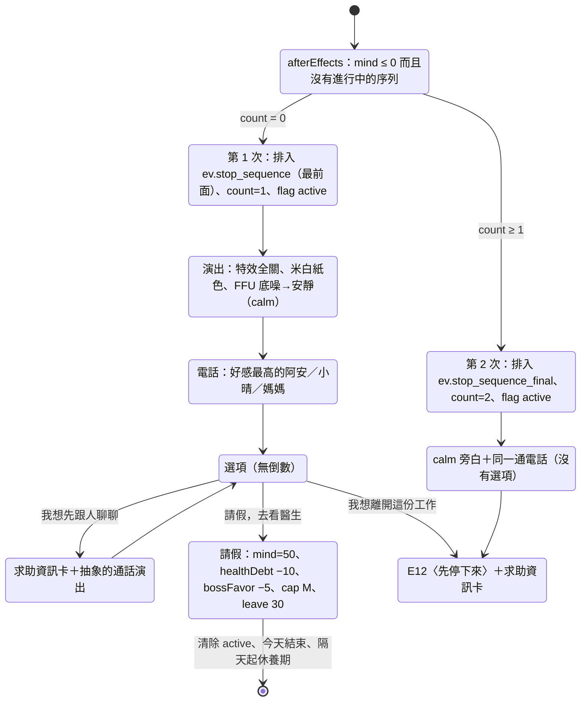

# 工程規格書 02：遊戲系統與規則

| 項目 | 內容 |
|---|---|
| 文件版本 | v1.3（2026-10-24：同步 00 §9.3 N1、N4、N6——§2.2、§2.6、§2.7、§3.4）；v1.2（2026-10-24：套用審查回合 1 的 lead 裁決，見 `00-index.md` §9——§2 時間預算重算（新訓日、跨場景往返、#8 依機制）、§3.4 `economy` 估值與 #4 找房、午餐與關心對話的統一、`chr.lao_k`、#3 著裝教學只跑一次、T73 日期）；v1.1（2026-10-24：§15 的變更請求已由 01 v1.1 裁決並合併，裁決見 `00-index.md` §4；附錄 B 已與 03、04 雙向對齊；`MachineStatus` 黃燈改名 `warn`） |
| 撰寫日期 | 2026-10-23 |
| 依據 | `docs/planning/game-design-doc.md` v1.0（下稱 **GDD**，含 §17 暫定決議）、`docs/specs/01-architecture.md` v1.0（下稱 **01**）、`CLAUDE.md` |
| 範圍 | GDD §15.1 MVP「第一年」的全部規則（精確到可以直接寫測試）；GDD §15.2 完整版以精簡表格涵蓋 |
| 讀者 | 實作 `src/core/` 的工程師 |
| 型別 | 一律引用 01 §5 `src/model.ts` 與 01 §18 的名稱。本文件**不**重新定義跨層型別；01 不足之處列在 §15 變更請求 |
| 邊界 | 小遊戲內部玩法與評分歸 03；畫面與演出歸 04。本文件只定義 `MinigameOutcome` 如何換算成數值變化與 KPI（§1.9） |

> **用語**：沿用 01 的「必須／應／可」。**⚑GDD 差異**＝本文件為了讓 GDD 的設計意圖成立而改動 GDD 的數字或規則，理由寫在同一處。
>
> **引用**：〔GDD §4.4〕、〔01 §7.5〕；本文件內部引用寫成「§3.4」。

---

## 目錄

0. [摘要與共通約定](#0-摘要與共通約定)
1. [數值規則](#1-數值規則)
2. [時間與節奏（解決 01 §17 R1）](#2-時間與節奏解決-01-17-r1)
3. [平衡規則（解決 01 §17 R2）](#3-平衡規則解決-01-17-r2)
4. [下班卡、加班、帶回家做、夜間行動、睡眠與 on-call](#4-下班卡加班帶回家做夜間行動睡眠與-on-call)
5. [快轉系統](#5-快轉系統)
6. [事件排程與觸發](#6-事件排程與觸發)
7. [職涯與經濟](#7-職涯與經濟)
8. [角色關係](#8-角色關係)
9. [伏筆與黑歷史本](#9-伏筆與黑歷史本)
10. [結局判定](#10-結局判定)
11. [敏感處理的系統面](#11-敏感處理的系統面)
12. [01 §17 R16 逐條確認](#12-01-17-r16-逐條確認)
13. [測試案例清單](#13-測試案例清單)
14. [調校常數總表](#14-調校常數總表)
15. [對 01 的變更請求](#15-對-01-的變更請求)
16. [「我的決定」清單](#16-我的決定清單)
- [附錄 A：MVP 事件數值表](#附錄-amvp-事件數值表)
- [附錄 B：需要 03／04 配合的介面點](#附錄-b需要-0304-配合的介面點)

---

## 0. 摘要與共通約定

### 0.1 一頁摘要

| 主題 | 結論 |
|---|---|
| 時鐘倍率（R1） | `balance.clock.realMsPerGameMinute = 150`（現實 1 秒＝遊戲 6.67 分）⚑GDD 是 1 秒＝1 分。理由：班中 540 遊戲分鐘在 1:1 下要 9 分鐘現實時間；150 讓「典型走動 25 秒」的玩家約 13:30 做完任務，「走動 2.5 倍」的玩家剛好撞到 17:30（§2.3） |
| full 關鍵日長度（R1） | 中位數 **166 秒（2.8 分）**；含隨機事件、16:30 緊急任務、on-call 的期望值 **≈ 182 秒（3.0 分）**；落在 2.5～4 分（§2.2；v1.2 以每天 1 次跨場景往返計） |
| MVP 一輪（R1） | 21 個劇本關鍵日 ≈ 49.1 分 ＋ 快轉 5.5 分 ＋ 建角 2.0 分 ＋ 結局 2.0 分 ＋ 條件與插播期望 0.7 分 ≈ **59.3 分**（§2.7；v1.2 依審查回合 1 重算，v1.1 是 59.5） |
| 完整版一輪（R1） | 42 個劇本關鍵日＋期望 4 個非劇本關鍵日 ≈ 127.4 分 ＋ 快轉 12.6 分 ＋ 建角與終章 7.5 分 ≈ **148 分**（§2.8） |
| 平衡檢查（R2） | 加權分數納入隱藏數值、伏筆期望值、機率期望值、黑歷史本、計數器與旗標的價值；差距 ＝ (max − min) ÷ max(核心選項的平均「牽動量」, 10)，門檻 **20%**；門檻卡另有上限（不能比最好的基本卡好超過 25% 平均牽動量）；每張卡至少一項扣分（§3） |
| GDD 範例的檢查結果 | GDD §5.5 六個範例**原始數值全部不過**（差距 29%～96%）；套用本文件的建議數值後**全部通過**（2%～17%），兩張門檻卡也調到上限內（§3.6） |
| 新增模組 | `core/workday.ts`、`core/thresholds.ts`、`core/minigame_rewards.ts`（各附 `*.spec.ts`），列在 §15 CR-01；`minigame_rewards.ts` 的 `deriveMinigameEffects` 就是 03 CR-5 指的換算函式 |
| 對 01 的變更請求 | 19 條（§15），其中**必要** 8 條（CR-01～06、14、15：沒有它規則寫不出來或測試無法編譯），文字修訂 7 條，建議 4 條。**v1.1：已由 01 v1.1 裁決合併**（拒絕 CR-07、CR-12；CR-13 延後；見 §15 開頭） |

### 0.2 數字的約定

1. **儲存精度**：數值以 `number` 儲存，只有 `StatRule.integer = true` 的 4 項（`favor`、`money`、`goldenHandcuffs`、`evidence`）會四捨五入。其他數值可以有小數（例：加班 1 小時精神 −1.5、健康債 +0.5）。
2. **比較用原值，顯示才取整**：門檻判定（「≤35」）一律比較儲存值；HUD、chip 顯示 `Math.round`。
3. **四捨五入**：本文件寫「取整」都指 `Math.round`（.5 進位）；金額寫「取整到百元」指 `Math.round(x / 100) × 100`。
4. **時間單位**：「遊戲分」＝ `minuteOfDay` 的分鐘；「現實秒」＝ app 量到的秒數。`dayIndex` 0 ＝ 2027-03-01（星期一），星期 ＝ `dayIndex mod 7`（0＝一）。
5. **月**：「本月」以日曆月為準；`yyyymm` 數字（例：`202712`）用於只需要記錄月份的系統計數器。
6. **機率**：寫成 0～1 的小數；「25%」＝ 0.25。所有機率都經過 `clamp(·, 0, 1)`。
7. **順序**：寫「依序」的步驟，必須依表列順序執行，因為 RNG 消耗順序是契約（01 §7.7）。

### 0.3 系統計數器與旗標登錄表

01 的 `GameState` 沒有為下列規則狀態預留欄位。本文件**用 `counters`／`flags` 表達**（不需要改型別），所有 ID 都要登錄在 `content/flags.ts`，前綴 `sys_` 代表「由 core 依規則讀寫」；內容（事件效果）只能依「內容可寫」欄的規定使用。§15 CR-12 建議之後升級成具名欄位。

**計數器**（`CounterId`，未設定視為 0）

| ID | 意義 | 寫入者 | 重設時機 | 內容可寫 |
|---|---|---|---|---|
| `cnt.sys_cleanroom_streak_min` | 今天連續待在無塵室的遊戲分鐘 | `clock.ts` | `dayStart`；進入非無塵室地點；午餐選「去吃飯」 | 否 |
| `cnt.wip_pressure` | WIP 壓力 0～100（§1.10） | 內容＋`economy.ts` 月結 | 不重設（core 夾限 0～100） | 是（`counter` 效果） |
| `cnt.sys_kpi_penalty` | 本考核期 KPI 扣分（正數＝扣） | `minigame_rewards.ts`、內容 | 考績結算後 | 是（負值＝加分，例：範例三「KPI +5」寫 −5） |
| `cnt.sys_ps_adjust` | 本考核期 PS 事件修正（GDD §4.4「事件修正」） | 內容 | 考績結算後 | 是 |
| `cnt.sys_line_kpi_sum`、`cnt.sys_line_kpi_n` | 產線 KPI 的月取樣累計 | `economy.ts` 月結 | 考績結算後 | 否 |
| `cnt.sys_grind_streak` | 連續「拚」月數（可為小數：週 ＝ 0.25） | `fast_forward.ts` | 生活方針選休養或運動 → 0 | 否 |
| `cnt.sys_exercise_bonus` | 最大體力的運動加成（core 夾限 0～10） | 內容 | 不重設 | 是 |
| `cnt.sys_mind_zero_count` | 「停下來」序列啟動次數 | `thresholds.ts` | 不重設 | 否 |
| `cnt.sys_leave_until_day` | 休養期最後一天的 `dayIndex`；0 ＝ 沒有休養（休養不可能結束在第 0 天） | `thresholds.ts` | 休養結束 → 0 | 否 |
| `cnt.sys_last_care_month` | 上次「身心警訊關心對話」的 `yyyymm` | `thresholds.ts` | — | 否 |
| `cnt.sys_last_safety_prompt_month` | 上次快轉安全提示的 `yyyymm` | `fast_forward.ts` | — | 否 |
| `cnt.sys_oncall_unanswered` | on-call 沒接的累計次數（GDD §9.6） | 內容 | 不重設 | 是 |
| `cnt.sys_oncall_weeks_month` | 本月輪值週數（發薪用） | `fast_forward.ts`、`workday.ts` | 5 號發薪後 | 否 |
| `cnt.sys_ff_nonstat_accum` | 快轉中「非數值方針效果」的累積比例 | `fast_forward.ts` | 累積 ≥1 套用後 −1 | 否 |
| `cnt.sys_gowning_perfect_streak` | 著裝連續全對次數 | `minigame_rewards.ts` | 有失誤 → 0 | 否 |
| `cnt.sys_save_policy_months` | 「省」方針累計月數（E08） | `fast_forward.ts` | 不重設 | 否 |
| `cnt.sys_learning_gap_months` | 連續沒有進修的月數（GDD §4.3「腳麻」） | `fast_forward.ts` | 選「學」或進修行動 → 0 | 否 |
| `cnt.sys_overtime_week_hours` | 本週加班時數（完整版 60 小時警戒） | `workday.ts`、`fast_forward.ts` | 每週一 | 否 |
| `cnt.sys_major_violations` | 重大違規次數（GDD §9.6） | 內容 | 不重設 | 是 |
| `cnt.sys_x_grades` | 累積拿到 X 的次數 | `review.ts` | 不重設 | 否 |
| `cnt.sys_borrow_month` | 上次「跟家人借錢」事件的 `yyyymm` | `economy.ts` | — | 否 |
| `cnt.sys_pip_weeks`、`cnt.sys_pip_fails` | PIP 已進行週數、失敗週數（§7.9） | `review.ts` | PIP 解除或結束 | 否 |

**旗標**（`FlagId`；`scope` 依 01 `FlagDef`）

| ID | scope | 意義 | 寫入者 | 內容可寫 |
|---|---|---|---|---|
| `flag.sys_hd30_fired`、`flag.sys_hd60_fired`、`flag.sys_hd85_fired` | run | 健康債門檻事件已觸發（只觸發一次） | `thresholds.ts` | 否 |
| `flag.sys_stop_sequence_active` | run | 「停下來」序列進行中；`selectors.presentationMood` 回傳 `calm` | `thresholds.ts` | 否 |
| `flag.sys_leave_request_30`、`flag.sys_leave_request_14` | keyDay | 內容要求「休養 30 天／請假 2 週」 | 內容 | 是 |
| `flag.sys_end_day_requested` | keyDay | 內容要求「今天到此為止，直接就寢」 | 內容 | 是 |
| `flag.sys_review_cap_m` | run | 下一次考績最高只到 M（GDD §13.3） | 內容 | 是 |
| `flag.sys_grade_upgrade_requested` | run | 申訴成功：最近一次考績升一級 | 內容 | 是 |
| `flag.sys_pip_active` | run | PIP 進行中（快轉強制週分段） | `review.ts` | 否 |
| `flag.sys_written_warning` | run | 已收到書面警告 | 內容、`review.ts` | 是 |
| `flag.sys_major_mistake_period` | run | 本考核期有重大失誤（考績直接 X） | 內容 | 是 |
| `flag.sys_lunch_skipped` | keyDay | 今天沒吃午餐 | 內容（午餐微事件） | 是 |
| `flag.sys_early_arrival` | keyDay | 沒吃早餐，班中提早 10 分鐘開始 | 內容（起床事件） | 是 |
| `flag.sys_blackout_today` | keyDay | 今天已經「眼前一黑」過 | `thresholds.ts` | 否 |
| `flag.sys_no_ring_tonight` | keyDay | 今晚不擲 on-call 電話（病假、休養） | `thresholds.ts` | 否 |
| `flag.rookie_technician_tonight` | keyDay | 今晚是菜鳥技術員值班（沿用 01 §5.3.4 的 ID） | `workday.ts` | 否 |
| `flag.tonight_date_with_aan` | keyDay | 今晚原本跟阿安有約（沿用 01 §8.5） | 內容 | 是 |
| `flag.sys_bonded_help_azhe`、`_xiaoqing`、`_haoge`、`_meiling`、`_vivian` | run | 該角色「生死之交」的一次救援已用掉（§8.4） | `effects.ts` | 否 |

### 0.4 本文件定義的 core 函式（總覽）

> 函式與它的輸入輸出型別放在 core 模組內（跟 01 的 `EvalContext`、`CheckpointInput` 同一種做法：只在 core 內部使用，不是跨層資料）。

| 模組 | 函式 | 章節 |
|---|---|---|
| `core/selectors.ts` | `maxStamina`（公式擴充）、`mindRecoveryMultiplier`、`linAffinity`、`affinityTier`、`onCallTonight`、`isWindPeriod`、`presentationMood` | §1.4、§8 |
| `core/stats.ts` | `scaleEffects`（快轉比例、生活行動減半） | §1.3、§5.4 |
| `core/workday.ts`（新） | `planOvertime`、`applyClockOut`、`applyLifeAction`、`sleepRecovery`、`resolveSleep`、`applyWrapUp` | §2.4、§4 |
| `core/thresholds.ts`（新） | `runThresholdMonitor` | §1.6、§11 |
| `core/minigame_rewards.ts`（新） | `deriveMinigameEffects` | §1.9 |
| `core/fast_forward.ts` | `planSegment`、`segmentFraction`、`beginSegment`（01） | §5 |
| `core/economy.ts` | `runCalendarHooks`、`buildPayslip`、`quarterlyBonus`、`yearEndBonus` | §1.8、§7 |
| `core/review.ts` | `computeKpi`、`computePs`、`blackBookPsAdjust`、`simulatePeerPs`、`allocateGrade`、`raisedSalary`、`evaluateProbation`、`runReview` | §7 |
| `core/black_book.ts` | `entryScore`、`recordEntry`（01）、`citeForReview`（01） | §9 |
| `core/event_scheduler.ts` | `tagMultiplier` | §6.3 |
| `core/key_day_planner.ts` | `planNext`（01，加上休養期規則） | §6.6、§11.3 |
| `core/endings.ts` | `checkMidwayEndings`、`judgeTermEnding` | §10 |
| `core/balance_check.ts` | `valueChoice`、`valueEvent`、`coreChoiceSpread`（簽名變更）、`thresholdCardViolations`、`costlessChoices`、`findDominatedChoices`、`visibleDeltaViolations` | §3 |

---

## 1. 數值規則

### 1.1 `StatRule` 表（`content/economy.ts` 的 `stats`）

| StatId | 中文 | min | max | initial | visibility | integer | lowLine | overflowTo |
|---|---|---|---|---|---|---|---|---|
| `stamina` | 體力 | 0 | `'maxStamina'` | 80 | visible | false | 35 | null |
| `mind` | 精神 | 0 | 100 | 70 | visible | false | 35 | null |
| `skill` | 專業 | 0 | 100 | 22（履歷覆寫） | visible | false | null | null |
| `bossFavor` | 主管好感 | 0 | 100 | 50（履歷覆寫） | visible | false | null | null |
| `favor` | 同事人情 | 0 | 5 | 3（履歷覆寫） | visible | true | null | `{ stat: 'network', perUnit: 3 }` |
| `money` | 存款 | null | null | 60000（履歷覆寫） | visible | true | null | null |
| `healthDebt` | 健康債 | 0 | 100 | 0 | hidden | false | null | null |
| `blame` | 背鍋值 | 0 | 100 | 0 | hidden | false | null | null |
| `scheming` | 心機 | 0 | 100 | 10（履歷覆寫） | hidden | false | null | null |
| `conscience` | 良心 | 0 | 100 | 70 | hidden | false | null | null |
| `lifeSatisfaction` | 生活滿足 | 0 | 100 | 50 | hidden | false | null | null |
| `network` | 人脈網 | 0 | 100 | 12（履歷覆寫） | hidden | false | null | null |
| `visibility` | 能見度 | 0 | 100 | 20 | hidden | false | null | null |
| `goldenHandcuffs` | 金手銬 | 0 | 5 | 0 | hidden | true | null | null |
| `evidence` | 證據包 | 0 | 10 | 0 | hidden | true | null | null |

- **專業不會下降**（GDD §4.1）：`skill` 的負向 delta **必須**被忽略（實際變化 0，不記錄 delta）。驗證器另外把內容裡的負向 `skill` 效果列為 error（§15 CR-15）。
- **精神與體力的 0**：夾限到 0 之後由 `afterEffects` 的門檻監看處理（§1.6），不是在 `applyEffects` 裡處理。

### 1.2 履歷初始值（`content/resumes.ts`，GDD §3.2）

| ResumeId | skill | bossFavor | favor | money | 其他 `initialStats` | `initialAffinity` | `minigameTolerance` | `initialFlags` |
|---|---|---|---|---|---|---|---|---|
| `res.beiwan_materials`（北灣材料所） | 25 | 50 | 2 | 60000 | network 15 | — | — | — |
| `res.lujiang_electronics`（鷺江電子所） | 18 | 55 | 3 | 45000 | network 10、scheming 15 | — | — | — |
| `res.technician_transfer`（技術員轉職） | 22 | 50 | 4 | 260000 | network 10 | `chr.meiling` +30 | `mg.spc` +1 | `flag.ex_operator` |

角色的基礎好感見 §8.2；履歷的 `initialAffinity` 是加在基礎值上。

### 1.3 效果套用管線（補充 01 §5.3.3）

01 §5.3.3 的 `stat` 步驟擴充成下列順序（新增的是 2b、2c、2d）：

| 步驟 | 內容 |
|---|---|
| 1 | `delta = evaluateNumber(effect.delta)` |
| 2 | 修正器乘數（01：`statGain` 正值乘 `positiveMultiplier`、負值乘 `negativeMultiplier`） |
| 2b | **精神回復倍率**：`stat = 'mind'` 而且 `delta > 0` → `delta × mindRecoveryMultiplier(state)`（§1.4） |
| 2c | **專業不降**：`stat = 'skill'` 而且 `delta < 0` → `delta = 0` |
| 2d | **生死之交擋鍋**：`stat = 'blame'` 而且 `delta ≥ 8` → §8.4 的規則可能把 `delta` 改成 0 |
| 3 | 風向期：`stat = 'bossFavor'` 而且 `isWindPeriod` → `× review.windBossFavorMultiplier`（1.5，正負都乘，GDD §2.5「增減 ×1.5」） |
| 4～7 | 01 原文：夾限、溢出、取整、記錄實際 delta |

**生活行動減半**（GDD §4.3「生活滿足 ≤10：生活行動效果減半」）：`applyLifeAction` 在把行動的效果交給 `applyEffects` 之前，先呼叫 `scaleEffects(effects, 0.5, { positiveOnly: true })`，只縮放最上層 `stat`／`affinity` 的正值常數。

```ts
// src/core/stats.ts
export interface ScaleOptions {
  /** true：只縮放正值（生活行動減半）；false：正負都縮放（快轉比例） */
  positiveOnly: boolean;
}
/** 回傳新的效果陣列；規則見 §5.4 表「快轉的效果縮放」 */
export function scaleEffects(effects: readonly Effect[], factor: number, options: ScaleOptions): Effect[];
```

### 1.4 衍生公式（`core/selectors.ts`）

```ts
// 最大體力（GDD §4.4，擴充「拚」的暫時上限 −10，⚑GDD §2.3 只寫了效果沒寫公式）
// = 100 − ⌊healthDebt ÷ 2⌋ + min(10, cnt.sys_exercise_bonus) − (policy.work === 'grind' ? 10 : 0)
export function maxStamina(state: DeepReadonly<GameState>, content: ContentBundle): number;

// 精神回復倍率（GDD §4.4）：lifeSatisfaction ≥60 → 1.3；≤25 → 0.7；其他 1.0
export function mindRecoveryMultiplier(state: DeepReadonly<GameState>): number;

// 林課長的 −100～100 好感（01 D20）＝ bossFavor × 2 − 100
export function linAffinity(bossFavor: number): number;

// 好感段落：≤−40 hostile；−40 < a < 0 cold；0 ≤ a < 40 neutral；40 ≤ a < 80 trusted；≥80 bonded
export function affinityTier(affinity: number): AffinityTier;

// 考績風向（GDD §4.2）：目前 PS 在 10 人中的名次（§7.4 用當下數值試算，NPC 用上次考績的 PS；沒有就用 base）
// 名次 1～3 → 'smile'；4～8 → 'flat'；9～10 → 'frown'
export function reviewWind(state: DeepReadonly<GameState>, content: ContentBundle): ReviewWind;

// 機台狀態（GDD §4.2 燈號）：health ≥ yellowBelow(40) → 'run'（綠）；redBelow(20)～39 → 'warn'（黃；CR-08 已由 01 v1.1 接受）；<20 → 'down'（紅）
export function machineStatus(health: number, rules: BalanceRules['machines']): MachineStatus;

// 今晚是否 on-call：今天的 KeyDayDef.onCall，或（章節 ≥ ch3 且今天落在輪值週，§4.6）
export function onCallTonight(state: DeepReadonly<GameState>, content: ContentBundle): boolean;

// 氛圍（01 §10.5）：flag.sys_stop_sequence_active → 'calm'；mind ≤15 → 'warning'；mind ≤35 → 'low'；其他 'normal'
export function presentationMood(state: DeepReadonly<GameState>): PresentationMood;
```

| 公式 | 定義 | 出處 |
|---|---|---|
| KPI | `0.6 × 小遊戲平均 ＋ 0.4 × 產線 KPI − cnt.sys_kpi_penalty`，夾限 0～100；細節 §7.3 | GDD §4.4、01 D35 |
| PS | `0.35 × KPI ＋ 0.30 × bossFavor ＋ 0.15 × visibility ＋ 0.20 × (100 − blame) ＋ cnt.sys_ps_adjust ＋ 同事評價 ＋ 黑歷史本修正`；細節 §7.4 | GDD §4.4 |
| 小遊戲難度旗標 | `fatigued = stamina ≤ 20`、`stressed = mind ≤ 35`（填入 `MinigameContext`） | GDD §8 共通規則 |
| 走路速度 | `stamina ≤ 20` → ×0.7（app 讀 selector 後交給 render，附錄 B） | GDD §4.1 |

### 1.5 各數值的增減來源

> 只列**系統規則**產生的變化。事件選項的數值在內容裡（MVP 見附錄 A）。「關鍵日」與「快轉」分開列，因為快轉只套用方針與月結。

**可見數值**

| 數值 | 關鍵日的系統來源 | 快轉的系統來源 |
|---|---|---|
| 體力 | 早餐店 +5；交通車補眠 +5；每項任務 −`TaskDef.staminaCost`（3～8）；小遊戲節點 −`MinigamePreset.staminaCost`；full／review 關鍵日下班卡 −25；加班每小時 −6；黃光區每小時額外 −3（`LocationDef.staminaPerHour`）；睡眠回復（§4.5）；歸零「眼前一黑」設為 30 | 抵達關鍵日時重設為 `min(maxStamina, 80)`，再套方針的體力效果（§5.3） |
| 精神 | 準時下班 +6；加班每小時 −1.5；on-call 電話響 −8；生活行動；mind ≤15 不再額外扣 | 方針效果；快轉 on-call 每通 −2（§5.7） |
| 專業 | 加班時沒有剩餘任務：每小時 +1；小遊戲結果（§1.9） | 方針效果；第一章重點學程微事件 +1.5／週 |
| 主管好感 | 加班每小時 +1（當天上限 +4，§4.2）；未完成任務 −3／項；風向期 ×1.5 | 方針效果；工時申報 >46 小時 −5（§7.7） |
| 同事人情 | 只有事件與生活行動 | 方針「社交」50% +1 |
| 存款 | 早餐 −60；生活行動 | 日曆掛鉤（§1.8）：房租、薪資、孝親費、月結開銷、利息、分紅、年終 |

**隱藏數值**

| 數值 | 關鍵日的系統來源 | 快轉／月結的系統來源 |
|---|---|---|
| 健康債 | 加班每小時 +0.5；on-call 被吵醒 +2；帶回家做 +1；憋尿（#23）+3；眼前一黑 +8；mind ≤15 時每個關鍵日睡前 +1 | 方針（拚 6～24 遞增，§5.5；穩 +2；休養 −4；運動 −6）；mind ≤15 時每月 +4（週分段 +1）；快轉 on-call 每通 +0.5 |
| 背鍋值 | 小遊戲結果（§1.9）；未完成任務 +1／項 | 月結 −2；考績結算後 ×0.6 |
| 心機、良心 | 只有事件 | — |
| 生活滿足 | 準時下班 +2；加班每小時 −1；帶回家做 −3；生活行動 | 方針；工時申報少報每 10 小時 −2（完整版） |
| 人脈網 | 交通車滑論壇 +1；人情溢出每枚 +3 | 方針（學 +3）；「腳麻」連續 6 個月沒進修 −5（§7.8） |
| 能見度 | 只有事件 | 方針；月結 −5 |
| 金手銬、證據包 | 只有事件（完整版：購車、購屋、留任、外派） | — |

### 1.6 門檻效果（`core/thresholds.ts` 的 `runThresholdMonitor`）

監看在每個 `afterEffects` 檢查點、以及快轉分段模擬完之後執行（01 §7.2）。**觸發一次**＝用 `flag.sys_*_fired` 記錄，終身只觸發一次；**每次**＝每次跨過都觸發；**持續**＝只要在門檻內就生效（selector 判斷，不排事件）。

| 數值 | 門檻 | 效果 | 時機與次數 | 在快轉中 |
|---|---|---|---|---|
| 體力 | ≤35 | HUD「危」 | 持續 | — |
| 體力 | ≤20 | `fatigued`；走路 ×0.7 | 持續 | — |
| 體力 | =0 | 排入 `ev.blackout`（`afterCurrent`）：bossFavor −5、healthDebt +8、`setStat stamina 30`、設 `flag.sys_end_day_requested`、`flag.sys_no_ring_tonight` | 每個關鍵日最多 1 次（`flag.sys_blackout_today`） | 不會發生（抵達關鍵日才重設體力） |
| 精神 | ≤35 | `stressed`；`presentationMood = 'low'`；內容的「爆氣」卡（`requires: mind lte 35`） | 持續 | — |
| 精神 | ≤15 | `'warning'`；關心對話（§11.4）；睡前健康債 +1 | 關心對話每日曆月最多 1 次 | 關心對話一律以 `scene` 呈現（標籤 `safety`、沒有倒數、不降級；v1.2 審查回合 1 矛盾 3）；健康債每月 +4 |
| 精神 | =0 | 「停下來」序列（§11.2） | 每次歸零；第 2 次直接 E12 | 序列以 `scene` 呈現，不降級（§15 CR-09） |
| 主管好感 | ≤20 | 「被電」：標籤 `calledOut` 的早會事件權重 ×2；標籤 `badTask` ×1.5；16:30 緊急任務 +10% | 持續（`tagMultiplier`） | 同 |
| 主管好感 | ≥80 | 16:30 緊急任務 +20%（GDD「信任的代價」） | 持續 | — |
| 同事人情 | =0 | 協調卡上鎖（內容 `requires: favor gte 1`） | 持續 | — |
| 存款 | <0 | 月結利息 1.5% | 每月 | 同 |
| 存款 | < −50,000 | 排入 `ev.borrow_from_mom`（借 NT$60,000、媽媽好感 −15；或強制 1 個月「拚」） | 每月最多 1 次（`cnt.sys_borrow_month`） | 微事件 |
| 健康債 | ≥30 | MVP：微事件 `ev.health_check_red`（健檢紅字簡版）；完整版：條件關鍵日「健檢紅字日」 | 觸發一次 | 微事件 |
| 健康債 | ≥60 | 微事件 `ev.body_alarm`（痛風／腎發炎／心悸，`roll` 三選一） | 觸發一次 | 微事件 |
| 健康債 | ≥85 | `ev.doctor_final_warning`（scene）：「請假 2 週」或「繼續撐」 | 觸發一次 | scene，不降級（標籤 `safety`） |
| 健康債 | ≥100 | 中途結局 E13 | — | 同 |
| 背鍋值 | ≥60 | 標籤 `blame` 的事件權重與 clock 機率 ×1.5 | 持續（`tagMultiplier`） | 同 |
| 背鍋值 | ≥85（考績時） | PIP（§7.9） | 每次考績判定 | — |
| 生活滿足 | ≥60／≤25 | 精神回復 ×1.3／×0.7 | 持續 | 同 |
| 生活滿足 | ≤10 | 生活行動正值效果 ×0.5 | 持續 | 方針生活效果**不**減半（只限夜間行動） |

**同一批效果跨過多個門檻時的順序**（依序，每項最多排一個事件）：結局（E13）→ 精神歸零 → 體力歸零 → 健康債 85 → 60 → 30 → 精神 ≤15 關心 → 借錢。結局成立時後面全部不跑。

### 1.7 關鍵日的日結算順序

1. `dayStart`：清除 `scope: 'keyDay'` 旗標（01 §6.7 已做）、`cnt.sys_cleanroom_streak_min = 0`、`career.bossFavorFromOvertimeToday = 0`；跑**日曆掛鉤**（§1.8，今天是 1／5／10 號或月底時）；跑 `dayStart` 檢查點（伏筆、好感衰減不在這裡，在月結）。
2. 依 `KeyDayDef.phases` 進入各時段（01 §6.4）；`shift` 時鐘走動（§2）。
3. `clockOut`：下班卡（§4.2～4.4）。
4. `evening`：生活行動（§4.4）；發薪日的薪資單文件在 `evening` 開始時開啟（沒有 `evening` 的變體在最後一個時段結束時開啟）。
5. `sleep`：mind ≤15 → healthDebt +1；on-call 判定（§4.6）；睡眠回復（§4.5）。
6. 跨日 → `planNext`（01 §7.9）。今天若是月底，月結已經在步驟 1 的日曆掛鉤跑過（月結在**月底那天的 dayStart** 執行，見下節）。

### 1.8 日曆掛鉤與月結（`core/economy.ts` 的 `runCalendarHooks`）

不論關鍵日或快轉，**每一天**依序檢查下列掛鉤（快轉中逐日跑，關鍵日在 `dayStart` 跑）：

| 順序 | 條件 | 內容 |
|---|---|---|
| 1 | 每月 1 號 | 房租（§7.6）；宿舍第 4 個月 → 排入 `ev.dorm_move_out`（微事件，選雅房或合租） |
| 2 | 每月 5 號 | 薪資單（§7.5）：本薪＋上月申報加班費＋上月 on-call 津貼，預扣 8%；之後 `career.overtimeHoursDeclaredThisMonth = 0`、`career.onCallCallsThisMonth = 0`、`cnt.sys_oncall_weeks_month = 0` |
| 3 | 每月 10 號 | 孝親費：存款 −`filialAmount`；`chr.mom` 好感 ±（§7.6） |
| 4 | 1 月 20 日 | 年終獎金（§7.5） |
| 5 | 每月最後一天 | **月結**（下表），然後跑 `monthEnd` 檢查點 |

**月結順序**（依序）

| # | 步驟 | 規則 |
|---|---|---|
| 1 | 生活開銷 | 存款 −（伙食 9,000 ＋ 手機雜支 3,500 ＋ 保險 2,500 ＋ 交通 0／1,500） |
| 2 | 利息 | 存款 <0 → 存款 −`round(|存款| × 0.015)` |
| 3 | 自然衰減 | blame −2；visibility −5（不套修正器、不乘風向） |
| 4 | 產線 KPI 取樣 | `cnt.sys_line_kpi_sum += 負責機台平均健康`；`cnt.sys_line_kpi_n += 1` |
| 5 | 機台 | 健康 <40 的機台自動 PM：+30（上限 100）；紅燈（<20）的機台每台 WIP +5；然後 WIP −15（§1.10） |
| 6 | 好感衰減 | §8.5 |
| 7 | 腳麻 | §7.8（第三章起） |
| 8 | 工時申報 | MVP：`overtimeHoursDeclaredThisMonth = overtimeHoursThisMonth`（01 D31 全額申報）；申報 >46 → bossFavor −5；`overtimeHoursThisMonth = 0` |
| 9 | 季分紅 | 3／6／9／12 月：§7.5 |
| 10 | 申訴、PIP | 處理到期的申訴與 PIP 週（由伏筆與微事件驅動，§7.9） |
| 11 | 借錢檢查 | 存款 < −50,000 而且本月還沒觸發 → 排入 `ev.borrow_from_mom` |

> 薪資在 5 號發「當月」薪資（例：3/5 發 3 月本薪）。這樣 MVP 期間（2027/03～2028/02）剛好 12 次發薪，跟 GDD §9.3 的試算（3 個月 Q1 ＋ 9 個月 Q2 ＝ 76.8 萬）一致。加班費與 on-call 津貼是「上個月」的，跟著下一次薪資發。

### 1.9 小遊戲結果的換算（與 03 的介面，`core/minigame_rewards.ts`）

**分工**（採用 03 §9 CR-5）：03 的 `MinigameLogic.finish()` 回傳 `score`、`result`、`gameMinutes`（**額外**分鐘，03 CR-4）、`facts`，以及**不含 `stat`** 的 `effects`（旗標、伏筆，例：Hold Lot 的揭曉伏筆）。所有數值變化由 core 依本節的換算表從 `facts` 產生；換算表是內容常數（§15 CR-03 `balance.minigameRewards`），所以 02 是數值的唯一來源。

```ts
// src/core/minigame_rewards.ts
export interface MinigameRewardContext {
  preset: string;
  /** 由任務啟動（Interaction.task）或時段啟動（著裝、半夜電話）時為 true */
  fromTaskOrPhase: boolean;
  /** 進入時段的種類（03 CR-3）；早上的著裝要把「退回重穿」換算成早會遲到 */
  source: 'event' | 'task' | 'gowning' | 'onCall';
  content: ContentBundle;
}
export interface MinigameReward { effects: Effect[]; kpiSample: number | null; staminaCost: number; gameMinutes: number }
export function deriveMinigameEffects(outcome: MinigameOutcome, context: MinigameRewardContext): MinigameReward;
```

**`finishMinigame` 的套用順序**（依序）：(1) 體力 −`preset.staminaCost`；(2) 時間 ＋(`preset.gameMinutes` ＋ `outcome.gameMinutes`)，早上著裝例外（時段之間的時刻是設定，03 §3.8）；(3) `outcome.effects`；(4) `deriveMinigameEffects` 的效果；(5) KPI 樣本；(6) 事件節點依 `result` 分支（沒有 `partial` 分支時走 `fail`，01 §7.8）。教學局（`facts.tutorial === true` 或著裝 `mode: 'tutorial'`）只套用**正值**效果。

**換算表**（03 §10.1 I-1 的建議起點，02 定案）

| 小遊戲 | facts 條件 | 效果 | 說明 |
|---|---|---|---|
| `mg.gowning` | `perfect` | `chance 0.2` → 美玲姐 +1；`cnt.sys_gowning_perfect_streak` +1 | GDD「偶爾」 |
| `mg.gowning` | `mistakes ≥ 1` | `cnt.sys_kpi_penalty` ＋`mistakes`；streak 歸 0 | 著裝不進 KPI 樣本，所以「每錯一件 KPI −1」改用扣分計數器，不會重複 |
| `mg.gowning` | `reGowned` 而且 `source = 'gowning'`（早上） | bossFavor −2、mind −2（早會遲到被念） | 03 I-5 |
| `mg.gowning` | `reGowned` 而且在班中（`regown` 預設組） | 無額外效果（時間已經真的扣了） | — |
| `mg.spc`（chart） | `timely` | skill ＋min(2, `timely`) | 03 I-1 |
| `mg.spc`（chart） | `lotsLost` | blame ＋5 × min(2, `lotsLost`) | GDD「+5～+10」 |
| `mg.spc`（chart） | `falseFlags ≥ 1` | bossFavor −2（一次）；`cnt.wip_pressure` ＋10 × min(3, `falseFlags`) | 「你 hold 這個幹嘛？」 |
| `mg.spc`（chart） | `holdTool` | `cnt.wip_pressure` ＋5 × `holdTool` | 整台 hold 讓 WIP 塞 |
| `mg.spc`（chart） | `result = 'fail'` | mind −3 | — |
| `mg.spc`（logTrace） | 全部 | 無 | 由範例一的事件節點處理（03 I-1） |
| `mg.hold_lot` | `consulted` | favor −1 | 打給阿哲 |
| `mg.hold_lot` | `qTimeExpired` | `cnt.wip_pressure` ＋5 × `qTimeExpired` | — |
| `mg.hold_lot` | `faSent` | `cnt.wip_pressure` ＋3 × `faSent` | FA 要排隊 |
| `mg.hold_lot` | `best`、`badReleases`、`overScraps` | **不立即給**；由 03 埋的三個揭曉伏筆在 14～28 天後給（下表） | 03 I-8：立即浮字會洩漏答案 |
| `mg.oncall` | `orderCorrect` | skill +1 | — |
| `mg.oncall` | `lotScrapped` | blame +8、`mc.et04` 健康 −10 | GDD §8.12 |
| `mg.oncall` | `ending = 'wentIn'` | stamina −15（`outcome.gameMinutes` 90 是夜裡的時間，不影響時鐘） | GDD「體力 −15，但保證安全」 |
| `mg.oncall` | `ending = 'timedOut'` | bossFavor −3（隔天被問） | 03 I-1 |
| `mg.oncall` | `seasoningShortcut` | `flag.used_seasoning_shortcut`（完整版主線的前身旗標） | — |

**Hold Lot 揭曉事件的數值**（03 §5.6 的三個伏筆；03 I-7）

| 伏筆 → 事件 | 效果 |
|---|---|
| `seed.hold_lot_customer_complaint` → `ev.hold_lot_complaint` | blame +15、mind −4（GDD「錯誤放行 → 客訴，背鍋 +15」） |
| `seed.hold_lot_fa_reworkable` → `ev.hold_lot_fa_reworkable` | bossFavor −3、mind −2（「你知道一片多少錢嗎？」） |
| `seed.hold_lot_wat_pass` → `ev.hold_lot_wat_pass` | skill +1、bossFavor +1（「判斷正確 → 專業 +1」延到揭曉） |

**KPI 樣本與成本**

| 小遊戲 | KPI 樣本 | 體力（`preset.staminaCost`，採用 03 §7.1 的建議值為定案） |
|---|---|---|
| `mg.gowning` | **不計**（每天都玩，計入會稀釋 KPI，03 I-2） | 0（已含在下班疲勞 −25）；`regown` 2 |
| `mg.spc` | `score`；`certification` 只寫 `career.certificationScore`，不計 | tutorial 3、ch2 4、certification 4、ch3 5、logTraceShort 0 |
| `mg.hold_lot` | `score` | tutorial 3、ch2 3、ch3 6、burstQuake 9、burstDuty 12 |
| `mg.oncall` | `score`（`drill` 不計） | drill 2、night 0、corridor 0（夜間成本見 §4.6） |
| 加班自動完成的任務 | 60 | — |
| 未完成任務 | 40 | — |

- **任務的體力**：小遊戲任務的 `TaskDef.staminaCost` 必須是 0（體力只扣預設組的，避免重複；驗證器檢查，§15 CR-15）；event 型快速任務才用 `TaskDef.staminaCost`。
- **難度修正器**（03 I-10）：第一章重點學程 `offset −1`（§5.11）；加班 ≥4 小時 → 下一個關鍵日 `mod.overtime_fog`（`minigameDifficulty`、`all`、`offset +1`、`durationDays 1`）。其他狀態（疲勞、壓力）由 `MinigameContext.fatigued`／`stressed` 表達，不另加修正器。
- **履歷容錯**（03 I-11）：只有技術員轉職 `mg.spc` +1（§1.2）。
- **上機認證**（03 I-12）：`score ≥ 60` 就過（03 的 `success` 與 `partial`），其他條件見 §7.2。
- **平衡估算用的期望值**（§3.4）：`valuation.minigameResultValues`——`mg.spc` chart success 3.0／fail −8.6、logTrace 0／0、`mg.hold_lot` success 2.5／fail −10、`mg.oncall` success 1.5／fail −9、`mg.gowning` 0／0。

### 1.10 機台健康與 WIP 壓力

| 項目 | 規則 |
|---|---|
| 負責機台 | `MachineDef.ownedByPlayer = true`：ET-03～ET-06（4 台）。ET-07 是完整版的 buy-off 機台，不算 |
| 初始健康 | ET-03 45、ET-04 70、ET-05 75、ET-06 80 |
| 快轉衰減 | 每個分段結束時，每台負責機台 −（衰減 × 分段比例）；衰減依工作方針：拚 4、穩 6、學 7、省 9（你越不顧，機台越差） |
| 自動 PM | 月結時健康 <40 → +30（上限 100） |
| 燈號 | ≥40 綠 `run`、20～39 黃 `warn`、<20 紅 `down`（`machineStatus`） |
| 產線 KPI | 考核期內每月月結取樣的負責機台平均健康的平均；沒有樣本時用當下平均 |
| WIP 壓力 | `cnt.wip_pressure`，初始 40（`createNewGame` 設定）。來源：SPC 誤判 +10／次、SPC hold 機台 +5／次、Q-time 過期 +5／張、送 FA +3／張（§1.9）、地震 +20、範例六「hold 整台」+15、紅燈機台每台每月 +5；月結 −15；夾限 0～100 |
| WIP 的用途 | #19「解 hold 解到崩潰」的觸發條件（≥60，§6.5）；標籤 `wip` 的隨機事件權重 ×(1 ＋ WIP ÷ 100) |

---

## 2. 時間與節奏（解決 01 §17 R1）

### 2.1 問題與解法

R1 的根源：班中 08:30～17:30 共 540 遊戲分；GDD 的 1 秒＝1 分讓「只靠時鐘走到下班」需要 9 分鐘現實時間。解法分三層：

1. **一天的長度由內容量決定，不由時鐘決定**：有了「提早收尾」（§2.4），玩家做完任務就能跳到 16:30 → 17:30，所以時鐘倍率幾乎不影響一天的總長度，只影響「做完任務時牆上是幾點」與「閒晃要付多少遊戲時間」。
2. **時鐘倍率**用「走動慢 2.5 倍的玩家剛好撞到 17:30」來定（§2.3），讓時鐘有壓力但不懲罰正常玩家。
3. **內容量**用時間預算表控制（§2.2）：MVP 的 full 關鍵日只有 2 項任務 ＋ 1 個主事件。⚑GDD §2.2 寫「任務清單 3～5 項」，MVP 改為 2 項（1 個小遊戲任務 ＋ 1 個快速任務），完整版第三章起 3 項。理由：3～5 項在任何時鐘倍率下都超過 4 分鐘（見 §2.2 的敏感度列）。

### 2.2 full 關鍵日時間預算（中位數玩家）

| 時段 | 內容 | 現實秒 | 遊戲分 | 說明 |
|---|---|---|---|---|
| wake 06:30 | 手機 2～3 則群組訊息、早餐一鍵 | 10 | （設定） | 時段之間時間是「設定」不是流逝（01 §6.4） |
| commute 07:00 | 補眠／滑論壇一鍵 | 4 | （設定） | — |
| gowning 07:25 | 著裝 QTE | 10 | 15 | 設定「自動著裝」時 2 秒 |
| briefing 07:40 | 1 句早會摘要＋（可能）1 個一鍵選擇 | 8 | （設定到 08:30） | MVP 沒有早會小遊戲（01 D29）。v1.2：摘要從 1～2 句縮成 1 句（12 → 8 秒），抵銷下面的跨場景往返 |
| shift：走動 | 3 段路（任務 1、任務 2、主事件地點） | 25 | 167 | 25 秒 × 6.67 |
| shift：跨場景往返（每天最多 1 次，v1.2 R1-D） | bay → 更衣室（轉場卡）→ 辦公室 → 回 bay：2 次轉場各 1 秒（時鐘暫停）＋多走 4 秒 | 6 | 42 | 再進入無塵室 15（自動著裝，01 §6.5-10）＋ 4 秒 × 6.67 ≈ 27；沒有往返的日子少 6 秒、42 分 |
| shift：任務 1（小遊戲） | SPC 或 Hold Lot | 35 | 30 | 03 的預設組已對齊：班中 SPC ≤40 秒、Hold Lot 每張 ≤15 秒（附錄 B.1 I-3） |
| shift：任務 2（快速任務） | `TaskDef.action.kind = 'event'`：1～2 句＋1 個選擇 | 10 | 20 | — |
| shift：主事件 | 劇本事件（台詞＋選擇＋結果） | 40 | 20 | `EventDef.gameMinutes` 預設 20 |
| shift：午餐 | 12:00 的 `micro` 事件「中午跟誰吃」 | 4 | 60 | 不佔對話名額（01 §7.4-3） |
| shift：提早收尾 | 一鍵 → 16:30 → 17:30 | 2 | 跳到 17:30 | §2.4 |
| clockOut | 下班卡 | 4 | — | — |
| evening | 生活行動一鍵 | 6 | — | — |
| sleep | 就寢（不是 on-call 夜） | 2 | — | — |
| **合計** | | **166 秒（2.8 分）** | 班中 339 分＝**14:09 做完任務** | v1.1 是 164 秒、297 分（13:27）；v1.2 以「每天 1 次往返」計（保守） |

**變動項的期望值**

| 變動項 | 發生機率 | 額外秒數 | 期望秒數 |
|---|---|---|---|
| 日常隨機事件（`shiftStart`） | 0.35（`randomEventDailyChance`） | 30 | 10.5 |
| 16:30 緊急任務 | 0.15（基本值） | 25 | 3.8 |
| on-call 夜電話響（只限 on-call 夜，MVP full 關鍵日約 1 成是 on-call 夜） | 0.1 × 0.37 | 45 | 1.7 |
| **full 關鍵日期望長度** | | | **≈ 182 秒（3.0 分）** |

**敏感度**（給調校用；每列只改一個變數。v1.2 註：下表以 v1.1 的基準 164 秒計算；新基準 166 秒，各列約 +2 秒，結論不變；N6（00 §9.3）：以新基準的完整重算延到 Stage 3 實測時鐘倍率後一併進行）

| 改動 | full 關鍵日中位數 |
|---|---|
| 基準 | 164 秒 |
| 任務改成 3 項（加 1 個小遊戲） | 199 秒 |
| 任務改成 5 項（GDD 原案，3 個小遊戲＋2 個快速任務） | 279 秒（超過 4 分） |
| 時鐘倍率改回 1000（1:1） | 164 秒（不變，因為有提早收尾；但做完任務時是 10:40） |
| 不提供提早收尾、倍率 150 | 164 − 2 ＋ (540 − 297) × 0.15 ＝ 198 秒 |
| 不提供提早收尾、倍率 1000 | 405 秒（R1 的原始狀況） |

### 2.3 時鐘倍率

**初始值**：`balance.clock.realMsPerGameMinute = 150`。`hotspotMoveMinutes = 3`（L3 定點模式每次切換地點，01 §6.5-7）。

**定值的理由**：典型走動 W = 25 秒、固定成本 F = 130 遊戲分（任務 30 ＋ 20、主事件 20、午餐 60）。希望「走動 2.5 倍（62 秒）的玩家剛好在 17:30 做完」：

```
realMsPerGameMinute = 2.5 × W × 1000 ÷ (540 − F) = 2.5 × 25 × 1000 ÷ 410 ≈ 152 → 取 10 的倍數：150
```

**跨場景的日子（v1.2 審查回合 1）**：有往返的 full 日 W ≈ 29 秒、F = 145 分，在 150 下容錯 ＝ `(540 − 145) × 150 ÷ (29 × 1000)` ≈ **2.0 倍**；新訓日下午（13:15 起只剩 255 分，F = 30，W ≈ 17 秒）＝ `225 × 150 ÷ (17 × 1000)` ≈ **2.0 倍**。不為此改倍率：往返每天最多 1 次、新訓日只有 1 項任務，走得特別慢的玩家代價是加班或任務未完成（跟其他日子相同的規則）。Stage 3 實測時把這兩種日子另外列。

**調整規則**（Stage 3 實測後執行，記錄在 `IMPLEMENTATION_PLAN.md`，01 §15 Stage 3）：

1. 收集 ≥10 個 full 關鍵日（≥2 位測試者＝使用者與其業界朋友；取不到時由實作者自測、倍率維持 150，Stage 3 以「暫定通過（待人工驗收）」收尾，01 §15 共通規則 3），量每天的 W（班中時鐘有在走的現實秒數）與 F（班中扣掉的固定遊戲分）。
2. 用中位數重算：`round10(2.5 × W_med × 1000 ÷ (540 − F_med))`，夾限 **100～400**。
3. 新值跟目前值差 ≤20% 時不改（避免來回調）。
4. 一天的總長度**不**用時鐘修正。full 關鍵日中位數 >240 秒時，依序動這些槓桿：(a) `randomEventDailyChance` 0.35 → 0.25；(b) 03 的小遊戲預設組 `durationSec`／張數；(c) 早會改成只有摘要；(d) 第 3 個關鍵日起預設開啟自動著裝。中位數 <150 秒時反向操作 (a)。

### 2.4 提早收尾（`wrapUpShift`，01 D37）

```ts
// src/core/workday.ts
/** 前提不成立時丟 InvariantError；回傳領域事件 */
export function applyWrapUp(draft: GameState, ctx: EffectContext): DomainEvent[];
```

| 項目 | 規則 |
|---|---|
| 可用條件 | `flow = keyDay.shift`、`interaction = null`、`events.queue` 沒有排在本時段的事件、`tasks` 沒有 `todo` |
| 自動提示 | 最後一項任務完成時，UI 自動跳出「提早收尾」提示卡（附錄 B-04-01）；玩家可以關掉繼續走動 |
| 步驟 1 | 目前時刻 <16:30 → 時鐘設為 16:30，依時間順序跑 `(舊時刻, 16:30]` 之間所有 `clock` 觸發（例：沒吃午餐前收尾會先跑 12:00 午餐） |
| 步驟 2 | 16:30 的緊急任務擲骰一定會跑（01 §6.5-8） |
| 步驟 3 | 步驟 1～2 產生了新任務或事件 → 留在 shift，時鐘從 16:30 繼續走；否則時鐘設為 `shiftWindow.to`（17:30），跑 `(16:30, 17:30]` 的觸發，進入 clockOut |
| 跳過的時間 | 算成「待在目前地點」：在無塵室收尾時，跳過的分鐘數照樣加到 `cnt.sys_cleanroom_streak_min`（所以收尾不能用來逃避 #23 憋尿） |
| 目前時刻 ≥16:30 | 直接做步驟 3 |

### 2.5 時間成本表

| 項目 | 遊戲分 | 體力 | 出處 |
|---|---|---|---|
| 著裝＋風淋 | 15（錯 3 件再 +10）；班中離開無塵室再進來 +15（`balance.workday.regownMinutes`，自動著裝、不開小遊戲；#23 用 `regown` 預設組，15 分不重複算；午餐「去吃」不另計，v1.2 R1-D） | 0 | GDD §8.1 |
| SPC 獵人 | 30 | 預設組 3～5（03 §7.1） | GDD §8.2 |
| Hold Lot 判官 | 每張 15 | 預設組 3～12（03 §7.1） | GDD §8.3 |
| 半夜電話 | 20（夜間，不影響班中） | 見 §4.6 | GDD §8.12 |
| SPC `logTraceShort`（範例一肆） | 5 | 預設組 0（選項本身已扣 −6） | 01 §8.5 |
| 快速任務（event 型） | 20 | −3 | 本文件 |
| 報告型任務（例：`task.extra_et03_report`） | 45 | −5 | 本文件 |
| 劇本事件（scene） | 20（預設；內容可覆寫） | 0（選項自帶） | 01 §5.2 |
| 微事件（micro） | 0；午餐 60 | 0 | 本文件 |
| 黃光區 | 每 60 分 體力 −3（`staminaPerHour`，依停留分鐘比例扣） | — | GDD §4.1 |
| 地點切換（L3 定點模式） | 3 | 0 | 01 §6.5 |

### 2.6 各變體關鍵日

| `variant` | `phases` | 班中時窗 | 下班卡體力 −25 | 預算（現實分） |
|---|---|---|---|---|
| `full` | 全部 8 段（v1.3：新訓日沒有 `gowning` 與 `briefing`，著裝在午餐後進 FAB 時，見下表） | 08:30～17:30（沒吃早餐 08:20） | 是 | 2.5～3.0 |
| `review` | 全部 8 段；`briefing` 跑考績（§7.4） | 同上 | 是 | 3.0 |
| `short` | 依日（例：值班夜 `['shift','sleep']`） | 依 `shiftWindow` | 否 | 1.2～2.2 |
| `offsite` | `['evening','sleep']` 或 `['briefing','evening','sleep']` | — | 否 | 1.2～1.6 |

**新訓日（第一章 full 關鍵日）的時間預算**（v1.2 審查回合 1 R1-C；流程見 01 §6.4）

| 時段 | 內容 | 現實秒 | 遊戲分 | 說明 |
|---|---|---|---|---|
| wake／commute | 同 §2.2 | 14 | （設定） | — |
| （沒有 briefing） | 新訓學員不參加課內早會；省下 8 秒 | 0 | — | 條件事件併入時在 `shiftStart` 執行（§6.6） |
| shift 上午：教室 | 2.5D `scn.academy_classroom`；劇本事件（上課＋選擇） | 40 | 210 | `gameMinutes: 210`：08:30 → 12:00 |
| 午餐 | `ev.lunch_pick`（新訓日照常有，§4.4） | 4 | 60 | → 13:00 |
| 前往 FAB | 教室 `hs.classroom_exit` → 更衣室著裝 QTE（`dailyCh1`；03-08 是第一次 QTE，多 1 則泡泡 +3 秒）→ `scn.fab_bay`（取代 +15 自動著裝，v1.3 N1） | 13 | 15 | → 13:15 |
| 下午：見習走動 | 2 段路 | 17 | 113 | 17 秒 × 6.67 |
| 下午：任務 | 1 項（小遊戲教學或演練） | 35 | 30 | → 15:38 做完任務 |
| 收尾～就寢 | 提早收尾、下班卡、夜間、就寢 | 14 | 跳到 17:30 | 同 §2.2 |
| **合計** | | **137 秒（2.3 分）** | | 各日差異：03-08 第一次 QTE 泡泡＋SPC 教學泡泡 +13；03-17 SOP 排序題 3 題 +10；03-24 #7 準備＋重考 +15；04-01 演練 +25（併入 #8 時再 +30） |

v1.3（N1）：著裝的 15 分取代原本的 +15 自動著裝，午餐後的時刻（13:15）與合計（137 秒）不變。

### 2.7 MVP 21 個劇本關鍵日與一輪預算

| # | KeyDayId | 日期（星期）| variant | phases | 主事件（GDD #） | 任務 | onCall | 預算（分） |
|---|---|---|---|---|---|---|---|---|
| 1 | `kd.prologue_0301_onboarding` | 2027-03-01（一） | full | wake、commute、briefing、shift（辦公室）、clockOut、evening、sleep | #1、HR 簡報 | 1 快速 | 否 | 3.4 |
| 2 | `kd.prologue_0302_first_cleanroom` | 03-02（二） | full | 全部 | #3 的前導（commute）與收尾（briefing）、參觀 fab；著裝教學本身是 `gowning` 時段的 `mg.gowning/tutorial`，只跑一次（v1.2 矛盾 6） | 1 快速 | 否 | 2.9 |
| 3 | `kd.prologue_0303_house_hunting` | 03-03（三） | offsite | evening、sleep | #4 | 0 | 否 | 1.2 |
| 4 | `kd.prologue_0305_welcome_supper` | 03-05（五） | offsite | briefing、evening、sleep | #5、迎新宵夜 | 0 | 否 | 1.5 |
| 5 | `kd.ch1_0308_training_opening` | 03-08（一） | full（新訓） | 新訓日（午餐後著裝、無 briefing，§2.6） | #6 開訓（教室）；第一次著裝 QTE | 1（SPC 教學，bay） | 否 | 2.5 |
| 6 | `kd.ch1_0317_sop_quiz` | 03-17（三） | full（新訓） | 新訓日 | SOP 排序題（教室） | 1（bay） | 否 | 2.5 |
| 7 | `kd.ch1_0324_draw_machine` | 03-24（三） | full（新訓） | 新訓日 | #7（關卡 1，教室） | 1（bay） | 否 | 2.5 |
| 8 | `kd.ch1_0401_oncall_drill` | 04-01（四） | full（新訓） | 新訓日 | 上午：值班演練說明（教室）；下午：任務 `task.oncall_drill`（`mg.oncall/drill`，bay 分機電話）；#8 成立時併入（§6.6） | 1 | 否 | 2.7（併入 #8：3.2） |
| 9 | `kd.ch1_0416_assignment` | 04-16（五） | short | briefing、evening、sleep | 結訓分發 ⚑GDD 標 W6；第一章 6 週到 04/16，放在章末 | 0 | 否 | 1.2 |
| 10 | `kd.ch2_0419_ojt_day1` | 04-19（一） | full | 全部 | OJT 第一天 | 2 | 否 | 2.5 |
| 11 | `kd.ch2_0430_beiwan` | 04-30（五） | full | 全部 | #11（範例二） | 2 | 否 | 2.7 |
| 12 | `kd.ch2_0507_video_day20` | 05-07（五） | full | 全部 | #10 | 2 | 否 | 2.5 |
| 13 | `kd.ch2_0512_first_hold_lot` | 05-12（三） | full | 全部 | #13（Hold Lot 教學是主事件） | 1 | 否 | 2.7 |
| 14 | `kd.ch2_0520_rookie_blame` | 05-20（四） | full | 全部 | #12（範例四） | 2 | 否 | 2.7 |
| 15 | `kd.ch2_0528_probation` | 05-28（五） | review | 全部 | #14（關卡 2） | 0（上機認證） | 否 | 3.1 |
| 16 | `kd.ch3_0613_duty_night` | 06-13（日） | short | shift（22:30～23:59）、sleep | #16（範例一） | 0 | 是 | 1.6 |
| 17 | `kd.ch3_0821_cinema` | 08-21（六） | offsite | evening、sleep | #20（範例六） | 0 | 是 | 1.6 |
| 18 | `kd.ch3_0918_quake` | 09-18（六） | short | wake（04:12）、shift（05:00～10:00）、evening、sleep | #21、#22（範例三） | 0 | 否 | 2.2 |
| 19 | `kd.ch3_1208_urgent_task` | 12-08（三） | full | 全部 | #18（劇本版：16:30 一定發生） | 2 | 否 | 2.8 |
| 20 | `kd.ch3_0112_annual_review` | 2028-01-12（三） | review | 全部 | #32（範例五，關卡 3） | 1 | 否 | 3.1 |
| 21 | `kd.ch3_0121_year_end_party` | 01-21（五） | offsite | evening、sleep | #31 尾牙（montage 演出＋1 個選擇）⚑見 §7.5 | 0 | 否 | 1.2 |

- 條件關鍵日（不算在 21 天內）：`kd.cond_public_execution`（#8，`short`，`['briefing']`）。v1.2（審查回合 1 矛盾 1）**依機制、不依日期**：#7 任一次 <20 分 → `flag.drew_three_circles`；03-25～03-31 這個快轉區塊只有 7 天 → 一個週分段；分段模擬完才在 `fastForwardSegment` 判定成立 → 排在分段結束日（03-31）之後的第一個平日＝04-01（四）；那天已經是 `kd.ch1_0401_oncall_drill` → 併入，在 `shiftStart` 於教室執行（新訓日沒有 briefing）。所以 MVP 實際上不會出現獨立的條件關鍵日；04-01 的預算從 2.7 變成 3.2 分（+30 秒），仍在 full 的 2.5～4 分內。⚑GDD 寫「隔天」。
- 地震日的「回不回去」：選「裝睡」或遠端判定「可控」時，選項效果設 `flag.sys_end_day_requested`，core 跳過剩下的時段直接就寢（§4.1）。

**MVP 一輪預算（中位數玩家）**

| 區塊 | 分鐘 | 算法 |
|---|---|---|
| 標題＋內容提示＋建角 | 2.0 | — |
| 序章 4 天 | 9.0 | 3.4 ＋ 2.9 ＋ 1.2 ＋ 1.5 |
| 第一章 5 天 | 11.4 | 2.5 ＋ 2.5 ＋ 2.5 ＋ 2.7 ＋ 1.2（v1.2 新訓日，§2.6） |
| 第二章 6 天 | 16.2 | 2.5 ＋ 2.7 ＋ 2.5 ＋ 2.7 ＋ 2.7 ＋ 3.1 |
| 第三章縮短版 6 天 | 12.5 | 1.6 ＋ 1.6 ＋ 2.2 ＋ 2.8 ＋ 3.1 ＋ 1.2 |
| 快轉 | 5.5 | 20 個快轉區塊 × 方針 5 秒 ＋ 週分段 10 個 × 6.5 秒 ＋ 極短分段 4 個 × 3 秒 ＋ 月分段 15 個 × 8 秒 ＋ 薪資單 12 張 × 3 秒（§5.2） |
| 條件關鍵日、插播（期望） | 0.7 | 公開處刑約 2 成玩家 × 0.5 分（v1.2：併入 04-01，不再是 1.0 分的獨立關鍵日）、#19 插播約 3 成玩家 × 2.0 分 |
| 結局＋統計 | 2.0 | — |
| **合計** | **59.3** | 快的玩家（跳對白、自動著裝）約 45 分；慢的約 70 分。v1.1 是 59.5 |

**v1.2（審查回合 1）重算說明**：新訓日加上著裝、教室、午餐、進 FAB 之後，靠「新訓日不跑 briefing」維持每天約 2.5 分；ch2～ch3 的 full／review 日以每天 1 次跨場景往返計（+6 秒），用「早會摘要 12 → 8 秒」抵銷（review 日的早會是考績，沒有摘要可縮，所以 +0.1 分）；#8 併入 04-01（−0.1）。**修剪了什麼**：(1) full 日的早會摘要縮成 1 句；(2) 新訓日沒有 briefing 時段；(3) #8 不再是獨立的條件關鍵日。合計 59.5 → 59.3 分，仍在 50～60 分內。

### 2.8 完整版一輪預算（約 150 分）

| 區塊 | 關鍵日 | 分鐘 |
|---|---|---|
| 標題＋建角 | — | 2.5 |
| 序章～第二章 | 15 | 36.6（同 MVP） |
| 第三章（10 天：值班夜 1.6、期中面談 2.5、電影院 1.6、地震 2.2、健檢 2.5、客訴 excursion 3.5、緊急任務 2.8、尾牙 1.2、年度考績 3.0、除夕 2.0） | 10 | 22.9 |
| 第四章（9 天，平均 3.3：PM 排程、扯皮對話戰、帶學弟讓任務變 3 項） | 9 | 29.7 |
| 第五章（8 天，平均 3.5：長版偵探、8D 魔王戰） | 8 | 28.0 |
| 快轉（週分段約 14 個 × 6.5 秒、月分段約 31 個 × 12 秒、方針約 45 次 × 5 秒、薪資單 36 張 × 3 秒） | — | 12.6 |
| 條件、角色線、插播關鍵日（期望 4 天，每月上限 2） | 4 | 10.0 |
| 終章：結局＋統計＋尾聲（GDD §3.1） | — | 5.0 |
| **合計** | **42＋4** | **≈ 148** |

---

## 3. 平衡規則（解決 01 §17 R2）

### 3.1 為什麼要重新定義

GDD §4.6 的檢查只看可見數值，而 GDD 自己的範例刻意把代價藏在隱藏數值、伏筆與機率裡（P2「代價只看得到一半」）。01 §13.5 照字面實作後，範例一的差距是 72.6%。本節把 §4.6 改成「**期望價值**」的檢查：

1. 每張卡的價值 ＝ 可見數值 ＋ 隱藏數值 ＋ 角色好感 ＋ 機台 ＋ 機率效果的期望值 ＋ 伏筆的期望值 ＋ 黑歷史本 ＋ 有規則意義的計數器、旗標、修正器。
2. 差距的分母改成「這組選項平均牽動了多少東西」（毛額），而不是「最大淨分」。理由：三張卡淨分都是 −15 左右、但每張都牽動 40 分的事件，跟三張卡都只牽動 5 分的事件，「差 5 分」的意義完全不同。
3. 門檻從 15% 放寬到 **20%**。⚑GDD §4.6 寫 15%：在新的分母下，15% 會讓「同一事件裡一張卡多一個 0.4 機率的小伏筆」就不過，對內容作者太嚴；20% 時 GDD 六個範例的建議版全部通過，且仍然能抓出原始版的失衡。
4. 新增兩條 GDD §5.1 已經寫了、但 §4.6 沒有量化的規則：**門檻卡上限**（「比較聰明，但還是有代價」）與**每張卡至少一項扣分**（P2）。

### 3.2 定義

對一個選擇節點的每張卡 `c`：

| 符號 | 名稱 | 定義 |
|---|---|---|
| `N(c)` | 淨價值 | `valueChoice` 的 `net`：卡片效果 ＋ 選完之後同一事件後續節點的價值（§3.4） |
| `G(c)` | 牽動量（毛額） | 同樣的走訪，但每個元件取絕對值後加總；機率與條件分支用「分支毛額 × 權重」 |
| `S` | 差距 | `(max N − min N) ÷ max(mean G, spreadFloor)`，只算核心選項；`spreadFloor = 10` |
| 核心選項 | — | `EventDef.balance.choices` 列出的基本卡（沒有 `requires` 的卡；01 §13.5） |
| 共同後果 | — | 所有核心選項都會觸發的同一個事件（`queueEvent` 或伏筆指向的 `EventId` 交集）；從所有選項的 `N`、`G` 中**扣除**，因為它不影響「選哪張」 |

**檢查項目與門檻**

| 檢查 | 規則 | 常數 | 可豁免 |
|---|---|---|---|
| 差距 | `S ≤ maxCoreChoiceSpread` | 0.20 | 可（`balance.waiver`，必須附 issue） |
| 門檻卡上限 | 每張有 `requires` 的卡：`N ≤ max N(核心) ＋ thresholdCardMarginRatio × mean G(核心)` | 0.25 | 可 |
| 至少一項扣分 | 每張卡（含沉默）至少有一個元件 `value ≤ −0.5` | 0.5 | 只限事件標籤 `routine`（早餐、通勤、午餐這類每天的一鍵選擇）或 `freeChoice`（GDD 刻意設計成「不起眼、沒有代價」的小選擇，例：#1 寄 mail 給自己） |
| 支配 | 同節點中 A 被 B 支配：每個維度 `polarity × B ≥ polarity × A − 0.01`，而且至少一維嚴格大 0.01 以上。維度 ＝ 每個 `StatId`、每個角色好感、`deferred`（伏筆＋黑歷史本＋計數器旗標修正器＋排入事件）、`machine`；值為期望 delta | ε = 0.01 | 否 |
| 單卡可見上限 | 卡片最上層可見數值每項 \|delta\| ≤ 20 | 20 | 否 |
| 單日淨變化 | 一個關鍵日的可見數值淨變化每項 ≤ ±35（`playthrough.test.ts` 模擬中檢查；`money` 不在此限） | 35 | 否 |

### 3.3 權重表（`balance.choiceWeights`、`balance.valuation`）

| 項目 | 權重（每單位的分數） | 理由 |
|---|---|---|
| `stamina` | 1 | GDD §4.6 |
| `mind` | 1.2 | GDD §4.6 |
| `bossFavor` | 1 | GDD §4.6 |
| `skill` | 1.5 | GDD §4.6 |
| `favor` | 8 ／枚 | GDD §4.6 |
| `money` | 1 ／NT$1,000 | GDD §4.6（`moneyPerThousand`） |
| `healthDebt` | −1.5 | 每點永久降低最大體力 0.5，並推近 30／60／85／100 門檻 |
| `blame` | −1.0 | PS −0.2／點（×2.5 ＝ 0.5）＋ PIP 與 ≥60 事件加權的風險 |
| `scheming` | 0.3 | 主要是解鎖選項，本身不加分 |
| `conscience` | 0.3 | 同上 |
| `lifeSatisfaction` | 0.8 | 控制精神回復倍率 |
| `network` | 0.8 | 完整版的 offer 與獵頭；MVP 只有溢出來源 |
| `visibility` | 0.4 | PS 0.15／點 × 2.5，但每月衰減 5，平均只撐到下次考績的一半 |
| `goldenHandcuffs` | −6 | 完整版的下山門檻 |
| `evidence` | 6 ／件 | 解鎖自保與申訴 |
| 角色好感（`affinityPerPoint`） | 0.4；`chr.aan` 0.5 | 段落切點 40 分寬，約 16 分 ＝ 一次協調 |
| 負責機台健康（`ownedMachineHealthPerPoint`） | 0.1 | 4 台平均 → 產線 KPI → PS |
| PS 一點（`psPointValue`） | 2.5 | 一個等第約 3～4 PS；一個等第的價值 `gradeStepValue` ＝ 20 |
| KPI 一點（`kpiPointValue`） | 0.875 | 0.35 × 2.5 |
| WIP 壓力一點 | −0.1 | 推近 #19 |
| 黑歷史本條目（`blackBookPerWeight`） | ±0.8 × weight | PS 修正 0.75 × 平均新近度 0.61 × 2.5 × 被引用機率 0.7 |
| 條件係數（`conditionalFactor`） | 0.5 | 用於 `when`、`SeedDef.when`、`citeWhen`、`branch` |
| 小遊戲成功率假設（`minigameSuccessRate`） | 0.6 | `minigame` 節點 |
| 任務（`addTask`，`taskValue`） | −4 | 體力 3～8 ＋ 時間，扣掉 KPI 與專業的回報 |
| `economy` 效果（`economyHorizonMonths`，v1.2 R1-E） | 每月 NT$ 變動 × 6 ÷ 1,000 | 跟 money「NT$1,000 = 1 分」一致；6 個月約是一次考績週期，太長會讓住處、孝親費壓過所有當下的代價 |
| 等第一級（`gradeStepValue`） | 20 | 不用存款權重換算：一級等第的分紅差約 NT$7 萬，照 money 權重是 70 分，會讓所有考績相關選項壓倒其他數值 |

**有規則意義的計數器、旗標、修正器**（`valuation.counterValues`／`flagValues`／`modifierValues`，每單位）

| ID | 值 | 理由 |
|---|---|---|
| `cnt.sys_ps_adjust` | 2.5 | ＝ PS 一點 |
| `cnt.sys_kpi_penalty` | −0.875 | ＝ KPI 一點（正數是扣分） |
| `cnt.wip_pressure` | −0.1 | — |
| `cnt.sys_oncall_unanswered` | −1.5 | ≥3 次且背鍋 ≥50 → 書面警告 |
| `cnt.useful_rookie` | −1.5 | 每一次離「≥3 → 緊急任務 +25%」更近 |
| `cnt.swallow_count`（吞忍） | −2 | ≥4 → 夢境事件精神 −10 |
| `cnt.date_interrupted`（中斷或取消約會） | −2 | ≥3 → 伴侶談判 |
| `flag.lin_covers_once` | +2.5 | 50% × 背鍋 10 × 條件 0.5 |
| `flag.sys_grade_upgrade_requested` | +20 | ＝ 一個等第 |
| `flag.sys_review_cap_m` | −10 | 半個等第的期望損失 |
| `flag.offer_near_miss_upgrade` | +5 | 範例五肆：期中差 5 分內升等 |
| `mod.blame_events_up`（背鍋類 ×1.1） | −2 | — |
| `mod.lin_hostility`（主管好感正向 ×0.7，90 天） | −3 | 90 天約 10 點好感 × 0.3 |
| `mod.targeted`（`badTask` ×1.5，180 天） | −5 | — |
| 其他旗標、計數器、修正器 | 0 | 新增有規則意義的 ID 時必須在這裡登錄 |

### 3.4 價值的計算規則（`core/balance_check.ts`）

```ts
// src/core/balance_check.ts
export interface ValuationComponent { source: string; value: number }
export interface ChoiceValuation {
  net: number;
  gross: number;
  components: ValuationComponent[];
  /** 這張卡會排入或由伏筆觸發的事件（算共同後果用） */
  referencedEvents: EventId[];
}
export function valueChoice(event: EventDef, choiceId: ChoiceId, content: ContentBundle): ChoiceValuation;
export function valueEvent(eventId: EventId, content: ContentBundle, depth: number): { net: number; gross: number };
/** 取代 01 §13.4 的 spreadRatio(scores, floor) 用法（§15 CR-05） */
export function coreChoiceSpread(event: EventDef, content: ContentBundle): number;
export function thresholdCardViolations(event: EventDef, content: ContentBundle): { event: EventId; choice: ChoiceId; net: number; cap: number }[];
export function costlessChoices(event: EventDef, content: ContentBundle): { event: EventId; choice: ChoiceId }[];
export function findDominatedChoices(event: EventDef, content: ContentBundle): { event: EventId; dominated: ChoiceId; by: ChoiceId }[];
export function visibleDeltaViolations(event: EventDef, maxDelta: number): { event: EventId; choice: ChoiceId; stat: VisibleStatId; delta: number }[];
```

**效果的價值**

| Effect | 價值 |
|---|---|
| `stat` | `weight[stat] × delta`；`money` 為 `delta ÷ 1000`；非常數的 `delta` 用參考狀態求值。**不**套修正器、精神回復倍率、風向期（價值是內容本身的設計值） |
| `setStat` | `weight × (value − 參考狀態的值)` |
| `affinity` | `affinityPerPoint(角色) × delta` |
| `machine` | 負責機台：`0.1 × healthDelta`；其他 0 |
| `counter`／`flag`／`modifier` | 查 §3.3 的表；`flag` 只有設成 `true` 才計 |
| `plantSeed` | `chance × (when ? 0.5 : 1) × 結果價值`；結果是 `effects` 就算效果，是 `event` 就用 `valueEvent`；`chance` 非常數時用參考狀態求值；`onExpire` 不計 |
| `economy`（v1.2 審查回合 1 R1-E） | `−(新設定下 6 個月的固定支出 − 參考狀態設定下 6 個月的固定支出) ÷ 1000`，即「每月 NT$ 變動 × `economyHorizonMonths`（6）÷ 1,000」，計入 `money` 維度（支配檢查也是）。住處：從效果當月起算 6 個日曆月的房租，依 `rent` 階梯的月序；宿舍到第 `dormMoveOutMonth` 個月起以 `ev.dorm_move_out` 的倒數預設（雅房）計。通勤：`monthlyCosts.transport` 的差額 × 6。孝親費：金額差 × 6。參考狀態的住處是 `dorm`、`housingSinceDay = 0`（`createNewGame`）；孝親費改變時另計媽媽好感：`(filialAffinityPerMonth[新金額] − filialAffinityPerMonth[參考金額]) × economyHorizonMonths × affinityPerPoint`（`affinityOverrides['chr.mom']` 有值時用它），計入 `chr.mom` 的好感維度；參考金額是 `createNewGame` 的 10,000（v1.3，00 §9.3 N4） |
| `cancelSeed`、`phone`、`advanceTime` | 0 |
| `blackBook` | `±0.8 × weight × (citeWhen ? 0.5 : 1)`（negative 為負） |
| `addTask` | −4 |
| `queueEvent` | `valueEvent` |
| `when` | `0.5 × V(then) ＋ 0.5 × V(else ?? [])` |
| `chance` | `p × V(then) ＋ (1 − p) × V(else ?? [])` |
| `ending` | 不允許出現在核心選項（驗證器 error） |

**節點的價值**（`valueChoice` 從選項的 `next` 繼續走；`valueEvent` 從 `start` 走）

| 節點 | 價值 |
|---|---|
| `line`、`phone`、`result` | 0，走 `next` |
| `effects` | 效果價值，走 `next` |
| `branch` | 所有出口（各 `case` 與 `otherwise`）的價值平均 |
| `roll` | 依 `weight`（參考狀態求值）加權平均 |
| `choice` | 參考狀態下沒上鎖的卡中 `N` 最大者（玩家會選最好的）；全部上鎖時用 `countdown.onTimeout` |
| `minigame` | `0.6 × (成功分支 ＋ minigameResultValues[遊戲].success) ＋ 0.4 × (失敗分支 ＋ minigameResultValues[遊戲].fail)`（§1.9 末；`logTrace` 視為獨立一列） |
| `end`、`next: null` | 結束 |

- **遞迴深度**：`valueEvent` 最多 2 層（伏筆的事件再埋的伏筆算第 2 層，第 3 層起當 0）；同一事件在路徑上重複出現時當 0（防循環）。
- **參考狀態**：`balanceReferenceState(chapter, content)`＝ 用下表覆寫 `createNewGame` 的數值，章節取事件 `chapters[0]`。這張表也是完整版「章節選擇」的平均基準值（GDD §3.1、§14.1）。

| 章節 | stamina | mind | skill | bossFavor | favor | money | healthDebt | blame | scheming | conscience | lifeSat | network | visibility | goldenHandcuffs | evidence |
|---|---|---|---|---|---|---|---|---|---|---|---|---|---|---|---|
| prologue | 80 | 70 | 22 | 52 | 3 | 120,000 | 0 | 0 | 12 | 70 | 50 | 12 | 20 | 0 | 0 |
| ch1 | 80 | 68 | 23 | 52 | 3 | 110,000 | 1 | 0 | 12 | 70 | 50 | 12 | 20 | 0 | 1 |
| ch2 | 80 | 62 | 32 | 50 | 3 | 150,000 | 4 | 3 | 13 | 70 | 47 | 13 | 18 | 0 | 1 |
| ch3 | 80 | 58 | 40 | 50 | 3 | 180,000 | 9 | 14 | 15 | 68 | 45 | 14 | 18 | 0 | 1 |
| ch4 | 80 | 55 | 50 | 52 | 3 | 1,100,000 | 30 | 18 | 20 | 64 | 42 | 20 | 22 | 0 | 2 |
| ch5 | 80 | 52 | 64 | 54 | 3 | 2,200,000 | 45 | 22 | 25 | 60 | 40 | 26 | 25 | 1 | 2 |

### 3.5 自動測試與豁免

- `test/content_balance.test.ts` 改成呼叫 §3.4 的函式（§15 CR-05），四個斷言：差距、門檻卡上限、至少一項扣分、支配；加上 01 原有的單卡可見上限與豁免必須附 issue。
- `balance.waiver` 只能豁免「差距」與「門檻卡上限」，`reason` 必須寫出用什麼機制補平（例：「靠第五章的回聲台詞補償」）。
- 01 §8.5 範例一的 `waiver`（`#1`）在套用 §3.6 的建議數值後**必須刪除**；issue #1 以本節結案。（v1.1：01 已刪除）

### 3.6 GDD §5.5 六個範例的實算

> 元件寫法：「數值 delta（價值）」。「原」＝ GDD 原始數值；「建」＝ 本文件建議。建議值會變成 MVP 內容的數值（附錄 A），⚑GDD 差異。

#### 範例一：ET-03 又 down 了（核心：壹、貳、參）

| 卡 | 元件 | N | G |
|---|---|---|---|
| 原・壹 留下 | 體力 −18（−18）、精神 −10（−12）、主管 +8（+8）、專業 +3（+4.5）、健康債 +3（−4.5）、生活滿足 −5（−4）、ET-03 +10（+1）、`cnt.useful_rookie` +1（−1.5）、`when` 阿安有約 阿安 −10（0.5 × −5 ＝ −2.5）、伏筆 followup（1 × addTask −4） | −33.0 | 60.0 |
| 原・貳 準時走 | 精神 +6（+7.2）、主管 −12（−12）、生活滿足 +6（+4.8）、能見度 −3（−1.2）、黑歷史本 w2 有 `citeWhen`（−0.8）、ET-03 −10（−1.0）、伏筆 0.4 ×（背鍋 +8、精神 −6 ＝ −15.2）＝ −6.08 | −9.08 | 33.08 |
| 原・參 找阿哲 | 人情 −1（−8）、體力 −8（−8）、主管 +2（+2）、阿哲 +5（+2）、伏筆 overdue（有 `when`）0.5 × 阿哲 −8（−3.2）＝ −1.6 | −13.6 | 21.6 |
| **原始結果** | 平均 G 38.23；S ＝ (−9.08 − −33.0) ÷ 38.23 ＝ **62.6% ✗** | | |
| 建・壹 | 體力 **−15**、精神 **−6**、主管 **+10**、專業 **+4**、**新增**能見度 +3、健康債 **+2**、生活滿足 **−4**，其餘不變 | −18.2 | 54.6 |
| 建・貳 | 主管 **−14**、能見度 **−5**，其餘不變 | −11.88 | 35.88 |
| 建・參 | 體力 **−10**，其餘不變 | −15.6 | 23.6 |
| **建議結果** | 平均 G 38.03；S ＝ 6.32 ÷ 38.03 ＝ **16.6% ✓** | | |
| 門檻卡・肆（專業 ≥45） | 體力 −6、專業 +2、主管 +4（＋1）；小遊戲 logTrace（結果價值 0）0.6 ×（黑歷史本正面 w2 ＋1.6、ET-03 +10 ＋1.0）＋ 0.4 ×（STAY_LATE 建議版 −18.2、體力 −6）＝ 1.56 − 9.68 | −7.12 | — |
| 上限 | −11.88 ＋ 0.25 × 38.03 ＝ −2.37；−7.12 ≤ −2.37 **✓** | | |

> 內容配合：`seed.et03_followup_task` 的 MVP 窗口改成 7～200 天（MVP 在 06/13 之後 30 天內沒有關鍵日，原窗口會讓伏筆永遠不觸發）；`checkpoints` 加上 `fastForwardSegment`，在快轉中觸發時 `addTask` 依 §6.8 改成下一個關鍵日。

#### 範例二：「你北灣的欸」（核心：壹、貳、參）

| 卡 | 元件 | N | G |
|---|---|---|---|
| 原・壹 吞下 | 精神 −8（−9.6）、Vivian +3（+1.2）、`cnt.swallow_count` +1（−2） | −10.4 | 12.8 |
| 原・貳 回嘴 | 精神 +4（+4.8）、主管 −3（−3）、Vivian −15（−6）、心機 +2（+0.6）、能見度 +2（+0.8）、伏筆 `seed.vivian_peer_review`（窗口 29～300 天、`checkpoints: ['review']`、`chance 1`、結果 `cnt.sys_ps_adjust` −4 ＝ −10） | −12.8 | 25.2 |
| 原・參 熬夜學 VBA | 體力 −12（−12）、專業 +4（+6）、伏筆 1 天後判定：`branch`（成功：能見度 +8、主管 +5、Vivian −5 ＝ +6.2；失敗：精神 −6 ＝ −7.2）平均 −0.5、毛額 8.7 | −6.5 | 26.7 |
| **原始結果** | 平均 G 21.57；S ＝ 6.3 ÷ 21.57 ＝ **29.2% ✗** | | |
| 建・壹 | **新增**專業 +1（「我馬上學」真的學了一點） | −8.9 | 14.3 |
| 建・貳 | 精神 **+6** | −10.4 | 27.6 |
| 建・參 | 不變 | −6.5 | 26.7 |
| **建議結果** | 平均 G 22.87；S ＝ 3.9 ÷ 22.87 ＝ **17.1% ✓** | | |
| 門檻卡・肆（人情 ≥2） | 人情 −1（−8）、專業 +2（+3）、精神 +2（+2.4）、阿哲 +2（+0.8） | −1.8 | — |
| 上限 | −6.5 ＋ 0.25 × 22.87 ＝ −0.78 **✓** | | |

> `seed.vivian_peer_review` 的 `minDays = 29` 讓它跳過 05/28 的試用期考核，落在第一次年度考績；這樣不需要 `when`，價值不打條件折扣。

#### 範例三：地震夜召回（核心：壹、貳；共同後果：`ev.quake_i_take_it`「地震我來扛」）

「地震我來扛」在壹是 06:10 子事件，在貳是週一 Vivian 的訊息（同一個事件，以伏筆排入），兩張卡都有 → 依 §3.2 從兩邊扣除（它的價值 −8.0：參考狀態心機 15，c 鎖住，a −8.0 優於 b −8.5）。

| 卡 | 元件（已扣除共同後果） | N | G |
|---|---|---|---|
| 原・壹 飛車回廠 | 體力 −20（−20）、主管 +10（+10）、健康債 +4（−6）、生活滿足 −3（−2.4）、能見度 +5（+2）、`ev.earthquake_recall` 的 Hold Lot 節點（`burstQuake`）：0.6 × 2.5 ＋ 0.4 × −10 ＝ −2.5（毛額 5.5） | −18.9 | 45.9 |
| 原・貳 裝睡 | 精神 +3（+3.6）、主管 −15（−15）、良心 −5（−1.5）、阿哲 −10（−4）、黑歷史本 w3（−2.4）、伏筆 0.7 ×（精神 −10、背鍋 +5 ＝ −17）＝ −11.9 | −31.2 | 38.4 |
| **原始結果** | 平均 G 42.15；S ＝ 12.3 ÷ 42.15 ＝ **29.2% ✗** | | |
| 建・壹 | 不變 | −18.9 | 45.9 |
| 建・貳 | 精神 **+8**、主管 **−13**、阿哲 **−6**、伏筆機率 **0.6** | −19.9 | 39.1 |
| **建議結果** | 平均 G 42.5；S ＝ 1.0 ÷ 42.5 ＝ **2.4% ✓** | | |
| 門檻卡・參（專業 ≥40）原 | 體力 −8、專業 +2、主管 +3（−2）；`roll` 60%（體力 −12、`cnt.sys_kpi_penalty` −5 ＝ −12 ＋ 4.375）／40%（精神 +2 ＝ +2.4）＝ −3.615 | −5.62 | — |
| 上限 | −18.9 ＋ 0.25 × 42.5 ＝ −8.28；原 −5.62 **✗（太強）** | | |
| 門檻卡・參 建 | 主管 **+1**（「你沒有第一時間出現」）；60% 分支體力 **−15**：−4 ＋（0.6 × −10.625 ＋ 0.4 × 2.4） | −9.42 | **✓** |

> GDD 的「每成功 1 個專業 +1」在本規格改成 Hold Lot 揭曉時的專業 +1（§1.9，03 I-8），所以回廠的解 hold 連發在估算上是「有風險的工作」而不是加分。

#### 範例四：新人背鍋（核心：壹、參）

| 卡 | 元件 | N | G |
|---|---|---|---|
| 原・壹 認了 | 精神 −10（−12）、主管 +8（+8）、背鍋 +15（−15）、`flag.lin_covers_once`（+2.5）、修正器 `mod.blame_events_up`（−2） | −18.5 | 39.5 |
| 原・參 拖著 | 精神 −3（−3.6）；`roll` 50% 無事／30% 伏筆到年度考績（`cnt.sys_ps_adjust` −5 ＝ −12.5、背鍋 +8 ＝ −8）／20% 鍋轉給豪哥或小晴（`chance 0.5` 被發現，該角色 −10：0.5 × −4 ＝ −2） | −10.15 | 10.15 |
| **原始結果** | 平均 G 24.83；S ＝ 8.35 ÷ 24.83 ＝ **33.6% ✗** | | |
| 建・壹 | 主管 **+10**、背鍋 **+12** | −13.5 | 38.5 |
| 建・參 | `roll` 改成 **40／40／20** | −12.2 | 12.2 |
| **建議結果** | 平均 G 25.35；S ＝ 1.3 ÷ 25.35 ＝ **5.1% ✓** | | |
| 門檻卡・貳（證據 ≥1） | 主管 −15、背鍋 −5（+5）、心機 +5（+1.5）、能見度 +4（+1.6）、`mod.lin_hostility`（−3） | −9.9 | 上限 −12.2 ＋ 6.34 ＝ −5.86 **✓** |
| 門檻卡・肆（心機 ≥40）原 | 主管 −5、能見度 +10（+4）、背鍋 +5（−5）、心機 +3（+0.9） | −5.1 | **✗（太強）** |
| 門檻卡・肆 建 | **新增**黑歷史本「{date} 越級搶課長的戲」w2 negative（−1.6），對應 GDD 原文「林課長也記住了」 | −6.7 | **✓** |

#### 範例五：第一次年度考績面談（核心：壹、貳、參；只在 M−／D 出現）

| 卡 | 元件 | N | G |
|---|---|---|---|
| 原・壹 微笑接受 | 精神 −10（−12）、主管 +3（+3） | −9.0 | 15 |
| 原・貳 正式申訴 | 主管 −20（−20）；伏筆 `seed.review_appeal`（月結時判定，`chance 1`）→ `ev.appeal_result` 的 `roll`：成功率 p ＝ 0.2 ＋ 0.1 × 證據（加成上限 0.5）＋（專業 ≥60 ? 0.1 : 0），參考狀態 p ＝ 0.3；成功（能見度 +5 ＋2、`flag.sys_grade_upgrade_requested` ＋20）／失敗（背鍋 +10 −10、`mod.targeted` −5）＝ 0.3 × 22 ＋ 0.7 × −15 ＝ −3.9 | −23.9 | 37.1 |
| 原・參 問具體理由 | 主管 −6（−6）、心機 +3（+0.9） | −5.1 | 6.9 |
| **原始結果** | 平均 G 19.67；S ＝ 18.8 ÷ 19.67 ＝ **95.6% ✗** | | |
| 建・壹 | 精神 **−12** | −11.4 | 17.4 |
| 建・貳 | 主管 **−12**；成功率基本值 **0.25**（參考狀態 p ＝ 0.35 → −2.05） | −14.05 | 29.45 |
| 建・參 | **新增**精神 −6（聽林課長唸黑歷史本的代價） | −12.3 | 14.1 |
| **建議結果** | 平均 G 20.32；S ＝ 2.65 ÷ 20.32 ＝ **13.0% ✓** | | |
| 門檻卡・肆（人脈網 ≥40） | 主管 −10；`roll` 50%（`flag.offer_near_miss_upgrade` ＋5）／50%（精神 −10 −12、主管 −10 −10）＝ −8.5 | −18.5 | 上限 −11.4 ＋ 5.08 ＝ −6.32 **✓** |

#### 範例六：電影院的 call 機（核心：壹、貳）

| 卡 | 元件 | N | G |
|---|---|---|---|
| 原・壹 走出去接 | 主管 +3（+3）、阿安 −10（−5）、生活滿足 −8（−6.4）、`cnt.date_interrupted` +1（−2）、半夜電話小遊戲（0.6 × 專業 +1 ＋1.5 ＋ 0.4 ×（背鍋 +8、ET-04 −10 ＝ −9））＝ −2.7 | −13.1 | 20.9 |
| 原・貳 飛航模式 | 精神 +3（+3.6）、生活滿足 +5（+4）、阿安 +3（+1.5）、`cnt.sys_oncall_unanswered` +1（−1.5）、`roll` 35%（背鍋 +12、主管 −15、黑歷史本 w4 ＝ −30.2）／65%（美玲姐 −5 ＝ −2）＝ −11.87 | −4.27 | 22.47 |
| **原始結果** | 平均 G 21.69；S ＝ 8.83 ÷ 21.69 ＝ **40.7% ✗** | | |
| 建・壹 | 主管 **+5**、阿安 **−8** | −10.1 | 21.9 |
| 建・貳 | 精神 **+2**、`roll` 改成 **40／60** | −6.88 | 22.68 |
| **建議結果** | 平均 G 22.29；S ＝ 3.22 ÷ 22.29 ＝ **14.4% ✓** | | |
| 參（人情 ≥1） | 人情 −1（−8）、精神 −2（−2.4）、阿安 −3（−1.5）、WIP +15（−1.5）、伏筆（有 `when` 主管好感 <40）0.5 × 背鍋 +5 ＝ −2.5 | −15.9 | 上限 −6.88 ＋ 5.57 ＝ −1.31 **✓**（偏弱，可接受：它買的是「不擲 40% 的大鍋」，在背鍋已高時才划算） |
| 沉默 | 精神 −4（−4.8）＋ 貳的 `roll`（−13.28）＋ 沒接（−1.5） | −19.58 | 有扣分 **✓**；比所有卡都差，符合「沉默有它自己的後果」 |

#### 總表

| 範例 | 原始 S | 建議 S | 門檻卡 | 支配 | 處置 |
|---|---|---|---|---|---|
| 一 ET-03 | 62.6% ✗ | 16.6% ✓ | 肆 ✓ | 無 | 改數值；刪除 01 的 waiver #1 |
| 二 北灣 | 29.2% ✗ | 17.1% ✓ | 肆 ✓ | 無 | 改數值 |
| 三 地震 | 29.2% ✗ | 2.4% ✓ | 參 原 ✗ → 建 ✓ | 無 | 改數值；參的 60% 分支體力 −12 → −15 |
| 四 背鍋 | 33.6% ✗ | 5.1% ✓ | 貳 ✓；肆 原 ✗ → 建 ✓ | 無 | 改數值；肆加黑歷史本 |
| 五 考績 | 95.6% ✗ | 13.0% ✓ | 肆 ✓ | 無 | 改數值；申訴基本成功率 0.2 → 0.25 |
| 六 電影院 | 40.7% ✗ | 14.4% ✓ | 參 ✓（偏弱） | 無 | 改數值 |

> 支配檢查逐對確認：建議版每組核心卡都至少在一個維度互有勝負（例：範例三壹體力 −20 劣於貳、主管 +10 優於貳），沒有被支配的卡。所有建議版的可見 delta 都 ≤20（範例三壹的體力 −20 剛好等於上限）。

#### 附加：#4 找房（審查回合 1 R1-E，核心：宿舍、雅房、合租）

v1.1 的 `economy` 效果沒有估值（當成 0），結果宿舍（生活滿足 −2）被雅房（+3）支配，雅房與合租也沒有任何扣分。用 §3.4 的新規則（03-03 是宿舍第 1 個月；宿舍路線 6 個月房租 ＝ 0 ＋ 0 ＋ 3,000 ＋ 8,500 × 3 ＝ 28,500）：

| 卡 | 6 個月房租 | `economy` 價值 | 其他效果（建議值） | N | G |
|---|---|---|---|---|---|
| 宿舍 | 28,500 | 0 | lifeSatisfaction −4（−3.2）、mind −2（−2.4）：上下舖、門禁 | **−5.6** | 5.6 |
| 雅房 | 8,500 × 6 ＝ 51,000 | −22.5 | lifeSatisfaction +10（+8.0）、mind +6（+7.2）：自己的房間 | **−7.3** | 37.7 |
| 合租 | 6,000 × 6 ＝ 36,000 | −7.5 | 豪哥 +10（+4.0）、lifeSatisfaction −2（−1.6）：室友打電動到半夜、`flag.haoge_roommate` | **−5.1** | 13.1 |

差距 ＝ (−5.1 − (−7.3)) ÷ max(18.8, 10) ＝ **11.7%** ✓；支配：宿舍 vs 合租（合租的生活滿足、精神、豪哥較好，錢較差）、雅房 vs 兩者（生活滿足、精神較好，錢最差）都互有勝負 ✓；每張卡都有扣分（宿舍：生活滿足與精神；雅房：錢；合租：錢與生活滿足）✓。附錄 A #4 已改成這組數值。

---

## 4. 下班卡、加班、帶回家做、夜間行動、睡眠與 on-call

### 4.1 改變當天流程的兩個系統旗標

| 旗標 | 誰設定 | core 的處理（`afterEffects` 時，等目前互動結束） |
|---|---|---|
| `flag.sys_end_day_requested` | 內容（範例三裝睡、遠端判定可控）、`ev.blackout` | 清掉 `events.queue` 中本關鍵日的事件（依各事件 `overflow` 處置）、未完成任務標為 `failed`（**不**扣未完成懲罰）、跳過剩下的時段直接進入 `sleep`。在 12:00 以前跳到 `sleep` 時，睡眠回復視為滿額（當成補眠的休息日） |
| `flag.sys_leave_request_30`／`_14` | 「停下來」序列、醫生最後警告 | 同上，並設 `flag.sys_no_ring_tonight`；跨日後由 `planNext` 進入休養期（§11.3） |

### 4.2 下班卡（`clockOut` 指令，`core/workday.ts` 的 `applyClockOut`）

| 模式 | 規則（依序） |
|---|---|
| 準時 `onTime` | (1) 下班疲勞：variant 是 `full` 或 `review` → stamina −25；(2) 每個 `todo` 任務 → `failed`：bossFavor −3、blame +1、KPI 樣本 40；(3) mind +6、lifeSatisfaction +2；(4) `runStats.onTimeLeaves +1`；(5) 進入 evening，時刻 17:30 |
| 加班 `overtime`，`hours` 1～5 | (1) 下班疲勞同上；(2) `planOvertime`（下方）；(3) 依序把 `todo` 任務改成 `autoDone`（KPI 樣本 60），每項用掉 1 小時；剩下的小時每小時 skill +1；(4) 每小時套用 `balance.overtimePerHour`（stamina −6、mind −1.5、healthDebt +0.5、lifeSatisfaction −1）；(5) bossFavor +`bossFavorRaw`（進入效果管線，風向期 ×1.5）；(6) `career.overtimeHoursThisMonth`、`runStats.overtimeHours`、`cnt.sys_overtime_week_hours` 各 +hours；(7) 在無塵室下班時 `cnt.sys_cleanroom_streak_min += hours × 60`；(8) 加班後若還有 `todo`（任務多於小時）→ 照準時規則 (2) 處理；(9) 進入 evening，時刻 17:30 ＋ hours |
| 帶回家做 `takeHome` | 前提：至少 1 個 `todo` 任務，否則 `InvariantError`。(1) 下班疲勞同上；(2) 全部 `todo` → `autoDone`（KPI 樣本 60）；(3) 套用 `balance.takeHomeEffects`：mind −4、lifeSatisfaction −3、healthDebt +1，`when flag.tonight_date_with_aan` → 阿安 −3；(4) **跳過 evening**；(5) 就寢時刻固定 00:30 |

```ts
// src/core/workday.ts
export interface OvertimePlanInput { hours: 1 | 2 | 3 | 4 | 5; todoTasks: number; bossFavorFromOvertimeToday: number }
export interface OvertimePlan { autoCompleteTasks: number; skillFromIdleHours: number; bossFavorRaw: number }
/** GDD §2.2：每小時自動完成 1 項任務，沒有任務時專業 +1；主管好感每小時 +1，當天上限 overtimeBossFavorDailyCap（4） */
export function planOvertime(input: OvertimePlanInput, rules: BalanceRules): OvertimePlan;
// autoCompleteTasks = min(hours, todoTasks)
// skillFromIdleHours = hours − autoCompleteTasks
// bossFavorRaw = min(hours, max(0, cap − bossFavorFromOvertimeToday))；之後 bossFavorFromOvertimeToday += bossFavorRaw
```

- **上限算原始值**：「當天上限 +4」限制的是加班換來的原始點數；風向期的 ×1.5 在效果管線裡套用，所以風向期最多 +6。⚑GDD 沒有規定兩者的先後；這樣做讓風向期的加班真的「更值錢」，符合 GDD §2.5 的意圖。
- **加班時數不能超過當天**：17:30 ＋ 5 小時 ＝ 22:30，不跨日。
- **Q3 以上（責任制）**：加班照樣有效果，但不產生加班費（§7.5）。

### 4.3 夜間生活（`pickLifeAction`，`applyLifeAction`）

進入 evening 時，`Interaction.eveningActions.options` ＝ 符合 `requires` 與時刻限制的行動。行動效果先經過 §1.3 的「生活滿足 ≤10 減半」，再進入效果管線（精神正值 × 回復倍率）。

| LifeActionId | 名稱 | 效果 | 耗時（遊戲分） | 限制 |
|---|---|---|---|---|
| `act.sleep_early` | 睡死 | stamina +10、mind +4；就寢時刻 ＝ max(22:00, 夜間開始時刻) | — | 一定可選（就算 22:30 也可以） |
| `act.netflix` | 耍廢追劇 | mind +6、lifeSatisfaction +2 | 120 | — |
| `act.call_mom` | 打給家人 | 媽媽 +4、mind +4、lifeSatisfaction +3 | 45 | — |
| `act.exercise` | 運動 | healthDebt −3、mind +5、lifeSatisfaction +3、stamina −5、money −150、`cnt.sys_exercise_bonus` +0.5 | 120 | 夜間開始 ≤21:00 |
| `act.date_aan` | 約會阿安 | 阿安 +5、lifeSatisfaction +8、mind +8、money −1,500 | 180 | 夜間開始 ≤20:00 |
| `act.read_paper` | 讀 paper | skill +2、mind −2、stamina −3；`cnt.sys_learning_gap_months` 歸 0 | 120 | 夜間開始 ≤21:00 |
| `act.forum` | 逛灰區論壇 | network +1、mind +2；`chance 0.3` → mind −4（被酸） | 60 | — |
| `act.treat_azhe_supper` | 請阿哲吃宵夜 | 01 §8.5（money −380、阿哲 +5、favor +1、清旗標、取消伏筆） | 90 | `flag.owe_azhe_supper` |

- 加班 4 或 5 小時（夜間開始 21:30／22:30）時只剩 `act.sleep_early`、`act.call_mom`、`act.forum`、`act.netflix` 可選。
- **就寢時刻** ＝ max(23:00, 夜間開始 ＋ 行動耗時)；`act.sleep_early` 例外如上；帶回家做固定 00:30。

### 4.4 晨間與通勤的一鍵選擇（每個有該時段的關鍵日）

| 事件（`micro`、`repeatable`） | 檢查點 | 選項 | 倒數預設 |
|---|---|---|---|
| `ev.breakfast_pick` | `wake` | 早餐店：stamina +5、money −60、`cnt.breakfast_shop` +1／不吃：`flag.sys_early_arrival`（班中 08:20 開始，多 10 遊戲分） | 早餐店 |
| `ev.commute_pick` | `commute` | 補眠：stamina +5／滑論壇：network +1 | 補眠 |
| `ev.lunch_pick` | `clock` 12:00（`chance 1`；第一章起的 full／review 關鍵日，含新訓日；序章不排。v1.2 矛盾 4，與 §6.5 一致） | 跟阿哲吃：阿哲 +2、`advanceTime 60`／跟同期吃：小晴 +2、豪哥 +2、`advanceTime 60`／自己吃滑手機：mind +2、`advanceTime 45`／不吃繼續盯機台：`flag.sys_lunch_skipped`、stamina −3、`advanceTime 15` | 跟同期吃 |

- 午餐選「去吃」（前三項）時 `cnt.sys_cleanroom_streak_min = 0`。
- 三個事件的 `gameMinutes` 都是 0，時間由 `advanceTime` 給。

### 4.5 睡眠回復（`sleepRecovery`）

```ts
// src/core/workday.ts
export interface SleepInput {
  /** 就寢時刻，以「關鍵日當天 00:00」起算的分鐘；過了午夜就 ≥1440（例：00:30 → 1470） */
  bedtimeMinute: number;
  /** 'none'：沒被吵醒；'remote'：接電話遠端處理；'wentIn'：進廠 */
  call: 'none' | 'remote' | 'wentIn';
}
/** 回傳體力回復量；起床固定 06:30（隔天的 390 → 1830） */
export function sleepRecovery(input: SleepInput, rules: BalanceRules): number;
// hours = (1830 − bedtimeMinute) ÷ 60
// base  = 45 × min(1, hours ÷ 7)
// factor = call === 'none' ? 1 : 0.5
// return Math.round(base × factor)
```

| 情境 | 就寢 | 結果 |
|---|---|---|
| 準時、23:00 睡 | 1380 | 7.5 小時 → **45** |
| 帶回家做 | 1470 | 6 小時 → 45 × 6/7 ＝ 38.57 → **39** |
| 23:00 睡、被叫醒遠端處理 | 1380 | 45 × 0.5 ＝ 22.5 → **23** |
| 23:00 睡、進廠 | 1380 | **23**，另外小遊戲 `wentIn` 扣 stamina −15 |

- `resolveSleep` 的順序（依序）：(1) mind ≤15 → healthDebt +1；(2) on-call 判定（§4.6），電話響就開啟半夜電話小遊戲；(3) 小遊戲結束（或沒響）→ stamina ＋ `sleepRecovery`；(4) 跨日。
- 一般「GDD 睡滿 7 小時 +45」就是 `base`；GDD「週末 +30」由快轉抵達時的體力重設取代（§5.3）。

### 4.6 On-call 判定

| 項目 | 規則 |
|---|---|
| 今晚是否 on-call | `selectors.onCallTonight`：今天的 `KeyDayDef.onCall = true`；或章節 ≥ `ch3`、今天落在**輪值週**、不在休養期 |
| 輪值週 | 每個月「第 3 個星期六」所在的那一週（星期一～星期日）。例：2027 年 8 月的第 3 個星期六是 8/21 → 8/16～8/22 |
| 判定順序（`sleep` 檢查點之後，依序） | (1) `flag.sys_no_ring_tonight` → 不判定；(2) `chance 0.3` → 設 `flag.rookie_technician_tonight`；(3) 擲電話：`p = clamp(0.25 ＋ (100 − 負責機台平均健康) × 0.003 ＋ (菜鳥 ? 0.10 : 0), 0, 1)`（GDD §8.12；01 §5.3.4 的 NumExpr） |
| 電話響 | mind −8、healthDebt +2、`runStats.wokenUpCount +1`、`career.onCallCallsThisMonth +1`；開啟 `mg.oncall`（`chapterDefaults` 的 `night` 預設組，03 CR-3） |
| 小遊戲結果 | §1.9；`sleepRecovery` 的 `call` 由 `facts.ending` 決定：`submitted`／`timedOut` → `remote`、`wentIn` → `wentIn`；睡眠回復 ×0.5 |
| 第一章演練（04/01） | 不是睡前電話：班中任務 `task.oncall_drill` 啟動 `mg.oncall` 的 `drill` 預設組（03 §7.2）；不套用「電話響」的 mind −8 與 healthDebt +2，不加 KPI 樣本 |
| 範例六（電影院） | 電話在事件內已經響過一次（成本由事件選項負責）；當晚睡前仍照常判定，但 p × 0.5（同一晚的第 2 通） |
| 津貼 | 每個輪值週 NT$500（週一那天 `cnt.sys_oncall_weeks_month +1`）；每通 NT$300；下一次 5 號發放 |

---

## 5. 快轉系統

### 5.1 快轉區塊與分段（`planSegment`）

- **快轉區塊**：兩個關鍵日之間連續的非關鍵日。方針轉盤只在**區塊開始**出現一次（GDD「每次快轉前設定」）。
- **分段**：區塊再切成分段，每個分段結束都會有 montage、微事件、結算。

```ts
// src/core/fast_forward.ts
export interface SegmentPlan {
  fromDay: number;
  toDay: number;
  granularity: FastForwardGranularity;
  /** 方針效果的比例（§5.4） */
  fraction: number;
  /** 長度 ≤3 天：不演 montage、不抽微事件，只翻頁 */
  tiny: boolean;
  /** 本分段要截斷並排入的插播關鍵日（§5.8） */
  interrupt: { dayIndex: number; event: EventId } | null;
}
export function planSegment(state: DeepReadonly<GameState>, content: ContentBundle): SegmentPlan;
export function segmentFraction(fromDay: number, toDay: number, granularity: FastForwardGranularity): number;
```

| 規則 | 週分段（序章～第二章） | 月分段（第三章起） |
|---|---|---|
| 長度 | 剩餘天數 ≤10 → 一段到底；否則 7 天 | 到「起點所在月份的月底」或「下個關鍵日前一天」較早者；切出來 <10 天、而且後面還有快轉 → 併入下一段（合併後仍以下個關鍵日前一天為上限） |
| 不跨章 | 分段在章節邊界切開（例：05/29～05/31 是第二章週分段，06/01 起是第三章月分段） | 同 |
| 強制週分段 | `flag.sys_pip_active` 時一律用週分段（PIP 每週一個任務，§7.9） | — |
| `fraction` | `0.25 × 天數 ÷ 7` | 每個日曆月的部分：`該月天數內的天數 ÷ 該月總天數`，跨月時相加 |

### 5.2 快轉的階段與時間預算

| `FastForwardStage` | 內容 | 現實秒 |
|---|---|---|
| `policy`（區塊開始） | 安全提示（§5.9）→ 方針雙轉盤；預設選上次的組合，一鍵「沿用」 | 5 |
| （core 模擬分段，§5.3） | — | 0 |
| `montage` | 3 格漫畫；`tiny` 分段跳過 | 3 |
| `micro` | 0～2 則微事件，每則 5 秒預設倒數 | 0～10 |
| `settlement` | 分段跨過 5 號 → 薪資單；季末 → 分紅；沒有就跳過 | 0～3 |

### 5.3 分段模擬順序（決定性，依序）

1. 安全點自動存檔（01 §11.3，只在區塊的第一個分段）。
2. `planSegment`（含插播判定，§5.8）。
3. **逐日**從 `fromDay` 到 `toDay`：
   1. 輪值週的星期一 → `cnt.sys_oncall_weeks_month +1`。
   2. 日曆掛鉤（§1.8：1／5／10 號、1/20、月底月結＋`monthEnd` 檢查點）。
   3. 輪值週的夜晚 → 快轉 on-call 判定（§5.7）。
   4. 星期一 → `cnt.sys_overtime_week_hours = 0`。
4. **分段結束**（依序）：
   1. **抵達關鍵日前的體力重設**（只在區塊的最後一個分段）：stamina ＝ min(maxStamina, 80)。⚑取代 GDD「週末 +30」：快轉中不逐日模擬體力。
   2. 機台衰減（§1.10）。
   3. 方針效果：先工作方針、再生活方針，各自經過 `scaleEffects(effects, fraction, { positiveOnly: false })`（所以「學」的 stamina −5 是在重設之後扣）。
   4. 加班時數：`overtimeHoursThisMonth`、`runStats.overtimeHours` ＋ `overtimeHoursPerMonth × fraction`。分段跨月時依各月天數比例分配；屬於已經月結月份的那一部分直接加進 `overtimeHoursDeclaredThisMonth`（MVP 全額申報）。
   5. 系統計數器：`cnt.sys_grind_streak`（§5.5）、`cnt.sys_save_policy_months`（「省」→ ＋fraction）、`cnt.sys_learning_gap_months`（不是「學」→ ＋fraction；是「學」→ 0）。
   6. mind ≤15 → healthDebt ＋ 4 × fraction。
5. `fastForwardSegment` 檢查點：到期伏筆、條件關鍵日升格、微事件抽選（§5.6）。
6. `afterEffects`：門檻監看（§1.6）。

### 5.4 方針效果表（`content/policies.ts`）

**工作方針**（每月效果）

| WorkPolicyId | 效果 | `overtimeHoursPerMonth` | 機台衰減 |
|---|---|---|---|
| `grind` 拚 | skill +4、bossFavor +6、visibility +5、mind −10、lifeSatisfaction −8、healthDebt **遞增**（§5.5）；生效期間最大體力 −10 | 44 | 4 |
| `steady` 穩 | skill +2、bossFavor +1、mind −3、healthDebt +2 | 18 | 6 |
| `save` 省 | mind +5、lifeSatisfaction +6、bossFavor −5、visibility −4；`chance 0.25` → `queueEvent ev.called_back_at_clockout`（`nextCheckpoint`） | 0 | 9 |
| `learn` 學 | skill +3、network +3、stamina −5、mind −2、lifeSatisfaction −2、money −3,000 | 8 ⚑GDD 沒寫，取「穩」與「省」之間 | 7 |

**生活方針**（每月效果）

| LifePolicyId | 效果 |
|---|---|
| `rest` 休養 | healthDebt −4、mind +6；`cnt.sys_grind_streak` 歸 0 |
| `partner` 伴侶 | 阿安 +8、lifeSatisfaction +6、money −6,000 |
| `family` 家人 | 媽媽 +8、lifeSatisfaction +3、money −3,000 |
| `social` 社交 | `chance 1` 包住「五選一同事 +6」（巢狀 `chance`：阿哲 1/5、否則小晴 1/4、否則豪哥 1/3、否則美玲姐 1/2、否則 Vivian）；`chance 0.5` → favor +1；money −2,500 |
| `exercise` 運動 | healthDebt −6、`cnt.sys_exercise_bonus` +2（core 夾限 10）、mind +2；`cnt.sys_grind_streak` 歸 0 |
| `saveMoney` 存錢 | money +5,000、lifeSatisfaction −4 |

**快轉的效果縮放**（`scaleEffects(effects, fraction, { positiveOnly: false })`，只處理最上層）

| Effect | 縮放方式 |
|---|---|
| `stat`、`affinity`、`counter`（`delta` 是常數） | `delta × fraction` |
| `stat`（`delta` 是運算式） | 包成 `{ product: [delta, fraction] }` |
| `chance` | `p × fraction`（夾限 1）；內層效果**不**縮放 |
| `when` | 條件照常求值；內層效果遞迴視為最上層縮放 |
| 其他（`flag`、`plantSeed`、`queueEvent`、`blackBook`、`modifier`、`phone`……） | 累積比例 `cnt.sys_ff_nonstat_accum += fraction`；≥1 時套用一次、累積 −1。方針內容目前沒有用到這類效果，預留 |

> 例：「穩」的週分段（7 天）＝ skill +0.5、bossFavor +0.25、mind −0.75、healthDebt +0.5；「社交」週分段的同事 +6 以 `p = 0.25` 發生。

### 5.5 「拚」的健康債遞增 ⚑GDD 差異

GDD §4.6 說「拚連續 4 個月、沒有休養，健康債大約會到 85」，但 §2.3 的「拚」只寫健康債 +6／月（4 個月才 +24）。為了讓「加班螺旋」的意圖成立，健康債改成**連續月數遞增**：

```
本分段健康債 ＝ fraction × min(24, 6 × (1 ＋ ⌊cnt.sys_grind_streak⌋))
// 內容寫法：{ if: streak ≥3 then 24 elif ≥2 then 18 elif ≥1 then 12 else 6 } 再 × fraction（scaleEffects 自動包 product）
```

| 連續月數（分段開始時） | 0 | 1 | 2 | ≥3 |
|---|---|---|---|---|
| 本月健康債 | +6 | +12 | +18 | +24 |

- 驗算：從健康債 25（第一年「穩」約 12 個月 ＋ 關鍵日加班的典型值）開始，連拚 4 個月 → 25 ＋ 6 ＋ 12 ＋ 18 ＋ 24 ＝ **85**，符合 GDD「觸發最後警告」。
- `cnt.sys_grind_streak` 更新（§5.3 步驟 4.4）：工作方針是 `grind` 而且生活方針不是 `rest`／`exercise` → `+= fraction`；否則 → 0。健康債用的是**更新前**的值。
- 「穩」一直玩 3 年：+2 × 36 ＝ 72，落在 GDD「60～80」。

### 5.6 微事件抽選

1. 數量：月分段 `rng.int(0, 2)`；週分段 `rng.int(0, 1)`；`tiny` 分段不抽（也不消耗 RNG）。
2. 候選：`trigger.kind = 'micro'`、章節與條件符合、沒看過或 `repeatable`；權重 ＝ `trigger.weight` × `tagMultiplier`（§6.3）。
3. 不重複地加權抽出（01 §7.4）。
4. **額外的微事件不佔數量**：本分段由伏筆、`queueEvent`、降級（`overflow: 'micro'`）產生的微事件全部照跑，排在抽選的微事件**之前**；但一個分段的微事件總數上限 4，超過的延到下一個分段。
5. 5 秒（× `countdownScale`）沒選 → `timeout` → 套用 `countdown.onTimeout`（01 §7.10-4）。

### 5.7 快轉中的 on-call

輪值週落在分段內的每一晚（依日期順序）擲一次：`p = 0.25 ＋ (100 − 負責機台平均健康) × 0.003`（快轉不擲菜鳥）。電話響：mind −2、healthDebt +0.5、`runStats.wokenUpCount +1`、`career.onCallCallsThisMonth +1`。⚑GDD 的 −8 是「玩到的一通」；快轉的一通沒有遊玩，用 1/4 的代價表示，否則每月約 2.4 通 × −8 會讓任何方針都撐不住。

### 5.8 插播關鍵日

| 項目 | 規則 |
|---|---|
| 判定時機 | `planSegment` 時（**模擬之前**），用分段開始時的狀態判定 ⚑01 §7.10 寫在檢查點之後；改在之前是為了不必「模擬完再倒帶」（§15 CR-10） |
| 候選 | `interruptsFastForward: true`、`trigger.kind: 'condition'`、`checkpoint: 'fastForwardSegment'`、章節與 `when` 成立、沒看過或可重複 |
| 名額 | `events.interruptsByMonth[插播日所在月] < maxInterruptsPerMonth (1)` |
| 插播日 | 分段內第一個 `dayIndex ≥ fromDay ＋ 2` 的星期六（假日值班）；沒有就用 `toDay` |
| 截斷 | 分段改成結束在插播日前一天；排入 `PendingKeyDay { kind: 'interrupt', template: campaign.templates.interrupt, event }` |
| 多個候選 | 依 `CATEGORY_RANK` → `priority` → `EventId` 取第一個；其他留待下一個分段 |
| MVP 唯一的插播 | #19 `ev.unhold_meltdown`（WIP ≥60、第三章），插播範本 `kd.tpl_interrupt`：`short`、`['shift','sleep']`、班中 20:00～23:59、`endShiftWhenEventsDone`、`onCall: true` |

### 5.9 安全提示（GDD §2.3、§13）

- 條件：進入 `policy` 時 `mind ≤ 15` 或 `stamina ≤ 20`。
- 頻率：每個日曆月最多 1 次（`cnt.sys_last_safety_prompt_month`），但 `mind ≤ 5` 時每次都提示。
- 內容：`ev.ff_care_prompt`（`scene`、標籤 `safety`、沒有倒數）：「要不要先休養一下？」→「好，這個月休養」（設 `flag.sys_suggest_rest`，scope `keyDay`，轉盤預先選好生活方針「休養」）／「我再撐一下」。**兩個選項都沒有任何數值懲罰**；玩家仍然可以改轉盤。

### 5.10 休養期與 PIP 期的快轉

- **休養期**（§11.3）：方針固定為「省＋休養」，轉盤顯示鎖住；不判定 on-call；微事件只抽標籤含 `safety`、`health`、`family`、`partner` 的。
- **PIP 期**（§7.9）：強制週分段；每個週分段一定排入 `ev.pip_week`（不佔微事件數量）。

### 5.11 第一章的「重點學程」

第一章（新訓）每個週分段一定排入 `ev.training_focus`（`micro`、`repeatable`，不佔數量）：設備／製程／系統／值班技能 4 選 1。每個選項：skill +1.5，加上一個 `minigameDifficulty` 修正器（`offset −1`、`durationDays null`，同一個 ID 重複選會以新取代舊，所以每種最多 −1）：設備 → `mg.gowning`、製程 → `mg.spc`、系統 → `mg.hold_lot`、值班技能 → `mg.oncall`。倒數預設：製程。

---

## 6. 事件排程與觸發

> 引擎流程依 01 §7（候選收集 → 過濾 → 依 `EventId` 排序 → 擲骰 → 優先序 → 名額 → 佇列）。本節補上所有數字與 01 沒有寫到的規則。

### 6.1 優先序（確認 01 `CATEGORY_RANK`）

危機 `crisis` 0 ＞ 主線 `main` 1 ＞ 條件 `condition` 2 ＞ 角色 `character` 3 ＞ 季節 `seasonal` 4 ＞ 日常隨機 `random` 5 ＞ 微事件 `micro` 6。同類別依 `priority` 降冪，再依 `EventId` 字典序。**例外**：標籤含 `safety` 的事件（停下來序列、眼前一黑、醫生最後警告、關心對話、快轉安全提示）一律插到佇列最前面，不受名額限制、不降級（§15 CR-09）。

### 6.2 名額

| 名額 | 值 | 規則 |
|---|---|---|
| 每個關鍵日的對話事件 | 2 | `presentation: 'scene'` 而且類別不是 `crisis`；劇本事件與 `sub` 事件一定執行但佔名額 |
| 每個關鍵日的危機事件 | 1 | — |
| 微事件 | 不限 | 關鍵日中以手機通知呈現；午餐、早餐、通勤都是微事件 |
| 每月的非劇本關鍵日 | 2 | 條件、角色線關鍵日；超過 → 事件 `overflow` 是 `micro` 就降級成下次快轉的微事件，否則延到下個月第一個平日 |
| 每月插播 | 1 | §5.8 |
| 一輪的關鍵日總數（完整版） | 40～46 | `campaign.keyDayTarget = { min: 42, max: 42 }` 只檢查劇本關鍵日；非劇本關鍵日超過 4 個時，之後的條件關鍵日一律降級成微事件 |

### 6.3 標籤乘數（`tagMultiplier`）

```ts
// src/core/event_scheduler.ts
/** 套用在 randomPool／micro 的權重，以及 clock 觸發的 chance（相乘後夾限 ≤0.9） */
export function tagMultiplier(event: EventDef, state: DeepReadonly<GameState>, content: ContentBundle): number;
```

依序相乘：

| 條件 | 標籤 | 乘數 | 出處 |
|---|---|---|---|
| `blame ≥ 60` | `blame` | ×1.5 | GDD §4.3「替死鬼體質」 |
| 風向期 | `politics` | ×2 | GDD §2.5 |
| `bossFavor ≤ 20` | `calledOut` | ×2 | GDD §4.1「被電」 |
| `bossFavor ≤ 20` | `badTask` | ×1.5 | 同上 |
| 第五章、已設志向 | 志向標籤（`aspiration:promotion` 等） | 相符 ×2、其他 `aspiration:*` ×0.5 | GDD §6.3 |
| 修正器 | `eventTagWeight` 的 `tag` | `multiplier`（01） | 例：`mod.blame_events_up` ×1.1、`mod.targeted`（`badTask` ×1.5） |
| WIP | `wip` | ×(1 ＋ WIP ÷ 100) | §1.10 |

### 6.4 日常隨機事件池

| 項目 | 值 |
|---|---|
| 擲骰時機 | `shiftStart`，只在 `full`／`review` 關鍵日 |
| 今天有沒有 | `randomEventDailyChance = 0.35`（⚑GDD「每個關鍵日 0～1 個」，取 0.35 以控制時間預算，§2.2） |
| 抽哪一個 | `pickWeighted`，權重 ＝ `trigger.weight` × `tagMultiplier` |
| 權重級距 | 常見 10、少見 5、稀有 2 |
| 冷卻 | 同一 `cooldownGroup` 隔 3 個關鍵日（`randomCooldownKeyDays`）；`repeatable` 的事件也要遵守冷卻（⚑01 §7.3 只寫隨機事件；GDD「可重複除外」指的是 on-call 電話這類不在池裡的事件） |
| 章節池 | 第二章起才有工作類隨機事件；第三章起才有跨部門標籤 `crossDept` |
| MVP 池（至少 6 個） | `ev.rand_oht_stuck`（天車卡車，10，`wip`）、`ev.rand_meiling_pm_delay`（美玲姐 PM 延後，10）、`ev.rand_haoge_rant`（豪哥抱怨，10）、`ev.rand_lin_amnesia`（「這個我們之前沒討論過吧？」，5，`blame`）、`ev.rand_vivian_slides`（Vivian 借圖，5，`politics`）、`ev.rand_xiaoqing_customer`（小晴被客戶追，5） |

### 6.5 時刻觸發（`clock`）

| 事件 | 時刻 | 機率 | 條件 |
|---|---|---|---|
| `ev.lunch_pick` | 12:00 | 1 | 第一章起的 full／review 關鍵日（含新訓日；序章不排。v1.2 審查回合 1 矛盾 4、R1-C） |
| #23 `ev.hold_bladder` 憋尿 | 14:30 | 1（× `tagMultiplier`） | `cnt.sys_cleanroom_streak_min ≥ 360`（沒吃午餐，或收尾跳過時間時人在無塵室） |
| #18 `ev.urgent_task_1630` | 16:30 | 下式 | 第二章起；`cooldownGroup: 'urgent_task'`，冷卻 3 個關鍵日 |

**#18 緊急任務機率**

```
base = 0.15 ＋ 章節修正（ch2 −0.05、ch3 0、ch4 +0.05、ch5 +0.05）
     ＋ (bossFavor ≥ 80 ? 0.20 : 0)                 // GDD「信任的代價」
     ＋ (bossFavor ≤ 20 ? 0.10 : 0)                 // 「被電」派爛任務
     ＋ (cnt.useful_rookie ≥ 3 ? 0.25 : 0)           // 範例一「好用的新人」
p = clamp(base, 0, 0.85) × tagMultiplier（標籤 `badTask`、`lin`）→ 再夾限 ≤0.9
```

例：第三章、主管好感 50 → 0.15；主管好感 85 ＋ 好用的新人 3 次 → 0.60；再加上「被針對」修正器（×1.5）→ 0.90。

**#19 解 hold 解到崩潰**：`trigger: { kind: 'condition', checkpoint: 'fastForwardSegment', when: { counter: 'cnt.wip_pressure', cmp: 'gte', value: 60 } }`、`interruptsFastForward: true`、`repeatable: true`、`cooldownGroup: 'hold_storm'`（以插播計，同一個月最多 1 次）；另外在 on-call 的關鍵日 `shiftStart` 也以同一條件觸發（第二個 `EventDef`：`ev.unhold_meltdown_onduty`，共用台詞）。

### 6.6 條件關鍵日與角色線關鍵日

1. `trigger.kind: 'condition'` 且 `promotesKeyDay: true` 的事件在 `fastForwardSegment` 成立時 → 排在「本分段結束日之後的第一個平日」為條件關鍵日（`PendingKeyDay.kind = 'conditional'`）。
2. 角色線（完整版）：`trigger.kind: 'condition'`、`when` 含 `affinityTier`、有 `window`，`promotesKeyDay: true`，`PendingKeyDay.kind = 'character'`。
3. 每月上限 2（§6.2）；同一天已經有劇本關鍵日 → 併入那一天的佇列（仍受當天名額限制），在當天第一個 `briefing` 檢查點執行；那天沒有 briefing 時段（新訓日）就在 `shiftStart` 執行（v1.2）。
4. MVP 只有一個條件關鍵日：`kd.cond_public_execution`（#8）。⚑v1.2（審查回合 1 矛盾 1）**依機制、不依日期**：#7 的事件效果設 `flag.drew_three_circles`，#8 的觸發是 `condition`、`checkpoint: 'fastForwardSegment'`、`when: flag`、`promotesKeyDay: true`、`window: 2027-03-25～2027-03-31`（分段 03-25～03-31 落在窗口內）。條件要等快轉分段模擬完才判定，所以落在分段結束後的第一個平日 04-01，併入 `kd.ch1_0401_oncall_drill` 的 `shiftStart`（§2.7 註；預算 2.7 → 3.2 分）。內容與台詞不得寫「隔天」，寫「上週的默畫」。

### 6.7 伏筆的檢查點慣例

| 伏筆的用途 | `checkpoints` |
|---|---|
| 隔天早會被點名 | `['briefing', 'fastForwardSegment']`（隔天不是關鍵日就在快轉中以微事件呈現） |
| 考績時被翻出來 | `['review']` |
| 月底結算型（申訴、稽核） | `['monthEnd']` |
| 「幾天後」的人際後果 | `['dayStart', 'fastForwardSegment']` |

### 6.8 `addTask` 在班中以外的處理（補充 01 §5.3.3）

`addTask { when: 'today' }` 在今天沒有 `shift` 時段、或 `shift` 已經結束、或發生在快轉中 → 自動改成 `nextKeyDay`：任務加到下一個有 `shift` 的關鍵日。

### 6.9 每週與每月的固定節點

| 節點 | 規則 |
|---|---|
| 週一大早會 | 星期一的關鍵日，`briefing` 事件使用標籤 `weeklyMeeting` 的版本；早會答錯的背鍋值 ×2（內容用 `if weekdayIn [0]` 寫，GDD §2.4） |
| 週三跨部門會議 | 星期三的關鍵日，標籤 `crossDept` 的隨機事件權重 ×2（第三章起） |
| 週五週報 | 「拚」：自動完成；「省」：快轉週分段 `chance 0.3` → 微事件 `ev.weekly_report_chase`（被催，bossFavor −2） |
| 每月 1／5／10 號、月底 | §1.8 |
| 季末 | §7.5 季分紅；微事件 `ev.bonus_day`（#34，完整版） |

---

## 7. 職涯與經濟

### 7.1 職等（`content/economy.ts` 的 `ranks`）

| RankId | 職稱 | `monthlySalary` | `overtimeEligible` | `allowance` | 升等條件 |
|---|---|---|---|---|---|
| Q1 | 助理工程師 | 58,000 | true | 0 | 起點；試用期 3 個月 |
| Q2 | 工程師 | 66,000 | true | 0 | 通過試用期（立即升等，薪資從下一次 5 號起） |
| Q3 | 資深工程師 | 78,000 | false | 6,000 | 年度考績時：年資 ≥18 個月 ＋ 最近兩次考績（期中或年度）至少一次 M+ 而且另一次至少 M（或其中一次 P）＋ skill ≥60 ＋ 升等答辯（扯皮對話戰變體，完整版） |
| Q4 | 主任工程師 | 92,000 | false | 9,000 | 只有 E01：最終年度考績 P 或 M+ ＋ 8D 選 A 或 D 並成功 ＋ skill ≥80 ＋ visibility ≥60 |
| Q5 | 副理 | 0（遊戲內不發薪） | false | 0 | 只有 E02 的「代理課長」稱號 |

- 升等時 `monthlySalary = max(新職等底薪, 取整到百元(目前月薪 × 1.08))`。

### 7.2 試用期考核（`evaluateProbation`，05/28）

```ts
// src/core/review.ts
export interface ProbationInput { certificationScore: number; skill: number; bossFavor: number; weakFoundation: boolean }
export type ProbationCheck = { passed: boolean; failedOn: readonly ('certification' | 'skill' | 'bossFavor')[] };
export function evaluateProbation(input: ProbationInput, rules: ReviewRules): ProbationCheck;
// 通過 = certificationScore ≥ 60 且 skill ≥ (weakFoundation ? 35 : 30) 且 bossFavor ≥ 25
```

| 步驟 | 規則 |
|---|---|
| 1 | `briefing` 跑上機認證：`mg.spc` 的 `certification` 預設組 → `career.certificationScore` |
| 2 | `review` 檢查點：`evaluateProbation` |
| 3 | 通過 → `career.probation = 'passed'`、`rank = 'Q2'`、`monthlySalary = 66,000`、`bonusMultiplier = 1.0`；面談事件依結果分支 |
| 4 | 不通過、`favor ≥ 2` → 選項「拜託阿哲幫你惡補」：favor −2、skill +3、bossFavor +5、`career.probation = 'retakePending'`，在 shift 重考上機認證（同一個 `certification` 預設組，`MinigameContext.tolerance` +1）；重考後再判定一次 |
| 5 | 不通過、`favor < 2`，或重考仍不通過 → `career.probation = 'failed'` → `ending: end.e09_badge_erased` |
| 旗標 | 「基礎不穩」＝ `flag.weak_foundation`（默畫機台重考也沒過，§附錄 A #7） |

### 7.3 KPI（`computeKpi`）

```ts
export interface KpiInput { samples: readonly number[]; lineKpi: number; penalty: number }
/** 0.6 × 平均(samples)（沒有樣本時用 60）＋ 0.4 × lineKpi − penalty，夾限 0～100 */
export function computeKpi(input: KpiInput, rules: ReviewRules): number;
```

- `samples` ＝ `career.kpiSamples`（§1.9）；`lineKpi` ＝ `cnt.sys_line_kpi_sum ÷ cnt.sys_line_kpi_n`（n ＝ 0 時用當下負責機台平均健康）；`penalty` ＝ `cnt.sys_kpi_penalty`。

### 7.4 考績積分與強制分配（`runReview`）

```ts
export interface PsInput { kpi: number; bossFavor: number; visibility: number; blame: number; eventAdjust: number; peerReviewAdjust: number; blackBookAdjust: number }
export function computePs(input: PsInput, rules: ReviewRules): number;
// = 0.35 kpi + 0.30 bossFavor + 0.15 visibility + 0.20 (100 − blame) + eventAdjust + peerReviewAdjust + blackBookAdjust（不夾限）

export interface CitedForPs { weight: number; polarity: 'negative' | 'positive'; monthsAgo: number }
/** Σ(±weight × 0.85^monthsAgo) × 0.75，夾限 −8～+4（§9.3） */
export function blackBookPsAdjust(cited: readonly CitedForPs[], rules: ReviewRules): number;

/** 用 forkSeed 得到的子 RNG，依 peers 清單順序各抽一次 */
export function simulatePeerPs(seed: number, rules: ReviewRules): number[];

export interface GradeInput { playerPs: number; peerPs: readonly number[]; scrap: boolean; capAtM: boolean }
export function allocateGrade(input: GradeInput, rules: ReviewRules): { grade: Grade; teamRank: number };

/** 取整到百元(salary × (1 + raisePct[grade])) */
export function raisedSalary(salary: number, grade: Grade, rules: ReviewRules): number;
```

**`review` 檢查點的步驟**（依序）

| # | 步驟 | 規則 |
|---|---|---|
| 1 | KPI | §7.3 |
| 2 | 同事評價 | `peerReviewAdjust` ＝ −4 × 段落為 hostile 的同事數（同事 ＝ 阿哲、小晴、豪哥、美玲姐、Vivian），下限 −12；範例二回嘴的 −4 走 `cnt.sys_ps_adjust`（伏筆），同一位同事不會重複扣（hostile 的 Vivian 若同時有伏筆，只扣伏筆那一次） |
| 3 | 黑歷史本修正 | 用「負面優先」的引用順序選出最多 3 筆（`citeWhen` 成立者）算 `blackBookPsAdjust` |
| 4 | PS | `computePs` |
| 5 | NPC | `simulatePeerPs(rng.forkSeed())`：`ps = clamp(base ＋ spread × (2u − 1), 45, 80)` |
| 6 | 等第 | `allocateGrade`：10 人依 PS 降冪；平手時玩家排在 NPC 後面（01 D24），NPC 之間依清單順序；名次 1 → P、2～3 → M+、4～7 → M、8～9 → M−、10 → D。`scrap`（PS <40 或 `flag.sys_major_mistake_period`）→ X（佔掉 D 的名額）。`capAtM`（`flag.sys_review_cap_m`）→ P、M+ 降為 M，並清除旗標 |
| 7 | 全員過關 | 10 人 PS 都 ≥55 → 設 `flag.review_all_clear`（scope run，下次考績前清除），面談台詞用「今年部門沒人犯錯……」變體 |
| 8 | 黑歷史本引用 | 依等第決定顯示順序（§9.3）寫入 `ReviewRecord.citedEntries` |
| 9 | 紀錄 | `career.reviews.push(ReviewRecord)`（含 `kpiBreakdown` 小遊戲平均／產線／扣分與 `bonusMultiplier`，給考績單顯示，01 D49）；`kpiSamples = []`；`cnt.sys_kpi_penalty`、`cnt.sys_ps_adjust`、`cnt.sys_line_kpi_sum`、`cnt.sys_line_kpi_n` 歸 0 |
| 10 | 倍率與調薪 | 期中：`bonusMultiplier` ＝ 等第倍率（用於 9、12 月）；年度：`bonusMultiplier` ＝ 等第倍率（用於隔年 3、6 月），調薪在 2 月 1 日的日曆掛鉤套用：`monthlySalary = raisedSalary(monthlySalary, grade)` |
| 11 | 後果 | §7.9；背鍋值 ≥85（**翻篇前**的值）→ PIP |
| 12 | 翻篇 | 面談與文件都結束後：blame × 0.6 |

**課內 9 位 NPC**（`review.peers`，§15 CR-04；名字是虛構的 TextId）

| # | id | 名字 | base | spread |
|---|---|---|---|---|
| 1 | `vivian` | 蔣怡君（Vivian） | 74 | 4 |
| 2 | `jianhong` | 劉建宏（老鳥） | 70 | 5 |
| 3 | `yating` | 王雅婷 | 68 | 5 |
| 4 | `azhe` | 陳哲宇（阿哲） | 64 | 6 |
| 5 | `guanting` | 林冠廷 | 62 | 8 |
| 6 | `peijun` | 張佩君 | 60 | 6 |
| 7 | `zonghan` | 李宗翰 | 58 | 7 |
| 8 | `yixuan` | 黃怡萱 | 55 | 8 |
| 9 | `junjie` | 吳俊傑 | 52 | 7 |

平均 62.6。典型玩家（KPI 66、主管 55、能見度 20、背鍋 25）PS ≈ 59 → 名次 7～9 → M 或 M−，跟 GDD 範例五的「M−」一致。

**考績日期**：試用期 2027-05-28；期中 2027-07-14（只面談、不打等第）、2028-07-12、2029-07-11；年度 2028-01-12、2029-01-10、2030-01-09。風向期 ＝ 考績日前 42 天（`reviewDay − 42 ≤ dayIndex < reviewDay`，試用期不算）。例：2028-01-12（dayIndex 317）→ 風向期 dayIndex 275～316（2027-12-01～2028-01-11）。

### 7.5 收入

| 項目 | 規則 | 發放 |
|---|---|---|
| 本薪 | `career.monthlySalary`（職等改變當天生效，下次 5 號照新值發） | 每月 5 號，當月 |
| 加班費 | Q1、Q2：`overtimeHoursDeclaredThisMonth × 400`；Q3 以上 0 | 跟下一次 5 號 |
| On-call 津貼 | `cnt.sys_oncall_weeks_month × 500 ＋ onCallCallsThisMonth × 300` | 跟下一次 5 號 |
| 專業津貼 | Q3 6,000、Q4 9,000 | 每月 5 號 |
| 預扣 | 以上合計 × 8% | 同時 |
| 季分紅 | `monthlySalary × 3.5 × bonusMultiplier`，預扣 10%；`probation` 是 `pending`／`retakePending`／`failed` 時不發 | 3／6／9／12 月月結 |
| 年終 | `monthlySalary × 2`（最近一次年度等第是 D 或 X 時 × 0.5），預扣 10% | 1 月 20 日 ⚑見下 |
| 外派加給（完整版） | 本薪 ＋40% | 每月 5 號 |

```ts
// src/core/economy.ts
export interface PayslipInput { month: string; rank: RankId; monthlySalary: number; declaredOvertimeHours: number; onCallWeeks: number; onCallCalls: number }
export function buildPayslip(input: PayslipInput, ranks: ContentBundle['ranks'], rules: EconomyRules): Payslip;
export function quarterlyBonus(monthlySalary: number, multiplier: number, rules: EconomyRules): { gross: number; withholding: number; net: number };
export function yearEndBonus(monthlySalary: number, grade: Grade | null, rules: EconomyRules): { gross: number; withholding: number; net: number };
```

- `Payslip.bonus` 只放季分紅與年終（分紅與年終各自產生一張「獎金單」，`base = 0`）；`withholding` 為該張單的預扣合計。所有金額取整到元。
- ⚑**年終與尾牙的時序**：GDD 說年終「1 月尾牙前入帳」、而且 D／X 只發一半，所以年度考績必須在尾牙前。本規格把年度考績放在 1 月第 2 個星期三、年終 1/20、尾牙 1/21。代價是尾牙不在風向期內（GDD §3.5 把尾牙標為「風向期政治」）；尾牙的政治效果改成直接影響下一次考績（主管好感）。

### 7.6 支出

| 項目 | 規則 |
|---|---|
| 房租（每月 1 號，搬入當天收第 1 個月） | 宿舍：第 1、2 個月 0、第 3 個月 3,000、第 4 個月 1 號排入 `ev.dorm_move_out`（必須選雅房或合租，選完立即收新住處第 1 個月）；雅房 8,500；合租 6,000。月序 ＝ 搬入月份起算的第幾個日曆月 |
| 初始住處 | `createNewGame`：`housing = 'dorm'`、`housingSinceDay = 0`（報到週先住公司暫住宿舍）；03/03 #4 選擇後以 `economy` 效果改變（§15 CR-02） |
| 生活開銷（月結） | 伙食 9,000、手機雜支 3,500、保險 2,500、交通（交通車 0／機車 1,500） |
| 孝親費（每月 10 號） | 0／5,000／10,000（預設）／20,000；媽媽好感每月 −6／−2／+2／+6 |
| 信用卡利息（月結） | 存款 <0 → −取整(\|存款\| × 1.5%) |
| 跟家人借錢 | 月結後存款 < −50,000 → `ev.borrow_from_mom`：借（money +60,000、媽媽 −15）／不借（下一個快轉區塊強制「拚」1 個月） |
| 大型消費（完整版） | 買車 頭期 300,000 ＋ 每月 15,000 × 48；預售屋 簽約 1,500,000 ＋ 交屋 1,500,000 ＋ 每月 45,500；留任獎金 +500,000（2 年內離職全額賠） |

### 7.7 工時申報

- **MVP**：月結時全額申報（01 D31）；申報 >46 小時 → bossFavor −5（林課長：「你加班這麼多，是效率有問題嗎？」，微事件）。
- **完整版**：月結開啟申報畫面，滑桿 0～實際時數；每少報 10 小時 lifeSatisfaction −2（取整到 10 小時）；累積少報 100 小時 → 成就「無償的愛」；任一週 `cnt.sys_overtime_week_hours > 60`（週日結算）→ HR 工時警戒：強制休假 1 天（stamina +30，下一個關鍵日任務 −1）。

### 7.8 人脈網「腳麻」（第三章起）

月結時 `cnt.sys_learning_gap_months ≥ 6` → network −5，計數器歸 0。「學」方針、`act.read_paper`、研討會事件把計數器歸 0。

### 7.9 等第後果、PIP、開除與離職

| 情況 | 規則 | 結局 |
|---|---|---|
| 拿到 D | 解鎖 `flag.got_d_grade`（成就「擋片人生」、下班卡多一個「反正都 D 了」的準時下班台詞） | — |
| 連續兩次 D | 面談後 `ev.two_d_in_a_row`：mind −15 | — |
| 拿到 X | `flag.sys_written_warning`、`cnt.sys_x_grades +1` | 累積 2 次 → E10 |
| 考績時 blame ≥85 | 面談後排入 `ev.pip_start`（scene）：接受（`flag.sys_pip_active`）／提早離職（→ E10）／（完整版）證據 ≥6 而且良心 ≥60 → 提告（→ E11） | — |
| PIP 週（4 週） | 每週 `ev.pip_week`：成功率 `clamp(0.35 ＋ 0.004 × skill ＋ 0.004 × (mind − 50) ＋ 0.002 × bossFavor, 0.1, 0.9)`；成功 bossFavor +2；失敗 mind −5、`cnt.sys_pip_fails +1`；`cnt.sys_pip_weeks +1` | 4 週後失敗 ≥2 → E10；否則 PIP 解除、blame −15 |
| 重大違規 | 內容 `cnt.sys_major_violations +1` 並設 `flag.sys_major_mistake_period` | 第 2 次 → E10（違規版） |
| on-call 不接 | `cnt.sys_oncall_unanswered ≥ 3` 而且 blame ≥50 → `flag.sys_written_warning` | 之後再不接 1 次 → E10 |
| 試用期 | §7.2 | E09 |
| 主動離職（MVP） | 手機「人生」App 的 `resign`：只在 `interaction = null` 時可送出（否則 `InvariantError`）；`dayIndex < 184`（2027-09-01 之前，入職 6 個月內）→ E21；之後 MVP 顯示鎖住「離職預約在完整版開放」 | E21 |
| 離職預約（完整版） | 送出 → 排隊 14～28 天（`rng.int`）；排隊期間慰留擲骰：加薪 8%（50% 真的兌現）、調部門、升等承諾（30% 兌現）；約談：留下／走人（依 offer 進入結局）／談條件 | E04／E05／E06／E15／E16／E19 |

PIP 用到的計數器 `cnt.sys_pip_fails`、`cnt.sys_pip_weeks` 由 `review.ts` 寫入，PIP 解除或結束時歸 0（登錄在 §0.3）。

### 7.10 申訴（範例五「貳」）

選項效果：bossFavor −12（建議值）、`plantSeed seed.review_appeal`（窗口 20～50 天、`checkpoints: ['monthEnd']`、`chance 1`、結果 `ev.appeal_result`）。`ev.appeal_result` 的 `roll`：成功權重 `p ＝ min(0.25 ＋ 0.1 × evidence, 0.75) ＋ (skill ≥ 60 ? 0.1 : 0)`（⚑GDD 基本 0.2、加成上限 +0.5；基本值改 0.25 見 §3.6），失敗權重 `1 − p`。成功：visibility +5、`flag.sys_grade_upgrade_requested` → core 把最近一次考績的 `grade` 升一級、重算 `bonusMultiplier` 與 `raisePct`（2 月 1 日前生效則照新等第調薪；之後生效則從下個月 1 號起補調）。失敗：blame +10、修正器 `mod.targeted`（`badTask` ×1.5、180 天）。

### 7.11 手算驗證案例（給測試當獨立預期值）

**案例 A：2027 年 3 月的現金流**（北灣履歷、03/03 選雅房、孝親費 10,000；不計事件與生活行動的花費；方針「穩＋休養」沒有金額效果）

| 日期 | 掛鉤 | 金額 | 存款 |
|---|---|---|---|
| 初始 | — | — | 60,000 |
| 03/01 | 宿舍第 1 個月房租 | 0 | 60,000 |
| 03/03 | 搬進雅房，收第 1 個月 | −8,500 | 51,500 |
| 03/05 | 薪資 Q1 58,000，預扣 8% ＝ 4,640 | +53,360 | 104,860 |
| 03/10 | 孝親費（媽媽好感 +2） | −10,000 | 94,860 |
| 03/31 | 月結：伙食 9,000 ＋ 手機 3,500 ＋ 保險 2,500 ＋ 交通車 0；試用期中不發季分紅 | −15,000 | **79,860** |

**案例 B：轉正後的第一張薪資單與分紅**（5 月申報加班 10 小時；6 月申報 18 小時、輪值週 6/14～6/20 一週、被叫 2 次）

| 日期 | 計算 | 實領 |
|---|---|---|
| 06/05 | 本薪 66,000 ＋ 加班 10 × 400 ＝ 4,000 → 70,000；預扣 5,600 | **64,400** |
| 06/30 | 季分紅 66,000 × 3.5 × 1.0 ＝ 231,000；預扣 23,100 | **207,900** |
| 07/05 | 本薪 66,000 ＋ 加班 18 × 400 ＝ 7,200 ＋ on-call 500 ＋ 2 × 300 ＝ 600 → 74,300；預扣 5,944 | **68,356** |

**案例 C：第一次年度考績**（2028-01-12；本考核期小遊戲成績 72、65、80、58；產線 KPI 62；KPI 扣分 0；主管好感 58；能見度 22；背鍋 26；`cnt.sys_ps_adjust` −4（範例二回嘴）；沒有 hostile 同事；引用到的負面黑歷史本兩筆：w2、7 個月前，w3、4 個月前；NPC PS ＝ 74.2、71.5、69.8、66.0、63.3、60.4、57.1、53.0、50.2）

| 步驟 | 計算 | 結果 |
|---|---|---|
| 小遊戲平均 | (72 ＋ 65 ＋ 80 ＋ 58) ÷ 4 | 68.75 |
| KPI | 0.6 × 68.75 ＋ 0.4 × 62 ＝ 41.25 ＋ 24.8 | 66.05 |
| 黑歷史本修正 | −0.75 × (2 × 0.85⁷ ＋ 3 × 0.85⁴) ＝ −0.75 × (0.6411541765625 ＋ 1.56601875) | −1.655379694921875 |
| PS | 0.35 × 66.05 ＋ 0.30 × 58 ＋ 0.15 × 22 ＋ 0.20 × 74 − 4 − 1.6553797 ＝ 23.1175 ＋ 17.4 ＋ 3.3 ＋ 14.8 − 4 − 1.6553797 | **52.962120305078125** |
| 名次 | 高於 50.2、低於 53.0 | **第 9 名 → M−** |
| 調薪（2/1 生效） | 66,000 × 1.02 ＝ 67,320 → 取整到百元 | **67,300** |
| 年終（1/20） | 66,000 × 2 ＝ 132,000；預扣 13,200 | **118,800** |
| 2028 年 3、6 月分紅倍率 | M− | **0.85** |
| 翻篇後背鍋 | 26 × 0.6 | **15.6** |

### 7.12 完整版的職涯與經濟（精簡）

| 系統 | 規則 |
|---|---|
| 外部 offer | 人脈網 ≥40 → 外商設備商 FAE（薪資 −10%，E04）；skill ≥60 且人脈網 ≥50 → IC 設計（±0%，E04）；「國考」事件成功 → 準公營（−35%，E14 變體）；人脈網 ≥30 → 系統廠／新創（`roll` −15%／±0／+10% 各 1/3，E04 或 E05）；人脈網 ≥30 → 獵頭（每季最多 1 次，×2，E20 風險） |
| 下山門檻 | 金手銬 ≥1 而且存款 < 房貸 × 6 個月（45,500 × 6 ＝ 273,000）→「下山」選項鎖住 |
| 內轉 | 新廠：精神 +10、之後專業成長 ×0.7（`statGain` 修正器 `skill` 正值 ×0.7）；南部廠：開啟家庭線；長日班：健康債 −15、月薪 −5% |
| 外派 | 櫻花：月薪 ＋40%、金手銬 +1；沙漠：月薪 ＋40%、每個關鍵日加班下限 3 小時 |

---

## 8. 角色關係

### 8.1 範圍、段落與主管好感的換算（確認 01 D20）

- 好感 `RelationshipState.affinity` 範圍 −100～100；段落切點 −40／0／40／80（`selectors.affinityTier`，§1.4）。
- **林課長不存好感**：一律用 `stats.bossFavor`（0～100）。條件 `{ affinity: 'chr.lin', ... }` 讀 `bossFavor × 2 − 100`（01 §5.3.2）。換算後的段落：

| bossFavor | 林課長好感 | 段落 | GDD 的直接門檻（讀 bossFavor） |
|---|---|---|---|
| 0～30 | −100～−40 | hostile | ≤20「被電」 |
| 30.5～49.5 | −39～−1 | cold | — |
| 50～69.5 | 0～39 | neutral | — |
| 70～89.5 | 40～79 | trusted | ≥80「信任的代價」 |
| 90～100 | 80～100 | bonded | — |

- 換算是線性、沒有資訊損失，所以 01 D20 成立；GDD §4.1 的 ≤20／≥80 門檻直接讀 `bossFavor`，不經過段落。

### 8.2 MVP 角色的基礎好感（`CharacterDef.initialAffinity`）

| CharacterId | 角色 | 基礎 | 備註 |
|---|---|---|---|
| `chr.lin` | 林課長 | —（`isDirectBoss`） | 由 bossFavor 表示 |
| `chr.azhe` | 阿哲 | 10 | — |
| `chr.xiaoqing` | 小晴 | 0 | 03/05 迎新宵夜 +20 |
| `chr.haoge` | 豪哥 | 0 | 03/05 迎新宵夜 +20；03/03 選合租再 +10 |
| `chr.meiling` | 美玲姐 | 10 | 技術員轉職履歷 +30 → 40（直接 trusted） |
| `chr.vivian` | Vivian | 0 | — |
| `chr.shen` | 沈部經理 | 0 | — |
| `chr.aan` | 阿安 | 50 | 交往中，起始 trusted |
| `chr.hr_he` | 何佩珊 | 0 | MVP 只有文字 |
| `chr.mom` | 媽媽 | 60 | MVP 只有文字（`hasPortrait: false`）⚑01 §3 只列 8 位＋HR；孝親費與借錢需要她，新增為文字角色 |
| `chr.lao_k` | 老K（新訓講師） | 0 | v1.2 審查回合 1 矛盾 5：MVP 只有文字，做法同 `chr.mom`（`hasPortrait: false`、`expressions: []`）；#6 開訓、SOP、#7、值班演練與 `seed.draw_retake_reminder` 的說話者；教學泡泡用通用講師圖示（03 §2.5）。MVP 沒有改變他好感的效果（完整版 #48 需要好感 ≥40） |

### 8.3 好感來源

**通用來源**（GDD §7.5）

| 行為 | 好感 | 實作 |
|---|---|---|
| 午餐一起吃 | +2 | `ev.lunch_pick` |
| 送宵夜 | +5 | 生活行動、事件 |
| 幫忙代班 | +6 | 事件 |
| 在早會替對方說話 | +8 | 事件 |
| 搶功或甩鍋給對方 | −20 | 事件（`shiftBlame` 類卡片） |
| 社交方針 | 隨機 1 位同事 +6／月 | §5.4 |

**MVP 角色的主要來源**（事件數值見附錄 A）

| 角色 | 加 | 減 |
|---|---|---|
| 阿哲 | 範例一參 +5、請宵夜 +5、範例二肆 +2、午餐 +2、社交 | 範例一逾期 −8、範例三貳 −6（建議值）、#10 偷學別組 −5、#10 跟主管反映 −3 |
| 小晴 | 迎新 +20、午餐 +2 | 範例四參 20% 被發現 −10 |
| 豪哥 | 迎新 +20、合租 +10、午餐 +2 | 範例四參 20% 被發現 −10 |
| 美玲姐 | 著裝全對 20% +1、履歷 +30 | 範例六貳 65% −5、#19 留給下一班 −5 |
| Vivian | 範例二壹 +3、範例三 c 50% +5 | 範例二貳 −15、範例二參成功 −5、範例三 b −5 |
| 沈部經理 | #5 鼓掌 +3 | #5 偷滑手機 −3、#5 問加班費 −8 |
| 阿安 | 伴侶方針 +8／月、約會 +5、範例六貳 +3 | 範例一壹 −10（有約時）、範例六壹 −8（建議值）、帶回家做 −3（有約時） |
| 媽媽 | 孝親費 +2～+6／月、家人方針 +8／月、打給家人 +4 | 孝親費 0 → −6／月、借錢 −15 |

### 8.4 段落效果

| 段落 | 效果 | 規則 |
|---|---|---|
| 信任（≥40） | 解鎖角色線（完整版） | 角色線事件的 `when` 用 `affinityTier atLeast trusted` |
| 信任（≥40） | 協調免人情（每章每人一次） | 選了 `type: 'coordinate'` 的卡，卡片最上層第一個 `affinity` 效果的角色段落 ≥ trusted，而且 `coordinateWaiverUsedIn ≠ 目前章節` → 該卡最上層的 `favor` 負值效果不套用，`coordinateWaiverUsedIn = 目前章節`。chip 在產生 `EventView` 時就已經扣掉，卡片蓋「免人情」小章（附錄 B-04-04）。0 枚人情時卡片仍然鎖住（`requires` 不變） |
| 生死之交（≥80） | 結局尾聲的後日談 | `EndingResult` 由 UI 依 `relationships` 選後日談 |
| 生死之交（≥80） | 主動擋一次鍋（每人每輪一次） | §1.3 步驟 2d：單一 `blame` 效果 `delta ≥ 8`、有同事（阿哲、小晴、豪哥、美玲姐、Vivian）是 bonded 而且 `flag.sys_bonded_help_<id>` 未設 → 取好感最高者（平手依前述順序），`delta = 0`、設旗標、送一則手機訊息（`t.sys.bonded_help.<id>`）。阿安與媽媽不擋工作上的鍋 |
| 敵視（≤−40） | 同事評價 −4 | §7.4 步驟 2 |
| 敵視（≤−40） | 扯皮對話戰站在對方那邊（完整版） | 03 讀 `affinityTier` |

### 8.5 好感衰減

月結步驟 6：對每個非 `isDirectBoss` 角色，`affinity > 40` 而且（`lastInteractionDay` 為 null 且 `dayIndex ≥ 90`，或 `dayIndex − lastInteractionDay ≥ 90`）→ affinity −5、`lastInteractionDay = dayIndex`（所以之後每 90 天再衰減一次）。任何 `affinity` 效果（含方針、孝親費）都更新 `lastInteractionDay`（01 §5.3.3）。

---

## 9. 伏筆與黑歷史本

### 9.1 伏筆規則（確認 01 D22，補兩點）

| 規則 | 內容 |
|---|---|
| 窗口 | `eligibleFromDay = 埋下日 ＋ minDays`、`expiresDay = 埋下日 ＋ maxDays`（含兩端） |
| 只擲一次 | 窗口內第一個「檢查點相符而且 `when` 成立」的時刻擲一次 `chance`；中 → 執行 `outcome`；沒中 → 移除 |
| **機率在擲骰時求值**（補充） | `chance` 是 `NumExpr`，用擲骰當下的狀態；例：稽核 `if scheming ≥ 50 then 0.15 else 0.3` |
| 快轉中 | 只有 `checkpoints` 含 `fastForwardSegment` 的會求值；求值範圍是分段的日期範圍與窗口有交集 |
| 過期 | 從未成立 → 套用 `onExpire` 後移除 |
| 容量 | 8 個；超過時淘汰 `weight` 最低者，同權重淘汰最早埋下的；被淘汰的**不**套用 `onExpire` |
| 同 ID | 由事件效果埋下（`sourceEvent` 不是 null）→ 以新取代舊，窗口重新起算（01 §7.5）；由小遊戲 `outcome.effects` 埋下（`sourceEvent` 為 null，03 CR-6）→ 已在佇列中就不重複加入，維持原窗口（連續錯誤放行不會把客訴一直往後延） |
| **伏筆事件的降級**（補充） | 伏筆在關鍵日觸發、但當天名額已滿 → 依事件的 `overflow`；在快轉中觸發的 `scene` 事件 → 降級成微事件，事件必須提供 `micro` 也能讀的節點（只有 `phone`、`effects`、`choice`），否則驗證器報 error |

### 9.2 MVP 伏筆清單

| SeedId | 埋下 | 窗口（天） | checkpoints | when | chance | 結果 | weight |
|---|---|---|---|---|---|---|---|
| `seed.draw_retake_reminder` | #7 不及格 | 1～7 | `dayStart`、`fastForwardSegment` | 重考未完成 | 1 | 微事件：老K「下週記得重考」 | 1 |
| `seed.hold_lot_customer_complaint`、`seed.hold_lot_fa_reworkable`、`seed.hold_lot_wat_pass` | Hold Lot 的 `outcome.effects`（03 §5.6；含 #13 第一次 hold lot） | 14～28 | `dayStart`、`fastForwardSegment` | — | 1 | §1.9「Hold Lot 揭曉事件的數值」 | 3 |
| `seed.vivian_peer_review` | 範例二貳 | 29～300 | `review` | — | 1 | `cnt.sys_ps_adjust` −4 | 3 |
| `seed.vba_next_day` | 範例二參 | 1～1 | `dayStart`、`fastForwardSegment` | — | 1 | `ev.vba_result`（`branch` skill ≥32） | 2 |
| `seed.stall_review_dig` | 範例四參 30%→40% 分支 | 200～260 | `review` | — | 1 | `cnt.sys_ps_adjust` −5、blame +8 | 3 |
| `seed.et03_followup_task` | 範例一壹 | 7～200 | `briefing`、`fastForwardSegment` | — | 1 | `ev.et03_followup_task` | 2 |
| `seed.et03_worsened_overnight` | 範例一貳 | 1～1 | `briefing`、`fastForwardSegment` | — | 0.4 | `ev.who_was_on_duty` | 3 |
| `seed.azhe_supper_overdue` | 範例一參 | 8～8 | `dayStart`、`fastForwardSegment` | 仍欠宵夜 | 1 | 阿哲 −8、拒絕下次協調 | 2 |
| `seed.cinema_who_held` | 範例六參 | 5～9 | `briefing`、`fastForwardSegment` | — | 1 | `ev.who_held_et04`：`when bossFavor < 40` → blame +5 | 2 |
| `seed.monday_quake_roll_call` | 範例三貳 | 2～2（09/20 週一） | `fastForwardSegment` | — | 0.6（建議值） | 微事件：mind −10、blame +5 | 3 |
| `seed.vivian_quake_message` | 範例三貳 | 2～2 | `fastForwardSegment` | — | 1 | `ev.quake_i_take_it`（微事件版） | 3 |
| `seed.internal_audit` | 範例三 a | 60～120 | `monthEnd` | — | `scheming ≥ 50 ? 0.15 : 0.3` | blame +30、bossFavor −20、`flag.sys_written_warning`、`cnt.sys_major_violations +1`、`flag.sys_major_mistake_period` | 4 |
| `seed.review_appeal` | 範例五貳 | 20～50 | `monthEnd` | — | 1 | `ev.appeal_result` | 4 |

### 9.3 黑歷史本（補充 01 §7.6）

| 規則 | 內容 |
|---|---|
| 容量 | 12 筆；新增後超過就淘汰分數最低者（同分淘汰 `dayIndex` 最早者；新條目也可能被淘汰） |
| 分數 | `entryScore = weight × 0.85^monthsAgo`，`monthsAgo = ⌊(今天 − dayIndex) ÷ 30⌋` |
| 候選 | 考績當下 `citeWhen` 成立的條目（沒有 `citeWhen` 視為成立） |
| **PS 修正用的 3 筆** | 負面優先：先依 polarity（negative 在前）、再依分數降冪、再依 `dayIndex` 降冪；取前 3 筆 → `blackBookPsAdjust`（§7.4） |
| **考績單顯示的 3 筆** ⚑改 01 D23 | 等第 P／M+：正面優先；M、M−、D、X：負面優先（排序鍵同上，只換 polarity 的先後）。D／X 一定顯示（不足 3 筆全部顯示）；其他等第也顯示。理由：拿 P 的人聽到的還是「你上次 ET-03 自己查出 gauge」，才符合林課長「這是部門給你的肯定」的台詞 |
| 結局 | `EndingResult.blackBook` 全文 |
| 首次教學（R16-c） | MVP 第一次顯示引用時（2028-01-12），考績單旁邊顯示一句教學旁白（`t.ui.black_book_tutorial`），用 `flag.seen_black_book` 記錄 |

**MVP 黑歷史本條目**

| 來源 | 文字（`t.bb.*`） | weight | polarity | citeWhen |
|---|---|---|---|---|
| 範例一貳 | `{date} 值班夜先走` | 2 | negative | bossFavor <50 |
| 範例一肆成功 | `{date} ET-03 自己查出 gauge 飄移` | 2 | positive | — |
| 範例三貳 | `{date} 地震夜沒回來` | 3 | negative | — |
| 範例四肆（建議新增） | `{date} 越級搶課長的戲` | 2 | negative | — |
| 範例六貳 35%→40% 分支 | `{date} on-call 失聯` | 4 | negative | — |
| #10 跟主管反映 | `{date} 抱怨沒人教` | 2 | negative | bossFavor <50 |
| #18 明早硬擠 | `{date} 緊急任務拖到隔天` | 1 | negative | — |
| #19 留給下一班 | `{date} 把 hold 丟給下一班` | 2 | negative | — |
| #5 問加班費 | `{date} 新人座談問加班費` | 1 | negative | bossFavor <45 |

---

## 10. 結局判定

### 10.1 判定時機

| 時機 | 內容 |
|---|---|
| 中途監看 | 每次 `afterEffects`（含快轉分段結束後）呼叫 `checkMidwayEndings`：(1) `ending` 效果設下的待處理結局；(2) `timing: 'midway'` 而且 `condition` 成立的結局 |
| 同時成立時的優先序 | 待處理結局（效果）優先；條件結局依序：E13 → E12 → E10 → E11 → E09 → E20 → E21 → 離職路線（完整版：E15 → E16 → E19 → E04 → E06 → E05） |
| 轉到結局 | 目前互動結束後才轉（01 §5.3.3-6）；「停下來」序列中的 E12 在序列的最後一個節點結束時轉 |
| 期滿 | 快轉分段模擬到 `termEndDate`（含該日的月結）之後，或最後一個關鍵日結束而 `planNext` 回傳 null 並快轉到期滿日之後，呼叫 `judgeTermEnding`：依 `campaign.termEndings` 順序取第一個成立者 |
| 存檔 | 抵達結局時不覆寫自動存檔（01 D15） |

```ts
// src/core/endings.ts
export function checkMidwayEndings(state: DeepReadonly<GameState>, content: ContentBundle): EndingId | null;
export function judgeTermEnding(state: DeepReadonly<GameState>, content: ContentBundle): EndingId;
export function buildEndingResult(state: DeepReadonly<GameState>, ending: EndingId): EndingResult;
```

- 只由效果觸發的結局，`EndingDef.condition` 寫 `{ any: [] }`（永遠不成立），避免被監看誤觸。
- 覆蓋規則（`replaces`）：待處理結局是 A、而 B 的 `replaces` 含 A 且 B 的 `condition` 成立 → 改成 B。

### 10.2 MVP 結局

| EndingId | 名稱 | timing | 觸發 | condition | tone | palette（04 §9.23） | showHelpCard |
|---|---|---|---|---|---|---|---|
| `end.e09_badge_erased` | 工號被消失 | midway | 試用期與重考都沒過（§7.2） | `{ any: [] }` | bad | `badgeErased` | false |
| `end.e10mvp_pushed_out` | 背鍋到底：被勸退（簡版） | midway | PIP 失敗 ≥2 週、PIP 選提早離職、2 次 X、第 2 次重大違規、書面警告後再不接 on-call | `{ any: [] }` | bad | `pip` | false |
| `end.e12_stop` | 先停下來 | midway | 停下來序列選「離開」、第二次歸零 | `{ any: [] }` | sensitive | `rest` | **true** |
| `end.e13mvp_hospital` | 過勞住院（簡版） | midway | — | `{ stat: 'healthDebt', cmp: 'gte', value: 100 }` | bitter | `hospital` | false |
| `end.e21_back_to_normal` | 歡迎回到正常人的生活 | midway | `resign` 而且 `dayIndex < 184` | `{ any: [] }` | neutral | `normalLife` | false |
| `end.e17mvp_first_year` | 撐過第一年 | term | 期滿 2028-02-29 | `{ all: [] }` | neutral | `firstYear` | false |

`campaign.termEndings = ['end.e17mvp_first_year']`。E12 與 E11 的片尾求助資訊卡、勞工諮詢資訊見 §11。

### 10.3 完整版 21 個結局的條件

> `final` ＝ 2030-01 的最終年度考績；「8D」＝ 第五章 10 月 D4 的選擇（旗標 `flag.d4_*`）；「線索」＝ `cnt.clues`；「離職」＝ 離職預約約談選「走人」。

| # | 結局 | timing | 條件 | replaces |
|---|---|---|---|---|
| E01 | 破格升遷 | term | final ∈ {P, M+}；`flag.d4_true_cause_success`（A 成功或 D 成功）；skill ≥80；visibility ≥60；blame ≤30；bossFavor ≥70 或沈部經理 ≥60 | — |
| E02 | 你成了林課長 | term | scheming ≥75；conscience ≤30；甩鍋卡 ≥5 次（§15 CR-13）；bossFavor ≥60；8D 選 B 或 C | — |
| E03 | 技術大神 | term | skill ≥90；線索 ＝5；8D 選 D，或 A 成功；conscience ≥50；大D ≥60；favor ≥3 | — |
| E04 | 下山治百病 | midway | 離職；network ≥60；money ≥800,000；goldenHandcuffs ≤2；offer 是外商 FAE 或 IC 設計 | — |
| E05 | 下山後悔 | midway | 離職；network <30 或 money <300,000 或沒有 offer | — |
| E06 | 回鍋輪迴 | midway | E05 的尾聲選「回鍋」（E05 演出後的選擇，選了就改成 E06） | E05 |
| E07 | 外派人生 | term | `flag.expat_accepted`；期滿時在外派地；mind ≥30（櫻花／沙漠依旗標） | — |
| E08 | 躺平 FIRE | term | 志向 躺平；`cnt.sys_save_policy_months ≥ 14`；`flag.got_d_grade`；money ≥1,500,000；lifeSatisfaction ≥70；healthDebt ≤40 | — |
| E09 | 工號被消失 | midway | §7.2 | — |
| E10 | 被勸退 | midway | §7.9 | — |
| E11 | 羅生門勝訴 | midway | PIP 期間或羅生門線選提告；evidence ≥6；conscience ≥60 | E10 |
| E12 | 先停下來 | midway | §11.2 | — |
| E13 | 過勞住院 | midway | healthDebt ≥100 | — |
| E14 | 回到生活 | term | lifeSatisfaction ≥80；阿安 ≥80 或媽媽 ≥80；mind ≥50；`flag.transfer_south` 或 `flag.public_offer` | — |
| E15 | 泡麵泡不爛 | midway | `cnt.water_dispenser ≥ 5`；離職約談選理由「泡麵泡不爛」 | E04、E05、E16、E19 |
| E16 | 時薪三千的外包神 | midway | E04 的條件；skill ≥85；線索 ≥4 | E04 |
| E17 | 第四年的早上 | term | `{ all: [] }`（保底） | — |
| E18 | 完美螺絲釘 | term | stamina、mind、skill、bossFavor 都在 40～60；所有打等第的考績都是 M ⚑GDD 寫「6 次」，實際打等第的只有 5 次（期中 2 ＋ 年度 3）；沒有任何角色線收束旗標 | — |
| E19 | 下山說書人 | midway | 離職時選「做自己的頻道」；`cnt.forum_posts ≥ 8`；`flag.forum_viral`；network ≥40 | E04、E05 |
| E20 | 營業秘密 | midway | 接受境外 offer 並選「帶走 recipe」 | — |
| E21 | 歡迎回到正常人的生活 | midway | 入職 6 個月內離職 | — |

`campaign.termEndings`（完整版）＝ E02 → E01 → E03 → E07 → E14 → E08 → E18 → E17（GDD §10.1）。

---

## 11. 敏感處理的系統面

### 11.1 原則的系統對應（GDD §13.2「求助永遠不重罰」）

| 求助行為 | 系統代價（全部列出，沒有其他隱藏扣分） |
|---|---|
| 停下來序列選「請假，去看醫生」 | 時間（休養期快轉）、bossFavor −5、下次考績最高 M |
| 停下來序列選「先跟人聊聊」 | 無 |
| 醫生最後警告選「請假 2 週」 | 時間、bossFavor −3 |
| 關心對話接受建議 | 無（mind +10） |
| 快轉安全提示選「休養」 | 無（生活方針本身的效果） |

驗證器檢查（§15 CR-15）：標籤 `safety` 的事件中，所有選項都不能有 `blame` 正值、`mind` 負值、`ending`（「離開」的 E12 除外）。

### 11.2 精神歸零：「停下來」序列的狀態流程



| 步驟 | 規則 |
|---|---|
| 偵測 | `runThresholdMonitor`：`mind ≤ 0` 而且 `flag.sys_stop_sequence_active` 未設；在關鍵日或快轉都一樣 |
| 進行中的互動 | 目前的事件跑完它的 `result` 節點（如果正在結果框）就結束，不再進入後續節點；`events.queue` 中其他事件依 `overflow` 處置 |
| 呈現 | `flag.sys_stop_sequence_active` → `presentationMood = 'calm'`，優先於所有演出提示（01 §10.5）；事件標籤 `safety`，在快轉中也以 scene 呈現 |
| 打電話的人 | `chr.aan`、`chr.xiaoqing`、`chr.mom` 中好感最高者（平手依此順序）；台詞用 `TextRef.variants` |
| 「先跟人聊聊」回到選項 | 01 的驗證器不允許節點循環，所以節點圖展開成 3 層：選項 → 聊聊 → 選項（含「再聊一下」）→ 聊聊 → 選項（只剩請假／離開）。求助資訊卡在整段序列中隨時可以從畫面角落開啟（UI 常駐），所以第 3 層之後仍然能看到 |
| 選「請假」的效果 | `setStat mind 50`、healthDebt −10、bossFavor −5、`flag.sys_review_cap_m`、`flag.ach_take_care`（成就「好好照顧自己」）、`flag.sys_leave_request_30` |
| 序列結束 | 清除 `flag.sys_stop_sequence_active`；§4.1 結束今天 |
| 第二次歸零 | `ev.stop_sequence_final`：calm 旁白、同一通電話、沒有選項 → `ending: end.e12_stop` |

### 11.3 休養期（`key_day_planner.planNext` 的擴充）

1. 跨日時看到 `flag.sys_leave_request_30`（或 `_14`）：`leaveEnd = min(今天 ＋ 30（或 14）, 下一個 review 變體關鍵日 − 1)`；`leaveEnd < 今天 ＋ 1` 時不休養（考績就在明天，照常舉行）。寫入 `cnt.sys_leave_until_day = leaveEnd`。
2. `planNext` 跳過日期在 `(今天, leaveEnd]` 之間、`variant ≠ 'review'` 的劇本關鍵日：它們的劇本事件記成 `events.seen[id] = { count: 1, lastDay: 該日, lastChoice: null }`，不埋任何伏筆、不算 `keyDaysPlayed`。同範圍的非劇本關鍵日移除，事件依 `overflow` 降級。⚑GDD「代價只有時間（被快轉）」的直接實作；`playthrough.test.ts` 的「劇本關鍵日 21 個」斷言要排除休養期跳過的天數。
3. 休養期快轉：§5.10；`dayIndex > leaveEnd` 時 `cnt.sys_leave_until_day = 0`。
4. 期滿日落在休養期內 → 照常期滿判定。

### 11.4 身心警訊（mind ≤15）與關心對話

| 項目 | 規則 |
|---|---|
| 觸發 | 關鍵日 `dayStart` 或快轉分段結束時 `mind ≤ 15`，而且 `cnt.sys_last_care_month ≠ 本月` |
| 事件 | `ev.care_call`（scene、標籤 `safety`、沒有倒數）；v1.2 矛盾 3：**一律**是 scene，快轉中（分段結束時觸發）也以 scene 呈現、不降級成微事件（敏感處理，安全優先；§1.6、§6.1 的 safety 例外） |
| 來電者 | `chr.aan`、`chr.xiaoqing`、`chr.azhe`、`chr.mom` 中好感最高者（平手依此順序）；小晴版就是 GDD 的「要不要一起去公司的諮商室？」 |
| 選項 | 接受建議（去諮商、早點睡）：mind +10、lifeSatisfaction +3／「謝謝，我沒事」：mind +2。兩者都沒有扣分 |
| 呈現 | `presentationMood = 'warning'`；幻覺震動可在設定關閉（04） |
| 求助資訊卡 | 手機設定頁、暫停選單常駐；`t.ui.help_card.*` 必須含 1925、1995、1980（01 §8.4 驗證） |

### 11.5 健康債的身體警告

- `ev.doctor_final_warning`（healthDebt ≥85，一次）：「請假 2 週」→ `flag.sys_leave_request_14`、healthDebt −15、bossFavor −3／「繼續撐」→ 無效果（但 healthDebt 已經只差 15 到 E13）。
- E13 的演出沒有死亡（GDD §13.1-3），由 04 負責。

### 11.6 勞權小知識卡

| 事件 | 卡片文字 ID | 內容 |
|---|---|---|
| #12 新人背鍋（MVP）、`ev.pip_start`（MVP） | `t.ui.labor_card.hotline` | 勞動部勞工諮詢申訴專線：1955 |
| #37 生理假（完整版） | `t.ui.labor_card.menstrual_leave` | 生理假是法定權利…… |

結果節點以 `phone` 節點的 `system` 訊息附上一行，不另做演出。驗證器：含 `t.ui.labor_card.hotline` 的文字必須包含「1955」。

---

## 12. 01 §17 R16 逐條確認

| # | 01 的暫定處理 | 02 的決定 |
|---|---|---|
| (a) | 試用期「第 90 天（2027/05/28）」依 dayIndex 是第 89 天 | **確認日期 2027-05-28（dayIndex 88、星期五、入職第 89 天）**。台詞與 UI 一律寫「試用期三個月」，不寫「第 90 天」。所有規則以日期為準 |
| (b) | 範例一肆在 MVP 用 SPC `logTrace` 代替偵探（01 D30） | **確認**。`logTraceShort` 的成敗走 §1.9 的 SPC 規則；平衡估算用成功率 0.6（§3.6） |
| (c) | MVP 沒有 7 月期中面談，黑歷史本教學移到年度考績 | **確認**，並補上：MVP 的考績單**所有等第**都顯示引用（§9.3），第一次顯示時有教學旁白 |
| (d) | E21 需要 MVP 的離職入口（01 D33） | **確認**手機「人生」App 的 `resign`；補上：入職 6 個月（`dayIndex < 184`）之後在 MVP 鎖住（§7.9），所以 MVP 不會出現沒有結局可去的離職 |
| (e) | MVP 狀態包含全部 9 項隱藏數值（01 D21） | **確認**。MVP 實際用到：健康債、背鍋、心機、良心、生活滿足、人脈網（溢出、論壇）、能見度、證據包；金手銬在 MVP 永遠是 0 |

**本文件另外發現並處理的 GDD 矛盾**

| # | 矛盾 | 處理 | 章節 |
|---|---|---|---|
| R16-f | 「拚」4 個月健康債 85，但每月只寫 +6 | 遞增 6／12／18／24 | §5.5 |
| R16-g | 年終「尾牙前入帳」且依等第，但尾牙被列在考績前的風向期 | 年度考績 → 年終（1/20）→ 尾牙（1/21） | §7.5 |
| R16-h | 第一章 6 週到 04/16，但結訓分發標 W6 | 放在 04/16（章末） | §2.7 |
| R16-i | 「任務 3～5 項」與「一天 2.5～4 分」不能同時成立 | MVP 2 項、完整版第三章起 3 項 | §2.1 |
| R16-j | 1 秒＝1 分的時鐘 | 150 ms／遊戲分 | §2.3 |
| R16-k | §4.6 的 15% 與範例數值矛盾（01 R2） | 期望價值＋20% | §3 |
| R16-l | E18「6 次考績全部 M」，實際只有 5 次打等第 | 改成「所有打等第的考績」 | §10.3 |
| R16-m | 快轉中 on-call 每通 −8 精神會讓所有方針崩潰 | 快轉中 −2 | §5.7 |
| R16-n | 申訴成功率 20% 基本值讓範例五失衡 | 25% | §7.10 |
| R16-o | 「體力上限暫時 −10」沒有公式 | 寫進 `maxStamina` | §1.4 |

---

## 13. 測試案例清單

> 依 CLAUDE.md 測試品質清單與 01 §13.3：`describe(函式名)`、參數化、預期值獨立手算（寫在「預期」欄）、強斷言（`toEqual` 整個結構，浮點用 `toBeCloseTo`）、邊界值。**U** ＝ 單元測試（`*.spec.ts`，只用 `test/fixtures.ts`，數值規則用測試裡的具名常數覆寫）；**I** ＝ 整合測試（`test/*.test.ts`，真實內容）。

### 13.1 案例表

| ID | 種類 | describe | 輸入 | 預期（預先算好） | 防的是什麼 |
|---|---|---|---|---|---|
| T01 | U | `maxStamina` | healthDebt 0、運動加成 0、方針 穩 | 100 | 基本公式 |
| T02 | U | `maxStamina` | healthDebt 37 | 100 − ⌊18.5⌋ ＝ 82 | 用 floor 而不是 round |
| T03 | U | `maxStamina` | healthDebt 85、`cnt.sys_exercise_bonus` 12、方針 拚 | 100 − 42 ＋ 10 − 10 ＝ 58 | 運動加成夾限 10、拚 −10 |
| T04 | U | `mindRecoveryMultiplier` | lifeSatisfaction 59／60／25／26 | 1.0／1.3／0.7／1.0 | 門檻的含等號方向 |
| T05 | U | `applyEffects` | lifeSatisfaction 70；mind +10、mind −10 兩批 | 實際 +13、−10 | 回復倍率只放大正值 |
| T06 | U | `applyEffects` | 風向期；bossFavor +8、−12 | +12、−18 | 風向期正負都 ×1.5 |
| T07 | U | `applyEffects` | favor 5；favor +1 | favor 5、network +3、deltas ＝ `[{network, 3}]` | 溢出、0 變化不記錄 |
| T08 | U | `applyEffects` | skill −5 | skill 不變、deltas ＝ `[]` | 專業不降 |
| T09 | U | `linAffinity`＋`affinityTier` | bossFavor 30／50／70／90 | −40 hostile／0 neutral／40 trusted／80 bonded | 換算與切點 |
| T10 | U | `scaleEffects` | 「穩」月效果 × 0.25 | skill 0.5、bossFavor 0.25、mind −0.75、healthDebt 0.5 | 週 ＝ 1/4 月 |
| T11 | U | `scaleEffects` | `chance 0.5 → favor +1` × 0.25 | `chance 0.125 → favor +1`（內層 +1 不縮放） | 只縮放最上層 |
| T12 | U | `scaleEffects` | `[mind +6, stamina −5]` × 0.5 `positiveOnly` | `[mind +3, stamina −5]` | 生活行動減半只縮正值 |
| T13 | U | `applyWrapUp` | 11:40、沒吃午餐、任務全做完 | 依序觸發 12:00 午餐 → 16:30 擲骰 → 時鐘 17:30、`flow` 進 clockOut | 跨過的時刻依時間順序 |
| T14 | U | `applyWrapUp` | 還有 1 個 `todo` | 丟 `InvariantError` | 前提檢查 |
| T15 | U | `applyWrapUp` | 10:00 在無塵室、`flag.sys_lunch_skipped`、streak 90 | 14:30 時 streak ≥360 → `ev.hold_bladder` 進佇列 | 收尾不能逃避憋尿 |
| T16 | U | `planOvertime` | 3 小時、2 個 todo、今日已得 0 | `{ autoCompleteTasks: 2, skillFromIdleHours: 1, bossFavorRaw: 3 }` | 任務優先、剩餘時數換專業 |
| T17 | U | `planOvertime` | 5 小時、1 個 todo、0 | `{ 1, 4, 4 }` | 當日上限 4 |
| T18 | U | `planOvertime` | 5 小時、0、今日已得 2 | `{ 0, 5, 2 }` | 上限扣掉已得 |
| T19 | U | `planOvertime` | 1 小時、3 個 todo、4 | `{ 1, 0, 0 }` | 上限用完 |
| T20 | U | `planOvertime` | 1～5 小時 × todo 0／1／2／3／6 | 每組 `autoComplete ＋ skill ＝ hours` | 不變量：每小時剛好用一次 |
| T21 | U | `applyClockOut` | full、準時、1 個 todo | stamina −25、mind +6、lifeSatisfaction +2、bossFavor −3、blame +1、`kpiSamples` 多一個 40、`onTimeLeaves +1` | 準時規則全套 |
| T22 | U | `applyClockOut` | full、風向期、加班 3 小時、2 個 todo、lifeSatisfaction 50 | stamina −43、mind −4.5、healthDebt +1.5、lifeSatisfaction −3、bossFavor +4.5、skill +1、`kpiSamples` 多兩個 60、evening 開始 20:30 | 加班換算與風向期 |
| T23 | U | `applyClockOut` | 帶回家做、0 個 todo | 丟 `InvariantError` | 前提 |
| T24 | U | `applyClockOut` | 帶回家做、`flag.tonight_date_with_aan` | 阿安 −3、mind −4、跳過 evening、就寢 1470 | 條件效果、就寢時刻 |
| T25 | U | `sleepRecovery` | 1380、none | 45 | 滿額 |
| T26 | U | `sleepRecovery` | 1470、none | 39 | 比例 |
| T27 | U | `sleepRecovery` | 1380、remote | 23 | 減半與 .5 進位 |
| T28 | U | `sleepRecovery` | 1380、wentIn | 23 | 進廠也減半（−15 另計） |
| T29 | U | 電話機率 NumExpr | 平均健康 60、非菜鳥；平均 20、菜鳥 | 0.37；0.59 | GDD §8.12 公式 |
| T30 | U | `onCallTonight` | 2027-08-18（三，第三章）；08-23；2027-04-14（第一章） | true；false；false | 輪值週＝第 3 個星期六那週、第三章起 |
| T31 | U | `planSegment` | 從 2027-03-09，下個關鍵日 03-17 | 03-09～03-16、`fraction` 0.25 × 8/7 ＝ 0.285714、`tiny` false | ≤10 天一段到底 |
| T32 | U | `planSegment` | 從 2027-04-02，下個關鍵日 04-16 | 04-02～04-08（7 天） | 超過 10 天切 7 天 |
| T33 | U | `planSegment` | 從 2027-05-29，下個關鍵日 06-13 | 05-29～05-31、週分段、`tiny` true | 不跨章 |
| T34 | U | `segmentFraction` | 2027-12-01～12-07、月 | 7/31 ＝ 0.225806 | 部分月份 |
| T35 | U | 拚的健康債 NumExpr | streak 0／2.5／5、fraction 1 | 6／18／24 | 遞增與上限 |
| T36 | I | `beginSegment` 連續 4 個月分段 | healthDebt 25、拚＋存錢 | 85 | GDD §4.6 的宣稱成立 |
| T37 | U | `beginSegment` | streak 3、拚＋休養、1 個月 | streak 歸 0；healthDebt ＋24 − 4 ＝ +20 | 用更新前 streak；休養重設 |
| T38 | U | 微事件數量 | 週分段 200 個種子；`tiny` 分段 | 週分段數量 ∈ {0,1}；`tiny` 前後 `rngState` 相同 | RNG 契約 |
| T39 | U | `planSegment` 插播 | WIP 70、從 2027-10-01（五）起；第一組 2027-10 已插播 1 次，第二組未插播 | 第一組 `interrupt: null`；第二組插播日 10-09（10-02 雖是星期六，但早於「起點＋2 天」10-03），分段改成 10-01～10-08 | 名額與「≥ 起點＋2 天的第一個星期六」 |
| T40 | U | 安全提示 | 同月兩次 mind 15；再一次 mind 5 | 第 1 次有、第 2 次沒有、第 3 次有 | 頻率與例外 |
| T41 | U | 緊急任務機率 | 第三章 bossFavor 50；bossFavor 85 ＋ useful 3；再加 `mod.targeted`；第二章 bossFavor 50 | 0.15；0.60；0.90；0.10 | §6.5 公式 |
| T42 | U | `tagMultiplier` | 標籤 blame、blame 60、`mod.blame_events_up` | 1.5 × 1.1 ＝ 1.65 | 乘數相乘 |
| T43 | U | `runCheckpoint` 冷卻 | 群組上次 `keyDaysPlayed` 10；現在 12、13 | 12 不可選、13 可選 | 冷卻 3 |
| T44 | U | `runCheckpoint` 名額 | 劇本 1 ＋ 條件 scene 2（`nextKeyDay`、`micro`） | 劇本＋第一個條件執行；第二個進 `deferred` 或微事件 | 名額與 overflow |
| T45 | U | `applyEffects` addTask | 快轉中 `addTask today` | 任務出現在下一個有 shift 的關鍵日 | §6.8 |
| T46 | U | `buildPayslip` | 2027-06、Q2、66,000、加班 10、輪值 0、通話 0 | net 64,400 | 案例 B |
| T47 | U | `buildPayslip` | 2027-07、Q2、66,000、加班 18、輪值 1、通話 2 | gross 74,300、預扣 5,944、net 68,356 | 案例 B |
| T48 | U | `quarterlyBonus` | 66,000、1.0 | `{ gross: 231000, withholding: 23100, net: 207900 }` | 季分紅公式 |
| T49 | I | 2027-03 現金流 | 北灣、03/03 雅房、孝親費 10,000、不吃早餐、無行動 | 03-31 存款 79,860 | 案例 A、掛鉤順序 |
| T50 | U | `yearEndBonus` | 66,000、M−；66,000、D | net 118,800；gross 66,000、net 59,400 | D 減半 |
| T51 | U | `computeKpi`→`computePs`→`allocateGrade` | 案例 C | KPI 66.05、PS 52.962120、`{ grade: 'M-', teamRank: 9 }` | 考績全鏈 |
| T52 | U | `allocateGrade` | 玩家 PS 69.8，跟第 3 名 NPC 同分 | `{ grade: 'M', teamRank: 4 }` | 平手排在 NPC 後（跨等第邊界） |
| T53 | U | `allocateGrade` | 玩家 PS 39.9 | `{ grade: 'X', teamRank: 10 }` | 報廢門檻 |
| T54 | U | `allocateGrade` | 9 位 NPC 都 ≥58、玩家 57 | `{ grade: 'D', teamRank: 10 }` | 全員過關仍有 D |
| T55 | U | `raisedSalary` | 66,000、M−；66,000、P | 67,300；72,600 | 取整到百元 |
| T56 | U | `evaluateProbation` | 認證 60、skill 34、bossFavor 25、基礎不穩；skill 35；bossFavor 24.9 | 不過（skill）；過；不過（bossFavor） | 門檻含等號、旗標 +5 |
| T57 | U | 翻篇 | 考績後 blame 26 | 15.6 | ×0.6 在 PIP 判定之後 |
| T58 | U | 月結利息 | 存款 −20,000 | −20,300 | 1.5% |
| T59 | U | 房租 | 宿舍第 3、第 4 個月的 1 號 | 3,000；排入 `ev.dorm_move_out` | 宿舍規則 |
| T60 | U | 好感衰減 | affinity 45、上次互動 91 天前；89 天前 | 40；45 | 90 天與 >40 |
| T61 | U | 協調免人情 | 阿哲 trusted、第三章第一次／第二次 | 人情不變／−1 | 每章一次 |
| T62 | U | 生死之交擋鍋 | 美玲姐 bonded；blame +8 兩次 | 第一次 0 並設旗標；第二次 +8 | 每人每輪一次 |
| T63 | U | `plantSeed` | 佇列 8 個（權重 1 的最舊在 day 3），再埋 1 個 | 移除 day 3 那個、沒有套用它的 `onExpire` | 容量淘汰 |
| T64 | U | `collectDueSeeds` | `when` 不成立；成立但擲骰沒中 | 保留；移除 | 只擲一次 |
| T65 | U | `entryScore` | w3、120 天前；119 天前 | 1.56601875；1.842375 | 30 天為一個月、floor |
| T66 | U | `citeForReview` | 正面 w2、負面 w1、負面 w3；等第 P 與 D | P：正 w2、負 w3、負 w1；D：負 w3、負 w1、正 w2 | 依等第換 polarity 順序 |
| T67 | U | `checkMidwayEndings` | healthDebt 100 | `end.e13mvp_hospital` | 條件結局 |
| T68 | U | `checkMidwayEndings` | 待處理 E09 ＋ healthDebt 100 | `end.e09_badge_erased` | 效果優先 |
| T69 | I | `judgeTermEnding` | MVP 撐到 2028-02-29 | `end.e17mvp_first_year` | 保底 |
| T70 | U | `resign` | dayIndex 183；184 | E21；丟 `InvariantError` | 6 個月邊界、MVP 鎖住 |
| T71 | U | `runThresholdMonitor` | mind 0、次數 0 | 佇列最前面是 `ev.stop_sequence`、次數 1、`presentationMood` calm | 停下來序列 |
| T72 | U | `runThresholdMonitor` | mind 0、次數 1 | `ev.stop_sequence_final` | 第二次 → E12 |
| T73 | U | `planNext` 休養期 | 2027-08-10（162）請假 30 天 | `leaveEnd` 192（09-09；v1.2 修正：dayIndex 192 ＝ 2027-09-09，08-01 是 153、09-01 是 184）；08-21 電影院被跳過並記為已看過；下一個關鍵日 09-18 | 休養跳過劇本日 |
| T74 | U | `planNext` 休養期 | 2027-05-20（80）請假 30 天 | `leaveEnd` 87（05-27）；05-28 試用期照常 | review 變體不跳過 |
| T75 | U | 關心對話 | 同一個月 mind 15 兩次 | 只有一次 `ev.care_call` | 每月 1 次 |
| T76 | I | 內容檢查 | 所有 `safety` 標籤事件 | 違規清單 `[]`（沒有 blame 正值、mind 負值、非 E12 結局） | 求助不懲罰 |
| T77 | U | `valueChoice` | 範例一貳（原始數值，測試內建事件） | net −9.08、gross 33.08 | 伏筆期望值、黑歷史本、機台 |
| T78 | I | `coreChoiceSpread` | 範例一 原始／建議（內容） | 0.626／0.166 | §3.6 的結果 |
| T79 | U | `coreChoiceSpread` | 範例三原始（測試內建） | 0.292（共同後果已扣除） | 共同後果規則 |
| T80 | U | `thresholdCardViolations` | 範例四肆原始 | `[{ net: −5.1, cap: −5.86 }]`（近似值用 `toBeCloseTo`） | 門檻卡上限 |
| T81 | U | `costlessChoices` | 一張只有正值效果的卡 | 回報該卡 | 每張卡都有代價 |
| T82 | U | `findDominatedChoices` | A：mind −5；B：mind −3、stamina +1 | `[{ dominated: 'A', by: 'B' }]` | 支配 |
| T83 | I | `playthrough` | 3 個固定種子 | 抵達 MVP 結局、劇本關鍵日 21（扣除休養期跳過）、伏筆 ≤8、黑歷史本 ≤12、單日可見淨變化 ≤±35 | 01 §13.7 |
| T84 | U | `valueChoice` | #4 找房三張卡（§3.6 附加的建議值，測試內建事件） | net −5.6／−7.3／−5.1 | `economy` 估值（×6 個月、宿舍到第 4 個月改算雅房） |
| T85 | U | `coreChoiceSpread`、`findDominatedChoices`、`costlessChoices` | 同上 | 0.117；`[]`；`[]` | R1-E：沒有支配、每張卡都有代價 |
| T86 | U | 班中跨場景（`enterLocation`） | 10:00 從 `loc.office` 進入 `loc.etch_bay` | 時鐘 10:15、沒有開小遊戲互動、`cnt.sys_cleanroom_streak_min` 從 0 起算 | R1-D 自動著裝 ＋15 |
| T87 | U | 同上 | 午餐選「跟阿哲吃」後回到 `loc.etch_bay` | 不另加 15 分 | 午餐已含出入無塵室 |
| T88 | U | 條件升格與併入 | 03-24 設 `flag.drew_three_circles`，快轉 03-25～03-31 | 沒有獨立的條件關鍵日；`ev.public_execution` 在 04-01 的 `shiftStart` 執行 | 矛盾 1：依機制不依日期 |
| T89 | U | `runThresholdMonitor`（快轉分段結束） | mind 12、本月沒有關心過 | 佇列最前面是 `ev.care_call`、`presentation 'scene'`、沒有倒數 | 矛盾 3 |
| T90 | U | `clock` 12:00 | 第一章新訓日、序章 03-02 | 新訓日跑 `ev.lunch_pick`；序章不跑 | 矛盾 4 |
| T91 | I | 內容檢查 | 03-02 的關鍵日與 #3 事件 | `ev.first_bunny_suit`、`ev.first_bunny_suit_debrief` 沒有 `minigame` 節點；當天只在 `gowning` 時段跑一次 `mg.gowning/tutorial` | 矛盾 6 |


### 13.2 完整測試程式一：`src/core/workday.spec.ts`

```ts
// src/core/workday.spec.ts
import { describe, expect, test } from 'bun:test';
import { testContent } from '../../test/fixtures';
import type { BalanceRules } from '../model';
import { type OvertimePlan, type OvertimePlanInput, planOvertime, type SleepInput, sleepRecovery } from './workday';

// GDD §2.2：加班換來的主管好感，當天上限 +4
const OVERTIME_FAVOR_CAP = 4;
// GDD §4.1：睡滿 7 小時 +45；on-call 被吵醒時回復減半
const FULL_RECOVERY = 45;
const FULL_SLEEP_HOURS = 7;
const CALLED_FACTOR = 0.5;
const MINUTES_PER_HOUR = 60;
const BEDTIME_23_00 = 23 * MINUTES_PER_HOUR;
const BEDTIME_00_30 = 24 * MINUTES_PER_HOUR + 30;

const RULES: BalanceRules = {
  ...testContent.balance,
  overtimeBossFavorDailyCap: OVERTIME_FAVOR_CAP,
  sleep: {
    fullRecovery: FULL_RECOVERY,
    fullSleepHours: FULL_SLEEP_HOURS,
    wakeAt: '06:30',
    defaultBedtime: '23:00',
    calledFactor: CALLED_FACTOR,
  },
};

const OVERTIME_CASES: readonly [string, OvertimePlanInput, OvertimePlan][] = [
  [
    'three hours with two tasks left completes both and turns the idle hour into skill',
    { hours: 3, todoTasks: 2, bossFavorFromOvertimeToday: 0 },
    { autoCompleteTasks: 2, skillFromIdleHours: 1, bossFavorRaw: 3 },
  ],
  [
    'five hours with one task left stops boss favor at the daily cap',
    { hours: 5, todoTasks: 1, bossFavorFromOvertimeToday: 0 },
    { autoCompleteTasks: 1, skillFromIdleHours: 4, bossFavorRaw: OVERTIME_FAVOR_CAP },
  ],
  [
    'five hours after two favor points earned today adds only the remaining two',
    { hours: 5, todoTasks: 0, bossFavorFromOvertimeToday: 2 },
    { autoCompleteTasks: 0, skillFromIdleHours: 5, bossFavorRaw: 2 },
  ],
  [
    'one hour with the cap already used adds no favor and completes one of three tasks',
    { hours: 1, todoTasks: 3, bossFavorFromOvertimeToday: OVERTIME_FAVOR_CAP },
    { autoCompleteTasks: 1, skillFromIdleHours: 0, bossFavorRaw: 0 },
  ],
];

describe('planOvertime', () => {
  test.each(OVERTIME_CASES)('%s', (_name, input, expected) => {
    expect(planOvertime(input, RULES)).toEqual(expected);
  });

  test('every overtime hour is spent on exactly one auto-completed task or one skill point', () => {
    const HOURS = [1, 2, 3, 4, 5] as const;
    const PENDING_TASK_COUNTS = [0, 1, 2, 3, 6];
    const broken = HOURS.flatMap((hours) =>
      PENDING_TASK_COUNTS.flatMap((todoTasks) => {
        const plan = planOvertime({ hours, todoTasks, bossFavorFromOvertimeToday: 0 }, RULES);
        return plan.autoCompleteTasks + plan.skillFromIdleHours === hours ? [] : [{ hours, todoTasks }];
      }),
    );
    expect(broken).toEqual([]);
  });
});

// 預期值手算（02 §4.5）：
// 23:00 睡到 06:30 ＝ 7.5 小時 ≥ 7 → 滿額 45
// 00:30 睡 ＝ 6 小時 → 45 × 6 ÷ 7 ＝ 38.57 → 39
// 23:00 睡、被叫醒（遠端或進廠）→ 45 × 0.5 ＝ 22.5 → Math.round 進位為 23
const SLEEP_CASES: readonly [string, SleepInput, number][] = [
  ['a full night from 23:00 recovers 45', { bedtimeMinute: BEDTIME_23_00, call: 'none' }, 45],
  ['going to bed at 00:30 after taking work home recovers 39', { bedtimeMinute: BEDTIME_00_30, call: 'none' }, 39],
  ['a remote on-call fix halves the recovery to 23', { bedtimeMinute: BEDTIME_23_00, call: 'remote' }, 23],
  ['going in to the fab also halves the recovery to 23', { bedtimeMinute: BEDTIME_23_00, call: 'wentIn' }, 23],
];

describe('sleepRecovery', () => {
  test.each(SLEEP_CASES)('%s', (_name, input, expected) => {
    expect(sleepRecovery(input, RULES)).toBe(expected);
  });
});
```

### 13.3 完整測試程式二：`src/core/review.spec.ts`

```ts
// src/core/review.spec.ts
import { describe, expect, test } from 'bun:test';
import { testContent } from '../../test/fixtures';
import type { ReviewRules } from '../model';
import { allocateGrade, blackBookPsAdjust, type CitedForPs, computeKpi, computePs, raisedSalary } from './review';

// GDD §4.4、§9.2 的考績規則；以具名常數覆寫 fixture，讓測試不依賴 fixture 的數值
const RULES: ReviewRules = {
  ...testContent.review,
  psWeights: { kpi: 0.35, bossFavor: 0.3, visibility: 0.15, blameInverse: 0.2 },
  kpiWeights: { minigames: 0.6, line: 0.4 },
  teamSize: 10,
  quota: [
    { grade: 'P', count: 1 },
    { grade: 'M+', count: 2 },
    { grade: 'M', count: 4 },
    { grade: 'M-', count: 2 },
    { grade: 'D', count: 1 },
  ],
  scrapBelowPs: 40,
  raisePct: { P: 0.1, 'M+': 0.07, M: 0.04, 'M-': 0.02, D: 0, X: 0 },
  blackBookRecencyDecayPerMonth: 0.85,
  blackBookPsFactor: 0.75,
  blackBookPsClamp: { min: -8, max: 4 },
  salaryRoundTo: 100,
};
const PRECISION_DIGITS = 6;

// 02 §7.11 案例 C 的輸入
const MINIGAME_SAMPLES = [72, 65, 80, 58];
const LINE_KPI = 62;
const BOSS_FAVOR = 58;
const VISIBILITY = 22;
const BLAME = 26;
const VIVIAN_PEER_REVIEW_ADJUST = -4;
const CITED: readonly CitedForPs[] = [
  { weight: 2, polarity: 'negative', monthsAgo: 7 },
  { weight: 3, polarity: 'negative', monthsAgo: 4 },
];
const PEER_PS = [74.2, 71.5, 69.8, 66.0, 63.3, 60.4, 57.1, 53.0, 50.2];
const MONTHLY_SALARY = 66_000;

// 02 §7.11 的手算結果
const EXPECTED_KPI = 66.05; // 0.6 × 68.75 ＋ 0.4 × 62
const EXPECTED_BLACK_BOOK = -1.655379694921875; // −0.75 × (2 × 0.85^7 ＋ 3 × 0.85^4)
const EXPECTED_PS = 52.962120305078125; // 23.1175 ＋ 17.4 ＋ 3.3 ＋ 14.8 − 4 − 1.6553797
const EXPECTED_RAISED_M_MINUS = 67_300; // 66,000 × 1.02 ＝ 67,320 → 取整到百元
const EXPECTED_RAISED_P = 72_600; // 66,000 × 1.10
// 5 筆 w5 的負面條目都在本月：−0.75 × 25 ＝ −18.75 → 夾限 −8
const MAX_WEIGHT_ENTRIES: readonly CitedForPs[] = Array.from({ length: 5 }, () => ({ weight: 5, polarity: 'negative', monthsAgo: 0 }));

const casePs = (): number =>
  computePs(
    {
      kpi: computeKpi({ samples: MINIGAME_SAMPLES, lineKpi: LINE_KPI, penalty: 0 }, RULES),
      bossFavor: BOSS_FAVOR,
      visibility: VISIBILITY,
      blame: BLAME,
      eventAdjust: VIVIAN_PEER_REVIEW_ADJUST,
      peerReviewAdjust: 0,
      blackBookAdjust: blackBookPsAdjust(CITED, RULES),
    },
    RULES,
  );

describe('computeKpi', () => {
  test('case C weighs the minigame average 0.6 and the line KPI 0.4', () => {
    expect(computeKpi({ samples: MINIGAME_SAMPLES, lineKpi: LINE_KPI, penalty: 0 }, RULES)).toBeCloseTo(EXPECTED_KPI, PRECISION_DIGITS);
  });
});

describe('blackBookPsAdjust', () => {
  test('case C decays each cited entry by 0.85 per month and scales the sum by 0.75', () => {
    expect(blackBookPsAdjust(CITED, RULES)).toBeCloseTo(EXPECTED_BLACK_BOOK, PRECISION_DIGITS);
  });

  test('five fresh weight-5 negative entries are clamped at the -8 floor', () => {
    expect(blackBookPsAdjust(MAX_WEIGHT_ENTRIES, RULES)).toBe(RULES.blackBookPsClamp.min);
  });
});

describe('computePs', () => {
  test('case C combines KPI, favor, visibility, inverse blame and both adjustments into 52.962120', () => {
    expect(casePs()).toBeCloseTo(EXPECTED_PS, PRECISION_DIGITS);
  });
});

describe('allocateGrade', () => {
  test('case C ranks ninth of ten and receives M-', () => {
    expect(allocateGrade({ playerPs: casePs(), peerPs: PEER_PS, scrap: false, capAtM: false }, RULES)).toEqual({ grade: 'M-', teamRank: 9 });
  });

  test('a player tied with the third-ranked peer is placed fourth and drops from M+ to M', () => {
    const THIRD_PLACE_PS = 69.8;
    expect(allocateGrade({ playerPs: THIRD_PLACE_PS, peerPs: PEER_PS, scrap: false, capAtM: false }, RULES)).toEqual({ grade: 'M', teamRank: 4 });
  });

  test('a PS just below 40 is scrapped to X', () => {
    const JUST_BELOW_SCRAP = RULES.scrapBelowPs - 0.1;
    expect(allocateGrade({ playerPs: JUST_BELOW_SCRAP, peerPs: PEER_PS, scrap: false, capAtM: false }, RULES)).toEqual({ grade: 'X', teamRank: 10 });
  });

  test('the last place still receives D when every PS is above the all-clear line', () => {
    const ALL_CLEAR_PEERS = [80, 78, 75, 72, 70, 66, 63, 60, 58];
    const LAST_PLACE_PS = 57;
    expect(allocateGrade({ playerPs: LAST_PLACE_PS, peerPs: ALL_CLEAR_PEERS, scrap: false, capAtM: false }, RULES)).toEqual({ grade: 'D', teamRank: 10 });
  });
});

describe('raisedSalary', () => {
  test.each([
    ['M-', EXPECTED_RAISED_M_MINUS],
    ['P', EXPECTED_RAISED_P],
  ] as const)('a %s raise on 66,000 rounds to %p', (grade, expected) => {
    expect(raisedSalary(MONTHLY_SALARY, grade, RULES)).toBe(expected);
  });
});
```

### 13.4 完整測試程式三：`src/core/balance_check.spec.ts`

```ts
// src/core/balance_check.spec.ts
import { describe, expect, test } from 'bun:test';
import { testContent } from '../../test/fixtures';
import type { BlackBookEntryDef, ContentBundle, Effect, EventDef, MachineDef } from '../model';
import { valueChoice } from './balance_check';

// 02 §3.3 的權重（測試內寫死，不讀 fixture 的值）
const CHOICE_WEIGHTS = {
  stamina: 1, mind: 1.2, bossFavor: 1, skill: 1.5, favor: 8,
  blame: -1, lifeSatisfaction: 0.8, visibility: 0.4, moneyPerThousand: 1,
};
const OWNED_MACHINE_PER_POINT = 0.1;
const BLACK_BOOK_PER_WEIGHT = 0.8;
const CONDITIONAL_FACTOR = 0.5;
const OVERNIGHT_CHANCE = 0.4;
const PRECISION_DIGITS = 6;

// 手算（02 §3.6 範例一「原・貳」）：
// 精神 +6 × 1.2 ＝ 7.2；主管 −12；生活滿足 +6 × 0.8 ＝ 4.8；能見度 −3 × 0.4 ＝ −1.2；
// 黑歷史本 w2、有 citeWhen：−0.8 × 2 × 0.5 ＝ −0.8；ET-03 −10 × 0.1 ＝ −1.0；
// 伏筆 0.4 ×（背鍋 +8 × −1 ＋ 精神 −6 × 1.2）＝ 0.4 × −15.2 ＝ −6.08
const EXPECTED_NET = 7.2 - 12 + 4.8 - 1.2 - 0.8 - 1.0 - 6.08;
const EXPECTED_GROSS = 7.2 + 12 + 4.8 + 1.2 + 0.8 + 1.0 + 6.08;
const SEED_VALUE = -6.08;

const LEFT_EARLY: BlackBookEntryDef = {
  text: 't.bb.et03_left_early',
  weight: 2,
  polarity: 'negative',
  citeWhen: { stat: 'bossFavor', cmp: 'lt', value: 50 },
};
const LEAVE_EFFECTS: readonly Effect[] = [
  { op: 'stat', stat: 'mind', delta: 6 },
  { op: 'stat', stat: 'bossFavor', delta: -12 },
  { op: 'stat', stat: 'lifeSatisfaction', delta: 6 },
  { op: 'stat', stat: 'visibility', delta: -3 },
  { op: 'blackBook', entry: LEFT_EARLY },
  { op: 'machine', machine: 'mc.et03', healthDelta: -10 },
  { op: 'plantSeed', seed: 'seed.et03_worsened_overnight' },
];

const whoWasOnDuty: EventDef = {
  id: 'ev.who_was_on_duty',
  gddRef: null,
  category: 'condition',
  chapters: ['ch3'],
  tags: [],
  trigger: { kind: 'seed' },
  repeatable: false,
  overflow: 'micro',
  presentation: 'micro',
  scene: null,
  gameMinutes: 0,
  start: 'n_hit',
  nodes: {
    n_hit: {
      kind: 'effects',
      effects: [
        { op: 'stat', stat: 'blame', delta: 8 },
        { op: 'stat', stat: 'mind', delta: -6 },
      ],
      next: null,
    },
  },
  sourceRefs: [],
};

const et03DownWith = (overnightChance: number): EventDef => ({
  id: 'ev.et03_down',
  gddRef: 16,
  category: 'main',
  chapters: ['ch3'],
  tags: [],
  trigger: { kind: 'scripted' },
  repeatable: false,
  overflow: 'drop',
  presentation: 'scene',
  scene: 'scn.fab_bay',
  gameMinutes: 20,
  start: 'n_choice',
  nodes: {
    n_choice: {
      kind: 'choice',
      choices: [{ id: 'c_leave', label: 't.ev.et03_down.c_leave', type: 'refuse', effects: LEAVE_EFFECTS, next: null }],
    },
  },
  seeds: [
    {
      id: 'seed.et03_worsened_overnight',
      window: { minDays: 1, maxDays: 1 },
      checkpoints: ['briefing', 'fastForwardSegment'],
      chance: overnightChance,
      outcome: { event: 'ev.who_was_on_duty' },
      weight: 3,
    },
  ],
  sourceRefs: ['〔WS §2-2〕'],
});

const ET03: MachineDef = { id: 'mc.et03', label: 'ET-03', location: 'loc.test_room', hotspot: 'hs.test_spot', ownedByPlayer: true, initialHealth: 45 };

const contentWith = (event: EventDef): ContentBundle => ({
  ...testContent,
  events: { ...testContent.events, [event.id]: event, [whoWasOnDuty.id]: whoWasOnDuty },
  machines: { ...testContent.machines, [ET03.id]: ET03 },
  balance: {
    ...testContent.balance,
    choiceWeights: CHOICE_WEIGHTS,
    valuation: {
      ...testContent.balance.valuation,
      ownedMachineHealthPerPoint: OWNED_MACHINE_PER_POINT,
      blackBookPerWeight: BLACK_BOOK_PER_WEIGHT,
      conditionalFactor: CONDITIONAL_FACTOR,
    },
  },
});

describe('valueChoice', () => {
  test('the original "leave on time" card of GDD example one is worth -9.08 net and 33.08 gross', () => {
    const event = et03DownWith(OVERNIGHT_CHANCE);
    const valuation = valueChoice(event, 'c_leave', contentWith(event));
    expect([valuation.net, valuation.gross].map((v) => Number(v.toFixed(PRECISION_DIGITS)))).toEqual([
      Number(EXPECTED_NET.toFixed(PRECISION_DIGITS)),
      Number(EXPECTED_GROSS.toFixed(PRECISION_DIGITS)),
    ]);
  });

  test('a zero-chance seed removes exactly the seed value from net and gross', () => {
    const event = et03DownWith(0);
    const valuation = valueChoice(event, 'c_leave', contentWith(event));
    expect(valuation.net).toBeCloseTo(EXPECTED_NET - SEED_VALUE, PRECISION_DIGITS);
  });

  test('the seed target event is reported as referenced so shared consequences can be excluded', () => {
    const event = et03DownWith(OVERNIGHT_CHANCE);
    expect(valueChoice(event, 'c_leave', contentWith(event)).referencedEvents).toEqual(['ev.who_was_on_duty']);
  });
});
```

---

## 14. 調校常數總表

> 「位置」是內容常數的路徑（`content/*.ts` 匯出的 `ContentBundle` 欄位）；標 **CR** 的欄位是 §15 要求新增的。事件內的數值不在此表（MVP 見附錄 A）。

### 14.1 `balance`（`BalanceRules`）

| 位置 | 值 | 單位 | 出處 |
|---|---|---|---|
| `clock.realMsPerGameMinute` | 150 | ms／遊戲分 | §2.3 ⚑GDD 1000 |
| `clock.hotspotMoveMinutes` | 3 | 遊戲分 | 01 §6.5 |
| `overtimePerHour` | stamina −6、mind −1.5、healthDebt +0.5、lifeSatisfaction −1 | 每小時 | GDD §2.2、§4.1 |
| `overtimeBossFavorDailyCap` | 4 | 點（原始值） | GDD §2.2 |
| `takeHomeEffects` | mind −4、lifeSatisfaction −3、healthDebt +1；有約時阿安 −3 | — | GDD §2.2、§4.3 |
| `workday.workdayStamina` **CR** | −25 | 體力 | GDD §4.1 |
| `workday.onTimeEffects` **CR** | mind +6、lifeSatisfaction +2 | — | GDD §4.1、§4.3 |
| `workday.unfinishedTaskEffects` **CR** | bossFavor −3、blame +1 | 每項 | 本文件 |
| `minigameKpi.unfinishedSample`／`autoDoneSample` **CR** | 40／60 | 分 | 本文件（v1.1：只放在 `MinigameKpiRules`，`workday` 不重複） |
| `workday.overtimeIdleSkillPerHour` **CR** | 1 | 專業 | GDD §2.2 |
| `workday.takeHomeBedtime` **CR** | 00:30 | 時刻 | 本文件 |
| `workday.lunchAt`／`wrapUpAt`／`shiftDefault` **CR** | 12:00／16:30／08:30～17:30 | 時刻 | GDD §2.2、01 D37 |
| `workday.earlyArrivalMinutes` **CR** | 10 | 遊戲分 | GDD §2.2「不吃省 10 分鐘」 |
| `workday.regownMinutes`（v1.2） | 15 | 遊戲分 | GDD §8.1、01 §6.5-10（R1-D） |
| `sleep.fullRecovery` **CR** | 45 | 體力 | GDD §4.1 |
| `sleep.fullSleepHours` **CR** | 7 | 小時 | GDD §4.1 |
| `sleep.wakeAt`／`defaultBedtime` **CR** | 06:30／23:00 | 時刻 | GDD §2.2 |
| `sleep.calledFactor` **CR** | 0.5 | 倍率 | GDD §4.1 |
| `onCall.baseChance` **CR** | 0.25 | 機率 | GDD §8.12 |
| `onCall.perMissingHealth` **CR** | 0.003 | 機率／點 | GDD §8.12 |
| `onCall.rookieBonus`／`rookieChance` **CR** | 0.10／0.30 | 機率 | GDD §8.12／本文件 |
| `onCall.secondCallFactor` **CR** | 0.5 | 倍率 | §4.6 |
| `onCall.ringEffects` **CR** | mind −8、healthDebt +2 | 每通 | GDD §4.1、§4.3 |
| `onCall.fastForwardRingEffects` **CR** | mind −2、healthDebt +0.5 | 每通 | §5.7 ⚑ |
| `onCall.rotationSaturday` **CR** | 3 | 第幾個星期六 | §4.6 |
| `fastForward.arrivalStaminaBase` **CR** | 80 | 體力 | §5.3 |
| `fastForward.weekSingleSegmentMaxDays` **CR** | 10 | 天 | §5.1 |
| `fastForward.monthMergeBelowDays` **CR** | 10 | 天 | §5.1 |
| `fastForward.tinySegmentMaxDays` **CR** | 3 | 天 | §5.1 |
| `fastForward.maxMicroPerSegment` **CR** | 4 | 則 | §5.6 |
| `fastForward.grindHealthDebt` **CR** | base 6、step 6、cap 24 | 健康債／月 | §5.5 ⚑ |
| `fastForward.mindWarningHealthDebtPerMonth` **CR** | 4 | 健康債 | GDD §4.3 |
| `stamina.base`／`healthDebtDivisor`／`exerciseCap`／`grindPenalty` **CR** | 100／2／10／10 | — | GDD §4.4、§2.3 |
| `mindRecovery` **CR** | `highAtOrAbove` 60 ×1.3、`lowAtOrBelow` 25 ×0.7；`lifeActionHalfAtOrBelow` 10 | — | GDD §4.3、§4.4 |
| `thresholds.healthDebt` **CR** | `checkup` 30、`bodyAlarm` 60、`finalWarning` 85、`hospital` 100 | 健康債 | GDD §4.3 |
| `thresholds.blackoutEffects` **CR** | bossFavor −5、healthDebt +8、stamina 設為 30 | — | GDD §4.1 |
| `thresholds.borrowBelow`／`borrowAmount`／`borrowMomAffinity` **CR** | −50,000／60,000／−15 | NT$／好感 | GDD §4.1 |
| `machines.autoPmBelow`／`autoPmGain` **CR** | 40／30 | 健康 | §1.10 |
| `machines.yellowBelow`／`redBelow` **CR** | 40／20 | 健康 | GDD §4.2 |
| `machines.decayByWorkPolicy` **CR** | 拚 4、穩 6、學 7、省 9 | 健康／月 | §1.10 |
| `wip.initial`／`monthlyRelief`／`redMachineMonthly`／`meltdownAt` **CR** | 40／−15／+5／60 | 點 | §1.10 ⚑GDD #19 寫 70 |
| `relationships.decayAbove`／`decayAfterDays`／`decay` **CR** | 40／90／−5 | — | GDD §7.5 |
| `relationships.hostilePeerPenalty`／`hostilePeerFloor` **CR** | −4／−12 | PS | GDD §7.5 |
| `maxPendingSeeds` | 8 | 個 | GDD §5.3 |
| `maxBlackBookEntries` | 12 | 筆 | GDD §5.3 |
| `perKeyDayCaps` | dialogue 2、crisis 1 | 個 | GDD §6.3 |
| `maxNonScriptedKeyDaysPerMonth` | 2 | 個 | GDD §2.6 |
| `maxInterruptsPerMonth` | 1 | 次 | GDD §2.3 |
| `microEventsPerSegment` | min 0、max 2（週分段 max 1） | 則 | GDD §2.3 |
| `randomEventDailyChance` | 0.35 | 機率 | §6.4 ⚑ |
| `randomCooldownKeyDays` | 3 | 關鍵日 | GDD §6.3 |
| `safety.careMindAtOrBelow` | 15 | 精神 | GDD §2.3 |
| `safety.careStaminaAtOrBelow` | 20 | 體力 | GDD §2.3 |
| `safety.warningMindAtOrBelow` | 15 | 精神 | GDD §4.1 |
| `safety.lowMindAtOrBelow` **CR** | 35 | 精神 | GDD §4.1 |
| `safety.promptAlwaysAtOrBelowMind` **CR** | 5 | 精神 | §5.9 |
| `safety.leaveDays`／`shortLeaveDays` **CR** | 30／14 | 天 | GDD §13.3、§4.3 |
| `safety.leaveEffects` **CR** | mind 設為 50、healthDebt −10、bossFavor −5、cap M | — | GDD §13.3 |
| `safety.shortLeaveEffects` **CR** | healthDebt −15、bossFavor −3 | — | §11.5 |
| `choiceWeights` | stamina 1、mind 1.2、bossFavor 1、skill 1.5、favor 8、moneyPerThousand 1、healthDebt −1.5、blame −1、scheming 0.3、conscience 0.3、lifeSatisfaction 0.8、network 0.8、visibility 0.4、goldenHandcuffs −6、evidence 6 | 分／單位 | §3.3 |
| `statPolarity` | healthDebt、blame、goldenHandcuffs 為 −1，其他 +1 | — | 01 §13.5 |
| `spreadFloor` | 10 | 分 | 01 §13.5 |
| `maxCoreChoiceSpread` | 0.20 | 比例 | §3.1 ⚑GDD 0.15 |
| `maxVisibleDeltaPerChoice` | 20 | 點 | GDD §4.6 |
| `maxVisibleNetPerKeyDay` | 35 | 點 | GDD §4.6 |
| `valuation.*` **CR** | §3.3 全表（v1.2 加 `economyHorizonMonths` 6；affinity 0.4／阿安 0.5、機台 0.1、黑歷史本 0.8、條件 0.5、小遊戲成功 0.6、任務 −4、門檻卡 0.25、扣分門檻 0.5、支配 ε 0.01、深度 2；`counterValues`、`flagValues`、`modifierValues`；`minigameResultValues`） | — | §3.3、§1.9 |
| `minigameRewards` **CR** | §1.9 換算表 | — | §1.9 |

### 14.2 `economy`（`EconomyRules`）與 `ranks`

| 位置 | 值 | 出處 |
|---|---|---|
| `withholdingRate` | 0.08 | GDD §9.3 |
| `bonusWithholdingRate` | 0.10（季分紅與年終） | GDD §9.3 |
| `overtimeHourly` | 400 | GDD §9.3 |
| `onCallWeekly`／`onCallPerCall` | 500／300 | GDD §9.3 |
| `quarterlyBonusSalaryMonths` | 3.5 | GDD §9.3 |
| `yearEndSalaryMonths` | 2（D／X × 0.5：`yearEndHalfGrades` **CR**） | GDD §9.3 |
| `yearEndPayDate` **CR** | 1 月 20 日 | §7.5 ⚑ |
| `rent.dorm` | `[{ fromMonth: 1, amount: 0 }, { fromMonth: 3, amount: 3000 }]`；第 4 個月必須搬走（`dormMoveOutMonth` **CR** ＝ 4） | GDD §3.2、§9.5 |
| `rent.sharedRoom`／`rent.flatShare` | `[{ 1, 8500 }]`／`[{ 1, 6000 }]` | GDD §9.5 |
| `monthlyCosts` | food 9,000、phone 3,500、insurance 2,500、transport shuttle 0／scooter 1,500 | GDD §9.5 |
| `calendarDays` | rent 1、salary 5、filial 10 | GDD §2.4 |
| `filialAffinityPerMonth` | 0 → −6、5,000 → −2、10,000 → +2、20,000 → +6 | GDD §9.5 |
| `creditInterestMonthly` | 0.015 | GDD §4.1 |
| `declaredOvertimePenalty` **CR** | 申報 >46 小時 → bossFavor −5 | GDD §9.4 |
| `promotionRaise` **CR** | 1.08 | §7.1 |
| （取整單位） | 用 `review.salaryRoundTo`（§14.3），經濟規則不另設 | §0.2 |
| `ranks` | Q1 58,000／Q2 66,000／Q3 78,000＋6,000／Q4 92,000＋9,000／Q5 0 | GDD §9.1 |

### 14.3 `review`（`ReviewRules`）

| 位置 | 值 | 出處 |
|---|---|---|
| `psWeights` | kpi 0.35、bossFavor 0.30、visibility 0.15、blameInverse 0.20 | GDD §4.4 |
| `kpiWeights` | minigames 0.6、line 0.4 | GDD §4.4 |
| `teamSize` | 10 | GDD §4.4 |
| `peerPsRange` | 45～80 | GDD §4.4 |
| `peers` **CR** | §7.4 的 9 位 | §7.4 |
| `quota` | P 1、M+ 2、M 4、M− 2、D 1 | GDD §9.2 |
| `scrapBelowPs` | 40 | GDD §9.2 |
| `allClearPs` | 55 | GDD §4.4 |
| `raisePct` | P 0.10、M+ 0.07、M 0.04、M− 0.02、D 0、X 0 | GDD §9.2 |
| `bonusMultiplier` | P 1.5、M+ 1.2、M 1.0、M− 0.85、D 0.6、X 0 | GDD §9.2 |
| `windPeriodDays` | 42 | GDD §2.5 |
| `windBossFavorMultiplier` | 1.5 | GDD §2.5 |
| `blackBookCiteCount` | 3 | GDD §5.3 |
| `blackBookRecencyDecayPerMonth` | 0.85 | 01 D23 |
| `blameDecayFactorAfterReview` | 0.6 | GDD §4.3 |
| `blackBookPsFactor`／`blackBookPsClamp` **CR** | 0.75／−8～+4 | §9.3 ⚑ |
| `defaultMinigameKpi` **CR** | 60 | §7.3 |
| `salaryRoundTo` **CR** | 100 | §7.4 |
| `probation` **CR** | 認證 60、skill 30（基礎不穩 35）、bossFavor 25、重考人情 ≥2 花 2、重考 skill +3、bossFavor +5 | GDD §3.4 |
| `appeal` **CR** | 基本 0.25、證據 +0.1／件（上限 0.75）、skill ≥60 +0.1、窗口 20～50 天 | GDD §5.5 ⚑ |
| `pip` **CR** | 4 週、失敗 ≥2 勸退、成功率 `0.35 ＋ 0.004 skill ＋ 0.004 (mind − 50) ＋ 0.002 bossFavor`（0.1～0.9）、解除 blame −15 | GDD §9.6 |
| `pipBlameAtOrAbove` **CR** | 85 | GDD §4.3 |
| `xGradesToDismiss`／`majorViolationsToDismiss`／`unansweredOnCallWarning` **CR** | 2／2／3（且 blame ≥50） | GDD §9.6 |

### 14.4 其他內容常數

| 位置 | 值 | 出處 |
|---|---|---|
| `stats`（`StatRule`） | §1.1 表 | GDD §4 |
| `resumes` | §1.2 表 | GDD §3.2 |
| `characters[*].initialAffinity` | §8.2 表 | 本文件 |
| `workPolicies`／`lifePolicies` | §5.4 表 | GDD §2.3 |
| `lifeActions` | §4.3 表 | 本文件 |
| `machines[*].initialHealth` | ET-03 45、ET-04 70、ET-05 75、ET-06 80 | §1.10 |
| `minigames` | 03 §7.1（體力成本由本文件定案為 03 的建議值） | 03 |
| `campaign.keyDayTarget` | MVP `{ min: 21, max: 21 }`；完整版 `{ min: 42, max: 42 }` | GDD §3.1、§15.1 |
| `campaign.termEndDate` | MVP 2028-02-29；完整版 2030-02-28 | 01 D34 |
| 緊急任務機率 | §6.5 公式（0.15、章節 −0.05～+0.05、+0.20、+0.10、+0.25、上限 0.85／0.9） | GDD §6.4 #18 |
| 輪值週 | 每月第 3 個星期六那一週 | §4.6 |
| E21 期限 | `dayIndex < 184` | GDD §10.2 |

---

## 15. 對 01 的變更請求

> 依 01 §5.1-5，本文件沒有修改 01。**必要**＝沒有它本文件的規則寫不出來或測試無法編譯；**文字**＝只改 01 的說明文字；**建議**＝現行型別用系統計數器也能做，但升級後更明確。跟 03 §9 重疊的請求在「與 03」欄註明。
>
> **v1.1 裁決**（逐條理由見 `00-index.md` §4，已合併進 01 v1.1）：接受 CR-01～06、08～11、14～19；**修改後接受** CR-04（`salaryRoundTo` 只放 `ReviewRules`，`EconomyRules` 另補 §14.2 標 CR 的欄位）、CR-06（子結構的欄位名以 01 §5.2 第 16a 區為準，例：`thresholds.healthDebt` 改成具名物件、`relationships.hostilePeerFloor`）、CR-13（延到 Stage 8 再加型別）；**拒絕** CR-07、CR-12（MVP 維持 §0.3 的 `sys_` 計數器與旗標，D02-44；Stage 8 前重新評估）。

| CR | 等級 | 改什麼 | 為什麼 | 與 03 |
|---|---|---|---|---|
| CR-01 | 必要 | 01 §3 目錄樹新增 `src/core/workday.ts`、`thresholds.ts`、`minigame_rewards.ts` 與各自的 `*.spec.ts` | 下班卡、睡眠、門檻監看、小遊戲換算各自是一組獨立規則，塞進 `step.ts` 或 `stats.ts` 會讓那兩個檔案失去單一職責 | 03 CR-9 也新增檔案；`minigame_rewards.ts` 就是 03 CR-5 指的檔案 |
| CR-02 | 必要 | `Effect` 新增 `{ op: 'economy'; housing?: HousingId; commute?: EconomyState['commute']; filialAmount?: EconomyState['filialAmount'] }`；套用時改寫 `EconomyState`，改住處當天收新住處第 1 個月房租並更新 `housingSinceDay` | #4 找房、宿舍第 4 個月搬家都要改住處；01 的效果沒有任何寫經濟狀態的方法 | — |
| CR-03 | 必要 | `BalanceRules` 新增 `minigameRewards: readonly MinigameRewardRule[]` 與 `minigameKpi`；型別見下方程式區塊 | §1.9 的換算表必須是內容常數 | 實作 03 CR-5 |
| CR-04 | 必要 | `ReviewRules` 新增 `peers`、`blackBookPsFactor`、`blackBookPsClamp`、`defaultMinigameKpi`、`salaryRoundTo`、`probation`、`appeal`、`pip`、`pipBlameAtOrAbove`、`xGradesToDismiss`、`majorViolationsToDismiss`、`unansweredOnCallWarning` | GDD「NPC 的 PS 依個性模擬」需要每位 NPC 的基準；其他是 §7 的規則常數。不接受 `peers` 時退回：9 位都在 `peerPsRange` 均勻分布 | — |
| CR-05 | 必要 | `core/balance_check.ts` 的 API 改成 §3.4（`valueChoice`、`valueEvent`、`coreChoiceSpread(event, content)`、`thresholdCardViolations`、`costlessChoices`、`findDominatedChoices(event, content)`）；`weightedChoiceScore`、`spreadRatio` 移除；`BalanceRules.valuation: ValuationRules`；01 §13.4 範例三改用本文件 §13.4；`content_balance.test.ts` 改成 §3.5 的四個斷言 | R2 的解法 | — |
| CR-06 | 必要 | `BalanceRules` 新增 `workday`、`sleep`、`onCall`、`fastForward`、`stamina`、`mindRecovery`、`thresholds`、`machines`、`wip`、`relationships` 子物件，`safety` 擴充（§14.1 標 CR 者） | 這些常數目前沒有欄位，只能寫死在 core（違反「內容是資料」） | — |
| CR-07 | 建議 | `RelationshipState` 新增 `bondedHelpUsed: boolean`，取代 5 個 `flag.sys_bonded_help_*` | 明確 | — |
| CR-08 | 建議 | `MachineStatus` 的 `'idle'` 改名 `'warn'`（黃燈＝注意，GDD §4.2） | 目前用 `idle` 表示黃燈，語意不符；04 決定 | 04 |
| CR-09 | 文字 | 01 §7.4 加一條：標籤 `safety` 的事件插到佇列最前面、不佔名額、不降級，在快轉中也以 `scene` 呈現 | §1.6、§11；GDD §13「MVP 也不能省」 | — |
| CR-10 | 文字 | 01 §7.10 改寫：方針轉盤只在快轉區塊開始；分段規則見 §5.1；插播在分段**模擬前**判定；`tiny` 分段不抽微事件、不消耗 RNG | 不需要「模擬完再倒帶」；控制快轉時間（§2.7） | — |
| CR-11 | 文字 | 01 §5.3.3 補：`addTask today` 在班中以外改成 `nextKeyDay`（§6.8）；`stat` 步驟 2b～2d（精神回復倍率、專業不降、生死之交擋鍋，§1.3） | 規則完整 | — |
| CR-12 | 建議 | 把 §0.3 的系統計數器升級成具名欄位：`CareerState.kpiPenalty`、`psAdjust`、`lineKpiSum`、`lineKpiSamples`、`pipWeeks`、`pipFails`；`TimeState.cleanroomStreakMinutes`、`leaveUntilDay: number \| null`；`GameState.safety: { mindZeroCount; stopSequenceActive; lastCareMonth; lastSafetyPromptMonth }`；`GameState.world: { wipPressure }` | Explicit over implicit；存檔守衛可以檢查範圍。需要 `SAVE_SCHEMA_VERSION` +1 與遷移 | — |
| CR-13 | 完整版 | `Condition` 新增 `{ choiceTally: ChoiceType; cmp: Cmp; value: number }` | E02「甩鍋型選項 ≥5 次」讀 `choiceTally`；退路：core 把每種類型鏡像到 `cnt.sys_tally_*` | — |
| CR-14 | 必要 | 01 §8.3、§3 的 MVP 角色加上 `chr.mom`（文字角色，`hasPortrait: false`） | 孝親費、借錢、關心對話需要她 | — |
| CR-15 | 必要 | 驗證器新增：負向 `skill` 效果；`safety` 事件不得有 blame 正值、mind 負值、E12 以外的 `ending`；核心選項不得有 `ending`；小遊戲任務的 `TaskDef.staminaCost` 必須 0；伏筆可能在快轉中觸發的 `scene` 事件必須能以微事件呈現；`valuation` 的計數器／旗標／修正器 ID 必須存在；含 `t.ui.labor_card.hotline` 的文字必須有「1955」 | 把本文件的規則變成啟動時的 fail fast | 03 CR-8 也擴充驗證器 |
| CR-16 | 文字 | 01 D23 與 §7.6 改成 §9.3：PS 修正用負面優先、考績單顯示依等第換 polarity；新增黑歷史本對 PS 的修正 | P2「幾個月前的選擇回來咬你」要有數值牙齒；拿 P 的人看正面條目才合理 | — |
| CR-17 | 文字 | 01 §8.5 範例一改成 §3.6 的建議數值、刪除 `waiver #1`；`seed.et03_followup_task` 窗口 7～200 天並加 `fastForwardSegment` | §3.6 | — |
| CR-18 | 文字 | `selectors.maxStamina(state)` 改成 `maxStamina(state, content)`，公式見 §1.4（加上運動加成來源與「拚」−10） | 運動加成與拚的上限需要內容常數 | — |
| CR-19 | 文字 | 接受 03 的 CR-4（`outcome.gameMinutes` 是額外分鐘）、CR-5、CR-6；CR-6 的「重複埋伏筆」語意依 §9.1：事件來源取代、小遊戲來源不重複 | 跟 03 對齊 | 03 CR-4／5／6 |

**CR-03 的型別**

```ts
// 加到 src/model.ts 第 16 區（內容總包）
export type MinigameRewardWhen =
  | { fact: string; gte: number }
  | { fact: string; is: boolean | string }
  | { result: MinigameOutcome['result'] }
  | { source: 'event' | 'task' | 'gowning' | 'onCall' };
export interface MinigameRewardRule {
  minigame: MinigameId;
  /** 例：'chart'／'logTrace'（SPC 的 facts.variant）；省略＝全部 */
  variant?: string;
  when: readonly MinigameRewardWhen[];
  effects: readonly Effect[];
  /** 依 fact 的整數值重複套用 effects，最多 cap 次 */
  perUnit?: { fact: string; cap: number };
}
export interface MinigameKpiRules {
  excluded: readonly MinigameId[];
  excludedPresets: readonly string[];
  autoDoneSample: number;
  unfinishedSample: number;
}
// BalanceRules 新增：
//   minigameRewards: readonly MinigameRewardRule[];
//   minigameKpi: MinigameKpiRules;
```

**CR-05 的型別**

```ts
export interface ValuationRules {
  affinityPerPoint: number;
  affinityOverrides: Readonly<Partial<Record<CharacterId, number>>>;
  ownedMachineHealthPerPoint: number;
  blackBookPerWeight: number;
  conditionalFactor: number;
  minigameSuccessRate: number;
  minigameResultValues: Readonly<Record<MinigameId | 'mg.spc:logTrace', { success: number; fail: number }>>;
  taskValue: number;
  thresholdCardMarginRatio: number;
  costFloor: number;
  dominanceEpsilon: number;
  maxEventDepth: number;
  counterValues: Readonly<Record<CounterId, number>>;
  flagValues: Readonly<Record<FlagId, number>>;
  modifierValues: Readonly<Record<ModifierId, number>>;
}
// BalanceRules 新增：valuation: ValuationRules
```

---

## 16. 「我的決定」清單

> 本規格自行拍板、使用者沒有明確指定的決定。每一條都可以推翻；推翻時同步修改對應章節與 §14。

**A. 時間與節奏**
1. **D02-01** 時鐘 150 ms／遊戲分（現實 1 秒＝6.67 遊戲分），用「走動 2.5 倍的玩家剛好撞到 17:30」定值（§2.3）。
2. **D02-02** MVP 的 full 關鍵日只有 2 項任務（1 小遊戲＋1 快速任務），完整版第三章起 3 項（§2.1）。
3. **D02-03** 日常隨機事件每個關鍵日 35%（§6.4）。
4. **D02-04** 提早收尾跳過的時間照樣算在目前地點（不能逃避憋尿）；最後一項任務完成時自動提示（§2.4）。
5. **D02-05** 午餐是 12:00 的微事件，不佔對話名額，去吃飯會重設無塵室連續時數（§4.4）。
6. **D02-06** 快轉的方針轉盤只在快轉區塊開始出現；≤3 天的分段只翻頁（§5.1）。
7. **D02-07** 年度考績放在 1 月第 2 個星期三，年終 1/20，尾牙 1/21（§7.5）。
8. **D02-08** 結訓分發放在 04/16（第一章最後一天）（§2.7）。

**B. 數值**
9. **D02-09** 「拚」的健康債依連續月數遞增 6／12／18／24，休養或運動歸零（§5.5）。
10. **D02-10** 快轉抵達關鍵日時體力重設為 min(最大體力, 80)，取代「週末 +30」（§5.3）。
11. **D02-11** 「拚」生效期間最大體力 −10，寫進 `maxStamina`（§1.4）。
12. **D02-12** 快轉中 on-call 每通只扣精神 −2、健康債 +0.5（玩到的一通才是 −8／+2）（§5.7）。
13. **D02-13** 機台健康依工作方針衰減（拚 4／穩 6／學 7／省 9），低於 40 自動 PM +30（§1.10）。
14. **D02-14** WIP 壓力用 `cnt.wip_pressure` 表達，#19 的門檻是 60（GDD 寫 70，配合 MVP 的月結回落 −15 下修）（§1.10）。
15. **D02-15** 「學」方針每月加班 8 小時（§5.4）。
16. **D02-16** 睡眠回復 ＝ 45 × min(1, 睡眠小時 ÷ 7)，被叫醒 ×0.5，取整（§4.5）。
17. **D02-17** 加班換來的主管好感「當天上限 4」限制的是原始點數，風向期再 ×1.5（§4.2）。
18. **D02-18** 未完成任務：主管好感 −3、背鍋 +1、KPI 樣本 40；加班自動完成的任務 KPI 樣本 60（§4.2）。
19. **D02-19** 夜間生活行動 8 種與其數值（§4.3）。
20. **D02-20** 輪值週＝每月第 3 個星期六所在的那一週；菜鳥技術員 30%（§4.6）。

**C. 小遊戲換算（與 03 對齊）**
21. **D02-21** 著裝不進 KPI 樣本，失誤改記 `cnt.sys_kpi_penalty`；早上被退回重穿換算成「早會遲到」（§1.9）。
22. **D02-22** Hold Lot 的專業成長延到 WAT 揭曉時才給（採用 03 I-8）（§1.9）。
23. **D02-23** 小遊戲體力成本採用 03 §7.1 的建議值為定案；小遊戲任務的 `TaskDef.staminaCost` 一律 0（§1.9）。
24. **D02-24** 加班 ≥4 小時 → 隔天小遊戲難度 +1（§1.9）。

**D. 平衡（R2）**
25. **D02-25** §4.6 改成期望價值檢查：隱藏數值權重、伏筆期望值、條件係數 0.5、小遊戲成功率 0.6、任務 −4（§3.3）。
26. **D02-26** 差距分母改成核心選項的平均牽動量，門檻 20%（GDD 15%）（§3.2）。
27. **D02-27** 所有核心選項共同的後果從估算中扣除（§3.2）。
28. **D02-28** 門檻卡不得比最好的基本卡多出 25% 平均牽動量；每張卡至少一項扣分（`routine`、`freeChoice` 除外）（§3.2）。
29. **D02-29** 一個等第的價值固定 20 分，不用存款權重換算（§3.3）。
30. **D02-30** GDD §5.5 六個範例的數值依 §3.6 調整；01 的 waiver #1 刪除。

**E. 職涯與經濟**
31. **D02-31** 薪資每月 5 號發當月；加班費與 on-call 津貼跟下一次 5 號（§1.8）。
32. **D02-32** 課內 9 位 NPC 的 PS 基準與浮動（§7.4）。
33. **D02-33** 黑歷史本會影響 PS：引用的 3 筆 × 新近度 × 0.75，夾限 −8～+4；考績單依等第決定正負面的顯示順序（§9.3）。
34. **D02-34** 申訴基本成功率 25%（GDD 20%）（§7.10）。
35. **D02-35** PIP 每週成功率公式與「失敗 ≥2 勸退」（§7.9）。
36. **D02-36** MVP 入職 6 個月後的離職按鈕鎖住（§7.9）。
37. **D02-37** 新遊戲先住公司暫住宿舍，03/03 選擇後才改住處；借錢金額 NT$60,000（§7.6）。
38. **D02-38** 升等月薪 ＝ max(新職等底薪, 目前月薪 × 1.08)（§7.1）。

**F. 敏感處理**
39. **D02-39** 休養期最長 30 天、在下一個考績日前截斷；期間跳過非考績的劇本關鍵日（§11.3）。
40. **D02-40** 「先跟人聊聊」的回到選項展開成 3 層節點（驗證器不允許循環），求助資訊卡在序列中常駐（§11.2）。
41. **D02-41** `safety` 標籤事件的選項全部沒有懲罰（E12 的「離開」除外），由驗證器強制（§11.1）。
42. **D02-42** 關心對話的來電者是阿安、小晴、阿哲、媽媽中好感最高者（§11.4）。
43. **D02-43** 媽媽在 MVP 是文字角色（§8.2）。

**G. 其他**
44. **D02-44** 系統狀態先用 `sys_` 計數器與旗標表達，具名欄位列為建議 CR（§0.3、CR-12）。
45. **D02-45** 伏筆重複埋：事件來源取代、小遊戲來源不重複（§9.1）。
46. **D02-46** E18 改成「所有打等第的考績都是 M」（實際 5 次）（§10.3）。
47. **D02-47** 默畫機台的分數公式與「三個圈圈」只在被抓到偷看或專業極低時出現（附錄 A #7）。

**v1.2 審查回合 1**（lead 裁決見 `00-index.md` §9；以下是套用時的實作層決定）

48. **D02-48** 新訓日不跑 briefing，以抵銷著裝、教室、午餐、進 FAB 的時間；早會摘要縮成 1 句（12 → 8 秒）抵銷跨場景往返（§2.2、§2.6、§2.7）。
49. **D02-49** 宿舍的 6 個月估值在第 4 個月起改算 `ev.dorm_move_out` 的倒數預設（雅房）；#4 找房改成 §3.6 附加的建議值（R1-E）。
50. **D02-50** 跨場景往返的時鐘容錯在 150 下約 2.0 倍（低於一般日的 2.5 倍），不另調倍率，Stage 3 實測另列（§2.3）。
51. **D02-51** 新訓日的午餐照常（矛盾 4）；序章兩天仍不排午餐，因為序章的班中是 HR 報到與參觀，劇本已涵蓋。

---

## 附錄 A：MVP 事件數值表

> 只列選項效果的數值（台詞歸內容）。範例一～六用 §3.6 的**建議值**。「→」後是延遲後果。所有事件的 `sourceRefs` 依 GDD §6.4。

| GDD # | 事件（暫訂 ID） | 選項與效果 |
|---|---|---|
| 1 | `ev.badge_erased` | 筆記本：收下（`flag.has_notebook`、scheming +1）／交給 HR（conscience +3、bossFavor +2）／丟掉（mind +2、`flag.notebook_discarded`）。寄 mail 給自己（標籤 `freeChoice`）：寄（evidence +1、scheming +1）／不寄（無） |
| 3 | `ev.first_bunny_suit`（前導）＋`ev.first_bunny_suit_debrief`（收尾） | v1.2 矛盾 6：事件裡**沒有** `mg.gowning/tutorial` 節點（著裝教學只在 03-02 的 `gowning` 時段跑一次，01 §6.3）。前導：`commute` 檢查點、scene `scn.bus`，美玲姐在交通車上交代「手機要放置物櫃、等一下照順序穿」；收尾：`briefing` 檢查點、scene `scn.office`，「第一次穿這樣算快了」→ 班中帶去參觀 fab。無選擇 |
| 4 | `ev.house_hunting` | v1.2 R1-E（§3.6 附加；`balance: core`，三張都是核心）：宿舍（`economy housing dorm`、lifeSatisfaction −4、mind −2）／雅房（`economy housing sharedRoom`、lifeSatisfaction +10、mind +6）／合租（`economy housing flatShare`、豪哥 +10、lifeSatisfaction −2、`flag.haoge_roommate`）；房租由 `economy` 效果收取 |
| 5 | `ev.passion_speech` | 鼓掌（bossFavor +2、沈 +3、mind −2）／偷滑手機（mind +2、沈 −3、`chance 0.3` bossFavor −3）／問 on-call 有沒有加班費（visibility +5、沈 −8、bossFavor −4、conscience +2、黑歷史本 w1） |
| 6 | `ev.training_opening`（scene `scn.academy_classroom`；說話者老K `chr.lao_k`） | 認真記筆記（skill +1、mind −2）／跟同期吐槽（小晴 +3、豪哥 +3、mind +2、`chance 0.2` visibility −2）／舉手問離職率（visibility +3、scheming +1、mind −3） |
| — | `ev.sop_quiz` | 3 個排序題（`choice` 節點，每題對／錯）；錯 ≥2 題 → mind −8（⚑GDD「錯 3 題以上」，題數只有 3，改成 ≥2）；全對 → skill +2 |
| 7 | `ev.draw_machine` | 分數 ＝ 1.5 × skill ＋ 準備加成 ＋ 雜訊；準備：熬夜背圖（加成 +18、stamina −15、mind −4、healthDebt +1）／偷看學長舊筆記（加成 +28；`chance 0.25` 被抓：分數改成 15、blame +10、conscience −8、bossFavor −8）／照實畫（加成 +8、mind +2）。雜訊 `roll`：−20（25%）／0（50%）／+15（25%）。≥60 及格；<60 當場重考一次（加成 +10、再擲雜訊）；重考仍 <60 → `flag.weak_foundation`；任一次 <20 → `flag.drew_three_circles` → #8。參考：skill 28 時熬夜及格率 75%、照實畫 25% |
| 8 | `ev.public_execution`（scene `scn.academy_classroom`；v1.2 併入 04-01 的 `shiftStart`，§6.6） | 道歉（mind −12、bossFavor +2）／辯解（mind −8、bossFavor −6、blame +2）／沉默（mind −15）；全部 `flag.ach_three_circles` |
| — | `ev.oncall_drill`（任務） | `mg.oncall/drill`；無選擇 |
| — | `ev.assignment` | 林課長登場；無選擇（`chr.lin` 首次出現） |
| 10 | `ev.video_day20` | 去找別組學長偷學（skill +3、network +2、阿哲 −5、stamina −5）／星期六自主到廠（skill +4、healthDebt +2、lifeSatisfaction −6、bossFavor +2）／跟主管反映（bossFavor −4、阿哲 −3、黑歷史本 w2 `citeWhen bossFavor < 50`、`chance 0.5` skill +2） |
| 11 | `ev.beiwan` | 範例二建議值：壹 mind −8、Vivian +3、skill +1、`cnt.swallow_count +1`／貳 mind +6、bossFavor −3、Vivian −15、scheming +2、visibility +2 → `seed.vivian_peer_review`／參 stamina −12、skill +4 → `seed.vba_next_day`／肆（favor ≥2）favor −1、skill +2、mind +2、阿哲 +2 |
| 12 | `ev.rookie_blame` | 範例四建議值：壹 mind −10、bossFavor +10、blame +12、`flag.lin_covers_once`、`mod.blame_events_up`／貳（evidence ≥1）bossFavor −15、blame −5、scheming +5、visibility +4、`mod.lin_hostility`／參 mind −3、`roll` 40／40／20／肆（scheming ≥40）bossFavor −5、visibility +10、blame +5、scheming +3、黑歷史本 w2。結果附勞權小知識卡 1955 |
| 13 | `ev.first_hold_lot` | `mg.hold_lot/tutorial`；三個結果接同一節點（03 §7.2）；揭曉由 03 的伏筆處理 |
| 14 | `ev.certification` | §7.2 |
| 16 | `ev.et03_down` | 範例一建議值：壹 stamina −15、mind −6、bossFavor +10、skill +4、visibility +3、healthDebt +2、lifeSatisfaction −4、`cnt.useful_rookie +1`、ET-03 +10、有約阿安 −10、`seed.et03_followup_task`／貳 mind +6、bossFavor −14、lifeSatisfaction +6、visibility −5、黑歷史本 w2、ET-03 −10、`seed.et03_worsened_overnight`（0.4）／參 favor −1、stamina −10、bossFavor +2、阿哲 +5、欠宵夜／肆（skill ≥45）stamina −6、skill +2、bossFavor +4、`mg.spc/logTraceShort` |
| 17 | `ev.six_am_tested`（微事件） | 秒回（bossFavor +2、mind −3）／已讀不回到 8 點（預設；mind +1、bossFavor −3）／回貼圖（mind +2、bossFavor −1、`chance 0.3` bossFavor −3） |
| 18 | `ev.urgent_task_1630` | 標籤 `dilemma`、倒數 10 秒：加班趕完（`addTask task.urgent_report today`、bossFavor +4、`cnt.useful_rookie +1`）／明早硬擠（bossFavor −2、mind −3、`addTask nextKeyDay`、黑歷史本 w1）／找同事分擔（favor ≥1：favor −1、stamina −4、bossFavor +1、小晴 +3）；沉默（bossFavor −5、mind −2、`addTask today`） |
| 19 | `ev.unhold_meltdown` | 硬解（`mg.hold_lot/burstDuty`、stamina −10、mind −6）／打給學長（favor ≥1：favor −1、阿哲 +2、mind −2，再進 `burstDuty`）／寫進交接留給下一班（mind +3、blame +4、美玲姐 −5、黑歷史本 w2、`chance 0.4` bossFavor −5） |
| 20 | `ev.cinema_call` | 範例六建議值：壹 bossFavor +5、阿安 −8、lifeSatisfaction −8、`cnt.date_interrupted +1`、`mg.oncall/corridor`／貳 mind +2、lifeSatisfaction +5、阿安 +3、`cnt.sys_oncall_unanswered +1`、`roll` 40／60／參（favor ≥1）favor −1、mind −2、阿安 −3、WIP +15、`seed.cinema_who_held`／沉默 mind −4 ＋ 貳的 `roll` |
| 21 | `ev.earthquake_recall` | 範例三建議值：壹 stamina −20、bossFavor +10、healthDebt +4、lifeSatisfaction −3、visibility +5、`mg.hold_lot/burstQuake`、06:10 子事件 #22／貳 mind +8、bossFavor −13、conscience −5、阿哲 −6、黑歷史本 w3、`seed.monday_quake_roll_call`（0.6）、`seed.vivian_quake_message`／參（skill ≥40）stamina −8、skill +2、bossFavor +1、`roll` 60%（stamina −15、`cnt.sys_kpi_penalty −5`）／40%（mind +2、`flag.sys_end_day_requested`）。WIP +20（事件開頭的效果節點） |
| 22 | `ev.quake_i_take_it` | a 跟著報（blame −10、conscience −15、scheming +5、`flag.ach_quake_i_take_it`、`seed.internal_audit`）／b 照實報（conscience +5、favor −1、Vivian −5）／c（scheming ≥40）提醒稽核風險（scheming +2、`chance 0.5` Vivian +5 否則 −5） |
| 23 | `ev.hold_bladder` | 憋著（healthDebt +3、mind −2、`cnt.pee_hold +1`；≥3 → 微事件 `ev.kidney_alarm` healthDebt +5、mind −5）／出去重新換衣（`mg.gowning/regown`、`chance 0.3` bossFavor −1、無塵室連續時數歸 0） |
| 31 | `ev.year_end_party` | 上台表演（bossFavor +4、visibility +3、mind −4）／幫課長擋酒（bossFavor +6、healthDebt +3、stamina −10、lifeSatisfaction −2）／提早溜走（lifeSatisfaction +4、mind +3、bossFavor −3） |
| 32 | `ev.annual_review` | 範例五建議值（M−／D 時）：壹 mind −12、bossFavor +3、`flag.silent_majority`（當晚多「去論壇發文」行動）／貳 bossFavor −12 → `seed.review_appeal`／參 bossFavor −6、scheming +3、mind −6、唸出黑歷史本／肆（network ≥40）bossFavor −10、`roll` 50／50 |
| — | `ev.dorm_move_out`（微事件） | 雅房／合租（`economy housing`）；倒數預設雅房 |
| — | `ev.called_back_at_clockout`（微事件，「省」方針） | 留下來（bossFavor +2、mind −4、本月加班 +2 小時）／照走（bossFavor −4、mind +1） |
| — | `ev.weekly_report_chase`（微事件） | 無選擇：bossFavor −2 |
| — | `ev.training_focus`（微事件，第一章） | §5.11 |
| — | `ev.breakfast_pick`、`ev.commute_pick`、`ev.lunch_pick` | §4.4（標籤 `routine`） |
| — | `ev.borrow_from_mom` | 借（money +60,000、媽媽 −15）／不借（下一個快轉區塊強制「拚」） |
| — | 安全事件 | `ev.stop_sequence`、`ev.stop_sequence_final`、`ev.care_call`、`ev.ff_care_prompt`、`ev.doctor_final_warning`、`ev.blackout`：§11 |
| — | 健康事件 | `ev.health_check_red`（healthDebt ≥30，微事件：去看醫生 healthDebt −5、money −1,000／不理它 無）／`ev.body_alarm`（≥60，`roll` 三選一的身體事件，各 mind −5、stamina 下一個關鍵日 −10） |
| — | PIP | `ev.pip_start`、`ev.pip_week`：§7.9；`ev.pip_start` 附勞權小知識卡 1955 |

---

## 附錄 B：需要 03／04 配合的介面點

> v1.1：本附錄原本是單向的（撰寫時 04 §13 尚未完成）。整合後已與 03 §10、04 §13 逐項雙向對齊；「狀態」欄寫出在哪一份、哪一節解決。跨文件的總對照表見 `00-index.md` §5。

### B.1 與 03 小遊戲（回覆 03 §10.1 的 I-1～I-12）

| 03 # | 02 的回覆 | 狀態 | 章節 |
|---|---|---|---|
| I-1 facts → 效果 | 採用 03 的 facts 鍵；換算表定案於 §1.9，函式 `deriveMinigameEffects`、檔案 `core/minigame_rewards.ts` | ✅ 01 v1.1 接受 CR-03／03 CR-5（`balance.minigameRewards`） | §1.9、01 §5.2 第 16a 區 |
| I-2 KPI 樣本 | 每個小遊戲等權；著裝不計；`certification`、`drill` 不計 | ✅ `balance.minigameKpi` | §1.9 |
| I-3 時間成本 | 預算採用 SPC 30、Hold Lot 15／張、logTrace 5 遊戲分；現實時長 SPC ≤40 秒、Hold Lot ≤15 秒／張、著裝 QTE 10～13 秒 | ✅ **03 v0.2 已調整**：`mg.spc/ch2`、`ch3` 改 40 秒（違規數 2）；`certification` 維持 50 秒（05/28 review 關鍵日沒有其他小遊戲任務，預算 3.0 分已含）；Hold Lot `QTIME_MS_PER_MINUTE` 120 → 60，每張 10～15 秒；著裝 10／12／13 秒不變 | §2.2、03 §4.7、§5.2、§7.1 |
| I-4 體力成本 | 03 §7.1 的建議值全部定案 | ✅ | §1.9 |
| I-5 早上退回重穿 | bossFavor −2、mind −2（早會遲到） | ✅ | §1.9 |
| I-6 on-call | 響鈴機率、菜鳥 30%、電話響 mind −8／healthDebt +2、`wentIn` stamina −15、睡眠回復 ×0.5；`facts.ending` 對應 `sleepRecovery.call` | ✅ 時段進入點 `Interaction.minigame`（`source: 'onCall'`，01 v1.1 接受 03 CR-3）；`wentIn` 的額外時間 90 分（03 §2.3 已統一） | §4.5、§4.6 |
| I-7 Hold Lot 揭曉 | 客訴 blame +15、mind −4；可重工 bossFavor −3、mind −2；PASS skill +1、bossFavor +1 | ✅ | §1.9 |
| I-8 專業成長時機 | 採用：延到揭曉 | ✅ | §1.9 |
| I-9 WIP | `cnt.wip_pressure`（初始 40、月結 −15、#19 門檻 60），03 的 `falseFlags`、`holdTool`、`faSent`、`qTimeExpired` 都有換算 | ✅ `balance.wip` | §1.10 |
| I-10 難度修正器 | 第一章學程 −1；加班 ≥4 小時隔天 +1 | ✅ | §1.9、§5.11 |
| I-11 履歷容錯 | 只有技術員轉職 `mg.spc` +1 | ✅ | §1.2 |
| I-12 上機認證 | 03 的 success／partial ＝ 過；其他條件在 `evaluateProbation` | ✅ | §7.2 |
| 新增：`facts.tutorial` | 02 用它判斷「教學只套正值效果」 | ✅ 03 v0.2：SPC（chart、logTrace）、Hold Lot、半夜電話的 facts 都有 `tutorial`；著裝用 `mode`；01 §5.2 `MinigameOutcome.facts` 註解寫明 | §1.9、03 §4.6、§5.6、§6.6 |
| 新增：`seasoningShortcut` | 02 轉成 `flag.used_seasoning_shortcut`（完整版主線） | ✅ | §1.9 |
| 新增：伏筆重複語意 | 小遊戲來源的同 ID 伏筆不重複加入 | ✅ 01 v1.1 接受 03 CR-6（`PendingSeed.sourceEvent: EventId \| null`、01 §7.5） | §9.1 |

### B.2 與 04 美術 3D UI（02 的 B-04-01～15 ⇄ 04 §13.1 的 G-1～G-17）

**02 提出、04 回應**

| # | 介面點 | 02 提供 | 04 的決定（狀態） |
|---|---|---|---|
| B-04-01 | 提早收尾提示 | 最後一項任務完成時 `applyWrapUp` 可用；一鍵跳到 16:30 → 17:30 | ✅ 04 §9.15：便利貼清單下方 `.btn--plain`「提早收尾」；HUD 時鐘直接跳（不做快轉動畫） |
| B-04-02 | HUD 時鐘 | 現實 1 秒 ＝ 6.67 遊戲分；只在 shift 走動 | ✅ 04 §9.6（v1.1 修正）：數字以 5 遊戲分為單位更新（約每 0.75 秒一次），避免閃爍 |
| B-04-03 | 機台燈號 | `machineStatus`：≥40 `run` 綠、20～39 `warn` 黃、<20 `down` 紅 | ✅ CR-08 接受：04 §5.1、§5.2 的 `idle` 全部改成 `warn`，螢幕文字 RUN／WARN／ALARM |
| B-04-04 | 協調免人情 | chip 已扣掉人情；`ChoiceCardView.favorWaived = true`（01 v1.1 新增欄位，01 D45） | ✅ 04 §9.11（v1.1 新增列）：「免人情」小章 |
| B-04-05 | 停下來序列 | `flag.sys_stop_sequence_active` → `presentationMood = 'calm'`；序列中求助資訊卡常駐可開；來電者依 §11.2；序列中不排任何小遊戲節點 | ✅ 04 §9.24、§3.4；04 §9.27「不可以在 `calm` 中進入小遊戲」由本文件保證 |
| B-04-06 | 疲勞走路 | `stamina ≤ 20` → `SceneSnapshot.playerSpeedScale = 0.7` | ✅ 01 §9.2（v1.1）：玩家站立時 `clip = 'tired'`；04 §4.1、§6.5 |
| B-04-07 | 方針轉盤 | 休養期轉盤鎖住；`flag.sys_suggest_rest` 時預選「休養」；說明文字由內容提供，UI 不算效果 | ✅ 04 §9.20（v1.1 新增「鎖住」列）、「建議」小標 |
| B-04-08 | 考績單 | `ReviewRecord.citedEntries` 已依等第排好；`kpiBreakdown`、`bonusMultiplier` 在紀錄裡（01 D49）；第一次顯示有教學旁白 `t.ui.black_book_tutorial` | ✅ 04 §9.16（v1.1 修正：P／M+ 正面優先、教學旁白位置） |
| B-04-09 | 薪資單與獎金單 | 季分紅、年終另開一張 `Payslip`（`base = 0`、`bonus` 有值） | ✅ 04 §9.17（v1.1 新增「獎金單」列） |
| B-04-10 | 快轉時間預算 | montage ≤3 秒、`tiny` 分段只翻頁、微事件 5 秒、薪資單 ≤3 秒 | ✅ 04 §9.21（v1.1 修正：格間 1.0 s、總長 ≤3 s，原為 ≤6 s）；§9.22 微事件 5 秒 |
| B-04-11 | 勞權小知識卡 | `phone` 節點的 `system` 訊息附一行（1955） | ✅ 01 D50：資料走本文件 §11.6；04 §9.13 的一行 `.panel--calm` 小卡是 `system` 訊息在事件中的樣式 |
| B-04-12 | 生死之交擋鍋 | 送一則手機訊息 `t.sys.bonded_help.<id>` | ✅ 不另做演出（只有手機訊息，04 §9.18 的一般訊息樣式） |
| B-04-13 | 夜間行動卡的 chip | core 依 01 §7.8 規則放進 `Interaction.eveningActions.options[].chips`（01 D45） | ✅ 04 §9.19（v1.1 修正） |
| B-04-14 | 關心對話的來電 | 來電者 ＝ §11.4（阿安、小晴、阿哲、媽媽中好感最高）；停下來序列是阿安、小晴、媽媽（§11.2） | ✅ 04 §8.3 阿哲新增 `concerned` 表情（v1.1）；媽媽在 MVP 沒有立繪，來電畫面只顯示名字（04 §9.24） |
| B-04-15 | 立繪替代文字 | `t.ui.portrait_alt.<slug>.<expression>` 由內容提供 | ✅ 04 §8.2；MVP 共 56 句（含阿哲 `concerned`） |

**04 提出、02（與內容）回應**（04 §13.1）

| 04 # | 介面點 | 02 的回應（狀態） | 章節 |
|---|---|---|---|
| G-1 | 地點、hotspot、spot | ✅ 採用 04 §4.2～§4.4 的 ID 為正式名稱（`hs.et03`～`hs.et06`、`hs.bay_terminal`、`hs.gown_*`、`hs.office_*`…）；`content/world.ts` 的 `LocationDef.hotspots`、`MachineDef.hotspot`、`TaskDef.hotspot` 只用這些 ID；小遊戲任務的 hotspot 是 `hs.bay_terminal`（MES 終端）；`SceneActor.spot` 只用 04 §4 的名稱 | 04 §4、01 §8.3 |
| G-2 | 角色外觀 | ✅ `content/characters.ts` 的 `appearance` 照 04 §6.4 填（含 `hairStyle`、`topColor`、`bottomColor`） | 04 §6.4、01 §5.2 |
| G-3 | 表情 ID | ✅ `CharacterDef.expressions`、`defaultExpression` 照 04 §8.3；台詞的 `PortraitRef.expression` 只用這些 ID（驗證器已有此規則，01 §8.6） | 04 §8.3 |
| G-4 | 立繪替代文字 | ✅ 內容提供 56 句（`content/text/ui.ts`） | B-04-15 |
| G-5 | 演出配方 | ✅ 事件的 `stage` 照 04 §7.3；`content/events/safety.ts` 的節點不寫 `stage`（驗證器 04/CR-14 已接受） | 04 §7.3、01 §8.6 |
| G-6 | 「停下來」來電者 | ✅ §11.2：阿安、小晴、媽媽中好感最高者（平手依此順序），以 `phone` 節點提供；頭像：阿安 `gentle`、小晴 `relieved`、媽媽無立繪 | §11.2、04 §9.24 |
| G-7 | 結局調色 | ✅ §10.2 表的 `palette` 欄（v1.1 新增）；`EndingDef.palette: EndingPalette`（01 D49）；`panels` 每格 ≤40 字由內容遵守 | §10.2、04 §9.23 |
| G-8 | 快轉文字 | ✅ 內容提供 `t.ui.montage.<policy>.<n>`（每格 ≤12 字） | 04 §9.21 |
| G-9 | 方針與夜間行動的說明、chip | ✅ 內容提供 `t.ui.policy.<id>.desc`、`t.ui.life_action.<id>.desc`；chip 由 core 算（01 D45） | §4.3、§5.4 |
| G-10 | 互動動詞 | ✅ 內容提供 `t.ui.hotspot.<id>` | 04 §9.15 |
| G-11 | 墨點不可遮的詞 | ✅ 台詞可用 `〔〕`；驗證器檢查成對（04/CR-14） | 01 §8.6 |
| G-12 | 呈現快照新欄位 | ✅ 01 §9.2 的「快照欄位的算法」表：`timeOfDay` 切點、`yieldIndex` ＝ 90 ＋ 負責機台平均健康 ÷ 10（只在辦公室）、`focusActor`、`playerSpeedScale`、`phoneGlow` | 01 §9.2 |
| G-13 | 結果框表情 | ✅ 01 §8.5 範例一 `n_r_leave.portrait = { chr.lin, displeased }` | 01 §8.5 |
| G-14 | 機台狀態門檻 | ✅ `balance.machines.yellowBelow = 40`、`redBelow = 20` | §1.10 |
| G-15 | 考績與薪資單資料 | ✅ `ReviewRecord`（`kpi`、`kpiBreakdown`、`ps`、`grade`、`raisePct`、`bonusMultiplier`、`citedEntries`）與 `Payslip` 由 core 產生 | §7.4、§7.5 |
| G-16 | 自動著裝的開放時機 | ✅ 01 D44：設定一開始就能開，教學完成後才生效（合併 03 M3 與 04 #23）；⚑GDD「連續 10 次全對」改掉 | 03 §3.10 |
| G-17 | 主角外型 | ✅ `PlayerProfile.look: 'a' \| 'b'`，建角時寫入（預設依代名詞） | 04 §8.3 |
