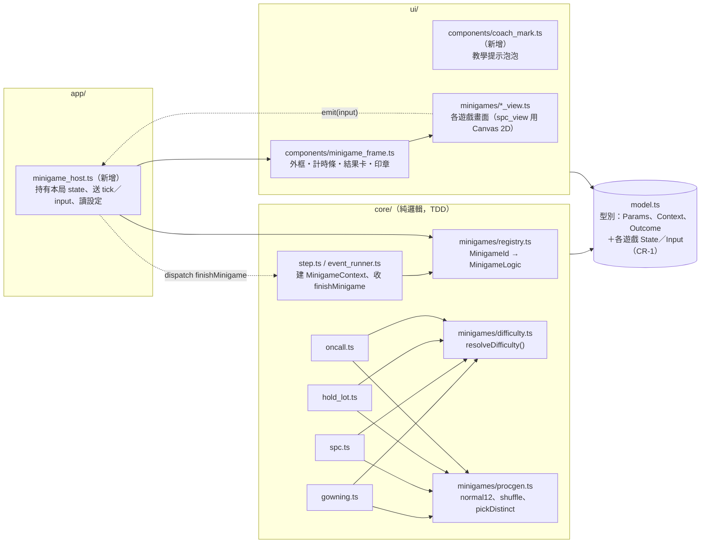
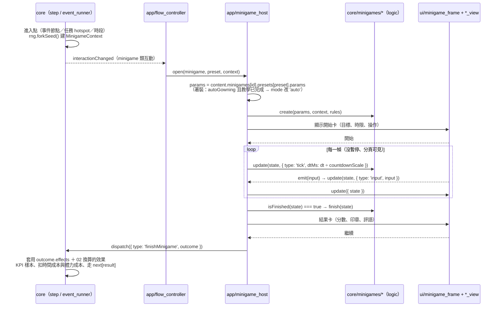
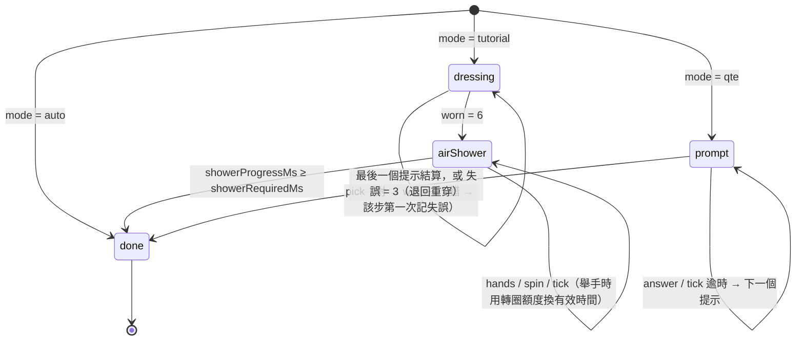
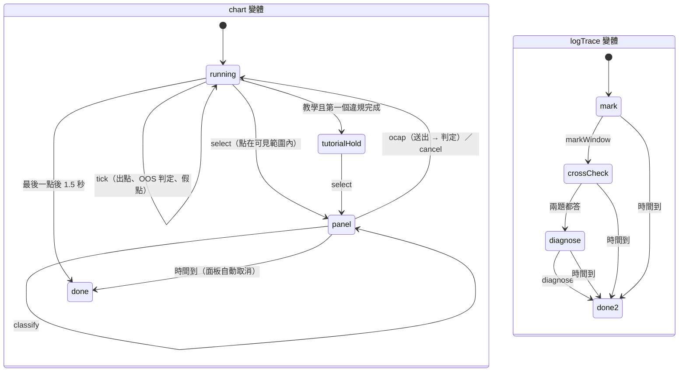
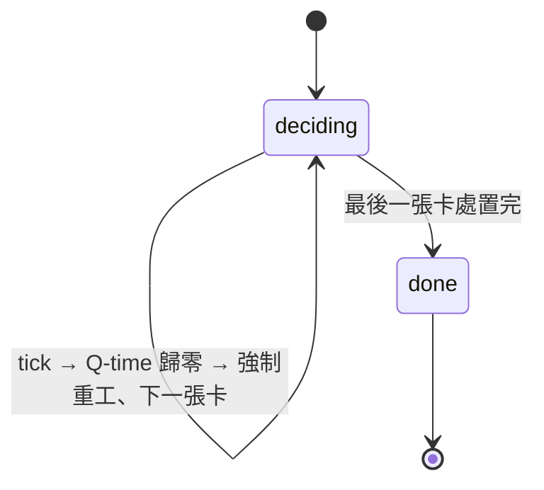
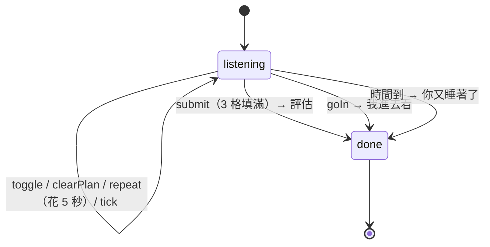

# 工程規格書 03：工作小遊戲

| 項目 | 內容 |
|---|---|
| 文件 | 工程規格書第 03 部：工作小遊戲（MVP 4 個可實作規格＋完整版 8 個設計規格） |
| 版本 | v0.4（2026-10-24：同步 00 §9.3 N1——§3.10、§7.2）；v0.3（2026-10-24：套用審查回合 1 的 lead 裁決，見 `00-index.md` §9——OCAP 小卡、Hold Lot 案例、半夜電話的情境／正確順序／危險指令改成內容資料 `rules`（§2.2、§4～§7）、新訓日加入著裝（v0.4 改到午餐後）、老K 用通用講師圖示）；v0.2（2026-10-24：§9 的變更請求已由 01 v1.1 裁決並合併，裁決見 `00-index.md` §4；依 02 的時間預算縮短 SPC 班中預設組、加快 Hold Lot 的 Q-time；§10 已標上 02、04 的回應）；v0.1（2026-10-23） |
| 上游 | `docs/planning/game-design-doc.md`（下稱 GDD）§4.1、§8、§15.1、§17；`docs/research/fab-domain.md`（下稱 FD）；`docs/specs/01-architecture.md`（下稱 01）§5、§6、§7.7、§10、§13、§16、§18；`design/style-c-toon.html`（風格 C） |
| 平行文件 | 02 遊戲系統（Outcome → 數值／KPI 換算、時間預算）、04 美術 3D UI（整體視覺風格）。本文件**不寫**它們的範圍，需要配合的地方列在 §10 |
| 讀者 | 實作 `src/core/minigames/`（純邏輯）與 `src/ui/minigames/`（畫面）的工程師；撰寫 `src/content/minigames.ts` 預設組的內容作者 |
| 型別規則 | 一律使用 01 §5 的 `MinigameId`、`MinigameParamsMap`、`WecoRule`、`MinigamePreset`、`MinigameContent`、`MinigameContentMap`、`MinigameContext`、`MinigameAction`、`MinigameOutcome`、`MinigameLogic`。本文件需要的新型別**一律以變更請求提出**（§9），不在模組內另立跨層定義 |

> **閱讀提示**：§1～§2 是四個 MVP 小遊戲共用的規則與框架，先讀；§3～§6 是各遊戲的完整規格，每節的 11 個小節順序固定（真實對照 → 流程 → 輸入 → 狀態機 → 程序生成 → 評分 → 難度 → 參數 → UI → 教學 → 測試）；§7 是 MVP 預設組總表；§8 是完整版其餘 8 個；§9 是對 01 的變更請求；§10 是跟 02／04 的介面點；§11 是「我的決定」。

## 目錄

0. [一頁總覽](#0-一頁總覽)
1. [設計原則與共通規則](#1-設計原則與共通規則)
2. [共用框架](#2-共用框架)
3. [著裝＋風淋 `mg.gowning`](#3-著裝風淋-mggowning)
4. [SPC 獵人 `mg.spc`（含 `logTrace` 變體）](#4-spc-獵人-mgspc含-logtrace-變體)
5. [Hold Lot 判官 `mg.hold_lot`](#5-hold-lot-判官-mghold_lot)
6. [半夜電話 `mg.oncall`](#6-半夜電話-mgoncall)
7. [MVP 預設組總表（`content/minigames.ts`）](#7-mvp-預設組總表contentminigamests)
8. [完整版其餘 8 個小遊戲（設計規格）](#8-完整版其餘-8-個小遊戲設計規格)
9. [對 01 的變更請求](#9-對-01-的變更請求)
10. [介面點：需要 02、04 配合的地方](#10-介面點需要-0204-配合的地方)
11. [「我的決定」清單](#11-我的決定清單)
12. [風險清單](#12-風險清單)
13. [附錄：本文件新增的名稱索引](#13-附錄本文件新增的名稱索引)

---

## 0. 一頁總覽

| # | 小遊戲 | `MinigameId` | 範圍 | 一句話玩法 | 一局真實時長 | 遊戲時間成本 | 進入點 |
|---|---|---|---|---|---|---|---|
| 1 | 著裝＋風淋 | `mg.gowning` | **MVP** | 依「口罩→髮罩→頭罩→無塵鞋→無塵衣→手套」穿上兔寶寶裝，再進風淋室舉手轉圈直到燈變綠；之後每天是 10 秒 QTE | 教學 60～80 秒；每日 QTE 10～15 秒；自動 0 秒 | 15 分 | 時段 `gowning`、事件節點（#23 憋尿重穿） |
| 2 | SPC 獵人 | `mg.spc` | **MVP** | 管制圖每 0.8 秒跳一點，在違規變成 OOS 之前點出違規點、判斷 WECO 規則、依 OCAP 選處置 | 班中 40 秒；上機認證 50 秒（另加開始卡與結果卡） | 30 分 | 任務、事件節點（#14 上機認證） |
| 2b | ┗ `logTrace` 變體 | `mg.spc` | **MVP** | 調出機台 2 小時 log，框出鋸齒狀的壓力段，跟節流閥、參考 gauge 比對，判斷「是 gauge 飄，不是 chamber」 | 45～75 秒 | 5 分 | 事件節點（#16「ET-03 又 down 了」肆） |
| 3 | Hold Lot 判官 | `mg.hold_lot` | **MVP** | 看 lot 卡（站點、量測、wafer map、Q-time、客戶等級），在 Q-time 倒數內選放行／重工／報廢／分批／送 FA；結果 2～4 週後才由 WAT 揭曉 | 每張 10～15 秒；一局 1～4 張 | 每張 15 分 | 任務、事件節點（#13、#19、#21 解 hold 連發） |
| 4 | 半夜電話 | `mg.oncall` | **MVP** | 半夢半醒聽技術員講 alarm（字會糊掉），從指令清單排出 3 步遠端處置，或直接「我進去看」 | 30～60 秒 | 20 分（影響睡眠，換算屬 02） | 時段 `sleep`、事件節點（#20 電影院走廊）、第一章 W5 模擬 |
| 5 | Recipe 調參台 | `mg.recipe` | 完整版 | 4 個滑桿、4 項輸出，控片有限，找出全部落在綠窗的參數 | 60～90 秒 | 每次試跑 30 分 | 任務 |
| 6 | Excursion 偵探 | `mg.excursion` | 完整版 | 止血 → 3D 蒐證 → 4M 排除 → 真因 → 防再發 | 3～6 分鐘（分段） | 依步驟 | 危機事件 |
| 7 | 交接＋早會生存 | `mg.briefing` | 完整版 | 6～9 則夜班留言挑 3 則；早會 2～3 題、每題 5 秒 | 45～70 秒 | 40 分 | 時段 `briefing` |
| 8 | PM 排程 | `mg.pm_schedule` | 完整版 | 2 週時間軸排 4 台機台的 PM；seasoning 走 SOP 還是「快速 release」 | 60～90 秒 | 30 分 | 每月第一個關鍵日 |
| 9 | 8D 拼圖 | `mg.eight_d` | 完整版 | 把證據卡放進 D2～D7；D4 要分「發生原因／流出原因」；客戶品保審查 | 60～120 秒 | 60 分 | 事件節點 |
| 10 | 扯皮對話戰 | `mg.debate` | 完整版 | 對手論點出現矛盾時出示證據；耐久 vs 火氣 | 60～120 秒 | 30 分 | 事件節點 |
| 11 | 黃光區之眼 | `mg.yellow_eye` | 完整版 | 琥珀色下辨認 FOUP 標籤與 wafer map 缺陷；待久了只剩符號提示 | 30～45 秒 | 20 分 | 任務（跨模組支援） |
| 12 | 默畫機台 | `mg.draw_tool` | 完整版 | 看剖面圖 20 秒，90 秒內拖放零件、接管路 | 110 秒 | 60 分 | 第一章 W4 關卡 1 |

**MVP 不做的**：Excursion 偵探由 `mg.spc` 的 `logTrace` 變體代替（01 D30）；早會時段改跑事件（01 D29）；第一章 W4「默畫機台」（GDD #7）在 MVP 是純事件：三個選項加上依專業擲骰的結果，不做拖放小遊戲（§11 決定 M14）。

---

## 1. 設計原則與共通規則

### 1.1 四條設計原則

1. **「對，就是這樣」**：每個小遊戲都要能指出它模擬的真實流程與 FD 出處；術語保留業界原文（lot、hold、OOC、OOS、Q-time、OCAP、abort、release）。玩法上的簡化（例如 OCAP 只留三個選項）要簡化在「判斷的骨架」上，不能改變判斷的方向（例：蝕刻後的 lot **不能**重工光阻，只有蝕刻不足可以補蝕，見 §5.1）。
2. **短**：MVP 每局 30～90 秒（真實時間）。唯一例外是每日著裝 QTE（10～15 秒），因為 GDD §8.1 明訂它是每天的短儀式。
3. **判斷，不是手速**：時間壓力只用來呈現「不能慢慢想」，不拿來考反應神經。所有倒數都受 01 D36 的 `countdownScale`（×1／×1.5／×2）影響；疲勞造成的 −20% 也是乘在同一條時間軸上（§1.3）。
4. **純函式、可重現**：`create()` 一次產生整局需要的全部隨機內容；`update()` 不再擲骰。同一組 `(params, context, actions)` 一定得到同一個 `MinigameOutcome`（01 §7.7、§13.7）。

### 1.2 共通規則（對照 GDD §8 開頭）

| GDD 共通規則 | 本規格的實作 |
|---|---|
| 每局給 0～100 成績，計入當期 KPI | `MinigameOutcome.score` 一律是 0～100 的**整數**；計入 `CareerState.kpiSamples` 的方式與權重屬 02 |
| 體力 ≤20 或精神 ≤35 時都變難 | `MinigameContext.fatigued`／`stressed`（01 已定義），由 §1.3 的 `resolveDifficulty()` 統一換算 |
| 滑鼠、鍵盤、觸控都支援 | §1.5 的共通鍵位＋各遊戲的輸入表；每個小遊戲都能**全程只用鍵盤**完成 |
| 進行時時鐘暫停，結束一次扣時間成本 | 01 §6.5 第 4 條；扣除的分鐘數＝`preset.gameMinutes ＋ outcome.gameMinutes`（後者是本局的**額外**時間，例如退回重穿 +10，見 §2.3 與 §9 CR-4） |

### 1.3 共通難度修正 `resolveDifficulty()`

所有遊戲都只透過這一個函式讀取疲勞、壓力、修正器與容錯，確保「體力 ≤20 → 計時 −20%」在四個遊戲裡是同一個數字。

```ts
// src/core/minigames/difficulty.ts
import type { MinigameContext } from '../../model';

/** 只在 core/minigames 內使用，不跨層，所以不放 model.ts */
export interface MinigameDifficulty {
  /** 乘在所有「時間窗」上：倒數、Q-time、SPC 捲動間隔。<1 代表更快、更緊 */
  timeScale: number;
  /** 加在 params.noise 等「干擾量」上；使用端自行夾限在 0～1 */
  noiseBonus: number;
  /** 履歷等帶來的容錯（例：技術員轉職 SPC +1） */
  tolerance: number;
}

export const FATIGUE_TIME_SCALE = 0.8; // GDD §4.1：體力 ≤20 → 小遊戲計時 −20%
export const STRESS_NOISE_BONUS = 0.25; // GDD §4.1：精神 ≤35 → 雜訊增加
export const OFFSET_TIME_STEP = 0.08; // 修正器每 +1 級，時間窗 −8%
export const OFFSET_NOISE_STEP = 0.1; // 修正器每 +1 級，干擾 +0.1
export const MAX_DIFFICULTY_OFFSET = 2;

export function resolveDifficulty(context: MinigameContext): MinigameDifficulty;
```

| 項目 | 公式 | 說明 |
|---|---|---|
| `offset` | `clamp(context.difficultyOffset, −2, 2)` | `difficultyOffset` 是 `ModifierDef.kind: 'minigameDifficulty'` 的加總（01 §5.2）；**正數＝更難** |
| `timeScale` | `(fatigued ? 0.8 : 1) × (1 − 0.08 × offset)` | 範圍 0.672～1.16 |
| `noiseBonus` | `(stressed ? 0.25 : 0) + 0.1 × offset` | 可以是負數（修正器讓遊戲變簡單） |
| `tolerance` | `max(0, context.tolerance)` | 各遊戲自己決定容錯的意義（§3.7、§4.7、§5.7、§6.7） |

> **`countdownScale` 不在這裡**：無障礙的倒數倍率由 app 處理——`app/minigame_host.ts` 送進邏輯的 `tick.dtMs` 先除以 `countdownScale`（§2.3）。這樣 core 不需要知道玩家設定，而且所有時間窗（包含 SPC 捲動）一起變慢，不會漏掉任何一個。

**疲勞與壓力在各遊戲的具體表現**

| 遊戲 | 體力 ≤20（`timeScale` 0.8） | 精神 ≤35（`noiseBonus` +0.25） |
|---|---|---|
| 著裝 | QTE 每個提示的時間窗 −20% | QTE「下一件」多一個誘答選項（外出鞋／外套） |
| SPC 獵人 | 點與點的間隔 ×0.8（GDD §8.2：捲動 +25%） | 誘答圖形增加；畫面閃出「假點」（GDD §8.2），點到算誤判 |
| `logTrace` | 時限 −20% | 節流閥通道多一段假性起伏 |
| Hold Lot | Q-time 倒數 −20% | 每張卡多一則誤導留言的機率提高 |
| 半夜電話 | 時限 −20%；糊字比例本來就跟體力連動 | 指令清單多 2 個干擾項；糊字比例 +15% |

### 1.4 評分、三段判定、Outcome 的共通約定

1. **score**：0～100 整數；計算過程**全部用整數百分點**，只在最後做一次 `Math.round`，避免浮點誤差讓「72.5」變成 72（§4.11 的測試會抓這件事）。
2. **result**：每個遊戲各自定義 `success`／`partial`／`fail` 的門檻（下表）。事件節點沒有 `partial` 分支時走 `fail`（01 §7.8）。

| 遊戲 | success | partial | fail |
|---|---|---|---|
| 著裝（QTE） | 0 失誤 | 1～2 失誤 | ≥3 失誤（退回重穿） |
| 著裝（教學） | 失誤 <3 | 失誤 ≥3 | 不會失敗 |
| 著裝（自動） | 一律 | — | — |
| SPC（chart） | score ≥75 且沒有 lot 報廢 | score ≥60 | score <60 |
| SPC（logTrace） | 診斷正確且框選 IoU ≥0.3 | 不使用 | 其他 |
| Hold Lot | score ≥70 且沒有錯誤放行 | 其他 | score <40 或錯誤放行 ≥2 |
| 半夜電話 | 3 步全對且順序正確；或「我進去看」 | 對 2 步以上、沒有危險指令 | 有危險指令、對 ≤1 步、或時間到 |

3. **effects（本規格的分工）**：小遊戲邏輯**不輸出任何 `op: 'stat'` 效果**。可見與隱藏數值的換算（專業 +1～+2、背鍋 +8……）全部由 02 從 `facts` 算出（§10.1）。邏輯只輸出「小遊戲機制本身」的效果：`flag`（教學完成）、`counter`（例：完整版的快速 release 次數）、`plantSeed`（Hold Lot 的延遲揭曉）。這個分工需要 01 §7.8 的處理順序配合（§9 CR-5）。
4. **facts**：只放 `number | boolean | string`（01 型別限制）；鍵名用 lowerCamelCase；每個遊戲的完整鍵表在各節 X.6，02 只能依賴這些鍵。
5. **gameMinutes**：本局**額外**消耗的遊戲分鐘（0 代表只扣預設組的 `gameMinutes`）。

### 1.5 輸入與無障礙的共通規則

| 鍵 | 所有小遊戲共通的意義 |
|---|---|
| Enter／Space | 確認目前焦點（開始、送出、繼續）。著裝風淋室例外：Space 長按＝舉手 |
| 1～9 | 選第 N 個選項（選項上一律標出數字） |
| ← → ↑ ↓ | 在選項、資料點、卡片欄位間移動焦點 |
| Esc | 關閉子面板；沒有子面板時開暫停選單（小遊戲時間同時停止） |
| H | 重新顯示本遊戲的操作提示（教學提示卡） |
| Tab／Shift+Tab | 依 DOM 順序移動焦點（焦點陷阱在小遊戲框內，01 §10.6） |

- **觸控目標**：可點元素至少 44×44 CSS px；資料點這種小目標用「最近點吸附」（半徑 24px）加上左右微調鈕。
- **不只靠顏色**：OOC／OOS、正常／異常一律同時用形狀或文字標示（01 §10.6 色彩輔助）。
- **減少動態**（`MotionPolicy.reduced`）：關閉晃動、閃爍、集中線；SPC 的「假點」改成靜態淡入 0.4 秒，不閃爍；半夜電話的「模糊」改用遮字塊（▒▒）而不是 CSS 模糊動畫。
- **朗讀**：每局開始時把目標與時限寫入 `#live` 一次；倒數只在剩 10 秒時朗讀一次；結果卡的分數與判定寫入 `#live`。
- **焦點**：小遊戲框開啟時焦點移到「開始」；結果卡出現時移到「繼續」；結束後焦點回到開啟前的元素（01 §10.6）。

---

## 2. 共用框架

### 2.1 對應 01 的分層



| 檔案 | 層 | 職責 | 01 是否已列 |
|---|---|---|---|
| `src/core/minigames/registry.ts` | core | `minigameLogics: { [K in MinigameId]: MinigameLogic<K, MinigameStateMap[K], MinigameInputMap[K]> }` | 已列（型別參數依 CR-1 收緊） |
| `src/core/minigames/difficulty.ts`＋`.spec.ts` | core | §1.3 | **新增**（四個遊戲共用，符合 CLAUDE.md「≥2 個模組使用才放共用」） |
| `src/core/minigames/procgen.ts`＋`.spec.ts` | core | §2.6 | **新增**（同上） |
| `src/core/minigames/{gowning,spc,hold_lot,oncall}.ts`＋`.spec.ts` | core | 各遊戲邏輯 | 已列 |
| `src/app/minigame_host.ts` | app | 生命週期（§2.2）、`countdownScale`、自動著裝設定、暫停 | **新增**（避免 `flow_controller.ts` 膨脹） |
| `src/ui/components/minigame_frame.ts` | ui | 外框、計時條、開始卡、結果卡、成績印章 | 已列 |
| `src/ui/components/coach_mark.ts` | ui | 教學泡泡（說話者頭像＋一句話＋「知道了」） | **新增** |
| `src/ui/minigames/{gowning,spc,hold_lot,oncall}_view.ts` | ui | 各遊戲畫面；只讀 props 裡的 state，只透過 `emit(input)` 回報 | 已列 |
| `src/content/minigames.ts` | content | 預設組（§7） | 已列 |
| `src/content/text/minigames.ts` | content | 小遊戲台詞，`t.mg.<遊戲>.<鍵>` | 已列（01 §8.1 的 `minigames` 台詞檔） |

> 新增的 4 個檔案在 §9 CR-9 一併請 01 更新目錄表。`ui/minigames/` 有 4 個檔案、`core/minigames/` 有 13 個檔案，都滿足「一個目錄不只一個檔案」。

### 2.2 生命週期



逐步說明：

1. **進入**：三種進入點（§2.4）都由 core 建立 `MinigameContext`：`chapter`、`fatigued`（體力 ≤20）、`stressed`（精神 ≤35）、`tolerance`（`resume.minigameTolerance[id] ?? 0`）、`difficultyOffset`（符合的修正器加總）、`seed`（`rng.forkSeed()`，主序列只消耗一次），以及 CR-2 新增的 `stamina`、`skill`、`favor`。此時 `interaction ≠ null`，遊戲時鐘已經停止（01 §6.5 第 2 條）。
2. **建立**：`minigame_host` 取出預設組的 `params` 與該遊戲的領域資料 `content.minigames[id].rules`（v0.3 審查回合 1 R1-B：OCAP 小卡、Hold Lot 案例、半夜電話情境；01 §5.2 `MinigameRulesMap`）交給 `logic.create(params, context, rules)`。邏輯**不得**寫死這些資料；`create()` 把後續要用的部分複製進 state（`update()`／`finish()` 只拿得到 state）。小遊戲 state **不放**在 `GameState`（01 §6.6），所以重新整理頁面會讓進行中的小遊戲消失；玩家回到最近的安全點（關鍵日開始），這是 01 D15 的既定行為。
3. **開始卡**：顯示遊戲名、一句目標、時限（已套用 `timeScale` 與 `countdownScale` 後的真實秒數）、目前輸入方式的操作圖示。按「開始」前不送 tick。第一次玩某個遊戲時，開始卡之後接教學提示（§2.5）。例外：每日著裝 QTE 只顯示 0.5 秒標題就自動開始（§3.2），自動著裝不顯示開始卡也不顯示結果卡（只播 1 秒剪影後直接回報）。
4. **進行**：`minigame_host` 在 `game_loop` 的 `flow.updateFrame(dt)` 中送 tick（dt 已由 01 §6.6 夾限 ≤250 ms，再除以 `countdownScale`）。暫停選單開啟、分頁隱藏、教學泡泡等待確認時**不送 tick**。
5. **結束**：`isFinished()` 為真時呼叫 `finish()` 取得 Outcome，顯示結果卡。結果卡只顯示分數、印章、1～3 行事實、一句評語；數值浮字要等 `finishMinigame` 被 core 套用後由 `delta_pop` 顯示（01 §10.3），避免 UI 自己猜數值。
6. **回報**：玩家按「繼續」→ `dispatch({ type: 'finishMinigame', outcome })`。core 依序：套用 `outcome.effects` → 套用 02 從 facts 換算的效果 → `kpiSamples.push(score)` → 扣 `preset.gameMinutes + outcome.gameMinutes` 與 `preset.staminaCost` → 任務狀態（success／partial → `done`，fail → `failed`）或事件 `next[result]` → 清除 interaction。

### 2.3 時鐘、時間成本、體力成本

| 項目 | 規則 | 負責 |
|---|---|---|
| 小遊戲內的「時間」 | 只有邏輯時間：所有 tick 的 `dtMs` 加總。跟遊戲時鐘（`TimeState.minuteOfDay`）無關 | 03 |
| 無障礙倍率 | `dtMs_logic = dtMs_real ÷ countdownScale` | `app/minigame_host.ts` |
| 疲勞、修正器 | 乘在時間窗上（`timeScale`），不改 dt | 各遊戲 `create()` |
| 結束後扣除的遊戲時間 | `preset.gameMinutes`（固定）＋`outcome.gameMinutes`（本局額外，例：退回重穿 +10、我進去看 +90） | 03 定義數字；core 套用 |
| 體力成本 | `preset.staminaCost`（預設組上的固定值，§7 給建議值）；其他體力變化由 02 從 facts 換算 | 02 定案 |
| 跨過時刻 | 時間成本可能跨過 16:30 等時刻，依 01 §6.5 第 5 條補跑檢查點 | 01 |

### 2.4 三種進入點

| 進入點 | 例 | 型別路徑 | 預設組怎麼選 |
|---|---|---|---|
| 事件節點 | #16 肆 → `logTraceShort`；#14 上機認證 → `certification`；#20 走廊 → `corridor` | `EventNode.kind: 'minigame'` → `EventView.minigame` | 寫死在節點上 |
| 任務 | 班中便利貼「看 ET-04 SPC」 | `TaskDef.action.kind: 'minigame'` → `Interaction.task` | 寫死在 `TaskDef` 上；章節差異用不同的 `TaskId` |
| 時段 | 每天 07:25 著裝；on-call 夜晚電話響 | `Interaction.minigame`（`{ kind: 'minigame'; source: 'gowning' \| 'onCall'; … }`，§9 CR-3，01 v1.1 已新增） | 依 `MinigameContent.chapterDefaults[chapter]`（CR-3）；著裝教學看 `flag.gowning_tutorial_done` |

### 2.5 共用 UI 元件

| 元件 | 內容 | 互動 | 需求重點（具體樣式由 04） |
|---|---|---|---|
| `minigame_frame` 外框 | 標題籤（左上斜貼）、副標（例：`ET-04 · AEI CD`）、計時條、`?` 說明鈕、`Ⅱ` 暫停鈕、底部操作提示列 | `?` → H；`Ⅱ` → Esc | 沿用風格 C 的 `.panel`（粗墨線、錯位陰影）；疊在 `#overlay`，3D 畫面在後方壓暗 |
| 計時條 | 剩餘邏輯時間 ÷ 總時間；剩 25% 轉紅並加「!」符號 | — | `role="timer"`；減少動態時不閃 |
| 開始卡 | 遊戲名、一句目標、時限、操作圖示（依最後一次使用的輸入裝置切換：滑鼠／觸控／鍵盤） | Enter 開始 | — |
| 教學提示 `coach_mark` | 角色頭像（美玲姐、阿哲；老K 在 MVP 是文字角色 `chr.lao_k`、沒有立繪，改用**通用講師圖示**，04 §8.5；v0.3 審查回合 1 矛盾 5）＋一句話＋指向目標的箭頭；「知道了」「跳過教學」 | Enter 下一則；S 跳過 | 等待確認時 host 不送 tick |
| 結果卡 | 分數（大字）、印章、1～3 行事實（從 facts 產生）、一句評語（依 facts 選台詞） | Enter 繼續 | 印章：success「RELEASE」、partial「HOLD」、fail「SCRAP」；著裝失敗用「退回重穿」；Hold Lot 不顯示分數（§5.6） |
| 暫停 | 01 的 `pause_page`；小遊戲畫面以紙色遮罩蓋住（避免暫停時研究圖） | Esc | — |

**評語台詞規則**：每個遊戲在 X.6 列出「facts 條件 → `TextId`」的對照，依序取第一個成立的（例：SPC 有誤判 → 林課長「你 hold 這個幹嘛？」）。評語只是台詞，不帶任何數值效果。

### 2.6 共用程序生成工具

```ts
// src/core/minigames/procgen.ts
import type { Rng } from '../rng';

/** 近似標準常態：12 個均勻亂數相加減 6（Irwin–Hall）。只用加減法，所有 JS 引擎結果逐位元相同；每次固定消耗 12 次 next() */
export function normal12(rng: Rng): number;
/** [min, max) 均勻分布；消耗 1 次 */
export function uniform(rng: Rng, min: number, max: number): number;
/** Fisher–Yates，回傳新陣列；消耗 items.length − 1 次 */
export function shuffle<T>(rng: Rng, items: readonly T[]): T[];
/** 不重複抽 count 個；count > items.length 時丟 InvariantError */
export function pickDistinct<T>(rng: Rng, items: readonly T[], count: number): T[];
/** 四捨五入到小數 digits 位（顯示用的量測值） */
export function roundTo(value: number, digits: number): number;
```

- **RNG 來源**：`createRng(context.seed)`（01 §7.7 的 mulberry32）。每個 `create()` 自己建一個，不跟其他模組共用。
- **為什麼不用 Box–Muller**：`Math.log`、`Math.cos` 在不同 JS 引擎（bun 的 JavaScriptCore、瀏覽器的 V8）可能差最後一個位元，碰到夾限門檻時會讓同一個種子產生不同的圖。`normal12` 的分布在 ±6σ 截斷，對遊戲沒有影響。
- **消耗順序**：每個遊戲在 X.5 寫明 `create()` 的擲骰順序；改順序等於改所有種子的結果，必須同時更新測試。

### 2.7 內容驗證（`core/content_validator.ts` 增加的小遊戲規則）

| 遊戲 | 規則 | 嚴重度 |
|---|---|---|
| 全部 | `gameMinutes` 是 ≥0 整數；`staminaCost` ≥0；預設組名符合 `^[a-z][a-zA-Z0-9]*$` | error |
| 全部 | CR-3 的 `chapterDefaults` 指到存在的預設組 | error |
| `mg.gowning` | `timeLimitSec` 6～120；`mode: 'tutorial'` 時 `variants` 必須是空陣列；預設組不得使用 `mode: 'auto'`（自動只能由設定切換） | error |
| `mg.spc` chart | `charts` 1～3；`rules` 不空、不重複；`pointIntervalMs` 400～1,500；`noise` 0～1；`durationSec × 1000 ÷ pointIntervalMs ≥ 30` | error |
| `mg.spc` logTrace | `charts === 3`、`rules` 為空、`pointIntervalMs === 0`、`durationSec` 30～120 | error |
| `mg.hold_lot` | `cards` 1～5；`tutorial: true` 時 `cards === 1` 且 `qTimePressure === false` | error |
| `mg.oncall` | `stepsRequired === 3`（MVP 只做 3 步）；`timeLimitSec` 20～120 | error |
| 領域資料（v0.3 R1-B） | `rules` 的完整性：`mg.spc` 的 `ocap.byRule` 涵蓋 4 條規則；`mg.hold_lot` 每案例 `payoffs` 恰好一個 100、`tutorialCase` 的 `minAmbiguity` 是 0、每個 `ambiguity` 0～2 的案例池至少 2 個；`mg.oncall` 每情境 `correct` 長度 ＝ `stepsRequired`、`correct` ∩ `dangerous` ＝ ∅、`dangerous` ≥1、`randomPool` 非空、`neutralCommands` 不出現在任何情境的 `correct`／`dangerous`（01 §8.6） | error |
| 全部 | 預設組 `gameMinutes` 超過 120 | warning |

### 2.8 錯誤處理與日誌

- **不可能的輸入**（違反 UI 契約）→ `InvariantError`，訊息單行：`[mg.spc] invalid input: kind=select chart=3 charts=1`。例：選項索引超出範圍、`spin.degrees` 是負數或非有限值、`select` 的點不存在。
- **過時的輸入**（時間差造成，例如提示剛超時、玩家同一幀按下答案）→ state 原樣回傳、`staleInputs + 1`。這不是吞錯：計數器在 state 裡，`minigame_host` 結束時以 `logger.debug('[mg.gowning] stale inputs: count=2')` 記錄。
- **生成失敗**（SPC 背景重抽 8 次仍有違規，§4.5）→ `InvariantError`，訊息帶 seed：`[mg.spc] background generation failed: seed=12345 chart=0`。這代表生成規則有漏洞，必須 fail fast。
- **`finish()` 在未結束時被呼叫** → `InvariantError`。

### 2.9 測試共通約定

- 單元測試放 `src/core/minigames/*.spec.ts`，`describe(函式名)` 分組（CLAUDE.md 測試清單 #7），**不得** import `src/content`（01 §13.2）；需要的 params 在測試檔內用具名常數寫出。
- `test/fixtures.ts` 增加一個共用的建構器（四個 spec 都用）：

```ts
// test/fixtures.ts（新增）
import type { MinigameContext } from '../src/model';

/** 預設：第三章、不疲勞、不壓力、無容錯與修正、體力 80、專業 40、人情 2 */
export function minigameContextFor(overrides: Partial<MinigameContext> = {}): MinigameContext {
  return {
    chapter: 'ch3', fatigued: false, stressed: false, tolerance: 0, difficultyOffset: 0, seed: TEST_SEED,
    stamina: 80, skill: 40, favor: 2, // CR-2
    ...overrides,
  };
}
```

- 每個遊戲至少包含：(1) **決定性**：同種子 `create()` 兩次 `toEqual`；同一串 actions 的 Outcome 相同；(2) **評分**：用手算的獨立預期值（不得用被測函式的輸出當預期）；(3) **疲勞／壓力**：`timeScale` 或干擾量真的改變；(4) **邊界**：門檻 −1／0／＋1；(5) **過時與非法輸入**。
- `test/playthrough.test.ts`（01 §13.7）的機器人「小遊戲固定回報 70 分」不需要跑小遊戲邏輯：機器人直接組一個 `MinigameOutcome`（score 70、result 依該遊戲 §1.4 的門檻推出、facts 用各節 X.6 表格「機器人預設值」欄）。這樣整合測試不會因為小遊戲平衡調整而壞掉。

---

## 3. 著裝＋風淋 `mg.gowning`

### 3.1 真實工作對照

- **流程**：進廠 → 手機寄放、只用工作機 → 脫外鞋進換衣區 → 自動洗手 → 依序著裝 → 風淋室舉手轉圈、等指示燈 → 進無塵室〔FD §5.2〕。
- **順序**：本作採中研院無塵室守則的「口罩 → 髮罩 → 無塵帽（頭罩） → 無塵鞋 → 無塵衣」，GDD §8.1 再加上最後的手套〔FD §5.2〕。FD 也記錄了另一種業界順序（鞋套 → 頭罩 → 連身衣 → 手套），所以教學台詞要讓美玲姐說一句「每個廠不太一樣，在我們這裡就是這樣穿」，避免業界玩家覺得「我們廠才不是這樣」。
- **風淋室**：兩側門互鎖、高速過濾空氣、人要舉手原地轉圈，指示燈亮了才開另一側門；廠商預設約 12 秒〔FD §5.2〕。教學用 12 秒原值；每日 QTE 把 12 秒壓縮成 3 秒邏輯時間，畫面上的倒數仍顯示 12→0（四倍速），保留「等燈變綠」的感覺。
- **變體**：無塵衣破洞（穿前要檢查）、手套尺寸拿錯（太大會皺、太小易破）——都是「人是最大污染源、更衣要專心」〔FD §5.2 #7〕的具體化。

### 3.2 玩家目標、一局流程、時長

| 模式 | 何時 | 目標 | 流程 | 真實時長 |
|---|---|---|---|---|
| `tutorial` | 序章 D2（GDD #3「第一次兔寶寶裝」） | 依正確順序穿好 6 件、完成 12 秒風淋 | ① 開始卡 → ② 美玲姐 3 則教學泡泡 → ③ 置物架上 6 件裝備已洗牌，依序點選（或拖到紙娃娃上）；選錯會彈回並記一次失誤（同一步只記一次）→ ④ 6 件穿完進風淋室：舉手＋轉圈，累積 12 秒有效時間，指示燈由紅轉綠 → ⑤ 結果卡 | 60～80 秒 |
| `qte` | 之後每個關鍵日 07:25；中途離開無塵室再回來（#23） | 3～5 個提示都答對 | ① 開始卡（0.5 秒標題，不需要按開始）→ ② 背景播自動著裝動畫，依序跳出提示：**下一件是？**（×2）、**檢查無塵衣**（變體）、**手套尺寸**（變體）、**風淋**（最後）→ ③ 結果卡 | 10～15 秒 |
| `auto` | 設定「自動著裝」開啟且已完成教學 | — | 直接結束，播 1 秒換衣剪影 | 0～1 秒 |

### 3.3 輸入方式

| 動作 | 滑鼠 | 觸控 | 鍵盤 |
|---|---|---|---|
| 選裝備（教學） | 點選，或拖到紙娃娃 | 點選 | 1～6 選置物架格位 → Enter 穿上；或 ← → 移動焦點 → Enter |
| 回答提示（QTE） | 點選項 | 點選項 | 1～6（`tornSuit` 有 6 個區域） |
| 舉手 | 點「舉手」切換（舉起／放下） | 點「舉手」切換 | **Space 長按**＝舉手，放開＝放下（GDD「按住舉手鍵」） |
| 轉圈 | 在轉圈盤上按住拖曳畫圓 | 單指沿轉圈盤畫圓 | ← → **交替**按：每次換邊算 90°；同一鍵連按不算 |

- 指標轉圈的換算在 view 端：每次 pointermove 計算相對轉圈盤中心的角度差 |Δθ|，只在指標距中心 ≥ 30% 半徑時才計入（避免抖動），每幀彙總成一個 `spin` 輸入。
- 觸控的「舉手」做成切換而不是長按，因為手機上要同時按住一處又畫圓很難操作。
- 無障礙：`countdownScale ×2` 時 QTE 每個提示的時間窗加倍；教學沒有失敗條件；鍵盤轉圈每秒交替 2 次即可（12 秒共 24 次）。
- QTE 是 2～4 秒內要回答的題目，所以 QTE 一開始就把焦點放在第一個選項上，鍵盤玩家不用先移動焦點。

### 3.4 狀態機與 `MinigameAction`



**型別**（依 §9 CR-1 加入 `src/model.ts` §8 區）：

```ts
export type GownItem = 'mask' | 'hairNet' | 'hood' | 'boots' | 'suit' | 'gloves';
export type GownDecoy = 'streetShoes' | 'jacket';
export type GloveAction = 'wearAnyway' | 'doubleGlove' | 'swapToM';
export type SuitRegion = 'leftSleeve' | 'rightSleeve' | 'chest' | 'back' | 'leftLeg' | 'rightLeg';

export type GowningPrompt =
  /** 已穿 step 件，問下一件（正解＝GOWN_ORDER[step]） */
  | { kind: 'nextItem'; step: number; options: readonly (GownItem | GownDecoy)[]; correct: number; windowMs: number }
  /** 拿到的手套盒尺寸不對（主角的尺寸固定 M） */
  | { kind: 'gloveSize'; boxSize: 'S' | 'L'; options: readonly GloveAction[]; correct: number; windowMs: number }
  /** 6 個區域中有一處破洞 */
  | { kind: 'tornSuit'; options: readonly SuitRegion[]; correct: number; windowMs: number }
  | { kind: 'airShower'; requiredMs: number; windowMs: number };

export interface GowningState {
  mode: 'tutorial' | 'qte' | 'auto';
  phase: 'dressing' | 'airShower' | 'prompt' | 'done';
  /** 教學：置物架的顯示順序（已洗牌） */
  shelf: readonly GownItem[];
  /** 教學：已穿件數 0～6 */
  worn: number;
  /** 教學：目前這一步是否已經記過失誤（同一步只記一次） */
  stepMistaken: boolean;
  /** QTE：依穿戴順序排好的提示 */
  prompts: readonly GowningPrompt[];
  promptIndex: number;
  promptElapsedMs: number;
  handsUp: boolean;
  /** 轉圈換來、尚未用掉的「角度額度」，上限 SPIN_CREDIT_CAP_DEG */
  spinCreditDeg: number;
  showerProgressMs: number;
  /** 教學 12,000；QTE 見 §3.5 */
  showerRequiredMs: number;
  mistakes: number;
  /** 第 k 次失誤增加的微粒數（create 時抽好 6 個） */
  particleBumps: readonly number[];
  tornSuit: 'none' | 'found' | 'missed';
  gloveSize: 'none' | 'correct' | 'wrong';
  reGowned: boolean;
  elapsedMs: number;
  /** 教學：超過後 UI 自動高亮下一件（不扣分） */
  softLimitMs: number;
  staleInputs: number;
}

export type GowningInput =
  | { kind: 'pick'; item: GownItem }
  | { kind: 'answer'; option: number }
  | { kind: 'hands'; up: boolean }
  /** 角度絕對值（≥0、有限值）；方向不影響 */
  | { kind: 'spin'; degrees: number };
```

**`src/core/minigames/gowning.ts` 匯出**

```ts
export const GOWN_ORDER: readonly GownItem[] = ['mask', 'hairNet', 'hood', 'boots', 'suit', 'gloves'];
export const TUTORIAL_SHOWER_MS = 12_000;   // FD §5.2 廠商預設 12 秒
export const QTE_SHOWER_MS = 3_000;         // 畫面以四倍速顯示 12→0
export const SPIN_DEG_PER_SEC = 180;        // 每秒轉半圈才算「有在轉」
export const SPIN_CREDIT_CAP_DEG = 360;     // 最多預存 2 秒，不能先猛轉再發呆
export const MISTAKE_PENALTY = 10;
export const REGOWN_MISTAKES = 3;           // GDD §8.1：錯 3 件 → 退回重穿
export const REGOWN_PENALTY = 10;
export const REGOWN_EXTRA_MINUTES = 10;     // GDD §8.1：遊戲時間 −10 分
export const AUTO_SCORE = 90;
export const VARIANT_CHANCE = 0.5;
/** QTE 時間窗的整數權重（用整數避免浮點誤差） */
export const PROMPT_WEIGHTS = { nextItem: 10, gloveSize: 12, tornSuit: 14, airShower: 24 } as const;
export declare const gowningLogic: MinigameLogic<'mg.gowning', GowningState, GowningInput>;
```

**`update()` 規則**

| action | 有效的 phase | 效果 | 其他 phase |
|---|---|---|---|
| `tick` | 全部 | `elapsedMs += dt`。在 `airShower`（或目前提示是 `airShower`）且 `handsUp`：`use = min(dt, spinCreditDeg ÷ 180 × 1000)`，`showerProgressMs += use`，`spinCreditDeg −= use × 180 ÷ 1000`；進度達標 → 教學進 `done`、QTE 進下一個提示。QTE：`promptElapsedMs += dt`，達到 `windowMs` 仍未完成 → 記失誤、進下一個提示（每次 tick 最多結算一個提示；dt ≤250 ms 遠小於任何時間窗） | — |
| `pick` | `dressing` | 等於 `GOWN_ORDER[worn]` → `worn + 1`、`stepMistaken = false`，`worn = 6` 時進 `airShower`；否則若 `!stepMistaken` → `mistakes + 1`、`stepMistaken = true` | `staleInputs + 1` |
| `answer` | `prompt` 且目前提示不是 `airShower` | `option` 超出範圍 → `InvariantError`。對 → 下一個提示；錯 → 記失誤、下一個提示。`tornSuit`／`gloveSize` 同時寫入對應的事實欄位（逾時也寫 `missed`／`wrong`） | `staleInputs + 1` |
| `hands` | 全部 | `handsUp = up` | — |
| `spin` | `airShower`、QTE 的 `airShower` 提示 | 非有限值或負數 → `InvariantError`；`spinCreditDeg = min(360, spinCreditDeg + degrees)` | `staleInputs + 1` |

「記失誤」：`mistakes + 1`；QTE 中 `mistakes ≥ 3` → `reGowned = true`、直接進 `done`。進下一個提示時 `promptElapsedMs`、`spinCreditDeg`、`showerProgressMs` 歸零，`handsUp` 保留。

### 3.5 程序生成（`create()` 的擲骰順序）

1. `shelf = shuffle(rng, GOWN_ORDER)`（所有模式都做，讓消耗順序固定）。
2. `particleBumps`：連續 6 次 `rng.int(25, 60)`。
3. `mode = 'auto'` → 直接回傳 `phase: 'done'`。`mode = 'tutorial'` → `showerRequiredMs = 12,000`、`softLimitMs = timeLimitSec × 1000`，回傳 `phase: 'dressing'`。
4. QTE：`forkSteps = pickDistinct(rng, [1, 2, 3, 4, 5], 2)` 後遞增排序。每個 step：`distractors = pickDistinct(rng, 其餘 5 件, 2)`；`noiseBonus ≥ 0.25`（精神 ≤35）時再加 `pickDistinct(rng, ['streetShoes', 'jacket'], 1)`；`options = shuffle(rng, [正解, ...distractors])`，`correct` 是正解的索引。
5. 依 `params.variants` 的順序，每個變體用 `rng.chance(0.5)` 決定今天是否出現：
   - `tornSuit`：`torn = rng.int(0, 5)`；`options` 是固定的 6 個區域順序（不洗牌，對應紙娃娃上的位置），`correct = torn`。
   - `wrongGloveSize`：`boxSize = rng.chance(0.5) ? 'S' : 'L'`；`options = shuffle(rng, ['wearAnyway', 'doubleGlove', 'swapToM'])`，正解 `swapToM`。
6. 提示依穿戴順序排列：`nextItem`（依 step）、`tornSuit` 插在 step 4（無塵衣）之前、`gloveSize` 插在 step 5（手套）之前、`airShower` 最後。
7. 時間窗：`budgetMs = Math.round(timeLimitSec × 1000 × timeScale)`；`windowMs = Math.floor(budgetMs × w ÷ Σw)`（w 為 `PROMPT_WEIGHTS`）。風淋 `requiredMs = min(3000, Math.floor(0.8 × airShower.windowMs))`，保證最緊的情況（`timeScale` 0.672）仍有 20% 餘裕。

範例（`timeLimitSec: 10`、無變體）：Σw＝10＋10＋24＝44。正常：下一件 2,272 ms ×2、風淋 5,454 ms；疲勞（budget 8,000）：1,818 ms ×2、風淋 4,363 ms。

### 3.6 評分與 `MinigameOutcome`

| 模式 | score | result | gameMinutes | effects |
|---|---|---|---|---|
| `tutorial` | `max(50, 100 − 10 × mistakes)` | `mistakes < 3` → success；否則 partial（教學不會失敗） | 0 | `[{ op: 'flag', flag: 'flag.gowning_tutorial_done', value: true }]` |
| `qte` | `clamp(100 − 10 × mistakes − (reGowned ? 10 : 0), 0, 100)` | 0 失誤 success；1～2 partial；退回重穿 fail | `reGowned ? 10 : 0` | `[]` |
| `auto` | 90 | success | 0 | `[]` |

**facts**

| 鍵 | 型別 | 意義 | 機器人預設值 |
|---|---|---|---|
| `mode` | string | `'tutorial'`／`'qte'`／`'auto'` | `'qte'` |
| `mistakes` | number | 失誤數 | 0 |
| `particles` | number | `Σ particleBumps[0..mistakes−1]`（0.1 µm 以上微粒數的增量，純演出） | 0 |
| `perfect` | boolean | `mistakes === 0` 且不是自動 | true |
| `reGowned` | boolean | 被技術員退回重穿 | false |
| `tornSuit` | string | `'none'`（今天沒有這個變體）／`'found'`／`'missed'` | `'none'` |
| `gloveSize` | string | `'none'`／`'correct'`／`'wrong'` | `'none'` |

**評語**（依序取第一個成立的）：`reGowned` → 技術員「你這樣不行，回去重穿。」；`tornSuit = 'missed'` → 美玲姐「袖子破了你沒看到？」；`mistakes ≥ 1` → 旁白「微粒數上升。」（數字由結果卡的數字欄顯示，不寫進台詞，因為 01 §8.4 沒有數字佔位符）；`perfect` → 美玲姐「穿得比我還快喔。」

> GDD「全對偶爾美玲姐好感 +1」、「每錯一件當天 KPI −1」都屬於 02 從 `perfect`／`mistakes` 換算（§10.1）。

### 3.7 難度曲線

| 章 | 模式 | `timeLimitSec` | 變體池 | 疲勞（體力 ≤20） | 壓力（精神 ≤35） |
|---|---|---|---|---|---|
| 序章 D2 | `tutorial` | 90（軟性） | — | 不影響（教學） | 不影響 |
| 第一章 | `qte` | 10 | — | 時間窗 ×0.8 | 「下一件」多 1 個誘答 |
| 第二章 | `qte` | 12 | `wrongGloveSize` | 同上 | 同上 |
| 第三章（MVP 最後） | `qte` | 13 | `tornSuit`、`wrongGloveSize` | 同上 | 同上 |
| 第四、五章（完整版） | `qte` | 12 | 同第三章 | 同上 | 同上 |

- 每個變體出現機率 50%，第三章平均每天 4 個提示。
- 本遊戲不使用 `tolerance`；`difficultyOffset` 只影響時間窗（§1.3）。

### 3.8 參數表與 MVP 預設組

`MinigameParamsMap['mg.gowning']` 沿用 01，不需要新欄位：`{ mode, variants, timeLimitSec }`。

| 預設組 | `mode` | `variants` | `timeLimitSec` | `gameMinutes` | `staminaCost`（建議，02 定案） | 用在 |
|---|---|---|---|---|---|---|
| `tutorial` | tutorial | `[]` | 90 | 15 | 0 | 序章 D2 |
| `dailyCh1` | qte | `[]` | 10 | 15 | 0 | 第一章（v0.3：含新訓日，第一次 QTE 在 03-08） |
| `dailyCh2` | qte | `['wrongGloveSize']` | 12 | 15 | 0 | 第二章 |
| `dailyCh3` | qte | `['tornSuit', 'wrongGloveSize']` | 13 | 15 | 0 | 第三章 |
| `regown` | qte | `[]` | 10 | 15 | 2 | #23 憋尿「出去重新換衣」（GDD：遊戲時間 −15 分）。v0.3：這是班中**唯一**開著裝小遊戲的重新著裝；其他班中離開再進入無塵室都自動完成、+15 分、不開小遊戲（01 §6.5-10，審查回合 1 R1-D） |

- 每天著裝的體力成本已包含在「正常上班一天 −25」（GDD §4.1），所以建議 0。
- 早上的 `gameMinutes` 會被 `briefing` 時段的開始時刻（07:40）覆蓋（01 §6.4「時段之間的時間是設定」），因此早上退回重穿的 +10 分**不會**真的讓時鐘多走；02 應改用 `reGowned` 換算成「早會遲到」的效果（§10.1）。班中的 `regown` 則會真的扣時間。

### 3.9 UI 版面

**教學：更衣（桌機）**

```
┌─[著裝＋風淋]───────────────── 更衣室 ────────────────────── [?][Ⅱ]┐
│ ┌─置物架（點選或拖到右邊）──────────┐   ┌─鏡子／紙娃娃───────────┐ │
│ │ ①[髮罩]  ②[手套]   ③[口罩]         │   │        ┌───┐           │ │
│ │ ④[無塵衣] ⑤[頭罩]  ⑥[無塵鞋]       │   │        │◕ ◕│ ← 已戴口罩 │ │
│ └────────────────────────────────────┘   │        └───┘           │ │
│  進度  ①口罩✔ ②髮罩✔ ③＿ ④＿ ⑤＿ ⑥＿     │       /|  |\           │ │
│ ┌美玲姐┐「由上而下、由內而外。下一件？」   └────────────────────────┘ │
├────────────────────────────────────────────────────────────────────┤
│ 1～6 選格位・Enter 穿上・H 提示・Esc 暫停                             │
└────────────────────────────────────────────────────────────────────┘
```

**教學：風淋室（桌機）**

```
┌─[風淋室]────────── 指示燈 ●紅「等待」  剩 08 秒 ────────────── [Ⅱ]┐
│      ┌──────────────┐          ┌──────轉圈盤──────┐                │
│      │  [ 舉手 ]  │          │      ↻   ●        │                │
│      │ Space 長按    │          │   沿著圓圈畫      │                │
│      └──────────────┘          └──────────────────┘                │
│      有效時間 ████████░░░░  8.0 / 12.0 秒   （放下手會停止累積）      │
├────────────────────────────────────────────────────────────────────┤
│ Space 長按＝舉手・← → 交替＝轉圈                                      │
└────────────────────────────────────────────────────────────────────┘
```

**手機（≤760px）**：外框滿版；更衣時置物架改成 3×2 大按鈕放下半部，紙娃娃縮成上方 96px 頭像＋進度點；風淋室時「舉手」按鈕在上、轉圈盤在下（直徑＝視窗寬 − 64px），單指畫圓。

```
┌[著裝]──────── [Ⅱ]┐        ┌[風淋室] ●紅 08s [Ⅱ]┐
│  (◕ ◕) 進度 ●●○○○○ │        │   [  舉手  ]      │
│ 美玲姐「下一件？」 │        │  ┌──────────────┐   │
│ ┌────┐┌────┐┌────┐│        │  │   ↻    ●     │   │
│ │髮罩││手套││口罩││        │  │  單指畫圓     │   │
│ ├────┤├────┤├────┤│        │  └──────────────┘   │
│ │衣  ││頭罩││鞋  ││        │  ████████░░ 8/12 秒 │
│ └────┘└────┘└────┘│        └─────────────────────┘
└───────────────────┘
```

**QTE（桌機；手機改成單欄大按鈕）**

```
┌─[著裝 QTE]──────────────── 時限 ███████░░ ── [Ⅱ]┐
│  （背景：更衣室 3D，角色播放自動換衣動作）       │
│  已穿：口罩 → 髮罩 → 頭罩 → ？                   │
│   ┌────────┐ ┌────────┐ ┌────────┐            │
│   │①無塵鞋 │ │②手套   │ │③無塵衣 │            │
│   └────────┘ └────────┘ └────────┘            │
└───────────────────────────────────────────────┘
```

**元件清單**：置物架格（圖示＋文字＋數字鍵角標）、紙娃娃（6 個疊層）、進度點、教學泡泡、舉手鈕（`aria-pressed`）、轉圈盤（`role="slider"`、`aria-valuenow`＝有效秒數）、指示燈（紅／綠＋文字「等待」／「可通行」）、QTE 選項卡、提示計時條。

**回饋與演出提示**（給 04）：選對 → 紙娃娃換層＋短促「咻」；選錯 → 裝備彈回、格子抖一下（減少動態時改成紅框 0.3 秒）＋微粒計數器的小浮字；風淋中 → 畫面兩側風線（減少動態時關閉）＋持續風聲；燈轉綠 → 「叮」＋門滑開；退回重穿 → 技術員大頭＋集中線＋印章「退回重穿」。

### 3.10 教學與自動模式

- **教學內容**（美玲姐，3 則，按 S 可全部跳過）：「手機放置物櫃了嗎？裡面只能用工作機。」→「由上而下、由內而外：口罩、髮罩、頭罩、鞋、衣服，最後手套。每個廠不太一樣，在我們這裡就是這樣穿。」→（進風淋室時）「手舉起來、原地轉，燈綠了門才會開。」
- **第一次 QTE**（第一章第一個關鍵日 03-08 `kd.ch1_0308_training_opening`；v0.4（00 §9.3 N1）：新訓日沒有 `gowning` 時段，著裝 QTE 在午餐後從教室進 FAB 時開啟，用 `dailyCh1`（01 §6.4））：多一則泡泡「之後每天都要穿，熟了就快了。」
- **自動模式**：`SettingsData.autoGowning`（01 已有；設定頁一開始就能開，但要到教學完成後才生效，01 D44 合併本節與 04 §15 #23）。`minigame_host` 在下列條件同時成立時把 `params.mode` 改成 `'auto'`：設定開啟、`flag.gowning_tutorial_done` 為真、預設組的 `mode` 是 `'qte'`（教學永遠不會被跳過）。GDD「連續 10 次全對才能開自動」在 MVP 簡化成「完成教學就能開」，理由見 §11 M3；成就「人形無塵衣」留給完整版（需要跨輪計數，見 §9 CR-10）。

### 3.11 測試案例

| # | 輸入 | 預先算好的期望 | 防止的缺陷 |
|---|---|---|---|
| G1 | 教學；依 `GOWN_ORDER` 點 6 件；舉手後「轉 360°＋tick 2,000」×6 | `score 100`、`success`、`gameMinutes 0`、effects 只有教學旗標、facts 全為完美值 | 順序判定、風淋累積、教學旗標遺漏 |
| G2 | 教學；第 1 步連點兩次「頭罩」，之後依序 | `mistakes 1`、`score 90`、`success` | 同一步重複扣分 |
| G3 | 教學；在第 1、3、5 步各錯一次 | `mistakes 3`、`score 70`、`partial` | 教學被判成 fail |
| G4 | 風淋：不舉手，轉 360°＋tick 2,000 | `showerProgressMs 0`、`spinCreditDeg 360` | 沒舉手也累積 |
| G5 | 風淋：舉手、一次轉 1,000°，再 tick 5,000 | `showerProgressMs 2000`（額度上限 360°＝2 秒） | 先猛轉再發呆 |
| G6 | QTE（10 秒、無變體），種子 1、42、20270301，每題答對、風淋轉滿 | 每個種子都是 `score 100`、`success`、`gameMinutes 0` | 種子影響「完美玩家」的結果 |
| G7 | QTE，同上種子，兩題答錯＋風淋不動等到逾時 | `mistakes 3`、`reGowned true`、`score 60`、`fail`、`gameMinutes 10` | 退回重穿門檻、額外時間 |
| G8 | QTE `timeLimitSec 10`：正常 vs `fatigued` | 時間窗 `[2272, 2272, 5454]` vs `[1818, 1818, 4363]` | 疲勞 −20% 沒套到時間窗 |
| G9 | QTE，`stressed: true` | 兩個 `nextItem` 的 `options.length` 都是 4（正常是 3） | 壓力雜訊沒生效 |
| G10 | `mode: 'auto'` | `isFinished` 立即為真；`score 90`、`success`、`facts.perfect false` | 自動模式被算成完美 |
| G11 | 教學 `dressing` 中送 `answer` | `staleInputs 1`，其餘欄位不變 | 過時輸入改到狀態 |
| G12 | QTE 送 `answer: { option: 7 }` | 丟 `InvariantError` | 非法輸入被吞掉 |
| G13 | 同種子 `create()` 兩次 | `toEqual` | `create()` 用了外部亂數 |

**完整測試碼（G1、G6＋G7）**

```ts
// src/core/minigames/gowning.spec.ts
import { describe, expect, test } from 'bun:test';
import { minigameContextFor } from '../../../test/fixtures';
import type { GowningInput, GowningState, MinigameAction, MinigameParamsMap } from '../../model';
import { GOWN_ORDER, gowningLogic, REGOWN_EXTRA_MINUTES, TUTORIAL_SHOWER_MS } from './gowning';

type GowningParams = MinigameParamsMap['mg.gowning'];
type Action = MinigameAction<GowningInput>;

const TUTORIAL: GowningParams = { mode: 'tutorial', variants: [], timeLimitSec: 90 };
const QTE_NO_VARIANTS: GowningParams = { mode: 'qte', variants: [], timeLimitSec: 10 };
const SEEDS = [1, 42, 20270301] as const;
// SPIN_DEG_PER_SEC = 180：轉 360° 換 2 秒有效時間，剛好等於額度上限
const FULL_TURN_DEG = 360;
const FULL_TURN_MS = 2000;

const input = (value: GowningInput): Action => ({ type: 'input', input: value });
const tick = (dtMs: number): Action => ({ type: 'tick', dtMs });
const run = (state: GowningState, actions: readonly Action[]): GowningState =>
  actions.reduce((s, a) => gowningLogic.update(s, a), state);
const spinFor = (totalMs: number): Action[] =>
  Array.from({ length: Math.ceil(totalMs / FULL_TURN_MS) }, () => [
    input({ kind: 'spin', degrees: FULL_TURN_DEG }),
    tick(FULL_TURN_MS),
  ]).flat();

function playQte(state: GowningState, strategy: 'perfect' | 'allWrong'): GowningState {
  let s = state;
  while (!gowningLogic.isFinished(s)) {
    const prompt = s.prompts[s.promptIndex];
    if (prompt === undefined) throw new Error(`prompt missing: index=${s.promptIndex}`);
    if (prompt.kind === 'airShower') {
      s = strategy === 'perfect'
        ? run(s, [input({ kind: 'hands', up: true }), ...spinFor(prompt.requiredMs)])
        : gowningLogic.update(s, tick(prompt.windowMs));
    } else {
      const option = strategy === 'perfect' ? prompt.correct : (prompt.correct + 1) % prompt.options.length;
      s = gowningLogic.update(s, input({ kind: 'answer', option }));
    }
  }
  return s;
}

describe('gowningLogic', () => {
  test('a tutorial worn in canonical order with a full air shower finishes perfect and sets the tutorial flag', () => {
    const start = gowningLogic.create(TUTORIAL, minigameContextFor({ seed: SEEDS[0] }), null);
    const dressed = run(start, GOWN_ORDER.map((item) => input({ kind: 'pick', item })));
    const end = run(dressed, [input({ kind: 'hands', up: true }), ...spinFor(TUTORIAL_SHOWER_MS)]);

    expect(gowningLogic.finish(end)).toEqual({
      minigame: 'mg.gowning',
      score: 100,
      result: 'success',
      gameMinutes: 0,
      effects: [{ op: 'flag', flag: 'flag.gowning_tutorial_done', value: true }],
      facts: { mode: 'tutorial', mistakes: 0, particles: 0, perfect: true, reGowned: false, tornSuit: 'none', gloveSize: 'none' },
    });
  });

  // 手算：10 秒、無變體 → 2 題「下一件」＋風淋，共 3 個提示
  // allWrong：失誤 3 → 退回重穿；score = 100 − 3×10 − 10 = 60
  const QTE_CASES = SEEDS.flatMap((seed) => [
    { seed, strategy: 'perfect' as const, expected: { score: 100, result: 'success', gameMinutes: 0, reGowned: false } },
    { seed, strategy: 'allWrong' as const, expected: { score: 60, result: 'fail', gameMinutes: REGOWN_EXTRA_MINUTES, reGowned: true } },
  ]);

  test.each(QTE_CASES)('a $strategy QTE player with seed $seed ends with score $expected.score', ({ seed, strategy, expected }) => {
    const end = playQte(gowningLogic.create(QTE_NO_VARIANTS, minigameContextFor({ seed }), null), strategy);
    const outcome = gowningLogic.finish(end);
    expect({ score: outcome.score, result: outcome.result, gameMinutes: outcome.gameMinutes, reGowned: outcome.facts.reGowned })
      .toEqual(expected);
  });
});
```

---

## 4. SPC 獵人 `mg.spc`（含 `logTrace` 變體）

### 4.1 真實工作對照

- **chart 變體**：PE 每天看 SPC 管制圖掌握產線健康，發現失控（OOC）時依 OCAP 處理並做 lot disposition〔FD §2.2 #3〕。OOC＝超出管制界限或違反趨勢規則、「怪怪的但不一定壞」；OOS＝超出規格界限、產品可能已經不合格〔FD §6〕。判斷規則用 Western Electric（WECO）：一點超出 3σ、連續多點在中心線同一側、趨勢〔FD §6、§7 #1〕。GDD §8.2 採用的 4 條正好是 01 的 `WecoRule`：
  | `WecoRule` | 規則 | 對應的 Nelson 規則 |
  |---|---|---|
  | `beyond3Sigma` | 1 點超出 ±3σ | Nelson 1 |
  | `run7` | 連續 7 點落在中心線同一側 | 介於 Nelson 2（9 點）與部分廠規（7 點）之間；採 GDD 的 7 點 |
  | `trend6` | 連續 6 點遞增或遞減 | Nelson 3 |
  | `twoOfThree2Sigma` | 連續 3 點中有 2 點在同一側超出 2σ | WECO Zone A（Nelson 5） |
- **「抓太晚就變 OOS」**：管制界限（±3σ）比規格界限（本作 ±4σ，相當於 Cpk 1.33）窄，SPC 的價值就是在 OOS 之前抓到漂移〔FD §7 #1〕。
- **誤判的代價**：白白 hold 貨會拖慢產出〔FD §7 #1〕，林課長：「你 hold 這個幹嘛？」（GDD §8.2）。
- **OCAP 的簡化**：真實 OCAP 是每張圖各自規定「誰做什麼、要不要 hold」〔FD §6〕。本作把它簡化成一張全課共用的 OCAP 小卡（§4.6），三個處置選項：hold lot／hold 機台／繼續觀察並通知（GDD §8.2）。
- **`logTrace` 變體**：GDD §5.5 範例一「肆：先調 log 看是不是 pressure gauge 飄」。真實做法是把機台的 sensor log 拉出來，看腔壓讀值跳動時，跟它物理上連動的訊號（節流閥開度、第二顆壓力計）有沒有一起動：只有一顆 gauge 在跳、其他都平 → sensor 問題；大家一起動 → 腔體真的有事。這就是「先分析原因再處置」〔FD §2.2 #4〕的最小版本，也是 01 D30 指定的 Excursion 偵探替代。

### 4.2 玩家目標、一局流程、時長

**chart 變體**

| 步驟 | 內容 |
|---|---|
| ① 開始卡 | 「ET-04 · AEI CD：抓出違規，在它變成 OOS 之前。」顯示啟用的規則圖示與 OCAP 小卡 |
| ② 捲動 | 畫面先有 15 個歷史點；之後每 `intervalMs` 從右側進來一點，舊點往左捲出，畫面保留最近 25 點（手機 15 點） |
| ③ 標記 | 看到違規 → 點選該圖形中的任一點 → 標記面板開啟（捲動減速 50%）→ 選違規類型 → 選 OCAP 處置 → 送出。點旁出現「已 hold」標籤 |
| ④ 升級 | 沒抓到的違規會繼續惡化，第 6 點超出規格：紅色「OOS！」字卡，這批 lot 報廢（仍可補標記，拿少量分數） |
| ⑤ 結束 | 最後一點進來後 1.5 秒結束；結果卡 |

真實時長：班中任務一律 40 秒（第一章另加教學暫停；疲勞時 ×0.8），符合 02 §2.2 的時間預算（v0.2 由 45／50 秒縮短）；05/28 上機認證 `certification` 50 秒（review 關鍵日沒有其他小遊戲任務，02 §2.7 預算 3.0 分已含）。每局有 1～3 個違規（`floor(即時點數 ÷ 20)`：40 秒 2 個、50 秒 3 個）。

**`logTrace` 變體**（範例一，22:47 的 ET-03 前）

| 步驟 | 內容 |
|---|---|
| ① 框選 | 畫面只顯示通道 ①「腔壓 Gauge 1」最近 120 分鐘的 log。拖出一個時間框，框住鋸齒狀跳動的那段 |
| ② 比對 | 通道 ②「節流閥開度」、③「腔壓 Gauge 2（參考）」出現。回答兩題：節流閥有跟著動嗎？參考 gauge 有跟著跳嗎？ |
| ③ 結論 | 三選一：Gauge 1 飄了（sensor）／腔體真的漏氣／氣體 MFC 不穩 |

真實時長 45～75 秒（時限 75 秒 × `timeScale`）。遊戲時間成本 5 分（GDD 範例一）。

### 4.3 輸入方式

| 動作 | 滑鼠 | 觸控 | 鍵盤 |
|---|---|---|---|
| 選點（chart） | 點擊點（命中半徑 12px） | 點擊後吸附最近點（半徑 24px）；面板上有 ◀ ▶ 微調 | ← → 移動游標（預設停在最新點，捲動時跟著新點）；Enter 開面板 |
| 違規類型 | 點按鈕 | 點按鈕 | 1～4（只列出本局啟用的規則，依 `WECO_RULE_ORDER` 編號） |
| OCAP 處置 | 點按鈕 | 點按鈕 | 選完類型後 1～3 |
| 取消 | 面板外點擊 | 下滑關閉 bottom sheet | Esc |
| 框選（logTrace） | 按住拖曳；拖兩端把手調整 | 拖曳；兩端把手 ≥44px | ← → 移動框、Shift+← → 調整寬度、Enter 確認 |
| 比對／結論 | 點按鈕 | 點按鈕 | 1～4／1～3 |

- 游標所在點會朗讀「第 38 點，46.21 奈米，超出管制上限」；違規圖形不會被朗讀提示（那是答案）。
- 色彩輔助：OOC 點畫成空心菱形、OOS 點畫成實心三角形＋「OOS」字；已標記點加方框與「HOLD」字樣。

### 4.4 狀態機與 `MinigameAction`



**型別**（CR-1 加入 `model.ts`）：

```ts
export type SpcOcapAction = 'holdLot' | 'holdTool' | 'monitor';
export type SpcTiming = 'timely' | 'late' | 'afterOos' | 'missed';

export interface SpcAnomaly {
  id: number;
  /** 注入的違規圖形 */
  rule: WecoRule;
  /** 圖形第一點（絕對索引，含歷史點） */
  start: number;
  /** detectViolations 第一次成立的點 */
  detectIndex: number;
  /** detectIndex + ESCALATION_POINTS：第一個超出規格的點 */
  oosIndex: number;
  /** OCAP 小卡上的正確處置 */
  ocap: SpcOcapAction;
}
export interface SpcChart {
  label: TextId;
  unit: string;
  machine: MachineId;
  mean: number;
  sigma: number;
  /** 全部點（含歷史點），單位是 σ；顯示值 = mean + z × sigma */
  z: readonly number[];
  anomalies: readonly SpcAnomaly[];
}
export interface SpcFlag {
  chart: number;
  index: number;
  /** 選點當下最新一點的索引（判定時機用，面板思考時間不算） */
  atIndex: number;
  rule: WecoRule;
  ocap: SpcOcapAction;
  /** null＝誤判（白 hold） */
  anomalyId: number | null;
  timing: SpcTiming | null;
  ruleCorrect: boolean;
  ocapCorrect: boolean;
}
export interface SpcGhost { id: number; chart: number; showAtMs: number; hideAtMs: number; z: number }

export interface SpcChartState {
  variant: 'chart';
  tutorial: boolean;
  rules: readonly WecoRule[];
  /** v0.3 R1-B：create() 從 rules.ocap 複製；送出判定與 OCAP 小卡顯示都讀這裡 */
  ocap: SpcOcapRules;
  charts: readonly SpcChart[];
  historyCount: number;
  totalPoints: number;
  /** pointIntervalMs × timeScale，四捨五入成整數 */
  intervalMs: number;
  /** 3 + tolerance */
  catchWindow: number;
  /** 捲動時間軸（面板開啟時半速、教學暫停時不動） */
  scrollMs: number;
  /** 已出現的點數（含歷史點） */
  emitted: number;
  pending: { chart: number; index: number; atIndex: number; rule: WecoRule | null } | null;
  flags: readonly SpcFlag[];
  /** OOS 點已出現、當時還沒被處置的違規 */
  lostAnomalyIds: readonly number[];
  ghosts: readonly SpcGhost[];
  ghostFlags: number;
  falseFlags: number;
  tutorialHold: boolean;
  phase: 'running' | 'done';
  staleInputs: number;
}

export type LogTraceDiagnosis = 'gaugeDrift' | 'chamberLeak' | 'mfcUnstable';
export interface LogTraceChannel { label: TextId; unit: string; values: readonly number[] }
export interface SpcLogTraceState {
  variant: 'logTrace';
  tutorial: boolean;
  /** [0] 腔壓 Gauge 1、[1] 節流閥開度、[2] 腔壓 Gauge 2（參考） */
  channels: readonly LogTraceChannel[];
  /** MVP 固定 gaugeDrift（§4.5） */
  truth: LogTraceDiagnosis;
  truthWindow: { from: number; to: number };
  decoyWindow: { from: number; to: number } | null;
  step: 'mark' | 'crossCheck' | 'diagnose' | 'done';
  marked: { from: number; to: number } | null;
  /** [節流閥有跟著動嗎, 參考 gauge 有跟著跳嗎]；null＝還沒答 */
  crossChecks: readonly (boolean | null)[];
  diagnosis: LogTraceDiagnosis | null;
  elapsedMs: number;
  limitMs: number;
  staleInputs: number;
}
export type SpcState = SpcChartState | SpcLogTraceState;

export type SpcInput =
  | { kind: 'select'; chart: number; index: number }
  | { kind: 'selectGhost'; ghost: number }
  | { kind: 'classify'; rule: WecoRule }
  | { kind: 'ocap'; action: SpcOcapAction }
  | { kind: 'cancel' }
  | { kind: 'markWindow'; from: number; to: number }
  | { kind: 'crossCheck'; channel: 1 | 2; follows: boolean }
  | { kind: 'diagnose'; diagnosis: LogTraceDiagnosis };
```

**`src/core/minigames/spc.ts` 匯出**

```ts
export const WECO_RULE_ORDER: readonly WecoRule[] = ['beyond3Sigma', 'run7', 'trend6', 'twoOfThree2Sigma'];
export const SPEC_LIMIT_SIGMA = 4;     // 規格界限 ±4σ（Cpk 1.33）
export const HISTORY_POINTS = 15;
export const VISIBLE_POINTS = 25;      // 手機 15，由 view 決定顯示幾點；可選範圍一律以 25 判定
export const CATCH_WINDOW_POINTS = 3;  // GDD §8.2：違規出現後 3 個點內抓到
export const ESCALATION_POINTS = 6;    // 沒抓到時第 6 點 OOS
export const POINTS_PER_ANOMALY = 20;
export const END_GRACE_MS = 1500;
export const FALSE_FLAG_PENALTY = 12;
export const LOG_SAMPLES = 120;        // 120 分鐘 log，每分鐘一筆

export interface SpcViolation { rule: WecoRule; index: number; start: number }
/** 純函式：回報每個「違規片段」第一次成立的點；同一片段延續不重複回報 */
export function detectViolations(z: readonly number[], rules: readonly WecoRule[]): SpcViolation[];

export interface SpcAnomalyResult { timing: SpcTiming; ruleCorrect: boolean; ocapCorrect: boolean }
export function scoreSpcRound(results: readonly SpcAnomalyResult[], falseFlags: number): number;
export function classifySpcResult(score: number, lotsLost: number): MinigameOutcome['result'];
/** 兩個閉區間的 IoU，回傳 0～100 整數（無條件捨去） */
export function windowIoU(a: { from: number; to: number }, b: { from: number; to: number }): number;
export declare const spcLogic: MinigameLogic<'mg.spc', SpcState, SpcInput>;
```

> `SpcViolation`、`SpcAnomalyResult` 只在 core 使用，所以定義在 `spc.ts`；`detectViolations`、`scoreSpcRound`、`classifySpcResult`、`windowIoU` 匯出是為了單元測試（CLAUDE.md：唯一能測試的方式才抽函式；這四個也被 `create()`／`finish()` 重用）。

**`detectViolations` 的精確語意**

| 規則 | 成立條件（在索引 i） | 回報 | 延續 |
|---|---|---|---|
| `beyond3Sigma` | `|z[i]| > 3`（等於 3 不算） | `{ index: i, start: i }` | 每個點各自回報 |
| `run7` | `z[i−6..i]` 全部同號且都不是 0（0 會中斷） | `start: i − 6` | 同一段連續同號只回報一次，直到中斷 |
| `trend6` | `z[i−5..i]` 嚴格遞增或嚴格遞減（相等會中斷） | `start: i − 5` | 同方向延續只回報一次；方向改變重新計算 |
| `twoOfThree2Sigma` | `z[i] > 2` 且 `z[i−2..i−1]` 至少一點 `> 2`（或都 `< −2` 的對稱情況） | `start` 為窗內第一個超出 2σ 的點 | 在 i−1 也成立時不重複回報 |

輸出依 `index` 遞增排序；同一個 `index` 依 `WECO_RULE_ORDER`。

**`update()` 規則（chart）**

| action | 條件 | 效果 |
|---|---|---|
| `tick` | `running` | 速度係數：教學暫停 0、面板開啟 0.5、其他 1。`scrollMs += dt × 係數`；`emitted = historyCount + min(即時點數, floor(scrollMs ÷ intervalMs))`。新出的點若是某個未處置違規的 `oosIndex` → 加入 `lostAnomalyIds`。教學：第一個違規的 `detectIndex` 一出現就設 `tutorialHold = true`。`scrollMs ≥ 即時點數 × intervalMs + 1500` → 有開啟的面板自動取消、進 `done` |
| `select` | `running`、沒有面板、`index` 在 `[emitted − 25, emitted − 1]` | 開面板，`atIndex = emitted − 1`；教學暫停解除。`chart`／`index` 不存在 → `InvariantError`；點已捲出畫面或已在已處置違規的範圍內 → `staleInputs + 1` |
| `selectGhost` | `running`、該假點正在顯示 | `falseFlags + 1`、`ghostFlags + 1`（「你揉了揉眼睛，那個點不見了。」）；假點已消失 → stale |
| `classify` | 面板開啟 | 規則不在本局啟用清單 → `InvariantError`；記入 `pending.rule`（可以改選） |
| `ocap` | 面板開啟且已選規則 | 送出判定（下表），關面板；未選規則 → stale |
| `cancel` | 面板開啟 | 關面板，不扣分 |

**送出判定**（`t = pending.atIndex`）

1. 找同一張圖上**還沒被處置**、而且 `start ≤ index ≤ oosIndex` 的違規 A。找不到 → 誤判：`falseFlags + 1`，記錄 `anomalyId: null`。
2. `timing`：`t ≥ A.oosIndex` → `afterOos`；`t − A.detectIndex ≤ catchWindow` → `timely`（`t` 小於 `detectIndex`，也就是圖形還沒完整就標，也算 `timely`）；其他 → `late`。
3. `ruleCorrect`：`detectViolations(z[0..t], [選的規則])` 中有一筆 `index` 落在 `[A.start, t]`。圖形還沒完整就標的話通常不成立——「感覺對但說不出依據」，只扣 20%。
4. `ocapCorrect`：`afterOos` 時必須等於 `state.ocap.afterOos`（初值 `holdTool`）；否則必須等於 `A.ocap`（`create()` 依 `rules.ocap.byRule[A.rule]` 填入）。

**`update()` 規則（logTrace）**

| action | 條件 | 效果 |
|---|---|---|
| `tick` | 非 `done` | `elapsedMs += dt`；`≥ limitMs` → `done`（`timedOut`） |
| `markWindow` | `mark` | 範圍不合法（`from > to` 或超出 0～119）→ `InvariantError`；記錄 `marked`，進 `crossCheck` |
| `crossCheck` | `crossCheck` | 記錄答案（可改）；兩題都答完 → `diagnose` |
| `diagnose` | `diagnose` | 記錄 → `done` |
| 其他 chart 專用輸入 | — | `staleInputs + 1` |

### 4.5 程序生成

**chart 變體（`create()` 的擲骰順序）**

`noiseEff = clamp(params.noise + noiseBonus, 0, 1)`；`live = floor(durationSec × 1000 ÷ pointIntervalMs)`；`total = 15 + live`；`intervalMs = round(pointIntervalMs × timeScale)`；違規數 `N = clamp(floor(live ÷ 20), 1, 3)`。

對每張圖 c（0 … `charts − 1`）依序：

1. **圖表範本**：`CHART_TEMPLATES[rng.int(0, 2)]`，機台 `['mc.et03', 'mc.et04', 'mc.et05', 'mc.et06'][rng.int(0, 3)]`。

   | 範本 | label | unit | mean | sigma | UCL／USL（顯示） |
   |---|---|---|---|---|---|
   | AEI CD | `t.mg.spc.chart.aei_cd` | nm | 45.00 | 0.35 | 46.05／46.40 |
   | Etch Rate | `t.mg.spc.chart.etch_rate` | Å/min | 3200 | 40 | 3320／3360 |
   | Etch Depth | `t.mg.spc.chart.etch_depth` | Å | 2500 | 25 | 2575／2600 |

2. **背景**：每點 `z = clamp(normal12(rng) × 0.75, −1.8, 1.8)`。之後做**不用亂數的修補**：連續同號第 6 點 → 變號；嚴格單調第 5 點 → 改成等於前一點（相等會中斷趨勢）。背景因此不會含任何違規，也不會含「差一點」的圖形（那是誘答的工作）。
3. **違規注入**：把即時區切成 N 個等長槽，第 k 個違規放在第 k 槽。
   - 規則：教學的第 1 個違規固定 `beyond3Sigma`；其他 `rules[rng.int(0, rules.length − 1)]`，若跟前一個相同且 `rules.length > 1`，改用清單中的下一條（不再擲骰）。
   - 方向 `s = rng.chance(0.5) ? 1 : −1`；起點 `start = 槽起點 + 2 + rng.int(0, 槽長 − (圖形長 + 6) − 4)`。
   - 圖形前一點固定改寫（不用亂數），避免背景把圖形「接長」而提早成立：`run7` → `z[start − 1] = −s × 0.3`；`trend6` → `z[start − 1] = v0`（相等中斷趨勢）；其他規則不改。
   - 圖形（圖形長：1／7／6／3）：

     | 規則 | 數值 |
     |---|---|
     | `beyond3Sigma` | `z[start] = s × uniform(3.2, 3.8)` |
     | `run7` | 位移 `m = uniform(0.6, 1.2)`；7 點 `z = s × min(1.7, m + |normal12| × 0.25)`；若意外形成 6 點嚴格單調，第 6 點改成等於前一點 |
     | `trend6` | `v0 = −s × uniform(0.6, 1.0)`、`step = s × uniform(0.35, 0.5)`；`z[start + j] = v0 + j × step`（j = 0…5，終點落在 ±1.9 以內） |
     | `twoOfThree2Sigma` | `s × uniform(2.1, 2.6)`、`s × uniform(0.2, 1.0)`、`s × uniform(2.1, 2.6)` |

   - **升級**：`e = start + 圖形長 − 1`；`B = 1.2`（`beyond3Sigma`、`twoOfThree2Sigma`）或 `|z[e]|`（`run7`、`trend6`）；`k = 1…6`：`z[e + k] = s × (B + (4.3 − B) × k ÷ 6)`。第 6 點 `|z| = 4.3 > 4` → OOS。升級段會順帶觸發其他規則，這是允許的（漂移本來就會越來越明顯）。
   - `ocap` ＝ `rules.ocap.byRule[規則]`（§4.6 的 OCAP 小卡是內容資料，v0.3 R1-B）。
4. **誘答**（`round(noiseEff × 4)` 個）：類型 `rng.int(0, 3)`：差一點破 3σ（單點 `s × uniform(2.5, 2.9)`）、同側 6 點（第 7 點強制變號）、5 點趨勢、孤立的 2σ 點（`s × uniform(2.1, 2.5)`，前後點 `|z| < 1`）。位置在違規區段外、前後留 3 點；放不下就略過（不重抽）。
5. **驗證**：`detectViolations(z, WECO_RULE_ORDER)`（四條全用，不只本局啟用的）的每一筆都必須落在某個違規的 `[start, oosIndex]` 內，而且每個違規自己的規則在預期的 `e` 成立（`detectIndex = e`）。不成立 → 從步驟 2 重來（RNG 繼續往下用）；8 次都失敗 → `InvariantError`（§2.8）。
6. **假點**（只在 `context.stressed`）：3 個；`showAtMs = uniform(0, live × intervalMs)`、`hideAtMs = showAtMs + 400`、`z = ±uniform(3.1, 3.6)`。假點不在 `z` 陣列裡，只是畫面上的幻覺。

**logTrace 變體**

`noiseEff` 同上；`limitMs = round(durationSec × 1000 × timeScale)`。

1. `truthWindow.from = rng.int(50, 85)`；長度 `rng.int(18, 28)`。
2. 鋸齒振幅 `amp = uniform(2.0, 3.5)` mTorr。
3. 通道 ①（`t.mg.spc.log.gauge1`，mTorr）：`30 + normal12 × 0.15 × (1 + noiseEff)`；窗內再加 `amp × SAW[(i − from) mod 3]`，`SAW = [1, −0.6, 0.3]`。
4. 通道 ②（`t.mg.spc.log.throttle`，%）：`35 + normal12 × 0.5 × (1 + noiseEff)`。`noiseEff ≥ 0.3` 時在真因窗外（前後留 10 點）放一段 8 點的假性起伏 `+2.5 × [0.25, 0.5, 0.75, 1, 1, 0.75, 0.5, 0.25]`，起點 `rng.int` 在可放範圍內——它「有在動」，但時間對不上。
5. 通道 ③（`t.mg.spc.log.gauge2`，mTorr）：`30 + normal12 × 0.15 × (1 + noiseEff)`。
6. `truth = 'gaugeDrift'`。MVP 只有一個情境（範例一的劇本需要「是 gauge 飄」）；完整版加 `chamberLeak`（三通道一起動）與 `mfcUnstable`（節流閥先動、壓力後動），需要 §9 CR-7 的 `scenario` 欄位。

### 4.6 評分與 `MinigameOutcome`

**OCAP 小卡（遊戲內規則，畫面上一直顯示）**——v0.3（審查回合 1 R1-B）：這是 `content/minigames.ts` 的 `rules.ocap`，下表是**審核前初值**；UI 從 `state.ocap` 畫，業界審核後只改內容

| 違規 | 意義（給玩家看的一句話） | 正確處置 |
|---|---|---|
| `beyond3Sigma` | 單一 lot 出事，先扣住這批再複量 | `holdLot` |
| `run7` | 機台整體位移了，後面的貨都有風險 | `holdTool` |
| `trend6` | 機台在漂，再跑下去會出規格 | `holdTool` |
| `twoOfThree2Sigma` | 預警，加量測並通知 EE | `monitor` |
| 已經 OOS | 不管哪種，先停機台 | `holdTool` |

**chart 評分**（全部以整數百分點計算）

- 每個違規的價值 `v = TIMING × RULE × OCAP ÷ 10,000`：`TIMING` = timely 100／late 60／afterOos 20／missed 0；`RULE` = 對 100／錯 80；`OCAP` = 對 100／錯 75。
- `score = clamp(Math.round(Σv ÷ N) − 12 × falseFlags, 0, 100)`；教學不扣誤判。
- `result = classifySpcResult(score, lotsLost)`：`score ≥ 75` 且 `lotsLost = 0` → success；`score ≥ 60` → partial；其他 → fail。
- **上機認證**（GDD §3.4 關卡 2「SPC 實作 ≥60 分」）：60 分是 partial 的下限，所以事件 #14 把 `success` 與 `partial` 都接到「過關」節點即可，不需要另外讀分數。

**logTrace 評分**

- 框選：`windowIoU(marked, truthWindow) ≥ 50` → 30；`≥ 30` → 15；其他 0。
- 比對：每題 15（`gaugeDrift` 的正解是兩題都「沒有」）。
- 結論：正確 40。
- `result`：診斷正確且 IoU ≥ 30 → success；其他 → fail。沒有 partial（範例一的節點只有成功／失敗兩條路）。

**gameMinutes 與 effects**：兩個變體的 `gameMinutes` 都是 0（沒有額外時間）。chart 變體的 `effects` 是本局啟用規則對應的「看過」旗標（只用來決定教學泡泡，§4.10）；logTrace 是 `[]`。

```ts
export const SPC_SEEN_FLAGS: Readonly<Record<WecoRule, FlagId>> = {
  beyond3Sigma: 'flag.mg_spc_seen_beyond3',
  run7: 'flag.mg_spc_seen_run7',
  trend6: 'flag.mg_spc_seen_trend6',
  twoOfThree2Sigma: 'flag.mg_spc_seen_two_of_three',
};
```

**facts（chart）**

| 鍵 | 型別 | 意義 | 機器人預設值 |
|---|---|---|---|
| `variant` | string | `'chart'` | `'chart'` |
| `anomalies` | number | 違規數 N | 2 |
| `timely`／`late`／`afterOos`／`missed` | number | 各時機的違規數 | 1／1／0／0 |
| `lotsLost` | number | OOS 時尚未處置的違規數（＝報廢的 lot 數） | 0 |
| `falseFlags` | number | 誤判（含假點） | 0 |
| `ghostFlags` | number | 其中點到假點的次數 | 0 |
| `wrongRule`／`wrongOcap` | number | 類型判錯／處置選錯的次數 | 0／0 |
| `holdTool` | number | 選了 hold 機台的次數（02 用來估 WIP 壓力） | 0 |
| `tutorial` | boolean | 是否教學局 | false |

**facts（logTrace）**：`variant: 'logTrace'`、`windowIoU`（0～100）、`crossChecksCorrect`（0～2）、`diagnosis`（`'gaugeDrift'`／`'chamberLeak'`／`'mfcUnstable'`／`'none'`）、`diagnosisCorrect`、`timedOut`、`tutorial`（v0.2 補上，跟 chart 一致，02 §1.9 用它判斷教學局）。機器人預設值：IoU 60、2、`'gaugeDrift'`、true、false、false。

**評語**：`lotsLost ≥ 1` → 美玲姐「這批 OOS 了……要報廢了。」；`falseFlags ≥ 1` → 林課長「你 hold 這個幹嘛？」（GDD §8.2）；`wrongOcap ≥ 1` → 阿哲「整台在飄的話要 hold 機台，不是只 hold lot。」；全部 timely → 林課長「……嗯。」。logTrace 成功 → 沿用 GDD 範例一的結果台詞（由事件節點顯示，結果卡只放「是 gauge 飄」一句）。

### 4.7 難度曲線

| 章 | 預設組 | 規則 | 圖數 | `pointIntervalMs` | `noise` | `durationSec` | 違規數 | 疲勞 | 壓力 | 容錯 |
|---|---|---|---|---|---|---|---|---|---|---|
| 第一章（教學） | `tutorial` | `beyond3Sigma` | 1 | 800 | 0 | 40 | 2 | 間隔 ×0.8 | 誘答 +1、假點 3 | 技術員轉職履歷 `tolerance 1` → 抓到時機 3 → 4 點 |
| 第二章 | `ch2` | ＋`run7` | 1 | 800 | 0.15 | 40 | 2 | 同上 | 同上 | 同上 |
| 第二章 05/28 | `certification` | 同上 | 1 | 800 | 0.2 | 50 | 3 | 同上 | 同上 | 同上 |
| 第三章 | `ch3` | 4 條 | 1 | 800 | 0.4（量測雜訊） | 40 | 2 | 同上 | 同上 | 同上 |
| 第四章（完整版） | `ch4` | 4 條 | 2 | 800 | 0.4 | 55 | 每張 2 | 同上 | 同上 | 同上 |
| 第五章（完整版） | `ch5` | 4 條 | 3 | 900 | 0.5 | 60 | 每張 2 | 同上，另加「疲勞抖動」（view 讓點有 ±1px 抖動，純視覺） | 同上 | 同上 |
| 範例一 | `logTraceShort` | — | 3 通道 | 0 | 0.3 | 75 | — | 時限 ×0.8 | 假性起伏必出 | 本變體不用容錯 |

- `noise` 換算成誘答數：0 → 0、0.15 → 1、0.2 → 1、0.4 → 2、0.5 → 2（`round(noiseEff × 4)`）；精神 ≤35 再 +0.25（≈ +1 個誘答）。
- 第五章的 900 ms 是因為三張圖同時捲動，閱讀量變三倍；實測後由 02 的時間預算再調。

### 4.8 參數表與 MVP 預設組

`MinigameParamsMap['mg.spc']` 沿用 01 的 6 個欄位，另依 CR-7 增加 `tutorial: boolean`（教學暫停與不扣誤判必須在邏輯裡，否則 UI 暫停時邏輯仍會判定 OOS）。

| 預設組 | `variant` | `charts` | `rules` | `pointIntervalMs` | `noise` | `durationSec` | `tutorial` | `gameMinutes` | `staminaCost`（建議） |
|---|---|---|---|---|---|---|---|---|---|
| `tutorial` | chart | 1 | `['beyond3Sigma']` | 800 | 0 | 40 | true | 30 | 3 |
| `ch2` | chart | 1 | `['beyond3Sigma', 'run7']` | 800 | 0.15 | 40 | false | 30 | 4 |
| `certification` | chart | 1 | `['beyond3Sigma', 'run7']` | 800 | 0.2 | 50 | false | 30 | 4 |
| `ch3` | chart | 1 | 4 條全部 | 800 | 0.4 | 40 | false | 30 | 5 |
| `logTraceShort` | logTrace | 3 | `[]` | 0 | 0.3 | 75 | false | 5 | 0（範例一的「肆」已含體力 −6） |

### 4.9 UI 版面

**chart（桌機）**——數值以 AEI CD 範本為例：

```
┌─[SPC 獵人]──── ET-04 · AEI CD (nm) ─────────── 時限 ██████░░ 31s ── [?][Ⅱ]┐
│ USL 46.40 ┄┄┄┄┄┄┄┄┄┄┄┄┄┄┄┄┄┄┄┄┄┄┄┄┄┄┄┄┄┄┄┄┄┄┄┄┄┄┄┄  ┌─OCAP 小卡──────────┐│
│ UCL 46.05 ━━━━━━━━━━━━━━━━━━━━━━━━━━━━━━━━◇━━━━━━━  │1點破3σ → hold lot   ││
│ +2σ 45.70 ╌╌╌╌╌╌╌╌╌╌╌╌╌╌╌╌╌╌╌╌╌╌╌╌╌╌╌╌╌╌╌╌╌╌╌╌╌╌╌╌  │連7點同側 → hold 機台││
│ CL  45.00 ──●──●─●───●──●─●──●───●─●──●─●────●──◉←新│連6點趨勢 → hold 機台││
│ −2σ 44.30 ╌╌╌╌╌╌╌╌╌╌╌╌╌╌╌╌╌╌╌╌╌╌╌╌╌╌╌╌╌╌╌╌╌╌╌╌╌╌╌╌  │3點2破2σ → 觀察通知  ││
│ LCL 43.95 ━━━━━━━━━━━━━━━━━━━━━━━━━━━━━━━━━━━━━━━━━━  │已OOS → hold 機台    ││
│ LSL 43.60 ┄┄┄┄┄┄┄┄┄┄┄┄┄┄┄┄┄┄┄┄┄┄┄┄┄┄┄┄┄┄┄┄┄┄┄┄┄┄┄┄  └────────────────────┘│
│ ┌─標記面板（選點後出現，捲動減速 50%）────────────────────────────────┐ │
│ │ 第 38 點  46.21 nm  ◇OOC                                              │ │
│ │ 違規類型：[1 超出3σ] [2 連7點同側] [3 連6點趨勢] [4 3點有2點超2σ]      │ │
│ │ 處置：    [1 hold lot] [2 hold 機台] [3 繼續觀察並通知]      [Esc 取消] │ │
│ └──────────────────────────────────────────────────────────────────────┘ │
├──────────────────────────────────────────────────────────────────────────┤
│ ← → 選點・Enter 標記・數字選類型與處置・Esc 取消／暫停                     │
└──────────────────────────────────────────────────────────────────────────┘
```

**chart（手機）**：OCAP 小卡收成右上角「OCAP」按鈕（點開覆蓋 3 秒或再點關閉）；圖佔滿寬度、高度 45vh、顯示最近 15 點；標記面板是 bottom sheet，按鈕兩欄。

```
┌[SPC] ET-04 AEI CD 31s [Ⅱ]┐
│ UCL ━━━━━━━━━━━◇━━━  [OCAP]│
│ CL  ─●─●──●─●──●─◉         │
│ LCL ━━━━━━━━━━━━━━━         │
│ ┌──── bottom sheet ──────┐ │
│ │ 第38點 46.21 ◇OOC [◀][▶]│ │
│ │ [超出3σ]   [連7點同側]   │ │
│ │ [hold lot] [hold 機台]   │ │
│ │ [觀察通知]   [取消]      │ │
│ └─────────────────────────┘ │
└────────────────────────────┘
```

**logTrace（桌機；手機三通道上下堆疊、每條高 18vh）**

```
┌─[Log 追查]──── ET-03 · 20:47～22:47 ──────────────── 時限 52s ──── [?][Ⅱ]┐
│ ① 腔壓 Gauge 1 (mTorr)   ∿∿∿∿∿∿∿∿∿∿∿∿/\/\/\/\/\/\∿∿∿∿∿∿∿∿∿∿∿∿          │
│                                  ┃■■■■ 框選 ■■■■┃                      │
│ ② 節流閥開度 (%)          ────────────────────────────────  （步驟 2 出現）│
│ ③ 腔壓 Gauge 2・參考      ────────────────────────────────  （步驟 2 出現）│
│ 步驟  ① 框出異常段 ✔ → ② 比對 → ③ 下結論                                 │
│ ② 節流閥有跟著動嗎？ [1 有] [2 沒有]   參考 gauge 有跟著跳嗎？ [3 有] [4 沒有]│
│ ③ [1 Gauge 1 飄了（sensor）] [2 腔體真的漏氣] [3 氣體 MFC 不穩]           │
└────────────────────────────────────────────────────────────────────────┘
```

**元件清單**：Canvas 2D 管制圖（中心線、±2σ 虛線、UCL／LCL 粗線、USL／LSL 紅色點線、點、游標、已標記框）、OCAP 小卡、標記面板（點資訊、規則鈕、處置鈕）、OOS 字卡、假點層、log 三通道圖、框選把手、步驟指示、比對題、結論鈕。

**回饋與演出提示**：送出標記 → 印章小圖「HOLD」蓋在點上＋`stamp` 音效；誤判 → 點上出現灰色「白 hold」＋林課長小頭像皺眉；OOS → 紅色暈影 0.5 秒＋`beepAlarm`＋字卡「OOS！」（減少動態時只顯示字卡）；假點 → 點出現在畫面上 0.4 秒後淡出（減少動態時改成靜態淡入淡出，不閃）；logTrace 成功 → 鋸齒段被畫上紅圈（呼應範例一「指著 log 上一條鋸齒狀的線」）。

### 4.10 教學

- **第一章教學局**（老K，4 則，S 可跳過；泡泡用通用講師圖示）：「中間這條是 CL，兩條粗線是管制界限 UCL／LCL，紅點線是規格 USL／LSL。」→「超出管制界限叫 OOC，製程怪怪的；超出規格叫 OOS，貨可能已經壞了。」→（第一個違規完成時暫停）「這點破 3σ 了，點它。」→（開面板後）「看右邊的 OCAP 小卡：單點超出，先 hold lot。」
- **新規則第一次出現**（第二章的 `run7`、第三章的 `trend6`／`twoOfThree2Sigma`）：開始卡多一則阿哲泡泡，例如「連 7 點同一邊，就算都沒破線，也是機台在偏。」判斷方式：邏輯在 `finish()` 時對本局啟用的每條規則輸出一個旗標效果（§4.6 的 `SPC_SEEN_FLAGS`）；`minigame_host` 開局前讀 `GameState.flags`，沒看過的規則才顯示泡泡。這 4 個旗標要登錄在 `content/flags.ts`（scope `'run'`）。
- **logTrace**：不另外教學；開始卡一句「先拉 log 看看是不是 gauge 飄。」
- **不能自動跳過**：SPC 是 KPI 與上機認證的主要來源；無障礙由 `countdownScale` 提供（×2 時 800 ms 變 1.6 秒一點）。

### 4.11 測試案例

| # | 輸入 | 預先算好的期望 | 防止的缺陷 |
|---|---|---|---|
| S1 | `detectViolations([0.1, −0.4, 3.2, 0.2], ['beyond3Sigma'])` | `[{ rule: 'beyond3Sigma', index: 2, start: 2 }]` | 3σ 判定 |
| S2 | `[3.0]`，`['beyond3Sigma']` | `[]` | 邊界：等於 3 不算 |
| S3 | `[0.3, 0.5, 0.2, 0.8, 0.1, 0.4, 0.6]`，`['run7']`；同一串加第 8 點 0.9 | 都是 `[{ run7, index: 6, start: 0 }]` | 7 點同側；延續不重複 |
| S4 | `[0.5, 0.5, 0.5, 0, 0.5, 0.5, 0.5]`，`['run7']` | `[]` | 0 會中斷 |
| S5 | `[−1, −0.6, −0.2, 0.2, 0.6, 1]`，`['trend6']`；把第 3 點改成 −0.6 | `[{ trend6, index: 5, start: 0 }]`；`[]` | 趨勢、相等中斷 |
| S6 | `[2.1, 0.3, 2.4]` 與 `[2.1, 0.3, −2.4]`，`['twoOfThree2Sigma']` | `[{ index: 2, start: 0 }]`；`[]` | 2 of 3 必須同側 |
| S7 | `scoreSpcRound`：〔timely 對 對〕＋〔late 對 錯〕、誤判 0 | `(100 + 45) ÷ 2 = 72.5 → 73` | 整數百分點計算、四捨五入 |
| S8 | `scoreSpcRound`：〔timely 對 對〕、誤判 9 | `100 − 108 → 0` | 夾限 |
| S9 | `classifySpcResult`：(75, 0)、(80, 1)、(74, 0)、(60, 0)、(59, 0) | success、partial、partial、partial、fail | 門檻 |
| S10 | `create()` 第三章預設組，種子 1～20 | 每張圖 `detectViolations(z, 全部規則)` 都落在注入區段內；每個違規 `detectIndex` 等於圖形最後一點；`oosIndex − detectIndex = 6` | 生成器產生意外違規 |
| S11 | 同種子 `create()` 兩次；同一串 actions 的 Outcome | `toEqual` | 決定性 |
| S12 | `fatigued: true`，`pointIntervalMs 800` | `intervalMs 640` | 疲勞捲動 +25% |
| S13 | `stressed: true` | `ghosts.length 3`；正常為 0 | 假點 |
| S14 | 在違規 `detectIndex + 3` 選點並送出正確類型、處置；另一局在 `+4` | 第一局 `timing 'timely'`；第二局 `'late'`；`tolerance: 1` 時 `+4` 為 `timely` | 抓到時機與容錯 |
| S15 | 不處置，tick 到 `oosIndex` 出現 | `lostAnomalyIds` 含該違規；結束時 `lotsLost 1` | OOS 判定 |
| S16 | `windowIoU({50,69}, {60,79})`；相同區間；不相交 | 33；100；0 | IoU |
| S17 | logTrace：IoU 20、比對 2 題對、診斷對 | `score 70`、`fail` | IoU 門檻優先於分數 |

**完整測試碼（S1～S6、S7～S9）**

```ts
// src/core/minigames/spc.spec.ts
import { describe, expect, test } from 'bun:test';
import type { WecoRule } from '../../model';
import { classifySpcResult, detectViolations, type SpcAnomalyResult, type SpcViolation, scoreSpcRound } from './spc';

const ALL_RULES: readonly WecoRule[] = ['beyond3Sigma', 'run7', 'trend6', 'twoOfThree2Sigma'];

describe('detectViolations', () => {
  const CASES: readonly { name: string; z: readonly number[]; rules: readonly WecoRule[]; expected: SpcViolation[] }[] = [
    { name: 'a single point at 3.2 sigma', z: [0.1, -0.4, 3.2, 0.2], rules: ['beyond3Sigma'], expected: [{ rule: 'beyond3Sigma', index: 2, start: 2 }] },
    { name: 'a point exactly at 3 sigma', z: [3.0], rules: ['beyond3Sigma'], expected: [] },
    { name: 'seven points above center', z: [0.3, 0.5, 0.2, 0.8, 0.1, 0.4, 0.6], rules: ['run7'], expected: [{ rule: 'run7', index: 6, start: 0 }] },
    { name: 'an eight-point run reported once', z: [0.3, 0.5, 0.2, 0.8, 0.1, 0.4, 0.6, 0.9], rules: ['run7'], expected: [{ rule: 'run7', index: 6, start: 0 }] },
    { name: 'a run broken by a point on the center line', z: [0.5, 0.5, 0.5, 0, 0.5, 0.5, 0.5], rules: ['run7'], expected: [] },
    { name: 'six strictly increasing points', z: [-1, -0.6, -0.2, 0.2, 0.6, 1], rules: ['trend6'], expected: [{ rule: 'trend6', index: 5, start: 0 }] },
    { name: 'a trend broken by a tie', z: [-1, -0.6, -0.6, 0.2, 0.6, 1], rules: ['trend6'], expected: [] },
    { name: 'two of three above 2 sigma on the same side', z: [2.1, 0.3, 2.4], rules: ['twoOfThree2Sigma'], expected: [{ rule: 'twoOfThree2Sigma', index: 2, start: 0 }] },
    { name: 'two of three beyond 2 sigma on opposite sides', z: [2.1, 0.3, -2.4], rules: ['twoOfThree2Sigma'], expected: [] },
    { name: 'a 3.2 sigma point when only run7 is enabled', z: [0.1, -0.4, 3.2, 0.2], rules: ['run7'], expected: [] },
  ];

  test.each(CASES)('$name yields the expected violations', ({ z, rules, expected }) => {
    expect(detectViolations(z, rules)).toEqual(expected);
  });

  test('a point beyond 3 sigma that also completes two-of-three is reported under both rules in rule order', () => {
    expect(detectViolations([2.5, 0, 3.5], ALL_RULES)).toEqual([
      { rule: 'beyond3Sigma', index: 2, start: 2 },
      { rule: 'twoOfThree2Sigma', index: 2, start: 0 },
    ]);
  });
});

describe('scoreSpcRound', () => {
  const timely: SpcAnomalyResult = { timing: 'timely', ruleCorrect: true, ocapCorrect: true };
  // 每個違規價值 = TIMING × RULE × OCAP ÷ 10,000（timely 100／late 60／afterOos 20；錯類型 80；錯處置 75）
  const CASES: readonly { name: string; results: readonly SpcAnomalyResult[]; falseFlags: number; expected: number }[] = [
    { name: 'one perfect catch', results: [timely], falseFlags: 0, expected: 100 },
    { name: 'a perfect catch plus a late catch with the wrong OCAP: (100 + 45) / 2 = 72.5', results: [timely, { timing: 'late', ruleCorrect: true, ocapCorrect: false }], falseFlags: 0, expected: 73 },
    { name: 'a timely catch with wrong rule and wrong OCAP: 100 × 80 × 75 / 10000', results: [{ timing: 'timely', ruleCorrect: false, ocapCorrect: false }], falseFlags: 0, expected: 60 },
    { name: 'an after-OOS catch plus a late catch with the wrong rule: (20 + 48) / 2', results: [{ timing: 'afterOos', ruleCorrect: true, ocapCorrect: true }, { timing: 'late', ruleCorrect: false, ocapCorrect: true }], falseFlags: 0, expected: 34 },
    { name: 'two perfect catches minus three false holds: 100 − 36', results: [timely, timely], falseFlags: 3, expected: 64 },
    { name: 'a missed anomaly', results: [{ timing: 'missed', ruleCorrect: false, ocapCorrect: false }], falseFlags: 0, expected: 0 },
    { name: 'nine false holds clamp at zero', results: [timely], falseFlags: 9, expected: 0 },
  ];

  test.each(CASES)('$name scores $expected', ({ results, falseFlags, expected }) => {
    expect(scoreSpcRound(results, falseFlags)).toBe(expected);
  });
});

describe('classifySpcResult', () => {
  const CASES = [
    { score: 75, lotsLost: 0, expected: 'success' },
    { score: 80, lotsLost: 1, expected: 'partial' },
    { score: 74, lotsLost: 0, expected: 'partial' },
    { score: 60, lotsLost: 0, expected: 'partial' },
    { score: 59, lotsLost: 0, expected: 'fail' },
  ] as const;

  test.each(CASES)('score $score with $lotsLost lots lost is $expected', ({ score, lotsLost, expected }) => {
    expect(classifySpcResult(score, lotsLost)).toBe(expected);
  });
});
```

---

## 5. Hold Lot 判官 `mg.hold_lot`

### 5.1 真實工作對照

- **Lot disposition**：對異常批貨做決定——放行、重工（rework）、報廢（scrap）、分批（split）〔FD §6〕；製造部把被 hold 的貨送來，PE 要追問原因、跟學長確認處理方式、向老闆報備〔FD §2.2 #5〕。GDD §8.3 再加上「送實驗室分析（FA）」。
- **延遲回饋**：結果在 WAT／CP 時才揭曉〔FD §7 #2〕。WAT 量的是切割道上的測試結構，通過才出貨〔FD §4〕。本作用 2～4 週後的啾訊通知呈現（伏筆，§5.6）。
- **Q-time**：站與站之間有等待時間上限，超過就必須重工（GDD §8.3）。這讓「送 FA 慢慢查」不是永遠安全的選項。
- **讓業界玩家點頭的細節**——蝕刻是不可逆的：
  - **ADI（黃光顯影後、蝕刻前）** 發現 CD 偏大 → 可以退回黃光剝光阻重做（rework），這是黃光的日常。
  - **AEI（蝕刻後）** 的東西已經刻下去了：蝕刻**不足**可以「補蝕」（也算 rework），蝕刻**過頭**就回不去了，只能報廢。
  - 所以同一個「重工」按鈕，在 AEI 過蝕的卡上是錯的。阿哲教學時會說：「蝕刻完的東西，沒有後悔藥。」
- **分批**：同一台機台有多個 chamber，問題只出在其中一個 chamber 的片子時，把好片先放行、壞片另外處置——wafer map 上會看到「每隔幾片壞一片」的規律。

### 5.2 玩家目標、一局流程、時長

| 步驟 | 內容 |
|---|---|
| ① 開始卡 | 「製造部送來 N 個被 hold 的 lot，在 Q-time 用完前做處置。」 |
| ② 看卡 | 一次一張 lot 卡：lot ID（例 `QJ27A0193`）、站點與階段（ADI／AEI）、異常描述、量測表（數值、規格、OOC／OOS 標示）、25 片 wafer map、剩餘 Q-time、客戶等級（Hot Lot／一般／工程批）、0～1 則留言 |
| ③ 處置 | 5 個按鈕，每個標出時間與代價：放行（立即）／重工或補蝕（立即，重設 Q-time）／報廢 N 片（立即，顯示金額）／分批（+30 分）／送 FA（+4 小時） |
| ④ 求救 | 第二章起可以「打給阿哲」一次（人情 1 枚，第二章教學局不用），他會說他會怎麼做 |
| ⑤ Q-time | `qTimePressure` 時 Q-time 即時倒數（1 秒 ≈ 16.7 分 Q-time）；倒數歸零 → 強制重工。處置需要的時間超過剩餘 Q-time（例：剩 3 小時還送 FA）→ 也變成強制重工 |
| ⑥ 結果卡 | **不顯示分數**：「處置完成 3 張・WAT 約 2～4 週後揭曉」。分數照常計入 KPI，但對錯要等伏筆揭曉 |

真實時長：每張 10～15 秒（Q-time 倒數是上限：多數案例 ≤18 秒；v0.2 為了符合 02 §2.2 的「每張 ≤15 秒」預算，把 `QTIME_MS_PER_MINUTE` 從 120 改成 60）；一般任務 1～2 張（15～30 秒）；地震夜、值班夜「解 hold 連發」3～4 張（35～60 秒）。教學局沒有 Q-time 壓力，含阿哲講解約 40 秒（它是 05/12 的主事件，不算任務預算）。

### 5.3 輸入方式

| 動作 | 滑鼠 | 觸控 | 鍵盤 |
|---|---|---|---|
| 讀卡 | 捲動、滑過量測列看規格 | 捲動；點量測列展開規格 | Tab 在「量測／wafer map／留言」三區之間移動；↑ ↓ 逐列朗讀 |
| 處置 | 點 5 個按鈕 | 底部固定的 5 個大按鈕 | 1～5 |
| 打給阿哲 | 點按鈕 | 點按鈕 | C |

- wafer map 每片用形狀區分（■ 壞、□ 好、？ 未量），不只靠顏色；朗讀「25 片中第 3、7、11、15、19、23 片異常」。
- Q-time 倒數條旁邊一律有數字（「2:40 剩餘」）；`countdownScale` 讓倒數變慢。

### 5.4 狀態機與 `MinigameAction`



**型別**（CR-1 加入 `model.ts`）：

```ts
export type HoldLotCaseId = 'flier' | 'adiCdHigh' | 'underEtch' | 'overEtch' | 'partialChamber' | 'unknownDefect';
export type HoldLotDisposition = 'release' | 'rework' | 'scrap' | 'split' | 'fa';
export type HoldLotPriority = 'hot' | 'normal' | 'engineering';
export type WaferMark = 'ok' | 'bad' | 'unknown';

export interface HoldLotMeasurement {
  label: TextId;
  value: number;
  unit: string;
  specLow: number | null;
  specHigh: number | null;
  status: 'ok' | 'ooc' | 'oos';
}
export interface HoldLotNote { from: 'technician' | 'mfg' | 'customer'; text: TextId; misleading: boolean }
export interface HoldLotCard {
  /** 例 'QJ27A0193'（純顯示，不是 01 的 ID 型別） */
  lotId: string;
  caseId: HoldLotCaseId;
  machine: MachineId;
  stage: 'ADI' | 'AEI';
  station: TextId;
  description: TextId;
  measurements: readonly HoldLotMeasurement[];
  /** 25 片 */
  waferMap: readonly WaferMark[];
  qTimeMinutes: number;
  priority: HoldLotPriority;
  notes: readonly HoldLotNote[];
}
export interface HoldLotDecision {
  lotId: string;
  caseId: HoldLotCaseId;
  /** null＝Q-time 歸零前沒有處置 */
  chosen: HoldLotDisposition | null;
  /** 實際執行的處置（Q-time 不夠時變成 'rework'） */
  effective: HoldLotDisposition;
  /** 0～100 的整數價值（§5.6 表） */
  value: number;
  badRelease: boolean;
  overScrap: boolean;
  qTimeExpired: boolean;
}
export interface HoldLotState {
  tutorial: boolean;
  consultAllowed: boolean;
  qTimePressure: boolean;
  cards: readonly HoldLotCard[];
  /** v0.3 R1-B：create() 從 rules.cases 複製；判定與阿哲的建議讀這裡（UI 不得顯示） */
  caseRules: Readonly<Record<HoldLotCaseId, HoldLotCaseDef>>;
  current: number;
  /** 目前這張卡剩下的 Q-time（邏輯毫秒） */
  qTimeLeftMs: number;
  /** QTIME_MS_PER_MINUTE × timeScale，四捨五入成整數 */
  msPerQMinute: number;
  decisions: readonly HoldLotDecision[];
  consultUsed: boolean;
  /** 阿哲的建議（只對 consult 當下那張卡） */
  consultHint: { card: number; disposition: HoldLotDisposition } | null;
  phase: 'deciding' | 'done';
  elapsedMs: number;
  staleInputs: number;
}
export type HoldLotInput = { kind: 'decide'; disposition: HoldLotDisposition } | { kind: 'consult' };
```

**`src/core/minigames/hold_lot.ts` 匯出**

```ts
/** 遊戲內「需要多少 Q-time 分鐘才能執行」；重工本身會重設 Q-time，所以是 0 */
export const DISPOSITION_MINUTES: Readonly<Record<HoldLotDisposition, number>> = { release: 0, rework: 0, scrap: 0, split: 30, fa: 240 };
export const QTIME_MS_PER_MINUTE = 60;    // 3 小時 Q-time ≈ 10.8 秒（v0.2：120 → 60）
// v0.3（R1-B）：價值表與「錯誤放行／過度報廢」的判定是內容資料（HoldLotCaseDef，01 §5.2），不再是本模組的常數
export function judgeHoldLotCard(
  caseId: HoldLotCaseId,
  caseDef: Pick<HoldLotCaseDef, 'payoffs' | 'releaseIsBad' | 'scrapIsOver'>,
  chosen: HoldLotDisposition | null,
  qTimeLeftMinutes: number,
): Omit<HoldLotDecision, 'lotId'>;
export function scoreHoldLotRound(decisions: readonly Pick<HoldLotDecision, 'value'>[]): number;
export function classifyHoldLotResult(score: number, badReleases: number): MinigameOutcome['result'];
export const HOLD_LOT_SEEDS = {
  complaint: 'seed.hold_lot_customer_complaint',
  overScrap: 'seed.hold_lot_fa_reworkable',
  pass: 'seed.hold_lot_wat_pass',
} as const satisfies Record<string, SeedId>;
export declare const holdLotLogic: MinigameLogic<'mg.hold_lot', HoldLotState, HoldLotInput>;
```

**`update()` 規則**

| action | 條件 | 效果 |
|---|---|---|
| `tick` | `deciding` | `elapsedMs += dt`；`qTimePressure` 時 `qTimeLeftMs −= dt`，`≤ 0` → `judgeHoldLotCard(caseId, caseRules[caseId], null, 0)`、下一張卡 |
| `decide` | `deciding` | `remaining = qTimePressure ? qTimeLeftMs ÷ msPerQMinute : card.qTimeMinutes`；`judgeHoldLotCard(caseId, caseRules[caseId], disposition, remaining)` → 記錄 → 下一張卡（`qTimeLeftMs = 下一張.qTimeMinutes × msPerQMinute`）；沒有下一張 → `done` |
| `consult` | `deciding`、`consultAllowed`、`!consultUsed` | `consultUsed = true`、`consultHint = { card: current, disposition: caseRules[caseId].payoffs 中值為 100 的處置 }`；條件不符 → `staleInputs + 1`（UI 會把按鈕停用，送到這裡代表時間差） |

`consultAllowed = params.consult && !params.tutorial && context.favor ≥ 1`（`favor` 來自 CR-2）。

### 5.5 程序生成

> v0.3（審查回合 1 R1-B）：本節的案例池、量測範圍、wafer map 型態、Q-time 範圍、留言，以及 §5.6 的價值表，全部是 `content/minigames.ts` 的 `rules.cases`（`HoldLotCaseDef`）；下面的表格是**審核前初值**。邏輯只讀資料：案例池 ＝ `minAmbiguity ≤ ambiguity` 的案例，依 `caseId` 字典序排列；教學案例 ＝ `rules.tutorialCase`；量測 ＝ `measurements`（`range` 用 `uniform`、`ambiguity0Only` 控制第 3 列）；wafer map ＝ `waferPattern`（`allOk` 全 □、`allBad` 全 ■、`everyFourth`、`scattered`）；Q-time ＝ `qTimeMinutes`（`ambiguity 2` 用 `qTimeMinutesAtAmbiguity2`）；留言 ＝ `notes`。業界審核後的修改只動內容。

**案例池**（`ambiguity` 決定可以抽到哪些）

| `caseId` | 階段 | 案例（玩家看到的） | 0 | 1 | 2 |
|---|---|---|---|---|---|
| `flier` | AEI | 9 點 CD 只有 1 點超規，其他正常（量測飛點） | ● | ● | ● |
| `adiCdHigh` | ADI | 顯影後 CD 整片偏大，還沒蝕刻 | ● | ● | ● |
| `underEtch` | AEI | Etch depth 偏淺、EPD 提早結束 | ● | ● | ● |
| `overEtch` | AEI | Etch depth 偏深、下層材料被吃掉 | ● | ● | ● |
| `partialChamber` | AEI | 只有某些片 particle 超標，規律分布 | | ● | ● |
| `unknownDefect` | AEI | CD、depth 都正常，但 defect 掃描 adder 偏高、散布無規律 | | ● | ● |

**每張卡的擲骰順序**

1. `caseId`：教學固定 `adiCdHigh`（教「蝕刻前還能重工」）；其他 `pool[rng.int(0, pool.length − 1)]`，若跟前一張相同且池子 >1，改用池中下一個。
2. `lotId = 'QJ27' + 'ABCDEFGH'[rng.int(0, 7)] + 四位數 rng.int(0, 9999)`（補零）。
3. `machine = ['mc.et03', 'mc.et04', 'mc.et05', 'mc.et06'][rng.int(0, 3)]`。
4. 量測值（下表的範圍用 `uniform`，顯示時 `roundTo`）：

   | `caseId` | 量測 1 | 量測 2 | 量測 3（只在 `ambiguity 0`） |
   |---|---|---|---|
   | `flier` | AEI CD 最大點 46.6～47.2 nm（規格 43.5～46.5，OOS） | 其餘 8 點平均 44.8～45.3（ok） | 複量 45.1～45.4（ok） |
   | `adiCdHigh` | ADI CD 平均 46.7～47.3 nm（OOS） | 片內均勻度 1.8～2.4 %（ok） | 光阻厚度正常（ok） |
   | `underEtch` | Etch depth 2,240～2,330 Å（規格 2,400～2,600，OOS） | EPD 提早 5～8 秒 | 同 chamber 前一批正常 |
   | `overEtch` | Etch depth 2,850～2,950 Å（OOS） | Underlayer loss 100～150 Å（規格 ≤40，OOS） | 整批 25 片一致 |
   | `partialChamber` | Particle adder（異常片）70～95 ea（規格 ≤30，OOS） | Particle adder（其他片）5～12 ea（ok） | 異常片都在 chamber B |
   | `unknownDefect` | Defect adder 42～55 ea（規格 ≤30，OOS） | AEI CD 44.8～45.3、depth 2,460～2,540（ok） | 無 chamber 規律 |

5. wafer map（25 片）：`flier` 全 □；`adiCdHigh`、`underEtch`、`overEtch` 全 ■；`partialChamber` 從 `rng.int(0, 3)` 開始每 4 片一片 ■（6～7 片）；`unknownDefect` 用 `pickDistinct` 抽 4～7 片 ■（數量 `rng.int(4, 7)`）。`ambiguity 2` 時每片再 `rng.chance(0.3)` 改成 ？。
6. `qTimeMinutes`：`flier` 120～300、`adiCdHigh` 150～300、`underEtch` 90～200、`overEtch` 60～240、`partialChamber` 120～300、`unknownDefect` 280～480（`ambiguity 2` 時 280～400，要在 40～160 分 Q-time 內決定送 FA，約 2.4～9.6 秒），全部用 `rng.int`。
7. `priority`：`rng.int(0, 19)`：0～4 → hot、5～16 → normal、17～19 → engineering。只影響留言與演出，不影響評分（真實世界裡 Hot Lot 也不會讓壞貨變好）。
8. 留言：`ambiguity 0` → 有用的提示（例：`flier` 技術員「複量三次都正常」）；`1` → 中性留言；`2` → `rng.chance(clamp(0.4 + noiseBonus, 0, 1))` 成立時給**誤導**留言（例：`underEtch`／`partialChamber` 的製造部「客戶在催，先放行啦」、`flier` 的技術員「上次這樣後來 WAT 掛了」），否則中性。Hot Lot 的誤導留言一律來自製造部。

### 5.6 評分與 `MinigameOutcome`

**價值表**（v0.3：`rules.cases[*].payoffs` 的審核前初值；整數；粗體是最佳處置）

| `caseId` | 放行 | 重工／補蝕 | 報廢 | 分批 | 送 FA | 錯誤放行 | 過度報廢 |
|---|---|---|---|---|---|---|---|
| `flier` | **100** | 0（AEI 沒東西可重工） | 0 | 30 | 50 | — | 報廢就算 |
| `adiCdHigh` | 0 | **100** | 0 | 20 | 40 | 放行就算 | 報廢就算 |
| `underEtch` | 0 | **100**（補蝕） | 20 | 30 | 50 | 放行就算 | 報廢就算 |
| `overEtch` | 0 | 0（刻過頭回不去） | **100** | 20 | 60 | 放行就算 | — |
| `partialChamber` | 0 | 0 | 30 | **100** | 60 | 放行就算 | 報廢就算 |
| `unknownDefect` | 0 | 10 | 40 | 50 | **100** | 放行就算 | 報廢就算 |

**`judgeHoldLotCard(caseId, caseDef, chosen, qTimeLeftMinutes)`**

1. `chosen === null`，或 `DISPOSITION_MINUTES[chosen] > qTimeLeftMinutes` → `effective = 'rework'`、`qTimeExpired = true`（GDD：超過 Q-time 會被強制重工）。剛好相等可以執行。
2. 否則 `effective = chosen`。
3. `value = caseDef.payoffs[effective]`；`badRelease = effective === 'release' && caseDef.releaseIsBad`；`overScrap = effective === 'scrap' && caseDef.scrapIsOver`（初值：只有 `flier` 放行不算錯、只有 `overEtch` 報廢不算過度）。

**整局**

- `score = Math.round(Σvalue ÷ 張數)`。
- `result = classifyHoldLotResult(score, badReleases)`：`score < 40` 或錯誤放行 ≥2 → fail；`score ≥ 70` 且錯誤放行 0 → success；其他 → partial。
- `gameMinutes = 0`（預設組已是「每張 15 分 × 張數」）。
- `effects`：依序檢查，每類最多一個 `plantSeed`：有錯誤放行 → `HOLD_LOT_SEEDS.complaint`；有過度報廢 → `HOLD_LOT_SEEDS.overScrap`；兩者都沒有且至少一張拿到 100 → `HOLD_LOT_SEEDS.pass`。

**伏筆內容**（放在 `content/events/` 的揭曉事件上，`trigger: { kind: 'seed' }`；數值效果由 02 定案）

| SeedId | `window` | `checkpoints` | `chance` | 結果事件 | 呈現 |
|---|---|---|---|---|---|
| `seed.hold_lot_customer_complaint` | 14～28 天 | `['dayStart', 'fastForwardSegment']` | 1 | `ev.hold_lot_complaint` | 啾訊系統訊息「WAT：FAIL」→ 晨曦科技客訴；GDD：背鍋 +15 |
| `seed.hold_lot_fa_reworkable` | 14～28 天 | 同上 | 1 | `ev.hold_lot_fa_reworkable` | FA 報告「其實可以重工」→ 林課長：「你知道一片多少錢嗎？」（GDD §8.3） |
| `seed.hold_lot_wat_pass` | 14～28 天 | 同上 | 1 | `ev.hold_lot_wat_pass` | 啾訊系統訊息「LOT WAT：PASS」（微事件，一鍵關閉） |

> 揭曉訊息沒有 lot ID：01 §8.4 的佔位符不含動態字串，伏筆也不帶參數。MVP 用「上次你放行的那批」之類的說法；要顯示 `QJ27A0193` 需要 §9 CR-11。

**為什麼結果卡不顯示分數**：GDD §8.3 的核心是「結果在 WAT 時才揭曉」。如果結果卡立刻顯示 30 分，玩家就知道錯了，延遲回饋失效。分數照常進 `kpiSamples`（考績時才看得到總體 KPI）。事件作者**不應**依 Hold Lot 的 `result` 寫出「你判斷錯了」的台詞；三個結果可以接到同一個節點（#13 第一次 hold lot 就這樣接）。

**facts**

| 鍵 | 型別 | 意義 | 機器人預設值 |
|---|---|---|---|
| `cards` | number | 張數 | 1 |
| `best` | number | value 100 的張數 | 1 |
| `badReleases` | number | 錯誤放行張數 | 0 |
| `overScraps` | number | 過度報廢張數 | 0 |
| `qTimeExpired` | number | 被強制重工的張數 | 0 |
| `scrappedWafers` | number | 實際報廢片數（報廢全批 25 片；分批不算） | 0 |
| `faSent` | number | 送 FA 的張數 | 0 |
| `consulted` | boolean | 有沒有打給阿哲（02：人情 −1） | false |
| `tutorial` | boolean | 教學局 | false |

**評語**：`qTimeExpired ≥ 1` → 美玲姐「over Q 了，只能先重工。」（這是玩家看得到的事實，所以可以說）；`consulted` → 阿哲「下次自己判斷喔。」；其他 → 旁白「處置單送出去了。WAT 會說實話。」

### 5.7 難度曲線

| 章 | 預設組 | 張數 | `ambiguity` | Q-time 壓力 | 打給阿哲 | 疲勞 | 壓力 | 容錯 |
|---|---|---|---|---|---|---|---|---|
| 第二章 05/12（教學） | `tutorial` | 1 | 0 | 無 | 阿哲在旁邊直接講解 | 不適用 | 不適用 | — |
| 第二章 | `ch2` | 1 | 0 | 有 | 可 | Q-time ×0.8 | 誤導留言機率 +0.25（只在 `ambiguity 2` 有作用） | `tolerance ≥1`：Q-time 倒數 +20%／級 |
| 第三章 | `ch3` | 2 | 1 | 有 | 可 | 同上 | 同上 | 同上 |
| 第三章（地震夜 #21） | `burstQuake` | 3 | 1 | 有 | 可 | 同上 | 同上 | 同上 |
| 第三章（值班夜 #19） | `burstDuty` | 4 | 2 | 有 | 可 | 同上 | 同上 | 同上 |
| 第五章（完整版） | `ch5` | 2 | 2 | 有 | 可 | 同上 | 同上 | 同上 |

- 容錯在本遊戲的意義：`msPerQMinute = round(60 × timeScale × (1 + 0.2 × tolerance))`。MVP 只有技術員轉職履歷有 SPC 容錯，Hold Lot 預設 0。

### 5.8 參數表與 MVP 預設組

`MinigameParamsMap['mg.hold_lot']` 沿用 01 的 `{ cards, ambiguity, qTimePressure }`，依 CR-7 增加 `tutorial: boolean`（固定案例、阿哲講解）與 `consult: boolean`（這一局能不能打給阿哲）。

| 預設組 | `cards` | `ambiguity` | `qTimePressure` | `tutorial` | `consult` | `gameMinutes` | `staminaCost`（建議） |
|---|---|---|---|---|---|---|---|
| `tutorial` | 1 | 0 | false | true | false | 15 | 3 |
| `ch2` | 1 | 0 | true | false | true | 15 | 3 |
| `ch3` | 2 | 1 | true | false | true | 30 | 6 |
| `burstQuake` | 3 | 1 | true | false | true | 45 | 9 |
| `burstDuty` | 4 | 2 | true | false | true | 60 | 12 |

### 5.9 UI 版面

**桌機**

```
┌─[Hold Lot 判官]──── 第 1／3 張 ──────────────────────────── [?][Ⅱ]┐
│ ┌─LOT 卡（流程卡樣式）──────────────────────────┐ ┌─Q-time──────┐ │
│ │ LOT  QJ27A0193              ★Hot Lot・晨曦科技 │ │ 2:40 剩餘    │ │
│ │ 站點 ET-04 · VIA ETCH（AEI 蝕刻後）            │ │ ██████░░░░  │ │
│ │ 異常 Etch depth 偏淺，EPD 提早 6 秒            │ └─────────────┘ │
│ │ ┌量測─────────────┬─────────┬──────────┐     │ [C 打給阿哲 ●1] │
│ │ │ Etch depth       │ 2,286 Å │ ▼OOS     │     │                 │
│ │ │ EPD 提早         │ 6 s     │ —        │     │ 阿哲：「這種我   │
│ │ └─────────────────┴─────────┴──────────┘     │ 會先補蝕。」     │
│ │ wafer map ■■■■■■■■■■■■■■■■■■■■■■■■■（25 片）│                 │
│ │ 留言 製造部：「客戶在催，先放行啦。」          │                 │
│ └──────────────────────────────────────────────┘                 │
│ [1 放行] [2 補蝕] [3 報廢 25 片 ≈NT$200萬] [4 分批 +30分] [5 送 FA +4h]│
├──────────────────────────────────────────────────────────────────┤
│ 1～5 處置・C 打給阿哲・Tab 切換欄位・Esc 暫停                          │
└──────────────────────────────────────────────────────────────────┘
```

**手機**：Q-time 條固定在外框標題下；lot 卡可捲動；5 個處置鈕固定在底部（3＋2 兩列，各 ≥48px 高）；「打給阿哲」是卡片右上角的圓形鈕。

```
┌[Hold Lot] 1/3   [Ⅱ]┐
│ Q-time 2:40 ██████░░ │
│ ┌LOT QJ27A0193 ★Hot┐ │
│ │ET-04 VIA ETCH AEI │ │
│ │Etch depth 2,286 ▼ │ │
│ │EPD 提早 6 s        │ │
│ │■■■■■■■■■■■■■■■■■ │ │
│ │製造部：先放行啦    │ │
│ └───────────────[求救]┘ │
│ [放行][補蝕][報廢]    │
│ [分批 +30][送FA +4h]  │
└──────────────────────┘
```

**元件清單**：lot 卡（流程卡樣式：表格框線、手寫留言欄）、量測表、wafer map（25 格）、Q-time 條（數字＋條）、客戶等級徽章、留言欄、5 個處置鈕（第 2 鈕的文字依階段：ADI 顯示「退回黃光重工」、AEI 顯示「補蝕」）、阿哲求救鈕（顯示人情硬幣）、阿哲建議泡泡、張數指示。

**回饋與演出提示**：送出處置 → 卡片被蓋上對應印章（RELEASE／REWORK／SCRAP／SPLIT／FA）後滑出畫面、下一張滑入；over Q → 卡片邊框變紅＋印章「OVER Q → REWORK」＋`beepAlarm`；報廢 → 金額數字跳動一下；打給阿哲 → 手機小視窗＋`vibrate`。**不**做任何「對了／錯了」的回饋。

### 5.10 教學

- **第二章 05/12「第一次 hold lot」**（GDD #13）：阿哲 4 則泡泡：「先看是哪一站、蝕刻前還是蝕刻後。」→「ADI 是顯影後，還沒刻，CD 不對可以退回黃光重做。」→「蝕刻完的東西，沒有後悔藥。過蝕只能報廢，不夠的話可以補蝕。」→「Q-time 要看，FA 很慢，Q-time 不夠就別送。」教學局沒有 Q-time 倒數、不能打給阿哲（他就在旁邊）。
- **第一次出現 `partialChamber`／`unknownDefect`**（第三章）：開始卡阿哲泡泡「wafer map 要看規律，每隔幾片壞一片通常是某個 chamber。」判斷方式同 SPC：`finish()` 輸出 `flag.mg_hold_lot_seen_partial`、`flag.mg_hold_lot_seen_unknown`。
- **不能自動跳過**。

### 5.11 測試案例

> v0.3：`judgeHoldLotCard` 多一個 `caseDef` 參數；單元測試在測試檔內寫一份判定資料（§5.6 價值表的初值），**不讀** `src/content`（01 §13.2），所以業界審核改了內容也不會讓這些測試壞掉。下表省略這個參數。

| # | 輸入 | 預先算好的期望 | 防止的缺陷 |
|---|---|---|---|
| H1 | `judgeHoldLotCard('flier', 'release', 200)` | `{ caseId: 'flier', chosen: 'release', effective: 'release', value: 100, badRelease: false, overScrap: false, qTimeExpired: false }` | 基本判定 |
| H2 | `('adiCdHigh', 'release', 200)` | `value 0`、`badRelease true` | 錯誤放行 |
| H3 | `('partialChamber', 'scrap', 200)` | `value 30`、`overScrap true` | 過度報廢 |
| H4 | `('unknownDefect', 'fa', 180)` | `effective 'rework'`、`value 10`、`qTimeExpired true` | FA 需要 240 分 > 180 |
| H5 | `('unknownDefect', 'fa', 240)` | `effective 'fa'`、`value 100`、`qTimeExpired false` | 邊界：相等可以執行 |
| H6 | `('overEtch', null, 0)` | `effective 'rework'`、`value 0`、`qTimeExpired true` | 倒數歸零 |
| H7 | `scoreHoldLotRound` ＋ `classifyHoldLotResult`：[100, 100]／[100, 0（錯放）]／[0（錯放）, 0（錯放）]／[60, 100, 30]／[30（過度報廢）] | 100 success／50 partial／0 fail／63 partial／30 fail | 平均與門檻 |
| H8 | 教學預設組，任意種子 | `cards[0].caseId 'adiCdHigh'`、`stage 'ADI'`、`consultAllowed false` | 教學固定案例 |
| H9 | `ch2`，`favor: 0` | `consultAllowed false`；送 `consult` → `staleInputs 1` | 沒人情也能求救 |
| H10 | `ch2`，`fatigued: true` | `msPerQMinute 48`（正常 60） | 疲勞 |
| H11 | `ch2`，tick 到 Q-time 歸零 | `decisions[0]` 為 `chosen null`、`effective 'rework'`；`phase 'done'` | 倒數強制重工 |
| H12 | 一局有錯誤放行與過度報廢 | `effects` 依序為 complaint、overScrap 兩個 `plantSeed`，沒有 pass | 伏筆選擇 |
| H13 | 同種子 `create()` 兩次 | `toEqual` | 決定性 |

**完整測試碼（H1～H6、H7）**

```ts
// src/core/minigames/hold_lot.spec.ts
import { describe, expect, test } from 'bun:test';
import type { HoldLotCaseDef, HoldLotCaseId, HoldLotDecision, HoldLotDisposition } from '../../model';
import { classifyHoldLotResult, judgeHoldLotCard, scoreHoldLotRound } from './hold_lot';

type Judging = Pick<HoldLotCaseDef, 'payoffs' | 'releaseIsBad' | 'scrapIsOver'>;
// 測試內的判定資料（§5.6 價值表的審核前初值；單元測試不讀 src/content）
const JUDGING: Readonly<Partial<Record<HoldLotCaseId, Judging>>> = {
  flier: { payoffs: { release: 100, rework: 0, scrap: 0, split: 30, fa: 50 }, releaseIsBad: false, scrapIsOver: true },
  adiCdHigh: { payoffs: { release: 0, rework: 100, scrap: 0, split: 20, fa: 40 }, releaseIsBad: true, scrapIsOver: true },
  overEtch: { payoffs: { release: 0, rework: 0, scrap: 100, split: 20, fa: 60 }, releaseIsBad: true, scrapIsOver: false },
  partialChamber: { payoffs: { release: 0, rework: 0, scrap: 30, split: 100, fa: 60 }, releaseIsBad: true, scrapIsOver: true },
  unknownDefect: { payoffs: { release: 0, rework: 10, scrap: 40, split: 50, fa: 100 }, releaseIsBad: true, scrapIsOver: true },
};
const judgingOf = (caseId: HoldLotCaseId): Judging => {
  const judging = JUDGING[caseId];
  if (judging === undefined) throw new Error(`test judging missing: caseId=${caseId}`);
  return judging;
};

// DISPOSITION_MINUTES：送 FA 需要 240 分 Q-time；分批 30 分；其他 0
const AMPLE_QTIME = 200;
const FA_MINUTES = 240;
const SHORT_FOR_FA = FA_MINUTES - 60;

describe('judgeHoldLotCard', () => {
  const CASES: readonly {
    caseId: HoldLotCaseId;
    chosen: HoldLotDisposition | null;
    qTimeLeft: number;
    expected: Omit<HoldLotDecision, 'lotId' | 'caseId' | 'chosen'>;
  }[] = [
    { caseId: 'flier', chosen: 'release', qTimeLeft: AMPLE_QTIME, expected: { effective: 'release', value: 100, badRelease: false, overScrap: false, qTimeExpired: false } },
    { caseId: 'adiCdHigh', chosen: 'release', qTimeLeft: AMPLE_QTIME, expected: { effective: 'release', value: 0, badRelease: true, overScrap: false, qTimeExpired: false } },
    { caseId: 'partialChamber', chosen: 'scrap', qTimeLeft: AMPLE_QTIME, expected: { effective: 'scrap', value: 30, badRelease: false, overScrap: true, qTimeExpired: false } },
    { caseId: 'unknownDefect', chosen: 'fa', qTimeLeft: SHORT_FOR_FA, expected: { effective: 'rework', value: 10, badRelease: false, overScrap: false, qTimeExpired: true } },
    { caseId: 'unknownDefect', chosen: 'fa', qTimeLeft: FA_MINUTES, expected: { effective: 'fa', value: 100, badRelease: false, overScrap: false, qTimeExpired: false } },
    { caseId: 'overEtch', chosen: null, qTimeLeft: 0, expected: { effective: 'rework', value: 0, badRelease: false, overScrap: false, qTimeExpired: true } },
    { caseId: 'overEtch', chosen: 'scrap', qTimeLeft: 5, expected: { effective: 'scrap', value: 100, badRelease: false, overScrap: false, qTimeExpired: false } },
  ];

  test.each(CASES)('$caseId handled with $chosen at $qTimeLeft Q-time minutes becomes $expected.effective worth $expected.value', ({ caseId, chosen, qTimeLeft, expected }) => {
    expect(judgeHoldLotCard(caseId, judgingOf(caseId), chosen, qTimeLeft)).toEqual({ caseId, chosen, ...expected });
  });
});

describe('scoreHoldLotRound', () => {
  // 每列：各張的 value、其中錯誤放行張數、手算平均（Math.round）、判定
  const CASES = [
    { values: [100, 100], badReleases: 0, score: 100, result: 'success' },
    { values: [100, 0], badReleases: 1, score: 50, result: 'partial' },
    { values: [0, 0], badReleases: 2, score: 0, result: 'fail' },
    { values: [60, 100, 30], badReleases: 0, score: 63, result: 'partial' },
    { values: [30], badReleases: 0, score: 30, result: 'fail' },
    { values: [100, 100, 0], badReleases: 1, score: 67, result: 'partial' },
  ] as const;

  test.each(CASES)('values $values with $badReleases bad releases score $score and are $result', ({ values, badReleases, score, result }) => {
    const computed = scoreHoldLotRound(values.map((value) => ({ value })));
    expect({ score: computed, result: classifyHoldLotResult(computed, badReleases) }).toEqual({ score, result });
  });
});
```

---

## 6. 半夜電話 `mg.oncall`

### 6.1 真實工作對照

- **On-call**：PE 下班後、假日仍要接電話〔FD §2.2 #9〕；「On call 就是輪班不會，被挖起來問說怎麼作」「不知道電話何時會響」（GDD §8.12 引〔WS §2-2〕）。
- **遠端處置的骨架**：先止血（停止相關生產，避免擴大）→ 再分析原因 → 材料處置〔FD §2.2 #4〕。半夜電話就是在技術員的描述裡完成「止血」：讓機台停下來、把有風險的 lot 扣住、留下足夠的資訊給早上的人。
- **危險指令**：每個情境都有一個「聽起來省事、實際上會出事」的指令——alarm reset 繼續跑、叫技術員手動拿片（破片）、跑 5 片擋片 seasoning 就 release（主線「ET-03 的幽靈」的伏筆，GDD §7.1、§8.7）。
- **半夢半醒**：模糊程度跟體力成反比（GDD §8.12）；「請她再說一次」是真的會發生的事，也真的很浪費時間。

### 6.2 玩家目標、一局流程、時長

| 步驟 | 內容 |
|---|---|
| ① 來電 | 漆黑房間＋工作機震動；接起後進入通話畫面（教學局是新訓的「假電話」） |
| ② 聽 | 技術員（MVP 一律是美玲姐）一段 5～8 句的描述，關鍵字有一部分糊掉；可以「請她再說一次」，每次揭露一個糊掉的關鍵字，花 5 秒 |
| ③ 排指令 | 從 7 個指令（精神 ≤35 時 9 個）裡依序選 3 個放進 ①②③ 格；再點一次可以移除 |
| ④ 下指令 | 「下指令」送出；或任何時候按「我進去看」（體力大扣，但保證安全） |
| ⑤ 結果卡 | 美玲姐的回覆：「好，我先照做。」／「……這樣真的可以嗎？」／（危險指令）「……工程師，破片了。」 |

真實時長 30～60 秒（時限 60 秒 × `timeScale`）。教學局 90 秒。電影院走廊（#20）45 秒。

### 6.3 輸入方式

| 動作 | 滑鼠 | 觸控 | 鍵盤 |
|---|---|---|---|
| 選／移除指令 | 點指令 | 點指令（每列 ≥48px） | 1～9 |
| 清空 | 點「清空」 | 點「清空」 | Backspace |
| 再說一次 | 點按鈕 | 點按鈕 | R |
| 下指令 | 點按鈕（3 格填滿才可按） | 同左 | Enter |
| 我進去看 | 點按鈕 | 同左 | G |

- 糊字在畫面上是 `▒▒▒` 遮字塊（不是 CSS 模糊），朗讀成「聽不清楚」，所以螢幕閱讀器玩家拿到的資訊量跟視覺玩家相同。
- 減少動態時關閉畫面的「睡意晃動」與暗角呼吸效果。

### 6.4 狀態機與 `MinigameAction`



**型別**（CR-1 加入 `model.ts`）：

```ts
export type OnCallScenarioId = 'chamberPressure' | 'particleHigh' | 'rfReflected' | 'robotStuck' | 'epdMiss';
export type OnCallCommandId =
  | 'checkAlarm' | 'abortWafer' | 'holdTool' | 'holdLots' | 'holdLot' | 'runMonitor' | 'stopLoad'
  | 'checkMatch' | 'callEE' | 'dontTouch' | 'measureDepth' | 'waitMorning' | 'rebootTool'
  | 'resetContinue' | 'releaseContinue' | 'seasoningRelease' | 'manualRemove' | 'switchTimeMode';
export interface OnCallLine { text: TextId; key: boolean; blurred: boolean }
export interface OnCallState {
  tutorial: boolean;
  scenario: OnCallScenarioId;
  /** v0.3 R1-B：create() 從 rules.scenarios 複製；評估讀這裡（UI 不得顯示正解） */
  scenarioDef: OnCallScenarioDef;
  machine: MachineId;
  caller: CharacterId;
  transcript: readonly OnCallLine[];
  commands: readonly OnCallCommandId[];
  plan: readonly OnCallCommandId[];
  stepsRequired: number;
  /** 初始糊掉的關鍵句數（facts 用） */
  blurredAtStart: number;
  repeats: number;
  elapsedMs: number;
  limitMs: number;
  ending: 'none' | 'submitted' | 'wentIn' | 'timedOut';
  phase: 'listening' | 'done';
  staleInputs: number;
}
export type OnCallInput =
  | { kind: 'toggle'; command: OnCallCommandId }
  | { kind: 'clearPlan' }
  | { kind: 'repeat' }
  | { kind: 'submit' }
  | { kind: 'goIn' };
```

**指令與情境**（指令是 `OnCallCommandId` 型別，台詞在 `t.mg.oncall.cmd.<id>`；v0.3 審查回合 1 R1-B：下面的情境表——機台、技術員描述、正確順序、危險指令——以及中性指令清單，是 `content/minigames.ts` 的 `rules`（`OnCallScenarioDef`）的**審核前初值**，邏輯不寫死；「類別」欄只是說明，實際以每個情境的 `dangerous` 與 `rules.neutralCommands` 為準）

| 指令 | 台詞（玩家對技術員說） | 類別 |
|---|---|---|
| `checkAlarm` | 「先念 alarm code 跟 throttle valve 讀值給我。」 | 處置 |
| `abortWafer` | 「機台上那片 abort，lot 退回 FOUP。」 | 處置 |
| `holdTool` | 「hold 機台，交接寫給 EE。」 | 處置 |
| `holdLots` | 「今晚跑過的 lot 全部 hold，早上看 defect。」 | 處置 |
| `holdLot` | 「把這個 lot hold 住。」 | 處置 |
| `runMonitor` | 「跑一片 particle 控片確認。」 | 處置 |
| `stopLoad` | 「先停止進貨，load port 不要再放。」 | 處置 |
| `checkMatch` | 「看 RF match 的位置有沒有卡住。」 | 處置 |
| `callEE` | 「打給 EE on-call。」 | 處置 |
| `dontTouch` | 「不要手動拿片，什麼都先別動。」 | 處置 |
| `measureDepth` | 「那片先送量 depth。」 | 處置 |
| `waitMorning` | 「先放著，我早上進去看。」 | 中性 |
| `rebootTool` | 「機台重開一次看看。」 | 中性 |
| `resetContinue` | 「alarm reset 掉繼續跑。」 | **危險** |
| `releaseContinue` | 「先 release 繼續跑，明天再說。」 | **危險** |
| `seasoningRelease` | 「跑 5 片擋片 seasoning 就 release。」 | **危險**（主線伏筆） |
| `manualRemove` | 「戴手套開門把 wafer 拿出來。」 | **危險** |
| `switchTimeMode` | 「EPD 不準就改 time mode 繼續跑。」 | **危險** |

| 情境 | 機台 | 技術員描述（關鍵句以【】標示） | 正確順序 | 危險指令 |
|---|---|---|---|---|
| `chamberPressure` | `mc.et03` | 「工程師，【ET-03】又 alarm 了，【chamber pressure】【一直跳】，【alarm code 2047】，【三個 lot】卡在 load port。」 | `checkAlarm` → `abortWafer` → `holdTool` | `resetContinue` |
| `particleHigh` | `mc.et04` | 「【ET-04】PM 完跑的【particle 控片】【超標】，【已經跑了兩個 lot】，要不要 hold？」 | `holdTool` → `holdLots` → `runMonitor` | `releaseContinue`、`seasoningRelease` |
| `rfReflected` | `mc.et05` | 「【ET-05】【RF reflected power】【一直衝高】，【match 一直在找】，wafer 還在 chamber 裡。」 | `stopLoad` → `checkMatch` → `callEE` | `resetContinue` |
| `robotStuck` | `mc.et06` | 「【ET-06】【手臂】【卡住】了，【有一片在 transfer chamber】，要我開門拿嗎？」 | `dontTouch` → `holdTool` → `callEE` | `manualRemove` |
| `epdMiss` | `mc.et04` | 「【ET-04】【EPD】【沒抓到終點】，【跑到 max time】才停，後面還有 lot 要進。」 | `holdLot` → `measureDepth` → `holdTool` | `switchTimeMode` |

> 這五組「正確順序」是遊戲設定，依 FD §2.2 #4「先止血」的原則排：先讓狀況不再擴大（停進貨／不要動／abort），再扣住受影響的東西，最後留給對的人（EE、早班）。實際各廠 OCAP 不同；台詞審稿時請業界朋友確認（§12 R5）。

**`src/core/minigames/oncall.ts` 匯出**

```ts
// v0.3（R1-B）：情境資料（原 ONCALL_SCENARIOS、NEUTRAL_COMMANDS）移到內容 rules（OnCallScenarioDef，01 §5.2）
export const COMMAND_COUNT = 7;
export const STRESS_EXTRA_COMMANDS = 2;
export const REPEAT_COST_MS = 5000;
export const WENT_IN_SCORE = 70;
export const WENT_IN_EXTRA_MINUTES = 90;     // 開車進廠＋處理；對睡眠的影響由 02 換算
export const DANGEROUS_SCORE = 10;
export const BLUR_FULL_STAMINA = 60;         // 體力 ≥60 不糊
export const MAX_STAMINA_BLUR = 0.75;
export const STRESS_BLUR = 0.15;
export const MAX_BLUR = 0.9;
export function blurredTokenCount(stamina: number, stressed: boolean, blurByStamina: boolean, keyTokens: number): number;
export interface OnCallEvaluation {
  score: number;
  result: MinigameOutcome['result'];
  correctSteps: number;
  orderCorrect: boolean;
  dangerous: boolean;
  lotScrapped: boolean;
}
export function evaluateOnCallPlan(scenario: Pick<OnCallScenarioDef, 'correct' | 'dangerous'>, plan: readonly OnCallCommandId[], stepsRequired: number): OnCallEvaluation;
export declare const onCallLogic: MinigameLogic<'mg.oncall', OnCallState, OnCallInput>;
```

**`update()` 規則**

| action | 條件 | 效果 |
|---|---|---|
| `tick` | `listening` | `elapsedMs += dt`；`≥ limitMs` → `ending 'timedOut'`、`done` |
| `toggle` | `listening` | 指令不在 `commands` → `InvariantError`；已在 `plan` → 移除；否則 `plan.length < stepsRequired` 時加到最後；滿了 → `staleInputs + 1` |
| `clearPlan` | `listening` | `plan = []` |
| `repeat` | `listening` 且還有糊掉的關鍵句 | 依 transcript 順序揭露第一個糊掉的關鍵句；`repeats + 1`；`elapsedMs += 5000`（可能因此直接逾時）；沒有糊字 → stale |
| `submit` | `listening` 且 `plan.length === stepsRequired` | `ending 'submitted'`、`done`；未填滿 → stale |
| `goIn` | `listening` | `ending 'wentIn'`、`done` |

### 6.5 程序生成（`create()` 的擲骰順序）

1. 情境：`params.scenario !== 'random'` 時用指定的（CR-7）；教學固定 `rules.tutorialScenario`（初值 `chamberPressure`）；否則 `rules.randomPool[rng.int(0, randomPool.length − 1)]`（初值是 5 個情境）。`scenarioDef = rules.scenarios[scenario]` 寫進 state。
2. 糊字：`n = blurredTokenCount(context.stamina, context.stressed, params.blurByStamina && !params.tutorial, 關鍵句數)`；`shuffle(rng, 關鍵句索引)` 取前 n 個設為 `blurred`。
   - `ratio = blurByStamina ? clamp((60 − stamina) ÷ 60, 0, 0.75) : 0`；`ratio = min(0.9, ratio + (stressed ? 0.15 : 0))`；`n = Math.round(ratio × keyTokens)`。
3. 指令清單：`正確 3 個 ∪ 危險指令 ∪ 填充`，總數 `7 + (noiseBonus ≥ 0.25 ? 2 : 0)`。填充從「`rules.neutralCommands` ＋ 其他情境（`rules.scenarios` 依鍵的字典序）的正確指令」去掉已在清單中的之後，用 `pickDistinct` 抽到補滿；最後整份 `shuffle`。
4. `limitMs = Math.round(timeLimitSec × 1000 × timeScale)`。

### 6.6 評分與 `MinigameOutcome`

**`evaluateOnCallPlan(scenario, plan, stepsRequired)`**（v0.3：`scenario` 是 `state.scenarioDef`）

1. 一律先算 `correctSteps = plan 中屬於正確集合的個數`、`orderCorrect = plan 與正確順序逐項相同`、`dangerous = plan 含該情境的任一危險指令`（三個值都會寫進 facts）。
2. `dangerous` → `score 10`、`fail`、`lotScrapped true`（危險指令優先於其他所有規則）。
3. 否則 `score = Math.round(75 × correctSteps ÷ stepsRequired) + (orderCorrect ? 25 : 0)`；`result`：`orderCorrect` → success；`correctSteps ≥ 2` → partial；其他 → fail；`lotScrapped = correctSteps ≤ 1`（指令錯誤 → lot scrap，GDD §8.12）。

**整局**

| `ending` | score | result | gameMinutes | 備註 |
|---|---|---|---|---|
| `submitted` | 依上面 | 依上面 | 0 | — |
| `wentIn` | 70 | success | 90 | 「保證安全」（GDD）；02 換算體力 −15 與睡眠 |
| `timedOut` | 0 | fail | 0 | 你又睡著了；美玲姐只好先 hold 整台（`lotScrapped false`，但 02 可以換算主管好感） |

`effects = []`。

**facts**

| 鍵 | 型別 | 意義 | 機器人預設值 |
|---|---|---|---|
| `scenario` | string | 情境 ID | `'chamberPressure'` |
| `ending` | string | `'submitted'`／`'wentIn'`／`'timedOut'` | `'submitted'` |
| `correctSteps` | number | 0～3 | 3 |
| `orderCorrect` | boolean | 順序全對 | false |
| `dangerous` | boolean | 下了危險指令 | false |
| `lotScrapped` | boolean | 因指令錯誤報廢 | false |
| `seasoningShortcut` | boolean | 下了 `seasoningRelease`（主線伏筆；02 或主線事件可以讀，對應 GDD §8.7 的「你也用了快速 release」旗標的前身） | false |
| `blurred` | number | 開局糊掉的關鍵句數 | 0 |
| `repeats` | number | 請她再說幾次 | 0 |
| `tutorial` | boolean | 新訓模擬 | false |

**評語**：`dangerous` → 美玲姐「……工程師，破片了。」（`manualRemove`）／「又 alarm 了，而且更嚴重。」（其他）；`timedOut` → 美玲姐「工程師？……喂？」；`wentIn` → 旁白「你套上外套，凌晨的園區只有路燈。」；`orderCorrect` → 美玲姐「好，我照做，你去睡。」；partial → 美玲姐「……這樣真的可以嗎？」。

### 6.7 難度曲線

| 時機 | 預設組 | `timeLimitSec` | 糊字 | 情境 | 疲勞 | 壓力 | 容錯 |
|---|---|---|---|---|---|---|---|
| 第一章 W5 新訓模擬（教學） | `drill` | 90 | 無 | 固定 `chamberPressure` | 時限 ×0.8 | 指令 +2 | 本遊戲不用 |
| 第三章 on-call 夜 | `night` | 60 | 依體力 | 隨機 | 同上（體力 ≤20 時糊字也會到 0.67） | 指令 +2、糊字 +15% | — |
| 第三章 #20 電影院走廊 | `corridor` | 45 | 無（人是醒的，但電影院外很吵） | 固定 `particleHigh`（「ET-04 particle 超標」） | 同上 | 同上 | — |
| 第四、五章（完整版） | `nightLate` | 50 | 依體力 | 隨機 | 同上 | 同上 | — |

- 體力 → 糊字比例：80 → 0、60 → 0、45 → 0.25、30 → 0.5、15 → 0.75（上限）；6 個關鍵句時分別糊 0／0／2／3／5 句（`Math.round`）。

### 6.8 參數表與 MVP 預設組

`MinigameParamsMap['mg.oncall']` 沿用 01 的 `{ stepsRequired, timeLimitSec, blurByStamina }`，依 CR-7 增加 `tutorial: boolean` 與 `scenario: OnCallScenarioId | 'random'`（#20 的事件台詞指定了 ET-04 particle，必須能指定情境）。

| 預設組 | `stepsRequired` | `timeLimitSec` | `blurByStamina` | `tutorial` | `scenario` | `gameMinutes` | `staminaCost`（建議） |
|---|---|---|---|---|---|---|---|
| `drill` | 3 | 90 | false | true | `'chamberPressure'` | 20 | 2 |
| `night` | 3 | 60 | true | false | `'random'` | 20 | 0（睡眠回復減半由 02 處理） |
| `corridor` | 3 | 45 | false | false | `'particleHigh'` | 15 | 0 |

### 6.9 UI 版面

**桌機**（背景是 2.5D 房間，只剩手機冷白光）

```
┌─[半夜電話]── 03:12 ── 美玲姐 來電中 ────────────── 時限 41s ── [Ⅱ]┐
│ ┌─工作機─────────────────────┐  ┌─你的指令（依序 3 步）────────────┐ │
│ │ 美玲姐（夜班領班）           │  │ ① 先念 alarm code 跟 throttle… │ │
│ │「工程師，ET-03 又 alarm 了， │  │ ② ＿＿＿＿＿＿＿＿＿＿＿＿＿＿  │ │
│ │  ▒▒▒▒▒▒ 一直跳，alarm code  │  │ ③ ＿＿＿＿＿＿＿＿＿＿＿＿＿＿  │ │
│ │  ▒▒▒▒，三個 lot 卡在 load   │  └────────────────[Backspace 清空]┘ │
│ │  port。」                    │  指令（點選加入，再點移除）           │
│ │ [R 請她再說一次（−5 秒）]    │  1 hold 機台，交接寫給 EE             │
│ └─────────────────────────────┘  2 alarm reset 掉繼續跑               │
│                                  3 機上那片 abort，lot 退回 FOUP …（7） │
│ [Enter 下指令]                    [G 我進去看（體力大扣，但保證安全）]   │
└────────────────────────────────────────────────────────────────────┘
```

**手機**：滿版手機畫面；上半部是通話字幕（可捲動），中間是 ①②③ 三格，下半部是指令清單（可捲動），最底部固定「下指令」「我進去看」兩顆大按鈕。

```
┌ 03:12 美玲姐  41s [Ⅱ]┐
│「ET-03 又 alarm 了，  │
│ ▒▒▒▒ 一直跳……」       │
│      [R 再說一次 −5s] │
│ ① checkAlarm…  ② ＿  ③ ＿│
│ ┌指令────────────────┐│
│ │ hold 機台…          ││
│ │ alarm reset 繼續跑  ││
│ │ …                   ││
│ └─────────────────────┘│
│ [下指令]  [我進去看]   │
└───────────────────────┘
```

**元件清單**：來電畫面（接聽鈕）、通話字幕（含遮字塊）、再說一次鈕（顯示代價）、3 格指令槽（可移除）、指令清單（危險指令外觀與一般指令**完全相同**，不能用顏色暗示）、下指令鈕（未填滿時 `aria-disabled`）、我進去看鈕、時限條。

**回饋與演出提示**：來電 → `vibrate` 連續震動、畫面角落手機光（減少動態時只有文字「來電」）；糊字 → 遮字塊；再說一次 → 美玲姐嘆氣字卡「我再說一次喔……」；危險指令結果 → 電話那頭的 `beepAlarm`＋畫面一瞬間紅；我進去看 → 黑畫面＋「04:05，你又站在 ET-03 前面」字卡。

### 6.10 教學

- **第一章 W5「值班技能模擬」**（GDD §3.3；04-01）：老K 用假電話演練（泡泡用通用講師圖示），3 則泡泡：「半夜接電話，先讓狀況不要變大。」→「機台、lot、人，三件事都要交代。」→「聽不清楚就請她再說一次，但每問一次她就多等一次。」教學局沒有糊字、時限 90 秒、情境固定。
- **第三章第一次 on-call 夜**：來電前一行旁白「這週輪到你 on-call。工作機放在枕頭旁邊。」
- **不能自動跳過**；但電話響不響、要不要接（飛航模式）是事件層的選擇，不屬於本小遊戲。

### 6.11 測試案例

> v0.3：`evaluateOnCallPlan` 的第一個參數是情境資料（`correct`、`dangerous`）；單元測試在測試檔內寫一份 `chamberPressure` 的資料（§6.4 的初值），不讀 `src/content`。

| # | 輸入 | 預先算好的期望 | 防止的缺陷 |
|---|---|---|---|
| O1 | `evaluateOnCallPlan(chamberPressure 的資料, [checkAlarm, abortWafer, holdTool], 3)` | `{ score: 100, result: 'success', correctSteps: 3, orderCorrect: true, dangerous: false, lotScrapped: false }` | 全對 |
| O2 | `[abortWafer, checkAlarm, holdTool]` | `75`、`partial`、順序錯 | 順序 |
| O3 | `[checkAlarm, abortWafer, waitMorning]` | `50`、`partial` | 部分正確 |
| O4 | `[checkAlarm, resetContinue, holdTool]` | `10`、`fail`、`dangerous true`、`lotScrapped true` | 危險指令優先 |
| O5 | `[rebootTool, waitMorning, callEE]` | `0`、`fail`、`lotScrapped true` | 別的情境的正確指令不算 |
| O6 | `blurredTokenCount`：(70, F, T, 6)／(60, F, T, 6)／(30, F, T, 6)／(0, F, T, 6)／(30, T, T, 6)／(30, T, F, 6) | 0／0／3／5／4／1 | 糊字公式與邊界 |
| O7 | `goIn` | `score 70`、`success`、`gameMinutes 90`、`ending 'wentIn'` | 我進去看 |
| O8 | tick 到 `limitMs` | `score 0`、`fail`、`ending 'timedOut'` | 逾時 |
| O9 | `repeat` 剩 4 秒時 | 直接逾時（`elapsedMs` 超過 `limitMs`） | 再說一次的代價 |
| O10 | 計畫已滿 3 個再 `toggle` 第 4 個 | `staleInputs 1`、`plan` 不變 | 滿格 |
| O11 | `stressed: true` | `commands.length 9`（正常 7） | 壓力雜訊 |
| O12 | `scenario: 'particleHigh'` | `state.scenario 'particleHigh'`、`machine 'mc.et04'` | 指定情境（#20） |
| O13 | 同種子 `create()` 兩次 | `toEqual` | 決定性 |

**完整測試碼（O1～O5、O6）**

```ts
// src/core/minigames/oncall.spec.ts
import { describe, expect, test } from 'bun:test';
import type { OnCallCommandId, OnCallScenarioDef } from '../../model';
import { blurredTokenCount, evaluateOnCallPlan, type OnCallEvaluation } from './oncall';

const STEPS = 3;
// 測試內的情境資料（§6.4 的審核前初值；單元測試不讀 src/content）
const CHAMBER_PRESSURE: Pick<OnCallScenarioDef, 'correct' | 'dangerous'> = {
  correct: ['checkAlarm', 'abortWafer', 'holdTool'],
  dangerous: ['resetContinue'],
};
// 分數 = round(75 × 正確數 ÷ 3) + (順序全對 ? 25 : 0)；危險指令一律 10 分

describe('evaluateOnCallPlan', () => {
  const CASES: readonly { name: string; plan: readonly OnCallCommandId[]; expected: OnCallEvaluation }[] = [
    { name: 'the exact sequence', plan: ['checkAlarm', 'abortWafer', 'holdTool'], expected: { score: 100, result: 'success', correctSteps: 3, orderCorrect: true, dangerous: false, lotScrapped: false } },
    { name: 'the right commands in the wrong order', plan: ['abortWafer', 'checkAlarm', 'holdTool'], expected: { score: 75, result: 'partial', correctSteps: 3, orderCorrect: false, dangerous: false, lotScrapped: false } },
    { name: 'two right commands and a neutral one', plan: ['checkAlarm', 'abortWafer', 'waitMorning'], expected: { score: 50, result: 'partial', correctSteps: 2, orderCorrect: false, dangerous: false, lotScrapped: false } },
    { name: 'a dangerous reset among right commands', plan: ['checkAlarm', 'resetContinue', 'holdTool'], expected: { score: 10, result: 'fail', correctSteps: 2, orderCorrect: false, dangerous: true, lotScrapped: true } },
    { name: 'commands that belong to another scenario', plan: ['rebootTool', 'waitMorning', 'callEE'], expected: { score: 0, result: 'fail', correctSteps: 0, orderCorrect: false, dangerous: false, lotScrapped: true } },
  ];

  test.each(CASES)('$name on a chamber pressure call scores $expected.score', ({ plan, expected }) => {
    expect(evaluateOnCallPlan(CHAMBER_PRESSURE, plan, STEPS)).toEqual(expected);
  });
});

describe('blurredTokenCount', () => {
  const KEY_TOKENS = 6;
  // ratio = clamp((60 − 體力) / 60, 0, 0.75)；壓力 +0.15；上限 0.9；句數 = round(ratio × 6)
  const CASES = [
    { stamina: 70, stressed: false, blurByStamina: true, expected: 0 },
    { stamina: 60, stressed: false, blurByStamina: true, expected: 0 },
    { stamina: 30, stressed: false, blurByStamina: true, expected: 3 },
    { stamina: 0, stressed: false, blurByStamina: true, expected: 5 },
    { stamina: 30, stressed: true, blurByStamina: true, expected: 4 },
    { stamina: 30, stressed: true, blurByStamina: false, expected: 1 },
  ] as const;

  test.each(CASES)('stamina $stamina (stressed $stressed, blur by stamina $blurByStamina) blurs $expected of 6 key lines', ({ stamina, stressed, blurByStamina, expected }) => {
    expect(blurredTokenCount(stamina, stressed, blurByStamina, KEY_TOKENS)).toBe(expected);
  });
});
```

---

## 7. MVP 預設組總表（`content/minigames.ts`）

### 7.1 資料

```ts
// src/content/minigames.ts
import type { HoldLotCaseDef, HoldLotCaseId, HoldLotMeasurementDef, MinigameContentMap, OnCallScenarioId, TextId } from '../model';

const ALL_RULES = ['beyond3Sigma', 'run7', 'trend6', 'twoOfThree2Sigma'] as const;

// v0.3（審查回合 1 R1-B）：下面三份逐列資料照 §5.5、§6.4 的表格填寫（量測範圍、留言、技術員的逐句台詞）。
// 篇幅省略，這裡用 declare 表示；實作時是一般的 const 資料（01 §8.2-2 允許用 const 重複使用資料）。
declare const HOLD_LOT_MEASUREMENTS: Readonly<Record<HoldLotCaseId, readonly HoldLotMeasurementDef[]>>;
declare const HOLD_LOT_NOTES: Readonly<Record<HoldLotCaseId, HoldLotCaseDef['notes']>>;
declare const ONCALL_TRANSCRIPTS: Readonly<Record<OnCallScenarioId, readonly { text: TextId; key: boolean }[]>>;

export const minigames: MinigameContentMap = {
  'mg.gowning': {
    // CR-3：時段進入點依章節選預設組；flag.gowning_tutorial_done 為假時一律用 'tutorial'
    chapterDefaults: { prologue: 'dailyCh1', ch1: 'dailyCh1', ch2: 'dailyCh2', ch3: 'dailyCh3' },
    presets: {
      tutorial: { params: { mode: 'tutorial', variants: [], timeLimitSec: 90 }, gameMinutes: 15, staminaCost: 0 },
      dailyCh1: { params: { mode: 'qte', variants: [], timeLimitSec: 10 }, gameMinutes: 15, staminaCost: 0 },
      dailyCh2: { params: { mode: 'qte', variants: ['wrongGloveSize'], timeLimitSec: 12 }, gameMinutes: 15, staminaCost: 0 },
      dailyCh3: { params: { mode: 'qte', variants: ['tornSuit', 'wrongGloveSize'], timeLimitSec: 13 }, gameMinutes: 15, staminaCost: 0 },
      regown: { params: { mode: 'qte', variants: [], timeLimitSec: 10 }, gameMinutes: 15, staminaCost: 2 },
    },
    rules: null,
  },
  'mg.spc': {
    presets: {
      tutorial: { params: { variant: 'chart', charts: 1, rules: ['beyond3Sigma'], pointIntervalMs: 800, noise: 0, durationSec: 40, tutorial: true }, gameMinutes: 30, staminaCost: 3 },
      ch2: { params: { variant: 'chart', charts: 1, rules: ['beyond3Sigma', 'run7'], pointIntervalMs: 800, noise: 0.15, durationSec: 40, tutorial: false }, gameMinutes: 30, staminaCost: 4 },
      certification: { params: { variant: 'chart', charts: 1, rules: ['beyond3Sigma', 'run7'], pointIntervalMs: 800, noise: 0.2, durationSec: 50, tutorial: false }, gameMinutes: 30, staminaCost: 4 },
      ch3: { params: { variant: 'chart', charts: 1, rules: ALL_RULES, pointIntervalMs: 800, noise: 0.4, durationSec: 40, tutorial: false }, gameMinutes: 30, staminaCost: 5 },
      logTraceShort: { params: { variant: 'logTrace', charts: 3, rules: [], pointIntervalMs: 0, noise: 0.3, durationSec: 75, tutorial: false }, gameMinutes: 5, staminaCost: 0 },
    },
    // OCAP 小卡（§4.6）：業界審核項目
    rules: {
      ocap: {
        byRule: { beyond3Sigma: 'holdLot', run7: 'holdTool', trend6: 'holdTool', twoOfThree2Sigma: 'monitor' },
        afterOos: 'holdTool',
      },
    },
  },
  'mg.hold_lot': {
    presets: {
      tutorial: { params: { cards: 1, ambiguity: 0, qTimePressure: false, tutorial: true, consult: false }, gameMinutes: 15, staminaCost: 3 },
      ch2: { params: { cards: 1, ambiguity: 0, qTimePressure: true, tutorial: false, consult: true }, gameMinutes: 15, staminaCost: 3 },
      ch3: { params: { cards: 2, ambiguity: 1, qTimePressure: true, tutorial: false, consult: true }, gameMinutes: 30, staminaCost: 6 },
      burstQuake: { params: { cards: 3, ambiguity: 1, qTimePressure: true, tutorial: false, consult: true }, gameMinutes: 45, staminaCost: 9 },
      burstDuty: { params: { cards: 4, ambiguity: 2, qTimePressure: true, tutorial: false, consult: true }, gameMinutes: 60, staminaCost: 12 },
    },
    // Hold Lot 案例（§5.5、§5.6）：業界審核項目（蝕刻不可逆：ADI 可重工、AEI 不足可補蝕、過蝕只能報廢）
    rules: {
      tutorialCase: 'adiCdHigh',
      cases: {
        flier: { stage: 'AEI', minAmbiguity: 0, station: 't.mg.hold_lot.station.aei', description: 't.mg.hold_lot.case.flier', measurements: HOLD_LOT_MEASUREMENTS.flier, waferPattern: 'allOk', qTimeMinutes: [120, 300], payoffs: { release: 100, rework: 0, scrap: 0, split: 30, fa: 50 }, releaseIsBad: false, scrapIsOver: true, notes: HOLD_LOT_NOTES.flier },
        adiCdHigh: { stage: 'ADI', minAmbiguity: 0, station: 't.mg.hold_lot.station.adi', description: 't.mg.hold_lot.case.adi_cd_high', measurements: HOLD_LOT_MEASUREMENTS.adiCdHigh, waferPattern: 'allBad', qTimeMinutes: [150, 300], payoffs: { release: 0, rework: 100, scrap: 0, split: 20, fa: 40 }, releaseIsBad: true, scrapIsOver: true, notes: HOLD_LOT_NOTES.adiCdHigh },
        underEtch: { stage: 'AEI', minAmbiguity: 0, station: 't.mg.hold_lot.station.aei', description: 't.mg.hold_lot.case.under_etch', measurements: HOLD_LOT_MEASUREMENTS.underEtch, waferPattern: 'allBad', qTimeMinutes: [90, 200], payoffs: { release: 0, rework: 100, scrap: 20, split: 30, fa: 50 }, releaseIsBad: true, scrapIsOver: true, notes: HOLD_LOT_NOTES.underEtch },
        overEtch: { stage: 'AEI', minAmbiguity: 0, station: 't.mg.hold_lot.station.aei', description: 't.mg.hold_lot.case.over_etch', measurements: HOLD_LOT_MEASUREMENTS.overEtch, waferPattern: 'allBad', qTimeMinutes: [60, 240], payoffs: { release: 0, rework: 0, scrap: 100, split: 20, fa: 60 }, releaseIsBad: true, scrapIsOver: false, notes: HOLD_LOT_NOTES.overEtch },
        partialChamber: { stage: 'AEI', minAmbiguity: 1, station: 't.mg.hold_lot.station.aei', description: 't.mg.hold_lot.case.partial_chamber', measurements: HOLD_LOT_MEASUREMENTS.partialChamber, waferPattern: 'everyFourth', qTimeMinutes: [120, 300], payoffs: { release: 0, rework: 0, scrap: 30, split: 100, fa: 60 }, releaseIsBad: true, scrapIsOver: true, notes: HOLD_LOT_NOTES.partialChamber },
        unknownDefect: { stage: 'AEI', minAmbiguity: 1, station: 't.mg.hold_lot.station.aei', description: 't.mg.hold_lot.case.unknown_defect', measurements: HOLD_LOT_MEASUREMENTS.unknownDefect, waferPattern: 'scattered', qTimeMinutes: [280, 480], qTimeMinutesAtAmbiguity2: [280, 400], payoffs: { release: 0, rework: 10, scrap: 40, split: 50, fa: 100 }, releaseIsBad: true, scrapIsOver: true, notes: HOLD_LOT_NOTES.unknownDefect },
      },
    },
  },
  'mg.oncall': {
    // CR-3：sleep 時段的電話依章節選預設組（MVP 只有第三章會響）
    chapterDefaults: { ch3: 'night' },
    presets: {
      drill: { params: { stepsRequired: 3, timeLimitSec: 90, blurByStamina: false, tutorial: true, scenario: 'chamberPressure' }, gameMinutes: 20, staminaCost: 2 },
      night: { params: { stepsRequired: 3, timeLimitSec: 60, blurByStamina: true, tutorial: false, scenario: 'random' }, gameMinutes: 20, staminaCost: 0 },
      corridor: { params: { stepsRequired: 3, timeLimitSec: 45, blurByStamina: false, tutorial: false, scenario: 'particleHigh' }, gameMinutes: 15, staminaCost: 0 },
    },
    // 半夜電話情境（§6.4）：業界審核項目（正確處置順序、危險指令）
    rules: {
      tutorialScenario: 'chamberPressure',
      randomPool: ['chamberPressure', 'particleHigh', 'rfReflected', 'robotStuck', 'epdMiss'],
      neutralCommands: ['waitMorning', 'rebootTool'],
      scenarios: {
        chamberPressure: { machine: 'mc.et03', transcript: ONCALL_TRANSCRIPTS.chamberPressure, correct: ['checkAlarm', 'abortWafer', 'holdTool'], dangerous: ['resetContinue'] },
        particleHigh: { machine: 'mc.et04', transcript: ONCALL_TRANSCRIPTS.particleHigh, correct: ['holdTool', 'holdLots', 'runMonitor'], dangerous: ['releaseContinue', 'seasoningRelease'] },
        rfReflected: { machine: 'mc.et05', transcript: ONCALL_TRANSCRIPTS.rfReflected, correct: ['stopLoad', 'checkMatch', 'callEE'], dangerous: ['resetContinue'] },
        robotStuck: { machine: 'mc.et06', transcript: ONCALL_TRANSCRIPTS.robotStuck, correct: ['dontTouch', 'holdTool', 'callEE'], dangerous: ['manualRemove'] },
        epdMiss: { machine: 'mc.et04', transcript: ONCALL_TRANSCRIPTS.epdMiss, correct: ['holdLot', 'measureDepth', 'holdTool'], dangerous: ['switchTimeMode'] },
      },
    },
  },
};
```

> v0.3（審查回合 1 R1-B）：每個遊戲多了 `rules`（01 §5.2 `MinigameRulesMap`）。業界朋友審核的項目（OCAP 小卡、Hold Lot 案例與價值表、半夜電話的情境／正確順序／危險指令）全部在這裡與對應的台詞檔，審核後的修改只動內容；單元測試用測試檔內或 `test/fixtures.ts` 的資料，不受影響。
>
> `tutorial`、`consult`、`scenario`、`chapterDefaults` 是 §9 CR-3、CR-7 的新欄位，01 v1.1 已合併進 `model.ts`。`staminaCost` 已由 02 §1.9 定案為本表的值。v0.2：`ch2`、`ch3` 的 `durationSec` 改成 40（02 §2.2 時間預算）。

### 7.2 預設組在 MVP 內容中的使用位置

| 預設組 | 進入點 | 內容位置 | GDD 出處 |
|---|---|---|---|
| `mg.gowning/tutorial` | 時段 `gowning`（教學旗標為假） | `kd.prologue_0302_*`（v0.3 矛盾 6：#3 事件只是前導與收尾的對話，裡面**沒有**這個小遊戲節點，教學只跑一次） | #3、§3.2 D2 |
| `mg.gowning/daily*` | 時段 `gowning` | 所有含 `gowning` 時段的關鍵日，以及第一章 4 個新訓日午餐後進 FAB 時（v0.4 N1；第一次 QTE 在 03-08） | §2.2、§8.1 |
| `mg.gowning/regown` | 事件節點 | `ev.hold_bladder`（#23）「出去重新換衣」選項之後（班中唯一開小遊戲的重新著裝，01 §6.5-10） | #23 |
| `mg.spc/tutorial` | 任務 | 第一章 SPC 學程的關鍵日任務 `task.spc_training` | §3.3「SPC 小遊戲（教學版）」 |
| `mg.spc/ch2`、`ch3` | 任務 | 班中任務便利貼 `task.spc_et0x_ch2`、`task.spc_et0x_ch3` | §8.2 頻率「每個關鍵日 1～2 次」 |
| `mg.spc/certification` | 事件節點 | `ev.certification`（#14）；`success`、`partial` → 過關 | §3.4 關卡 2 |
| `mg.spc/logTraceShort` | 事件節點 | `ev.et03_down` 的 `n_mg_log`（#16 肆） | §5.5 範例一；01 §8.5 |
| `mg.hold_lot/tutorial` | 事件節點 | `ev.first_hold_lot`（#13）；三個結果接同一節點 | §3.4 05/12 |
| `mg.hold_lot/ch2`、`ch3` | 任務 | 班中任務 `task.hold_lot_ch2`、`task.hold_lot_ch3` | §8.3 頻率「每個關鍵日 0～2 張」 |
| `mg.hold_lot/burstQuake` | 事件節點 | `ev.earthquake_recall`（#21）「壹 立刻飛車回廠」之後 | §5.5 範例三 |
| `mg.hold_lot/burstDuty` | 事件節點 | `ev.unhold_meltdown`（#19）「硬解」選項之後 | #19 |
| `mg.oncall/drill` | 任務 | 第一章 W5 值班技能模擬 `task.oncall_drill` | §3.3 W5 |
| `mg.oncall/night` | 時段 `sleep`（電話響了） | 第三章 on-call 夜晚 | §8.12 |
| `mg.oncall/corridor` | 事件節點 | `ev.cinema_call`（#20）「壹 走出影廳接電話」之後 | §5.5 範例六 |

事件 ID 以 01 §8.3 規則暫訂，實際名稱以 `content/events/` 為準（事件作者負責）。

---

## 8. 完整版其餘 8 個小遊戲（設計規格）

> 本節是設計規格程度：給完整版排期與 01 型別擴充用。每個遊戲的 `MinigameId` 與 Params 是**草案**，進入實作前要比照 §3～§6 補齊 11 個小節，並依 §9 CR-12 提出 `model.ts` 變更。

### 8.1 Recipe 調參台 `mg.recipe`

| 項目 | 內容 |
|---|---|
| 真實對照 | PE 建立與維護 recipe；蝕刻的問題是 etch rate 漂移、均勻度、選擇比；PM 後腔體狀態改變〔FD §4、§6〕；有限控片跑 DOE〔FD §7 #4〕 |
| 玩法摘要 | 4 個滑桿（RF 功率、腔體壓力、CF₄／O₂ 比例、蝕刻時間）→「試跑」消耗 1 片控片與 30 分遊戲時間 → 看 4 項輸出（etch rate、均勻度、CD bias、選擇比）是否落進綠色窗口。專業 ≥60 時，試跑 4 次後解鎖兩參數響應地圖（DOE 輔助） |
| 輸入 | 滑鼠／觸控拖滑桿（另有 −／＋ 微調鈕）；鍵盤 Tab 選滑桿、← → 調整、Shift 加大步距、Enter 試跑 |
| 核心規則 | 每局在 `create()` 依種子產生一組隱藏的響應面：每項輸出 = 基準 ＋ Σ 一次項 ＋ 兩組交互項（例：功率↑ → etch rate↑、均勻度↓；壓力與比例有交互），再加量測雜訊。PM 漂移變體：基準被平移，第一次用舊 recipe 試跑就能看出「機台變了，不是 recipe 錯」 |
| 評分概念 | 達標時 `score = 100 − 8 × (試跑次數 − 1)`（下限 40）；超出控片預算即停止、未達標 → `score ≤ 30`、`fail`；判斷出 PM 漂移（選「機台問題，先叫 EE」）另計 `driftDiagnosed` |
| 難度軸 | 控片數（第三章 6 → 第五章 4）、量測雜訊、交互項強度、PM 漂移出現率、第五章「客戶指定 CD」硬限制（窗口變窄） |
| Params 草案 | `{ wafers: number; noise: number; interactions: 1 \| 2; driftChance: number; customerCd: boolean }` |
| Outcome facts 草案 | `trials`、`wafersUsed`、`inWindow`（boolean）、`overBudget`、`driftPresent`、`driftDiagnosed`、`doeUsed` |
| 主線／事件連結 | 第三章 10 月起約每 2 個關鍵日 1 次；未達標 → recipe 被 hold（林課長：「控片很貴耶。」）；PM 漂移是主線「ET-03 的幽靈」的日常伏筆（腔體狀態跟 seasoning 有關） |
| 實作風險 | 響應面要「可學習」而不是亂數，否則玩家覺得是猜謎；必須在 `create()` 檢查「至少存在一組解」且距離起點不超過 3 次試跑可達；手機上 4 個滑桿的精度（用微調鈕補） |

### 8.2 Excursion 偵探 `mg.excursion`

| 項目 | 內容 |
|---|---|
| 真實對照 | 異常處理四步：先止血、4M 分析、材料處置、防止再發〔FD §2.2 #4、§7 #3〕；PE 有權停機但判斷錯責任很重 |
| 玩法摘要 | 5 個步驟：① 止血：倒數內選 hold 範圍（同機台／同批／同時段），太小漏網、太大 WIP 爆 → ② 蒐證：**回到 3D fab** 走到機台、量測區、技術員身邊收集線索卡（每張 10～20 分遊戲時間）→ ③ 排除：把線索卡拖到人／機／料／法 4 欄 → ④ 真因：選真因卡 → ⑤ 防再發：選對策 |
| 輸入 | 3D 走動（沿用 01 §9.10）＋卡片拖放（鍵盤：方向鍵選卡、1～4 放欄、Enter 確認） |
| 核心規則 | 每個案件是內容資料（不是程序生成）：線索卡集合、每張卡支持／排除哪些假設、誤導卡；真因判斷看「被留下的假設」是否唯一。`logTrace`（§4）在完整版成為其中一種線索卡的取得方式 |
| 評分概念 | 止血時間 × 範圍適當度（40%）＋排除正確率（30%）＋真因（30%，錯誤真因 → 伏筆「幾週後同樣問題再發生」） |
| 難度軸 | 誤導線索數、需要的線索數、止血倒數、第五章長版（3 階段、約 6 分鐘）；第四章「黑函調查」把線索換成人際證據（打卡時間、啾訊、誰在場） |
| Params 草案 | `{ caseId: string; containmentSec: number; redHerrings: number; longForm: boolean }`（`caseId` 指向內容中的案件定義） |
| Outcome facts 草案 | `containmentScope`（`'tool'`／`'lot'`／`'window'`）、`containmentSec`、`lotsLeaked`、`cluesFound`、`eliminationAccuracy`（0～100）、`rootCause`（字串）、`rootCauseCorrect`、`countermeasure` |
| 主線／事件連結 | 第三章 11 月第一次客訴（#28）、第四章黑函（#49）、第五章「ET-03 的真相（上）」（#57）；收集到的證據卡要帶進 8D 拼圖 |
| 實作風險 | **最大的風險**：步驟 ② 離開小遊戲框回到 3D，等於小遊戲跨越多個互動與時鐘流逝，違反「小遊戲 state 不在 `GameState`、只在安全點存檔」的前提。建議拆成三個小遊戲片段＋一個 `GameState.caseFile`（CR-12），蒐證本身是一般的 3D 任務；案件內容寫作量大 |

### 8.3 交接＋早會生存 `mg.briefing`

| 項目 | 內容 |
|---|---|
| 真實對照 | 早上交接接夜班狀況（哪些機台 down、哪些 lot hold、inline 異常），常從半小時拖成一個半小時；早會老闆追前一天異常的進度〔FD §2.2 #1、#2、§7 #7〕 |
| 玩法摘要 | **交接**：白板上 6～9 則夜班留言（「ET-04 PM 延後」「LOT xxx hold 待 disposition」「天車 B 區卡車」），挑最重要的 3 則 → **早會**：課長或部經理追問 2～3 題，每題 5 秒；只有挑對交接重點，才會出現「具體回答」選項 |
| 輸入 | 點選留言（鍵盤 1～9 切換勾選、Enter 送出）；早會題目 1～3 選答 |
| 核心規則 | 每則留言有隱藏的「嚴重度 × 急迫度」；早會題目從嚴重度最高的留言產生；答案三類：具體（能見度 +3）、「我會再確認」（能見度 −1）、甩鍋「這個是設備那邊在看」（心機 +1、大D 好感 −3）（GDD §8.6，換算屬 02） |
| 評分概念 | 交接 40%（挑中前 3 名的數量）＋早會 60%（具體回答比例）；答錯或逾時 → 背鍋 +2（週一大早會 +4） |
| 難度軸 | 留言數（6 → 9）、相似度高的干擾留言、題數、倒數；**週一大早會**（部經理在場） |
| Params 草案 | `{ notes: number; questions: 2 \| 3; answerSec: number; bigMeeting: boolean }` |
| Outcome facts 草案 | `picksCorrect`（0～3）、`answersSpecific`、`answersSafe`、`answersDeflect`、`timeouts`、`bigMeeting` |
| 主線／事件連結 | 起床時手機上的夜間群組訊息是情報來源（GDD §2.2）：如果玩家早上有看，相關留言會被標記；跟 `briefing` 檢查點事件共用時段（01 D29 的 MVP 做法在完整版改回小遊戲） |
| 實作風險 | 每天都玩容易膩：留言必須從**目前狀態**產生（機台健康、hold 中的 lot、未處理的伏筆），需要 `MinigameContext` 帶一份狀態摘要（CR-12）；5 秒倒數對閱讀速度慢的玩家不友善 → `countdownScale` 必須套用 |

### 8.4 PM 排程 `mg.pm_schedule`（含「快速 release」共犯選項）

| 項目 | 內容 |
|---|---|
| 真實對照 | 定期保養（PM）；PM 後蝕刻腔要 seasoning 才能回到穩態；PM 不做 → 故障率與 particle 上升，做了 → 停機、WIP 堆積；PM 回來要跑 monitor 才能 release〔FD §4、§6、§7 #5〕 |
| 玩法摘要 | 2 週時間軸 × ET-03～ET-06 四台機台，每台有下降中的健康條；把 8 小時的 PM 區塊拖進時間軸；每次 PM 後選 seasoning 方式：**官方 SOP**（25 片擋片、4 小時）或**快速 release**（5 片擋片、1 小時，旁邊的提示：「學長都這樣做。」）。上方 WIP 佇列條顯示塞車程度，林課長要求 uptime ≥92% |
| 輸入 | 拖放 PM 區塊（觸控長按拖曳）；鍵盤：方向鍵選機台與時段、Enter 放置、S／Q 選 seasoning 方式 |
| 核心規則 | 模擬以 1 小時為步：健康每天下降、低於門檻 down 機機率上升；PM 回復健康；SOP seasoning 4 小時停機，快速 release 1 小時，但在隱藏數值上留下「腔體未穩」的風險（particle 伏筆） |
| 評分概念 | `score` = uptime 分（≥92% 滿分）× 0.5 ＋ 平均健康 × 0.5；**快速 release 在分數上一定比較好看**——這是設計刻意的：系統獎勵捷徑 |
| 難度軸 | WIP 壓力、健康下降速度、機台數、突發 down 機 |
| Params 草案 | `{ days: 14; machines: readonly MachineId[]; wipPressure: number; uptimeTarget: number }` |
| Outcome facts 草案 | `uptimePct`、`avgHealth`、`pmCount`、`quickReleases`、`sopSeasonings`、`downEvents` |
| effects | 邏輯輸出 `{ op: 'counter', counter: 'cnt.quick_release_used', delta: quickReleases }`（這是機制本身的計數，不是數值換算，符合 §1.4）；`cnt.quick_release_used ≥ 2` 由內容條件判斷成「你也用了快速 release」（GDD §8.7） |
| 主線／事件連結 | **最重要的連動**：玩家可能在不知情的情況下重複林課長當年的原罪；之後 8D 選「寫真因」時，自己也會被牽連（背鍋 +10，02 換算）。這是 P2、P3 的集中體現。§6 半夜電話的危險指令 `seasoningRelease` 是這個選項的前身伏筆 |
| 實作風險 | 道德設計不能說教：介面上不得有任何「這是錯的」暗示，提示文字只能是「學長都這樣做」；快速 release 的後果必須延遲出現（伏筆），否則玩家會立刻學會避開；PM 排程的拖放在手機上很擠（改成「選機台 → 選日期」兩段式） |

### 8.5 8D 拼圖 `mg.eight_d`

| 項目 | 內容 |
|---|---|
| 真實對照 | 8D：D2 描述問題（5W2H）、D3 圍堵、D4 真因（分「發生原因」與「流出原因」）、D5～D7 矯正、驗證、預防再發〔FD §2.3、§7 #8〕 |
| 玩法摘要 | 報告板上有 D2～D7 欄位；把 excursion 蒐集到的證據卡放進對應欄位；D4 有兩格；送出後由晨曦科技品保經理審查，D4 只寫表面原因 → 退件 |
| 輸入 | 卡片拖放（鍵盤：方向鍵選卡、Enter 拿起、方向鍵選欄位、Enter 放下） |
| 核心規則 | 每張卡有可放的欄位集合與「深度」（表面／真因）；審查規則是內容資料（品保經理的退件理由台詞）；第五章完整版接 `mg.debate` 審查會 |
| 評分概念 | 每欄正確 +；D4 兩格權重最高；退件次數扣分；退件 3 次 → 背鍋 +10（02） |
| 難度軸 | 第三章輕量（D2～D4）、第四章 D2～D7、第五章完整＋審查會 |
| Params 草案 | `{ caseId: string; sections: 'light' \| 'standard' \| 'full'; reviewRounds: number }` |
| Outcome facts 草案 | `rejections`、`d4OccurrenceCorrect`、`d4EscapeCorrect`、`sectionsCorrect`、`truthWritten`（主線：D4 寫的是不是「PM 後 seasoning 被縮短」） |
| 主線／事件連結 | 主線高潮 GDD §7.2「D4 真因要寫什麼」：寫真因會牽連林課長；若 `cnt.quick_release_used ≥ 2`，也會牽連玩家自己 |
| 實作風險 | 依賴 excursion 的證據卡 → 需要跨小遊戲保存（CR-12 `caseFile`）；主線抉擇不能被「分數」綁架：`truthWritten` 不影響 score（score 只評報告品質），抉擇的代價走事件 |

### 8.6 扯皮對話戰 `mg.debate`

| 項目 | 內容 |
|---|---|
| 真實對照 | 「製程會說是設備問題叫設備去查機台，設備會說設備沒問題叫製程去查流程」〔FD §2.2 #6、§7 #6〕 |
| 玩法摘要 | 對手依序提出 5～8 個論點；玩家手上有證據卡（SPC 圖、機台 log、PM 紀錄、交接單、mail）；在論點出現矛盾時「出示證據」；對手耐久條歸零即勝；隨時可以「讓步」 |
| 輸入 | 論點列表 ← →、證據卡 1～6、出示 Enter、讓步 Y；觸控點選 |
| 核心規則 | 每個論點標記「可反駁的關鍵字」與對應證據；出示正確 → 對手耐久 −；出示錯誤 → 火氣 +（GDD：精神 −3，02）；收尾二選一：給台階（對手好感 +5）／乘勝追擊（能見度 +5、對手好感 −10） |
| 評分概念 | 勝負＋錯誤出示次數＋剩餘火氣；讓步 → `partial`（保住關係但任務拖延） |
| 難度軸 | 論點數、矛盾的隱晦度、證據卡數（多 = 干擾）、對手（大D → 製造部 → 客戶 → 升等委員 → 林課長本人） |
| Params 草案 | `{ opponent: CharacterId; caseId: string; claims: number; anger: number }` |
| Outcome facts 草案 | `opponent`、`won`、`conceded`、`wrongPresents`、`finish`（`'face'`／`'press'`／`'none'`） |
| 主線／事件連結 | 第三章輕量 1 次、第四章 ET-07 buy-off 跟大D（3 次）、第五章 8D 審查會魔王戰；大D 經典開場：「我們機台 PM 都照 SOP 做，你要不要先查一下你的 recipe？」（GDD §8.9） |
| 實作風險 | 文字量大、像法庭遊戲容易變成「試錯直到對」→ 錯誤出示要有實際代價（火氣滿 → 強制讓步）；關鍵字要在論點中高亮，避免純猜 |

### 8.7 黃光區之眼 `mg.yellow_eye`

| 項目 | 內容 |
|---|---|
| 真實對照 | 黃光區擋掉 500 nm 以下的光，實測約 292 lux、2223 K；人在黃光下難辨顏色、視覺疲勞高；研究建議緊急設施用符號而不只用顏色〔FD §5.3〕 |
| 玩法摘要 | 進黃光區後 3D 與 HUD 轉琥珀色；任務：找出指定顏色標籤的 FOUP、辨認 wafer map 上用顏色標示的缺陷區；在黃光區待越久顏色提示越模糊，2 小時（遊戲時間）後顏色提示完全消失、只剩三角／圓／方形符號 |
| 輸入 | 點選 FOUP／缺陷區（鍵盤：方向鍵移動、Enter 選擇） |
| 核心規則 | 同時提供顏色與符號兩套提示；顏色可靠度隨 `yellowMinutes` 下降；符號永遠正確——**這是無障礙設計本身**（色盲玩家一開始就可以只看符號） |
| 評分概念 | 正確率 × 時間；送錯 lot → KPI −（02） |
| 難度軸 | 目標數、相近顏色、在黃光區的累積時間、事件 #25「看不清顏色」 |
| Params 草案 | `{ targets: number; colorFadeMinutes: number; timeLimitSec: number }`；`MinigameContext` 需要帶 `yellowMinutes`（CR-12） |
| Outcome facts 草案 | `correct`、`misidentified`、`cueMode`（`'color'`／`'mixed'`／`'symbol'`） |
| 主線／事件連結 | 第三章起跨模組支援任務；事件 #25；黃光區每小時體力額外 −3 已由 `LocationDef.staminaPerHour` 處理（01） |
| 實作風險 | 琥珀色濾鏡同時套在 3D 與 DOM 上的效能與一致性（04）；不得讓色盲玩家在「顏色模式」下更難——符號必須從第一秒就在 |

### 8.8 默畫機台 `mg.draw_tool`

| 項目 | 內容 |
|---|---|
| 真實對照 | 新訓設備元件全拆解讓學員動手〔FD §3〕；網友故事「默畫機台只畫出三個圈圈」→ 隔天早會公開處刑（GDD 引〔WS §3-1〕） |
| 玩法摘要 | 看蝕刻機台剖面圖 20 秒（腔體、靜電吸盤 ESC、RF 產生器、氣體管路、真空泵、load lock、機械手臂）→ 空白畫布，90 秒內把零件拖到正確位置並連接管路 |
| 輸入 | 拖放零件、點兩點連管路；鍵盤：Tab 選零件、方向鍵移動格位、Enter 放下、C 連線模式 |
| 核心規則 | 格位吸附；零件位置與相鄰關係（例：RF 接腔體、泵接 foreline）分別計分 |
| 評分概念 | 0～100；<20 → 「三個圈圈」漫畫特寫並觸發隔天 #8；關卡 1 是 60 分及格、可重考 1 次 |
| 難度軸 | 記憶時間、零件數、干擾零件（別的機台的零件） |
| Params 草案 | `{ studySec: number; drawSec: number; parts: number; decoys: number }` |
| Outcome facts 草案 | `partsPlaced`、`partsCorrect`、`pipesCorrect`、`threeCircles`、`retake` |
| 主線／事件連結 | 第一章 W4 關卡 1（#7）；第四章鏡像：林課長要你出題考學弟（出合理題或刁鑽題，良心 −3、學弟好感 −10）——這是事件選項，不需要新小遊戲 |
| 實作風險 | **MVP 已有 #7、#8 事件但沒有這個小遊戲**：MVP 改成事件選項＋依專業擲骰（§11 M14），完整版替換時要保留同一個 `ev.draw_tool` 的節點出口（`success`／`fail`）以免改動後續事件；拖放與連線在手機上的精度 |

---

## 9. 對 01 的變更請求

> 依 01 §5.1 第 5 條，本文件**沒有修改** 01，也沒有在模組內另立跨層型別。下列請求依優先度排列；「MVP 必要」的 CR 在 Stage 3 開始前要合併，否則 §3～§7 的程式碼無法通過型別檢查或架構測試。每條都附「若不接受」的退路。
>
> **v0.2 裁決**（理由見 `00-index.md` §4，已合併進 01 v1.1）：CR-1～CR-9 全部接受（型別在 01 §5.2 第 8a 區、`Interaction.minigame`、`chapterDefaults`、`MinigameContext` 三個數值、Params 新欄位、驗證規則 01 §8.6、目錄 01 §3）；CR-10、CR-12 延到 Stage 8（完整版）；CR-11 拒絕（MVP 的揭曉訊息不帶 lot ID，01 D48）。§9 下方各條的「若不接受」退路因此都不需要。

| CR | 優先度 | 摘要 |
|---|---|---|
| CR-1 | MVP 必要 | 各小遊戲的 State／Input 型別放進 `model.ts`，新增 `MinigameStateMap`、`MinigameInputMap` |
| CR-2 | MVP 必要 | `MinigameContext` 增加 `stamina`、`skill`、`favor` |
| CR-3 | MVP 必要 | 時段進入的小遊戲（著裝、on-call 電話）：新增 `Interaction` 變體與 `MinigameContent.chapterDefaults` |
| CR-4 | MVP 必要（只改註解與文字） | `MinigameOutcome.gameMinutes` 定義為「額外分鐘」；`difficultyOffset` 正數＝更難 |
| CR-5 | MVP 必要（只改流程文字） | 小遊戲不輸出 `stat` 效果；core 在 `finishMinigame` 時套用 02 的換算 |
| CR-6 | MVP 必要 | `PendingSeed.sourceEvent` 允許 `null`；重複埋同一個伏筆的語意 |
| CR-7 | MVP 必要 | `MinigameParamsMap` 補欄位：`tutorial`、`consult`、`scenario`；新增 `OnCallScenarioId` |
| CR-8 | MVP 必要 | 內容驗證器加入 §2.7 的小遊戲規則 |
| CR-9 | MVP 必要（只改目錄表） | 新增 4 個檔案與 1 個測試建構器 |
| CR-10 | 完整版 | 跨輪的著裝連續全對計數（成就「人形無塵衣」） |
| CR-11 | 選用 | 伏筆攜帶顯示參數（揭曉訊息顯示 lot ID） |
| CR-12 | 完整版 | 8 個新 `MinigameId`、案件檔 `caseFile`、狀態摘要 context |

### CR-1：State／Input 型別進 `model.ts`

- **改什麼**：01 §5.2 第 8 區（小遊戲）加入 §3.4、§4.4、§5.4、§6.4 列出的所有型別（`GownItem` … `OnCallInput`），以及：

  ```ts
  export interface MinigameStateMap {
    'mg.gowning': GowningState;
    'mg.spc': SpcState;
    'mg.hold_lot': HoldLotState;
    'mg.oncall': OnCallState;
  }
  export interface MinigameInputMap {
    'mg.gowning': GowningInput;
    'mg.spc': SpcInput;
    'mg.hold_lot': HoldLotInput;
    'mg.oncall': OnCallInput;
  }
  ```

  01 §18 的 `core/minigames/registry.ts` 型別改成 `{ [K in MinigameId]: MinigameLogic<K, MinigameStateMap[K], MinigameInputMap[K]> }`。`MinigameLogic` 本身不變。
- **為什麼**：`ui/minigames/*_view.ts` 要畫 state、要送 input，但 01 §4.2 規定 ui 只能 import `model.ts`、`core/selectors.ts`、`core/text.ts`。state 型別如果定義在 `core/minigames/*.ts`，ui 就拿不到；而 01 §5.1 第 5 條又禁止在其他地方另立跨層型別。這些型別全部是純資料、可 JSON 序列化，符合 01 §5.1 第 2 條。
- **若不接受**：替代方案是每個遊戲另外定義一個「view model」放 `model.ts`、由邏輯提供 `toView(state)`。這會讓同一份資料有兩種形狀，違反「避免重複定義」，不建議。

### CR-2：`MinigameContext` 增加三個數值

- **改什麼**：

  ```ts
  export interface MinigameContext {
    // …既有欄位…
    /** 開局當下的體力（半夜電話的糊字比例跟體力成反比，GDD §8.12） */
    stamina: number;
    /** 開局當下的專業（完整版 Recipe 的 DOE 輔助門檻 ≥60，GDD §8.4） */
    skill: number;
    /** 開局當下的同事人情枚數（Hold Lot「打給阿哲」需要 ≥1，GDD §8.3） */
    favor: number;
  }
  ```

- **為什麼**：01 的 context 只有 `fatigued`／`stressed` 兩個布林，表達不了「模糊程度跟體力成反比」（GDD §8.12）與「花人情 1 枚求救」（GDD §8.3）。保留 `fatigued`／`stressed` 不變，讓「門檻」仍然由 core 統一判定（GDD §4.1）。
- **若不接受**：半夜電話改用 `fatigued ? 0.6 : 0.2` 的兩段式糊字；「打給阿哲」改成事件層的選項（在進入 Hold Lot 前問一次），小遊戲內不能求救。

### CR-3：時段進入的小遊戲

- **改什麼**：
  1. `Interaction` 增加一個變體：

     ```ts
     // Interaction 新增的變體（01 v1.1 已合併）
     type InteractionMinigameVariant =
       | { kind: 'minigame'; source: 'gowning' | 'onCall'; minigame: MinigameId; preset: string; context: MinigameContext };
     ```

  2. `MinigameContent<K>` 增加選用欄位：

     ```ts
     export interface MinigameContent<K extends MinigameId> {
       presets: Readonly<Record<string, MinigamePreset<K>>>;
       /** 時段進入點（著裝、on-call 電話）依章節選的預設組 */
       chapterDefaults?: Partial<Record<ChapterId, string>>;
     }
     ```

  3. 01 §6.3／§6.4 的 `gowning`、`sleep` 列補上：進入 `gowning` 時段 → `interaction = { kind: 'minigame', source: 'gowning', minigame: 'mg.gowning', preset: flag.gowning_tutorial_done ? chapterDefaults[chapter] : 'tutorial', … }`；`sleep` 時段電話響（機率由 02）→ `source: 'onCall'`、`preset: chapterDefaults[chapter]`。`finishMinigame` 對這個變體的處理：套用效果、KPI、時間成本後回到時段流程。
- **為什麼**：01 的 `Interaction` 只有 `event` 與 `task` 兩種小遊戲入口，可是著裝（每天的 `gowning` 時段）與半夜電話（`sleep` 時段）不屬於任何事件或任務。用「系統事件」包裝也行不通：`scripted` 事件必須被 `KeyDayDef.events` 引用（01 §8.6），每個關鍵日都要手寫一次，容易漏。
- **若不接受**：每個含 `gowning` 時段的關鍵日都在 `events` 裡手動排一個 `ev.sys_gowning`（內含依章節 `branch` 的 minigame 節點）；驗證器加一條「有 gowning 時段就必須排 `ev.sys_gowning`」。

### CR-4：兩個語意的明確化（不改型別）

1. `MinigameOutcome.gameMinutes` 的註解改成「本局**額外**消耗的遊戲分鐘；core 扣除 `preset.gameMinutes + outcome.gameMinutes`」。01 §6.5 第 4 條同步改寫。理由：`MinigameLogic.create()` 拿不到預設組的 `gameMinutes`，邏輯只知道「多花了多少」（退回重穿 +10、我進去看 +90）。
2. `ModifierDef.kind: 'minigameDifficulty'` 的 `offset` 註解補上「正數＝更難；`resolveDifficulty()` 夾限在 ±2」（§1.3）。

### CR-5：效果的分工（只改流程文字）

- **改什麼**：01 §5.2 `MinigameOutcome.effects` 的註解「由小遊戲邏輯依規則算出的數值影響，例如背鍋 +8、專業 +1」改成「小遊戲機制本身的效果（旗標、計數器、伏筆）；**不含** `op: 'stat'`。數值變化由 02 的 `deriveMinigameEffects(outcome, context)` 從 `facts` 換算」。01 §7.8 `minigame` 節點的離開欄改成：「套用 `outcome.effects` → 套用 `deriveMinigameEffects()` → 加入 KPI 樣本 → 扣時間與體力成本 → `next[result]`」；`Interaction.task` 與 CR-3 的變體走同一個函式。
- **為什麼**：使用者指定「數值變化本身的換算規則屬於 02 規格書」。如果小遊戲邏輯自己輸出「背鍋 +8」，數字就散在 4 個（完整版 12 個）邏輯檔裡，02 調平衡時要改 core 程式而不是內容。分工後，03 只保證 `facts` 的鍵與意義（各節 X.6），02 只寫一張換算表。
- **若不接受**：小遊戲邏輯 import 一份由 02 定義的換算常數（放 `content/balance.ts` 再由 core 參數傳入），但 `MinigameLogic.create()` 沒有接收內容的參數，仍然需要改介面。

### CR-6：從小遊戲埋伏筆

- **改什麼**：`PendingSeed.sourceEvent: EventId` 改成 `EventId | null`（由任務進入的 Hold Lot 沒有事件）；01 §7.5 補一句：「`plantSeed` 的伏筆已經在佇列中時，不重複加入（維持原本的窗口）」。
- **為什麼**：Hold Lot 的延遲揭曉（GDD §8.3）用 `plantSeed` 實作（§5.6）。伏筆定義本身可以放在揭曉事件的 `seeds` 欄位上，不需要新型別；但來源欄位與重複語意 01 沒有定義。
- **若不接受**：任務進入的 Hold Lot 以 `'ev.task_minigame'` 這種佔位事件當來源（需要一個空事件定義），可行但不乾淨。

### CR-7：`MinigameParamsMap` 補欄位

```ts
export type OnCallScenarioId = 'chamberPressure' | 'particleHigh' | 'rfReflected' | 'robotStuck' | 'epdMiss';
export interface MinigameParamsMap {
  'mg.gowning': { mode: 'tutorial' | 'qte' | 'auto'; variants: readonly ('tornSuit' | 'wrongGloveSize')[]; timeLimitSec: number };
  'mg.spc': { variant: 'chart' | 'logTrace'; charts: 1 | 2 | 3; rules: readonly WecoRule[]; pointIntervalMs: number; noise: number; durationSec: number;
    /** 新增：教學暫停與不扣誤判（§4.10） */ tutorial: boolean };
  'mg.hold_lot': { cards: number; ambiguity: 0 | 1 | 2; qTimePressure: boolean;
    /** 新增：固定教學案例、阿哲講解 */ tutorial: boolean;
    /** 新增：這一局能不能打給阿哲 */ consult: boolean };
  'mg.oncall': { stepsRequired: number; timeLimitSec: number; blurByStamina: boolean;
    /** 新增：新訓模擬 */ tutorial: boolean;
    /** 新增：指定情境；#20 的事件台詞是「ET-04 particle 超標」 */ scenario: OnCallScenarioId | 'random' };
}
```

- **為什麼**：教學行為（SPC 暫停等玩家、Hold Lot 固定案例、On-call 不糊字）必須在邏輯裡，因為邏輯會判定 OOS 與逾時；只在 UI 暫停會跟邏輯打架。`scenario` 是為了讓事件台詞跟小遊戲內容一致。
- **若不接受**：教學改成「UI 等待確認時 host 不送 tick」＋邏輯一律照常計分（教學可能被判失敗）；#20 的台詞改成不提機台與症狀。
- **完整版預告**：`mg.spc` 的 `logTrace` 將需要 `scenario: LogTraceDiagnosis | 'random'`（目前固定 `gaugeDrift`）。

### CR-8：內容驗證器

01 §8.6 的驗證規則表增加 §2.7 的小遊戲預設組規則；`validate-content` 的錯誤路徑格式沿用 01，例：`minigames.mg.spc.presets.logTraceShort.params.rules`。

### CR-9：目錄與測試建構器

01 §3 目錄樹增加：`src/core/minigames/difficulty.ts`＋spec、`src/core/minigames/procgen.ts`＋spec、`src/app/minigame_host.ts`、`src/ui/components/coach_mark.ts`；`test/fixtures.ts` 增加 `minigameContextFor()`（§2.9）。`content/flags.ts` 登錄 `flag.gowning_tutorial_done`、`flag.mg_spc_seen_*`（4 個）、`flag.mg_hold_lot_seen_partial`、`flag.mg_hold_lot_seen_unknown`。

### CR-10：著裝連續全對（完整版）

`MetaData` 增加 `gowningPerfectStreak: number` 與成就清單（GDD §14.2 成就「人形無塵衣」：連續 10 次全對）。MVP 不需要（§11 M3）。

### CR-11：伏筆顯示參數（選用）

`PendingSeed` 增加 `params?: Readonly<Record<string, string>>`，`plantSeed` 效果可帶參數，`core/text.ts` 支援 `{lot}` 佔位符。讓揭曉訊息顯示「LOT QJ27A0193 WAT：PASS」（GDD §8.3 原文）。不接受時用不帶 lot ID 的訊息（§5.6）。

### CR-12：完整版的型別擴充（Stage 8 前提出正式 PR）

- 8 個新 `MinigameId`：`mg.recipe`、`mg.excursion`、`mg.briefing`、`mg.pm_schedule`、`mg.eight_d`、`mg.debate`、`mg.yellow_eye`、`mg.draw_tool`，Params 草案見 §8。
- `GameState.caseFile`：excursion 蒐集的證據卡、8D 與扯皮對話戰使用的證據（跨小遊戲、跨互動，必須進存檔）。
- `MinigameContext.snapshot`：交接小遊戲需要的狀態摘要（機台健康、hold 中的 lot、未處理的伏筆），以及黃光區之眼的 `yellowMinutes`。

---

## 10. 介面點：需要 02、04 配合的地方

> **v0.2 狀態**：§10.1 的 I-1～I-12 已由 02 附錄 B.1 逐項回覆，全部解決（換算表定案在 02 §1.9，下方「建議起點」表只保留作為歷史；以 02 為準）。02 另外要求的三點本文件已處理：班中 SPC ≤40 秒、Hold Lot 每張 ≤15 秒（§4.2、§5.2、§7.1）；所有教學局的 facts 帶 `tutorial`（§4.6、§5.6、§6.6；著裝用 `mode`）；伏筆重複語意（01 §7.5）。§10.2 的 A-1～A-10 已由 04 §13.2 逐項回應，視覺規格在 04 §9.27。跨文件總表見 `00-index.md` §5。

### 10.1 與 02 遊戲系統

| # | 介面點 | 03 提供 | 需要 02 決定 |
|---|---|---|---|
| I-1 | **facts → 效果換算**（CR-5） | 各節 X.6 的 facts 鍵表與「機器人預設值」 | `core/minigame_rewards.ts` 的 `deriveMinigameEffects(outcome, context)` 與換算表；建議起點見下表 |
| I-2 | **KPI 樣本** | `score` 一律 0～100 整數 | 是否每個小遊戲等權計入；著裝每天一次、樣本數最多，建議著裝權重降低或不計入（§11 M4） |
| I-3 | **時間成本** | `preset.gameMinutes`（§7）＋`outcome.gameMinutes`（額外） | 一天 2.5～4 分鐘的時間預算是否容得下（01 §17 R1） |
| I-4 | **體力成本** | 各預設組 `staminaCost` 建議值（§7） | 定案；GDD「每項任務 −3～−8」 |
| I-5 | **早上退回重穿** | `facts.reGowned` | 早上的時間成本會被 07:40 覆蓋（§3.8），請換算成「早會遲到」效果 |
| I-6 | **on-call 電話響的機率與睡眠** | `mg.oncall/night` 預設組；`ending`、`lotScrapped`、`gameMinutes 90`（我進去看） | GDD §8.12 的響鈴機率公式（25% ＋（100 − 負責機台平均健康）× 0.3% ＋ 菜鳥 10%）；成功「體力回復只扣一半」、我進去看「體力 −15」、精神 −8／響一次（GDD §4.1） |
| I-7 | **Hold Lot 伏筆的數值** | 3 個 SeedId、窗口 14～28 天（§5.6） | 揭曉事件的效果：客訴背鍋 +15、過度報廢的主管好感變化、PASS 時是否給專業 |
| I-8 | **專業成長的時機** | Hold Lot 結果卡不顯示對錯 | 建議「判斷正確 → 專業 +1」改在 `seed.hold_lot_wat_pass` 揭曉時給，否則數值浮字會洩漏答案 |
| I-9 | **WIP 壓力** | SPC `falseFlags`、`holdTool`；Hold Lot `faSent`、`qTimeExpired` | 01 沒有定義 WIP 壓力（GDD #19「WIP 壓力 ≥70」需要它），建議由 02 定義 `cnt.wip_pressure` 與增減規則 |
| I-10 | **難度修正器** | `minigameDifficulty` 的 `offset` 語意（§1.3） | 哪些事件或狀態會產生修正器（例：連續加班 → `offset +1`） |
| I-11 | **履歷容錯** | `tolerance` 在各遊戲的意義（SPC：抓到時機 +1 點；Hold Lot：Q-time +20%／級） | `ResumeDef.minigameTolerance` 的值（GDD：技術員轉職 SPC +1） |
| I-12 | **上機認證** | `certification` 的 success／partial ＝ ≥60 分 | 關卡 2 的其他條件（專業 ≥30、主管好感 ≥25）在事件層判斷 |

**I-1 換算表的建議起點**（全部出自 GDD，02 有權調整）

| 遊戲 | facts 條件 | GDD 建議 |
|---|---|---|
| 著裝 | `perfect` | 20% 機率美玲姐好感 +1（GDD §8.1「偶爾」） |
| 著裝 | `mistakes ≥ 1` | 當天 KPI −1／件（已由 score 反映，建議不再重複扣） |
| SPC | `timely` 每個 | 專業 +1（`timely ≥ 2` 時 +2，上限 +2） |
| SPC | `lotsLost` 每個 | 背鍋 +5（上限 +10） |
| SPC | `falseFlags ≥ 1` | WIP 壓力 +10；主管好感 −2（「你 hold 這個幹嘛？」） |
| SPC logTrace | `diagnosisCorrect` | 由事件 #16 節點處理（範例一已有完整效果），換算表不重複給 |
| Hold Lot | `consulted` | 人情 −1 |
| Hold Lot | `best` 每張 | 專業 +1（建議延遲到揭曉，I-8） |
| Hold Lot | `qTimeExpired` 每張 | WIP 壓力 +5 |
| 半夜電話 | `orderCorrect` | 睡眠回復只扣一半 |
| 半夜電話 | `lotScrapped` | 背鍋 +8 |
| 半夜電話 | `ending = 'wentIn'` | 體力 −15、健康債 +2（被吵醒） |
| 半夜電話 | `ending = 'timedOut'` | 主管好感 −3（隔天被問） |

### 10.2 與 04 美術 3D UI

| # | 介面點 | 03 的需求 | 需要 04 決定 |
|---|---|---|---|
| A-1 | 小遊戲外框 | §2.5：標題籤、計時條、`?`／`Ⅱ`、操作提示列；疊在 `#overlay`，3D 壓暗 | 風格 C 的具體樣式（`.panel` 變體、壓暗程度） |
| A-2 | 結果卡與印章 | 印章文字：RELEASE／HOLD／SCRAP、退回重穿、OVER Q → REWORK；Hold Lot 不顯示分數 | 印章外觀、旋轉角度、蓋章動畫（減少動態版本） |
| A-3 | SPC 管制圖 | Canvas 2D；CL 實線、±2σ 虛線、UCL／LCL 粗線、USL／LSL 紅點線；OOC 空心菱形、OOS 實心三角；已標記方框 | 線寬、配色、字型（Canvas 內字型要跟 `--f-head` 一致）、深色背景版本 |
| A-4 | 半夜電話 | 夜間手機畫面、遮字塊 `▒▒▒`、睡意晃動與暗角（可關閉） | 夜間配色（GDD §11：凌晨只剩手機冷白光） |
| A-5 | lot 卡 | 「流程卡」樣式：表格框線、手寫留言欄、客戶等級徽章、wafer map 25 格形狀編碼 | 具體樣式 |
| A-6 | 著裝 | 紙娃娃 6 疊層、置物架圖示、風淋室轉圈盤、指示燈 | 是否在 3D 更衣室同步角色換裝（`CharacterAppearance.outfit` 從 `casual` 換成 `cleanroom` 的時機）；風淋室要不要 3D 化 |
| A-7 | 音效 | 需要：風淋風聲（持續）、換裝「咻」、燈轉綠「叮」；既有 `stamp`、`beepAlarm`、`vibrate` 可沿用 | 是否擴充 01 的 `SfxId`（例：`'airShower'`、`'whoosh'`、`'ding'`）——屬 04 的 CR |
| A-8 | 減少動態與色彩輔助 | 各節 X.9 已列出替代呈現；所有狀態都有形狀或文字 | 統一的「減少動態」視覺規範 |
| A-9 | 手機版面 | 各節 X.9 的 ≤760px 線框 | 斷點細節、安全區 |
| A-10 | 黃光區（完整版） | `mg.yellow_eye` 需要 3D＋DOM 一起轉琥珀色、提示從顏色漸變為符號 | 濾鏡實作方式與效能 |

### 10.3 與內容作者（事件撰寫）

- 小遊戲在事件中的位置見 §7.2；事件 ID 由事件作者定案。
- **不要依 Hold Lot 的 `result` 寫「你判斷錯了」的台詞**（§5.6）。
- 上機認證 #14：`success` 與 `partial` 都接「過關」。
- #20 電影院走廊用 `corridor`（情境固定 ET-04 particle），台詞與小遊戲內容一致。
- #16 範例一的 `n_mg_log` 只有 `success`／`fail`；`logTrace` 不會產生 `partial`。
- 小遊戲台詞放 `content/text/minigames.ts`，ID 格式 `t.mg.<遊戲>.<鍵>`（例：`t.mg.oncall.cmd.hold_tool`、`t.mg.spc.remark.false_hold`），符合 01 §8.3 的台詞 regex。

---

## 11. 「我的決定」清單

> 以下是本規格自行拍板、使用者沒有明確指定的決定。每一條都可以推翻；推翻時請同步修改對應章節。

**A. 共通**

1. **M1** 小遊戲邏輯不輸出任何 `stat` 效果；數值換算全部交給 02（§1.4、CR-5）。
2. **M2** `countdownScale` 由 app 除在 tick 的 dt 上，所有時間窗（含 SPC 捲動）一起變慢，core 不讀設定（§1.3、§2.3）。
3. **M3** 自動著裝在 MVP「完成教學後就能開」，不等連續 10 次全對；理由：無障礙（動作不便的玩家每天 QTE 是負擔），而成就系統不在 MVP。自動著裝固定 90 分＝手動失誤一次的分數：比完美（100）低一點，保留親手穿好的小誘因，但不懲罰選擇自動的玩家。
4. **M4** 建議 02 降低著裝在 KPI 中的權重（它每天出現、且幾乎都是滿分，會稀釋其他小遊戲）。
5. **M5** 疲勞、壓力、修正器統一經過 `resolveDifficulty()`：疲勞＝時間窗 ×0.8、壓力＝干擾 +0.25、修正器每級 ±8% 時間／±0.1 干擾，夾限 ±2 級。
6. **M6** 所有評分用整數百分點計算，只在最後 `Math.round` 一次。
7. **M7** 常態亂數用 Irwin–Hall（12 個均勻亂數）而不是 Box–Muller，保證 bun 與各瀏覽器逐位元相同。
8. **M8** 過時輸入（時間差）不丟錯、也不吞掉：計入 `staleInputs`，結束時記 debug log；非法輸入丟 `InvariantError`。
9. **M9** 結果卡不顯示數值 chip；數值浮字等 core 套用後由 `delta_pop` 顯示。
10. **M10** 只有著裝有自動模式；SPC、Hold Lot、半夜電話是「工作本身」，不提供跳過，無障礙由 `countdownScale` 提供。

**B. 著裝**

11. **M11** 著裝順序採中研院守則＋手套（GDD 原案），教學台詞承認「各廠不同」。
12. **M12** 每日 QTE 把 12 秒風淋壓縮成 3 秒邏輯時間、畫面四倍速倒數。
13. **M13** 觸控與滑鼠的「舉手」是切換，鍵盤是長按 Space。

**C. SPC**

14. **M14** MVP 的 #7「默畫機台」是純事件（選項＋依專業擲骰），不做拖放小遊戲；完整版替換時保留節點出口。
15. **M15** 規格界限設在 ±4σ（Cpk 1.33），沒抓到的違規在第 6 點變 OOS；抓到時機 3 點內（GDD）。
16. **M16** 背景資料保證「沒有任何違規」，「差一點」的圖形只由誘答產生，數量由 `noise` 控制。
17. **M17** OCAP 簡化成一張全課共用的小卡：單點 → hold lot、位移與趨勢 → hold 機台、2/3 → 觀察通知、已 OOS → hold 機台。
18. **M18** 判定時機用「選點當下」而不是「送出當下」，面板裡思考不扣時機；面板開啟時捲動半速。
19. **M19** 精神 ≤35 的「假點」點到算誤判，旁白「你揉了揉眼睛」。
20. **M20** SPC 的 success 門檻 75、fail 門檻 60，讓上機認證的「≥60 分」剛好等於「不是 fail」。
21. **M21** `logTrace` 在 MVP 只有「gauge 飄」一個情境（範例一的劇本需要），沒有 partial。

**D. Hold Lot**

22. **M22** 用「蝕刻不可逆」作為案例設計的核心：ADI 可重工、AEI 蝕刻不足可補蝕、過蝕只能報廢。
23. **M23** 結果卡不顯示分數，對錯只透過 2～4 週後的伏筆揭曉；事件不應依 result 分支說對錯。
24. **M24** 客戶等級（Hot Lot）只影響留言與演出，不影響正確答案。
25. **M25** 重工會重設 Q-time，所以 Q-time 不夠時「強制重工」；只有分批（30 分）與送 FA（240 分）會因 Q-time 不足而失效。

**E. 半夜電話**

26. **M26** MVP 的來電者一律是美玲姐；菜鳥技術員（GDD 響鈴機率 +10%）的差異只在機率，不在小遊戲內容。
27. **M27** 糊字用遮字塊而不是 CSS 模糊，讓螢幕閱讀器與視覺玩家拿到相同資訊。
28. **M28** 每個情境都有「聽起來省事」的危險指令；`seasoningRelease` 是主線 PM 排程「快速 release」的前身伏筆，並以 `facts.seasoningShortcut` 留給主線使用。
29. **M29** 「我進去看」固定 70 分、success、額外 90 分鐘；逾時算 fail 但不報廢 lot。

**F. v0.2 整合時的調整**

30. **M30** 配合 02 §2.2 的時間預算：班中 SPC 預設組（`tutorial`、`ch2`、`ch3`）一律 40 秒，第三章的違規數因此從 3 變 2，難度改由規則數與雜訊撐；上機認證 `certification` 維持 50 秒（3 個違規讓 60 分的過關線有足夠的分數級距）。
31. **M31** Hold Lot 的 `QTIME_MS_PER_MINUTE` 從 120 改成 60（3 小時 Q-time ≈ 10.8 秒），讓每張卡落在 10～15 秒；`unknownDefect` 在 `ambiguity 2` 的 Q-time 改成 280～400 分，維持「約 2～10 秒內決定送 FA」的手感。

**G. v0.3 審查回合 1**

32. **M32**（v0.3 審查回合 1 R1-B）業界審核的領域資料（OCAP 小卡、Hold Lot 案例與價值表、半夜電話的情境／正確順序／危險指令／中性指令）是內容 `rules`，由 `create()` 讀入並複製進 state；邏輯常數只剩玩法參數（時間窗、分數權重）。單元測試用測試檔內的資料，審核後只改內容。
33. **M33**（v0.3）Hold Lot 案例池依 `caseId` 字典序、半夜電話的填充指令依情境鍵字典序，讓資料的物件順序不影響種子結果（同 01 §7.3 的決定性原則）。
34. **M34**（v0.3 審查回合 1 矛盾 5）老K 在 MVP 沒有立繪，教學泡泡用通用講師圖示（04 §8.5）。

---

## 12. 風險清單

| # | 風險 | 影響 | 可能性 | 緩解 |
|---|---|---|---|---|
| R1 | **SPC 太快或太難**：800 ms 一點、3 點內抓到＝2.4 秒，對沒看過管制圖的玩家可能太嚴 | 新手挫折、上機認證過不了 → E09 | 中 | 教學局暫停；`countdownScale`；判定用選點時刻；Stage 3 實測後調 `CATCH_WINDOW_POINTS` 或間隔 |
| R2 | **SPC 生成器重抽失敗** | 開發期 `InvariantError` | 低 | S10 測試跑 20 個種子；背景先夾限再修補，理論上只有誘答放置會衝突 |
| R3 | **Hold Lot 延遲回饋讓玩家覺得「沒回饋」** | 玩家不知道自己學到什麼 | 中 | 揭曉訊息要有具體原因（「FA 說可以補蝕」）；考績時黑歷史本可引用錯誤放行 |
| R4 | **著裝每天出現太煩** | 節奏拖沓 | 中 | QTE 10～15 秒、自動模式（M3） |
| R5 | **業界朋友不認同處置順序**（半夜電話的「正確順序」、OCAP 小卡） | 「這不是我們廠的做法」 | 中 | v0.3：這些全部是內容資料（§7.1 `rules`），審核後只改內容與台詞，不改邏輯；取不到審核時 Stage 以暫定通過收尾（01 §15 共通規則 3）。台詞審稿時請業界朋友逐條確認；必要時把 partial 的範圍放寬（順序錯只扣 25 分） |
| R6 | **CR 沒被 01 接受** | §7 的內容檔編譯不過 | ~~中~~ → 已解決 | v0.2：01 v1.1 接受 CR-1～9（CR-11 拒絕、CR-10／12 延後，都不影響 MVP 內容檔） |
| R7 | **小遊戲 state 不進存檔** | 玩到一半重新整理會回到關鍵日開始 | 確定 | 01 D15 的既定行為；結果卡前不要觸發任何自動存檔 |
| R8 | **手機上 SPC 選點精度** | 誤點成誤判 | 中 | 吸附半徑 24px、◀ ▶ 微調、送出前面板會顯示點的數值 |
| R9 | **完整版 Excursion 跨越 3D 走動** | 違反小遊戲是單一互動的前提 | 高（完整版） | CR-12 的 `caseFile`；拆成多個片段 |

---

## 13. 附錄：本文件新增的名稱索引

| 類別 | 名稱 | 位置 |
|---|---|---|
| 型別（CR-1，`model.ts`） | `GownItem`、`GownDecoy`、`GloveAction`、`SuitRegion`、`GowningPrompt`、`GowningState`、`GowningInput` | §3.4 |
| 型別（CR-1） | `SpcOcapAction`、`SpcTiming`、`SpcAnomaly`、`SpcChart`、`SpcFlag`、`SpcGhost`、`SpcChartState`、`LogTraceDiagnosis`、`LogTraceChannel`、`SpcLogTraceState`、`SpcState`、`SpcInput` | §4.4 |
| 型別（CR-1） | `HoldLotCaseId`、`HoldLotDisposition`、`HoldLotPriority`、`WaferMark`、`HoldLotMeasurement`、`HoldLotNote`、`HoldLotCard`、`HoldLotDecision`、`HoldLotState`、`HoldLotInput` | §5.4 |
| 型別（CR-1、CR-7） | `OnCallScenarioId`、`OnCallCommandId`、`OnCallLine`、`OnCallState`、`OnCallInput` | §6.4 |
| 型別（CR-1） | `MinigameStateMap`、`MinigameInputMap` | §9 CR-1 |
| 型別（v0.3 R1-B，01 §5.2 第 8 區） | `MinigameRulesMap`、`SpcOcapRules`、`HoldLotMeasurementDef`、`HoldLotCaseDef`、`OnCallScenarioDef`；`SpcChartState.ocap`、`HoldLotState.caseRules`、`OnCallState.scenarioDef` | §2.2、§4.4、§5.4、§6.4、§7.1 |
| core 內部型別 | `MinigameDifficulty`（`difficulty.ts`）、`SpcViolation`、`SpcAnomalyResult`（`spc.ts`）、`OnCallEvaluation`（`oncall.ts`） | §1.3、§4.4、§6.4 |
| 函式 | `resolveDifficulty`、`normal12`、`uniform`、`shuffle`、`pickDistinct`、`roundTo`、`detectViolations`、`scoreSpcRound`、`classifySpcResult`、`windowIoU`、`judgeHoldLotCard`、`scoreHoldLotRound`、`classifyHoldLotResult`、`blurredTokenCount`、`evaluateOnCallPlan`、`minigameContextFor`（test） | 各節 |
| 邏輯物件 | `gowningLogic`、`spcLogic`、`holdLotLogic`、`onCallLogic` | 各節 |
| 檔案（CR-9） | `core/minigames/difficulty.ts`、`core/minigames/procgen.ts`、`app/minigame_host.ts`、`ui/components/coach_mark.ts` | §2.1 |
| 旗標 | `flag.gowning_tutorial_done`、`flag.mg_spc_seen_beyond3`、`flag.mg_spc_seen_run7`、`flag.mg_spc_seen_trend6`、`flag.mg_spc_seen_two_of_three`、`flag.mg_hold_lot_seen_partial`、`flag.mg_hold_lot_seen_unknown` | §3.6、§4.6、§5.10 |
| 伏筆 | `seed.hold_lot_customer_complaint`、`seed.hold_lot_fa_reworkable`、`seed.hold_lot_wat_pass` | §5.6 |
| 計數器（完整版） | `cnt.quick_release_used`；建議 02 定義 `cnt.wip_pressure` | §8.4、§10.1 |
| 預設組 | 著裝 `tutorial`／`dailyCh1`／`dailyCh2`／`dailyCh3`／`regown`；SPC `tutorial`／`ch2`／`certification`／`ch3`／`logTraceShort`；Hold Lot `tutorial`／`ch2`／`ch3`／`burstQuake`／`burstDuty`；半夜電話 `drill`／`night`／`corridor` | §7 |
| 完整版 `MinigameId`（草案） | `mg.recipe`、`mg.excursion`、`mg.briefing`、`mg.pm_schedule`、`mg.eight_d`、`mg.debate`、`mg.yellow_eye`、`mg.draw_tool` | §8 |
